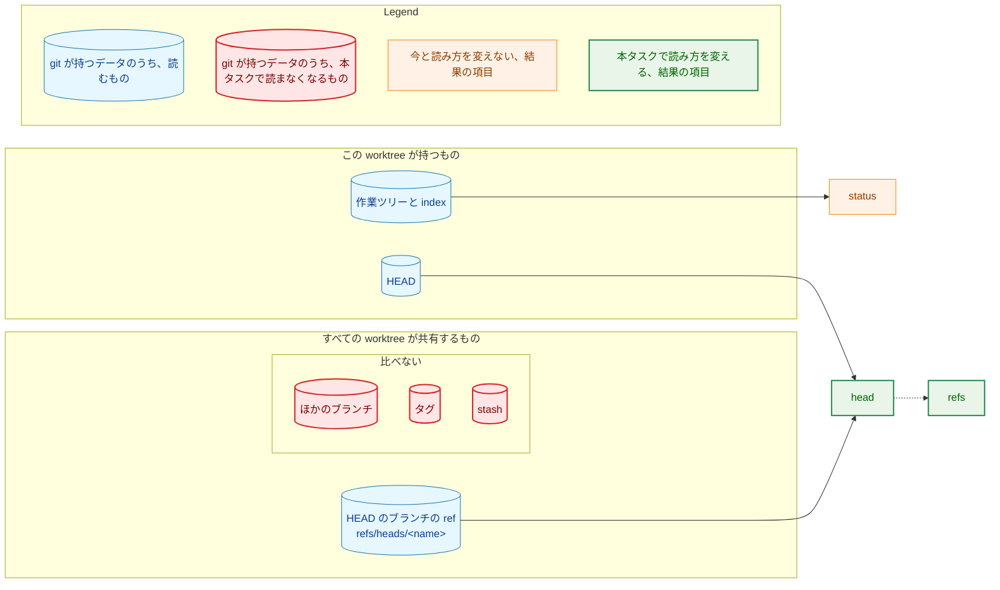
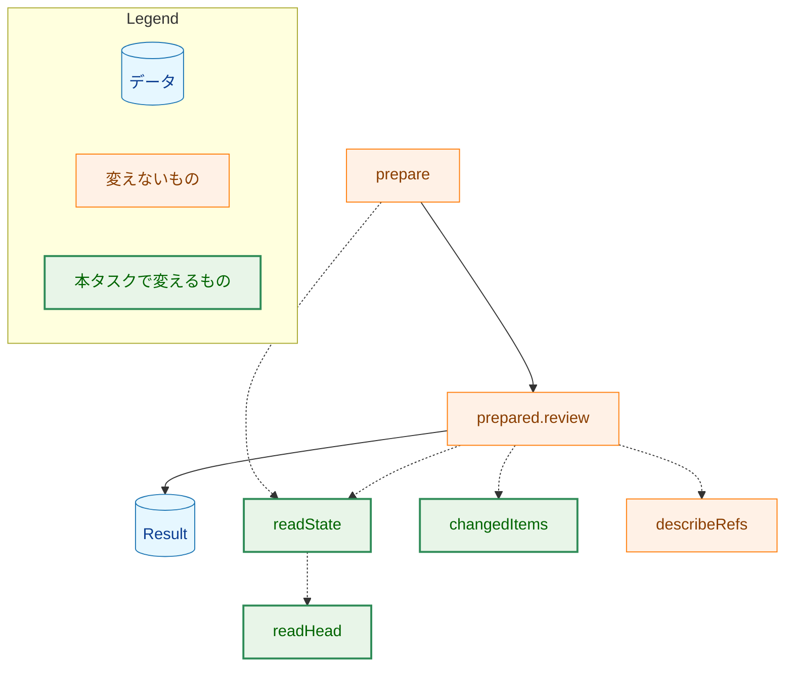
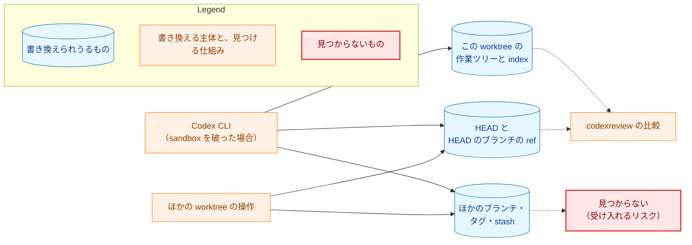
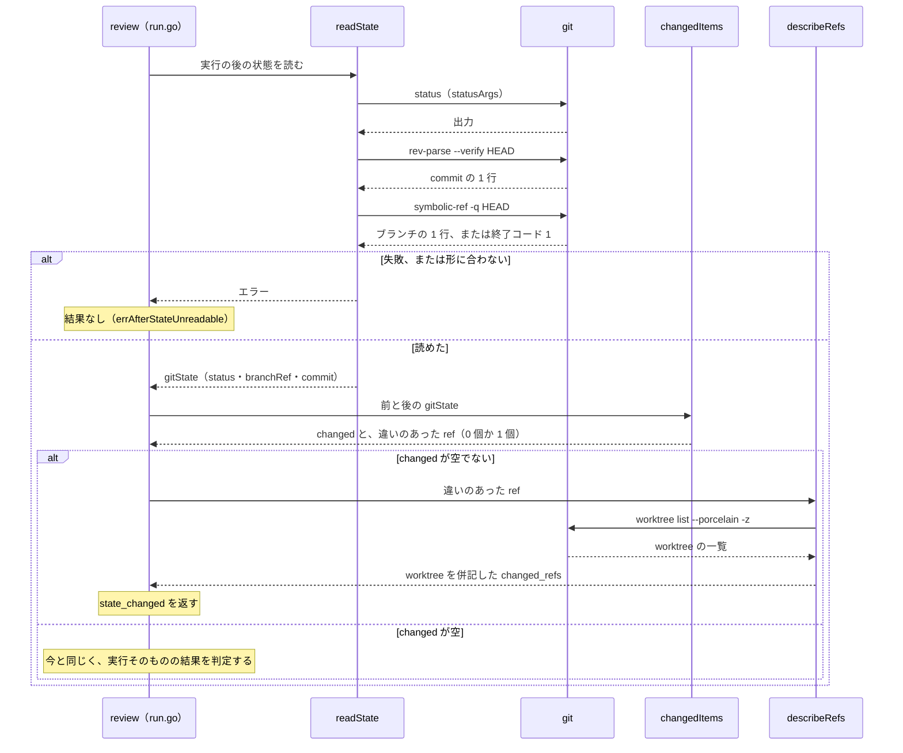

# アーキテクチャ設計書：codexreview の状態の比較を、この worktree の状態と HEAD のブランチに絞る

## Document Status

| Item | Value |
|---|---|
| Status | `draft` |
| Created | 2026-11-10 |
| Review date | - |
| Reviewer | - |
| Comments | - |

本書は [01_requirements.md](01_requirements.md)（要件定義書。以下、要件書）の設計である。既存のファイルの内容は、コミット `76e63cb8`（`76e63cb8aed90c19022448c699b4e43dae92088f`）で確かめた。`file:line` の行番号は、このコミットでの行番号である。F-NNN・AC-NN は要件書の項番を、H-NN は [design_handoff.md](design_handoff.md)（設計への引き継ぎ事項）の項番を指す。受け入れ基準との対応は付録 A に、引き継ぎ事項の各項目の扱いは付録 B にまとめる。

本書は、要件書 6 章の用語（HEAD のブランチ・比べるもの・ほかの worktree）を、要件書と同じ意味で使う。そのほかに、次の用語を使う。

-   **状態の読み取り:** `codexreview` が、Codex CLI の実行の前と後に、比べるものを git から読む処理。`internal/codexreview/state.go` の `readState` が行う。
-   **HEAD の読み取り:** 状態の読み取りのうち、HEAD のブランチの ref（`refs/heads/<name>` の形）と HEAD が指す commit を読む部分。今は `readHead`（`state.go:79-95`）が行う。
-   **形の確かめ:** 読んだ git の出力が、決まった形に合うかを確かめること。合わない出力は補わず、読めないものとして扱う（AC-08 の 3）。

## 1. 設計の全体像 (Design Overview)

### 1.1. 設計原則

-   **比べるものを、要件書 F-001 の 4 つだけにする。** この worktree の `git status`、HEAD のブランチの名前、HEAD が指す commit、HEAD のブランチの ref が指す commit である。ほかのブランチ、タグ、stash は読まない。読まなければ、比べることも、結果に現れることもない（AC-01〜AC-03、AC-09、AC-10）。
-   **HEAD のブランチの ref は、HEAD の読み取りの値から導く（1.2）。** git をこれ以上読まない。
-   **読む出力の形は、すべて決めて確かめる（1.2）。** 形に合わない出力は補わず、読めないものとして扱う（AC-08 の 3、`CLAUDE.md`「Reject, don't normalize」）。
-   **結果の形・プロトコルの番号・種類・終了コードは変えない（AC-11、要件書 4.4）。** 変わるのは、`changed` と `changed_refs` に現れうる値だけである。
-   **使われなくなるコードは消す（H-02）。** stash とすべての参照の読み取りのためだけにあった定数・フィールド・関数・エラーを残さない（YAGNI）。

### 1.2. 設計の際に決めたこと（2026-11-10）

-   **HEAD のブランチの ref の動きは、HEAD の読み取りの値から導く。ref を別には読まない（H-01）。**
    -   **理由:** HEAD がブランチにいるとき、`git rev-parse --verify HEAD`（`state.go:82`）は、HEAD からそのブランチの ref（`refs/heads/<name>`）をたどって commit を出す。そのため、「前と後で HEAD が同じブランチにいて、HEAD が指す commit が違う」ことと、「そのブランチの ref が別の commit を指すようになった」ことは同じことである。これは要件書 AC-09 の「AC-06 の違いは `head` と `refs` の両方で示す」と一致する。ref が消されたときは、HEAD が commit を指さなくなり、`rev-parse` が失敗する（git 2.50.1 で、HEAD を存在しないブランチに向けると `fatal: Needed a single revision` で終了コード 128 になることを確かめた）。このときは AC-08 の 2 のとおり、実行の後の状態の読み取りの失敗になる。ref を別に読んでも、得られる値は同じで、読み取りと形の確かめが 1 つずつ増えるだけである。
    -   **採らなかった案:** `git for-each-ref` の対象を `refs/heads/<HEAD のブランチの名前>` に絞って、ref を別に読む案。上の理由で、値が増えない。
    -   ADR の判断：ADR は作らない。`codexreview` の中で閉じる、状態の読み方の決定である。
-   **HEAD の読み取りの 2 つの出力は、形を決めて確かめる（AC-08 の 3）。**
    -   **理由:** 今の `readHead` は、`rev-parse` と `symbolic-ref` の出力を確かめずにつないで比べている（`state.go:94`）。今、形を確かめているのは、`for-each-ref` の出力を読む `parseRefs`（`state.go:102-115`）だけで、これは本タスクで消える。一方、上の決定では、HEAD のブランチの ref を出力から取り出して、`changed_refs` に入れる。取り出す値は、補わずに確かめるのがこのリポジトリの方針である（`CLAUDE.md`「Reject, don't normalize」）。形は 3.2 で定める。
    -   **採らなかった案:** 末尾の改行を 1 つ除くだけで、形は確かめない案。git が想定外の出力を返したとき、それを補って比べることになる。
    -   ADR の判断：ADR は作らない。`codexreview` の中で閉じる、出力の読み方の決定である。
-   **HEAD の読み取りと形の確かめは、`internal/codexreview` の中に置く。ほかの開発用ツールの同じ処理とは共有しない。**
    -   **理由:** 同じ 2 つの git のコマンドを読んで形を確かめる処理は、`internal/fixprguard` の `headState`（`internal/fixprguard/gitstate.go:609-632`）と、`internal/coveragecompare` の `resolveObject`（`internal/coveragecompare/precheck.go:55-66`）にもある。どちらも非公開の関数で、共有するには新しい共有のパッケージを作り、ほかの 2 つのツールを書き換えることになる。本タスクのスコープ（要件書 2.2）を越える。また、形に合わないときの扱いが目的によって違う。`fixprguard` は `refs/heads/` の外を指す HEAD を detached として扱う。`codexreview` は、`changed_refs` に入れるのが HEAD のブランチの ref だけ（AC-10）なので、そのような HEAD を読めないものとして扱い、止める側に倒す（3.2）。共有すると、どちらかの扱いを引数で選ぶ形になり、1 つの関数が 2 つの規則を持つ。
    -   **採らなかった案:** `cmdrunner` の近くに共有のパッケージを作り、3 つのツールで使う案。上の理由による。
    -   ADR の判断：ADR は作らない。コードの置き場所の決定で、本タスクの中で閉じている。

次のことは、要件書と今の規則から導いた（PR のレビューで異論があれば改める）。

-   **使われなくなるコードは消し、HEAD のブランチの ref を worktree とともに示す部分は残す（H-02、3.3）。** `describeRefs` と `parseWorktrees`（`state.go:146-182`）は、AC-10 が求める「今と同じく、checkout している worktree の併記」に使い続ける。`changed_refs` の要素の形（`<ref> (worktree <symbolic link を解決したパス>)`）と、worktree の一覧を読めないときに ref だけを示す扱い（`state.go:146-149`）を、そのまま保つためである。ADR の判断：ADR は作らない。実装の細部である。
-   **[ADR-0013](../../dev/adr/0013-review-setup.md) の決定は、要件書の PR で更新済みである。本書は ADR を変えない。** ADR-0013 の決定の項目には、決定が `codexreview` と共通手順にまだ反映されていないことを述べる文（ずれの記述）がある。ADR の規約は、ずれを直す PR がその文を同じ PR で除くと定める（`docs/dev/conventions/adr.md`「Editorial corrections」の「Discrepancy statements」）。そのため、実装の PR が除く（3.5）。

### 1.3. 概念モデル

比べるものと比べないものを図 1 に示す。実線の矢印 A → B は「A を、`codexreview` が B として読んで比べる」を、点線の矢印 A -.-> B は「B を、A の値から導く」を表す。「比べない」へは矢印を引かず、同じ囲みの中に置く。git の参照・stash・作業ツリーのうち、どれを読むかを示す図であり、処理の順序は示さない。



`BRANCH --> HEAD` は、`rev-parse HEAD` が HEAD のブランチの ref をたどって commit を出すことを表す（1.2）。`HEAD -.-> REFS` は、`refs` を、HEAD の読み取りで得たブランチの ref と commit から導くことを表す。今は、`refs` として、すべてのブランチとタグを `for-each-ref` で読んで比べている（`state.go:42`・`64-71`・`126-138`）。stash は今、`git stash list` で読んでいる（`state.go:43`・`72-75`）。

## 2. システム構成 (System Structure)

### 2.1. 全体構成

`codexreview.Run` の中で、状態の読み取りがどこで使われるかを図 2 に示す。実線の矢印 A → B は「A の次に B が行われる」を、点線の矢印 A -.-> B は「A が B を呼ぶ」を表す。図の流れは、どれも `76e63cb8` の今の流れであり（`internal/codexreview/run.go:221-240`、`run.go:307-313`、`run.go:409-441`）、本タスクは流れを変えない。



-   実行の前の状態の読み取りに失敗すると、`prepare` は Codex CLI を実行せず、`precondition`/`git_failed` を返す（`run.go:307-310`）。`status` が空でなければ `precondition`/`dirty_tree` を返す（`run.go:311-313`）。
-   実行の後の状態の読み取りに失敗すると、`review` は結果を返さずに `errAfterStateUnreadable` を返す（`run.go:418-421`）。
-   違いがあれば、`review` はほかのどの結果よりも先に `state_changed` を返す（`run.go:422-427`）。

本タスクで変えるのは、状態の読み取りが何を読むか、HEAD の読み取りの形の確かめ、`changedItems` が何を比べるかだけである。上の 3 つの箇条書きに述べた扱いは変えない（AC-07、AC-08 の 1・2）。

### 2.2. コンポーネント配置

| ファイル | 種別 | 変更の内容 | 対応する AC・H |
|---|---|---|---|
| `internal/codexreview/state.go` | 変更 | 比べるものの定義（3.1）、HEAD の読み取りと形の確かめ（3.2）、比較（3.3）、使われなくなるコードの削除（3.3）、コメントの書き換え（3.5） | AC-01〜AC-10、H-01、H-02、H-04 |
| `internal/codexreview/types.go` | 変更 | パッケージのコメントと、`Changed`・`ChangedRefs` のコメント（3.5）。型と JSON の名前は変えない | AC-11、H-04 |
| `internal/codexreview/run.go` | 変更なし | `changedItems` と `describeRefs` の形を変えないので（3.3）、呼び出し（`run.go:422-425`）はそのままである。`Run` のコメント（`run.go:207-220`）も変えない（3.5） | AC-07 |
| `internal/codexreview/run_test.go` | 変更 | `TestRunStateChanged` の行の入れ替え、比べないものの新しいテスト、HEAD の読み取りの失敗の `Run` を通したテスト（7.1） | AC-01〜AC-10、H-03 |
| `internal/codexreview/state_test.go` | 新規 | HEAD の読み取りの形の確かめの単体テスト（7.1） | AC-08 の 3 |
| `cmd/codexreview/main_test.go` | 変更 | `TestOutputIsOneJSONObject` の `state_changed` の行の入力（`main_test.go:188`）を、HEAD のブランチを動かす入力に替える（7.1） | AC-01、AC-11 |
| `.claude/commands/_lib/local-cli-review.md` | 変更 | 手順 3 の `stop` の説明の最後の文（`local-cli-review.md:165-167`）を書き換える（3.4） | AC-12 |
| `docs/dev/conventions/package_reference.md` | 変更 | `internal/codexreview` の行の、比べるものの記述（3.5） | H-04 |
| `docs/dev/adr/0013-review-setup.md` | 変更 | 決定の項目のずれの記述を除く（3.5） | 1.2 |

タスク 0049 の文書は変えない（要件書 2.3）。

## 3. コンポーネント設計 (Component Design)

### 3.1. 比べるもの（F-001）

比べるものを持つ型 `gitState`（`state.go:47-52`）を、次の形にする。

```go
// gitState is the state of this worktree compared before and after codex
// runs: its status, and where HEAD is.
type gitState struct {
	status    string // the output of statusArgs, compared as it is
	branchRef string // the ref of the branch HEAD is on, such as "refs/heads/main"; empty when HEAD is detached
	commit    string // the object ID HEAD resolves to
}
```

-   `status` は、今と同じ `statusArgs`（`state.go:41`）で読む。すべての未追跡ファイルとサブモジュールの変更を含む（AC-04）。
-   今の `head`（ブランチの ref と commit をつないだ文字列）を、`branchRef` と `commit` の 2 つのフィールドに分ける。`refs` を導くには、ブランチが同じかどうかと commit が同じかどうかを、別々に知る必要があるためである。`branchRef` は、要件書の「HEAD がいるブランチの名前」を、`refs/heads/` を付けた ref の形で持つ。`changed_refs` に入れる値の形（今と同じく `refs/heads/main` のような ref。`state.go:126-135`）に合わせるためである。
-   `commit` は、今と同じ `git rev-parse --verify HEAD` の値である。HEAD が commit 以外のオブジェクトを指すことは、通常の操作では起こらない。起きても、値を前後で比べるだけなので、今と同じく比べられる。
-   `refs`（すべてのブランチとタグ）と `stash` のフィールドはなくす。

結果に現れる項目の名前は、今の 3 つの定数 `itemStatus`・`itemHead`・`itemRefs`（`state.go:16-18`）のままである。`itemStash`（`state.go:19`）は消す（AC-09）。

### 3.2. HEAD の読み取りと形の確かめ（AC-05、AC-08、H-01）

HEAD の読み取りは、今と同じ 2 つの git のコマンドを使う（`state.go:82`・`86`）。

-   `git rev-parse --verify HEAD`: HEAD が指す commit。
-   `git symbolic-ref -q HEAD`: HEAD がいるブランチ。終了コード 1 は、HEAD が detached であることを表す（`state.go:87-90`）。

それぞれの出力の形を、次のように決める。形に合わない出力は、読めないものとして扱い、エラー `errHeadUnreadable` を返す（4 章）。

| コマンド | 受け入れる出力 | 取り出す値 |
|---|---|---|
| `rev-parse --verify HEAD` | 40 桁の小文字の 16 進数の後に、改行が 1 つ。ほかの文字や 2 行目はない | 改行を除いた 16 進数（`commit`） |
| `symbolic-ref -q HEAD`（終了コード 0） | `refs/heads/` で始まり、その後に 1 文字以上が続き、改行が 1 つで終わる 1 行。行の中に改行も NUL もない | 改行を除いた ref（`branchRef`） |
| `symbolic-ref -q HEAD`（終了コード 1） | 空の出力 | 空（detached） |

-   40 桁は SHA-1 のオブジェクト ID の長さである。`codexreview` は、`--base` に 40 桁の SHA-1 だけを受け入れる（`run.go:188-189`・`205`）。SHA-256 のリポジトリでは、40 桁の `--base` が祖先の確かめ（`run.go:276`）に通らず、状態の読み取りの前に `precondition` で終わる。そのため、64 桁は受け入れない。
-   ブランチの ref を `refs/heads/` に限るのは、AC-10 が `changed_refs` に入れるものを「HEAD のブランチの ref」と定めるためである。git の低水準のコマンドは、HEAD を `refs/heads/` の外の参照に向けることを許す（git 2.50.1 で、`git symbolic-ref HEAD refs/tags/x` の後、`symbolic-ref -q HEAD` が終了コード 0 で `refs/tags/x` を出すことを確かめた）。このときは読めないものとして扱い、止める側に倒す。実行の前なら Codex CLI を実行しない（4 章）。
-   `symbolic-ref` は、ref が別の ref を指す連なりを最後までたどった ref を出す。`rev-parse` も同じ連なりをたどるので、1.2 の導き方はそのまま成り立つ。
-   `symbolic-ref` の終了コードが 0 と 1 以外のときは、今と同じく読めないものとして扱う（`state.go:91-93`）。

形の確かめは、git を実行しない関数に分け、出力を直接与えて単体テストで確かめられるようにする（7.1）。HEAD の読み取りの関数と、形を確かめる関数の宣言は次のとおりである。

```go
// readHead runs rev-parse and symbolic-ref and returns what parseHead reads
// from their output.
func readHead(ctx context.Context, g git) (branchRef, commit string, err error)

// parseHead checks the output of rev-parse --verify HEAD and of
// symbolic-ref -q HEAD against their fixed forms. detached is true when
// symbolic-ref exited with status 1, and branchOut must then be empty.
func parseHead(commitOut, branchOut []byte, detached bool) (branchRef, commit string, err error)
```

### 3.3. 比較と、使われなくなるコード（F-002、H-02）

`changedItems`（`state.go:119-144`）は、今と同じ形 `changedItems(before, after gitState) (items, refs []string)` のまま、前と後の `gitState` を比べ、次の規則で、`changed`（違いのあった項目）と、違いのあった ref を返す。返す `refs` の要素は 0 個か 1 個である。順序は `status`・`head`・`refs` である（AC-09）。

| 項目 | 違いとする条件 | 対応する AC |
|---|---|---|
| `status` | `status` が前後で違う | AC-04 |
| `head` | `branchRef` が前後で違うか、`commit` が前後で違う | AC-05、AC-06 |
| `refs` | `branchRef` が前後で同じで、空でなく、`commit` が前後で違う。このとき、違いのあった ref は `branchRef` の 1 つ | AC-06、AC-09、AC-10 |

-   HEAD のブランチが変わったとき（別のブランチへの checkout、detached への切り替え、detached からの切り替え）は、commit が変わったかどうかによらず、`branchRef` が違うので `head` だけになり、`refs` は現れない（AC-09）。
-   HEAD が detached のまま commit が変わったときも、`branchRef` が空なので `head` だけになる。
-   ほかの worktree が HEAD のブランチの ref を動かすと、この worktree の index と作業ツリーは前の commit のままなので、2 つの commit の木が違えば `git status` にも違いが出る。木が違うとき、`changed` は `status`・`head`・`refs` の 3 つになる。AC-09 は「当てはまるものだけ、この順に並べる」と定めており、これに合う。

違いのあった ref は、今と同じ `describeRefs`（`state.go:150-164`）で、checkout している worktree を併記して `changed_refs` に入れる（AC-10）。HEAD のブランチはこの worktree が checkout しているので、併記される worktree はいつもこの worktree になる。そのため、併記された worktree は、ref を動かしたのがどの worktree かを示さない。それは、利用者が `git reflog show <ref>` で確かめる。違いのあった ref がないときの `changed_refs` は、今と同じく空の配列である（`run.go:579`）。

次のものは、使われなくなるので消す。どれも `state.go` の中だけで使われている（`76e63cb8` で `grep` して確かめた）。

| 消すもの | 場所 | 消す理由 |
|---|---|---|
| 定数 `itemStash` | `state.go:19` | stash を比べない（AC-03、AC-09） |
| 変数 `refsArgs` | `state.go:42` | すべての参照を読まない（AC-01、AC-02） |
| 変数 `stashArgs` | `state.go:43` | stash を読まない（AC-03） |
| `gitState` の `refs` と `stash` のフィールド | `state.go:50-51` | 3.1 |
| `readState` の参照と stash の読み取り | `state.go:64-75` | 同上 |
| `errRefsUnreadable` と `parseRefs` | `state.go:97-115` | `for-each-ref` の出力を読まない |
| `changedItems` のすべての参照と stash の比較と、`refs` の並べ替え | `state.go:126-142` | 3.3 の表に置き換える。`refs` は要素が 1 つ以下なので、並べ替え（`slices.Sort`）も要らない |

`describeRefs` と `parseWorktrees`（`state.go:146-182`）は残す。`make deadcode` は関数だけを報告するので、上の表の定数・変数・フィールドは、実装の PR のレビューで消えたことを確かめる。

### 3.4. 共通手順の記述（F-003）

`.claude/commands/_lib/local-cli-review.md` の手順 3、`stop` の説明の最後の文（「A `state_changed` caused by another session's commit or stash in another worktree ... is still a stop: the user decides.」）を、次の 2 つを述べる文に書き換える（AC-12）。この文は、`76e63cb8` では 165-167 行目にある。要件書 AC-12 は 163-165 行目と書いているが、同じ文を指す。

1.  ほかの worktree の操作でも、この worktree の HEAD のブランチを動かせば `state_changed` になり、その場合も止める。
2.  ほかのブランチ、タグ、stash の変化では `state_changed` にならない。

今の文の「`changed_refs` names the worktree」は、ほかの worktree が原因だと示すものとして読める。新しい範囲では、`changed_refs` に併記される worktree はいつもこの worktree なので（3.3）、書き換えた文はこの部分を残さない。

`state_changed` の扱いが `stop` であること、`stop` のときに報告するもの（`local-cli-review.md:159-165`）、表の行（`local-cli-review.md:130`）、`--protocol 1` の呼び出しは変えない（AC-11、AC-12）。文書のテストは文の意味を確かめないので（[ADR-0016](../../dev/adr/0016-document-test-policy.md)）、この文は PR のレビューで読んで確かめる（7.3）。

### 3.5. 比べるものを述べるコメントと文書（H-04）

比べるものを列挙している次の記述を、F-001 に合わせて改める。AC-09〜AC-11 と矛盾しないように、`changed` に入りうる値は `status`・`head`・`refs`、`changed_refs` には HEAD のブランチの ref だけが入りうる、と読める形にする。

| 場所 | 今の記述 | 改め方 |
|---|---|---|
| `internal/codexreview/types.go:1-4`（パッケージのコメント） | 「whether the run changed the repository's git state」 | 比べるのはこの worktree の状態と HEAD のブランチだと読める形にする |
| `types.go:40-41`（`Changed`・`ChangedRefs`） | 「which compared items differ」「refs that differ」 | `ChangedRefs` には HEAD のブランチの ref だけが入りうることを書く |
| `state.go:35-39`（読む git のコマンドのコメント） | refs の並べ方と stash の一覧に触れる | `status` の固定したオプションだけを述べる |
| `state.go:79-80`（`readHead` のコメント） | ブランチの名前と commit を返す | 3.2 の形の確かめを述べる |
| `docs/dev/conventions/package_reference.md:23` | 「It compares the status, HEAD, branches and tags, and stash list」 | 「the status, HEAD, and the ref of HEAD's branch」の形にし、`ChangedRefs` の説明を合わせる |
| `docs/dev/adr/0013-review-setup.md`、決定の 4 つ目の項目 | 「この決定は、まだ `codexreview` と共通手順に反映されていない。…このずれは #778 で扱う。」 | この 3 文を除く（1.2） |

`run.go:207-220` の `Run` のコメントは、比べるものを列挙していないので変えない。「it never changes the worktree, a ref, or the stash」は、`Run` 自身が書き換えないものを述べる文であり、比べるものとは別のことなので、そのまま正しい。

## 4. エラーハンドリング設計 (Error Handling Design)

HEAD の読み取りの形の確かめに、センチネルエラーを 1 つ加え、消える `errRefsUnreadable`（`state.go:99`）の代わりとする。

```go
// errHeadUnreadable reports rev-parse or symbolic-ref output that is not the
// one line of its fixed form.
var errHeadUnreadable = errors.New("unexpected HEAD output")
```

-   エラーの文は、git の出力の中身を含めない。今の `errRefsUnreadable` と同じく、規則だけを述べる。どちらのコマンドの出力が合わなかったかは、コマンド名（`rev-parse` か `symbolic-ref`）を前に付けたエラーに `errHeadUnreadable` を含めて返すことで示す。`cmd/codexreview` は、結果のない実行のエラーを標準エラーの診断の行に書く。
-   `readState` は、このエラーを git の失敗と同じように呼び出し元へ返す。実行の前なら `precondition`/`git_failed`（`run.go:307-309`）、実行の後なら `errAfterStateUnreadable` に含めて返され、結果なし（`run.go:418-421`）になる。新しい種類も `detail` も加えない（AC-08、AC-11）。
-   `cmd/codexreview` は、結果のない実行を今と同じく終了コード 1・標準出力なしで終える（`cmd/codexreview/main.go`）。共通手順は、それを「使える結果がない」として `stop` で扱う（`local-cli-review.md:147-151`）。

## 5. セキュリティ考慮事項 (Security Considerations)

`docs/dev/security.md` の適用は N/A とする（要件書 4.2）。本タスクは、外部のコマンドの起動、秘密、ネットワーク、キャッシュ、信頼できない文の扱いのどれも加えず、変えない。開発用ツールの信頼境界に関わる点は、次の脅威モデルと、受け入れるリスク（要件書 4.2、ADR-0013 の結果）で扱う。

図 3 に、Codex が読み取り専用の sandbox を破ったときに、何が見つかり、何が見つからないかを示す。矢印 A → B は「A が B を書き換えうる」を、点線の矢印 A -.-> B は「A の書き換えが B に行き着く」（B が「codexreview の比較」なら見つかり、「見つからない」なら見逃す）を表す。



-   **守るもの:** レビューの範囲（`BASE..HEAD`）と、共通手順が後で作る commit の内容。比べるもの（この worktree の `git status`・HEAD・HEAD のブランチの ref）は、そのうち主なものの変化を検出できる（AC-04〜AC-06）。すべてを検出できるわけではない。git-ignore されているファイル、共有の `.git/config`・hooks・`info/exclude`・`info/attributes`、index の `skip-worktree` の印のように、今も比べていないものがあり、本タスクはその扱いを変えない（要件書 2.3・4.2）。
-   **受け入れるリスク:** sandbox を破った Codex が、HEAD のブランチ以外のブランチ、タグ、stash を書き換えても見つからない。HEAD が detached のときは、どのブランチの変化も見つからない。この見逃しは、sandbox を破らない限り起こらない（`run.go:146` の `sandbox_mode="read-only"`）。起きても、この実行のレビューの範囲には影響しない（要件書 4.2）。ただし、ほかのセッションのブランチに加えられた commit は、そのセッションの push で、そのセッションの PR に入りうる。そこで止めるのは、そのセッションの clean の確かめ、ローカルの CLI レビュー、PR レビューである。
-   **信頼できない入力:** HEAD の読み取りの出力は、Codex が影響しうる git の状態から来る。出力は前後で比べ、`changed_refs` に参照の名前として入れるだけで、指示としては扱わない。形に合わない出力は読めないものとして扱う（3.2）。`changed_refs` に入るのは、`branchRef` が前後で同じときだけなので、その名前は Codex CLI の実行の前に決まっており、改行も NUL も含まない。
-   **TOCTOU（確かめた後、使うまでの間に状態が変わること）と、見逃す変化:** 次の 3 つは今の比較にもあり、本タスクは変えない。
    -   実行の間に動いて、実行の後の読み取りの前に元に戻った ref は見つからない。比べるのは前と後の 2 つの時点だけだからである。
    -   実行の後の読み取りの最中に、ほかの worktree が HEAD のブランチを動かした場合、動いた後の commit が読まれれば `state_changed` になり、読まれなければ見逃す。`rev-parse` と `symbolic-ref` の間で動いても、ブランチはこの worktree の HEAD が決めるので変わらない。
    -   実行の前の読み取りは、前提の確かめの最後に行う（`run.go:302-306`）。`BASE` の確かめと `readChangedFiles`（`run.go:276`・`299`）は、この読み取りより前に行う。その後、読み取りまでの間に、ほかの worktree が HEAD のブランチを同じ木の commit に動かすと、`status` は変わらず、その変化は実行の前の読み取りに入ってしまう。このとき、`in_range` と `instructions_changed` は、レビューした commit とは別の commit で決まる。本タスクの後は、ほかの worktree の操作で比較に効くのは HEAD のブランチの動きだけになるので、この期間は、残るリスクとしてここに記録し、仕組みは足さない。

## 6. 処理フロー詳細 (Processing Flow Details)

### 6.1. 実行の後の比較

図 4 に、Codex CLI の実行の後の比較の流れを示す。矢印 A ->> B は「A が B を呼ぶ」を、矢印 A -->> B は「A が、呼び出し元の B に値を返す」を表す。`review` が返す結果は、Note で示す。



実行の前の読み取りも、同じ `readState` を通る。失敗か形の不一致は `precondition`/`git_failed` になり、Codex CLI は実行されない（2.1）。

### 6.2. 入れ直しの前後

結果の形とプロトコルの番号は変えないので（AC-11）、入れ直す前と後のどちらのツールも、古い文書と新しい文書のどちらから呼んでも、`--protocol 1` で動く（要件書 1 章「要件定義の際に決めたこと」）。入れ直す前のツールは、今のまま、ほかのブランチ・タグ・stash の変化でも止まる。止まる側に倒れるので、守りは弱まらない。利用者は、実装の PR のマージの後に `make install-codexreview` で入れ直す（要件書 4.4）。入れ直すまでの間は、新しい共通手順の文と、古いツールの振る舞いが食い違う。`changed` に `stash` が入るか、`changed_refs` に HEAD のブランチ以外の ref が入っていれば、入れ直す前のツールだと分かる。このことは、恒久の文書ではなく、実装の PR の説明に書く。

## 7. テスト戦略 (Test Strategy)

### 7.1. ユニットテスト

テストの入力は、今の偽の `codex`（`internal/codexreview/testutil`）の `Behavior.Git` と `Behavior.GitDir`（`internal/codexreview/testutil/helpers.go:197-199`）で、Codex CLI の実行の間に git の操作を起こして作る。新しいテスト用の仕組みは要らない。

**`TestRunStateChanged`（`run_test.go:456-` を変える）:** 比べるものの変化が `state_changed` になることを確かめる表である。今の行のうち、`tracked_file`・`untracked_file_hidden_by_configuration`・`commit`・`detach_at_same_commit`・`with_failed_exit`・`with_timeout` は残す。比べなくなったものの行（`branch`・`deleted_branch`・`tag`・`stash`・`branch_in_another_worktree`。`run_test.go:507-552`）は、次の「比べないもののテスト」に移し、期待を「`state_changed` にならない」に変える。加える行は次のとおりである。

| 行 | 入力（Codex CLI の実行の間の操作） | 期待する `changed` と `changed_refs` | AC |
|---|---|---|---|
| HEAD のブランチをほかの worktree が動かす | HEAD と同じ commit から作ったほかの worktree で空の commit を作り（木は同じなので `status` は変わらない）、`git update-ref` でこの worktree の HEAD のブランチをその commit に向ける | `head`・`refs`。この worktree を併記した HEAD のブランチ | AC-06、AC-09、AC-10 |
| detached のまま commit | 前もって detached にし、実行の間に空の commit を作る | `head` だけ。`changed_refs` は空 | AC-05、AC-09、AC-10 |
| detached からブランチへ | 前もって detached にし、実行の間に同じ commit のブランチへ switch する | `head` だけ。`changed_refs` は空 | AC-05、AC-09 |
| 別の commit のブランチへ checkout | 前もって、同じ木の空の commit を指す別のブランチを作り、実行の間にそこへ switch する | `head` だけ。`changed_refs` は空 | AC-05、AC-09、AC-10 |

今の `commit` の行（`run_test.go:483-492`）は、この worktree での commit で `changed` が `head` と `refs` になり、`changed_refs` がこの worktree を併記した HEAD のブランチになること（AC-09、AC-10）を、そのまま確かめ続ける。

**比べないもののテスト（新規）:** 次の行で、Codex CLI の実行の間に比べないものを変えても、結果が `no_findings` のままであること（`state_changed` にならないこと）を確かめる。1 行には操作を 1 つだけ置き、その操作の前と後で、今の比較（すべてのブランチとタグ、stash）なら違いが出るようにする。

| 行 | 入力 | AC |
|---|---|---|
| ブランチを作る | この worktree で `git branch` | AC-01 |
| ブランチを消す | 前もって作ったブランチを `git branch -D` | AC-01 |
| ほかのブランチを動かす | 前もって作ったブランチを `git branch -f` で別の commit に向ける | AC-01 |
| ほかの worktree が checkout しているブランチを動かす | ほかの worktree で commit する | AC-01 |
| タグを作る | `git tag` | AC-02 |
| タグを動かす | 前もって作ったタグを `git tag -f` で別の commit に向ける | AC-02 |
| タグを消す | 前もって作ったタグを `git tag -d` | AC-02 |
| stash を加える | 追跡しているファイルを変えてから `git stash push` | AC-03 |
| stash を消す | 前もって作った stash を `git stash drop` | AC-03 |

stash を加える行は、作業ツリーを変えてから stash するので、作業ツリーは元に戻り、`status` に違いは出ない。

**HEAD の読み取りの失敗（`Run` を通したテスト）:** 実際の git で、次の 3 つを確かめる。

| 行 | 入力 | 期待 | AC |
|---|---|---|---|
| 実行の前に HEAD が `refs/heads/` の外を指す | 前もって `git symbolic-ref HEAD refs/tags/<tag>` で、HEAD の commit を指すタグに向ける | `precondition`/`git_failed`。偽の `codex` の記録に、レビューの実行がない | AC-08 の 1・3 |
| 実行の後に HEAD が `refs/heads/` の外を指す | 実行の間に、上と同じ操作をする | 結果がなく、`errAfterStateUnreadable` | AC-08 の 2・3 |
| 実行の間に HEAD のブランチの ref が消える | 実行の間に `git update-ref -d` で HEAD のブランチの ref を消す（`TestRunAfterStateUnreadable` に行を加える） | 結果がなく、`errAfterStateUnreadable` | AC-08 の 2 |

**HEAD の読み取りの形の確かめ（`state_test.go`、新規）:** `parseHead`（3.2）に出力を直接与え、受け入れる形（40 桁、`refs/heads/` の ref、detached で空の出力）と、受け入れない形で、`errHeadUnreadable` になるかを確かめる（AC-08 の 3）。受け入れない形は、改行がない、2 行ある、大文字を含む、桁数が違う、`refs/heads/` で始まらない、`refs/heads/` だけ、NUL を含む、detached なのに出力がある、である。最後の形は、今の `readHead` からは渡らない（終了コード 1 のときは出力を渡さない）が、`parseHead` の規則として確かめる。実際の git ではこれらの出力を作れないためである。

**`TestOutputIsOneJSONObject`（`cmd/codexreview/main_test.go:180-`）:** `state_changed` の行の入力（ブランチ `made-by-codex` を作る。`main_test.go:188`）は、AC-01 によって `state_changed` にならなくなる。入力を、この worktree で空の commit を作る操作に替え、終了コード 3 と `--protocol 1` の結果になることを確かめ続ける（AC-11）。

**失敗することの確かめ:** `CLAUDE.md`「Testing Strategy」に従い、実装の PR で次を 1 つずつ試し、コミットメッセージに書く。

-   比べるものを元の広さに戻す（すべてのブランチとタグ、stash を読む）と、比べないもののテストの各行が失敗する。
-   `refs` の条件から「`branchRef` が前後で同じ」を外すと、「別の commit のブランチへ checkout」の行が失敗する。「空でない」を外すと、「detached のまま commit」の行が失敗する。`refs` を導くこと自体をやめると、`commit` の行と「HEAD のブランチをほかの worktree が動かす」の行が失敗する。
-   `readHead` が `parseHead` を通さないようにすると、HEAD が `refs/heads/` の外を指す 2 つの行が失敗する。`parseHead` の各規則を外すと、`state_test.go` の受け入れない形の行が失敗する。

**テストの削除の扱い:** `TestRunStateChanged` から移す 5 つの行は、同じ入力の期待を、要件の変更に合わせて逆にして、新しいテストに移すものである。比べなくなった振る舞いを確かめる行を、比べないことを確かめる行に書き換えるので、テストの削除ではない（`CLAUDE.md`「Deleting a test is a claim that must be checked」の対象外）。ほかに消すテストはない（`parseRefs` を直接確かめるテストは、`76e63cb8` にない）。

### 7.2. 結合テスト

N/A。`codexreview` のテストは、今と同じく、実際の git と偽の `codex` で `Run` を通して確かめる（7.1）。実際の Codex CLI は実行しない。

### 7.3. 読んで確かめる（manual）

-   AC-12: 共通手順の手順 3 の書き換えた文が、3.4 の 2 つを述べ、`stop` の扱いと報告するものを変えていないこと。
-   H-04: 3.5 の表のコメントと文書が、AC-09〜AC-11 と矛盾しないこと。
-   3.3 の表の定数・変数・フィールドが消えていること（`make deadcode` が報告しないもの）。
-   AC-04 のサブモジュールの変更: `status` を読む `statusArgs`（`state.go:41`）の `--ignore-submodules=none` を変えていないこと。今もサブモジュールのテストはなく、本タスクは `status` の読み方を変えないので、テストは足さない。

### 7.4. セキュリティテスト

7.1 の形の確かめのテストが、想定外の出力を補わずに読めないものとすることを確かめる。それ以外に、セキュリティのためのテストは加えない（5 章の脅威は、7.1 の比べるものと比べないもののテストで確かめる）。

## 8. 実装の優先順位 (Implementation Priorities)

実装は 1 本の PR にする。`codexreview` の変更と共通手順の文の書き換えのどちらか一方だけが `main` にあると、文書とツールの振る舞いが食い違うためである。PR の中のコミットの分け方は、実装計画書で決める。順序の目安は次のとおりである。

1.  HEAD の読み取りと形の確かめ（3.2、4 章）と、その単体テスト（7.1）。
2.  比べるものと比較の変更、使われなくなるコードの削除（3.1、3.3）と、`TestRunStateChanged`、比べないもののテスト、HEAD の読み取りの失敗のテスト、`TestOutputIsOneJSONObject` の変更（7.1）。
3.  コメントと文書（3.4、3.5）。ADR-0013 のずれの記述を除く。

マージの後、利用者が `make install-codexreview` で入れ直す（6.2）。

## 9. 将来の拡張 (Future Extensibility)

-   比べるものを再び広げる、または `changed_refs` を外して結果の形を変える場合は、プロトコルの番号を上げることになる（要件書 1 章、ADR-0013 の採らなかった案）。その判断は、入れ直しの前後で Codex CLI の代替が働かない期間の費用と比べて行う。
-   本タスクは、それ以外の拡張の仕組みを用意しない（YAGNI）。

## 付録 A: 受け入れ基準との対応

| AC | 設計の箇所 | 確かめ方 |
|---|---|---|
| AC-01 | 1.3、3.1、3.3 | 比べないもののテスト（ブランチの行）、`TestOutputIsOneJSONObject` |
| AC-02 | 1.3、3.1、3.3 | 比べないもののテスト（タグの行） |
| AC-03 | 1.3、3.1、3.3 | 比べないもののテスト（stash の行） |
| AC-04 | 3.1、3.3 | `TestRunStateChanged`（`tracked_file`・`untracked_file_hidden_by_configuration`）。サブモジュールは読んで確かめる（7.3） |
| AC-05 | 3.2、3.3 | `TestRunStateChanged`（`detach_at_same_commit`、detached のまま commit、detached からブランチへ、別の commit のブランチへ checkout） |
| AC-06 | 1.2、3.3 | `TestRunStateChanged`（`commit`、HEAD のブランチをほかの worktree が動かす） |
| AC-07 | 2.1 | `TestRunStateChanged`（`with_failed_exit`・`with_timeout`） |
| AC-08 | 2.1、3.2、4 章 | 1: HEAD の読み取りの失敗のテスト（実行の前の行）。2: 同じテスト（実行の後の行）と `TestRunAfterStateUnreadable`（ref の削除の行）。3: HEAD の読み取りの失敗のテストと `state_test.go` |
| AC-09 | 3.1、3.3 | `TestRunStateChanged` の各行の `changed` |
| AC-10 | 3.3 | `TestRunStateChanged` の各行の `changed_refs` |
| AC-11 | 3.1、4 章、6.2 | `TestOutputIsOneJSONObject`、今の `--protocol` の guard（`cmd/codexreview/docs_test.go`） |
| AC-12 | 3.4 | 読んで確かめる（7.3） |

## 付録 B: 設計への引き継ぎ事項の扱い

| 項目 | 扱い |
|---|---|
| H-01 | ref は別に読まず、HEAD の読み取りの `branchRef` と `commit` から導く（1.2、3.3）。出力の決まった形と、形に合わない出力の扱いは 3.2 と 4 章で定める。HEAD が detached のときは `branchRef` が空で、`refs` は現れない |
| H-02 | 消すものを 3.3 の表に列挙した。`describeRefs` と `parseWorktrees` は、AC-10 の worktree の併記に使うので残す（1.2） |
| H-03 | 7.1 で、HEAD のブランチだけを動かす入力、ほかの worktree が checkout しているブランチを動かす入力、HEAD のブランチの ref を消す入力、HEAD を `refs/heads/` の外に向ける入力を定めた。比較の範囲を元の広さに戻すと失敗することと、`refs` の各条件を外すと失敗することの確かめも 7.1 に置いた |
| H-04 | 改める記述を 3.5 の表に列挙した。`run.go:207-220` は比べるものを列挙していないので変えない |
