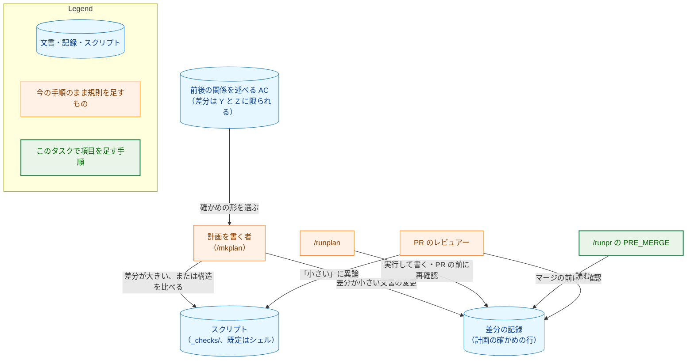
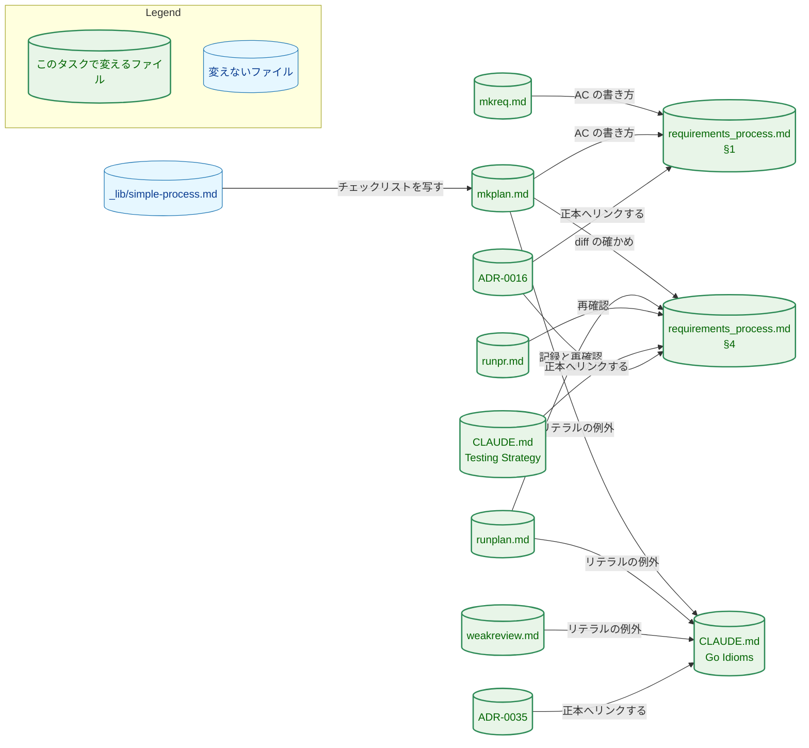
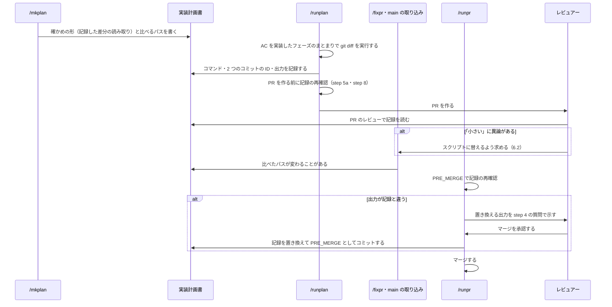
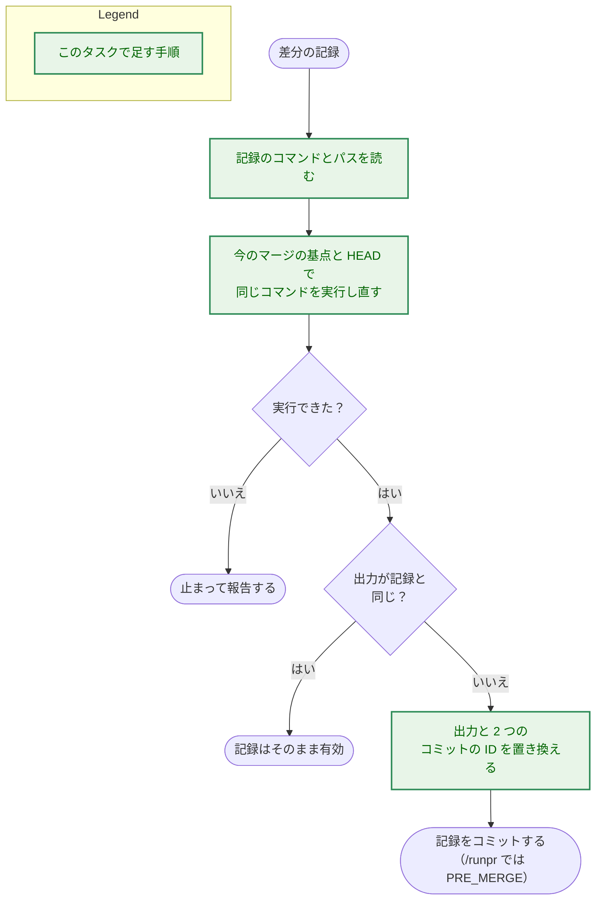

# アーキテクチャ設計書：`diff` の確かめを、確かめる変更の大きさに見合ったものにする

## Document Status

| Item | Value |
|---|---|
| Status | `draft` |
| Created | 2026-11-10 |
| Review date | - |
| Reviewer | - |
| Comments | - |

本書は [01_requirements.md](01_requirements.md)（要件定義書。以下、要件書）の設計である。既存のファイルの内容は、コミット `df655ec6` で確かめた。`file:line` の行番号は、このコミットでの行番号である。F-NNN・AC-NN は要件書の項番を、H-NN は [design_handoff.md](design_handoff.md)（以下、申し送り）の項番を指す。申し送りへの対応は付録 A に、受け入れ基準との対応は付録 B にまとめる。

本書は、要件書 3 章の冒頭と 6 章の用語（規約・記録した差分の読み取り・`diff` の確かめ・スクリプト・前後の関係を述べる AC・チェック・壊し方）を、要件書と同じ意味で使う。そのほかに、次の用語を使う。

-   **差分の記録:** 記録した差分の読み取りのために、計画の確かめの行に書く一式。実行したコマンド、マージの基点と PR の head のコミットの ID、出力からなる（3.3）。
-   **記録の再確認:** 差分の記録が今の PR を表しているかを、記録したコマンドを実行し直して確かめる手順（6.1）。
-   **PR-1・PR-2:** 本タスクの実装の 2 本の PR（1.2 の決定 2、8 章）。本書の PR と、実装計画書の PR は含まない。

## 1. 設計の全体像 (Design Overview)

### 1.1. 設計原則

-   **規則の正本を 1 か所にする。** `diff` の確かめの規則は、規約の「4. Acceptance Tests」に置く。前後の関係を述べる AC の書き方は、規約の「1. Requirements Document」に置く。`_checks/` の日本語のリテラルの例外は、`CLAUDE.md`「Go Idioms」に置く。コマンドの定義と `CLAUDE.md`「Testing Strategy」は、自分が実行する部分だけを短く書き、残りは正本の節を参照する（H-03）。
-   **新しい仕組みを作らない。** 道具・guard・Go のテストは足さない。マージの前の記録し直しには、`/runpr` の PRE_MERGE（マージの直前のコミット）を使う。異論でスクリプトに替えるときは、決定の変更と `/runpr` の承認という既存の経路を使う。
-   **実行する手順のない規則を置かない。** 記録・記録の再確認・異論への対応は、それぞれを行う時点のコマンド（`/runplan`・`/runpr`・`/fixpr`）の手順に書く。規約に規則だけを書いて、誰も実行しない形にはしない。
-   **既存の文を書き換えて足す。** `diff` の確かめを「`_checks/` のスクリプト」とだけ述べる文と、守る部分を並べ挙げる例は、そこを書き換える。同じ内容を別の段落に足して、古い文を残すことはしない（AC-04・AC-05）。

### 1.2. 設計の際に決めたこと（2026-11-10）

1.  **マージの前の記録し直しは、`/runpr` の PRE_MERGE が受け持つ（H-04）。** PRE_MERGE に「差分の記録の更新」の項目を足す（3.6）。記録が古くなるきっかけは、`/fixpr` の修正、`main` の取り込み、手で入れたコミットの 3 つである。PRE_MERGE はマージの直前に 1 回だけ動くので、どのきっかけによる変更もそこで拾える。また、`/runpr` の step 4 は PRE_MERGE の変更を質問の中で人に見せてからコミットする（`.claude/commands/runpr.md:696-699`）。そのため、更新した出力を人が読んでからマージすることになる。
    -   採らなかった案：`/fixpr` が修正の回ごとに記録し直す案。`main` の取り込みと手で入れたコミットを拾えず、別の手順が要る。
    -   採らなかった案：コマンドは変えず、規約に規則だけを書く案。規則を実行する手順がない。
    -   人の答え：PRE_MERGE を選んだ。
    -   ADR：なし。F-002 の決定（[ADR-0016](../../dev/adr/0016-document-test-policy.md)）を実行する手順であり、`/runpr` の中で閉じる。
2.  **実装は、ADR ごとに 2 本の PR に分ける。** PR-1 は `diff` の確かめ（F-001〜F-004・F-006）を入れ、ADR-0016 の食い違いの記述を消す。PR-2 は `_checks/` の日本語のリテラル（F-005）を入れ、ADR-0035 の #789 の食い違いの記述を消す。どちらの PR も 1 つの ADR の食い違いを一度に解くので、記述を途中の形に書き換える手間がない。また、レビューで読む量が PR ごとに分かれる。最終的な境界は、実装計画書（`/mkplan`）で決める。
    -   採らなかった案：1 本の PR にまとめる案。レビューで読む量が増える。
    -   人の答え：ADR ごとに 2 本を選んだ。
    -   ADR：なし。本タスクの中で閉じる、実装の順序の選択である。
3.  **`mkreq.md` の step 6 に、規約の §1 の「前後の関係を述べる AC の書き方」への参照を 1 つ足す（H-01）。** step 6 は、規約の §1 のうち従う部分を名指して並べている（`.claude/commands/mkreq.md:149-152`）。この並びに参照を足せば、規則の本文を §1 だけに置いたまま、`/mkreq` が規則を見落としにくくなる。チェックリストの項目は足さない。人が選ばなかったのは、AC の並べ挙げを指摘するチェックリストの項目であり（要件書 1 章）、この参照とは別のものである。
    -   採らなかった案：`mkreq.md` を変えず、step 6 の「section 1 に従う」に任せる案。§1 のほかの規則は名指しているのに、この規則だけが名指されない。
    -   人の答え：参照を 1 つ足すことを選んだ。
    -   ADR：なし。規則を置いた箇所への参照を足すだけである。

**上の決定と要件書から導いたこと（PR のレビューで異論があれば改める）:**

-   **記録の再確認は、記録したコマンドを今のマージの基点と head で実行し直し、出力を記録と比べて行う（6.1）。** 出力が同じなら記録はそのまま有効とし、違えば出力と 2 つのコミットの ID を置き換える。要件書の AC-03 は、比べたパスの内容が最終の head と同じである限り記録は有効とする。出力の比較はそれより広く、`main` の取り込みでマージの基点の側が変わった場合にも記録し直す。有効な記録を記録し直しても害はない。そして、記録したパスとコマンドだけで判定できるので、手順が 1 つで済む。ADR：なし。
-   **PR を作る前の記録の再確認は、`/runplan` の PR のチェックポイント（step 5a）と、PR の印のない計画の終わり（step 8）で行う（3.5）。** その後のブランチのレビューがコミットを足したときは、もう一度行う。step 5a は、同じ場合に green gate を走らせ直すとすでに定めている（`.claude/commands/runplan.md:85-87`）。それと同じ扱いである。ADR：なし。
-   **レビュアーの異論でスクリプトに替えることは、計画の決定の変更として扱う（6.2）。** 確かめの形が変わり、`_checks/` にスクリプトが加わるので、計画の内容が変わる。規約の「Editing an approved document」の決定の変更に当たる（`docs/dev/conventions/requirements_process.md:33-44`）。計画は `draft` に戻り、`/runpr` の PRE_MERGE の承認（`.claude/commands/runpr.md:312-314`）で承認し直す。新しい仕組みは要らない。ADR：なし。既存の規約を当てはめただけである。
-   **規約の「3. Implementation Plan」と「5. Pre-Commit Checklist」は変えない（AC-04）。** どちらも `diff` の確かめを、前後の関係を述べる AC のためのものとだけ述べており、スクリプトだけとは述べていない（`docs/dev/conventions/requirements_process.md:774-779`、`:831`）。ADR：なし。
-   **`_lib/simple-process.md` は変えない（AC-09）。** 「Reviewing the three documents」は、計画のレビュアーに `mkplan.md` step 8 のチェックリストをそのまま写して渡す（`.claude/commands/_lib/simple-process.md:198-204`）。そのため、`mkplan.md` の「Technical correctness checklist」に項目を足せば、簡易な進め方のレビューにもその項目が入る。ADR：なし。
-   **英語だけを求める規則は、例外の一覧を写さず、`CLAUDE.md`「Go Idioms」を参照する（H-05）。** 例外の範囲・理由・境界は「Go Idioms」だけに置く。各コマンドに一覧を写すと、例外が変わるたびに 4 つのファイルを直すことになる。ADR：なし。

### 1.3. なぜ今の書き方では足りないか

今の規約は、`diff` の確かめを「タスクの `_checks/` に置くスクリプト」の 1 つの形だけで定め、作りの基準も言語も定めていない（`docs/dev/conventions/requirements_process.md:790`）。`mkplan.md` も同じである（`.claude/commands/mkplan.md:98`、`:101`）。そのため、次のことが起きる。

-   差分が数行の変更でもスクリプトが要る（F-002 の要件）。
-   作りの手本が前のタスクの版になり、大きなプログラムがそのまま受け継がれる（F-001・F-004）。
-   前後の関係の例が守る部分を並べ挙げる形なので（`requirements_process.md:790` の「a document's existing headings keep their wording and order」）、AC と計画が細かくなる（F-003）。

これらは文言の欠けであり、文言を足して直せる。新しい道具が要る要件はない。

### 1.4. 概念モデル

図 1 に、前後の関係を述べる AC から、それを確かめる 2 つの形までの関係を示す。矢印 A → B は「A から B が決まる、または A が B を作る」を表す。

-   **2 つの形。** `diff` の確かめは、スクリプトか、記録した差分の読み取りのどちらかである。どちらもラベルは `diff` である（AC-04）。
-   **作りの基準。** どちらの形でも、レビュアーが読む量を、確かめる差分の量に見合ったものにする。スクリプトの既定の言語はシェルとし、ほかの言語はシェルで足りない理由を計画に書いたときに使う（AC-01）。
-   **選ぶ者と異論。** 「小さい」かどうかは計画を書く者が判断し、数の閾値は設けない。レビュアーが異論を述べたときは、マージの前にスクリプトに替える（AC-02・AC-03）。
-   **壊し方。** スクリプトでは、チェックごとに少なくとも 1 つの壊し方で失敗を確かめる。記録した差分の読み取りには、壊す対象のコードがないので、この手順は要らない（AC-02・AC-06）。

## 2. システム構成 (System Structure)

### 2.1. 全体構成

本タスクは、規約・コマンドの定義・`CLAUDE.md`・ADR の文言だけを変える。実行時に動くコンポーネント（拡張・Native Messaging のホスト・サーバ・CLI）と、開発の道具（`fixprguard`・`codexreview`・`mergepr`・`coveragecompare`）は変わらない。図 2 に、変えるファイルと、規則の正本への参照の関係を示す。矢印 A → B は「A が B の規則を参照する、または B から写して使う」を表す。

図 2 のうち、次の矢印は今の関係である。ほかの矢印は、実装の PR で加わる関係である。

-   `mkreq.md` → §1：step 6 が §1 に従うと定める（`.claude/commands/mkreq.md:149-152`）。加わるのは、AC の書き方の規則への名指しだけである。
-   `mkplan.md` → §4：確かめの種類の定義が §4 を参照する（`.claude/commands/mkplan.md:101`）。
-   Testing Strategy → §4：`CLAUDE.md:604-607` が `requirements_process.md` §4 を参照する。
-   `_lib/simple-process.md` → `mkplan.md`：`.claude/commands/_lib/simple-process.md:198-204`。
-   ADR-0016 → §4・§1 と、ADR-0035 → Go Idioms：両 ADR の「決定」のリンク（`docs/dev/adr/0016-document-test-policy.md:21-28`、`docs/dev/adr/0035-language-policy.md:21`）。

### 2.2. コンポーネント配置

| ファイル | PR | 変更の内容 |
|---|---|---|
| `docs/dev/conventions/requirements_process.md` | PR-1 | §1 に、前後の関係を述べる AC の書き方の規則を足す（3.1）。§4 の `diff` の確かめの箇条を、2 つの形・作りの基準・既定の言語・記録と再確認・異論・壊し方を述べる形に書き換える（3.2、3.3） |
| `.claude/commands/mkplan.md` | PR-1、PR-2 | PR-1：確かめの種類の定義と AC の行の規則に記録した差分の読み取りを足し、`_checks/` の計画の規則（作りの基準・既定の言語・手本として写さない・壊し方）と、前後の関係の例を書き換える。「Technical correctness checklist」に過大な確かめの項目を足す（3.4）。PR-2：英語だけを求める箇条・パネルの 2 人の担当・チェックリストの項目を、「Go Idioms」の例外に当たるリテラルを指摘しない形にする（3.4） |
| `.claude/commands/runplan.md` | PR-1、PR-2 | PR-1：step 5 に記録の作成を、step 5a と step 8 に記録の再確認を足し、「Phase-group review checklist」の `diff` の項目を 2 つの形に広げ、過大な確かめの項目を足す（3.5）。PR-2：step 6.5 の Check 2 の扱いの説明に、「Go Idioms」の例外に当たるリテラルを足す（3.5） |
| `.claude/commands/runpr.md` | PR-1 | step 2 の PRE_MERGE に「差分の記録の更新」の項目を足す（3.6） |
| `.claude/commands/weakreview.md` | PR-1、PR-2 | PR-1：「Weak-model failure checklist」に過大な確かめの項目を足す（3.7）。PR-2：言語の項目に、「Go Idioms」の例外に当たるリテラルを足す（3.7） |
| `.claude/commands/mkreq.md` | PR-1 | step 6 の §1 の名指しに、AC の書き方の規則を足す（3.9） |
| `CLAUDE.md` | PR-1、PR-2 | PR-1：「Testing Strategy」の `diff` の確かめの文を、2 つの形と新しい書き方の例に書き換える（3.8.1）。PR-2：「Go Idioms」の guard-test literal exception の範囲を `_checks/` に広げる（3.8.2） |
| `docs/dev/adr/0016-document-test-policy.md` | PR-1 | 「決定」の食い違いの記述を消す（3.11） |
| `docs/dev/adr/0035-language-policy.md` | PR-2 | 「決定」の #789 の食い違いの記述を消す。#726 の記述は残す（3.11） |
| `docs/tasks/0080_diff_check_proportion/03_implementation_plan.md` | PR-1、PR-2 | 実装計画書（`/mkplan` の PR が作る）。実装の PR は、進み具合と確かめの結果を記録する |
| `docs/tasks/0080_diff_check_proportion/_checks/` | 計画で決める | 本タスクの前後の関係を述べる AC（AC-10 など）の確かめ。形は実装計画書が決める（7.2） |

次のファイルは変えない。

-   `.claude/commands/_lib/simple-process.md`（1.2、AC-09）。
-   `.claude/commands/fixpr.md` と `.claude/commands/_lib/task-pr-handoff.md`。マージの前の記録し直しは `/runpr` が受け持ち（1.2 の決定 1）、PR を作る前の再確認は `/runplan` が受け持つ（3.5）。
-   文書を読む guard（3.12、H-02）。
-   開発の道具とその案内（`docs/dev/guides/fixprguard_guide.md` など）。要件書 2.3 節のスコープ外である。
-   ほかのタスクのディレクトリと、その `_checks/`（AC-10）。
-   ADR の索引 `docs/dev/adr/README.md`。両 ADR の題名は変わらない。

### 2.3. データフロー

図 3 に、記録した差分の読み取りを選んだ AC の、計画からマージまでの流れを示す。

-   記録は計画の中にあり、計画は比べるパスから外してよい（AC-03）。そのため、記録をコミットしても、記録した差分は変わらない。
-   PRE_MERGE のコミットで PR の head は進む。それでも、比べたパスの内容は変わらないので、記録は有効である（AC-03）。

## 3. コンポーネント設計 (Component Design)

規約とコマンドの定義は英語で書く（要件書 5 章）。本章は、各ファイルに書く内容と置き場所を定める。英語の文面は実装の PR で書く。

### 3.1. 規約「1. Requirements Document」（AC-05）

AC の要件の箇条（`docs/dev/conventions/requirements_process.md:602-613`）に、次の規則を 1 つの箇条として足す。

-   前後の関係を述べる AC は、「X の差分は Y と Z に限られる」の形で書き、守る部分を並べ挙げない。並べ挙げた部分の一つ一つが、確かめのコードになるためである。
-   移動と分割の AC だけは、「A の内容が B に変わらずにある」の形で書いてよい。移動と分割は、差分が限られる形では言い表せないためである。

`/mkreq` は、step 6 からこの箇条を名指して従う（3.9）。

### 3.2. 規約「4. Acceptance Tests」（AC-01〜AC-05）

`diff` の確かめの箇条（`docs/dev/conventions/requirements_process.md:790`）を、次の内容に書き換える。1 つの長い箇条にせず、`diff` の確かめの小見出しの下に、項目ごとの箇条を置く。

| 項目 | 内容 | AC |
|---|---|---|
| 対象 | 前後の関係を述べる AC を確かめる。例は、3.1 の形（「節 S の差分は、項目 X の 1 行の書き換えに限られる」など）に書き換える。恒久のテストにしない理由（今の文の後半）は残す | AC-04・AC-05 |
| 2 つの形 | スクリプトと、記録した差分の読み取り。どちらもマージの基点と PR の head を比べ、PR ごとに 1 回だけ行い、`make test` と CI は実行しない。マージの後は保守しない | AC-04 |
| 作りの基準 | 作りは、確かめる差分の大きさに見合ったものにする。レビュアーが読む量（スクリプト、または記録した出力）を、確かめる差分の量と比べて決める | AC-01 |
| スクリプト | タスクの `_checks/` に置く。既定の言語はシェル（`git diff`、`cmp`、`sed` など）とする。ほかの言語は、シェルで足りない理由を計画に書いたときに使ってよい。チェックごとに少なくとも 1 つの壊し方で、失敗することを確かめる | AC-01・AC-06 |
| 記録した差分の読み取り | 差分が小さい文書の変更で使える。「小さい」かどうかは計画を書く者が判断し、数の閾値は設けない。計画は、この形を使うことと、比べるパスを書く。壊して失敗を確かめる手順は要らない | AC-02 |
| 記録 | `/runplan` が、PR のブランチで `git diff` を実行し、その出力と 2 つのコミットの ID を計画の確かめの行に記録する。記録の形は 3.3 のとおり | AC-02・AC-03 |
| 比べるパス | AC が名指すパスに限ってよく、計画そのものを外してよい。変わるファイルを限る AC では、差分全体の変わったファイルの一覧（`git diff --name-only`）も記録する | AC-03 |
| 記録の再確認 | PR を作る前（`/runplan`）とマージの前（`/runpr` の PRE_MERGE）に、6.1 の手順で行う。記録をコミットして head が進んでも、比べたパスの内容が最終の head と同じである限り、記録は有効である | AC-03 |
| 異論 | レビュアーが「小さい」という判断に異論を述べたときは、マージの前に、その AC の確かめをスクリプトに替える（6.2） | AC-02・AC-03 |

「Traceability in implementation plan」の段落と例（`requirements_process.md:794-808`）は、ラベルの並びを述べるだけなので変えない。

### 3.3. 差分の記録の形（H-04）

計画の、その AC の確かめの行の下に、次のものを書く。規約の §4 にこの形を書く。

| 要素 | 書く者と時点 | 内容 |
|---|---|---|
| 形とパス | `/mkplan`（計画を書くとき） | 記録した差分の読み取りを使うことと、比べるパス。変わるファイルを限る AC では、ファイルの一覧も記録することを書く |
| コマンド | `/runplan`（記録するとき） | 実行したコマンドを、そのまま書く。パスは `--` の後に置く |
| コミットの ID | `/runplan` | マージの基点（`git merge-base origin/main HEAD`）と、比べた PR の head の、省略しない ID |
| 出力 | `/runplan` | コマンドの出力の全体。切り詰めない。コードブロックで囲み、囲みの記号は、出力の中のどの連続したバッククォートよりも長くする（文書の差分の出力は、コードブロックの囲みを含みうるため） |
| ファイルの一覧 | `/runplan`（変わるファイルを限る AC のとき） | `git diff --name-only` のコマンドと、その出力の全体 |

出力が長くて全体を読めないときは、その変更は「小さい」に当たらない。この場合、計画を書く者はスクリプトを選び、レビュアーは異論を述べる。出力を切り詰めて記録することはしない。

### 3.4. `mkplan.md`（AC-01・AC-02・AC-04〜AC-08）

**PR-1。**

-   **AC の行の規則（`.claude/commands/mkplan.md:98`）。** `diff` の確かめで名指すものに、「記録した差分の読み取りと、その比べるパス」を足す（AC-04）。
-   **確かめの種類の定義（`.claude/commands/mkplan.md:101`）。** `diff` の説明を、2 つの形を述べ、規約の §4 を参照する形にする。例の「existing headings or text kept unchanged」は、3.1 の形の例に書き換える（AC-04・AC-05）。
-   **`_checks/` の計画の規則。** 「[When applicable]」の箇条に、計画が `diff` の確かめを持つときの規則を 1 つの箇条として足す。中身は次の 4 つである。
    -   作りは確かめる差分の大きさに見合ったものにし、既定の言語はシェルとする。ほかの言語は、シェルで足りない理由を計画に書いたときに使う（AC-01）。
    -   差分が小さい文書の変更では、記録した差分の読み取りを選べる。選んだときは、その形と比べるパスを書く。記録は `/runplan` が行う（AC-02、§4 を参照）。
    -   前のタスクの `_checks/` を手本として写すよう書かない（AC-06）。
    -   スクリプトの壊し方は「チェックごとに少なくとも 1 つ」とだけ書き、並べ挙げない（AC-06）。
-   **文書だけの AC の箇条（`.claude/commands/mkplan.md:115`）。** 「Preservation of existing headings or text across the change」を、3.1 の形の言い方に書き換える（AC-05）。
-   **パネルの Reviewer B の担当（`.claude/commands/mkplan.md:133`）。** `diff` の確かめの大きさの釣り合いを足す。チェックリストの項目（次）が B の担当であることを示すためである。
-   **「Technical correctness checklist」。** `diff` の項目（`.claude/commands/mkplan.md:149`）の「names its script under the task's `_checks/` directory」に、記録した差分の読み取りと比べるパスを足す（AC-04）。さらに、次の項目を 1 つ足す（AC-08）。
    -   計画の `diff` の確かめ（スクリプトか、記録した差分の読み取り）が、確かめる差分に比べて過大でないこと。過大かどうかは、レビュアーが読むスクリプトの量を、確かめる差分の量と比べて判断する。既定でない言語には、シェルで足りない理由があること。前のタスクの `_checks/` を写すよう書いていないこと。壊し方を並べ挙げていないこと。

    `_lib/simple-process.md` はこのチェックリストを写して使うので（1.2）、項目は今の項目と同じ `- [ ]` の 1 行の形にする（H-03）。

**PR-2（AC-07）。** 次の 4 か所を、`CLAUDE.md`「Go Idioms」の例外に当たるリテラルを指摘の対象にしない形にする。例外の一覧は写さず、「Go Idioms」を参照する。

-   step 6 の英語だけを求める箇条（`.claude/commands/mkplan.md:111`）。
-   パネルの Reviewer A と Reviewer B の担当の、英語だけの規則（`:132`、`:133`）。
-   チェックリストの項目「The plan does not imply Japanese text in Go source …」（`:159`）。

### 3.5. `runplan.md`（AC-03・AC-04・AC-07・AC-08）

**PR-1。**

-   **記録の作成（step 5）。** step 5 の箇条（`.claude/commands/runplan.md:52-76`）に、次の箇条を足す。フェーズのまとまりが実装した AC のうち、計画が記録した差分の読み取りを選んだものは、PR のブランチで `git diff` を実行し、3.3 の形で記録する。スクリプトを選んだものは、スクリプトを実行し、その出力と 2 つのコミットの ID を記録する（今の規則の書き写し）。規約の §4 を参照する。
-   **PR を作る前の記録の再確認（step 5a・step 8）。** step 5a の最後の PR の確かめ（`.claude/commands/runplan.md:81`）と、step 8 のすべてのフェーズが終わったときの確かめ（`:233`）で、「each `diff` script was run …」を 2 つの形に広げ、記録した差分の読み取りには記録の再確認（6.1）を行うと述べる。step 5a の、ブランチのレビューがコミットを足したときに green gate を走らせ直す句（`:85-87`）に、記録の再確認もやり直すことを足す。
    -   step 5a の再確認は、PR の最後のチェックポイントに限らず、すべてのチェックポイントで行う。その PR が記録した AC の記録が、後のフェーズのまとまりで古くなりうるためである。
-   **「Phase-group review checklist」。** `diff` の項目（`.claude/commands/runplan.md:174`）の「Each `diff` script was run …」を 2 つの形に広げる（AC-04）。さらに、mkplan と同じ観点の過大な確かめの項目を 1 つ足す。対象は、このフェーズのまとまりで書いたスクリプトか記録である（AC-08）。

**PR-2（AC-07）。** step 6.5 の Check 2 の扱いの説明（`.claude/commands/runplan.md:162`）に、非 ASCII の文字を正当に含みうるものとして、「Go Idioms」の例外に当たるリテラルを足す。Check 2 のスクリプト自体は変えない。チェックリストの言語の項目（`:180`）は、コメントと識別子だけを述べ、リテラルを指摘の対象にしていないので変えない。

### 3.6. `runpr.md`（AC-03）

step 2 の PRE_MERGE の項目（`.claude/commands/runpr.md:304-337`）に、「Checkpoint」と並べて次の項目を足す。

-   **差分の記録の更新**（計画の PR）：計画の確かめの行にある差分の記録のうち、この PR が記録したものについて、6.1 の記録の再確認を行う。出力が記録と違う記録は、出力と 2 つのコミットの ID を置き換える。どの出力も記録と同じなら、この項目は空である。そのため、中断の後にやり直しても、二重に記録しない。

PRE_MERGE は、step 3 か step 4 が head を変えるたびに決め直す（`.claude/commands/runpr.md:268-269`）。そのため、`main` の取り込みや `/fixpr` の修正の後にも、記録の再確認はやり直される。step 4 は PRE_MERGE の変更を質問の中で示し（`:696-699`）、PRE_MERGE のコミットが PRE_MERGE の変えるファイルだけを変えたことを確かめる（`:936-937`）。この 2 つは今のままで、計画のファイルの変更にも当てはまる。

`TestRunprDocContract` などが読む `runpr.md` の見出しは、step 1・3・4・5 である（`cmd/yt2column/fixpr_docs_test.go:31-41`、`cmd/yt2column/codex_review_docs_test.go:81-85`）。step 2 の中に項目を足すだけなので、見出しは変わらない。

### 3.7. `weakreview.md`（AC-07・AC-08）

-   **PR-1。** 「Weak-model failure checklist」（`.claude/commands/weakreview.md:134`）に、過大な `diff` の確かめの項目を 1 つ足す。観点は mkplan の項目と同じで、範囲で足したスクリプトか記録を対象にする（AC-08）。
-   **PR-2。** 言語の項目（`.claude/commands/weakreview.md:295-299`）の、非 ASCII の文字を正当に含みうるものに、「Go Idioms」の例外に当たるリテラルを足す（AC-07）。step 3 の Check 5（`:100-102`）は変えない。

### 3.8. `CLAUDE.md`

#### 3.8.1. 「Testing Strategy」（PR-1、AC-04・AC-05）

`diff` の確かめに触れる文（`CLAUDE.md:604-607`）を次のように書き換える。

-   例の「existing headings kept unchanged」を、3.1 の形の例に書き換える。
-   「a script under the task's `_checks/` directory run once against the merge-base」を、スクリプトか記録した差分の読み取りのどちらかと述べ、規約の §4 を参照する形にする。

「Every test must be able to fail for its stated reason.」は変えない。スクリプトの壊し方（チェックごとに少なくとも 1 つ）と、記録した差分の読み取りにその手順が要らないことは、規約の §4 が述べる（3.2）。

#### 3.8.2. 「Go Idioms」（PR-2、AC-07）

guard-test literal exception の箇条（`CLAUDE.md:713-724`）に、次の範囲を足す。

-   **範囲。** `docs/tasks/*/_checks/` の下のスクリプト。スクリプトの言語は問わない。
-   **リテラル。** この範囲では、日本語の文書の文字列と一致しなければならないリテラルであれば、種類を限らない（語・文の断片・文も含む）。日本語の文字列を、別のデータのファイルに逃がす必要はない。
-   **境界。** コメントと識別子は英語のままとする。スクリプトが出すメッセージなど、文書の文字列と一致する必要のないリテラルも英語のままとする。
-   **理由。** 既存の例外と同じく、リテラルが日本語の文書の文字列と一致しなければならないためである。既存の例外が種類を 4 つに限るのに対して、ここで限らないのは、`_checks/` では語・文の断片・文を確かめる必要があり、種類を限ると `data.json` が残るためである（要件書 1 章）。

箇条の冒頭の「Go comments, identifiers, and string literals are English」は Go についての文である。シェルのスクリプトのリテラルも英語であることは、`CLAUDE.md`「Language」の「Code … source code, comments, identifiers, string literals」による。足す範囲は、この 2 つへの例外になる。

### 3.9. `mkreq.md`（AC-05、H-01）

step 6 の「Follow the requirements process guide, section 1: …」の並び（`.claude/commands/mkreq.md:149-152`）に、「前後の関係を述べる AC の書き方」を 1 つ足す。規則の本文は書かない。step 7 の自己点検のチェックリストは変えない（1.2 の決定 3）。

### 3.10. `_lib/simple-process.md`（AC-09）

変えない。理由は 1.2 のとおりである。

### 3.11. ADR-0016 と ADR-0035（AC-11〜AC-13）

AC-11・AC-12 の「背景」「決定」「採らなかった案」「結果」「経緯」と、AC-13 の食い違いの記述は、要件書の PR（#791）で入った（`docs/dev/adr/0016-document-test-policy.md:13-29`、`docs/dev/adr/0035-language-policy.md:25`）。本書の PR は、両 ADR を変えない。本書で決めたことは、どれも major ではない（1.2）。

実装の PR は、`docs/dev/conventions/adr.md`「Discrepancy statements」に従い、次のように記述を消す。

-   **PR-1** は、ADR-0016 の「決定」の最後の箇条（食い違いの記述）を消す。
-   **PR-2** は、ADR-0035 の「決定」の #789 の箇条を消す。同じ「決定」の #726 の記述は、別の食い違いなので残す。

どちらも、PR を作る前に `git grep -nE 'issues/789([^0-9]|$)' origin/main -- docs/dev/adr/` で記述を探す（`docs/dev/conventions/adr.md:346-354`）。

### 3.12. 既存のテスト（H-02）

変える文書を読む guard を調べた。直す必要のある guard はない。

| guard | 読むもの | 本タスクとの関係 |
|---|---|---|
| `TestInstructionDocPaths`（`cmd/yt2column/docpaths_test.go`） | 指示の文書の相対リンクと、`docs/dev/` の下のパスを書いたコード表記 | 足す文で `docs/dev/` の下のパスを書くときは、実在するファイルを書く。`docs/tasks/*/_checks/` は対象の形（`repoDocPathRE`、`:27`）に当たらない |
| `TestRunprDocContract` など（`cmd/yt2column/fixpr_docs_test.go`、`codex_review_docs_test.go`） | `runpr.md` の step 1・3・4・5 と、`fixpr.md` の Phase | 見出しを変えない。step 2 は読まれていない |
| `TestCodexMentionOnlyInRequestRow`（`cmd/yt2column/codex_review_docs_test.go:92`） | コマンドの定義と `CLAUDE.md` のメンション | 足す文にメンションを書かない |
| `TestCoverageCompareDocumented`・拡張のコマンドの一覧（`cmd/yt2column/makefile_test.go`、`extension_docs_test.go`） | `CLAUDE.md` のコマンドの節 | コマンドの節を変えない |
| `TestADRRecords` | ADR の構造と索引 | 実装の PR の ADR の変更で成功することを確かめる |

`mkplan.md`・`runplan.md`・`weakreview.md`・`mkreq.md` の step 6・規約の §1 と §4・`CLAUDE.md` の「Testing Strategy」と「Go Idioms」の文を読む guard は、`cmd/` と `internal/` の `_test.go` を `rg` で調べた範囲にない（コミット `df655ec6`）。拡張の `extension/test/` も、これらのファイルを読まない。

## 4. エラーハンドリング設計 (Error Handling Design)

### 4.1. 実行時のエラー

N/A。製品のコードと開発の道具を変えないので、エラーの型もメッセージも足さない。

### 4.2. 手順の中の失敗

| 状況 | 扱い |
|---|---|
| `/runplan` の記録で `git merge-base` か `git diff` が失敗する | 記録しない。チェックポイントに進まず、止まって報告する。出力のない記録は、差分がないことと区別できないためである |
| `/runpr` の記録の再確認で、コマンドが失敗する | PRE_MERGE を決めずに止まり、報告する。マージしない |
| 記録にコマンドかパスがない（計画の書き誤り） | 再確認できないので、`/runpr` は止まって報告する。計画のレビュー（3.4 のチェックリストの項目）で見つける |
| 出力が長くて全体を読めない | 「小さい」に当たらない（3.3）。計画を書く者はスクリプトを選び、レビュアーは異論を述べる |
| レビュアーが「小さい」に異論を述べる | マージの前にスクリプトに替える（6.2） |

## 5. セキュリティ考慮事項 (Security Considerations)

### 5.1. 製品

N/A。この変更は、`yt-dlp` を呼ばず、API キーや Webhook の URL を扱わず、キャッシュに触れず、LLM の API にも Webhook にも送らず、信頼しないテキストをプロンプトにも記事にも入れない（要件書 4.2 節）。脅威モデルの図は、新しい信頼の境界がないので描かない。

### 5.2. 開発の道具の信頼の境界

-   **`/runpr` の記録の再確認は、`git merge-base` と `git diff` だけを実行する。** 比べるパスは、計画の記録から読み、1 つずつ別の引数として `--` の後に渡す。記録に書かれたコマンドの文字列を、シェルで評価しない。`_checks/` のスクリプトは実行しない。計画は PR のブランチの内容で、PR のレビューの対象である。
-   **`/fixpr` がスクリプトを足すとき。** `fixprguard` の範囲の規則は、許可リストに当たらないファイル（`.sh` など）や、スレッドの `path` と別のディレクトリの `.go` を範囲外とし、利用者の確認に回す（`docs/dev/guides/fixprguard_guide.md` の「6. 範囲の規則」）。異論でスクリプトに替える修正は、この確認を経る。`fixprguard` は変えない（[ADR-0015](../../dev/adr/0015-untrusted-review-threads.md)）。
-   **`_checks/` の日本語のリテラル。** 例外を広げても、`_checks/` は `make test` と CI で実行されない（`go list ./...` は `_` で始まるディレクトリを無視する）。リテラルの言語は、実行の経路に影響しない。

## 6. 処理フロー詳細 (Processing Flow Details)

### 6.1. 記録の再確認

`/runplan`（step 5a・step 8）と `/runpr`（PRE_MERGE）が、同じ手順で行う。図 4 は、1 つの差分の記録についての流れである。

-   出力の比較は、変わるファイルを限る AC のファイルの一覧にも当てはめる。
-   `/runpr` では、置き換えた出力を step 4 の質問で示し、人の答えの後にコミットする（3.6）。

### 6.2. 異論でスクリプトに替える

1.  レビュアーは、PR のレビューのスレッドか、`/runpr` の step 4 の答えで異論を述べる。
2.  替える修正は、計画の確かめの行の形を変え、`_checks/` にスクリプトを足す。スレッドから来たときは `/fixpr` の修正の回で行い、`fixprguard` の確認を経る（5.2）。`/runpr` の答えから来たときは、`/runpr` の step 4 の質問の「Other」の答えとして扱い、人がその場で手で直すか、`/fixpr` に回す。
3.  計画の確かめの形を変えることは、計画の決定の変更である（1.2）。計画は `draft` に戻り、規約の「Editing an approved document」のとおりに記録する。
4.  `/runpr` は、PRE_MERGE の承認で計画を承認し直し（`.claude/commands/runpr.md:312-314`）、マージする。

## 7. テスト戦略 (Test Strategy)

### 7.1. ユニットテスト

足さない。本タスクは文言だけを変え、文書のテストが確かめる値・構造・実行できる例を足さない（`CLAUDE.md`「Testing Strategy」の「Document tests check values, structure, and executable examples, never prose.」）。足す文の意味は、PR のレビューで読んで確かめる（`manual`）。

### 7.2. 前後の関係の確かめ

AC-10 は、実装の PR の差分が限られることを述べる、前後の関係を述べる AC である。その確かめの形は、実装計画書で決める。F-007 により、新しい規則は本タスクの実装がマージされた後に書く計画から当てはめる。本タスクの計画は、それより前に書くので、今の規約に従う。

### 7.3. 読んで確かめる（manual）

AC-01〜AC-09 は、規約・コマンドの定義・`CLAUDE.md` の文の内容を述べる。それぞれ、PR のレビューで 3 章の該当する節と照らして読む。AC-04 は、`diff` の確かめを「`_checks/` のスクリプト」だけとして述べる文が残っていないことを、変える箇所の一覧（3.2・3.4・3.5・3.8.1）と照らして読む。

### 7.4. 結合テスト・セキュリティテスト

N/A。実行時の振る舞いと、開発の道具の振る舞いを変えない。

### 7.5. ビルドの確かめ

各実装の PR で `make test` と `make lint` が成功する（要件書 4.3 節）。3.12 の guard と `TestADRRecords`（AC-12）は、`make test` と CI の `doc-guard` のジョブに含まれる。

## 8. 実装の優先順位 (Implementation Priorities)

1.  **PR-1：`diff` の確かめ。** 規約の §1 と §4、`mkplan.md`・`runplan.md`・`weakreview.md` の `diff` の確かめと過大な確かめの項目、`runpr.md` の PRE_MERGE、`mkreq.md` の step 6、`CLAUDE.md`「Testing Strategy」を変え、ADR-0016 の食い違いの記述を消す。
2.  **PR-2：`_checks/` の日本語のリテラル。** `CLAUDE.md`「Go Idioms」の例外と、`mkplan.md`・`runplan.md`・`weakreview.md` の英語だけを求める規則を変え、ADR-0035 の #789 の食い違いの記述を消す。

2 本は別の箇所を変えるので、どちらを先にしても動く。PR-1 を先にする。PR-1 のほうが変える箇所が多く、レビューで見つかったことを PR-2 の書き方に生かせるためである。

## 9. 将来の拡張 (Future Extensibility)

-   記録の再確認を道具に移すこと。今は `git` のコマンド 2 つを手順として実行するだけで、判定は出力の比較である。記録し直しの漏れが実際に起きたときに、道具に移すかを検討する（[ADR-0014](../../dev/adr/0014-deterministic-checks-in-go.md)）。
-   `diff` 以外の確かめの種類（`test`・`static`・`manual`）にも、作りの釣り合いの基準を広げること。要件書 2.3 節のスコープ外である。

## 付録 A: 申し送り（design_handoff.md）への対応

| 項目 | 対応 |
|---|---|
| H-01 | `mkreq.md` の step 6 の §1 の名指しに、AC の書き方の規則を 1 つ足す。規則の本文は §1 だけに置き、チェックリストは変えない（1.2 の決定 3、3.9） |
| H-02 | 変える文書を読む guard を調べ、直す必要がないことを確かめた。`runpr.md` の見出しを変えず、メンションを書かず、`docs/dev/` の下のパスは実在するものだけを書く（3.12） |
| H-03 | 規則の正本を規約の §1・§4 と `CLAUDE.md`「Go Idioms」に置き、コマンドの定義は自分が実行する部分だけを書いて参照する（1.1）。チェックリストの項目は、今の項目と同じ 1 行の形にする（3.4） |
| H-04 | 記録の形は 3.3 のとおりとする。出力は切り詰めず、囲みの記号を出力より長くする。記録の再確認は、PR を作る前に `/runplan` の step 5a・step 8 で、マージの前に `/runpr` の PRE_MERGE で行う（1.2 の決定 1、3.5、3.6、6.1）。`fixpr.md` は変えない |
| H-05 | 例外の範囲・リテラル・境界・理由を「Go Idioms」の箇条に足す（3.8.2）。`mkplan.md`・`runplan.md`・`weakreview.md` は、例外の一覧を写さずに「Go Idioms」を参照する。`runplan.md` の Check 2 と `weakreview.md` の Check 5 のスクリプトは変えず、扱いの説明だけを変える（3.4、3.5、3.7） |

## 付録 B: 受け入れ基準との対応

| AC | 設計 | PR | 確かめ方 |
|---|---|---|---|
| AC-01 | 1.4、3.2、3.4 | PR-1 | manual |
| AC-02 | 1.4、3.2、3.3、3.4 | PR-1 | manual |
| AC-03 | 1.2、3.2、3.3、3.5、3.6、6.1、6.2 | PR-1 | manual |
| AC-04 | 1.2、3.2、3.4、3.5、3.8.1 | PR-1 | manual（7.3） |
| AC-05 | 3.1、3.2、3.4、3.8.1、3.9 | PR-1 | manual |
| AC-06 | 3.2、3.4 | PR-1 | manual |
| AC-07 | 3.4、3.5、3.7、3.8.2 | PR-2 | manual |
| AC-08 | 3.4、3.5、3.7 | PR-1 | manual |
| AC-09 | 1.2、3.10 | PR-1 | manual（`mkplan.md` の項目が 1 行の形で、写して使えること） |
| AC-10 | 2.2 | PR-1、PR-2 | 前後の関係の確かめ（7.2） |
| AC-11 | 3.11 | 要件書の PR（#791）、PR-1 | manual、`TestADRRecords` |
| AC-12 | 3.11 | 要件書の PR（#791） | `TestADRRecords` |
| AC-13 | 3.11 | PR-1、PR-2 | manual（最後の PR の後の `main` に記述がないこと） |
