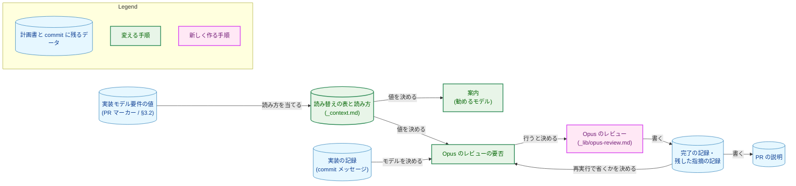
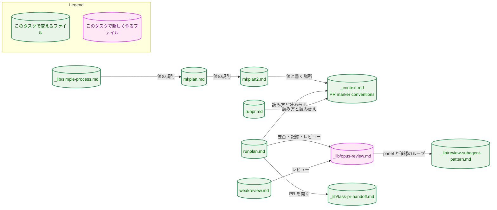
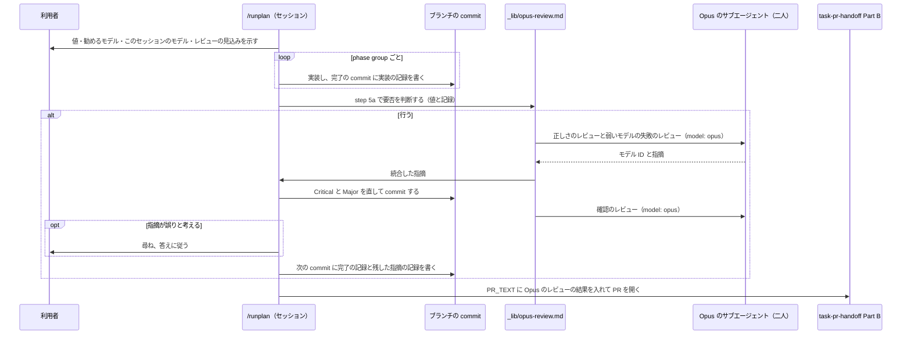
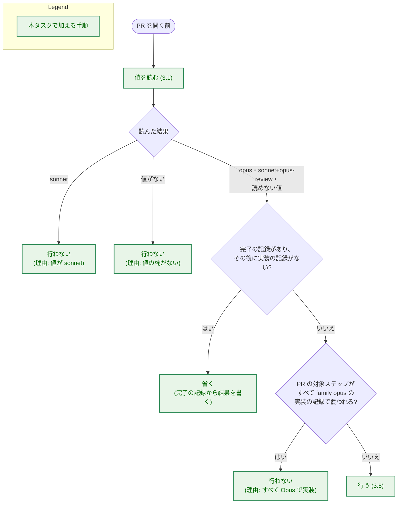
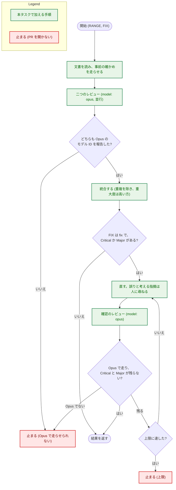

# アーキテクチャ設計書：実装モデル要件を Opus・Sonnet の選択に直結させ、Opus のレビューを一度に行う

## Document Status

| Item | Value |
|---|---|
| Status | `draft` |
| Created | 2026-11-10 |
| Review date | - |
| Reviewer | - |
| Comments | - |

本書は [01_requirements.md](01_requirements.md)（要件定義書。以下、要件書）の設計である。既存のファイルの内容は、コミット `6ba0b515` で確かめた。`file:line` の行番号は、このコミットでの行番号である。F-NNN・AC-NN は要件書の項番を、H-NN は [design_handoff.md](design_handoff.md)（以下、申し送り）の項番を指す。申し送りへの対応は付録 A に、受け入れ基準との対応は付録 B にまとめる。

本書は、要件書 6 章の用語（実装モデル要件・正しさのレビュー・弱いモデルの失敗のレビュー・phase group・確認のレビュー・Opus のレビュー・旧い値・読めない値・読み替えの表）を、要件書と同じ意味で使う。そのほかに、次の用語を使う。

-   **共通の手順:** Opus のレビューを定める新しいファイル `.claude/commands/_lib/opus-review.md`。`/runplan` と `/weakreview` がこれに従う（3.5）。
-   **記録の行:** commit メッセージの、決まった形で 1 列目から始まる 1 行。本タスクは、実装の記録・レビューの完了の記録・残した指摘の記録の 3 種類を加える（3.4）。考え方は、ローカルの CLI レビューの記録の行（`.claude/commands/_lib/local-cli-review.md:303-318`）と同じである。
-   **実装の記録:** phase group を実装したモデルを示す記録の行（AC-18）。
-   **完了の記録:** Opus のレビューを終えたことと、指摘の件数を示す記録の行。
-   **残した指摘の記録:** 直さずに進んだ Critical と Major の指摘を、1 件ずつ示す記録の行（AC-27）。
-   **PR の対象ステップ:** PR マーカーの `**対象ステップ**` に並ぶステップ。単一フェーズの計画書では、計画書のすべてのステップである。
-   **実装の PR:** 本タスクの実装計画書が切る PR。8 章で、分け方の目安を示す。

## 1. 設計の全体像 (Design Overview)

### 1.1. 設計原則

-   **値の定義と読み方は、それぞれ一か所に置く。** 値の意味・契機・判定理由の書き方は `mkplan2.md` に、読み替えの表・値の読み方・単一フェーズの計画書で値を書く場所は `_context.md` に置く（AC-05、AC-09）。ほかのファイルは、それを名指して使う。
-   **Opus のレビューは、一つの共通の手順にまとめる。** 二つのチェックリスト、統合、直し、確認、退けない規則、止まる条件は、共通の手順だけが持つ。`/runplan` と `/weakreview` は、範囲と、直すかどうかと、記録を書くかどうかを渡すだけにする（要件書 4.5 節）。
-   **記録はブランチの commit に残す。** 1 つの PR は、複数の `/runplan` のセッションにまたがりうる。そのため、どのモデルが実装したか、Opus のレビューを終えたかを、セッションの記憶ではなく commit メッセージから読む。
-   **迷うときは、Opus のレビューを行う側に倒す。** 記録がない phase group、読めない値、決まった形でない記録の行は、Opus で実装されていないものとして扱う（要件書 4.3 節）。
-   **Opus で走ったことは、確かめてから信じる。** Agent ツールに Opus を指定したことではなく、サブエージェント自身が報告するモデル ID で確かめる（3.5.4）。
-   **リポジトリの外のスキルに頼らない。** 正しさのレビューの観点は、リポジトリの中のチェックリストとして書く（1.2 の決定 1）。

### 1.2. 設計の際に決めたこと（2026-11-10）

1.  **正しさのレビューの観点は、リポジトリの中のチェックリストとして共通の手順に書く。組み込みの `/code-review` スキルは呼ばない。** 確かめた事実: `model` に `opus` を指定したサブエージェントは Skill ツールを持ち、`code-review` スキルが見える。ただし、このスキルの説明は「correctness bugs (plus reuse/simplification/efficiency …)」で、cleanup を含む。出力の形もスキルの側で決まる。理由: cleanup を除くこと（AC-28）と出力の形を固定できず、リポジトリの外でスキルが変わるとレビューの中身が黙って変わるため。採らない案: サブエージェントから `/code-review` を呼ぶ案。ADR: [ADR-0042](../../dev/adr/0042-implementation-model-tiers.md) を更新した。
2.  **Opus のレビューの手順は、共通の手順 `_lib/opus-review.md` に置く。弱いモデルの失敗のチェックリスト（今の `weakreview.md` の「Weak-model failure checklist」）と決定的な事前の確かめ（今の `weakreview.md` step 3）も、ここへ移す。** 理由: Opus のレビューの定義を一か所にまとめるため（利用者の選択）。採らない案: `/runplan` が `/weakreview` を呼ぶ案（引数の解釈、範囲の確かめ、作業ツリーの確かめが `/runplan` の手順と重なる）と、チェックリストを `weakreview.md` に残して共通の手順が名指す案（定義が二つのファイルに分かれる）。チェックリストを移すと、ADR-0016 の参照の編集上の訂正と、同じチェックリストを書き換えるタスク 0080 との順序の扱いが要る（3.11.3）。ADR: ADR-0042 を更新した。
3.  **Opus のレビューの直しの commit は、PR を開く前にローカルの CLI レビューへかけ直さない。** 理由: 直しは PR を開く前にブランチへ入るので、PR を作ったときの Codex の PR レビューが必ず見る。ローカルの CLI レビューの割り当てと、Codex CLI に切り替わったときの Codex の allowance を使うほどの益がない。採らない案: 直しの範囲をローカルの CLI レビューにかける案。ADR: ADR-0042 を更新した（ADR-0042 の「結果」が、この点を設計に委ねていた）。
4.  **実装の記録・完了の記録・残した指摘の記録を、commit メッセージの記録の行にする。手で実行した `/weakreview` は、完了の記録を書かない。** 実装の記録は、phase group を完了させる commit（`runplan.md:76` のチェックボックスの commit）に書き、モデルとステップの ID を持つ。再び実行した `/runplan` は、完了の記録があり、それより後に実装の記録を持つ commit がないときだけ、Opus のレビューを省く。理由: 記録がブランチと一緒に残り、セッションをまたいでも読めるため。`/weakreview` の範囲は自由に指定でき、PR の範囲と一致する保証がないため。採らない案: `/weakreview` も、範囲が既定で直す形のときに完了の記録を書く案。ADR: ADR-0042 を更新した。
5.  **単一フェーズの計画書の値は、§3 の `### 3.2 実装モデル要件` の節に書く。** 理由: 複数のフェーズの計画書が `### 3.2 PR 構成` を置く（`mkplan2.md:87-96`）のと同じ位置にし、読むコマンドが一つの場所だけを読めばよいようにするため。採らない案: `### フェーズ1` の見出しの直後に書く案。ADR: ADR-0042 を更新した。
6.  **二つのレビューは、`_lib/review-subagent-pattern.md` の panel mode の二人のレビュアーとして走らせ、統合は panel mode の「Synthesize before fixing」に従う。重大度は Critical・Major・Minor の尺度を使い、`_lib/triage-pattern.md` は使わない。** 理由: 統合の規則（重複を除く、重大度が食い違えば高い方をとる、境目の問題を組み立て直す）は panel mode に既にある。`_lib/triage-pattern.md` の `invalid` の判定は、セッションが指摘を自分の判断で退けることに当たり、AC-23 と合わない。ADR: なし（共通の手順の中の組み立てで、ADR-0042 の決定の範囲に収まる）。
7.  **Opus で走ったかは、各レビューのサブエージェントが出力の最初の行に書く自分のモデル ID で確かめる。** 確かめた事実: `model` に `opus` を指定したサブエージェントは「The exact model ID is claude-opus-5-5」と、`sonnet` を指定したものは「claude-sonnet-5-5」と、システムプロンプトの文を写して答えた。理由: 指定が効いたことを、レビューの結果と同じ出力の中で確かめられるため。ADR: ADR-0042 を更新した。
8.  **PR の説明に書く Opus のレビューの結果は、`/runplan` が完了の記録と残した指摘の記録から書き、`_lib/task-pr-handoff.md` の PR_TEXT として渡す。** 理由: PR を開くセッションが、レビューを行ったセッションと違っても書けるようにするため。指摘はサブエージェントの文を写さず、場所と自分の言葉の要旨で書く。ADR: なし（PR の説明の中身で、要件書が ADR なしと決めている）。

### 1.3. なぜ今の仕組みでは足りないか

-   **値:** 今の値（`frontier-required`・`frontier-recommended`・`standard`）は、`runplan.md:15-20` の案内でモデルの名前に結びつかず、Opus のレビューの条件にもならない。値の意味を変えずに案内の文だけを直しても、`frontier-recommended` が Sonnet で進めてよいかは決まらない（要件書 1 節の背景）。
-   **レビューのモデル:** `_lib/review-subagent-pattern.md` は、呼ぶ側が MODEL を渡さない限り、発見のレビューをセッションのモデルで走らせる（`.claude/commands/_lib/review-subagent-pattern.md:30-35`、`:94-99`）。`/runplan` の step 7・7.5 のレビューのモデルは変えない（要件書 2.3 節）ので、新しく Opus に固定したレビューを足す必要がある。
-   **`/weakreview`:** 今の `weakreview.md` は、`code-review` と `simplify` が別に走ることを前提にし（`.claude/commands/weakreview.md:14-29`）、`--fix` がなければ報告だけで終わる（`:128-132`）。どのコマンドからも呼ばれない。このままでは、`/runplan` から一度で行える Opus のレビューにならない。

### 1.4. 概念モデル

図 1 に、値・記録・Opus のレビューの関係を示す。矢印 A → B は「A が B を決める、または A が B を書く」を表す。



## 2. システム構成 (System Structure)

### 2.1. 全体構成

本タスクは、コマンドの定義・共通の定義・`CLAUDE.md`・ADR の文言だけを変える。実行時に動くコンポーネント（拡張・Native Messaging のホスト・サーバ・CLI）と、開発の道具（`fixprguard`・`codexreview`・`mergepr`・`coveragecompare`）は変わらない。図 2 に、変えるファイルが互いをどう参照するかを示す。矢印 A → B は「A が B の定義を名指して使う」を表す。



図 2 のうち、次の矢印は今の関係である。ほかの矢印は、実装の PR で加わる関係である。

-   `mkplan.md` → `mkplan2.md`：step 8.5 が `mkplan2.md` の steps 4〜9 に従う（`.claude/commands/mkplan.md:189-195`）。加わるのは、単一フェーズの計画書の値の規則への名指しである。
-   `_lib/simple-process.md` → `mkplan.md`：「Writing the three documents」が `mkplan.md` の手順を使う（`.claude/commands/_lib/simple-process.md:156-164`）。
-   `mkplan2.md` → `_context.md`：PR マーカーの書式が `_context.md` の PR marker conventions に従う（`.claude/commands/mkplan2.md:6-7`、`.claude/commands/_context.md:60-66`）。
-   `runplan.md` → `_context.md`：冒頭の案内が PR marker conventions を名指す（`.claude/commands/runplan.md:15-17`）。`runpr.md` は今、値をそのまま示すだけで、読み方を名指さない（`.claude/commands/runpr.md:719-731`）。
-   `runplan.md` → `_lib/task-pr-handoff.md`：step 5a と step 8 が Part B に従う（`.claude/commands/runplan.md:83-125`、`:233`）。
-   `weakreview.md` → `_lib/review-subagent-pattern.md`：今は `weakreview.md` が直接従う（`.claude/commands/weakreview.md:108`）。実装の後は、共通の手順を通して従う。

### 2.2. コンポーネント配置

| ファイル | 変更の内容 | 節 |
|---|---|---|
| `.claude/commands/_context.md` | PR marker conventions を、新しい 3 つの値・値を書くコマンドと読むコマンド・読み替えの表・値の読み方・単一フェーズの計画書の `### 3.2 実装モデル要件` に書き換える | 3.1 |
| `.claude/commands/mkplan2.md` | step 4 の「Model requirement」、step 6 の書式と `**判定理由**` の規則、step 7 の表の例、step 9 のペルソナとチェックリストを新しい値にする | 3.2 |
| `.claude/commands/mkplan.md` | step 8.5 に、単一フェーズの計画書へ `### 3.2 実装モデル要件` を書くことを足す。レビューのチェックリストにその項目を足す | 3.3 |
| `.claude/commands/_lib/simple-process.md` | 「Writing the three documents」に、単一フェーズの計画書の値を書くことを足す | 3.3 |
| `.claude/commands/_lib/opus-review.md`（新規） | Opus のレビューの要否の判断、記録の行の形、決定的な事前の確かめ、二つのチェックリスト、panel・統合・直し・確認・退けない規則・止まる条件 | 3.4、3.5 |
| `.claude/commands/runplan.md` | 冒頭の案内、実装を始める前の案内の表示、実装の記録、step 5a と step 8 の Opus のレビューと PR_TEXT | 3.6 |
| `.claude/commands/weakreview.md` | Purpose・引数・直すときの確かめ・PR が開いているときの添え書きを書き換え、レビュー本体は共通の手順に従う。チェックリストと事前の確かめは共通の手順へ移す | 3.7 |
| `.claude/commands/runpr.md` | step 4 の質問と step 5 の `/clear` の案内で、値と始めるモデルを示す。単一フェーズの計画書の値を読む | 3.8 |
| `.claude/commands/_lib/task-pr-handoff.md` | Part B step 3 の本文の項目に、`/runplan` の PR_TEXT が渡す Opus のレビューの結果を足す | 3.9 |
| `.claude/commands/_lib/review-subagent-pattern.md` | MODEL を、panel のすべてのレビュアーと確認のレビューに当てることを明記する | 3.10 |
| `CLAUDE.md` | コマンドの一覧の `/weakreview` の行 | 3.11.1 |
| `docs/dev/adr/0042-implementation-model-tiers.md` | 本書の PR で、1.2 の決定を足した。実装の最後の PR で、「決定」の食い違いの記述を消す | 3.11.2 |
| `docs/dev/adr/0016-document-test-policy.md` | チェックリストを移す実装の PR で、`weakreview.md` の「Weak-model failure checklist」への参照を編集上の訂正で直す | 3.11.3 |
| `docs/tasks/0081_implementation_model_choice/03_implementation_plan.md` | 実装計画書（`/mkplan` の PR が作る） | - |

次のファイルは変えない。

-   0073・0076・0077 の計画書と、完了したタスクの計画書（AC-13、要件書 2.3 節）。
-   `.claude/commands/_lib/local-cli-review.md`。Opus のレビューの直しを、ローカルの CLI レビューにかけ直さない（1.2 の決定 3）。
-   `.claude/commands/_lib/triage-pattern.md`（1.2 の決定 6）。
-   `.claude/commands/fixpr.md` と `.claude/commands/mergepr.md`。値も記録の行も読まない。
-   `docs/dev/security.md`。冒頭の「`mkarch` / `weakreview` などのコマンドは…本書を参照する」（`docs/dev/security.md:3`）は、`/weakreview` が共通の手順を通して本書を読み続けるので、実装の後も正しい。
-   ADR の索引 `docs/dev/adr/README.md`。ADR-0042 の題名は変わらない。
-   Go のコードとテスト（3.12）。

### 2.3. データフロー

図 3 に、PR マーカーのある計画書の 1 つの PR が、実装から PR を開くまでに、記録の行と Opus のレビューを通る流れを示す。矢印は、呼び出しと受け渡しの順序を表す。



-   phase group ごとのレビュー（step 7・7.5）とローカルの CLI レビュー（step 7.7）は、今のまま図 3 のループの中で行う。図 3 では省いた。
-   単一フェーズの計画書では、step 8 が、Part B の前に同じ判断とレビューを行う（3.6.4）。

## 3. コンポーネント設計 (Component Design)

本タスクは Go のコードを変えないので、型やインタフェースの定義はない。代わりに、値の読み方、記録の行の形、共通の手順の入力と出力を、ここで定める。コマンドの定義の文言は、実装の PR で書く。

### 3.1. `_context.md` の PR marker conventions（AC-09、AC-37、H-08）

今の `_context.md:64` は、旧い 3 つの値と、それを書くコマンドと読むコマンドを 1 項目で述べている。これを、次の 4 つで置き換える。

1.  **値:** `opus`・`sonnet+opus-review`・`sonnet` の 3 つ。書くのは `mkplan2.md`（step 4 の「Model requirement」。`mkplan.md` の step 8.5 と、簡易な進め方の `mkreq.md` から使われるものを含む）と、単一フェーズの計画書を書く `mkplan.md` の step 8.5（AC-37）である。読むのは `runplan.md`（案内と Opus のレビューの要否）と `runpr.md`（step 4 の質問と step 5 の `/clear` の案内）である。値の意味・契機・判定理由の書き方は `mkplan2.md` step 4 を名指し、ここでは繰り返さない（AC-05）。
2.  **値の場所:** PR マーカーの `**実装モデル要件**` の行。単一フェーズの計画書では、`### 3.2 実装モデル要件` の見出しの下の `**実装モデル要件**` の行（1.2 の決定 5）。
3.  **読み方:** 場所の中で、1 列目から `**実装モデル要件**: ` で始まる行を探す。その後から行の終わりまでを、前後の空白を除いて読む。
    -   新しい 3 つの値のどれかと完全に一致すれば、その値とする。
    -   旧い 3 つの値のどれかと完全に一致すれば、読み替えの表で新しい値とする。示すときは、旧い値と読み替えた値の両方を示す（AC-10）。
    -   どちらでもなければ、読めない値とする。推し量って別の値として扱わない（AC-11）。
    -   行がなければ（単一フェーズの計画書で `### 3.2 実装モデル要件` の見出しがない場合を含む）、値がないものとする（AC-12）。
4.  **読み替えの表:** 次の表を置く。旧い値が現れる指示は、この表と、旧い値を読むときの扱いを述べる箇所だけである（AC-09、AC-39）。

    | 旧い値 | 読み替えた値 |
    |---|---|
    | `frontier-required` | `opus` |
    | `frontier-recommended` | `sonnet+opus-review` |
    | `standard` | `sonnet` |

    表には、PR がまだ作られていない PR マーカーに旧い値を持つ計画書がなくなれば消してよいことを添える（要件書 4.5 節）。

値の行に括弧書きの注を付けた完了済みの計画書（`docs/tasks/0017_intermediate_artifacts/03_implementation_plan.md`）は、読めない値になる。0017 は完了しているので、`/runplan` と `/runpr` の振る舞いには影響しない（H-08）。

勧めるモデルと、Opus のレビューの見込みは、読んだ値から次のとおり決まる。この対応は `runplan.md` の冒頭の案内（3.6.1）が持つ。

| 読んだ結果 | 勧めるモデル | Opus のレビュー |
|---|---|---|
| `opus` | Opus | Opus 以外で実装された phase group か、記録のない phase group があれば行う |
| `sonnet+opus-review` | Sonnet | 同上 |
| `sonnet` | Sonnet | 行わない |
| 読めない値 | なし（その文字列と、読めない値であることを示す） | `sonnet+opus-review` と同じに扱う |
| 値がない | なし（値がないことを示す） | 行わない |

### 3.2. `mkplan2.md`（AC-01〜AC-05）

-   **step 4 の「Model requirement」**（`.claude/commands/mkplan2.md:41-46`）: 3 つの値を、要件書 F-001 の表のとおりの意味と契機で定める。契機の文は今の 3 区分の契機をそのまま引き継ぎ、意味の文だけを、とるべき行動（どのモデルで実装し、Opus のレビューを足すか）に書き換える。PR は、その PR のステップが求める値のうち最も高いものをとる（`opus` > `sonnet+opus-review` > `sonnet`）。「`weakreview.md` で確かめる」という今の文（`:41`）は消す（AC-39）。値の意味と判定理由の書き方は、この step だけが定める（AC-05）。
-   **step 6 の書式**（`:66`、`:84-85`）: 書式の行を `opus | sonnet+opus-review | sonnet` にする。`**判定理由**` の規則を、`opus` と `sonnet+opus-review` では当たった契機と「Sonnet に任せると何が起きやすいか」を、`sonnet` では当たる契機がないことを書く形にする（AC-03）。step 6 の値の説明は step 4 を名指し、意味を繰り返さない。
-   **step 7 の表の例**（`:93-95`）と **step 9**（ペルソナの文 `:111`、チェックリスト `:125-126`）: 新しい値で書く。チェックリストは、`判定理由` が「Sonnet に任せると何が起きやすいか」を述べているかも見る（AC-04）。
-   単一フェーズの計画書で止まる step 2 の扱い（`:29`）は変えない。単一フェーズの計画書の値は `mkplan.md` が書く（H-07）。

### 3.3. `mkplan.md` と `_lib/simple-process.md`（AC-06、AC-08）

-   **`mkplan.md` step 8.5**（`.claude/commands/mkplan.md:189-195`）: `### フェーズ` が一つのときは、PR マーカーを作らない代わりに、§3 に `### 3.2 実装モデル要件` の節を置き、`**実装モデル要件**` と `**判定理由**` の 2 行を書く。値と判定理由は、`mkplan2.md` step 4 の「Model requirement」と step 6 の `**判定理由**` の規則で決める（AC-06）。
-   **`mkplan.md` の「Technical correctness checklist」**: 単一フェーズの計画書が `### 3.2 実装モデル要件` の 2 行を持ち、判定理由が step 4 の規則に合うことを見る項目を足す。複数のフェーズの計画書の値は、今のとおり `mkplan2.md` step 9 のチェックリストが見る。
-   **`_lib/simple-process.md`「Writing the three documents」**（`.claude/commands/_lib/simple-process.md:159-164`）: 「with one phase there are no PR markers」の後に、`mkplan.md` step 8.5 のとおり `### 3.2 実装モデル要件` を書くことを足す（AC-08）。「Reviewing the three documents」は `mkplan.md` step 8 のチェックリストを使うので、上の項目もそこで見られる。

### 3.4. 記録の行（AC-18、AC-27、H-05、H-09）

3 種類の記録の行の形を、共通の手順の「Record lines」の節に定める。どれも、commit メッセージの 1 列目から始まる 1 行である。字下げした行や、文の途中で形に触れた行は記録の行ではない（ローカルの CLI レビューの記録の行と同じ規則。`_lib/local-cli-review.md:305-311`）。

```text
Implementation model: <family> (<model-id>[, <model-id> ...]) steps <step-id> / <step-id> ...
Opus review: done <START12>..<END12> (critical <n>, major <n>, minor <n>)
Opus review: kept <path>:<line> (<severity>; <reason>) <summary>
```

-   **実装の記録（`Implementation model:`）**
    -   書く場所: phase group を完了させる commit（`runplan.md:76`、チェックボックスを付ける commit）のメッセージ。1 つの phase group に 1 行。
    -   `<model-id>`: セッションが自分のモデルとして知る ID（Claude Code がシステムプロンプトで与える、`claude-opus-5-5` のような ID）。phase group の間にモデルが変わったと知っているときは、使ったモデルの ID をすべて並べる。
    -   `<family>`: `<model-id>` がすべて Opus のときだけ `opus`。それ以外は、Opus でないモデルのファミリー名（`sonnet` など）。
    -   `<step-id>`: phase group が実装したステップの ID を、計画書の書き方のまま並べる（`[-]` で飛ばしたステップを含む）。
    -   セッションが自分のモデル ID を知らないときは、この行を書かない。その phase group は記録がないものとして扱われ、Opus のレビューを行う側に倒れる（H-05）。
-   **完了の記録（`Opus review: done`）**
    -   書く場所: Opus のレビューが終わった後に、`/runplan` が最初に作る commit のメッセージ。step 5a ではグリーンゲートのチェックボックスの commit、step 8 では PR を開く前に作る commit（なければ記録の行だけの空の commit）である。step 7.7 の記録の行の置き方（`runplan.md:228`）と同じ考え方である。
    -   `<START12>..<END12>`: レビューした範囲（merge-base から、最後の確認のレビューを受けた commit まで）。どちらも 12 文字に切る。
    -   件数は、統合した後の指摘の重大度ごとの件数である。
    -   `/weakreview` は書かない（1.2 の決定 4）。
-   **残した指摘の記録（`Opus review: kept`）**
    -   直さずに進んだ Critical と Major の指摘を、1 件 1 行で書く。完了の記録と同じ commit に書く。
    -   `<reason>`: `rejected by reviewer`（人が退けた。AC-23）か、`decision change declined`（直すのに決定の変更が要り、人が認めなかった。AC-24）。
    -   `<summary>`: サブエージェントの文を写さず、自分の言葉で書く（1.2 の決定 8）。
-   **mention の確かめ:** 完了の記録か残した指摘の記録を含む commit の前に、メッセージをファイルに書き、`_context.md` の PR review request の mention を `grep -qiF` で探す（`_lib/local-cli-review.md:267-278` と同じ確かめ）。見つかったときは `<summary>` を消してもう一度確かめ、それでも見つかれば止まって報告する。

### 3.5. 共通の手順 `_lib/opus-review.md`（AC-19〜AC-31、H-01〜H-03、H-06）

frontmatter の `description` は、ほかの `_lib/` と同じく「Internal: … (not a command)」の形にする。英語で書く（`CLAUDE.md`、「Document language」の原則 (b)）。

#### 3.5.1. 呼ぶ側が渡すもの

| 入力 | 意味 | `/runplan` | `/weakreview` |
|---|---|---|---|
| RANGE | レビューする commit の範囲 | `$(git merge-base origin/main HEAD)..HEAD`（AC-21） | 引数から解いた範囲（AC-36） |
| TASK_DIR | タスクのディレクトリ | 対象のタスク | `task_identification.md` で特定したタスク |
| FIX | 直すか（`fix`・`report`） | `fix` | `--no-fix` がなければ `fix`、あれば `report` |
| DECISION_CHANGE | 直すのに決定の変更が要る指摘の扱い | `runplan.md` step 5 の「Decision change」の規則に従う（AC-24） | 直さずに報告し、人に委ねる（AC-31） |
| SUMMARY | 結果を返す先 | step 8 の要約と PR_TEXT | 報告 |

#### 3.5.2. 節の構成

1.  **Deciding whether a PR needs the review**（`/runplan` だけが使う。6.1）: 読んだ値（3.1）、PR の対象ステップ、実装の記録、完了の記録から、行う・行わない・省く（再実行）を決める。行わないときは、AC-19 のどの条件が成り立たなかったかを返す（AC-27）。
2.  **Record lines**: 3.4 の形と、読み方。
3.  **Documents to read**: TASK_DIR の `01_requirements.md`・`02_architecture.md`・`03_implementation_plan.md`、`docs/dev/conventions/test_organization.md`、`docs/dev/conventions/requirements_process.md`、`docs/dev/security.md`（今の `weakreview.md` step 2 から移す）。
4.  **Deterministic pre-checks**: 今の `weakreview.md` step 3 の Check 1〜5 を移す。RANGE に対して走らせ、FLAG をレビューに渡す。`runplan.md` step 6.5 の Check 1・2 と重なる確かめがあるが、step 6.5 は phase group の範囲、こちらは PR 全体の範囲で、弱いモデルの自己確認が上滑りした場合の確かめ直しを兼ねる（今の `weakreview.md` の Check 5 の注と同じ理由）。重なりは残す。
5.  **The two reviews**: `_lib/review-subagent-pattern.md` の panel mode で、二人のレビュアーを並行して走らせる。MODEL は `opus` である。
    -   Reviewer A（正しさのレビュー）: 担当はバグ（論理、エラーの経路、境界値、資源の解放）と、要件書の AC・設計書・計画書のステップの記述とのずれ。担当外は弱いモデルの失敗のチェックリストの項目と cleanup。CRITERIA は新しい「Correctness checklist」（1.2 の決定 1）。
    -   Reviewer B（弱いモデルの失敗のレビュー）: 担当は「Weak-model failure checklist」（今の `weakreview.md:134-308` を移す）。担当外は Reviewer A の担当。
    -   CRITERIA は、各レビュアーに自分の担当のチェックリストだけを渡す（`_lib/review-subagent-pattern.md` の panel mode の (a) pre-routed）。担当外は、気づいたときだけ OUT-OF-LANE FLAG の 1 行で報告させる。
    -   どちらのレビュアーにも、cleanup（再利用・単純化・効率）を指摘しないよう指示する（AC-28）。今の弱いモデルの失敗のチェックリストにある再利用の項目は、弱いモデルが既存の関数を名前を変えて作り直す失敗を見る項目で、cleanup ではなく、Reviewer B に残す。
6.  **Model check**: 3.5.4。
7.  **Synthesis**: panel mode の「Synthesize before fixing」に従い、セッションが統合する（AC-22、AC-30）。重大度は Critical・Major・Minor を使い、`_lib/triage-pattern.md` は使わない（1.2 の決定 6）。
8.  **Fixing and verification**（FIX が `fix` のとき）: 3.5.3。
9.  **Output**: 統合した指摘を重大度ごとに、各チェックリストの分類が clean・flagged・該当なしのどれかを 1 行ずつ、最後に今の `weakreview.md` の「Output format」（`:310-319`）の全体の見立ての 1 行を返す。直したときは、直した commit と、残した指摘を返す。

#### 3.5.3. 直しと確認のループ

-   セッションが Critical と Major の指摘をすべて直し、ビルドの確かめ（`_context.md`）を通してから commit する（AC-22）。
-   セッションが指摘を誤りと考えるときは、自分の判断で退けない。AskUserQuestion で人に尋ね、人が退けたときだけ直さずに進む（AC-23）。人に尋ねる前に、場所・指摘の要旨・セッションの考えを示す。
-   直すのに要件・設計・計画の決定の変更が要る指摘は、DECISION_CHANGE に従う。`/runplan` では `runplan.md` step 5 の規則（編集上の訂正はその場で直し、決定の変更は人と決める）である（AC-24）。
-   直した後の確認のレビューは、直した指摘の一覧を渡して、Opus で走らせる（AC-22）。`_lib/review-subagent-pattern.md` は、MODEL を渡したときは確認のレビューにも同じ MODEL を使うと定めている（`.claude/commands/_lib/review-subagent-pattern.md:107-110`）。確認のレビューも 3.5.4 で確かめる。
-   繰り返しの上限と、上限に達したときの扱いは、`_lib/review-subagent-pattern.md` の規則（3 回、収束の規則）に従う。上限に達して止まるときは、呼ぶ側に「止まった」を返す。`/runplan` は PR を開かず、何も push しない（AC-22）。
-   FIX が `report` のときは、何も直さず、統合した指摘を返す。

#### 3.5.4. Opus で走ったことの確かめ（AC-25、AC-29、H-06）

-   レビューのサブエージェントは、Agent ツールで `model` に `opus` を指定して走らせる。`subagent_type` に `fork` を使わない。Agent ツールの説明が、`fork` では `model` を無視すると述べているからである。
-   各サブエージェントへの指示に、出力の最初の行を `Model: <model-id>` とし、`<model-id>` にはシステムプロンプトにある自分のモデル ID を写すことを含める。1.2 の決定 7 の確かめで、この方法が働くことを見た。
-   セッションは、各サブエージェントの出力の最初の行を読む。次のどれかのときは、Opus で走らせられなかったものとして扱う。
    -   最初の行が `Model: ` の形でない。
    -   ID が Opus の ID でない（`claude-opus-` で始まらない）。
    -   Agent ツールの呼び出しが失敗した。
-   そのときは、セッションのモデルで代わりに走らせず、止まる。止まった時点までの直しの commit は、ブランチに残す。`/runplan` は PR を開かず、何も push せず、Opus が使えるようになってから `/runplan` を再び実行することを報告する（AC-25）。`/weakreview` は止まって、その旨を報告する（AC-29）。

### 3.6. `runplan.md`（AC-07、AC-10、AC-11、AC-12、AC-14〜AC-27）

#### 3.6.1. 冒頭の案内（AC-14、AC-16）

今の案内（`.claude/commands/runplan.md:15-20`）を、3.1 の後半の表の内容に書き換える。3 つの値それぞれについて、セッションを始めるモデルと、Opus のレビューが足される条件を述べ、値が Opus のレビューの条件に関わることを述べる。「This does not change any step below.」の文と、「`weakreview.md` で確かめる」という文は消す（AC-16、AC-39）。単一フェーズの計画書では、値を `### 3.2 実装モデル要件` から読むことも述べる。

#### 3.6.2. 実装を始める前の案内の表示（AC-15、AC-10、AC-11、AC-12）

step 4 で次の作業の単位を選んだ後、step 4.5 の前に、次を示す。`/runplan` は、セッションのモデルと値が合わなくても止まらない。

-   対象の PR の値。対象の PR は、これから実装する phase group を覆う PR マーカーの PR で、単一フェーズの計画書では計画書そのものである。旧い値なら読み替えた値も、読めない値ならその文字列と読めない値であることも、値がないならそのことも示す。
-   勧めるモデル（3.1 の表）。
-   このセッションのモデル（3.4 の `<model-id>` と同じもの。分からなければ「分からない」）。
-   Opus のレビューを行う見込み。この時点の値と実装の記録から、6.1 の判断を試しに当てた結果を示す。PR を開く前に、もう一度判断する。

step 4 が PR のチェックポイント（step 5a）を選んだときも、同じ表示をする。

#### 3.6.3. 実装の記録（AC-18）

step 5 の「When complete, update checkboxes … and commit.」（`:76`）の commit のメッセージに、実装の記録（3.4）を書くことを足す。step 6・7・7.5・7.7 の直しの commit には書かない。それらは、同じセッションが同じ phase group の中で作る commit だからである。

#### 3.6.4. step 5a と step 8 の Opus のレビュー（AC-19〜AC-27、H-04）

step 5a（`:78-127`）では、グリーンゲートの確認（`:80`）と、最後の PR のときの AC の確かめ（`:81`）の後、最初のチェックボックスの commit（`:82`）の前に、次を行う。

1.  共通の手順の「Deciding whether a PR needs the review」で、行う・行わない・省く（再実行）を決める（6.1）。
2.  行うときは、共通の手順に RANGE・FIX `fix` などを渡してレビューを行う（3.5）。止まったときは、`/runplan` も止まり、PR を開かず、何も push しない（AC-22、AC-25）。
3.  直しの commit があれば、グリーンゲートをもう一度通す。
4.  最初のチェックボックスの commit のメッセージに、完了の記録と残した指摘の記録を書く（3.4）。レビューを行わなかったときと省いたときは、記録の行を書かない。
5.  PR_TEXT に、Opus のレビューの結果（3.9）を加える。

単一フェーズの計画書の PR（step 8、`:233`）では、Part B の前に同じ 1〜3 を行い、完了の記録と残した指摘の記録は、PR を開く前に作る commit に書く。ほかの commit がなければ、記録の行だけの空の commit を作る（step 7.7 の空の commit と同じ形）。Part B の LOCAL_REVIEW の規則と CHECKS（グリーンゲート）は、今のままである。Opus のレビューの直しの範囲は、ローカルの CLI レビューにかけ直さない（1.2 の決定 3）。

この位置に置く理由: 直しの commit が PR を開く前にブランチへ入り（AC-26）、最初の Codex の PR レビューが直した後のコードを見るためである。最初のチェックボックスの commit より前に置くと、再び実行したときに、そのチェックボックスに記録が残っているかで、レビューを終えたかを判断できる。

再び実行したとき（AC-25、H-04）:

-   Opus のレビューの途中で止まったとき（Opus が使えない、上限に達した）は、完了の記録がない。step 4 は同じチェックポイントを選び、step 5a が判断からやり直す。これが「Opus のレビューから続ける」ことに当たる。止まる前の直しの commit は残り、レビューは PR のすべての commit を範囲にして走り直す。
-   Part B で止まったとき（ローカルの CLI レビューなど）は、チェックボックスの commit に完了の記録がある。その後に実装の記録を持つ commit はないので、レビューを省く。
-   利用者が手で `/weakreview` を実行した後でも、`/runplan` は完了の記録を見つけないので、条件が成り立てばレビューを行う（1.2 の決定 4）。

### 3.7. `weakreview.md`（AC-28〜AC-36、AC-38）

`weakreview.md` は、引数の解釈と、直すときの確かめと、報告だけを持ち、レビュー本体は共通の手順に従う。

-   **frontmatter:** `argument-hint` を `[range | PR] [--no-fix | --fix]` の趣旨に合わせる（AC-38）。
-   **Purpose:** `code-review` と `simplify` が別に走ることを前提にしない形に書き換える。Opus で正しさのレビューと弱いモデルの失敗のレビューを一度に行い、既定で直すことを述べる（AC-35）。
-   **引数（AC-32、AC-36）:** 範囲の指定（commit の範囲、PR 番号、省略時の `origin/main...HEAD`）は今と同じに受け付ける。`--no-fix` は報告だけにする。`--fix` は受け入れ、何もしない。`--no-fix` と `--fix` が両方あるとき、範囲の指定が二つ以上あるとき、ほかの引数があるときは、推し量らずに止まり、受け付ける引数を示す。
-   **直すときの確かめ（AC-33）:** FIX が `fix` のとき、共通の手順を呼ぶ前に次を確かめ、成り立たなければ何も変えずに理由を報告して止まる。
    -   ブランチを checkout している（detached HEAD でない）。
    -   範囲の終わりが `HEAD` と同じ commit である。PR 番号の指定では、その PR の head が `HEAD` と同じ commit である。範囲の終わりが `HEAD` でないと、直しの commit が、範囲の外の commit の上に積まれるからである。
    -   作業ツリーが clean である（`git status --short` が空）。
-   **PR が開いているときの添え書き（AC-34）:** 直したとき、`gh pr view <current-branch> --json state,url` で開いた PR があれば、直しが最初の PR レビューに届かないことと、push と以後のレビューの扱いは利用者か `/runpr` に委ねることを報告に添える。`/weakreview` を実行することが、この読み出しと、PR 番号の範囲を解くための `gh pr view` を認める、と定義に書く（`CLAUDE.md`、「Tool Execution Safety」は、ネットワークに触れるコマンドに承認を求める）。
-   **共通の手順の呼び出し:** DECISION_CHANGE は「直さずに報告し、人に委ねる」である（AC-31）。push はしない。完了の記録は書かない（1.2 の決定 4）。
-   **報告:** 共通の手順の Output（3.5.2 の 9）と、直した commit。

### 3.8. `runpr.md`（AC-07、AC-10〜AC-12、AC-17）

-   **step 4**（`.claude/commands/runpr.md:719-731`）: 次の PR の値を示すとき、3.1 の読み方で読み、値に加えて始めるモデル（`opus` は Opus、ほかの 2 つは Sonnet）を示す。旧い値は読み替えた値と並べて示す。読めない値は、その文字列をそのまま示し、読めない値であることを添える。値がないときは、そのことと、分かる範囲の理由（PR マーカーに欄がない、単一フェーズの計画書に `### 3.2 実装モデル要件` がない）を示す。
-   **単一フェーズの計画書:** 今は「the plan has no PR marker」を値がない理由にしている（`:724-726`）。これを、`### 3.2 実装モデル要件` から値を読む形に改める（AC-07）。
-   **step 5 の `/clear` の案内**（`:1024-1025`）: step 4 で示した値と始めるモデルを、そのまま繰り返す。

### 3.9. `_lib/task-pr-handoff.md`（AC-27、H-09）

-   **PR_TEXT**（`.claude/commands/_lib/task-pr-handoff.md:44-49`）: `runplan.md` の PR_TEXT に、「Opus のレビューの結果」を加える。
-   **Part B step 3 の本文の項目**（`:201-250`）: `runplan.md` の PR では、PR_TEXT の Opus のレビューの結果を示す項目を足す。中身は次のとおりで、`/runplan` が書く。
    -   行ったとき: 指摘の件数を重大度ごとに（完了の記録から）。残した指摘があれば、その場所と要旨（残した指摘の記録から）。
    -   行わなかったとき: AC-19 のどの条件が成り立たなかったか（値が `sonnet`、値の欄がない、PR の対象ステップがすべて Opus で実装されたと記録されている）。
    -   省いたとき（再実行で完了の記録があった）: その完了の記録から、行ったときと同じ中身を書く。
-   PR の説明は日本語で書く。本文のファイルは、今の Part B step 3 の mention の確かめを受ける。

### 3.10. `_lib/review-subagent-pattern.md`

今の「Model tiering」は、panel mode と組み合わせるとき「the discovery panel runs on the default model」と述べる（`.claude/commands/_lib/review-subagent-pattern.md:113-114`）。MODEL を渡したときに panel の各レビュアーにも MODEL を当てるかは、書かれていない。MODEL を渡したときは、panel のすべてのレビュアーと確認のレビューが MODEL で走ることを、この節に明記する。共通の手順は、その上で MODEL に `opus` を渡す。モデル ID の確かめ（3.5.4）は共通の手順だけが持ち、この節には入れない。ほかの呼ぶ側は、モデル ID の確かめを求めていないからである。

### 3.11. `CLAUDE.md` と ADR

#### 3.11.1. `CLAUDE.md`（AC-38）

コマンドの一覧の `/weakreview` の行（`CLAUDE.md:206`）を、Opus の二つのレビューを行い、既定で直して commit し（push はしない）、`--no-fix` で報告だけにする形と、受け付ける引数（`[range | PR] [--no-fix | --fix]`）に合わせる。

#### 3.11.2. ADR-0042（AC-40）

本書の PR で、1.2 の決定 1〜5・7 を「決定」に、採らない案を「採らなかった案」に足し、「結果」の、直しをローカルの CLI レビューで見直すかを設計に委ねる文を、決めた結果に書き換えた。「経緯」に本書の行を足した。「決定」の冒頭にある、決定がまだ `_context.md` とコマンドの定義に反映されていないという食い違いの記述は、実装の最後の PR で消す。

#### 3.11.3. ADR-0016 とタスク 0080

ADR-0016 は、`weakreview.md` の「Weak-model failure checklist」を、計画の規則とレビューのチェックリストの置き場所として名指している（`docs/dev/adr/0016-document-test-policy.md:17`、`:27`）。チェックリストを共通の手順へ移す実装の PR は、この参照を `_lib/opus-review.md` に直す。ADR-0016 の決定は変わらないので、編集上の訂正（`docs/dev/conventions/adr.md`、「Editorial corrections」）であり、その commit に訂正の行を書く。

タスク 0080 の計画も、このチェックリストに項目を足す。チェックリストを移す実装の PR は、そのときの `origin/main` の `weakreview.md` にあるチェックリストを、そのまま移す。0080 の実装が後になったときは、0080 の `/runplan` が、自分の計画のステップの記述を `_lib/opus-review.md` に合わせる編集上の訂正をする（`runplan.md` step 5 の規則）。ADR-0016 の参照も、そのときに 0080 の側で合わせる。

### 3.12. 既存のテスト

-   値・記録の行・`/weakreview` の振る舞いを確かめる Go のテストはない。`6ba0b515` で、`_test.go` に `frontier-`・`weakreview`・`実装モデル要件` を含むものはない（`grep -rln` の結果）。変えるテストはない。
-   `TestInstructionDocPaths`（`cmd/yt2column/docpaths_test.go:140`）は、`.claude/commands` の下の文書が名指すパスが存在することを確かめる。`_lib/opus-review.md` を名指す PR は、そのファイルを同じ PR で作る。
-   `TestCodexMentionOnlyInRequestRow`（`cmd/yt2column/codex_review_docs_test.go:92`）は、コマンドの文書に mention がないことを確かめる。新しいファイルも対象になる。
-   `TestADRRecords`（`cmd/yt2column/adr_test.go:434`）は、ADR-0042 と ADR-0016 の形を確かめる。

## 4. エラーハンドリング設計 (Error Handling Design)

### 4.1. 実行時のエラー

N/A。Go のコードを変えないので、エラーの型はない。

### 4.2. 手順の中の失敗

| 状況 | 振る舞い | AC |
|---|---|---|
| 値が読めない | 止まらない。その文字列と、読めない値であることを示し、Opus のレビューの条件では `sonnet+opus-review` と同じに扱う | AC-11 |
| 値の欄がない | 止まらない。値がないことを示し、Opus のレビューを行わない | AC-12 |
| セッションのモデルと値が合わない | 止まらない。案内を示す | AC-15 |
| セッションが自分のモデル ID を知らない | 実装の記録を書かない（Opus のレビューを行う側に倒れる）。案内では「分からない」と示す | AC-18、AC-19 |
| 実装の記録の行が決まった形でない | 記録がないものとして扱う | AC-19 |
| Opus で走らせられない（3.5.4） | 止まる。`/runplan` は PR を開かず、何も push しない | AC-25、AC-29 |
| 確認のレビューの上限に達した | 止まる。`/runplan` は PR を開かず、何も push しない。残った指摘を報告する | AC-22 |
| セッションが指摘を誤りと考える | 人に尋ねる。退けられたものだけ、残した指摘の記録に書いて進む | AC-23 |
| 直すのに決定の変更が要る | `/runplan`: step 5 の規則で人と決める。`/weakreview`: 直さずに報告する | AC-24、AC-31 |
| 記録の行に mention が入る | `<summary>` を消して確かめ直す。それでも入るなら止まる | 3.4 |
| `/weakreview` の引数が矛盾する、または受け付けない | 止まり、受け付ける引数を示す | AC-32 |
| `/weakreview` で、範囲の終わりが `HEAD` でない、または作業ツリーが clean でない（直すとき） | 何も変えずに止まり、理由を報告する | AC-33 |

報告の文は、どれも日本語で、止まった理由と、利用者が次にすること（Opus が使えるようになってから `/runplan` を再び実行する、など）を含める（`CLAUDE.md`、「Language」）。

## 5. セキュリティ考慮事項 (Security Considerations)

### 5.1. 製品

N/A。要件書 4.2 節のとおり、条件付きのガイド（`docs/dev/security.md`）の契機に当たらない。製品のコードと、外部コマンドの起動・API キー・Webhook の URL・キャッシュ・プロンプトへの信頼できないテキストの埋め込みには触れない。

### 5.2. 開発の道具の信頼の境界

-   レビューのサブエージェントが Anthropic の API にコードを送ることは、今の `/runplan` のレビューと同じである。送り先のサービスは変わらない。
-   実装の記録と、サブエージェントが報告するモデル ID は、品質を保つための自己申告である。偽れば Opus のレビューを省けるが、偽るのは同じ利用者のセッションであり、セキュリティの境界ではない（要件書 4.2 節）。記録が決まった形でないときと、報告が Opus でないときは、レビューを行う側か止まる側に倒す（4.2）。
-   GitHub に投稿するテキスト（PR の説明）と、記録の行を含む commit メッセージは、mention の確かめを受ける（3.4、3.9）。サブエージェントの文は写さず、自分の言葉で書く。
-   `fixprguard`・`codexreview`・`mergepr` の信頼境界（ADR-0015）は変えない。`/weakreview` が加える GitHub の読み出し（`gh pr view`）は読むだけで、書き込みはしない（3.7）。

## 6. 処理フロー詳細 (Processing Flow Details)

### 6.1. Opus のレビューの要否の判断

図 4 に、`/runplan` が step 5a と step 8 で行う判断を示す。矢印は判断の順序を表す。



-   実装の記録は、merge-base から `HEAD` までの commit のメッセージから読む。同じステップが二つ以上の記録に現れるとき（phase group をやり直したときなど）は、すべてが `opus` のときだけ Opus で実装されたものとする。
-   PR の対象ステップのうち、どの実装の記録にも現れないステップがあれば、「覆われない」とする。本タスクの前に作られた phase group が、これに当たる（要件書 4.4 節）。

### 6.2. Opus のレビュー

図 5 に、共通の手順の流れを示す。矢印は処理の順序を表す。



### 6.3. `/weakreview`

1.  引数を解く。矛盾や受け付けない引数があれば止まる（AC-32）。
2.  タスクを特定し、範囲を解く（今の step 1 と同じ）。
3.  FIX が `fix` なら、3.7 の確かめを行う（AC-33）。
4.  共通の手順を、RANGE・TASK_DIR・FIX・DECISION_CHANGE「直さずに報告する」で呼ぶ。
5.  直したときは、開いた PR があれば添え書きをする（AC-34）。結果を報告する。

## 7. テスト戦略 (Test Strategy)

### 7.1. ユニットテスト

新しい Go のテストは足さない。変えるのは文書の文言と手順で、値を定めるコードはない。`CLAUDE.md`、「Testing Strategy」の文書のテストの規則は、文の意味を言葉の一致で確かめるテストを禁じ、維持の費用が防ぐ誤りより大きい確かめも足さないとする。

### 7.2. 静的な確かめ

-   旧い値を書く指示が `.claude/commands/` に残っていないこと（AC-01、AC-39）: 旧い値を `grep` し、`_context.md` の読み替えの表と、旧い値を読むときの扱いを述べる箇所だけに現れることを確かめる。
-   「`weakreview.md` で確かめる」という今の案内の文が残っていないこと（AC-39）。
-   0073・0076・0077 の計画書が変わらないこと（AC-13）: merge-base との差分が、これらのパスについて空であること。
-   既存の guard（3.12）が通ること。

確かめの種類と形は、実装計画書が決める。

### 7.3. 読んで確かめる（manual）

値の意味、判定理由の書き方、案内の文、Opus のレビューの手順、`/weakreview` の Purpose など、文書の自然言語の中身だけを定める AC は、PR のレビューで読んで確かめる。

### 7.4. 結合テスト・セキュリティテスト

N/A。製品の振る舞いは変わらない。最初に Opus のレビューを行う `/runplan` の実行が、実地の確かめになる。本タスクの実装の PR は、Opus のレビューを足す前の `/runplan` で実装されるので、本タスクの PR 自身は新しい手順の対象にならない（8 章）。

## 8. 実装の優先順位 (Implementation Priorities)

PR の切り方は実装計画書が決める。次は目安である。

1.  **値と案内:** `_context.md`（3.1）、`mkplan2.md`（3.2）、`mkplan.md` と `_lib/simple-process.md`（3.3）、`runpr.md`（3.8）、`runplan.md` の冒頭の案内と実装を始める前の表示（3.6.1、3.6.2）。F-001〜F-004、AC-37。
2.  **共通の手順と `/weakreview`:** `_lib/opus-review.md` の、記録の行と要否の判断を除く部分（3.5）、`weakreview.md`（3.7）、`_lib/review-subagent-pattern.md`（3.10）、`CLAUDE.md`（3.11.1）、ADR-0016 の編集上の訂正（3.11.3）。F-006、AC-38。
3.  **`/runplan` への組み込み:** 記録の行と要否の判断（3.4、6.1）、`runplan.md` の実装の記録と step 5a・step 8（3.6.3、3.6.4）、`_lib/task-pr-handoff.md`（3.9）、ADR-0042 の食い違いの記述の削除（3.11.2）。F-005、AC-39 の最後の確かめ。

1 は 2・3 と独立している。3 は 2 の共通の手順に依存する。本タスクの計画書の値は、1 が入る前の `/mkplan2` が旧い値で書く。1 の後は、その値を読み替えの表で読む。

## 9. 将来の拡張 (Future Extensibility)

-   読み替えの表は、PR がまだ作られていない PR マーカーに旧い値を持つ計画書がなくなれば消せる（3.1）。
-   Claude 以外のモデル（#790）を実装モデルの候補にするときは、値に新しいファミリーを足し、実装の記録の `<family>` と、3.5.4 のモデル ID の確かめを見直す。
-   実装の記録は、Sonnet と Opus の実際の費用を比べる材料にもなりうる。測る仕組みは、本タスクの範囲外である（要件書 2.3 節）。

## 付録 A: 申し送り（design_handoff.md）への対応

| 項目 | とった方法 | 節 |
|---|---|---|
| H-01 | サブエージェントから `/code-review` を呼べることは確かめた。ただし、cleanup を除けず、出力の形も固定できないので、正しさのレビューのチェックリストをリポジトリの中に書く | 1.2 の決定 1、3.5.2 |
| H-02 | 共通の手順 `_lib/opus-review.md` を作り、`/runplan` と `/weakreview` が呼ぶ。`weakreview.md` の step 2（文書の読み込み）と step 3（決定的な事前の確かめ）とチェックリストを移す。step 1（タスクの特定と範囲）は `weakreview.md` に残す。`runplan.md` step 6.5 との重なりは、範囲が違うので残す | 1.2 の決定 2、3.5.2、3.7 |
| H-03 | panel mode の二人のレビュアーとし、統合は panel mode の「Synthesize before fixing」に従う。`_lib/triage-pattern.md` は使わない | 1.2 の決定 6、3.5.2 |
| H-04 | step 5a ではグリーンゲートの後、最初のチェックボックスの commit の前に置く。step 8 では Part B の前に置く。直しの後はグリーンゲートを通し直す。直しはローカルの CLI レビューにかけ直さない。再実行の手がかりは完了の記録で、手で実行した `/weakreview` は記録を書かない | 1.2 の決定 3・4、3.6.4 |
| H-05 | 実装の記録を、phase group の完了の commit に、モデルとステップの ID で書く。phase group に属さない commit は、記録を持たないので数えない。モデルが途中で変わったときは、すべての ID を並べる。モデルが分からないときは書かない | 1.2 の決定 4、3.4 |
| H-06 | `model` に `opus` を指定し、サブエージェントに自分のモデル ID を最初の行で報告させ、Opus でなければ止まる。`fork` は使わない | 1.2 の決定 7、3.5.4 |
| H-07 | `### 3.2 実装モデル要件` に書く。`mkplan2.md` が単一フェーズの計画書で止まる扱いは変えない | 1.2 の決定 5、3.3 |
| H-08 | 候補のとおり、`**実装モデル要件**: ` の後を前後の空白を除いて読み、6 つの値と完全に一致しなければ読めない値とする。表と読み方は `_context.md` に置く | 3.1 |
| H-09 | Part B step 3 の本文の項目に、`/runplan` の PR_TEXT が渡す結果を足す。結果は完了の記録と残した指摘の記録から書き、指摘は場所と自分の言葉の要旨で書く。本文は Part B の mention の確かめを受ける | 1.2 の決定 8、3.9 |

## 付録 B: 受け入れ基準との対応

| AC | 節 | 実装の PR（8 章の目安） |
|---|---|---|
| AC-01〜AC-05 | 3.2 | 1 |
| AC-06 | 3.3 | 1 |
| AC-07 | 3.1、3.6.2、3.8 | 1 |
| AC-08 | 3.3 | 1 |
| AC-09 | 3.1 | 1 |
| AC-10〜AC-12 | 3.1、3.6.2、3.8、6.1 | 1、3 |
| AC-13 | 2.2、7.2 | すべて |
| AC-14〜AC-16 | 3.6.1、3.6.2 | 1 |
| AC-17 | 3.8 | 1 |
| AC-18 | 3.4、3.6.3 | 3 |
| AC-19〜AC-21 | 3.5.1、3.6.4、6.1 | 3 |
| AC-22〜AC-24 | 3.5.3 | 2、3 |
| AC-25 | 3.5.4、3.6.4 | 2、3 |
| AC-26 | 3.6.4 | 3 |
| AC-27 | 3.4、3.9 | 3 |
| AC-28〜AC-31 | 3.5、3.7 | 2 |
| AC-32〜AC-36 | 3.7 | 2 |
| AC-37 | 3.1 | 1 |
| AC-38 | 3.7、3.11.1 | 2 |
| AC-39 | 3.1、3.2、3.6.1、7.2 | 1、3 |
| AC-40 | 3.11.2 | 本書の PR、3 |
