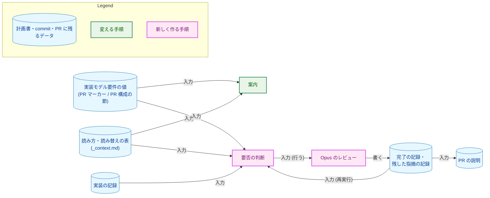
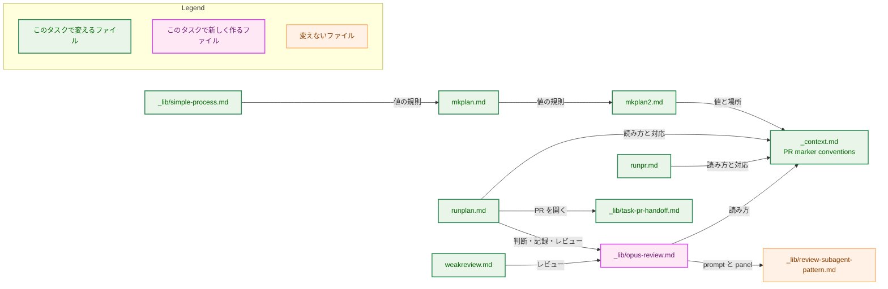
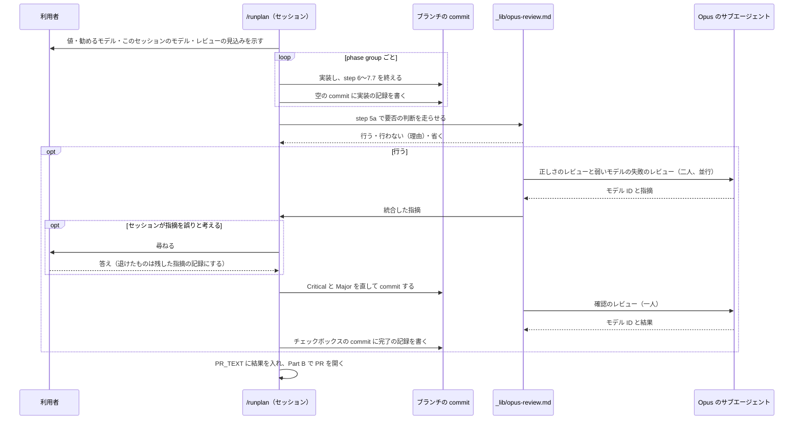
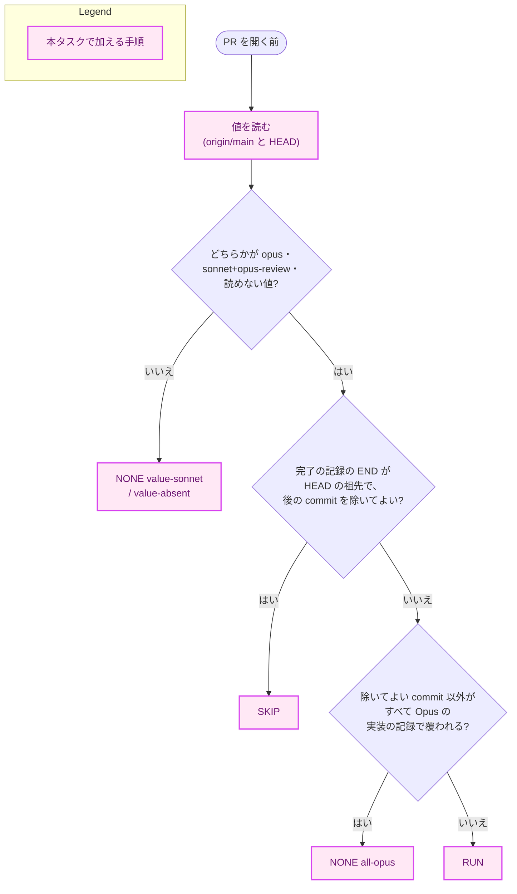
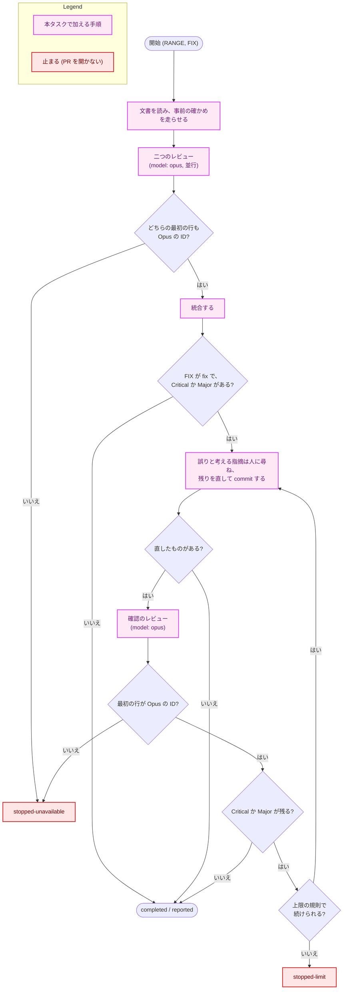

# アーキテクチャ設計書：実装モデル要件を Opus・Sonnet の選択に直結させ、Opus のレビューを一度に行う

## Document Status

| Item | Value |
|---|---|
| Status | `draft` |
| Created | 2026-11-10 |
| Review date | - |
| Reviewer | - |
| Comments | - |

本書は [01_requirements.md](01_requirements.md)（要件定義書。以下、要件書）の設計である。既存のファイルの内容は、コミット `9ba8f68a` で確かめた。`file:line` の行番号は、このコミットでの行番号である。F-NNN・AC-NN は要件書の項番を、H-NN は [design_handoff.md](design_handoff.md)（以下、申し送り）の項番を指す。申し送りへの対応は付録 A に、受け入れ基準との対応は付録 B にまとめる。

本書は、要件書 6 章の用語（実装モデル要件・正しさのレビュー・弱いモデルの失敗のレビュー・phase group・確認のレビュー・Opus のレビュー・旧い値・読めない値・読み替えの表）を、要件書と同じ意味で使う。そのほかに、次の用語を使う。

-   **共通の手順:** Opus のレビューを定める新しいファイル `.claude/commands/_lib/opus-review.md`。`/runplan` と `/weakreview` がこれに従う（3.5）。
-   **記録の行:** commit メッセージの、決まった形で 1 列目から始まる 1 行。本タスクは、実装の記録・完了の記録・残した指摘の記録の 3 種類を加える（3.4）。考え方は、ローカルの CLI レビューの記録の行（`.claude/commands/_lib/local-cli-review.md:303-318`）と同じである。
-   **実装の記録:** phase group の commit の範囲と、それを実装したモデルを示す記録の行（AC-18）。
-   **完了の記録:** Opus のレビューを終えたことと、レビューした範囲と、指摘の件数を示す記録の行。
-   **残した指摘の記録:** 直さずに進んだ Critical と Major の指摘を、1 件ずつ示す記録の行（AC-23、AC-27）。
-   **除いてよい commit:** 親が一つの commit のうち、空の commit と、親との差分で変えたファイルがタスクの `03_implementation_plan.md` と `README.en.md` だけの commit。merge commit は除いてよい commit にしない。チェックボックスと記録の行の commit、README の同期の commit がこれに当たる。Opus のレビューの要否を決めるときに、実装の記録で覆われていなくてよい commit である（3.5.2）。
-   **要否の判断:** PR を開く前に、Opus のレビューを行うか・行わないか・省くかを決める手順（3.5.1、3.5.2）。
-   **Opus の ID:** `claude-opus-` で始まるモデル ID。Opus かどうかは、この規則だけで決める（3.4）。
-   **実装の PR:** 本タスクの実装計画書が切る PR。8 章で、分け方の目安を示す。

## 1. 設計の全体像 (Design Overview)

### 1.1. 設計原則

-   **値の定義と読み方は、それぞれ一か所に置く。** 値の意味・契機・判定理由の書き方は `mkplan2.md` に置く（AC-05）。読み替えの表・値の読み方・値の場所・読んだ結果から勧めるモデルへの対応は、`_context.md` に置く（AC-09）。ほかのファイルは、それを名指して使う。
-   **Opus のレビューに関わる規則は、一つの共通の手順にまとめる。** 要否の判断、記録の行の形、二つのチェックリスト、統合、直し、確認、退けない規則、止まる条件は、共通の手順だけが持つ。`/runplan` と `/weakreview` は、範囲と、直すかどうかなどの入力を渡し、出力に従って振る舞う（要件書 4.5 節）。
-   **記録はブランチの commit に残す。** 1 つの PR は、複数の `/runplan` のセッションにまたがりうる。どのモデルが実装したか、Opus のレビューを終えたかを、セッションの記憶ではなく commit メッセージから読む。
-   **迷うときは、Opus のレビューを行う側に倒す。** 実装の記録で覆われない commit、読めない値、決まった形でない記録の行、判断の手順の失敗は、どれもレビューを行う側に倒す（要件書 4.3 節）。
-   **レビューを受ける側に判断を任せない。** 要否の判断は、Sonnet のセッションが自分の作業について下すことになる。そのため、文の解釈ではなく、共通の手順が持つ決まった手順（シェルのコマンド）で行う（3.5.2）。
-   **Opus で走ったことは、確かめてから信じる。** Agent ツールに Opus を指定したことではなく、サブエージェント自身が報告するモデル ID で確かめる（3.5.5）。
-   **リポジトリの外のスキルに頼らない。** 正しさのレビューの観点は、リポジトリの中のチェックリストとして書く（1.2 の決定 1）。

### 1.2. 設計の際に決めたこと（2026-11-10）

1.  **正しさのレビューの観点は、リポジトリの中のチェックリストとして共通の手順に書く。組み込みの `/code-review` スキルは呼ばない。** 確かめた事実: `model` に `opus` を指定したサブエージェントには、Skill ツールと `code-review` スキルが見える（呼び出しは確かめていない）。ただし、このスキルの説明は「correctness bugs (plus reuse/simplification/efficiency …)」で、cleanup を含む。出力の形もスキルの側で決まる。理由: cleanup を除くこと（AC-28）と出力の形を固定できず、リポジトリの外でスキルが変わるとレビューの中身が黙って変わるため。採らない案: サブエージェントから `/code-review` を呼ぶ案。ADR: [ADR-0042](../../dev/adr/0042-implementation-model-tiers.md) を更新した。
2.  **Opus のレビューに関わる規則は、共通の手順 `_lib/opus-review.md` に置く。弱いモデルの失敗のチェックリスト（今の `weakreview.md` の「Weak-model failure checklist」）と、決定的な事前の確かめ（今の `weakreview.md` step 3）も、ここへ移す。** 理由: Opus のレビューの定義を一か所にまとめるため（利用者の選択）。採らない案: `/runplan` が `/weakreview` を呼ぶ案（引数の解釈、範囲の確かめ、作業ツリーの確かめが `/runplan` の手順と重なる）と、チェックリストを `weakreview.md` に残して共通の手順が名指す案（定義が二つのファイルに分かれる）。チェックリストを移すと、同じチェックリストに項目を足すタスク 0080 との順序の扱いが要る（8 章）。ADR: ADR-0042 を更新した。
3.  **Opus のレビューの直しの commit は、PR を開く前にローカルの CLI レビューへかけ直さない。** 理由: 直しは PR を開く前にブランチへ入るので、PR を作ったときの Codex の PR レビューが必ず見る。ローカルの CLI レビューの割り当てと、Codex CLI に切り替わったときの Codex の allowance を使うほどの益がない。採らない案: 直しの範囲をローカルの CLI レビューにかける案。ADR: ADR-0042 を更新した（ADR-0042 の「結果」が、この点を設計に委ねていた）。
4.  **実装の記録・完了の記録・残した指摘の記録は、commit メッセージの記録の行にする。手で実行した `/weakreview` は、完了の記録を書かない。** 実装の記録は、phase group の最後に作る空の commit に書き、phase group の commit の範囲と、その間にセッションが使ったモデル ID を持つ。要否の判断では、除いてよい commit を除き、merge-base から `HEAD` までのすべての commit が、Opus の ID だけを持つ実装の記録の範囲に入っているときだけ、レビューを行わない。再び実行した `/runplan` は、完了の記録があり、その範囲の終わりが `HEAD` の祖先で、その後の commit がすべて除いてよい commit のときだけ、レビューを省く。理由: 記録がブランチと一緒に残り、セッションをまたいでも読めるため。phase group の外の commit（step 5a での直しや、手の commit）も、Opus で作られたと記録されていなければレビューの対象にするため（要件書 4.3 節）。手で実行した `/weakreview` が完了の記録を書かないのは、その範囲を自由に指定でき、PR の範囲と一致する保証がないためである。採らない案: 実装の記録を phase group のステップの ID で書き、ステップがすべて覆われるかで決める案（記録を書いた後の commit と、phase group の外の commit を見落とす）と、`/weakreview` も完了の記録を書く案。ADR: ADR-0042 を更新した。
5.  **単一フェーズの計画書の値は、§3 の「PR 構成」の節の終わりに、`**実装モデル要件**` と `**判定理由**` の 2 行として書く。`/mkplan` は、単一フェーズの計画書にもこの節を書く。** 確かめた事実: 既存の単一フェーズの計画書（0023・0054・0069・0070・0071）は、どれも §3 に `### 3.2. PR 構成` の節を持つ。中身は、0023 が PR 1 行の表（0023 は PR マーカーも持つ）、ほかの 4 つが PR は 1 本で作成ポイントの印を置かないという文である。見出しの番号には `3.2.` と `3.2` の両方の書き方がある。理由: 既存の単一フェーズの計画書が使う位置（§3 の「PR 構成」の節）をそのまま使い、複数のフェーズの計画書が `### 3.2 PR 構成` を置く（`.claude/commands/mkplan2.md:87-96`）のと同じ節で値を見つけられるようにするため。節は、番号ではなく見出しの文（`PR 構成`）で探す。採らない案: `### フェーズ1` の見出しの直後に書く案（PR マーカーのある計画書と、値を探す場所がそろわない）と、§3 の空いている番号に `実装モデル要件` の専用の節を置く案（節の番号が計画書ごとに変わり、`PR 構成` の節と並んで値の置き場所が二つに見える）。ADR: ADR-0042 を更新した。
6.  **二つのレビューは、`_lib/review-subagent-pattern.md` の panel mode の二人のレビュアーとして走らせ、統合は panel mode の「Synthesize before fixing」に従う。重大度は Critical・Major・Minor の尺度を使い、`_lib/triage-pattern.md` は使わない。** 理由: 統合の規則（重複を除く、重大度が食い違えば高い方をとる、境目の問題を組み立て直す）は panel mode に既にある。`_lib/triage-pattern.md` の `invalid` の判定は、セッションが指摘を自分の判断で退けることに当たり、AC-23 と合わない。ADR: なし（共通の手順の中の組み立てで、ADR-0042 の決定の範囲に収まる）。
7.  **Opus で走ったかは、各レビューのサブエージェントが出力の最初の行に書く自分のモデル ID で確かめる。** 確かめた事実: `model` に `opus` を指定したサブエージェントは Opus のモデル ID を、`sonnet` を指定したものは Sonnet のモデル ID を、システムプロンプトの文を写して答えた。理由: 指定が効いたことを、レビューの結果と同じ出力の中で確かめられるため。ADR: ADR-0042 を更新した。
8.  **PR の説明に書く Opus のレビューの結果は、`/runplan` が要否の判断の結果と記録の行から書き、`_lib/task-pr-handoff.md` の PR_TEXT として渡す。** 理由: PR を開くセッションが、レビューを行ったセッションと違っても書けるようにするため。squash merge の後、ブランチの commit メッセージは `main` に残らないので、PR の説明が後から読める記録になる。指摘はサブエージェントの文を写さず、場所と自分の言葉の要旨で書く。ADR: なし（PR の説明の中身で、要件書が ADR なしと決めている）。
9.  **要否の判断では、値を `origin/main` の計画書とブランチの `HEAD` の計画書の両方から読み、レビューを行う側の結果をとる。** 理由: ブランチの上の計画書は、レビューを受けるセッションが書き換えられる。値の行を下げても、消しても、レビューが外れないようにするため。ADR: ADR-0042 を更新した。

### 1.3. なぜ今の仕組みでは足りないか

-   **値:** 今の値（`frontier-required`・`frontier-recommended`・`standard`）は、`runplan.md:15-20` の案内でモデルの名前に結びつかず、Opus のレビューの条件にもならない。値の意味を変えずに案内の文だけを直しても、`frontier-recommended` が Sonnet で進めてよいかは決まらない（要件書 1 節の背景）。
-   **レビューのモデル:** `_lib/review-subagent-pattern.md` は、呼ぶ側が MODEL を渡さない限り、発見のレビューをセッションのモデルで走らせる（`.claude/commands/_lib/review-subagent-pattern.md:30-35`、`:94-99`）。`/runplan` の step 7・7.5 のレビューのモデルは変えない（要件書 2.3 節）ので、新しく Opus に固定したレビューを足す必要がある。
-   **`/weakreview`:** 今の `weakreview.md` は、`code-review` と `simplify` が別に走ることを前提にし（`.claude/commands/weakreview.md:14-29`）、`--fix` がなければ報告だけで終わる（`:128-132`）。どのコマンドからも呼ばれない。このままでは、`/runplan` から一度で行える Opus のレビューにならない。

### 1.4. 概念モデル

図 1 に、値・記録・Opus のレビューの関係を示す。矢印 A → B は「A が B の入力になる、または A が B を書く」を表す。



## 2. システム構成 (System Structure)

### 2.1. 全体構成

本タスクは、コマンドの定義・`_lib/` の共通の手順・`CLAUDE.md`・ADR の文言だけを変える。実行時に動くコンポーネント（拡張・Native Messaging のホスト・サーバ・CLI）と、開発の道具（`fixprguard`・`codexreview`・`mergepr`・`coveragecompare`）は変わらない。図 2 に、変えるファイルが互いをどう参照するかを示す。矢印 A → B は「A が B の定義を名指して使う」を表す。



図 2 のうち、次の矢印は今の関係である。ほかの矢印は、実装の PR で加わる関係である。

-   `mkplan.md` → `mkplan2.md`：step 8.5 が `mkplan2.md` の steps 4〜9 に従う（`.claude/commands/mkplan.md:189-195`）。加わるのは、単一フェーズの計画書の値の規則への名指しである。
-   `_lib/simple-process.md` → `mkplan.md`：「Writing the three documents」が `mkplan.md` の手順を使う（`.claude/commands/_lib/simple-process.md:156-164`）。
-   `mkplan2.md` → `_context.md`：冒頭が、PR マーカーの書式の正本として `_context.md` を名指す（`.claude/commands/mkplan2.md:8`）。
-   `runplan.md` → `_context.md`：冒頭の案内が PR marker conventions を名指す（`.claude/commands/runplan.md:15-17`）。`runpr.md` は今、値をそのまま示すだけで、読み方を名指さない（`.claude/commands/runpr.md:719-731`）。
-   `runplan.md` → `_lib/task-pr-handoff.md`：step 5a と step 8 が Part B に従う（`.claude/commands/runplan.md:83-125`、`:233`）。
-   `weakreview.md` → `_lib/review-subagent-pattern.md`：今は `weakreview.md` が直接従う（`.claude/commands/weakreview.md:108`）。実装の後は、共通の手順を通して従う。

### 2.2. コンポーネント配置

| ファイル | 変更の内容 | 節 |
|---|---|---|
| `.claude/commands/_context.md` | PR marker conventions を、新しい 3 つの値・値を書くコマンドと読むコマンド・値の場所・値の読み方・読み替えの表・読んだ結果から勧めるモデルへの対応に書き換える | 3.1 |
| `.claude/commands/mkplan2.md` | step 4 の「Model requirement」、step 6 の書式と `**判定理由**` の規則、step 7 の表の例、step 9 のペルソナとチェックリストを新しい値にする | 3.2 |
| `.claude/commands/mkplan.md` | step 8.5 に、単一フェーズの計画書の「PR 構成」の節と値の 2 行を書くことを足す。レビューのチェックリストにその項目を足す | 3.3 |
| `.claude/commands/_lib/simple-process.md` | 「Writing the three documents」に、単一フェーズの計画書の値を書くことを足す | 3.3 |
| `.claude/commands/_lib/opus-review.md`（新規） | 要否の判断、記録の行、決定的な事前の確かめ、二つのチェックリスト、panel・統合・直し・確認・退けない規則・止まる条件 | 3.4、3.5 |
| `.claude/commands/runplan.md` | 冒頭の案内、実装を始める前の案内の表示、phase group の最後の実装の記録、step 5a と step 8 の要否の判断と Opus のレビューと PR_TEXT | 3.6 |
| `.claude/commands/weakreview.md` | Purpose・引数・範囲のそろえ方・直すときの確かめ・PR が開いているときの添え書きを書き換え、レビュー本体は共通の手順に従う。チェックリストと事前の確かめは共通の手順へ移す | 3.7 |
| `.claude/commands/runpr.md` | step 4 の質問と step 5 の `/clear` の案内で、値と始めるモデルを示す。単一フェーズの計画書の値を読む | 3.8 |
| `.claude/commands/_lib/task-pr-handoff.md` | PR_TEXT と Part B step 3 の本文の項目に、`/runplan` が渡す Opus のレビューの結果を足す | 3.9 |
| `CLAUDE.md` | コマンドの一覧の `/weakreview` の行と、PR を作るコマンドが行うレビューを述べる段落 | 3.11.1 |
| `docs/dev/adr/0042-implementation-model-tiers.md` | 本書の PR で、1.2 の決定を足した。実装の最後の PR で、「決定」の食い違いの記述を消す | 3.11.2 |
| `docs/dev/adr/0016-document-test-policy.md` | チェックリストを移す実装の PR で、`weakreview.md` の「Weak-model failure checklist」への参照を、編集上の訂正で直す | 3.11.3 |
| `docs/tasks/0081_implementation_model_choice/03_implementation_plan.md` | 実装計画書（`/mkplan` の PR が作る） | - |

次のファイルは変えない。

-   0073・0076・0077 の計画書と、完了したタスクの計画書と設計書（AC-13、要件書 2.3 節）。完了したタスクの設計書（たとえば 0080 の設計書）が `weakreview.md` の行を名指していても、その時点の記録として残す。
-   `.claude/commands/_lib/review-subagent-pattern.md`。共通の手順は、この手順の prompt の組み立てと panel mode を使い、それに足す規則と置き換える規則を自分の中に書く（3.5.4、3.10）。
-   `.claude/commands/_lib/local-cli-review.md`。Opus のレビューの直しを、ローカルの CLI レビューにかけ直さない（1.2 の決定 3）。step 7.7 の記録の行の置き方も変えない（3.6.3）。
-   `.claude/commands/_lib/triage-pattern.md`（1.2 の決定 6）。
-   `.claude/commands/fixpr.md` と `.claude/commands/mergepr.md`。値も記録の行も読まない。
-   `docs/dev/security.md`。冒頭の「`mkarch` / `weakreview` などのコマンドは…本書を参照する」（`docs/dev/security.md:3`）は、`/weakreview` が共通の手順を通して本書を読み続けるので、実装の後も正しい。
-   ADR の索引 `docs/dev/adr/README.md`。ADR-0042 の題名は変わらない。
-   Go のコードとテスト（3.12）。

### 2.3. データフロー

図 3 に、PR マーカーのある計画書の 1 つの PR について、実装から PR を開くまでの、記録の行の作成と Opus のレビューの流れを示す。矢印は、呼び出しと受け渡しの順序を表す。



-   phase group ごとのレビュー（step 7・7.5）とローカルの CLI レビュー（step 7.7）は、今のまま図 3 のループの中で行う。
-   単一フェーズの計画書では、step 8 が、Part B の前に同じ判断とレビューを行う（3.6.4）。

## 3. コンポーネント設計 (Component Design)

本タスクは Go のコードを変えないので、型やインタフェースの定義はない。代わりに、値の読み方、記録の行の形、共通の手順の入力と出力を、ここで定める。コマンドの定義の文言は、実装の PR で書く。

### 3.1. `_context.md` の PR marker conventions（AC-09、AC-37、H-08）

今の `_context.md:64` は、旧い 3 つの値と、それを書くコマンドと読むコマンドを 1 項目で述べている。これを、次の 5 つで置き換える。

1.  **値:** `opus`・`sonnet+opus-review`・`sonnet` の 3 つ。書くのは `mkplan2.md` step 4 の「Model requirement」（`mkplan.md` の step 8.5 と、簡易な進め方の `mkreq.md` から使われるものを含む）と、単一フェーズの計画書を書く `mkplan.md` の step 8.5（`_lib/simple-process.md` の「Writing the three documents」から使われるものを含む）である（AC-37）。読むのは `runplan.md`（案内）、共通の手順（要否の判断）、`runpr.md`（step 4 の質問と step 5 の `/clear` の案内）である。値の意味・契機・判定理由の書き方は `mkplan2.md` step 4 を名指し、ここでは繰り返さない（AC-05）。
2.  **値の場所:** PR マーカーの節（`### PR-N 作成ポイント` の見出しから次の見出しまで）の `**実装モデル要件**` の行。単一フェーズの計画書では、§3 の中で、見出しの文（番号を除く）が `PR 構成` である節（`### 3.2 PR 構成` と `### 3.2. PR 構成` のどちらの書き方でもよい）の、`**実装モデル要件**` の行（1.2 の決定 5）。節は、次の見出し（どの階層でも）の前で終わる。
3.  **読み方:** 場所の中で、1 列目から `**実装モデル要件**: ` で始まる行を探す。その後から行の終わりまでを、前後の空白を除いて読む。
    -   新しい 3 つの値のどれかと完全に一致すれば、その値とする。
    -   旧い 3 つの値のどれかと完全に一致すれば、読み替えの表で新しい値とする。示すときは、旧い値と読み替えた値の両方を示す（AC-10）。
    -   どちらでもなければ、読めない値とする。推し量って別の値として扱わない（AC-11）。
    -   行がなければ（単一フェーズの計画書に `PR 構成` の節がない場合を含む）、値がないものとする（AC-12）。
4.  **読み替えの表:** 次の表を置く。旧い値が現れる指示は、この表と、旧い値を読むときの扱いを述べる箇所だけである（AC-09、AC-39）。

    | 旧い値 | 読み替えた値 |
    |---|---|
    | `frontier-required` | `opus` |
    | `frontier-recommended` | `sonnet+opus-review` |
    | `standard` | `sonnet` |

    表には、「PR がまだ作られていない PR マーカーに旧い値を持つ計画書がなくなれば、この表は消してよい」と添える（要件書 4.5 節）。
5.  **読んだ結果から勧めるモデルへの対応:** 次の表を置く。`runplan.md` の案内と `runpr.md` の表示は、この表を名指して示し、表を繰り返さない。Opus のレビューの列の詳しい規則は、共通の手順の要否の判断（3.5.2）が持つ。

    | 読んだ結果 | セッションを始めるモデル | Opus のレビュー |
    |---|---|---|
    | `opus` | Opus | 要否の判断が決める（Opus の記録で覆われない commit があれば行う） |
    | `sonnet+opus-review` | Sonnet | 同上 |
    | `sonnet` | Sonnet | 行わない |
    | 読めない値 | なし（その文字列と、読めない値であることを示す） | `sonnet+opus-review` と同じに扱う |
    | 値がない | なし（値がないことを示す） | 行わない |

値の行に括弧書きの注を付けた完了済みの計画書（`docs/tasks/0017_intermediate_artifacts/03_implementation_plan.md`）は、読めない値になる。0017 は完了しているので、`/runplan` と `/runpr` の振る舞いには影響しない（H-08）。

### 3.2. `mkplan2.md`（AC-01〜AC-05）

-   **step 4 の「Model requirement」**（`.claude/commands/mkplan2.md:41-46`）: 3 つの値を、要件書 F-001 の表のとおりの意味と契機で定める。契機の文は今の 3 区分の契機をそのまま引き継ぎ、意味の文だけを、とるべき行動（どのモデルで実装し、Opus のレビューを足すか）に書き換える。PR は、その PR のステップが求める値のうち最も高いものをとる（`opus` > `sonnet+opus-review` > `sonnet`）。「`weakreview.md` で確かめる」という今の文（`:41`）は消す（AC-39）。値の意味と判定理由の書き方は、この step だけが定める（AC-05）。
-   **step 6 の書式**（`:66`、`:84-85`）: 書式の行を `opus | sonnet+opus-review | sonnet` にする。`**判定理由**` の規則を、`opus` と `sonnet+opus-review` では当たった契機と「Sonnet に任せると何が起きやすいか」を、`sonnet` では当たる契機がないことを書く形にする（AC-03）。step 6 の値の説明は step 4 を名指し、意味を繰り返さない。
-   **step 7 の表の例**（`:93-95`）と **step 9**（ペルソナの文 `:111`、チェックリスト `:125-126`）: 新しい値で書く。チェックリストは、`判定理由` が「Sonnet に任せると何が起きやすいか」を述べているかも見る（AC-04）。
-   単一フェーズの計画書で止まる step 2 の扱い（`:29`）は変えない。単一フェーズの計画書の値は `mkplan.md` が書く（H-07）。

### 3.3. `mkplan.md` と `_lib/simple-process.md`（AC-06、AC-08）

-   **`mkplan.md` step 8.5**（`.claude/commands/mkplan.md:189-195`）: `### フェーズ` が一つのときは、PR マーカーを作らない代わりに、§3 に「PR 構成」の節を一つ置く。節には、PR が 1 本であることを書き、節の終わりに `**実装モデル要件**` と `**判定理由**` の 2 行を書く。値と判定理由は、`mkplan2.md` step 4 の「Model requirement」と step 6 の `**判定理由**` の規則で決める（AC-06）。
-   **`mkplan.md` の「Technical correctness checklist」**: 単一フェーズの計画書の「PR 構成」の節が一つだけあり、値の 2 行を持ち、判定理由が step 4 の規則に合うことを見る項目を足す。複数のフェーズの計画書の値は、今のとおり `mkplan2.md` step 9 のチェックリストが見る。
-   **`_lib/simple-process.md`「Writing the three documents」**（`.claude/commands/_lib/simple-process.md:159-164`）: 「with one phase there are no PR markers」の後に、`mkplan.md` step 8.5 のとおり「PR 構成」の節と値の 2 行を書くことを足す（AC-08）。「Reviewing the three documents」は `mkplan.md` step 8 のチェックリストを使うので、上の項目もそこで見られる。

### 3.4. 記録の行（AC-18、AC-23、AC-27、H-05、H-09）

3 種類の記録の行の形を、共通の手順の「Record lines」の節に定める。どれも、commit メッセージの 1 列目から始まる 1 行である。字下げした行や、文の途中で形に触れた行は記録の行ではない。commit メッセージの文の行を、これらの書き出しで始めてはならない（ローカルの CLI レビューの記録の行と同じ規則。`_lib/local-cli-review.md:305-311`）。

```text
Implementation model: <START12>..<END12> <model-id>[, <model-id> ...]
Opus review: done <START12>..<END12> (critical <n>, major <n>, minor <n>)
Opus review: kept <path>:<line> (<severity>; <reason>)[ <summary>]
```

-   **Opus かどうかの規則:** モデル ID が `claude-opus-` で始まるときだけ Opus とする。この規則は「Record lines」の節だけが持ち、要否の判断（3.5.2）とモデル ID の確かめ（3.5.5）の両方がこれを名指す。
-   **実装の記録（`Implementation model:`）**
    -   書く場所: phase group の最後、step 7.7 が返った後に `/runplan` が作る空の commit（`git commit --allow-empty`）のメッセージ。この commit は、step 7.7 の記録の行を置く「step 7.7 の後の最初の commit」（`runplan.md:228`）にもなる（3.6.3）。
    -   `<START12>..<END12>`: phase group の範囲。START は step 4.5 の `PHASE_START`、END は空の commit を作る直前の `HEAD`。どちらも 12 文字に切る。commit C がこの範囲に入るとは、C が `git rev-list START..END` に含まれることをいう。
    -   `<model-id>`: セッションが自分のモデルとして知る ID（Claude Code がシステムプロンプトで与える ID）。セッションは step 4.5 と、phase group の各 commit の時点で自分のモデル ID を確かめ、見えた ID をすべて並べる。
    -   どこかの時点で自分のモデル ID が分からなかったときは、この行を書かない。その範囲は記録で覆われず、Opus のレビューを行う側に倒れる（H-05）。
-   **完了の記録（`Opus review: done`）**
    -   書く場所: Opus のレビューを終えた後に `/runplan` が作る commit（3.6.4）。
    -   `<START12>..<END12>`: レビューした範囲。START は merge-base、END は記録を書く直前の `HEAD`（直しの後にグリーンゲート（`_context.md` の Green gate）を通すための直しを含む）。グリーンゲートの直しは確認のレビューを受けていないが、ビルドの直しに限られるので、範囲に含めてよいものとする。
    -   件数: 発見のレビューの指摘と、確認のレビューで新しく挙がった指摘を、統合した後に数えた重大度ごとの件数。
    -   `/weakreview` は書かない（1.2 の決定 4）。
-   **残した指摘の記録（`Opus review: kept`）**
    -   直さずに進んだ Critical と Major の指摘を、1 件 1 行で書く。人の答えを受けたその時点で、記録の行だけを持つ空の commit を作って書く。止まって再び実行しても、同じ指摘を人に尋ね直さないためである（3.5.4）。
    -   `<reason>`: `rejected by human`（人が退けた。AC-23）か、`decision change declined`（直すのに決定の変更が要り、人が認めなかった。AC-24）。
    -   `<summary>`: サブエージェントの文を写さず、自分の言葉で書く（1.2 の決定 8）。mention の確かめで消したときは、`<summary>` のない形になる。
-   **mention の確かめ:** 共通の手順が作るすべての commit（直しの commit と、記録の行の commit）の前に、メッセージをファイルに書き、`_context.md` の PR review request の mention を `grep -qiF` で探す（`_lib/local-cli-review.md:267-278` と同じ確かめ）。終了コードが 1 のときだけ通る。0（見つかった）と 1 より大きいもの（確かめの失敗）は通らない。直しの commit のメッセージにも、サブエージェントの文を写さない。通らないときは、記録の行の `<summary>` と、メッセージの中で指摘から書き起こした文を消して、もう一度確かめ、それでも通らなければ止まって報告する。

### 3.5. 共通の手順 `_lib/opus-review.md`（AC-19〜AC-31、H-01〜H-03、H-06）

frontmatter の `description` は、ほかの `_lib/` と同じく「Internal: … (not a command)」の形にする。英語で書く（`CLAUDE.md`、「Document language」の原則 (b)）。具体的なモデル ID（Opus の版を含む ID）は書かない。プロンプトに写ると、Opus でないサブエージェントがそれを写して報告できるからである（3.5.5）。

共通の手順には、入口が二つある。入口 1 は要否の判断、入口 2 はレビューである。

#### 3.5.1. 入口 1: 要否の判断（`/runplan` だけが使う）

| 入力 | 意味 |
|---|---|
| PLAN | タスクの `03_implementation_plan.md` のパス |
| TARGET | 対象の PR を表すもの。PR マーカーのある計画書では、その PR の `### PR-N 作成ポイント` の `N`。単一フェーズの計画書では「単一」 |
| BASE | `$(git merge-base origin/main HEAD)` |

| 出力 | 意味 |
|---|---|
| `RUN` | Opus のレビューを行う |
| `NONE <reason>` | 行わない。`<reason>` は `value-sonnet`（値が `sonnet`）、`value-absent`（値がない）、`all-opus`（除いてよい commit を除くすべての commit が、Opus の実装の記録で覆われる）のどれか（AC-20、AC-27） |
| `SKIP <done-line>` | 省く。条件を満たす完了の記録と、その後に続く commit の一覧を返す |

#### 3.5.2. 要否の判断の手順（AC-19、AC-20、AC-11、AC-12）

要否の判断は、共通の手順が持つシェルのコマンドの組で行い、セッションは出力を読むだけにする。今の `weakreview.md` step 3 の事前の確かめと同じく、決まった処理を文の解釈に任せないためである。コマンドの組が失敗したとき（`git` の失敗、計画書を読めない、場所が二つ以上見つかる）は `RUN` とする。

1.  **値を読む:** PLAN を、`git show origin/main:<PLAN>` と `HEAD` の作業ツリーの両方から、3.1 の場所と読み方で読む（1.2 の決定 9）。どちらかが `opus`・`sonnet+opus-review`・読めない値なら、レビューを行う側とする。両方が `sonnet` か値がないときだけ、`NONE value-sonnet` か `NONE value-absent` を返す（どちらかが `sonnet` なら `value-sonnet` を理由にする）。`origin/main` に計画書がない、または対象の PR マーカーがないときは、`HEAD` だけで決める。
2.  **完了の記録を確かめる:** `git log BASE..HEAD` の commit メッセージに、完了の記録があるか探す。最後の完了の記録について、次のすべてが成り立てば `SKIP` を返す。
    -   その END の commit が存在し、`HEAD` の祖先である。
    -   END から `HEAD` までの commit が、すべて除いてよい commit である。
3.  **実装の記録で覆われるかを確かめる:** `git rev-list BASE..HEAD` の各 commit について、除いてよい commit でなければ、少なくとも一つの実装の記録の範囲に入り、その commit を範囲に含むすべての実装の記録のモデル ID が Opus の ID であることを確かめる。すべての commit がそうなら `NONE all-opus` を返す。一つでもそうでない commit があれば（記録のない phase group、Opus 以外の記録、phase group の外の commit、merge commit、書き換えられて範囲から外れた commit）、`RUN` を返す。

この手順は、要件書 AC-19 の「phase group の記録が Opus 以外か、記録がない」を、commit の単位で確かめる形にしたものである。phase group の外で作られた commit（step 5a での直し、手の commit、`/weakreview` の直し）も、Opus で作られたと記録されていなければ対象になる。迷うときにレビューを行う側に倒す、要件書 4.3 節の方針に従う。そのため、phase group をすべて Opus で実装した PR でも、step 5a の要否の判断の前に作った直し（グリーンゲートの直し、AC の確かめの直し）があれば、レビューを行う。これは承知のうえの費用である。同じ方針で、値を `origin/main` からも読むこと（1.2 の決定 9）と、AC-18 の「phase group の commit」を phase group の最後の空の commit とすること（3.4）も、要件より厳しい側か同じ側の解釈であり、AC-20 が挙げる行わない場合を広げない。

#### 3.5.3. 入口 2: レビュー

| 入力 | 意味 | `/runplan` | `/weakreview` |
|---|---|---|---|
| RANGE | `<base>..<head>` の形の範囲 | `BASE..HEAD`（AC-21） | 引数から解いて、この形にそろえた範囲（3.7、AC-36） |
| TASK_DIR | タスクのディレクトリ | 対象のタスク | `task_identification.md` で特定したタスク |
| FIX | `fix` か `report` | `fix` | `--no-fix` がなければ `fix`、あれば `report` |
| DECISION_CHANGE | 直すのに決定の変更が要る指摘の扱い | `runplan.md` step 5 の「Decision change」の規則に従う（AC-24） | 直さずに報告し、人に委ねる（AC-31） |

| 出力 | 意味 |
|---|---|
| OUTCOME | `completed`（Critical と Major が残らない）、`reported`（FIX が `report`）、`stopped-unavailable`（Opus で走らせられない）、`stopped-limit`（繰り返しの上限）のどれか |
| FINDINGS | 統合した指摘（重大度・場所・要旨）と、重大度ごとの件数 |
| KEPT | 直さずに進んだ Critical と Major の指摘と、その理由 |
| COMMITS | 直しの commit と、記録の行の commit |
| CATEGORIES | 各チェックリストの分類が clean・flagged・該当なしのどれか（今の `weakreview.md` の「Output format」、`:310-319`） |
| READ | 全体の見立ての 1 行（同上）。`/runplan` は step 8 の要約と PR の説明に載せるだけで、振る舞いは変えない |

レビューの手順の節は、次のとおりである。

1.  **読む文書:** TASK_DIR の `01_requirements.md`・`02_architecture.md`・`03_implementation_plan.md`、`docs/dev/conventions/test_organization.md`、`docs/dev/conventions/requirements_process.md`、`docs/dev/security.md`（今の `weakreview.md` step 2 から移す）。
2.  **決定的な事前の確かめ:** 今の `weakreview.md` step 3 の Check 1〜5 を移し、RANGE に対して走らせる。`runplan.md` step 6.5 の Check 1・2 と重なる確かめがあるが、step 6.5 は phase group の範囲、こちらは PR 全体の範囲である。弱いモデルの自己確認が上滑りした場合の確かめ直しを兼ねるので、重なりは残す（今の `weakreview.md` の Check 5 の注と同じ理由）。
3.  **二つのレビュー:** `_lib/review-subagent-pattern.md` の panel mode で、二人のレビュアーを並行して走らせる（3.5.4）。
    -   Reviewer A（正しさのレビュー）: 担当は、バグ（論理、エラーの経路、境界値、資源の解放）と、要件書の AC・設計書・計画書のステップの記述とのずれ。担当外は Reviewer B の担当と cleanup。CRITERIA は新しい「Correctness checklist」（1.2 の決定 1）。
    -   Reviewer B（弱いモデルの失敗のレビュー）: 担当は「Weak-model failure checklist」（今の `weakreview.md:134-308` を移す）。担当外は Reviewer A の担当。
    -   CRITERIA は、各レビュアーに自分の担当のチェックリストだけを渡す（panel mode の (a) pre-routed）。担当外は、気づいたときだけ OUT-OF-LANE FLAG の 1 行で報告させる。
    -   「Correctness checklist」と `runplan.md` の「Phase-group review checklist」は、設計とのずれを見る点で重なる。重なりは意図したもので、phase group のレビューはセッションのモデルで phase group の範囲を、こちらは Opus で PR 全体を見る。「Correctness checklist」には、テストの網羅（`runplan.md` step 7.5 の範囲）と cleanup の項目を入れない。
    -   今の弱いモデルの失敗のチェックリストにある再利用の項目は、弱いモデルが既存の関数を名前を変えて作り直す失敗を見る項目である。cleanup ではないので、Reviewer B に残す。
4.  **モデル ID の確かめ:** 3.5.5。
5.  **統合:** panel mode の「Synthesize before fixing」に従い、セッションが統合する（AC-22、AC-30）。重大度は Critical・Major・Minor を使い、`_lib/triage-pattern.md` は使わない（1.2 の決定 6）。
6.  **直しと確認:** FIX が `fix` のときに行う（3.5.4）。
7.  **出力:** 上の表のとおり。

#### 3.5.4. `_lib/review-subagent-pattern.md` の使い方と、足す規則・置き換える規則（AC-22〜AC-24、H-03）

共通の手順は、`_lib/review-subagent-pattern.md` の「Procedure」の prompt の組み立て、「Panel mode」の steps 1〜3、「Convergence」を使う。繰り返しの上限は、AC-22 のとおり「Procedure」の規則に従う（3 回の後は、残った指摘が具体的で範囲が限られ、範囲を広げずに直せるときだけ続け、そうでなければ止まって報告する）。そのうえで、次を足す、または置き換える。

-   **prompt に足すもの:** 発見のレビューと確認のレビューの、すべてのサブエージェントの prompt に、次を入れる。
    -   出力の最初の行を `Model: <model-id>` とし、`<model-id>` にはシステムプロンプトにある自分のモデル ID を写すこと（3.5.5）。
    -   cleanup（再利用・単純化・効率）の指摘をしないこと（AC-28）。
    -   事前の確かめの FLAG（今の `weakreview.md` step 4 の CRITERIA の扱いと同じ）。
    -   RANGE と、`git diff <RANGE>` と `git log <RANGE>` を自分で走らせること。
    -   残した指摘の記録がブランチにあれば、その一覧を渡し、同じファイルの近くの場所にある同じ要旨の指摘は人が決めたものとして、挙げ直さないこと。直しで行番号がずれるので、場所の一致だけで判断しない。
-   **FILES:** 上の「読む文書」と、RANGE で変わったすべてのファイル（今の `weakreview.md` step 4 の FILES と同じ）。
-   **モデル（置き換え）:** 発見のレビューも確認のレビューも、Agent ツールの `model` に `opus` を指定して走らせる。「Model tiering」の、確認のレビューを安いモデルで走らせてよいという規則は使わない（AC-22）。
-   **確認のレビューの形:** 一人のレビュアーに、直した指摘の一覧と、二つのチェックリストのうち直した指摘が属するものを渡す。
-   **直し（置き換え）:** 「Fix all Critical and Major issues」と「Apply Minor fixes at your discretion」を、次に置き換える。
    -   セッションは Critical と Major の指摘をすべて直し、ビルドの確かめ（`_context.md`）を通してから commit する（AC-22）。
    -   セッションが指摘を誤りと考えるときは、自分の判断で退けない。直す前に、場所・指摘の要旨・セッションの考えを示して、AskUserQuestion で人に尋ねる。人が退けたときだけ、直さずに進み、残した指摘の記録を書く（AC-23、3.4）。
    -   直すのに要件・設計・計画の決定の変更が要る指摘は、DECISION_CHANGE に従う（AC-24）。`/runplan` で人が決定の変更を認めなかったときは、残した指摘の記録を書く。
    -   直したものが一つもないとき（人がすべて退けたとき）は、確認のレビューを走らせない。
    -   Minor の指摘は直さず、出力と PR の説明で報告するだけにする。「Convergence」の、Minor を issue として記録する規則は使わない。GitHub への書き込みを増やさないためである。
-   **FIX が `report` のとき:** 何も直さず、OUTCOME `reported` を返す。

#### 3.5.5. Opus で走ったことの確かめ（AC-25、AC-29、H-06）

-   レビューのサブエージェントは、Agent ツールで `model` に `opus` を指定して走らせる。`subagent_type` に `fork` を使わない。Agent ツールの説明が、`fork` では `model` を無視すると述べているからである。
-   セッションは、各サブエージェントの出力の最初の行が `^Model: claude-opus-` に合うかを、決まった形の確かめ（`grep -E` など）で見る。合わないとき（形が違う、Opus の ID でない）は、Opus で走らせられなかったものとして扱う。
-   Agent ツールの呼び出しが失敗したときは、一度だけやり直す。やり直しも失敗したら、Opus で走らせられなかったものとして扱う。
-   Opus で走らせられなかったときは、セッションのモデルで代わりに走らせず、OUTCOME `stopped-unavailable` を返す。止まった時点までの直しの commit と残した指摘の記録は、ブランチに残す。
-   残る危うさ: サブエージェントの文脈に Opus の ID の文字列が入ると（レビューする差分や文書にその文字列があると）、Opus でないモデルがそれを写して報告できる。そのため、共通の手順と prompt には具体的なモデル ID を書かない（3.5 の冒頭）。この確かめは品質を保つための仕組みで、セキュリティの境界ではない（5.2）。

### 3.6. `runplan.md`（AC-07、AC-10〜AC-12、AC-14〜AC-27）

#### 3.6.1. 冒頭の案内（AC-14、AC-16）

今の案内（`.claude/commands/runplan.md:15-20`）を、次の内容に書き換える。

-   3 つの値それぞれについて、セッションを始めるモデルと、Opus のレビューが足される条件を述べる。対応は `_context.md` の「読んだ結果から勧めるモデルへの対応」（3.1 の 5）を名指し、条件の詳しい規則は共通の手順の要否の判断を名指す（AC-14）。
-   値が Opus のレビューの条件に関わることを述べる。「This does not change any step below.」の文と、「`weakreview.md` で確かめる」という文は消す（AC-16、AC-39）。
-   単一フェーズの計画書では、値を「PR 構成」の節から読むことを述べる（AC-07）。

#### 3.6.2. 実装を始める前の案内の表示（AC-15、AC-10〜AC-12）

step 4 で次の作業の単位を選んだ後、step 4.5 の前に、次を示す。step 4 が PR のチェックポイント（step 5a）を選んだときも、同じ表示をする。`/runplan` は、セッションのモデルと値が合わなくても止まらない。

-   対象の PR の値。対象の PR は、これから実装する phase group を覆う PR マーカーの PR で、単一フェーズの計画書では計画書そのものである。旧い値なら読み替えた値も、読めない値ならその文字列と読めない値であることも、値がないならそのことも示す。
-   勧めるモデル（`_context.md` の対応の表による）。
-   このセッションのモデル（3.4 の `<model-id>` と同じもの。分からなければ「分からない」）。
-   Opus のレビューを行う見込み。この時点で要否の判断（3.5.2）を走らせた結果を示す。実装の前には、これから作る commit がまだ記録で覆われていないので、値が `opus`・`sonnet+opus-review`・読めない値のときは、ふつう「行う」になる。そのときは、このセッションが Opus で、PR のほかの phase group もすべて Opus の記録を持てば、レビューを行わない場合があることを添える。PR を開く前に、もう一度判断する。

#### 3.6.3. 実装の記録（AC-18）

step 7.7 の後、step 8 の前に、空の commit を作り、実装の記録（3.4）を書く。今の step 7.7 は、記録の行を「step 7.7 が返った後に作る最初の commit」に書くと定めている（`.claude/commands/runplan.md:228`）。この空の commit がその最初の commit になるので、step 7.7 の記録の行も同じメッセージに書く。step 7.7 の、後に commit が続かないときに記録の行だけの空の commit を作る規則は、いつもこの commit で満たされる。

モデル ID は、step 4.5 で `PHASE_START` と一緒に確かめ、phase group の各 commit の時点でも確かめる（3.4）。

#### 3.6.4. step 5a と step 8 の Opus のレビュー（AC-19〜AC-27、H-04）

step 5a（`:78-127`）では、グリーンゲートの確認（`:80`）と、最後の PR のときの AC の確かめ（`:81`）の後、最初のチェックボックスの commit（`:82`）の前に、次を行う。

1.  共通の手順の要否の判断（入口 1）を走らせる。
2.  `RUN` のときは、レビュー（入口 2）を RANGE `BASE..HEAD`・FIX `fix` で行う。OUTCOME が `stopped-unavailable` か `stopped-limit` のときは、`/runplan` も止まる。PR を開かず、何も push せず、その旨と、利用者にできること（Opus が使えるようになってから `/runplan` を再び実行する。上限のときは、残った指摘を見て決める）を報告する（AC-22、AC-25）。
3.  直しの commit があれば、グリーンゲートをもう一度通す。
4.  最初のチェックボックスの commit のメッセージに、完了の記録を書く（3.4）。チェックボックスが既に `[x]` のとき（前のセッションが付けた後に止まったとき）は、記録の行だけの空の commit を作る。`NONE` と `SKIP` のときは、記録の行を書かない。
5.  PR_TEXT に、Opus のレビューの結果（3.9）を加える。

単一フェーズの計画書の PR（step 8、`:233`）では、step 8 の既存の確かめ（ブランチに PR がないこと、commit があること）の後、Part B の前に、同じ 1〜3 と 5 を行う。完了の記録は、記録の行だけの空の commit に書く。Part B の LOCAL_REVIEW の規則と CHECKS（グリーンゲート）は、今のままである。Opus のレビューの直しの範囲は、ローカルの CLI レビューにかけ直さない（1.2 の決定 3）。

この位置に置く理由: 直しの commit が PR を開く前にブランチへ入り（AC-26）、最初の Codex の PR レビューが直した後のコードを見るためである。

再び実行したとき（AC-25、H-04）は、要否の判断が次のように振る舞う。

-   Opus のレビューの途中で止まったとき（Opus が使えない、上限に達した）は、完了の記録がない。step 4 は同じチェックポイントを選び、step 5a が要否の判断からやり直す。これが「Opus のレビューから続ける」ことに当たる。止まる前の直しの commit は残り、レビューは PR のすべての commit を範囲にして走り直す。人が既に退けた指摘は、残した指摘の記録から読み、尋ね直さない（3.5.4）。
-   Part B で止まったとき（ローカルの CLI レビューなど）は、完了の記録がある。その後の commit が除いてよい commit だけなら省く。ローカルの CLI レビューの直しなど、コードを変える commit が後に続いていれば、もう一度レビューを行う。
-   ブランチを書き換えて（rebase など）完了の記録の END が `HEAD` の祖先でなくなったときは、レビューを行う。
-   利用者が手で `/weakreview` を実行した後でも、`/runplan` は完了の記録を見つけないので、条件が成り立てばレビューを行う（1.2 の決定 4）。

### 3.7. `weakreview.md`（AC-28〜AC-36、AC-38）

`weakreview.md` は、引数の解釈と、直すときの確かめと、報告だけを持ち、レビュー本体は共通の手順の入口 2 に従う。

-   **frontmatter:** `argument-hint` を `[range | PR] [--no-fix | --fix]` の趣旨に合わせる（AC-38）。
-   **Purpose:** `code-review` と `simplify` が別に走ることを前提にしない形に書き換える。Opus で正しさのレビューと弱いモデルの失敗のレビューを一度に行い、既定で直すことを述べる（AC-35）。
-   **引数（AC-32、AC-36）:** 範囲の指定（commit の範囲、PR 番号、省略時の `origin/main...HEAD`）は今と同じに受け付ける。`--no-fix` は報告だけにする。`--fix` は受け入れ、何もしない。`--no-fix` と `--fix` が両方あるとき、範囲の指定が二つ以上あるとき、ほかの引数があるときは、推し量らずに止まり、受け付ける引数を示す。
-   **範囲のそろえ方:** 受け付けた範囲を、共通の手順の RANGE の形（`<base>..<head>`）にそろえる。省略時は `git fetch origin main` の後に `$(git merge-base origin/main HEAD)..HEAD` とする。`A...B` の形は `$(git merge-base A B)..B` とする。PR 番号は、その PR の base と head から同じ形にする。三つの点の範囲を `git log` に渡すと、両側の commit を含む対称差になるからである。
-   **直すときの確かめ（AC-33）:** FIX が `fix` のとき、共通の手順を呼ぶ前に次を確かめ、成り立たなければ何も変えずに理由を報告して止まる。
    -   ブランチを checkout している（detached HEAD でない）。そのブランチが既定のブランチ（`main`）でない。
    -   RANGE の head が `HEAD` と同じ commit である。範囲の終わりが `HEAD` でないと、直しの commit が、範囲の外の commit の上に積まれるからである。
    -   作業ツリーが clean である（`git status --short` が空）。
-   **PR が開いているときの添え書き（AC-34）:** 直したとき、`gh pr view <current-branch> --json state,url` で開いた PR があれば、報告に次を添える。
    -   直しの commit は push されておらず、最初の PR レビューに届かないこと。
    -   push しないまま `/fixpr` を実行したとき、`/fixpr` が commit しなければ、push されていない commit があるために止まること（`.claude/commands/fixpr.md:885-891`）。`/fixpr` が commit すれば、この直しも一緒に push されること。`/runpr` と `/mergepr` は GitHub の上の head をマージするので、push しない直しは squash merge に入らないこと。
    -   `/runpr` の前に、利用者が push するか、直しを捨てるかを決めること。push した変更に PR レビューを頼むかは、`_lib/pr-review-escalation.md` が決めること。

    `gh pr view` が失敗したときは、添え書きを省かず、PR の状態を確かめられなかったことを報告する。
-   **ネットワークの操作:** `/weakreview` を実行することが、`git fetch origin main` と、`gh pr view`（範囲を解くためと、添え書きのため）を認める、と定義に書く。どれも読むだけで、GitHub へ書き込まない（`CLAUDE.md`、「Tool Execution Safety」は、ネットワークに触れるコマンドに承認を求める）。
-   **共通の手順の呼び出し:** DECISION_CHANGE は「直さずに報告し、人に委ねる」である（AC-31）。push はしない。完了の記録は書かない（1.2 の決定 4）。人が退けた指摘の記録（3.4 の `kept`）は、直すときだけ書く。
-   **報告:** 共通の手順の出力（OUTCOME・FINDINGS・KEPT・COMMITS・CATEGORIES・READ）と、添え書き。

### 3.8. `runpr.md`（AC-07、AC-10〜AC-12、AC-17）

-   **step 4**（`.claude/commands/runpr.md:719-731`）: 次の PR の値を示すとき、3.1 の読み方で読み、`_context.md` の対応の表により、値に加えて始めるモデルを示す。旧い値は読み替えた値と並べて示す。読めない値は、その文字列をそのまま示し、読めない値であることを添える。値がないときは、そのことと、分かる範囲の理由（PR マーカーに欄がない、単一フェーズの計画書に「PR 構成」の節や値の行がない）を示す。
-   **単一フェーズの計画書:** 今は「the plan has no PR marker」を値がない理由にしている（`:724-726`）。これを、「PR 構成」の節から値を読む形に改める（AC-07）。
-   **step 5 の `/clear` の案内**（`:1024-1025`）: step 4 で示した値と始めるモデルを、そのまま繰り返す。
-   step 4 を見出しで探す guard（3.12）があるので、step 4 の見出しは変えない。

### 3.9. `_lib/task-pr-handoff.md`（AC-27、H-09）

-   **PR_TEXT**（`.claude/commands/_lib/task-pr-handoff.md:44-47`）: `runplan.md` の PR_TEXT に、「Opus のレビューの結果」を加える。
-   **Part B step 3 の本文の項目**（`:201-250`）: `runplan.md` の PR では、PR_TEXT の Opus のレビューの結果を示す項目を足す。中身は次のとおりで、`/runplan` が要否の判断の結果と記録の行から書く。
    -   行ったとき: レビューした範囲と、指摘の件数を重大度ごとに（完了の記録から）。残した指摘があれば、その場所と要旨と理由（残した指摘の記録から）。Minor の指摘の要旨。
    -   行わなかったとき: AC-19 のどの条件が成り立たなかったか（値が `sonnet`、値の欄がない、すべての commit が Opus の実装の記録で覆われる）。
    -   省いたとき（再実行で完了の記録があった）: その完了の記録から、行ったときと同じ中身を書き、完了の記録より後の commit（除いてよい commit）を挙げる。
-   PR の説明は日本語で書く。本文のファイルは、今の Part B step 3 の mention の確かめを受ける。squash merge の後は、PR の説明が Opus のレビューの結果を後から読める記録になる（1.2 の決定 8）。

### 3.10. `_lib/review-subagent-pattern.md`

変えない。今の「Model tiering」は、MODEL を渡したときの panel のレビュアーのモデルを明記していない（`.claude/commands/_lib/review-subagent-pattern.md:113-114`）。共通の手順は、モデルの指定と確認のレビューの形を自分の中で定める（3.5.4）ので、この手順の文言に頼らない。

### 3.11. `CLAUDE.md` と ADR

#### 3.11.1. `CLAUDE.md`（AC-38）

-   コマンドの一覧の `/weakreview` の行（`CLAUDE.md:206`）を、Opus の二つのレビューを行い、既定で直して commit し（push はしない）、`--no-fix` で報告だけにする形と、受け付ける引数（`[range | PR] [--no-fix | --fix]`）に合わせる。
-   PR を作るコマンドが行うレビューを述べる段落（`CLAUDE.md:212-216`）に、`/runplan` が条件に応じて Opus のレビューを行うことを足す。

#### 3.11.2. ADR-0042（AC-40）

本書の PR で、1.2 の決定 1〜5・7・9 を「決定」に、採らない案を「採らなかった案」に足し、「結果」の、直しをローカルの CLI レビューで見直すかを設計に委ねる文を、決めた結果に書き換えた。「経緯」に本書の行を足した。「決定」の冒頭にある、決定がまだ `_context.md` とコマンドの定義に反映されていないという食い違いの記述は、実装の最後の PR で消す。

#### 3.11.3. ADR-0016

ADR-0016 は、`weakreview.md` の「Weak-model failure checklist」を、過大な `diff` の確かめを指摘するチェックリストの一つとして名指している（`docs/dev/adr/0016-document-test-policy.md:25`）。チェックリストを共通の手順へ移す実装の PR は、この参照を `_lib/opus-review.md` に直す。ADR-0016 の決定は変わらないので、編集上の訂正（`docs/dev/conventions/adr.md`、「Editorial corrections」）であり、その commit に訂正の行を書く。

ADR-0016 の `:27` と ADR-0035 の `:25` も `weakreview.md` を名指すが、どちらもタスク 0080（#789）がまだ反映していないことを述べる食い違いの記述で、0080 の実装が消す。チェックリストを移す実装の PR は 0080 の実装の後に置く（8 章）ので、その時点ではこれらの記述は残っていない。

### 3.12. 既存のテスト

-   値・記録の行・`/weakreview` の振る舞いを確かめる Go のテストはない。`9ba8f68a` で、`_test.go` に `frontier-`・`weakreview`・`実装モデル要件` を含むものはない（`grep -rln` の結果）。変えるテストはない。
-   `TestInstructionDocPaths`（`cmd/yt2column/docpaths_test.go:140`）は、`.claude/commands` の下の文書が名指すパスが存在することを確かめる。`_lib/opus-review.md` を名指す PR は、そのファイルを同じ PR で作る。
-   `TestCodexMentionOnlyInRequestRow`（`cmd/yt2column/codex_review_docs_test.go:92`）は、コマンドの文書に mention がないことを確かめる。新しいファイルも対象になる。
-   `runpr.md` の step 4 を見出しで探す guard がある（`cmd/yt2column/fixpr_docs_test.go` の `runprStep4`）。3.8 の変更は step 4 の見出しを変えない。
-   `TestADRRecords`（`cmd/yt2column/adr_test.go:434`）は、ADR-0042 と ADR-0016 の形を確かめる。

## 4. エラーハンドリング設計 (Error Handling Design)

### 4.1. 実行時のエラー

N/A。Go のコードを変えないので、エラーの型はない。

### 4.2. 手順の中の失敗

| 状況 | 振る舞い | AC |
|---|---|---|
| 値が読めない | 止まらない。その文字列と、読めない値であることを示し、Opus のレビューの条件では `sonnet+opus-review` と同じに扱う | AC-11 |
| 値の欄がない | 止まらない。値がないことを示し、`origin/main` の計画書も値がなければ、Opus のレビューを行わない | AC-12 |
| ブランチの上で値が下げられた、消された | 要否の判断は `origin/main` の値も読み、レビューを行う側をとる | 1.2 の決定 9 |
| セッションのモデルと値が合わない | 止まらない。案内を示す | AC-15 |
| セッションが自分のモデル ID を知らない | 実装の記録を書かない（範囲は覆われず、レビューを行う側に倒れる）。案内では「分からない」と示す | AC-18、AC-19 |
| 記録の行が決まった形でない | 記録がないものとして扱う | AC-19 |
| 要否の判断のコマンドが失敗した | `RUN` とする | AC-19 |
| Agent ツールの呼び出しが失敗した | 一度だけやり直す。やり直しも失敗したら、Opus で走らせられないものとして扱う | AC-25 |
| Opus で走らせられない（3.5.5） | 止まる。`/runplan` は PR を開かず、何も push しない | AC-25、AC-29 |
| 確認のレビューの上限に達した | `_lib/review-subagent-pattern.md` の規則で止まる。`/runplan` は PR を開かず、何も push しない。残った指摘を報告する | AC-22 |
| セッションが指摘を誤りと考える | 人に尋ねる。退けられたものだけ、残した指摘の記録に書いて進む | AC-23 |
| 直すのに決定の変更が要る | `/runplan`: step 5 の規則で人と決める。`/weakreview`: 直さずに報告する | AC-24、AC-31 |
| commit メッセージに mention が入る | 指摘から書いた文を消して確かめ直す。それでも入るなら止まる | 3.4 |
| `/weakreview` の引数が矛盾する、または受け付けない | 止まり、受け付ける引数を示す | AC-32 |
| `/weakreview` で、既定のブランチの上、範囲の終わりが `HEAD` でない、または作業ツリーが clean でない（直すとき） | 何も変えずに止まり、理由を報告する | AC-33 |
| `/weakreview` で、`gh pr view` が失敗した | PR の状態を確かめられなかったことを報告する | AC-34 |

報告の文は、どれも日本語で、止まった理由と、利用者が次にできることを含める（`CLAUDE.md`、「Language」）。

## 5. セキュリティ考慮事項 (Security Considerations)

### 5.1. 製品

N/A。要件書 4.2 節のとおり、条件付きのガイド（`docs/dev/security.md`）の契機に当たらない。製品のコードと、外部コマンドの起動・API キー・Webhook の URL・キャッシュ・プロンプトへの信頼できないテキストの埋め込みには触れない。

### 5.2. 開発の道具の信頼の境界

-   レビューのサブエージェントが Anthropic の API にコードを送ることは、今の `/runplan` のレビューと同じである。送り先のサービスは変わらない。
-   実装の記録と、サブエージェントが報告するモデル ID は、品質を保つための自己申告である。偽れば Opus のレビューを省けるが、偽るのは同じ利用者のセッションであり、セキュリティの境界ではない（要件書 4.2 節）。記録が決まった形でないとき、報告が Opus の ID でないとき、判断のコマンドが失敗したときは、レビューを行う側か止まる側に倒す（4.2）。
-   GitHub に投稿するテキスト（PR の説明）と、共通の手順が作るすべての commit メッセージは、mention の確かめを受ける（3.4、3.9）。サブエージェントの文は写さず、自分の言葉で書く。
-   `fixprguard`・`codexreview`・`mergepr` の信頼境界（ADR-0015）は変えない。`/weakreview` が加えるネットワークの操作（`git fetch origin main` と `gh pr view`）は読むだけで、書き込みはしない（3.7）。

## 6. 処理フロー詳細 (Processing Flow Details)

### 6.1. 要否の判断

図 4 に、共通の手順の入口 1（3.5.2）の判断を示す。矢印は判断の順序を表す。どの段でコマンドが失敗しても `RUN` になる。



### 6.2. Opus のレビュー

図 5 に、共通の手順の入口 2（3.5.3、3.5.4）の流れを示す。矢印は処理の順序を表す。



### 6.3. `/weakreview`

1.  引数を解く。矛盾や受け付けない引数があれば止まる（AC-32）。
2.  タスクを特定し、範囲を RANGE の形にそろえる（3.7）。
3.  FIX が `fix` なら、3.7 の確かめを行う（AC-33）。
4.  共通の手順の入口 2 を、RANGE・TASK_DIR・FIX・DECISION_CHANGE「直さずに報告する」で呼ぶ。
5.  直したときは、開いた PR を確かめ、あれば添え書きをする（AC-34）。結果を報告する。

## 7. テスト戦略 (Test Strategy)

### 7.1. ユニットテスト

新しい Go のテストは足さない。変えるのは文書の文言と手順で、値を定めるコードはない。`CLAUDE.md`、「Testing Strategy」の文書のテストの規則は、文の意味を言葉の一致で確かめるテストを禁じ、維持の費用が防ぐ誤りより大きい確かめも足さないとする。

### 7.2. 静的な確かめ・前後の関係の確かめ

-   旧い値を書く指示が `.claude/commands/` に残っていないこと（AC-01、AC-39）: 旧い値を探し、`_context.md` の読み替えの表と、旧い値を読むときの扱いを述べる箇所だけに現れることを確かめる。
-   「`weakreview.md` で確かめる」という今の案内の文が残っていないこと（AC-39）。
-   0073・0076・0077 の計画書が変わらないこと（AC-13）: merge-base との差分が、これらのパスについて空であること。
-   チェックリストと事前の確かめを移す PR で、移した内容が、そのときの `origin/main` の `weakreview.md` の内容と変わらないこと（8 章）。
-   要否の判断のコマンドの組（3.5.2）を、PR の中で実際に走らせて、`RUN`・`NONE`・`SKIP` の各場合の出力を確かめること。
-   既存の guard（3.12）が通ること。

確かめの種類と形は、実装計画書が決める。

### 7.3. 読んで確かめる（manual）

値の意味、判定理由の書き方、案内の文、Opus のレビューの手順、`/weakreview` の Purpose など、文書の自然言語の中身だけを定める AC は、PR のレビューで読んで確かめる。

### 7.4. 結合テスト・セキュリティテスト

N/A。製品の振る舞いは変わらない。最初に Opus のレビューを行う `/runplan` の実行が、実地の確かめになる。

## 8. 実装の優先順位 (Implementation Priorities)

PR の切り方は実装計画書が決める。次は目安である。新しい値を読むコマンドを、書くコマンドより先に入れる。逆にすると、新しい値を書いた計画書があるのに Opus のレビューがまだ行われない期間ができ、`sonnet+opus-review` の PR が Sonnet だけで実装されうるからである。

1.  **共通の手順と `/weakreview`:** `_lib/opus-review.md` の入口 2 と記録の行のうち残した指摘の記録（3.4、3.5.3〜3.5.5）、`weakreview.md`（3.7）、`CLAUDE.md` の `/weakreview` の行（3.11.1）、ADR-0016 の編集上の訂正（3.11.3）。F-006、AC-38。
    -   この PR は、タスク 0080 の実装の PR のうち `weakreview.md` を変えるものがマージされた後に作る。0080 の要件書は、実装の PR の差分を `weakreview.md` を含むファイルに限っている（`docs/tasks/0080_diff_check_proportion/01_requirements.md:214-219`）。先にチェックリストを移すと、0080 の AC-10 を決定の変更として変えることになるからである。
    -   移した内容は、そのときの `origin/main` の `weakreview.md` と同じであることを確かめる（7.2）。
2.  **読むコマンドと `/runplan` への組み込み:** `_lib/opus-review.md` の入口 1 と実装の記録・完了の記録（3.4、3.5.1、3.5.2。`_context.md` の読み方を名指すので、同じ PR に入れる）、`_context.md`（3.1）、`runplan.md`（3.6）、`runpr.md`（3.8）、`_lib/task-pr-handoff.md`（3.9）、`CLAUDE.md` の段落（3.11.1）。F-003〜F-005、AC-07、AC-09〜AC-27、AC-37 の読む側。この PR の後は、旧い値を読み替えの表で読み、Opus のレビューも行われる。
3.  **書くコマンド:** `mkplan2.md`（3.2）、`mkplan.md` と `_lib/simple-process.md`（3.3）。F-001、F-002、AC-37 の書く側、AC-39 の最後の確かめ、ADR-0042 の食い違いの記述の削除（3.11.2）。

コマンドの定義は、checkout したブランチのものが読まれる。そのため、2 の PR より前に作られたブランチで進む `/runplan` は、記録も Opus のレビューも行わない。新しい手順は、2 の PR がマージされた後に作られたブランチから効く。本タスクの計画書の値は、3 が入る前の `/mkplan2` が旧い値で書き、2 の後は読み替えの表で読まれる。

## 9. 将来の拡張 (Future Extensibility)

-   読み替えの表は、PR がまだ作られていない PR マーカーに旧い値を持つ計画書がなくなれば消せる（3.1）。
-   Claude 以外のモデル（#790）を実装モデルの候補にするときは、値に新しい値を足し、`_context.md` の対応の表と、Opus かどうかの規則（3.4）と、モデル ID の確かめ（3.5.5）を見直す。
-   実装の記録は、Sonnet と Opus の実際の費用を比べる材料にもなりうる。測る仕組みは、本タスクの範囲外である（要件書 2.3 節）。

## 付録 A: 申し送り（design_handoff.md）への対応

| 項目 | とった方法 | 節 |
|---|---|---|
| H-01 | サブエージェントに `code-review` スキルが見えることは確かめた（呼び出しは確かめていない）。cleanup を除けず、出力の形も固定できないので、正しさのレビューのチェックリストをリポジトリの中に書く | 1.2 の決定 1、3.5.3 |
| H-02 | 共通の手順 `_lib/opus-review.md` を作り、`/runplan` と `/weakreview` が呼ぶ。`weakreview.md` の step 2（文書の読み込み）と step 3（決定的な事前の確かめ）とチェックリストを移す。step 1（タスクの特定と範囲）は `weakreview.md` に残す。`runplan.md` step 6.5 との重なりは、範囲が違うので残す | 1.2 の決定 2、3.5.3、3.7 |
| H-03 | panel mode の二人のレビュアーとし、統合は panel mode の「Synthesize before fixing」に従う。`_lib/triage-pattern.md` は使わない | 1.2 の決定 6、3.5.3、3.5.4 |
| H-04 | step 5a ではグリーンゲートと AC の確かめの後、最初のチェックボックスの commit の前に置く。step 8 では既存の確かめの後、Part B の前に置く。直しの後はグリーンゲートを通し直す。直しはローカルの CLI レビューにかけ直さない。再実行の手がかりは完了の記録で、その後にコードを変える commit があればやり直す。手で実行した `/weakreview` は完了の記録を書かない | 1.2 の決定 3・4、3.6.4 |
| H-05 | 実装の記録を、phase group の最後の空の commit に、commit の範囲とモデル ID で書く。phase group に属さない commit は、除いてよい commit でなければ、記録で覆われないものとしてレビューの対象にする。モデルが途中で変わったときは、見えた ID をすべて並べる。モデルが分からないときは書かない | 1.2 の決定 4、3.4、3.5.2 |
| H-06 | `model` に `opus` を指定し、サブエージェントに自分のモデル ID を最初の行で報告させ、決まった形で確かめる。Opus でなければ止まる。`fork` は使わない。呼び出しの失敗は一度だけやり直す | 1.2 の決定 7、3.5.5 |
| H-07 | 単一フェーズの計画書でも「PR 構成」の節を置き、節の終わりに 2 行を書く。節は見出しの文で探す。`mkplan2.md` が単一フェーズの計画書で止まる扱いは変えない | 1.2 の決定 5、3.1、3.3 |
| H-08 | 候補のとおり、`**実装モデル要件**: ` の後を前後の空白を除いて読み、6 つの値と完全に一致しなければ読めない値とする。表と読み方は `_context.md` に置く | 3.1 |
| H-09 | PR_TEXT と Part B step 3 の本文の項目に、`/runplan` が渡す結果を足す。結果は要否の判断の結果と記録の行から書き、指摘は場所と自分の言葉の要旨で書く。本文は Part B の mention の確かめを受ける | 1.2 の決定 8、3.9 |

## 付録 B: 受け入れ基準との対応

| AC | 節 | 実装の PR（8 章の目安） |
|---|---|---|
| AC-01〜AC-05 | 3.2 | 3 |
| AC-06 | 3.3 | 3 |
| AC-07 | 3.1、3.6.1、3.6.2、3.8 | 2 |
| AC-08 | 3.3 | 3 |
| AC-09 | 3.1 | 2 |
| AC-10〜AC-12 | 3.1、3.5.2、3.6.2、3.8 | 2 |
| AC-13 | 2.2、7.2 | すべて |
| AC-14〜AC-16 | 3.6.1、3.6.2 | 2 |
| AC-17 | 3.8 | 2 |
| AC-18 | 3.4、3.6.3 | 2 |
| AC-19〜AC-21 | 3.5.1、3.5.2、3.5.3、3.6.4 | 1、2 |
| AC-22〜AC-24 | 3.5.4 | 1 |
| AC-25 | 3.5.5、3.6.4 | 1、2 |
| AC-26 | 3.6.4 | 2 |
| AC-27 | 3.4、3.9 | 2 |
| AC-28〜AC-31 | 3.5、3.7 | 1 |
| AC-32〜AC-36 | 3.7 | 1 |
| AC-37 | 3.1、3.3 | 2、3 |
| AC-38 | 3.7、3.11.1 | 1 |
| AC-39 | 3.1、3.2、3.6.1、7.2 | 2、3 |
| AC-40 | 3.11.2 | 本書の PR、3 |
