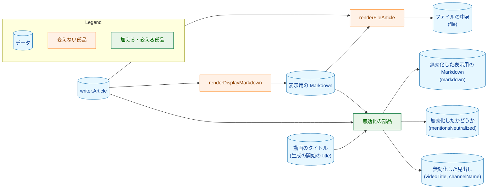
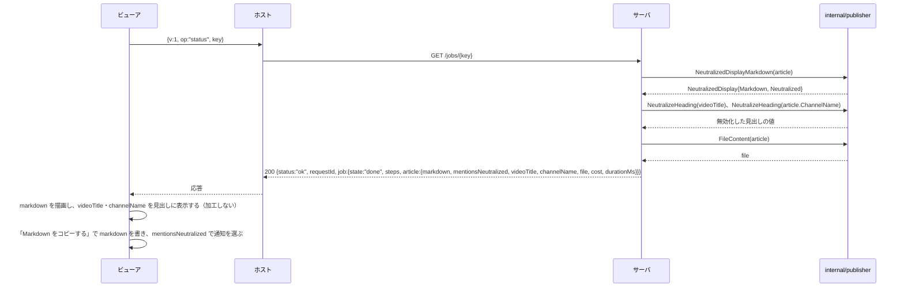
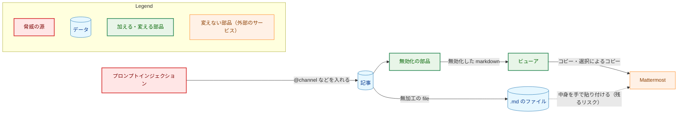
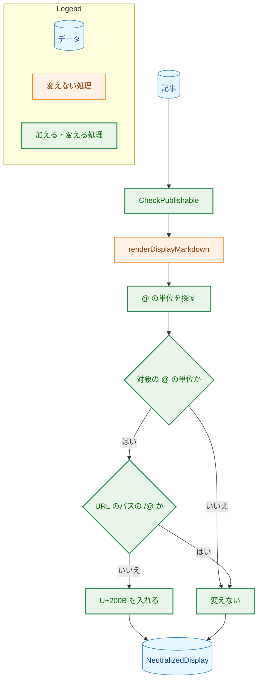
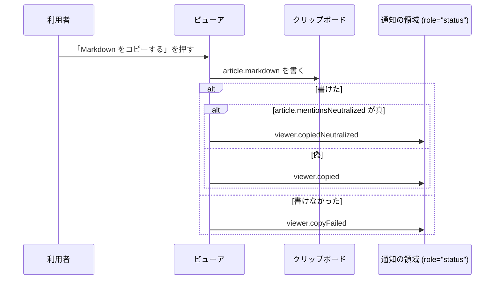

# アーキテクチャ設計書：Slack の Webhook への投稿の機能を廃止し、メンションの無効化をクリップボードへのコピーに移す

## Document Status

| Item | Value |
|---|---|
| Status | `approved` |
| Created | 2026-11-11 |
| Review date | 2026-11-11 |
| Reviewer | isseis |
| Comments | - |

本書は [01_requirements.md](01_requirements.md)（要件定義書。以下、要件書）の設計である。既存のコードは、コミット `ee6d14df` で確かめた。`file:line` の行番号は、このコミットでの行番号である。F-NNN・AC-NN は要件書の項番を、H-NN は [design_handoff.md](design_handoff.md)（以下、申し送り）の項番を指す。申し送りへの対応は付録 A に、受け入れ基準との対応は付録 B にまとめる。

本書は、要件書 §3.1 の用語（対象の `@`・無効化・URL・文字参照・URL のパスの `/@`・表示用の Markdown・コピーする文章）を、要件書と同じ意味で使う。そのほかに、次の用語を使う。

-   **無効化した表示用の Markdown:** 表示用の Markdown の対象の `@` を、要件書 F-002 の規則で無効化した文字列。状態の取得の応答の `markdown` に入れる。ビューアはこれを表示し、コピーする文章としてクリップボードに書く（3.1）。
-   **無効化の部品:** 記事（`writer.Article`）から、無効化した表示用の Markdown と、無効化したかどうかの真偽値を作る `internal/publisher` の関数と型（3.2）。
-   **`@` の単位:** 対象の `@` を探すときに、1 つの `@` として扱う並び。生の `@`（見た目の似た文字を含む）か、`@` を表しうる文字参照（要件書 §3.1）である（3.3）。

## 1. 設計の全体像 (Design Overview)

### 1.1. 設計原則

-   **無効化はサーバで行い、ビューアは受け取った文字列を加工しない。** 規則は Go の 1 か所（`internal/publisher`）に置き、拡張（TypeScript）に同じ規則を書かない（要件書 §4.5、申し送り H-01 のレビュー担当者の方針）。
-   **無効化したかどうかは、無効化の部品が値として返す。** 文字列の中の U+200B の有無からは判定しない（H-02）。
-   **Mattermost と判定が食い違いうるときは、無効化する側に倒す。** こちらが「変えない」とする `@` は、語の途中の `@` と URL のパスの `/@` だけで、どちらも Mattermost の判定より狭く定める（3.3、6.3）。
-   **投稿の機能は、残さずに消す。** 投稿の状態・Webhook の設定・投稿の操作は、型・コード・テスト・文書のどこにも残さない。前の版との互換の仕組みは作らない（要件書 §2.3）。
-   **加工しない出力は、いまと同じ関数で作る。** 保存するファイルと `--out` のファイルは、いまの `renderFileArticle`（`internal/publisher/file_render.go:43`）のままにする（AC-16a）。

### 1.2. 設計の際に決めたこと（2026-11-11）

-   **状態の取得の応答の `markdown` を、無効化した表示用の Markdown にする。無効化したかどうかを、`job.article.mentionsNeutralized`（真偽値）で添える。** 無加工の表示用の Markdown は応答に入れない。無加工の文字列は `file` の本文の部分にあり、レビュー担当者の方針（無加工と無効化した文字列の両方を渡す）は `file` と `markdown` で満たす。拡張は無加工の表示用の Markdown を使わない。両方を入れると応答が記事 1 本分大きくなり、記事の大きさの上限（`maxStatusResponseBytes`、`internal/server/status.go:20`）が実質およそ 3 分の 2 に下がるためである。レビュー担当者が選んだ。ADR の判断: [ADR-0027](../../dev/adr/0027-article-job-api.md)（応答が持つもの）と [ADR-0043](../../dev/adr/0043-copy-mention-neutralization.md)（無効化をサーバで行い、ビューアは加工しない）を改める。
-   **Mattermost のサーバのソースを読んで、こちらの判定と比べた。** 申し送り H-06 の候補のうち、ソースの読解を選んだ。実機での確かめより安く、要件書の実機の結果（URL の中の `/@` とコードの中の `@` が通知されない）の仕組みを説明できるためである。レビュー担当者が選んだ。読んだ内容と見つけた食い違いは 6.3 にある。ADR の判断: ADR-0043 の背景に加える。
-   **URL のパスの `/@` の定義を、Mattermost が自動リンクにする形だけに狭める。** 6.3 の U1〜U6 と S2 の形では、要件書の前の定義が `@` を変えないのに、Mattermost は自動リンクにせず通知する。要件書 §3.1 の定義を改めた（要件書「設計の際に改めたこと（2026-11-11）」）。レビュー担当者が選んだ。ADR の判断: ADR-0043 を改める。
-   **`@` を表しうる文字参照も無効化する。** Mattermost のサーバは、メンションを探す前に文字参照とバックスラッシュのエスケープを解く（6.3）。読んだ版では、文字参照が表す `@` は後ろの文字とつながらず、通知にならない。ただし、つながるかどうかは解析の内部の位置の扱いで決まり、版によって変わりうる。そのため、念のため無効化する。要件書は文字参照を変えずに残すと決めていたので、要件書を改めた（AC-10・AC-13・AC-14）。レビュー担当者が選んだ。ADR の判断: ADR-0043 を改める。
-   **`@` の直後の文字を問わずに無効化し、URL のスキームの直前の文字を限る。** ビューアは `*` の強調やバッククォートを除いて描画するので、表示した記事を選択してコピーすると、`@**channel**` が `@channel` に、`` `x`https://example.com/@here `` が `xhttps://example.com/@here` になり、通知される（6.3 の S1・S2）。要件書の対象の `@` の定義と、URL のパスの `/@` の条件 2 を改めた。レビュー担当者が選んだ。ADR の判断: ADR-0043 を改める。
-   **URL のパスの `/@` の `[` の条件（条件 5）を、表示用の Markdown の全体に広げる。** 選択によるコピーでは、リストやコードブロックの後ろの空行が 1 つの改行になることがあり、元の文字列の段落の切れ目が保たれない（6.3 の S3）。要件書 §3.1 を改めた。ADR の判断: ADR-0043 を改める。
-   **`<https://…>` の形は、`<` の直前が条件 2 の文字のときだけ URL の始まりとみなす。** ビューアは `<`・`>` を除いて描画するので、選択によるコピーでスキームの直前に来るのは `<` の直前の文字である。行頭や空白の後ろの `<https://www.youtube.com/@handle>` は、いまと同じくリンクとして表示できる。要件書 §3.1 を改めた。ADR の判断: ADR-0043 に含める（条件の細部で、決定は変わらない）。
-   **ビューアの見出しも、サーバが無効化した値を表示する。** ビューアは記事の上に、拡張がビューアの URL から読んだタイトルとチャンネル名を表示している（`extension/src/ui/renderViewer.ts:93`〜`114`、`renderViewerHeader`）。ページの全体を選択してコピーすると、その `@` がそのまま貼り付けられる（6.3 の S4）。見出しのタイトルは、記事のタイトル（`writer.Article.Title`、LLM が書いたもの。`internal/writer/output.go:216`〜`219`）ではなく、動画のタイトル（生成の開始の `title`。ポップアップは、送るときにその値を見出しに使う。`extension/src/core/popupView.ts:224`〜`236`）である。そこで、記事のキャッシュの記録が生成の開始の動画のタイトルを持ち、状態の取得の `done` の応答に、無効化した動画のタイトルとチャンネル名を加え、記事が完了した後の見出しはそれを表示する（要件書 AC-16b）。チャンネル名は、生成の開始の値と記事の値（`writer.Article.ChannelName`）が同じなので、記事の値を使う。レビュー担当者が選んだ。ADR の判断: ADR-0043 と ADR-0027 を改める。
-   **コードスパンとフェンス付きコードブロックの中の `@` も無効化する。** ビューアは、コードをバッククォートとフェンスの行を除いて描画する（`extension/src/ui/articleBody.ts:51`〜`52`・`121`〜`124`）。表示した記事を選択してコピーするか、長い記事を分けて貼り付けると、コードの中の `@` がコードの外の `@` として貼り付けられ、通知される。要件書はコードの中を変えないと決めていたので、要件書を改めた（AC-11・AC-12）。レビュー担当者が選んだ。この結果、無効化はコードの範囲を判定しない。ADR の判断: ADR-0043 を改める。
-   **無効化は、表示用の Markdown の全体に 1 つの規則をかける。** タイトルの見出しの行・チャンネル名の行・本文の規則が同じになり（AC-11）、コードの範囲も判定しないので、部分に分ける必要がない。無効化の部品は、いまの `renderDisplayMarkdown`（`internal/publisher/display_render.go:28`）の結果を入力にする。表示用の Markdown の作り方は 1 か所のままである。ADR の判断: ADR を作らない（関数の形で、ほかのタスクを縛らない）。
-   **無効化の部品は `internal/publisher` に置き、新しいパッケージを作らない。** 表示用の Markdown を作る `renderDisplayMarkdown` と、対象の `@` の判定（`mentionAts`、`internal/publisher/slack_message.go:394`）が同じパッケージにあるためである。ADR の判断: ADR を作らない（パッケージの中のファイルの置き場所で、ほかのタスクを縛らない）。
-   **本文の UTF-8 の検査を `writer.Article.CheckPublishable` に加える（H-03）。** サーバの完了の時点の検査（`internal/server/generation.go:72`）と、CLI の `--out`（`FilePublisher` が `FileContent` を通して呼ぶ。`internal/publisher/file.go:106`、`file_render.go:27`）の両方が、この関数を通るためである。ADR の判断: ADR を作らない（要件書のとおり）。
-   **英語の通知の文面は「Copied the Markdown. Invisible characters were inserted after @ so that they do not become mentions.」とする（AC-18）。** 日本語の文面（要件書 AC-18）と同じことを述べ、数を示さない。ADR の判断: ADR を作らない（文面の選択で、ほかのタスクを縛らない）。
-   **無効化の部品は、入力の長さに比例する時間で終わるように作る。** 無効化は、状態の取得のたびと、完了の時点の大きさの検査（`maxStatusSize`、`status.go:172`）で何度も走る。サーバの書き込みの打ち切りは 60 秒である（`internal/server/server.go:35`）。`/@` や `[` が多い記事で、`@` ごとに前を探し直すと、入力の長さの 2 乗の時間になる。`internal/writer/markdown.go:12`〜`14` の検査と同じ制約を置く。ADR の判断: ADR を作らない（部品の実装の制約で、ほかのタスクを縛らない）。
-   **`CLAUDE.md`「Declare, don't infer」に、無効化の部品の例外を加える。** 無効化の部品は、記事（LLM の出力と外部由来の値）の中身を見て、どの `@` に U+200B を入れるかを選ぶ。記事は型で表せない外部の値で、中身を見ることが部品の目的である。ほかの例外（`parseArticleMarkdown` など）と同じ形で、範囲・理由・境界を書く（3.12）。ADR の判断: ADR を作らない（`CLAUDE.md` の規則は ADR にしない。`CLAUDE.md`「Design decisions (ADR)」）。
-   **テストの削除の確かめ方は、本タスクに限り `CLAUDE.md`「Testing Strategy」の手順の例外とし、0059 と 0062 の前例に従う（実装計画の際に改めた。2026-11-11）。** 投稿の分岐は、残る関数の中にある。そのため、テストの削除を、残る関数の書き換えと分けられない。`make coverage-compare` と `make ext-coverage-compare` は、そのようなコミットでは止まる。そこで、残る関数を書き換えながらテストを消すコミットは、タスクの `_checks/` のスクリプトで、関数を名前で対応づけて比べる（7.4）。レビュー担当者が選んだ。採らなかった案は、どのコミットも道具が分類できる形にする段階のコミットを加える案である。コミットが大きく増え、経路の選び方や応答の構造体のように、それでも分類できない箇所が残りうる。ADR の判断: [ADR-0037](../../dev/adr/0037-test-deletion-coverage.md) の「結果」の、前例のタスクの並びに 0083 を加える（規則は変えない）。

### 1.3. なぜ今の仕組みでは足りないか

いまの無効化（`neutralizeMentions`・`neutralizeProse`、`internal/publisher/slack_render.go:116`〜`130`）は、Webhook への投稿の文字列だけに使われ、表示用の Markdown（`publisher.DisplayMarkdown`、`display_render.go:15`）は無効化しない。いまの無効化は、直前が `/` の `@`（`slack_render.go:147`、`followsSlash`）と、コードの中の `@`（`slack_render.go:75`〜`77`）と、文字参照を変えない。それらは投稿の拒否（`rejectMention`、`slack_message.go:220`）が防ぐ前提で作られている。コピーは拒否しない（要件書 F-002）ので、いまの関数をそのまま表示用の Markdown にかけると、`AC/@名前`・`\@channel`、選択によるコピーで記法を落としたコードの中の `@here` や `@**channel**` のような、通知される `@` が残る。そのため、無効化の規則（どの `@` を探し、どの `@` を変えないか）を改める。

対象の `@` の判定（`mentionAts`・`mentionAtsOf`・`replaceLookAlike`・`isMentionNameChar`、`slack_message.go:372`〜`424`）と、`@` の直後に U+200B を入れる処理（`insertAfterAts`、`slack_render.go:134`）は、もとにできる。これらは Webhook に固有の層（分割・`silent`・拒否）と同じファイルにあるので、残す規則を Webhook に依存しない名前のファイルへ移す（H-04、3.2）。

### 1.4. 概念モデル

図の矢印 A → B は、データから部品へは「A が B の入力である」を、部品からデータへは「B は A の出力である」を表す。



`renderFileArticle` は、記事の値からフロントマターを作り、その後ろに表示用の Markdown を置く（`file_render.go:43`〜`67`）。無効化した表示用の Markdown は、表示用の Markdown に U+200B を入れただけの文字列である（AC-10）。保存するファイルと `--out` のファイルは、無効化した文字列を通らない（AC-16a）。無効化した見出しは、動画のタイトルと記事のチャンネル名から、見出しの規則（3.2）で作る。

## 2. システム構成 (System Structure)

### 2.1. 全体構成

廃止の後の構成を示す。図の矢印 A → B は「A が B を使う（要求を送る、呼ぶ、書き込む）」を表す。投稿の操作と Webhook への送信は、図から消える。

```mermaid
flowchart LR
    classDef data fill:#e6f7ff,stroke:#1f77b4,stroke-width:1px,color:#0b3d91;
    classDef process fill:#fff1e6,stroke:#ff7f0e,stroke-width:1px,color:#8a3e00;
    classDef enhanced fill:#e8f5e8,stroke:#2e8b57,stroke-width:2px,color:#006400;

    VIEWER["拡張のビューア<br>(viewerApp.ts)"]
    POPUP["拡張のポップアップ"]
    HOST["Native Messaging のホスト<br>(internal/nmhost)"]
    SERVER["localhost サーバ<br>(internal/server)"]
    CACHE["記事のキャッシュ<br>(internal/articlecache)"]
    PUB["internal/publisher"]
    LLM["LLM の API"]
    CLIP[("クリップボード")]
    MD[(".md のファイル")]

    VIEWER -->|"status"| HOST
    POPUP -->|"start・status"| HOST
    HOST -->|"POST /jobs・GET /jobs/{key}"| SERVER
    SERVER -->|"記録の読み書き"| CACHE
    SERVER -->|"呼び出し"| PUB
    SERVER -->|"生成の要求"| LLM
    VIEWER -->|"コピー"| CLIP
    VIEWER -->|"保存"| MD

    class VIEWER,HOST,SERVER,PUB,CACHE enhanced
    class POPUP,LLM process
    class CLIP,MD data

    subgraph Legend["Legend"]
        L1[("データの保存先")]
        L2["変えない部品"]
        L3["変える部品"]
    end
    class L1 data
    class L2 process
    class L3 enhanced
```



記事のキャッシュは、投稿の状態を消すので変える部品である（3.7）。ポップアップは、状態の取得の応答の検査（`extension/src/core/response.ts`）とポーリング（`extension/src/core/poll.ts`）をビューアと共有するので、応答の形の変更が及ぶ。ポップアップのコード（`popup.ts`・`popupView.ts`）は変えない。

### 2.2. コンポーネント配置

| 部品 | 変更 |
|---|---|
| `internal/publisher` | 無効化の部品を加える。投稿の文字列・分割・拒否・Webhook への送信を消す（3.2〜3.4） |
| `internal/writer` | `CheckPublishable` に本文の UTF-8 の検査を加える（3.5）。使われなくなる `ProseRanges` を消す（3.4） |
| `internal/server` | 状態の取得の応答を改め、投稿の操作・投稿のジョブ・Webhook の設定を消す（3.6） |
| `internal/articlecache` | 投稿の状態と投稿の実行を消し、記録に生成の開始の動画のタイトルを持たせる（3.7） |
| `internal/nmhost` | `publish` の操作を消す（3.8） |
| `internal/config` | `SLACK_WEBHOOK_URL` を知らないキーにし、Webhook の URL の読み込みを消す（3.9） |
| `internal/slackwebhook` | パッケージを消す（3.9） |
| `cmd/yt2column-server` | Webhook の設定と投稿のジョブに関わる配線・ログ・停止の案内を消す（3.6） |
| 拡張 | 投稿の操作と表示を消し、`markdown` をそのまま表示・コピーし、コピーの通知を改める（3.10） |
| `Makefile` | `test-integration-slack` を消す（3.11） |
| 文書・エージェントの指示 | 要件書 §2.2 の文書を改める（3.12） |

### 2.3. データフロー

状態の取得から、表示とコピーまでの流れ。



## 3. コンポーネント設計 (Component Design)

### 3.1. 状態の取得の応答（AC-03、H-01、H-02、H-05）

`done` の応答は次の形になる。最上位の `webhookConfigured` と、`job` の `publish` はなくなる。

```json
{
  "status": "ok",
  "requestId": "…",
  "job": {
    "state": "done",
    "steps": { "draft": "done", "shorten": "skipped", "review": "done" },
    "article": {
      "markdown": "# タイトル\n\n…（無効化した表示用の Markdown）",
      "mentionsNeutralized": true,
      "videoTitle": "…（無効化した動画のタイトル。送られなかったときは空文字列）",
      "channelName": "…（無効化したチャンネル名。ないときは空文字列）",
      "file": "---\n…（無加工）",
      "cost": { "state": "known", "usd": "0.0123" },
      "durationMs": 12345
    }
  }
}
```

-   `markdown` は、無効化した表示用の Markdown である。ビューアは、これを描画し、そのままコピーする。
-   `mentionsNeutralized` は、`markdown` に無効化の U+200B を 1 つ以上入れたときだけ真である。表示用の Markdown がもともと U+200B を含んでも、無効化していなければ偽である（H-02）。
-   `videoTitle` は、生成の開始が送った動画のタイトル（記録が持つ。3.7）を、`channelName` は記事のチャンネル名（`writer.Article.ChannelName`）を、見出しの規則（3.2）で無効化したものである。どちらも、値がないときは空文字列である。ビューアは、記事が完了した後の見出しにこれを表示する（AC-16b）。
-   `file` は変えない（AC-16a）。
-   `running`・`failed`・`unknown` の応答は、`webhookConfigured` がなくなるほかは変えない。

`maxStatusSize`（`status.go:172`）は、実際の応答を描いて大きさを測るので、無効化で増えたバイト（1 つの `@` の単位につき 3 バイト）も数える。投稿の状態と理由の組み合わせの繰り返し（`status.go:177`〜`195`）は、投稿の状態がなくなるので消え、工程の状態だけを繰り返す。

### 3.2. 無効化の部品（F-002、H-01、H-04、H-07）

```go
// NeutralizedDisplay is the display Markdown of an article with its mentions
// neutralized, as the Viewer displays and copies it.
type NeutralizedDisplay struct {
	// Markdown is the display Markdown with U+200B inserted after each
	// neutralized '@' unit; removing those insertions gives the display
	// Markdown renderDisplayMarkdown returns.
	Markdown string
	// Neutralized reports whether at least one U+200B was inserted.
	Neutralized bool
}

// NeutralizedDisplayMarkdown runs CheckPublishable on a and returns its
// neutralized display Markdown.
func NeutralizedDisplayMarkdown(a writer.Article) (NeutralizedDisplay, error)

// NeutralizeHeading returns value, a video title or channel name for the
// Viewer's heading, with every target '@' unit neutralized, URL-path ones
// included.
func NeutralizeHeading(value string) string
```

-   いまの `DisplayMarkdown`（`display_render.go:15`）は、`NeutralizedDisplayMarkdown` に置き換える。呼び出し元は `internal/server/status.go:135` だけである（`git grep 'DisplayMarkdown('` で確かめた）。
-   **入力:** `renderDisplayMarkdown(a)` の結果の全体である。タイトルの見出しの行・チャンネル名の行・本文に同じ規則をかける（AC-11）。コードの範囲は判定しない。
-   **契約:** 結果の `Markdown` から、無効化で入れた U+200B を除くと、`renderDisplayMarkdown(a)` とバイト単位で一致する（AC-10、AC-15）。1 つの `@` の単位に入れる U+200B は 1 つだけである。処理の時間は、入力の長さに比例する（1.2）。
-   **規則:** 対象の `@` の単位（3.3）のうち、URL のパスの `/@`（3.3）でないものの直後に U+200B を入れる。生の `@` では `@` の直後に、文字参照では `;` の直後に入れる。
-   **見出しの規則:** `NeutralizeHeading` は、値の対象の `@` の単位をすべて無効化する。URL のパスの `/@` も除かない。タイトルとチャンネル名に URL が入ることはまれで、見出しは選択によるコピーで記事の前に付くので、規則を簡単に保つ。`Neutralized` と `mentionsNeutralized` は `Markdown` だけについて報告する。
-   **ファイルの分け方（H-04）:** 対象の `@` の判定と U+200B を入れる処理を、`slack_message.go`・`slack_render.go` から、Webhook に依存しない名前のファイル（例: `mention.go`）へ移す。移すコミットは、振る舞いを変えず、テストも一緒に移して消さない。規則の変更（3.3）は、その後の別のコミットで行い、投稿のコードとテストを消すコミットとも分ける（8 章）。`replaceLookAlike`（`slack_message.go:372`）は、`<`・`!` の見た目の似た文字も扱うが、その分を使うのは拒否の規則だけなので、拒否の規則を消した後の独立したコミットで `@` の分だけに減らす。いまの `neutralizeMentions`・`neutralizeProse`・`insertAfterAts`・`followsSlash`・`inRanges`（`slack_render.go:116`〜`169`）は、新しい規則の関数に置き換わり、消える。直後の名前の文字の条件がなくなり、拒否の規則も消えるので、`isMentionNameChar`（`slack_message.go:422`）も使われなくなり、消える。

### 3.3. 対象の `@` の単位と URL のパスの `/@` の判定（AC-11〜AC-14、H-06）

**`@` の単位と対象の判定。** 6.3 のとおり、Mattermost は、文字参照とエスケープを解いてから語に分け、ビューアの選択によるコピーは記法を落とす。こちらは、どちらの経路でも通知を逃さないように、次の規則で判定する。

-   **`@` の単位:** 生の `@`（見た目の似た文字を含む）と、`@` を表しうる文字参照（要件書 §3.1）。数値の文字参照は、表す値が `@` か見た目の似た文字なら、桁数を問わず `@` の単位とする。名前付きの文字参照は、名前を問わずすべて `@` の単位とする。Mattermost の名前付き文字参照の表に依存しないためで、余分に無効化するだけである。
-   **対象の条件:** `@` の単位の直前が、行頭か、生の文字でも数字でもない文字である。直後の文字は問わない（AC-13）。文字参照やエスケープが直前にあれば、それが解いた後に文字や数字になるかを問わず、語の途中とはみなさない。Mattermost では語の途中になる場合も、こちらは無効化する側に倒れる。

この規則は、生の `@` については、いまの `mentionAts`（`slack_message.go:394`〜`406`）から、直後に名前の文字が続く条件を除いたものである。

**URL のパスの `/@`。** 要件書 §3.1 の 5 つの条件をそのまま判定する。`@` の単位が文字参照のときは当たらない（条件 1）。条件 4 の「空白」は Unicode の空白（`unicode.IsSpace`）とする。Mattermost の自動リンクは ASCII の空白でしか終わらないので、こちらのほうが短く区切る。条件 5 は、段落の切れ目を見ずに、表示用の Markdown の先頭から URL の始まりまでに `[` があるかで決める。

この定義は、6.3 で読んだ Mattermost の自動リンクの条件より、どの点でも狭い。

| 条件（要件書 §3.1） | Mattermost の自動リンクの条件（6.3） |
|---|---|
| 1. 生の `@` で、直前が `/` | 自動リンクの中では、文字参照もエスケープも解かない |
| 2. スキームは小文字の `http`・`https` だけで、直前は行頭・空白・ASCII でない文字・`(` のどれか（または、直前がそれらのどれかである `<`） | スキームは `http`・`https`・`ftp`・`mailto`・`tel` を大文字・小文字を区別せずに受け、直前の ASCII の英字・数字までスキームに含める。`:` から始まる絵文字の記法（`:[a-z0-9_+-]+:`）が、スキームの `:` を取り込むことがある |
| 3. ホストは文字・数字・`.`・`-` で、先頭は文字か数字、直後が `/` | ホストの先頭は空白と Unicode の句読点以外、`_` を含むと自動リンクにしない。ホストの後ろは空白まで続く |
| 4. `@` までに空白・`<`・`>`・`?`・`#`・`` ` `` がない | ASCII の空白まで続き、`<`・`>` の前で切る。末尾の句読点と対にならない `)` を落とすが、`@` より前には戻らない。コードスパンの中から始まる URL は、自動リンクにならない |
| 5. 表示用の Markdown の中で、URL の始まりより前に `[` がない | 段落の中で、閉じていない `[`・`![` があると、自動リンクを作らない |

**ビューアの描画との関係。** ビューアは、`<https://…>` の形の自動リンクを、URL の条件をすべて満たすときだけリンクにする（`extension/src/core/articleMarkdown.ts:107`〜`127`、`linkUrl`）。無効化で U+200B が入った `<https://example.com/?@here>` は、`new URL` が U+200B を `%E2%80%8B` に置き換えて元の文字列と一致しなくなるので、リンクにならず、文字のまま表示される。行頭や空白の後ろの `<https://www.youtube.com/@handle>` は、URL のパスの `/@` なので変えず、いまと同じくリンクになる。`x<https://www.youtube.com/@handle>` のように `<` の直前が英字のものは、条件 2 に当たらないので無効化し、リンクにならない。選択によるコピーで `<` が落ちると `xhttps://…` になり、Mattermost が自動リンクにしないためである。そのほかの描画の規則は、U+200B を特別に扱わない（`articleMarkdown.ts:54`〜`71`）ので、ブロックの構成は変わらない。U+200B は幅を持たないので、表示の見た目は変わらない（AC-16）。

### 3.4. 投稿の文字列・分割・拒否・送信の削除（F-001、AC-07、AC-09）

`internal/publisher` から次を消す。

-   `slack.go`（`SlackWebhookPublisher`・`PostMessages`・`SlackMaxPostDuration` など）、`slack_errors.go`（`ErrSlackMention`・`ErrSlackUnsplittable` など）。
-   `slack_message.go` のうち、`PrepareSlackMessages`・分割・`rejectMention` と M1〜M4 の判定（3.2 で移す判定は残す）。
-   `slack_render.go` のうち、`renderSlackPost`・脚注（`slackFootnote`・`stageModels`）。`stageModels` を使うのは脚注だけである（`slack_render.go:92`、`git grep stageModels` で確かめた）。
-   `test_helpers_slack.go`、`testutil/mocks.go` の投稿の偽物、`testutil/integration.go` の Webhook の統合テストの設定（`SlackOptInEnv`・`WebhookURLEnv`・`SlackIntegrationOptions` など）。統合テストの設定のうち、ほかの統合テストが使う部分（`IntegrationOptions` など）は残す。
-   `slack_integration_test.go` と、投稿だけを確かめるテスト（`slack_test.go`・`slack_message_test.go`・`slack_render_test.go`・`slack_errors_test.go`・`slack_articles_test.go`）。対象の `@` の判定と U+200B を入れる処理のテストは、3.2 の移すコミットで新しいファイルへ移してから消す。

`FormatArticleCost` は、`file_render.go:61` と状態の取得（`status.go:144`）も使うので残す。

`writer.ProseRanges`（`internal/writer/markdown.go:49`）は、いまの呼び出し元が `slack_render.go:75` だけで、無効化はコードの範囲を判定しないので、使われなくなる。`make deadcode` が報告するので、`ProseRanges` とそのテスト（`internal/writer/markdown_test.go`）を消す。`ProseRanges` だけが返す型 `writer.ByteRange`（`markdown.go:31`〜`32`）も一緒に消す。`proseLines`（`markdown.go:132`）は、生成した記事の本文の検査（`markdown.go:109`）が使い続けるので残す。

### 3.5. 本文の UTF-8 の検査（AC-09a、H-03）

`writer.Article.CheckPublishable`（`internal/writer/article.go:16`）に、本文が正しい UTF-8 であることの検査を加える。違反は、いまのほかの検査と同じく `ErrInvalidArticle` を包む。理由は固定の文字列（例: `body is not valid UTF-8`）で、本文の値を含めない。この検査は、制御文字の検査（`article.go:49`）より前に置く。`strings.ContainsFunc` は不正なバイトを U+FFFD として読むため、先に UTF-8 を確かめないと、制御文字の検査が不正なバイトを素通りさせてしまうからである。

-   サーバ: 完了の時点の検査（`generation.go:72`）が `article_invalid` で失敗させる。
-   CLI: `FilePublisher` が `FileContent` を通して同じ検査をし、`--out` のファイルを書かずに失敗する。
-   Slack へ送る前の検査にある本文の UTF-8 の検査（`slack_message.go:30`〜`35`）は、3.4 で消える。

### 3.6. サーバ（AC-02、AC-03、AC-07、AC-08）

```go
// statusArticle is a done article: the neutralized display Markdown, whether
// it neutralized a mention, the neutralized video title and channel name for
// the Viewer's heading, the --out file content, the cost, and the generation's
// duration.
type statusArticle struct {
	Markdown            string     `json:"markdown"`
	MentionsNeutralized bool       `json:"mentionsNeutralized"`
	VideoTitle          string     `json:"videoTitle"`
	ChannelName         string     `json:"channelName"`
	File                string     `json:"file"`
	Cost                statusCost `json:"cost"`
	DurationMs          int64      `json:"durationMs"`
}
```

-   **応答:** `statusResponse` から `WebhookConfigured` を、`statusJob` から `Publish` を消す（`status.go:25`〜`41`）。`statusPublish`・`publishStatus`・`publishStateCode`・`unpostableCode`・`publishFailureCode` を消す。
-   **ルーティング:** `routePublish` と `PublishSuffix`（`handler.go:14`・`24`・`51`〜`52`・`76`〜`77`）を消す。`/jobs/{key}/publish` は、ほかの受け付けないターゲットと同じ経路で `not_found` になり、本文を読まない（AC-02）。`publish.go` を消す。
-   **拒否の理由:** `webhook_not_configured` と、投稿だけが使う理由（`article_not_ready`・`article_not_found`・`article_not_postable`）を消す（`response.go`）。
-   **完了の時点の検査:** `completeGeneration`（`generation.go:71`）は、`CheckPublishable` と応答の大きさの検査だけを行い、`PrepareSlackMessages` を呼ばない。記事はいつも `done` になる（AC-07）。成功のログの行から `publish` の属性を消す。
-   **記録を落とすときのログ:** `logEviction`（`jobs_api.go:202`）から `publish` の属性を消す。要件書は定めていないが、投稿の状態がなくなるので消す。
-   **設定:** `Options.Webhook`・`WebhookOptions`・`WebhookPublisher`・`webhookConfigured()`（`server.go:48`〜`73`・`169`〜`209`）を消す。
-   **停止:** 投稿のジョブの数（`postJobs`）とそのログの属性（`server.go:92`〜`94`・`260`）を消す。生成のジョブの取り消しと待ちは変えない（AC-08）。`cmd/yt2column-server/run.go` の停止の案内（`stopNoticeLogger`、`run.go:268`〜`276`）から投稿の待ちの文を消す。二度目の合図ですぐに終わることの案内は残す。取り消した生成は LLM の呼び出しが戻るまで終わらないので（`server.go:256`〜`258`）、すぐに終える手段に意味が残るためである。待つ時間の分を求める `approxMinutes`（`run.go:280`）は、使われなくなるので、そのテストと一緒に消す。
-   **起動:** `listening` の行から `webhookConfigured` を消し、Webhook がないことの警告の行（`run.go:223`〜`226`）と、`newPublisher` の配線（`run.go:50`〜`70`・`344`〜`350`）を消す。秘密の伏せ字の対象（`redact.SecretStrings`、`run.go:191`）から Webhook の URL を除く。HTTP/2 のデバッグの警告（`run.go:194`）の文面から Webhook の URL を除く。

### 3.7. 記事のキャッシュ（`internal/articlecache`）

-   `PublishState`・`UnpostableReason`・`PublishFailureReason` とその列挙（`record.go:62`〜`110`）、`Snapshot` の投稿の欄（`record.go:130`〜`132`）、記録の投稿の欄と `publishGen`・`delivered`、`BeginPublish`・`PublishRun`（`cache.go:235`〜、`record.go:357`〜`408`）を消す。
-   `CompletePostable`・`CompleteUnpostable`（`record.go:282`〜`299`）を、1 つの完了の操作（例: `Complete`）にまとめる。
-   `evictable`（`record.go:196`〜`205`）は、`done` の記録をいつも落としてよいものとする。投稿中の記録がなくなるためである。
-   `Eviction` の `Publish`（`cache.go:96`）を消す。
-   記録に、生成の開始が送った動画のタイトル（`jobInput` の `title`。`internal/server/request.go:80`）を持たせ、`Snapshot` で返す（3.1）。記録が字幕を持たないこと（`generation.go:20`〜`23` の契約）は変えない。

### 3.8. ホスト（AC-04）

`OperationPublish`・`opPublish`・`publishSuffix`（`internal/nmhost/relay.go:57`・`384`・`392`・`403`〜`404`・`418`〜`419`・`489`・`527`〜`528`）を消す。`op` が `publish` のメッセージは、`parseOperation` が `OperationUnknown` を返し、いまの `default` の経路（`relay.go:499`、`ruleOperation`）で、サーバへ何も送らずに `protocol_error` になる。

### 3.9. 設定（AC-05、AC-06）

-   `serverFileKeys`（`internal/config/serverfile.go:17`〜`20`）から `slackEnv` を除く。`SLACK_WEBHOOK_URL` の行は、知らないキーの拒否（`reasonLineUnknownKey`、`serverfile.go:71`）になる。拒否の理由は受け付けるキーを並べるだけで、読んだキーと値を含まない。`#` で始まる行は、いまと同じくキーとして読まない（`serverfile.go:59`）。
-   雛形（`serverfile.go:445`〜`447`）から `SLACK_WEBHOOK_URL` の 3 行を消す。
-   `ServerConfig.webhookURL`・`WebhookURL()`・`loadSlackWebhook`・`slackEnv`・`reasonSlackWebhook`（`config.go:45`・`107`・`338`〜`354`・`394`〜`412`・`753`〜`766`）を消す。CLI は `SLACK_WEBHOOK_URL` を読まない（[0062 要件定義書](../0062_remove_cli_slack/01_requirements.md)）ので、CLI の振る舞いは変わらない。
-   `internal/slackwebhook`（`ValidURL` など）を消す。使うのは `config.go:760` と `publisher/testutil/integration.go:91` だけで、どちらも本タスクで消える。

### 3.10. 拡張（AC-01、AC-16、AC-18〜AC-20、H-05）

```ts
export interface Article {
  /** The neutralized display Markdown: the viewer draws it rendered and copies it unchanged. */
  readonly markdown: string;
  /** Whether markdown neutralized at least one mention. */
  readonly mentionsNeutralized: boolean;
  /** The neutralized video title and channel name ("" for none), for the heading. */
  readonly videoTitle: string;
  readonly channelName: string;
  /** The file content, saved unchanged. */
  readonly file: string;
  readonly cost: Cost;
  readonly durationMs: number;
}

/** The result of the last operation, shown in the operation result's region. */
export type ActionNotice =
  | { readonly kind: "none" }
  | { readonly kind: "saved" }
  | { readonly kind: "copied"; readonly mentionsNeutralized: boolean }
  | { readonly kind: "copy-failed" };
```

-   **応答の検査（`response.ts`）:** `done` の記事の決まったメンバに `mentionsNeutralized`（真偽値）、`videoTitle`・`channelName`（空でもよい文字列）を加え（`response.ts:446`〜`459`）、`done` の `job` から `publish` を（`response.ts:510`〜`523`）、`ok` の応答から `webhookConfigured` を（`response.ts:629`〜`645`）除く。どの階層でも、メンバの集まりがちょうど一致するときだけ受理する規則は変えない（要件書 §4.2）。投稿の応答の検査（`classifyPublish`・`PublishOutcome`・投稿の拒否の理由・ログの形）を消す。
-   **ポーリング（`poll.ts:53`〜`66`）:** `done` の記事では、いつもポーリングを止める。投稿中の記事がなくなるためである。`JobDisplay`（`jobView.ts:46`〜`52`）から `publish` と `webhookConfigured` を除く。
-   **ビューア（`viewerApp.ts`、`ui/renderViewer.ts`、`static/viewer.html`、`static/viewer.css`）:** 投稿のボタン（`button#publish`）、投稿の状態の行（`div#publish-row`）とその CSS、投稿の処理（`publishArticle`、`viewerApp.ts:459`〜`527`）、投稿の状態の告知（`renderViewer.ts:206`〜`218`）、投稿中の状態（`publishing`・`awaitingPublishStatus`）、投稿の結果の通知（`PublishOpNotice` の `none` 以外）を消す。記事の描画は、いまと同じく `article.markdown` をそのまま `drawArticleBody` に渡す（`renderViewer.ts:337`）。保存（`saveArticle`、`viewerApp.ts:529`〜`540`）は `article.file` のまま変えない。
-   **コピー（`copyArticle`、`viewerApp.ts:542`〜`555`）:** `article.markdown` をそのまま書く。成功したら `{kind: "copied", mentionsNeutralized: article.mentionsNeutralized}` を示す。通知は、真なら新しいメッセージ（`viewer.copiedNeutralized`）を、偽ならいまの `viewer.copied` を示す。失敗はいまの `copy-failed` のままで、無効化を示さない（AC-19）。通知の領域はいまの `div#action-status`（`role="status"`、`static/viewer.html:29`）のままで、フォーカスを動かさない（AC-20）。
-   **見出し（`renderViewerHeader`、`renderViewer.ts:93`〜`114`）:** 記事が完了した後（`done` と、完了した記事を残している `lost`）は、見出しのタイトルに応答の `videoTitle` を、チャンネル名に `channelName` をそのまま表示する。`videoTitle` が空文字列なら、タイトルはビューアの URL の値のままにする（タブのタイトルの場合。要件書 §4.2 の残るリスク 9）。`channelName` が空文字列なら、チャンネル名の行を隠す。完了する前は、いまと同じくビューアの URL の値を表示する（AC-16b）。ポップアップは長い値を切り詰めて見出しにする（`popupView.ts:231`〜`235`）ので、完了した後の見出しは切り詰めない値になる。ブラウザのタブのタイトル（`viewerApp.ts:209`）は変えない。
-   **選択によるコピー:** `copy` イベントを捉えない。ビューアのコードは、ボタンの操作以外ではコピーに関与しないので、通知の領域は変わらない（AC-19a）。
-   **メッセージのカタログ（`core/i18n/catalog.ts`・`en.ts`・`ja.ts`）:** `viewer.copiedNeutralized` を英語と日本語の両方に加える（AC-20）。投稿のメッセージ（`viewer.publish`・`viewer.webhookNotConfigured`・`publishExchange`・`publishStates`・`publishReasons`・投稿の拒否の理由・`setWebhookStep`・`publishUnknownStep`・`publishAgainStep`）を消す。`repeatedPostStep` は `viewer.lost` も使う（`en.ts:312`）ので、その使い道が残るかを実装で確かめ、使わなくなれば消す。
-   **ホストへのメッセージ（`core/hostMessage.ts`）:** `publish` の形と `publishMessage` を消す。
-   **プレビューの台本（`scripts/popup-preview.ts`）:** 投稿の状態の行ごとのページを消し、`done` の記事に `mentionsNeutralized` を加える。
-   `manifest.json` は変えない。投稿に関わる権限は、いまもない（`static/manifest.json`、`host_permissions` なし）。

### 3.11. ビルドとテストの対象

-   `Makefile` から `test-integration-slack`・`SLACK_INTEGRATION_TIMEOUT` と、`.PHONY` の項目（`Makefile:57`・`285`〜`300`）を消す。`YT2COLUMN_TEST_SLACK_WEBHOOK_URL`・`YT2COLUMN_SLACK_INTEGRATION` を読むコードは、3.4 で消える（AC-09）。
-   CI の設定（`.github/workflows/*.yml`）には、Slack の統合テストを走らせる箇所がない（`grep -i slack` で確かめた）。

### 3.12. 文書とエージェントの指示（F-004）

要件書 §2.2 の文書を改める。値と構造を確かめる既存のガードのテスト（`CLAUDE.md`「Development Notes」）が読む箇所は、テストと文書を同じコミットで改める。

| 文書 | 改める内容 |
|---|---|
| `docs/dev/security.md` | §2 の Webhook の URL、§3 の Webhook への送信、§6 のメンションの 3 つの層、§8 の投稿の操作と投稿のジョブを消す。§6 に、表示とコピーの無効化の規則（要件書 F-002、本書 3.2・3.3）と、要件書 §4.2 の残るリスクを書く（AC-21）。§6 の「Mattermost のソースの読解」は、本書 6.3 の読解（`v11.11.3` と `master`）に改める |
| `docs/dev/guides/development.md` | 「ジョブの API」を 2 つの操作にし、状態の取得の応答の形（3.1）、投稿の状態と理由の表、投稿の拒否の理由の行を改める。拡張のテスト（`serverReasons.test.ts`・`jobCodes.test.ts`）が読む表なので、拡張のテストと合わせる |
| `README.md`・`README.en.md` | 投稿の説明と `SLACK_WEBHOOK_URL` の設定を消す。ビューアの説明に、表示とコピーの無効化と通知を書く（AC-22）。設定ファイルの説明に、`SLACK_WEBHOOK_URL` の行が残るとサーバが起動しないことと、その行を消す手順を書く（AC-23）。更新の後は、拡張とサーバを同じ版にそろえ、動いているサーバを起動し直すことを書く（5 章の版の食い違い）。`README.en.md` は `/mktrans` で同期する |
| `CLAUDE.md` | 「Architecture Overview」「Tool Execution Safety」「Commands」の Webhook と `make test-integration-slack` の記述を改める。「Declare, don't infer」に、無効化の部品の例外を加える。範囲は、`internal/publisher` の無効化の部品が、表示用の Markdown の中身を見て `@` の単位・URL のパスの `/@`・文字参照を判定し、U+200B を入れる位置を選ぶことに限る。理由は、表示用の Markdown が LLM の出力と外部由来の値で、型で表せず、判定が部品の目的であること。境界は、判定に迷う形は無効化する側に倒し、U+200B を入れるほかは文字列を変えないこと |
| `docs/dev/project_overview.md`・`docs/dev/production_profile.md`・`docs/dev/conventions/package_reference.md`・`AGENTS.md` | 投稿の機能を今の機能として説明する箇所を消すか改める |
| `docs/translation_glossary.md` | 要件書 §6 のとおりに改め、「無効化した表示用の Markdown」を加える |
| `.claude/commands/_context.md` | 「Conditional-guide trigger」から Webhook の URL と Webhook への送信を除き、「Target client environments」を要件書 AC-24 の文に改める |
| `.claude/commands/runplan.md` ほか | 投稿の機能に触れる指示を改める。実装で `git grep -i -E 'webhook|slack'` で洗い出す |
| `.github/workflows/deepseek-review.yml` | 投稿の機能に触れるレビューの指示を改める |
| ADR | 実装の PR で、各 ADR の #770 へリンクした食い違いの注記を消す（ADR-0005・0006・0008・0010・0018・0022・0027・0028・0031・0034・0043）。ADR-0009 の背景の投稿の記述は、編集上の訂正として直す（要件書 §1） |

### 3.13. 既存のテストへの影響

振る舞いを変える箇所を確かめている既存のテストは、次のとおりである。消すテストの確かめ方は 7.4 のとおりである。

| テスト | 扱い |
|---|---|
| `internal/publisher/display_render_test.go`（`TestDisplayMarkdown`） | `NeutralizedDisplayMarkdown` のテストに改める |
| `internal/publisher/slack_render_test.go`・`slack_message_test.go` のうち、対象の `@` の判定と U+200B を入れる処理のテスト | 新しいファイルへ移す。直前が `/` の `@` とコードの中の `@` を変えないことを確かめる行は、新しい規則（3.3）に合わせて改める |
| `internal/publisher/slack_*_test.go` の残り、`testutil/integration_settings_test.go` の Webhook の部分、`testutil/mocks_test.go` の投稿の偽物の部分 | 消す |
| `internal/writer/markdown_test.go` の `ProseRanges` のテスト | 消す（3.4） |
| `internal/slackwebhook/slackwebhook_test.go` | 消す |
| `internal/server/publish_test.go` | 消す |
| `internal/server/status_test.go`・`generation_test.go`・`jobs_api_test.go`・`handler_test.go`・`response_test.go`・`server_test.go` | 投稿の状態・`webhookConfigured`・投稿の拒否の理由を確かめる行を消し、`mentionsNeutralized` と完了の扱い（いつも `done`）を確かめる |
| `internal/articlecache/cache_test.go` | 投稿の状態と投稿の実行のテストを消し、`done` の記録を落とせることを確かめる |
| `internal/nmhost/relay_test.go`・`cmd/yt2column-nmhost/main_test.go` | `publish` を受け付けるテストを、`protocol_error` で何も送らないテストに改める |
| `internal/config/serverfile_test.go`・`config_test.go` | `SLACK_WEBHOOK_URL` の行を知らないキーとして拒否するテストを加え、Webhook の URL の読み込みのテストを消す |
| `cmd/yt2column-server/*_test.go` | Webhook の配線・警告の行・停止の案内のテストを改め、`approxMinutes` のテスト（`run_test.go:828`）を消す |
| `internal/writer/article_test.go` | 本文の UTF-8 の検査のテストを加える |
| 拡張のテスト（`response.test.ts`・`poll.test.ts`・`poller.test.ts`・`viewerApp.test.ts`・`renderViewer.test.ts`・`jobView.test.ts`・`hostMessage.test.ts`・`sendMessages.test.ts`・`serverReasons.test.ts`・`jobCodes.test.ts`・`entryPoints.test.ts`・`catalog.test.ts`・`metadataDocs.test.ts`・`popupHtml.test.ts`・`popupPreview.test.ts`・`secretsAbsent.test.ts`・`launch.test.ts` ほか、`test/helpers/job.ts`・`dom.ts`） | 投稿の部分を消し、`mentionsNeutralized` と新しい通知を確かめる |
| 文書を読むガードのテスト（`cmd/yt2column-server/docs_test.go`、`internal/doctestutil/readme.go` の `ReadmeSlackPostHeading` など） | 改めた文書に合わせる |

## 4. エラーハンドリング設計 (Error Handling Design)

-   **加えるエラーの型はない。** 本文の UTF-8 の違反は、いまの `writer.ErrInvalidArticle` を包む（3.5）。サーバでは `failed` の `article_invalid` に、CLI では `--out` を書かない失敗になる。理由は固定の文字列で、本文の値を含めない。
-   **無効化は失敗しない。** `NeutralizedDisplayMarkdown` が返すエラーは、`CheckPublishable` のエラーだけである。完了の時点の検査を通った記事では起きず、起きれば状態の取得は、いまと同じく実装の誤りとして扱う（`status.go:88`〜`91`）。
-   **大きさの上限:** 無効化で 1 つの `@` の単位につき 3 バイト増えるので、`@` の多い記事は、上限の近くで `article_too_large` になりうる。いまは、そのような記事の多くが `done` になり、投稿できない記事として扱われていた。上限そのものは変えない。
-   **消すエラー:** `ErrSlackMention`・`ErrSlackUnsplittable`・`SlackPostError` などの投稿のエラー、`errNilWebhookPublisher`、`webhook_not_configured` と投稿の拒否の理由、拡張の投稿の結果の文面。
-   **知らないキーの拒否:** `SLACK_WEBHOOK_URL` の行は、いまの `ErrConfigFileFormat` と行の番号と固定の理由で拒否し、サーバは起動しない（AC-05）。

## 5. セキュリティ考慮事項 (Security Considerations)

`docs/dev/security.md` を適用する。本タスクは、Webhook の URL（秘密）とその送信をなくし、信頼できないテキスト（記事）を外の出力に入れる経路（コピーと表示）の規則を改める。



図の実線の矢印 A → B は「A の値が B に届く」を、点線の矢印は本タスクが防がない経路を表す。

-   **信頼できない入力:** 無効化の入力は、完了の時点の検査を通った記事である。無効化は U+200B を入れるだけで、記事のほかの文字を変えない（AC-10）。
-   **変えない `@` は狭く定める。** こちらが変えない `@` は、語の途中の `@` と URL のパスの `/@` だけで、どちらも 6.3 で読んだ Mattermost の判定より狭い（3.3）。コードの中の `@`、`@` を表しうる文字参照、直後に記法が続く `@` も無効化する。URL のパスの `/@` は、スキームの直前の文字も限って定める。そのため、選択によるコピーや分けた貼り付けで記法が失われても、通知にならない。
-   **版の食い違いでは、表示もコピーもしない。** 拡張は、状態の取得の応答のメンバの集まりが、定められた形とちょうど一致するときだけ受理する（`response.ts:1`〜`7`）。`mentionsNeutralized` は必須のメンバで、省略を補わない。そのため、`markdown` を無効化しない前の版のサーバの応答を、新しい拡張は想定外として拒否し、記事を表示もコピーもしない。この性質を 7.1 のテストで確かめる。利用者には、README で、更新の後にサーバを起動し直すことを案内する（3.12）。
-   **入力の長さと時間:** 無効化は入力の長さに比例する時間で終わる（1.2）。状態の取得のたびに走るので、`/@`・`[`・`@` が多い記事でも、応答が遅れない。
-   **秘密:** Webhook の URL は、設定・型・ログの伏せ字の対象のどこにも残らない。`SLACK_WEBHOOK_URL` の行を拒否するときも、値をエラーとログに含めない（AC-05）。
-   **ネットワーク:** サーバが外へ送るのは LLM の API だけになる。サーバの停止で待つのは生成のジョブだけになる。
-   **残るリスク:** 要件書 §4.2 の 9 つのとおりである。記事が完了する前と、動画のタイトルが送られなかったときの見出しは無効化しない（残るリスク 9）。ほかに、Mattermost が自動リンクにする URL のうち、こちらの定義より広い形（ポート付きのホスト、`_` を含むホスト、大文字のスキーム、`x:https://` のようにスキームの直前が ASCII の記号の URL、`x<https://…>` のように `<` の直前が ASCII の英字・記号の URL、表示用の Markdown の前のほうに `[` がある URL。`[名前](https://www.youtube.com/@handle)` の形のリンクを含む）では、コピーした URL に U+200B が入って壊れる。コピーしたコードに `@` があると見えない文字が混じる。`@ ` のように名前が続かない `@` や、名前付きの文字参照（`&amp;` など）の後ろにも U+200B が入る。どちらも、通知を防ぐことを優先して受け入れる（ADR-0043）。

## 6. 処理フロー詳細 (Processing Flow Details)

### 6.1. 無効化の流れ



図の矢印は処理の順を表す。`CheckPublishable` は本文の UTF-8 の検査を加えるので、変える処理である（3.5）。`@` の単位ごとの判定は、前から 1 回たどる中で、行の始まり・それまでに `[` があったか・URL の始まりの状態を持って行う（1.2 の時間の制約）。見出しの値（`NeutralizeHeading`）は、URL のパスの `/@` の判定をせずに、同じ対象の判定をかける。

### 6.2. 「Markdown をコピーする」の流れ



### 6.3. Mattermost の判定との比較（H-06）

2026-11-11 に、Mattermost のサーバのソースを GitHub から取得して読んだ。読んだのは、`master`（コミット `d504067db55e8f888d03ccecbeb2845ef98a8eea`）の `server/public/shared/markdown` の `inlines.go`・`autolink.go`・`inspect.go`・`emoji.go`・`fenced_code.go`・`blocks.go`・`paragraph.go`・`markdown.go` と、`server/channels/app` の `notification.go`・`mention_parser_standard.go` である。同じファイルを、要件書の実機の確かめに使った版のタグ `v11.11.3` でも読んだ。`master` との差分はある（参照の定義の持ち方、語の長さの上限、末尾の句読点の除き方、システムの投稿の通知の抑止など）が、本書が依る振る舞い（以下に述べる、たどるノード、自動リンク・コードスパン・フェンス・文字参照・エスケープ・絵文字の解析、語の分け方）には影響しないことを確かめた。実機での確かめではない。

**メンションの探し方。**

-   `getExplicitMentions`（`notification.go`）は、投稿の文字列を `markdown.Inspect` でたどり、テキストのノード（`*markdown.Text`）を 1 つずつ語の分割（`ProcessText`、`mention_parser_standard.go`）に渡す。`InspectInline` はノードごとに `f(nil)` を呼ぶので、隣り合うテキストのノードはここではつながらない。つながるのは、段落のインラインを読んだ直後の `MergeInlineText` が、元の文字列の上の位置が接するテキストのノードを 1 つにまとめた場合だけである。
-   `Inspect`（`inspect.go`）がテキストのノードを取り出すのは、段落（`*Paragraph`）のインラインだけである。フェンス付きコードブロックとインデントのコードブロックの中はたどらない。インラインでは、リンクと画像の子だけをたどり、自動リンク（`*Autolink`）とコードスパン（`*CodeSpan`）の中はたどらない。
-   ブロックの解析（`blocks.go` の `blockStart`）は、引用・リスト・インデントのコード・フェンスだけを知り、見出しを知らない。見出しの行（`# タイトル`）も段落として読まれる。

**文字参照とエスケープ**（`inlines.go` の `parseCharacterReference`・`CharacterReference`・`parseEscapeCharacter`）。

-   `&` に来ると、次の `;` までを文字参照として解く。数値の文字参照（10 進は 8 桁まで、16 進は 8 桁まで）と、HTML の名前付き文字参照（`&commat;` は `@`）を解き、解いた文字をテキストのノードにする。解けなければ `&` をそのままテキストにする。解いた文字のノードの位置は、元の `&` の位置から解いた文字の長さだけを占めるので、前のテキストとはまとまるが、後ろのテキストとはまとまらない。
-   `\` の後ろが ASCII の句読点なら、その 1 文字をテキストのノードにする。ノードの位置は `\` の次の文字から始まるので、後ろのテキストとはまとまるが、前のテキストとはまとまらない。
-   そのため、読んだ版では、`\@channel` は `@channel` の語になって通知されうる。`&#64;channel` は `@` と `channel` に分かれ、`&#97;@here` の `@here` は前の `a` とつながらない。

**自動リンクの条件**（`autolink.go` の `parseURLAutolink`・`checkDomain`・`trimTrailingCharactersFromLink`、`inlines.go` の `parseAutolink`、`emoji.go` の `parseEmoji`）。

-   `:` の位置で、まず自動リンクを試す。直後が `//` であることを確かめ、直前の ASCII の英字・数字をスキームとして読む。スキームは `http`・`https`・`ftp`・`mailto`・`tel`（大文字・小文字を区別しない）のどれかでなければならない。
-   自動リンクにならなければ、同じ `:` で絵文字の記法（`` ^:([a-z0-9_\-+]+):\B ``、直前が ASCII の英字・数字・`_` でない）を試す。`:https://` の最初の `:` から `:https:` が絵文字として読まれると、スキームの `:` が取り込まれ、自動リンクにならない。
-   `://` の直後の文字は、空白でも Unicode の句読点でもない。ホストに `_` があると、自動リンクにしない。
-   ホストの後ろは、ASCII の空白（スペース・タブ・改行・VT・FF・CR）の直前まで続く。そこから、最初の `<` か `>` の前で切り、末尾の `?`・`!`・`.`・`,`・`:`・`*`・`_`・`~`・`'`・`"`、末尾の文字参照の形、対にならない末尾の `)` を落とす。`@` は落とす文字に当たらないので、落とすのは `@` より後ろだけである。
-   段落の中で閉じていない `[`・`![` があると、自動リンクを作らない（`parseAutolink` の冒頭）。
-   インラインの解析は左から進み、`` ` `` に来るとコードスパンを読む。自動リンクは、スキームの `:` に来たときに読み、空白まで取り込む。

**ビューアの描画**（`extension/src/ui/articleBody.ts`、`extension/src/core/articleMarkdown.ts`、`extension/src/ui/renderViewer.ts`）。ビューアは、コードスパンのバッククォート、フェンスの行、`*` の強調の記号、エスケープの `\`、`<https://…>` の `<`・`>` を除いて描画する。選択によるコピーは、描画した文字をクリップボードに書く。ブラウザは、段落や見出しの後ろには空行を書くが、リストやコードブロックの後ろには改行を 1 つだけ書くことがあり、元の文字列の段落の切れ目は保たれない。記事の上の見出し（タイトルとチャンネル名）は、記事とは別に描画する。

**見つけた食い違い。** 要件書の前の規則が変えない `@` を、Mattermost が通知する形である（S1・S2 は選択によるコピーの場合）。

| 記号 | 形 | 例 | 本設計の扱い |
|---|---|---|---|
| U1 | スキームの直前に ASCII の英字・数字がある | `xhttps://example.com/@here` | URL のパスの `/@` の条件 2 で除く |
| U2 | ホストに `_` を含むか、ホストの先頭が句読点 | `https://a_b.example.com/@here` | 条件 3 で除く |
| U3 | `/@` より前に `<`・`>` がある | `https://example.com<b/@here` | 条件 4 で除く |
| U4 | 同じ段落の前のほうに閉じていない `[` がある | `[https://example.com/@here]` | 条件 5 で除く |
| U5 | URL がコードスパンの中から始まる | `` `https://example.com`/@here `` | 条件 4（`` ` `` がない）で除く |
| U6 | 絵文字の記法がスキームの `:` を取り込む | `:https://example.com/@here`・`参照:https://example.com/@here` | 条件 2（直前が `:` などでない）で除く |
| R1 | エスケープした `@`、文字参照の直後の `@` | `\@channel`・`&#97;@here` | 生の `@` の直前が文字でも数字でもないので、対象の `@` として無効化する |
| R2 | 文字参照が `@` を表すか、`@` の直後の文字参照・エスケープが名前の文字を表す | `&#64;channel`・`@&#99;hannel`・`@\_name` | 読んだ版では通知にならない。ノードのまとめ方は版によって変わりうるので、念のため無効化する |
| S1 | ビューアが `@` の直後の記法を落とす（選択によるコピー） | `@**channel**`・`` `@`here `` | 直後の文字を問わずに無効化する |
| S2 | ビューアがスキームの直前の記法を落とす（選択によるコピー） | `` `x`https://example.com/@here ``・`a*https://example.com/@here*`・`x<https://example.com/@here>` | 条件 2（直前は行頭・空白・ASCII でない文字・`(`、またはそれらの後ろの `<`）で除く |
| S3 | 選択によるコピーで段落の切れ目が消え、前の `[` が URL と同じ段落に入る | `- [x`、空行、`https://example.com/@here` | 条件 5 を表示用の Markdown の全体に広げて除く |
| S4 | 見出しの `@` が、ページの全体の選択によるコピーで貼り付けられる | 動画のタイトルの `@channel` | 完了した後の見出しに、無効化した動画のタイトルとチャンネル名を表示する（AC-16b） |
| C | コードの判定の違い（情報文字列に `` ` `` を含む `~~~` のフェンス、`` ``` ``` `` のような閉じのフェンス、自動リンクに取り込まれる `` ` `` など） | `` ~~~ a`b `` | コードの中も無効化するので、食い違いが通知につながらない |

Mattermost の判定がこちらより広い形（ポート付きのホストなど）では、こちらが無効化する側に倒れるだけで、通知は起きない。`[` の判定（条件 5）は、Mattermost と違って、閉じているか、同じ段落か、コードの中か、エスケープした `\[` かを問わず、URL より前のすべての `[` を数える。これも無効化する側に倒れる。

## 7. テスト戦略 (Test Strategy)

### 7.1. ユニットテスト

-   **無効化の部品（`internal/publisher`）:** 要件書 AC-10〜AC-15 を、表のテストで確かめる。見出しの行・チャンネル名の行・本文（コードスパンとフェンス付きコードブロックの中を含む）のそれぞれで、対象の `@`、語の途中の `@`、URL のパスの `/@`、6.3 の U1〜U6・R1・R2・S1〜S3 の形、要件書 §3.1 の例を入れる。見出しの規則（`NeutralizeHeading`）は、URL のパスの `/@` を含むすべての対象の `@` を無効化することを確かめる。条件 2 の `<` の分かれ道は、当たる入力（行頭・空白・ASCII でない文字・`(` の後ろの `<https://…>`）と、当たらない入力（英字や記号の後ろの `<`、`<<https://`）の両方で確かめる。期待値は、U+200B を入れる位置で書く。契約（U+200B を除くと `renderDisplayMarkdown` の結果と一致する）は、表のすべての行について確かめる。`Neutralized` は、無効化した行で真、無効化しない行（表示用の Markdown がもともと U+200B を含む行を含む）で偽を確かめる。
-   **層を分ける入力（`CLAUDE.md`「Testing Strategy」）:** 語の途中の `@` の規則と URL のパスの `/@` の規則は、どちらも `@` を変えない。それぞれのテストの入力は、片方の規則だけが当たる形にする（直前が `/` で、語の途中でない URL のパスの `/@`、URL の外の語の途中の `@`）。条件 1〜5 のそれぞれについて、ほかの 4 つを満たし、その 1 つだけを満たさない入力で、無効化されることを確かめる。
-   **時間:** `/@`・`[`・`@`・`://` を多く含む長い入力（応答の大きさの上限に近い長さ）で、無効化が決まった時間の中で終わることを確かめる。
-   **本文の UTF-8:** `CheckPublishable` が不正な UTF-8 の本文を `ErrInvalidArticle` で拒否し、エラーの文字列が本文のバイトを含まないことを確かめる。
-   **サーバ:** 状態の取得の応答の形（`mentionsNeutralized` を持ち、`webhookConfigured`・`publish` を持たない）、`/jobs/{key}/publish` が `not_found` で本文を読まないこと、メンションを含む記事が `done` になること、成功のログの行に `publish` がないこと。
-   **キャッシュ:** `done` の記録が上限で落とせること。
-   **ホスト:** `op` が `publish` のメッセージが、送らずに `protocol_error` になること。
-   **設定:** `SLACK_WEBHOOK_URL` の行（値が空のときを含む）が知らないキーとして拒否され、エラーが値を含まないこと。`#` で始まる行は受理すること。雛形が `SLACK_WEBHOOK_URL` を含まないこと。
-   **拡張:** 見出しが、完了した記事では応答の `videoTitle`・`channelName` を表示し（`videoTitle` が空ならビューアの URL のタイトルのまま）、完了する前はビューアの URL の値を表示すること（AC-16b）。応答の検査が `mentionsNeutralized`・`videoTitle`・`channelName` を求め、`webhookConfigured`・`publish` を持つ応答と、`mentionsNeutralized` を持たない応答を想定外として拒否し、記事を表示もコピーもしないこと（5 章の版の食い違い）。`done` でポーリングが止まること。コピーが `markdown` をそのまま書き、`mentionsNeutralized` で通知を選ぶこと（AC-18、AC-19）。通知の領域がフォーカスを動かさないこと（AC-20）。投稿のボタンと行がないこと（AC-01）。

### 7.2. 結合テスト

-   `cmd/yt2column-server` の中継のテスト（`relay_e2e_test.go`）で、ホストからサーバまでの状態の取得が新しい形の応答を返すことを確かめる。
-   Webhook の統合テストは消える。本タスクの確かめで Webhook に送る手順はない（要件書 §5）。

### 7.3. セキュリティのテストと手動の確かめ

-   無効化のテストに、要件書 §3.1 の例と 6.3 の各形を入れる（7.1）。
-   AC-17 の手動の確かめを、実装の後に Mattermost のテスト用のチャンネルで行い、日付と版を記録する。6.3 の U1〜U6・R1・R2・S1〜S4 の形も、同じ手順で貼り付けて、通知されないことを確かめる。S1〜S4 は、ビューアのページの全体の選択によるコピーで、Chrome と Brave の両方で確かめる。
-   AC-16 の表示の見た目と、AC-21〜AC-23 の文書は、読んで確かめる。

### 7.4. テストの削除の確かめ

投稿の機能を消すと、残る関数（`matchTarget`・`renderStatus`・`maxStatusSize`、ホストの経路の選び方、`cmd/yt2column-server` の `run`、`config.LoadServer`、拡張の `jobView.ts`・`renderViewer.ts` など）の中の、投稿の分岐も消える。消す分岐を残したままテストだけを先に消すと、それらの関数の網羅率が下がる。テストは消す識別子を参照するので、分岐を先に消すこともできない。`make coverage-compare` と `make ext-coverage-compare` は、残る関数の範囲の中に削除でない差分の行があると止まる（[ADR-0037](../../dev/adr/0037-test-deletion-coverage.md)「結果」）。そこで、本タスクに限り、`CLAUDE.md`「Testing Strategy」の手順の例外として、0059 と 0062 の前例に従って、次のように確かめる。

-   製品のコードを変えずにテストを移す・加える・消すコミットと、関数を丸ごと消すだけのコミットは、今の手順のとおり、`make coverage-compare`（Go）と `make ext-coverage-compare`（拡張）で親のコミットと比べる。
-   残る関数を書き換えながらテストを消すコミットは、タスクの `_checks/` のスクリプトで、関数を名前で対応づけて前後の網羅を比べ、消した関数を挙げる。Go は残る関数の網羅率が下がらないこと、拡張は親で実行された残る関数の実行回数が 0 にならないことを基準とする。下がった関数には、テストを加えるか、実行されていた文を消しただけであることを理由とともに commit のメッセージと PR の説明に書く。
-   どちらの比較も、出力を commit のメッセージと PR の説明に書く。

## 8. 実装の優先順位 (Implementation Priorities)

PR の分け方は実装計画書で決める。依存の順は次のとおりである。

1.  **本文の UTF-8 の検査（3.5）。** ほかの変更に依存しない。
2.  **残す規則を移す（3.2）。** 対象の `@` の判定と U+200B を入れる処理を、テストと一緒に新しいファイルへ移す。振る舞いを変えず、テストを消さない。
3.  **無効化の部品と、応答・拡張の変更（3.1〜3.3、3.6 の応答、3.10）。** 無効化の規則（`@` の単位、URL のパスの `/@`）を作り、状態の取得の応答と拡張の応答の検査・表示・コピー・通知を、同じ PR で改める（H-05）。応答の形を変える側と受ける側を分けると、間の版で状態の取得がすべて想定外になるためである。
4.  **投稿の機能を消す（3.4、3.6〜3.9、3.10 の投稿の部分、3.11）。** テストの削除は 7.4 のとおりに確かめる。残る関数を書き換えてもテストを消さずに済む変更（呼び出し元の `completeGeneration`・`stopNoticeLogger` の変更など）は、テストを消すコミットより前の別のコミットで行う。`replaceLookAlike` を減らすことは、拒否の規則を消した後の別のコミットで行う（3.2）。消すテストだけが網羅していた残る関数は、削除のコミットより前に、その関数を確かめるテストを加えるか移す。応答の `webhookConfigured`・`publish` を消すことは、3 と 4 のどちらで行ってもよいが、拡張の検査と同じ PR で行う。
5.  **文書とエージェントの指示（3.12）。** 文書を読むガードのテストは、文書と同じコミットで改める。ADR の食い違いの注記は、コードと文書がそろった PR で消す。
6.  **手動の確かめ（AC-17、7.3）。**

## 9. 将来の拡張 (Future Extensibility)

-   **拡張だけの構成への移行（[#769](https://github.com/isseis/yt2column/issues/769)・[#772](https://github.com/isseis/yt2column/issues/772)）。** 無効化の部品は Go の `internal/publisher` にあり、記事の値から作るので、WASM の中でもそのまま使える。そのときも、ビューアは受け取った文字列を加工しない。
-   **Mattermost の版の更新。** 確かめの対象の Mattermost のサーバの版を上げるときは、開発者が 6.3 の比較を新しい版のタグでやり直し、自動リンク・文字参照・エスケープの扱いが変わっていれば、こちらの判定を狭める（ADR-0043）。

## 付録 A: 申し送り（design_handoff.md）への対応

| 項目 | 本書の対応 |
|---|---|
| H-01 | レビュー担当者の方針に従い、サーバで無効化し、ビューアは加工しない（1.1、1.2、3.1、3.2）。無加工の文字列は `file` にあり、応答には `markdown`（無効化した文字列）と `mentionsNeutralized` を入れる。応答の大きさの上限は `maxStatusSize` が無効化の後の文字列で測る（3.1） |
| H-02 | 無効化の部品が `Neutralized` を返し、応答の `mentionsNeutralized` にする（3.1、3.2） |
| H-03 | `CheckPublishable` に本文の UTF-8 の検査を加える（3.5） |
| H-04 | 残す規則を Webhook に依存しない名前のファイルへ、テストと一緒に移すコミットと、投稿のコードとテストを消すコミットを分ける（3.2、3.4、8 章） |
| H-05 | 拡張とサーバの応答の変更を同じ PR で行い、`done` でポーリングを止める（3.10、8 章） |
| H-06 | Mattermost のソースを読んだ（6.3）。URL の食い違いは URL のパスの `/@` の定義を狭めて（要件書 §3.1）、文字参照の扱いは `@` の単位に文字参照を含めて、ビューアが記法を落とす形は直後の文字を問わないことで、無効化する側に倒した（3.3）。コードの範囲の食い違いは、コードの中も無効化するので、通知につながらない |
| H-07 | 当てはまらなくなった。コードの範囲を判定せず、見出しの行・チャンネル名の行・本文に同じ規則をかけるので、表示用の Markdown を部分に切り分ける必要がない（1.2、3.2） |

## 付録 B: 受け入れ基準との対応

| AC | 設計 | 確かめ方 |
|---|---|---|
| AC-01 | 3.10 | 拡張のテスト・手動 |
| AC-02 | 3.6 | サーバのテスト |
| AC-03 | 3.1、3.6、3.10 | サーバと拡張のテスト |
| AC-04 | 3.8 | ホストのテスト |
| AC-05 | 3.9 | 設定のテスト |
| AC-06 | 3.9 | 設定のテスト |
| AC-07 | 3.6 | サーバのテスト |
| AC-08 | 3.6 | サーバのテスト |
| AC-09 | 3.4、3.11 | 静的な確かめ（`git grep`） |
| AC-09a | 3.5 | `writer` のテスト・CLI のテスト |
| AC-10 | 3.2 | 無効化の部品のテスト（契約） |
| AC-11 | 3.2、3.3 | 無効化の部品のテスト |
| AC-12 | 3.3 | 無効化の部品のテスト |
| AC-13 | 3.3 | 無効化の部品のテスト |
| AC-14 | 3.2、3.4 | 無効化の部品のテスト・サーバのテスト |
| AC-15 | 3.2 | 無効化の部品のテスト |
| AC-16 | 3.3、3.10 | 拡張のテスト・手動 |
| AC-16b | 3.1、3.2、3.10 | 無効化の部品のテスト・拡張のテスト・手動 |
| AC-16a | 1.4、3.2 | 既存の `--out` のゴールデンのテスト・拡張のテスト |
| AC-17 | 7.3 | 手動 |
| AC-18 | 1.2、3.10、6.2 | 拡張のテスト |
| AC-19 | 3.10、6.2 | 拡張のテスト |
| AC-19a | 3.10 | 拡張のテスト |
| AC-20 | 3.10 | 拡張のテスト |
| AC-21 | 3.12 | 手動 |
| AC-22 | 3.12 | 手動・既存のガードのテスト |
| AC-23 | 3.12 | 手動 |
| AC-24 | 3.12 | 手動 |

## 変更履歴

- 2026-11-11 承認（isseis、#826）
- 2026-11-11 draft への戻し：テストの削除の確かめ方を、本タスクに限り 0059・0062 の前例の例外にした（#834）
- 2026-11-11 承認（isseis、#834）
