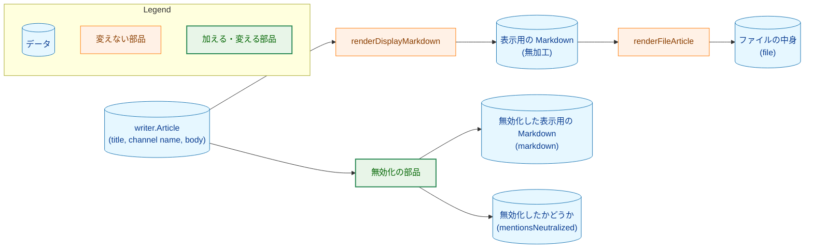
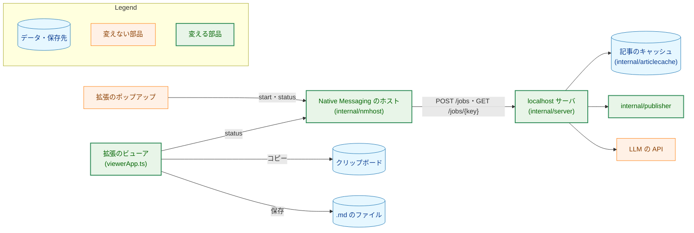
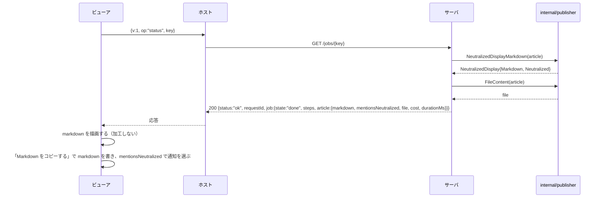
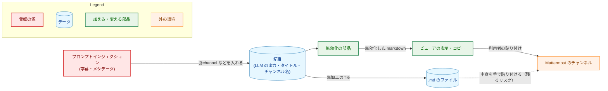
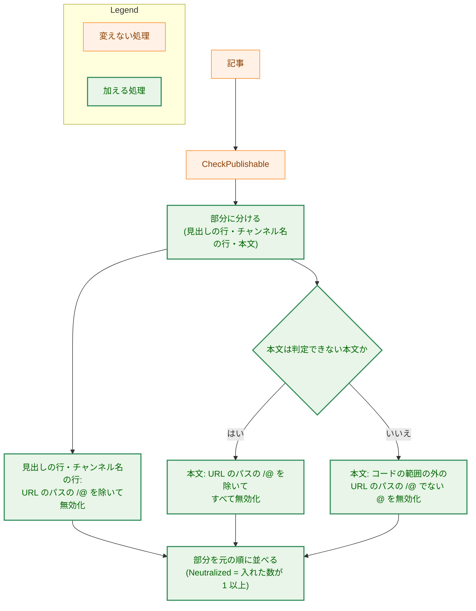
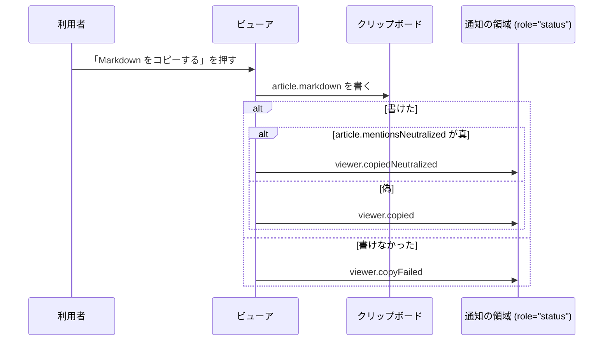

# アーキテクチャ設計書：Slack の Webhook への投稿の機能を廃止し、メンションの無効化をクリップボードへのコピーに移す

## Document Status

| Item | Value |
|---|---|
| Status | `draft` |
| Created | 2026-11-11 |
| Review date | - |
| Reviewer | - |
| Comments | - |

本書は [01_requirements.md](01_requirements.md)（要件定義書。以下、要件書）の設計である。既存のコードは、コミット `ee6d14df` で確かめた。`file:line` の行番号は、このコミットでの行番号である。F-NNN・AC-NN は要件書の項番を、H-NN は [design_handoff.md](design_handoff.md)（以下、申し送り）の項番を指す。申し送りへの対応は付録 A に、受け入れ基準との対応は付録 B にまとめる。

本書は、要件書 §3.1 の用語（対象の `@`・無効化・URL・URL のパスの `/@`・コードの範囲・表示用の Markdown・コピーする文章）を、要件書と同じ意味で使う。そのほかに、次の用語を使う。

-   **無効化した表示用の Markdown:** 表示用の Markdown の対象の `@` を、要件書 F-002 の規則で無効化した文字列。ビューアが表示し、コピーする文章としてクリップボードに書く（3.2）。
-   **無効化の部品:** 記事（`writer.Article`）から、無効化した表示用の Markdown と、無効化したかどうかを作る `internal/publisher` の関数と型（3.2）。
-   **自動リンクの並び:** 本文の中で、ASCII の空白（スペース・タブ・改行・VT・FF・CR）を含まず、`://` か `www`（大文字・小文字を区別しない）を含む、ひと続きの並び。Mattermost がコードスパンより先に自動リンクとして読みうる範囲を、広めに見積もったものである（3.3）。
-   **判定できない本文:** コードの範囲を判定できない本文（要件書 AC-13）。`writer.ProseRanges` が判定できないと返す本文に加え、本書が 3.3 で定める形を含む本文を指す。

## 1. 設計の全体像 (Design Overview)

### 1.1. 設計原則

-   **無効化はサーバで行い、ビューアは受け取った文字列を加工しない。** 規則は Go の 1 か所（`internal/publisher`）に置き、拡張（TypeScript）に同じ規則を書かない（要件書 §4.5、申し送り H-01 のレビュー担当者の方針）。
-   **タイトル・チャンネル名・本文は、記事の値を別々に持つ段階で無効化する。** 表示用の Markdown の 1 つの文字列から切り分けない（H-07）。
-   **無効化したかどうかは、無効化の部品が値として返す。** 文字列の中の U+200B の有無からは判定しない（H-02）。
-   **Mattermost と判定が食い違うときは、無効化する側に倒す。** こちらが「変えない」とする判定（URL のパスの `/@`、コードの範囲）は、2026-11-11 に読んだ Mattermost の判定より狭くする（3.3、6.3）。
-   **投稿の機能は、残さずに消す。** 投稿の状態・Webhook の設定・投稿の操作は、型・コード・テスト・文書のどこにも残さない。前の版との互換の仕組みは作らない（要件書 §2.3）。
-   **加工しない出力は、いまと同じ関数で作る。** 保存するファイルと `--out` のファイルは、いまの `renderFileArticle`（`internal/publisher/file_render.go:43`）のままにする（AC-16a）。

### 1.2. 設計の際に決めたこと（2026-11-11）

-   **状態の取得の応答の `markdown` を、無効化した表示用の Markdown にする。無効化したかどうかを、`job.article.mentionsNeutralized`（真偽値）で添える。** 無加工の表示用の Markdown は応答に入れない。無加工の文字列は `file` の本文の部分にあり、レビュー担当者の方針（無加工と無効化した文字列の両方を渡す）は `file` と `markdown` で満たす。拡張は無加工の表示用の Markdown を使わず、両方を入れると応答が記事 1 本分大きくなり、記事の大きさの上限（`maxStatusResponseBytes`、`internal/server/status.go:20`）が実質およそ 3 分の 2 に下がるためである。レビュー担当者が選んだ。ADR の判断: [ADR-0027](../../dev/adr/0027-article-job-api.md)（応答が持つもの）と [ADR-0043](../../dev/adr/0043-copy-mention-neutralization.md)（無効化をサーバで行い、ビューアは加工しない）を改める。
-   **Mattermost のソースを読んで、こちらの判定と比べた。** 申し送り H-06 の候補のうち、ソースの読解を選んだ。実機での確かめより安く、要件書の実機の結果（URL の中の `/@` とコードの中の `@` が通知されない）の仕組みを説明できるためである。レビュー担当者が選んだ。読んだ内容と見つけた食い違いは 6.3 にある。ADR の判断: ADR-0043 の背景に加える。
-   **URL のパスの `/@` の定義を、Mattermost が自動リンクにする形だけに狭める。** 6.3 の U1〜U5 の形では、要件書の前の定義が `@` を変えないのに、Mattermost は自動リンクにせず通知する。これを防ぐために要件書 §3.1 の定義を改めた。要件書の決定の変更なので、要件書を `draft` に戻し、本 PR で再び承認を受ける（要件書「設計の際に改めたこと（2026-11-11）」）。レビュー担当者が選んだ。ADR の判断: ADR-0043 を改める。
-   **Mattermost がコードとして扱わない書き方を含む本文は、判定できない本文として扱う。** 6.3 の C1〜C3 の形では、こちらがコードとみなす範囲の `@` を、Mattermost は段落のテキストとして通知する。要件書は、コードの範囲の判定の細部を設計に委ねている（要件書 §1「本書の記述範囲」）ので、要件書は改めない。判定できない本文では、要件書 AC-13 のとおり、本文の対象の `@` をすべて無効化する。C3 は、レビュー担当者に C1・C2 を示した後に見つけた形で、同じ扱いにした。レビュー担当者が C1・C2 にこの扱いを選んだ。ADR の判断: ADR-0043 を改める。
-   **無効化の部品は `internal/publisher` に置き、新しいパッケージを作らない。** 表示用の Markdown を作る `renderDisplayMarkdown` と、対象の `@` の判定（`mentionAts`）が同じパッケージにあり、別のパッケージに分けると、表示用の Markdown の作り方を二か所に分けることになるためである。ADR の判断: ADR を作らない。パッケージの中のファイルの置き場所で、ほかのタスクを縛らないためである。
-   **本文の UTF-8 の検査を `writer.Article.CheckPublishable` に加える（H-03）。** サーバの完了の時点の検査（`internal/server/generation.go:72`）と、CLI の `--out`（`FilePublisher` が `FileContent` を通して呼ぶ。`internal/publisher/file.go:106`、`file_render.go:27`）の両方が、この関数を通るためである。ADR の判断: ADR を作らない（要件書のとおり）。
-   **英語の通知の文面は「Copied the Markdown. An invisible character was inserted after each @ so that it does not become a mention.」とする（AC-18）。** 日本語の文面（要件書 AC-18）と同じことを述べ、数を示さない。ADR の判断: ADR を作らない（文面の選択で、ほかのタスクを縛らない）。

### 1.3. なぜ今の仕組みでは足りないか

いまの無効化（`neutralizeMentions`・`neutralizeProse`、`internal/publisher/slack_render.go:116`〜`130`）は、Webhook への投稿の文字列だけに使われ、表示用の Markdown（`publisher.DisplayMarkdown`、`internal/publisher/display_render.go:15`）は無効化しない。そのうえ、いまの無効化は、直前が `/` の `@` をすべて変えず（`slack_render.go:147`、`followsSlash`）、その `@` は投稿の拒否（`rejectMention`、`slack_message.go:220`）が防ぐ前提で作られている。コピーは拒否しない（要件書 F-002）ので、いまの関数をそのまま表示用の Markdown にかけると、`AC/@名前` のような通知される `@` が残る。チャンネル名も、いまは見出し行の中で無効化されるが、表示用の Markdown では独立した行にある（`display_render.go:31`〜`33`）。そのため、無効化の規則（どの `@` を変えないか）を改め、表示用の Markdown の各部分にかける部品を作る。

対象の `@` の判定（`mentionAts`・`mentionAtsOf`・`replaceLookAlike`・`isMentionNameChar`、`slack_message.go:372`〜`424`）と、`@` の直後に U+200B を入れる処理（`insertAfterAts`、`slack_render.go:134`）は、そのまま使える。これらは Webhook に固有の層（分割・`silent`・拒否）と同じファイルにあるので、残す規則を Webhook に依存しない名前のファイルへ移す（H-04、3.2）。

### 1.4. 概念モデル

図の矢印 A → B は「A から B を作る」を表す。



無効化した表示用の Markdown は、無加工の表示用の Markdown に U+200B を入れただけの文字列である（AC-10）。保存するファイルと `--out` のファイルは、無加工の表示用の Markdown から作り、無効化した文字列を通らない（AC-16a）。

## 2. システム構成 (System Structure)

### 2.1. 全体構成

廃止の後の構成を示す。図の矢印 A → B は「A が B に要求を送る」を表す。投稿の操作と Webhook への送信は、図から消える。



ポップアップは、状態の取得の応答の検査（`extension/src/core/response.ts`）とポーリング（`extension/src/core/poll.ts`）をビューアと共有するので、応答の形の変更が及ぶ。ポップアップのコード（`popup.ts`・`popupView.ts`）は変えない。

### 2.2. コンポーネント配置

| 部品 | 変更 |
|---|---|
| `internal/publisher` | 無効化の部品を加える。投稿の文字列・分割・拒否・Webhook への送信を消す（3.2、3.4） |
| `internal/writer` | `CheckPublishable` に本文の UTF-8 の検査を加える（3.5） |
| `internal/server` | 状態の取得の応答を改め、投稿の操作・投稿のジョブ・Webhook の設定を消す（3.6） |
| `internal/articlecache` | 投稿の状態と投稿の実行を消す（3.7） |
| `internal/nmhost` | `publish` の操作を消す（3.8） |
| `internal/config` | `SLACK_WEBHOOK_URL` を知らないキーにし、Webhook の URL の読み込みを消す（3.9） |
| `internal/slackwebhook` | パッケージを消す（3.9） |
| `cmd/yt2column-server` | Webhook の設定と投稿のジョブに関わる配線・ログ・停止の案内を消す（3.6） |
| 拡張 | 投稿の操作と表示を消し、`markdown` をそのまま表示・コピーし、コピーの通知を改める（3.10） |
| `Makefile` | `test-integration-slack` を消す（3.11） |
| 文書・エージェントの指示 | 要件書 §2.2 の文書を改める（3.12） |

### 2.3. データフロー

状態の取得から、表示とコピーまでの流れ。



## 3. コンポーネント設計 (Component Design)

### 3.1. 状態の取得の応答（AC-03、H-01、H-02、H-05）

`done` の応答は次の形になる。最上位の `webhookConfigured` と、`job` の `publish` はなくなる。

```json
{
  "status": "ok",
  "requestId": "…",
  "job": {
    "state": "done",
    "steps": { "draft": "done", "shorten": "skipped", "review": "done" },
    "article": {
      "markdown": "# タイトル\n\n…（無効化した表示用の Markdown）",
      "mentionsNeutralized": true,
      "file": "---\n…（無加工）",
      "cost": { "state": "known", "usd": "0.0123" },
      "durationMs": 12345
    }
  }
}
```

-   `markdown` は、無効化した表示用の Markdown である。ビューアは、これを描画し、そのままコピーする。
-   `mentionsNeutralized` は、`markdown` に無効化の U+200B を 1 つ以上入れたときだけ真である。表示用の Markdown がもともと U+200B を含んでも、無効化していなければ偽である（H-02）。
-   `file` は変えない（AC-16a）。
-   `running`・`failed`・`unknown` の応答は、`webhookConfigured` がなくなるほかは変えない。

`maxStatusSize`（`internal/server/status.go:172`）は、実際の応答を描いて大きさを測るので、無効化で増えたバイト（1 つの `@` につき 3 バイト）も数える。投稿の状態と理由の組み合わせの繰り返し（`status.go:177`〜`195`）は、投稿の状態がなくなるので消え、工程の状態だけを繰り返す。

### 3.2. 無効化の部品（F-002、H-01、H-04、H-07）

```go
// NeutralizedDisplay is the display Markdown of an article with its mentions
// neutralized, as the Viewer displays and copies it.
type NeutralizedDisplay struct {
	// Markdown is the display Markdown with U+200B inserted after each
	// neutralized '@'; removing those insertions gives the display Markdown
	// renderDisplayMarkdown returns.
	Markdown string
	// Neutralized reports whether at least one U+200B was inserted.
	Neutralized bool
}

// NeutralizedDisplayMarkdown runs CheckPublishable on a and returns its
// neutralized display Markdown.
func NeutralizedDisplayMarkdown(a writer.Article) (NeutralizedDisplay, error)
```

-   いまの `DisplayMarkdown`（`display_render.go:15`）は、`NeutralizedDisplayMarkdown` に置き換える。呼び出し元は `internal/server/status.go:135` だけである。
-   **部分ごとに無効化する。** タイトルの見出しの行、チャンネル名の行（`escapeLeadingMarkdown` を通した後の行）、本文の 3 つを、`renderDisplayMarkdown` と同じ順に並べ、それぞれに規則をかける。見出しの行とチャンネル名の行は、コードの範囲を持たない（AC-11）。本文だけに、コードの範囲の判定（3.3）をかける。表示用の Markdown の全体に判定をかけないので、タイトルのバッククォートが本文のバッククォートと対になることはない（H-07）。
-   **契約:** 結果の `Markdown` から、無効化で入れた U+200B を除くと、`renderDisplayMarkdown(a)` とバイト単位で一致する（AC-10、AC-15）。1 つの `@` に入れる U+200B は 1 つだけである。
-   **規則:** 対象の `@`（`mentionAts`、見た目の似た文字を含む）のうち、次のどれにも当たらないものを無効化する。
    1.  URL のパスの `/@`（要件書 §3.1 の 5 つの条件。判定は 3.3）。
    2.  本文で、判定できない本文ではなく、`@` がコードの範囲の中にあるもの。
-   **ファイルの分け方（H-04）:** 対象の `@` の判定と U+200B を入れる処理を、`slack_message.go`・`slack_render.go` から、Webhook に依存しない名前のファイル（例: `mention.go`）へ移す。直前が `/` の `@` をすべて除く `followsSlash`（`slack_render.go:157`）は、URL のパスの `/@` の判定に置き換える。移すコミットは、テストも一緒に移し、消さない。投稿のコードとテストを消すコミットとは分ける（8 章）。

### 3.3. URL のパスの `/@` とコードの範囲の判定（AC-11〜AC-13、H-06）

**URL のパスの `/@`。** 要件書 §3.1 の 5 つの条件をそのまま判定する。判定は部分（見出しの行・チャンネル名の行・本文）ごとに行い、条件 5 の「同じ段落」は、部分の中の、空行で区切られた行の並びとする。見出しの行とチャンネル名の行は、それぞれ 1 つの段落である。条件 4 の「空白」は、Unicode の空白（`unicode.IsSpace`）とする。Mattermost の自動リンクは ASCII の空白でしか終わらないので、こちらのほうが短く区切り、無効化する側に倒れる。

この定義は、6.3 で読んだ Mattermost の自動リンクの条件より、どの点でも狭い。

| 条件（要件書 §3.1） | Mattermost の自動リンクの条件（6.3） |
|---|---|
| 2. スキームは小文字の `http`・`https` だけで、直前は ASCII の英字・数字でない | スキームは `http`・`https`・`ftp`・`mailto`・`tel` を大文字・小文字を区別せずに受け、直前の ASCII の英字・数字までスキームに含める |
| 3. ホストは文字・数字・`.`・`-` で、先頭は文字か数字、直後が `/` | ホストの先頭は空白と Unicode の句読点以外、`_` を含むと自動リンクにしない。ホストの後ろは空白まで続く |
| 4. `@` までに空白・`<`・`>`・`?`・`#`・`` ` `` がない | ASCII の空白まで続き、`<`・`>` の前で切る。末尾の句読点と対にならない `)` を落とすが、`@` より前には戻らない |
| 5. 同じ段落の前のほうに `[` がない | 段落の中で、閉じていない `[`・`![` があると、自動リンクを作らない |

**判定できない本文。** 次のどれかに当たる本文は、判定できない本文とし、本文の対象の `@` を、URL のパスの `/@` を除いてすべて無効化する（AC-13）。

-   `writer.ProseRanges`（`internal/writer/markdown.go:49`）が、判定できないと返す本文。
-   **C1:** `~~~` のフェンスを開く行の、フェンスの文字の後ろに `` ` `` がある本文。
-   **C2:** 自動リンクの並びの中で、`://` か `www` より後ろに `` ` `` がある本文。
-   **C3:** 開いたフェンスの中に、`ProseRanges` は閉じのフェンスとみなさないが、行末の空白を Unicode の空白として除けば閉じのフェンスになる行がある本文。

この 3 つは、`ProseRanges` の結果の上に加える判定として作り、`proseLines`（`markdown.go:132`）は変えない。`proseLines` は、生成した記事の本文の検査（`markdown.go:109`）も使うので、変えると記事の生成が失敗するようになるためである。

**ビューアの描画との関係。** ビューアは、`<https://…>` の形の自動リンクを、URL の条件をすべて満たすときだけリンクにする（`extension/src/core/articleMarkdown.ts:107`〜`127`、`linkUrl`）。無効化で U+200B が入った `<https://example.com/?@here>` は、`new URL` が U+200B を `%E2%80%8B` に置き換えて元の文字列と一致しなくなるので、リンクにならず、文字のまま表示される。URL のパスの `/@` は変えないので、`<https://www.youtube.com/@handle>` はいまと同じくリンクになる。そのほかの描画の規則は、U+200B を特別に扱わない（`articleMarkdown.ts:54`〜`71`）ので、ブロックの構成は変わらない。表示の見た目は、U+200B が幅を持たないので変わらない（AC-16）。

### 3.4. 投稿の文字列・分割・拒否・送信の削除（F-001、AC-07、AC-09）

`internal/publisher` から次を消す。

-   `slack.go`（`SlackWebhookPublisher`・`PostMessages`・`SlackMaxPostDuration` など）、`slack_errors.go`（`ErrSlackMention`・`ErrSlackUnsplittable` など）。
-   `slack_message.go` のうち、`PrepareSlackMessages`・分割・`rejectMention` と M1〜M4 の判定（3.2 で移す判定は残す）。
-   `slack_render.go` のうち、`renderSlackPost`・脚注（`slackFootnote`・`stageModels`）。
-   `test_helpers_slack.go`、`testutil/mocks.go` の投稿の偽物、`testutil/integration.go` の Webhook の統合テストの設定（`SlackOptInEnv`・`WebhookURLEnv`・`SlackIntegrationOptions` など）。統合テストの設定のうち、ほかの統合テストが使う部分（`IntegrationOptions` など）は残す。
-   `slack_integration_test.go` と、投稿だけを確かめるテスト（`slack_test.go`・`slack_message_test.go`・`slack_render_test.go`・`slack_errors_test.go`・`slack_articles_test.go`）。対象の `@` の判定と U+200B を入れる処理のテストは、3.2 の移すコミットで新しいファイルへ移してから消す。

`stageModels` は、脚注のほかに使う所がない（`slack_render.go:35`、`git grep stageModels` で確かめた）ので、一緒に消す。`FormatArticleCost` は、`file_render.go:61` と状態の取得（`status.go:144`）も使うので残す。

### 3.5. 本文の UTF-8 の検査（AC-09a、H-03）

`writer.Article.CheckPublishable`（`internal/writer/article.go:16`）に、本文が正しい UTF-8 であることの検査を加える。違反は、いまのほかの検査と同じく `ErrInvalidArticle` を包み、理由は固定の文字列（例: `body is not valid UTF-8`）で、本文の値を含めない。この検査は、制御文字の検査（`article.go:49`）より前に置く。不正なバイトは、`strings.ContainsFunc` がルーンに変えるときに U+FFFD として読まれるので、先に UTF-8 を確かめないと、制御文字の検査が不正なバイトを読み飛ばすためである。

-   サーバ: 完了の時点の検査（`generation.go:72`）が `article_invalid` で失敗させる。
-   CLI: `FilePublisher` が `FileContent` を通して同じ検査をし、`--out` のファイルを書かずに失敗する。
-   いまの送る前の検査の本文の UTF-8 の検査（`slack_message.go:30`〜`35`）は、3.4 で消える。

### 3.6. サーバ（AC-02、AC-03、AC-07、AC-08）

```go
// statusArticle is a done article: the neutralized display Markdown, whether
// it neutralized a mention, the --out file content, the cost, and the
// generation's duration.
type statusArticle struct {
	Markdown            string     `json:"markdown"`
	MentionsNeutralized bool       `json:"mentionsNeutralized"`
	File                string     `json:"file"`
	Cost                statusCost `json:"cost"`
	DurationMs          int64      `json:"durationMs"`
}
```

-   **応答:** `statusResponse` から `WebhookConfigured` を、`statusJob` から `Publish` を消す（`status.go:25`〜`41`）。`statusPublish`・`publishStatus`・`publishStateCode`・`unpostableCode`・`publishFailureCode` を消す。
-   **ルーティング:** `routePublish` と `PublishSuffix`（`handler.go:14`・`24`・`51`〜`52`・`76`〜`77`）を消す。`/jobs/{key}/publish` は、ほかの受け付けないターゲットと同じ経路で `not_found` になり、本文を読まない（AC-02）。`publish.go` を消す。
-   **拒否の理由:** `webhook_not_configured` と、投稿だけが使う理由（`article_not_ready`・`article_not_found`・`article_not_postable`）を消す（`response.go`）。
-   **完了の時点の検査:** `completeGeneration`（`generation.go:71`）は、`CheckPublishable` と応答の大きさの検査だけを行い、`PrepareSlackMessages` を呼ばない。記事はいつも `done` になる（AC-07）。成功のログの行から `publish` の属性を消す。
-   **記録を落とすときのログ:** `logEviction`（`jobs_api.go:202`）から `publish` の属性を消す。要件書は定めていないが、投稿の状態がなくなるので消す。
-   **設定:** `Options.Webhook`・`WebhookOptions`・`WebhookPublisher`・`webhookConfigured()`（`server.go:48`〜`73`・`169`〜`209`）を消す。
-   **停止:** 投稿のジョブの数（`postJobs`）とそのログの属性（`server.go:94`・`260`）を消す。生成のジョブの取り消しと待ちは変えない（AC-08）。`cmd/yt2column-server/run.go` の停止の案内（`stopNoticeLogger`、`run.go:268`〜`276`）から投稿の待ちの文を消し、`SlackMaxPostDuration` を使わない。二度目の合図ですぐに終わることの案内は残す。
-   **起動:** `listening` の行から `webhookConfigured` を消し、Webhook がないことの警告の行（`run.go:223`〜`226`）と、`newPublisher` の配線（`run.go:50`〜`70`・`344`〜`350`）を消す。秘密の伏せ字の対象（`redact.SecretStrings`、`run.go:191`）から Webhook の URL を除く。HTTP/2 のデバッグの警告（`run.go:194`）の文面から Webhook の URL を除く。

### 3.7. 記事のキャッシュ（`internal/articlecache`）

-   `PublishState`・`UnpostableReason`・`PublishFailureReason` とその列挙（`record.go:62`〜`110`）、`Snapshot` の投稿の欄（`record.go:130`〜`132`）、記録の投稿の欄と `publishGen`・`delivered`、`BeginPublish`・`PublishRun`（`cache.go:235`〜、`record.go:357`〜`408`）を消す。
-   `CompletePostable`・`CompleteUnpostable`（`record.go:282`〜`299`）を、1 つの完了の操作（例: `Complete`）にまとめる。
-   `evictable`（`record.go:196`〜`205`）は、`done` の記録をいつも落としてよいものとする。投稿中の記録がなくなるためである。
-   `Eviction` の `Publish`（`cache.go:96`）を消す。

### 3.8. ホスト（AC-04）

`OperationPublish`・`opPublish`・`publishSuffix`（`internal/nmhost/relay.go:57`・`384`・`392`・`403`〜`404`・`418`〜`419`・`489`・`527`〜`528`）を消す。`op` が `publish` のメッセージは、`parseOperation` が `OperationUnknown` を返し、いまの `default` の経路（`relay.go:499`、`ruleOperation`）で、サーバへ何も送らずに `protocol_error` になる。

### 3.9. 設定（AC-05、AC-06）

-   `serverFileKeys`（`internal/config/serverfile.go:17`〜`20`）から `slackEnv` を除く。`SLACK_WEBHOOK_URL` の行は、知らないキーの拒否（`reasonLineUnknownKey`、`serverfile.go:71`）になる。拒否の理由は受け付けるキーを並べるだけで、読んだキーと値を含まない。`#` で始まる行は、いまと同じくキーとして読まない（`serverfile.go:59`）。
-   雛形（`serverfile.go:445`〜`447`）から `SLACK_WEBHOOK_URL` の 3 行を消す。
-   `ServerConfig.webhookURL`・`WebhookURL()`・`loadSlackWebhook`・`slackEnv`・`reasonSlackWebhook`（`config.go:45`・`107`・`338`〜`354`・`394`〜`412`・`753`〜`766`）を消す。CLI は `SLACK_WEBHOOK_URL` を読まない（[0062 要件定義書](../0062_remove_cli_slack/01_requirements.md)）ので、CLI の振る舞いは変わらない。
-   `internal/slackwebhook`（`ValidURL` など）を消す。使うのは `config.go:760` と `publisher/testutil/integration.go:91` だけで、どちらも本タスクで消える。

### 3.10. 拡張（AC-01、AC-16、AC-18〜AC-20、H-05）

```ts
// The article of a done job, as the status response carries it.
type Article = {
  markdown: string; // the neutralized display Markdown, drawn and copied unchanged
  mentionsNeutralized: boolean; // whether markdown neutralized a mention
  file: string; // the --out file content, saved unchanged
  cost: ArticleCost;
  durationMs: number;
};

// The result of an operation the Viewer shows beside its buttons.
type ActionNotice =
  | { kind: "saved" }
  | { kind: "copied"; mentionsNeutralized: boolean }
  | { kind: "copy-failed" };
```

-   **応答の検査（`response.ts`）:** `done` の記事の決まったメンバに `mentionsNeutralized`（真偽値）を加え（`response.ts:446`〜`459`）、`done` の `job` から `publish` を（`response.ts:510`〜`523`）、`ok` の応答から `webhookConfigured` を（`response.ts:629`〜`645`）除く。どの階層でも、メンバの集まりがちょうど一致するときだけ受理する規則は変えない（要件書 §4.2）。投稿の応答の検査（`classifyPublish`・`PublishOutcome`・投稿の拒否の理由・ログの形）を消す。
-   **ポーリング（`poll.ts:53`〜`66`）:** `done` の記事では、いつもポーリングを止める。投稿中の記事がなくなるためである。`JobDisplay`（`jobView.ts:46`〜`52`）から `publish` と `webhookConfigured` を除く。
-   **ビューア（`viewerApp.ts`、`ui/renderViewer.ts`、`static/viewer.html`）:** 投稿のボタン（`button#publish`）、投稿の状態の行（`div#publish-row`）、投稿の処理（`publishArticle`、`viewerApp.ts:459`〜`527`）、投稿の状態の告知（`renderViewer.ts:206`〜`218`）、投稿中の状態（`publishing`・`awaitingPublishStatus`）を消す。記事の描画は、いまと同じく `article.markdown` をそのまま `drawArticleBody` に渡す（`renderViewer.ts:337`）。保存（`saveArticle`、`viewerApp.ts:529`〜`540`）は `article.file` のまま変えない。
-   **コピー（`copyArticle`、`viewerApp.ts:542`〜`555`）:** `article.markdown` をそのまま書く。成功したら `{kind: "copied", mentionsNeutralized: article.mentionsNeutralized}` を示す。通知は、真なら新しいメッセージ（`viewer.copiedNeutralized`）を、偽ならいまの `viewer.copied` を示す。失敗はいまの `copy-failed` のままで、無効化を示さない（AC-19）。通知の領域はいまの `div#action-status`（`role="status"`、`static/viewer.html:29`）のままで、フォーカスを動かさない（AC-20）。
-   **選択によるコピー:** `copy` イベントを捉えない。ビューアのコードは、ボタンのほかにコピーに関わらないので、通知の領域は変わらない（AC-19a）。
-   **メッセージのカタログ（`core/i18n/catalog.ts`・`en.ts`・`ja.ts`）:** `viewer.copiedNeutralized` を英語と日本語の両方に加える（AC-20）。投稿のメッセージ（`viewer.publish`・`viewer.webhookNotConfigured`・`publishExchange`・`publishStates`・`publishReasons`・投稿の拒否の理由・`setWebhookStep`・`publishUnknownStep`・`publishAgainStep`）を消す。`repeatedPostStep` は、`viewer.lost` が使い続けるかを実装で確かめ、使わなくなれば消す。
-   **ホストへのメッセージ（`core/hostMessage.ts`）:** `publish` の形と `publishMessage` を消す。
-   **プレビューの台本（`scripts/popup-preview.ts`）:** 投稿の状態の行ごとのページを消し、`done` の記事に `mentionsNeutralized` を加える。
-   `manifest.json` は変えない。投稿に関わる権限は、いまもない（`static/manifest.json`、`host_permissions` なし）。

### 3.11. ビルドとテストの対象

-   `Makefile` から `test-integration-slack`・`SLACK_INTEGRATION_TIMEOUT` と、`.PHONY` の項目（`Makefile:57`・`285`〜`300`）を消す。`YT2COLUMN_TEST_SLACK_WEBHOOK_URL`・`YT2COLUMN_SLACK_INTEGRATION` を読むコードは、3.4 で消える（AC-09）。
-   CI の設定（`.github/workflows/*.yml`）には、Slack の統合テストを走らせる箇所がない（`grep -i slack` で確かめた）。

### 3.12. 文書とエージェントの指示（F-004）

要件書 §2.2 の文書を改める。値と構造を確かめる既存のガードのテスト（`CLAUDE.md`「Development Notes」）が読む箇所は、テストと文書を同じコミットで改める。

| 文書 | 改める内容 |
|---|---|
| `docs/dev/security.md` | §2 の Webhook の URL、§3 の Webhook への送信、§6 のメンションの 3 つの層、§8 の投稿の操作と投稿のジョブを消す。§6 に、コピーと表示の無効化の規則（要件書 F-002、本書 3.2・3.3）と、要件書 §4.2 の残るリスクを書く（AC-21）。§6 の「Mattermost のソースの読解」は、本書 6.3 の読解（`master`、コミット `d504067`）に改める |
| `docs/dev/guides/development.md` | 「ジョブの API」を 2 つの操作にし、状態の取得の応答の形（3.1）、投稿の状態と理由の表、投稿の拒否の理由の行を改める。拡張のテスト（`serverReasons.test.ts`・`jobCodes.test.ts`）が読む表なので、拡張のテストと合わせる |
| `README.md`・`README.en.md` | 投稿の説明と `SLACK_WEBHOOK_URL` の設定を消す。ビューアの説明に、表示とコピーの無効化と通知を書く（AC-22）。設定ファイルの説明に、`SLACK_WEBHOOK_URL` の行が残るとサーバが起動しないことと、その行を消す手順を書く（AC-23）。`README.en.md` は `/mktrans` で同期する |
| `docs/dev/project_overview.md`・`docs/dev/production_profile.md`・`docs/dev/conventions/package_reference.md`・`CLAUDE.md`・`AGENTS.md`・`docs/translation_glossary.md` | 投稿の機能を今の機能として説明する箇所を消すか改める。用語集は要件書 §6 のとおりに改める |
| `.claude/commands/_context.md` | 「Conditional-guide trigger」から Webhook の URL と Webhook への送信を除き、「Target client environments」を要件書 AC-24 の文に改める |
| `.claude/commands/runplan.md` ほか | 投稿の機能に触れる指示を改める。実装で `git grep -i -E 'webhook|slack'` で洗い出す |
| `.github/workflows/deepseek-review.yml` | 投稿の機能に触れるレビューの指示を改める |
| ADR | 実装の PR で、各 ADR の #770 へリンクした食い違いの注記を消す（ADR-0005・0006・0008・0010・0018・0022・0027・0028・0031・0034・0043）。ADR-0009 の背景の投稿の記述は、編集上の訂正として直す（要件書 §1） |

`CLAUDE.md` の「Architecture Overview」と「Tool Execution Safety」の Webhook の記述、「Commands」の `make test-integration-slack` に当たる記述も改める。

### 3.13. 既存のテストへの影響

振る舞いを変える箇所を確かめている既存のテストは、次のとおりである。消すテストは、8 章のとおり削除だけのコミットにし、coverage-compare で確かめる（`CLAUDE.md`「Testing Strategy」）。

| テスト | 扱い |
|---|---|
| `internal/publisher/display_render_test.go`（`TestDisplayMarkdown`） | `NeutralizedDisplayMarkdown` のテストに改める |
| `internal/publisher/slack_render_test.go`・`slack_message_test.go` のうち、対象の `@` の判定と U+200B を入れる処理のテスト | 新しいファイルへ移し、直前が `/` の `@` を変えないことを確かめる行は、URL のパスの `/@` の規則に合わせて改める |
| `internal/publisher/slack_*_test.go` の残り、`testutil/integration_settings_test.go` の Webhook の部分、`testutil/mocks_test.go` の投稿の偽物の部分 | 消す |
| `internal/slackwebhook/slackwebhook_test.go` | 消す |
| `internal/server/publish_test.go` | 消す |
| `internal/server/status_test.go`・`generation_test.go`・`jobs_api_test.go`・`handler_test.go`・`response_test.go`・`server_test.go` | 投稿の状態・`webhookConfigured`・投稿の拒否の理由を確かめる行を消し、`mentionsNeutralized` と完了の扱い（いつも `done`）を確かめる |
| `internal/articlecache/cache_test.go` | 投稿の状態と投稿の実行のテストを消し、`done` の記録を落とせることを確かめる |
| `internal/nmhost/relay_test.go`・`cmd/yt2column-nmhost/main_test.go` | `publish` を受け付けるテストを、`protocol_error` で何も送らないテストに改める |
| `internal/config/serverfile_test.go`・`config_test.go` | `SLACK_WEBHOOK_URL` の行を知らないキーとして拒否するテストを加え、Webhook の URL の読み込みのテストを消す |
| `cmd/yt2column-server/*_test.go` | Webhook の配線・警告の行・停止の案内のテストを改める |
| `internal/writer/article_test.go` | 本文の UTF-8 の検査のテストを加える |
| 拡張のテスト（`response.test.ts`・`poll.test.ts`・`poller.test.ts`・`viewerApp.test.ts`・`renderViewer.test.ts`・`jobView.test.ts`・`hostMessage.test.ts`・`sendMessages.test.ts`・`serverReasons.test.ts`・`jobCodes.test.ts`・`entryPoints.test.ts`・`catalog.test.ts`・`metadataDocs.test.ts`・`popupHtml.test.ts`・`popupPreview.test.ts`・`secretsAbsent.test.ts`・`launch.test.ts` ほか、`test/helpers/job.ts`・`dom.ts`） | 投稿の部分を消し、`mentionsNeutralized` と新しい通知を確かめる |
| 文書を読むガードのテスト（`cmd/yt2column-server/docs_test.go`、`internal/doctestutil/readme.go` の `ReadmeSlackPostHeading` など） | 改めた文書に合わせる |

## 4. エラーハンドリング設計 (Error Handling Design)

-   **加えるエラーの型はない。** 本文の UTF-8 の違反は、いまの `writer.ErrInvalidArticle` を包む（3.5）。サーバでは `failed` の `article_invalid` に、CLI では `--out` を書かない失敗になる。理由は固定の文字列で、本文の値を含めない。
-   **無効化は失敗しない。** `NeutralizedDisplayMarkdown` が返すエラーは、`CheckPublishable` のエラーだけである。完了の時点の検査を通った記事では起きず、起きれば状態の取得は、いまと同じく実装の誤りとして扱う（`status.go:88`〜`91`）。
-   **消すエラー:** `ErrSlackMention`・`ErrSlackUnsplittable`・`SlackPostError` などの投稿のエラー、`errNilWebhookPublisher`、`webhook_not_configured` と投稿の拒否の理由、拡張の投稿の結果の文面。
-   **知らないキーの拒否:** `SLACK_WEBHOOK_URL` の行は、いまの `ErrConfigFileFormat` と行の番号と固定の理由で拒否し、サーバは起動しない（AC-05）。

## 5. セキュリティ考慮事項 (Security Considerations)

`docs/dev/security.md` を適用する。本タスクは、Webhook の URL（秘密）とその送信をなくし、信頼できないテキスト（記事）を外の出力に入れる経路（コピーと表示）の規則を改める。



図の実線の矢印 A → B は「A の値が B に届く」を、点線の矢印は本タスクが防がない経路を表す。

-   **信頼できない入力:** 無効化の入力は、完了の時点の検査を通った記事である。無効化は U+200B を入れるだけで、記事のほかの文字を変えない（AC-10）。拡張は、応答の形がちょうど一致するときだけ受理する規則を保つ（3.10）。
-   **判定の食い違いは、無効化する側に倒す。** URL のパスの `/@` と、コードの範囲の判定は、6.3 で読んだ Mattermost の判定より狭い（3.3）。こちらが変えない `@` は、Mattermost も自動リンクかコードとして扱い、通知しない形に限る。
-   **秘密:** Webhook の URL は、設定・型・ログの伏せ字の対象のどこにも残らない。`SLACK_WEBHOOK_URL` の行を拒否するときも、値をエラーとログに含めない（AC-05）。
-   **ネットワーク:** サーバが外へ送るのは LLM の API だけになる。サーバの停止で待つのは生成のジョブだけになる。
-   **残るリスク:** 要件書 §4.2 の 6 つのとおりである。4 と 5 は、6.3 で見つけた食い違いを除いたが、読解していない形と版、Mattermost のサーバの版の違いは残る。ほかに、Mattermost が自動リンクにする URL のうち、こちらの定義より広い形（ポート付きのホスト、`_` を含むホスト、大文字のスキームなど）では、コピーした URL に U+200B が入って壊れる。Mattermost がコードとして扱うのに、判定できない本文とした本文（3.3 の C1〜C3 を含む本文など）では、コードの中に U+200B が入る。どちらも、通知を防ぐことを優先して受け入れる（ADR-0043）。

## 6. 処理フロー詳細 (Processing Flow Details)

### 6.1. 無効化の流れ



図の矢印は処理の順を表す。

### 6.2. 「Markdown をコピーする」の流れ



### 6.3. Mattermost の判定との比較（H-06）

2026-11-11 に、Mattermost の `master`（コミット `d504067db55e8f888d03ccecbeb2845ef98a8eea`）のソースを、GitHub から取得して読んだ。読んだのは `server/public/shared/markdown` の `inlines.go`・`autolink.go`・`inspect.go`・`fenced_code.go`・`blocks.go`・`paragraph.go`・`markdown.go` と、`server/channels/app` の `notification.go`・`mention_parser_standard.go` である。実機での確かめではない。要件書の実機の確かめは、Mattermost サーバ 11.11.3 で行った。

**メンションの探し方。**

-   `getExplicitMentions`（`notification.go`）は、投稿の文字列を `markdown.Inspect` でたどり、テキストのノード（`*markdown.Text`）だけを連ねて、語の分割（`ProcessText`、`mention_parser_standard.go`）に渡す。
-   `Inspect`（`inspect.go`）がテキストのノードを取り出すのは、段落（`*Paragraph`）のインラインだけである。たどるブロックは文書・リスト・リストの項目・引用で、フェンス付きコードブロックとインデントのコードブロックの中はたどらない。インラインでは、リンクと画像の子だけをたどり、自動リンク（`*Autolink`）とコードスパン（`*CodeSpan`）の中はたどらない。
-   ブロックの解析（`blocks.go` の `blockStart`）は、引用・リスト・インデントのコード・フェンスだけを知り、見出しを知らない。見出しの行（`# タイトル`）も段落として読まれ、その中の `@` は通知されうる。本設計は見出しの行を無効化する（3.2）。

**自動リンクの条件**（`autolink.go` の `parseURLAutolink`・`checkDomain`・`trimTrailingCharactersFromLink`、`inlines.go` の `parseAutolink`）。

-   `:` の位置から、直後が `//` であることを確かめ、直前の ASCII の英字・数字をスキームとして読む。スキームは `http`・`https`・`ftp`・`mailto`・`tel`（大文字・小文字を区別しない）のどれかでなければならない。
-   `://` の直後の文字は、空白でも Unicode の句読点でもない。ホストに `_` があると、自動リンクにしない。
-   ホストの後ろは、ASCII の空白（スペース・タブ・改行・VT・FF・CR）の直前まで続く。そこから、最初の `<` か `>` の前で切り、末尾の `?`・`!`・`.`・`,`・`:`・`*`・`_`・`~`・`'`・`"`、末尾の文字参照の形、対にならない末尾の `)` を落とす。`@` は落とす文字に当たらないので、落とすのは `@` より後ろだけである。
-   段落の中で閉じていない `[`・`![` があると、自動リンクを作らない（`parseAutolink` の冒頭）。
-   インラインの解析は左から進み、`` ` `` に来るとコードスパンを読む。自動リンクは `:` に来たときに読み、空白まで取り込む。

**フェンスとコードスパンの条件**（`fenced_code.go`、`inlines.go` の `parseBackticks`）。

-   フェンスを開く行は、`` ``` `` か `~~~` で始まり、フェンスの文字の後ろに `` ` `` があると、`~~~` のときもフェンスにしない。
-   閉じのフェンスは、インデントが 3 以下で、開いたフェンスの文字の並びで始まり、残りを `strings.TrimSpace`（Unicode の空白を除く）で除いた後に、フェンスの文字だけが残る行である。
-   コードスパンは、同じ長さの `` ` `` の並びで閉じる。

**見つけた食い違い。** こちらが変えない `@` を、Mattermost が通知する形である。

| 記号 | 形 | 例 | 本設計の扱い |
|---|---|---|---|
| U1 | スキームの直前に ASCII の英字・数字がある | `xhttps://example.com/@here` | URL のパスの `/@` の条件 2 で除く |
| U2 | ホストに `_` を含むか、ホストの先頭が句読点 | `https://a_b.example.com/@here` | 条件 3 で除く |
| U3 | `/@` より前に `<`・`>` がある | `https://example.com<b/@here` | 条件 4 で除く |
| U4 | 同じ段落の前のほうに閉じていない `[` がある | `[https://example.com/@here]` | 条件 5 で除く |
| U5 | URL がコードスパンの中から始まる | `` `https://example.com`/@here `` | 条件 4（`` ` `` がない）で除く |
| C1 | `~~~` のフェンスの情報文字列に `` ` `` がある | `` ~~~ a`b `` | 判定できない本文とする |
| C2 | 自動リンクの並びの中で、コードスパンが始まる | ``https://example.com/`x @here` `` | 判定できない本文とする |
| C3 | 閉じのフェンスの後ろに、Unicode の空白（U+00A0・U+3000 など）がある | `` ```（U+3000） `` | 判定できない本文とする |

どれも、Mattermost の判定がこちらより広い形（ポート付きのホストなど）では、こちらが無効化する側に倒れるだけで、通知は起きない。

インデントのコードブロックは、いまと同じく本文の散文として扱い、その中の `@` を無効化する（Mattermost はコードとして扱い、通知しない。無効化する側に倒れる）。閉じていない `[` の判定は、Mattermost と違ってコードの中の `[` も数え、空行で区切った行の並びをまとめて 1 つの段落とみなす。どちらも、無効化する側に倒れる。

## 7. テスト戦略 (Test Strategy)

### 7.1. ユニットテスト

-   **無効化の部品（`internal/publisher`）:** 要件書 AC-10〜AC-15 の各行を、表のテストで確かめる。見出しの行・チャンネル名の行・本文のそれぞれで、対象の `@`、語の途中の `@`、URL のパスの `/@`、6.3 の U1〜U5 と C1〜C3 の形、コードの中の `@`、判定できない本文の `@` を入れる。期待値は、U+200B を入れる位置で書く。契約（U+200B を除くと `renderDisplayMarkdown` の結果と一致する）は、表のすべての行について確かめる。`Neutralized` は、無効化した行で真、無効化しない行（表示用の Markdown がもともと U+200B を含む行を含む）で偽を確かめる。
-   **層を分ける入力（`CLAUDE.md`「Testing Strategy」）:** URL のパスの `/@` の規則とコードの範囲の規則は、どちらも `@` を変えない。それぞれのテストの入力は、片方の規則だけが当たる形にする（コードの外の URL のパスの `/@`、URL でないコードの中の `@`）。C1〜C3 のテストは、`ProseRanges` だけでは判定できると返すことを先に確かめ、加えた判定が働くことを確かめる。
-   **本文の UTF-8:** `CheckPublishable` が不正な UTF-8 の本文を `ErrInvalidArticle` で拒否し、エラーの文字列が本文のバイトを含まないことを確かめる。
-   **サーバ:** 状態の取得の応答の形（`mentionsNeutralized` を持ち、`webhookConfigured`・`publish` を持たない）、`/jobs/{key}/publish` が `not_found` で本文を読まないこと、メンションを含む記事が `done` になること、成功のログの行に `publish` がないこと。
-   **キャッシュ:** `done` の記録が上限で落とせること。
-   **ホスト:** `op` が `publish` のメッセージが、送らずに `protocol_error` になること。
-   **設定:** `SLACK_WEBHOOK_URL` の行（値が空のときを含む）が知らないキーとして拒否され、エラーが値を含まないこと。`#` で始まる行は受理すること。雛形が `SLACK_WEBHOOK_URL` を含まないこと。
-   **拡張:** 応答の検査が `mentionsNeutralized` を求め、`webhookConfigured`・`publish` を持つ応答を想定外として拒否すること。`done` でポーリングが止まること。コピーが `markdown` をそのまま書き、`mentionsNeutralized` で通知を選ぶこと（AC-18、AC-19）。通知の領域がフォーカスを動かさないこと（AC-20）。投稿のボタンと行がないこと（AC-01）。

### 7.2. 結合テスト

-   `cmd/yt2column-server` の中継のテスト（`relay_e2e_test.go`）で、ホストからサーバまでの状態の取得が新しい形の応答を返すことを確かめる。
-   Webhook の統合テストは消える。本タスクの確かめで Webhook に送る手順はない（要件書 §5）。

### 7.3. セキュリティのテストと手動の確かめ

-   無効化のテストに、要件書 §3.1 の例と 6.3 の各形を入れる（7.1）。
-   AC-17 の手動の確かめを、実装の後に Mattermost のテスト用のチャンネルで行い、日付と版を記録する。6.3 の U1〜U5 と C1〜C3 の形も、同じ手順で貼り付けて、通知されないことを確かめる。
-   AC-16 の表示の見た目と、AC-21〜AC-23 の文書は、読んで確かめる。

### 7.4. テストの削除の確かめ

投稿だけを確かめるテストの削除は、削除だけのコミットにし、Go のテストは `make coverage-compare`、拡張のテストは `make ext-coverage-compare` で、親のコミットと比べる（`CLAUDE.md`「Testing Strategy」、[ADR-0037](../../dev/adr/0037-test-deletion-coverage.md)）。

## 8. 実装の優先順位 (Implementation Priorities)

PR の分け方は実装計画書で決める。依存の順は次のとおりである。

1.  **本文の UTF-8 の検査（3.5）。** ほかの変更に依存しない。
2.  **残す規則を移す（3.2）。** 対象の `@` の判定と U+200B を入れる処理を、テストと一緒に新しいファイルへ移す。振る舞いを変えず、テストを消さない。
3.  **無効化の部品と、応答・拡張の変更（3.1〜3.3、3.6 の応答、3.10）。** 無効化の規則（URL のパスの `/@`、判定できない本文の追加の判定、チャンネル名の行）を作り、状態の取得の応答と拡張の応答の検査・表示・コピー・通知を、同じ PR で改める（H-05）。応答の形を変える側と受ける側を分けると、間の版で状態の取得がすべて想定外になるためである。
4.  **投稿の機能を消す（3.4、3.6〜3.9、3.10 の投稿の部分、3.11）。** 先に、テストを消すコミットを、削除だけのコミットとして coverage-compare で確かめる。その後で、コードを消す。応答の `webhookConfigured`・`publish` を消すことは、3 と 4 のどちらで行ってもよいが、拡張の検査と同じ PR で行う。
5.  **文書とエージェントの指示（3.12）。** 文書を読むガードのテストは、文書と同じコミットで改める。ADR の食い違いの注記は、コードと文書がそろった PR で消す。
6.  **手動の確かめ（AC-17、7.3）。**

## 9. 将来の拡張 (Future Extensibility)

-   **拡張だけの構成への移行（[#769](https://github.com/isseis/yt2column/issues/769)・[#772](https://github.com/isseis/yt2column/issues/772)）。** 無効化の部品は Go の `internal/publisher` にあり、記事の値から作るので、WASM の中でもそのまま使える。そのときも、ビューアは受け取った文字列を加工しない。
-   **Mattermost の判定の変化。** Mattermost の自動リンクやコードの判定が変わったら、6.3 の比較をやり直し、こちらの判定を狭める。判定を変えるときは、Mattermost の扱いと比べる（ADR-0043）。

## 付録 A: 申し送り（design_handoff.md）への対応

| 項目 | 本書の対応 |
|---|---|
| H-01 | レビュー担当者の方針に従い、サーバで無効化し、ビューアは加工しない（1.1、1.2、3.1、3.2）。無加工の文字列は `file` にあり、応答には `markdown`（無効化した文字列）と `mentionsNeutralized` を入れる。応答の大きさの上限は `maxStatusSize` が無効化の後の文字列で測る（3.1） |
| H-02 | 無効化の部品が `Neutralized` を返し、応答の `mentionsNeutralized` にする（3.1、3.2） |
| H-03 | `CheckPublishable` に本文の UTF-8 の検査を加える（3.5） |
| H-04 | 残す規則を Webhook に依存しない名前のファイルへ、テストと一緒に移すコミットと、投稿のコードとテストを消すコミットを分ける（3.2、3.4、8 章） |
| H-05 | 拡張とサーバの応答の変更を同じ PR で行い、`done` でポーリングを止める（3.10、8 章） |
| H-06 | Mattermost のソースを読み、食い違う形を、URL のパスの `/@` の定義の変更（要件書 §3.1）と、判定できない本文の追加の判定で、無効化する側に倒した（3.3、6.3） |
| H-07 | 記事の値を別々に持つ段階で、部分ごとに無効化する（3.2） |

## 付録 B: 受け入れ基準との対応

| AC | 設計 | 確かめ方 |
|---|---|---|
| AC-01 | 3.10 | 拡張のテスト・手動 |
| AC-02 | 3.6 | サーバのテスト |
| AC-03 | 3.1、3.6、3.10 | サーバと拡張のテスト |
| AC-04 | 3.8 | ホストのテスト |
| AC-05 | 3.9 | 設定のテスト |
| AC-06 | 3.9 | 設定のテスト |
| AC-07 | 3.6 | サーバのテスト |
| AC-08 | 3.6 | サーバのテスト |
| AC-09 | 3.4、3.11 | 静的な確かめ（`git grep`） |
| AC-09a | 3.5 | `writer` のテスト・CLI のテスト |
| AC-10 | 3.2 | 無効化の部品のテスト（契約） |
| AC-11 | 3.2、3.3 | 無効化の部品のテスト |
| AC-12 | 3.2、3.3 | 無効化の部品のテスト |
| AC-13 | 3.3 | 無効化の部品のテスト |
| AC-14 | 3.2、3.4 | 無効化の部品のテスト・サーバのテスト |
| AC-15 | 3.2 | 無効化の部品のテスト |
| AC-16 | 3.3、3.10 | 拡張のテスト・手動 |
| AC-16a | 1.4、3.2 | 既存の `--out` のゴールデンのテスト・拡張のテスト |
| AC-17 | 7.3 | 手動 |
| AC-18 | 1.2、3.10、6.2 | 拡張のテスト |
| AC-19 | 3.10、6.2 | 拡張のテスト |
| AC-19a | 3.10 | 拡張のテスト |
| AC-20 | 3.10 | 拡張のテスト |
| AC-21 | 3.12 | 手動 |
| AC-22 | 3.12 | 手動・既存のガードのテスト |
| AC-23 | 3.12 | 手動 |
| AC-24 | 3.12 | 手動 |
