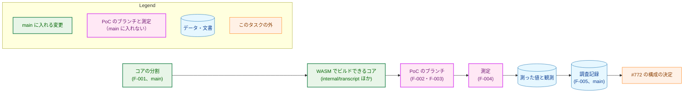
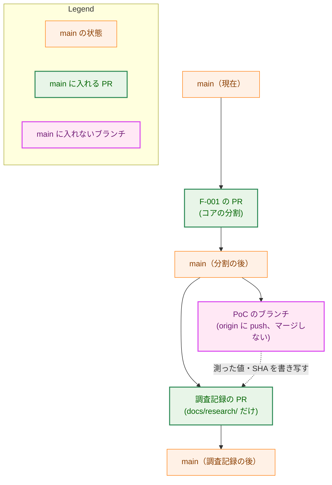
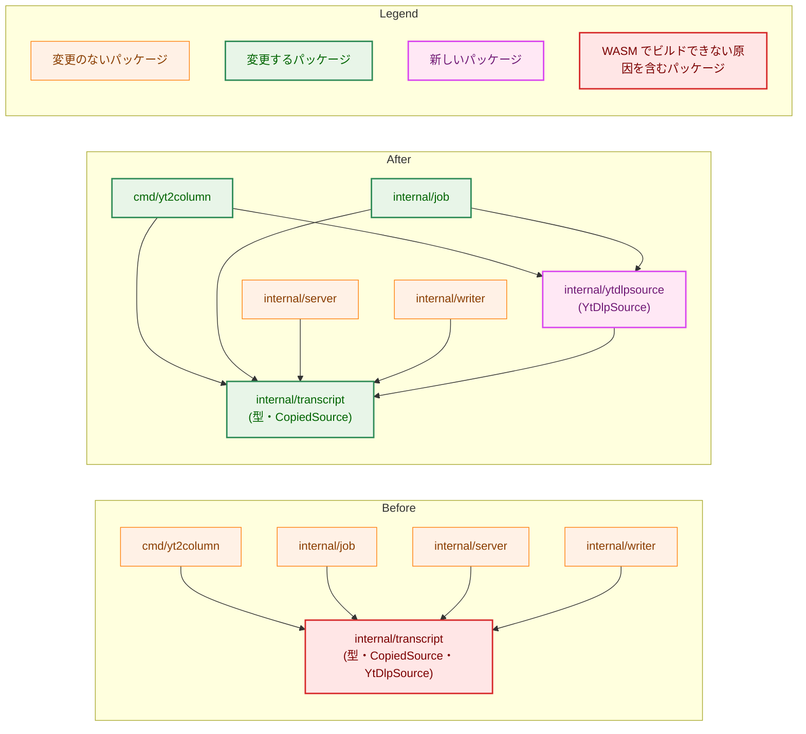
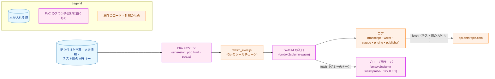
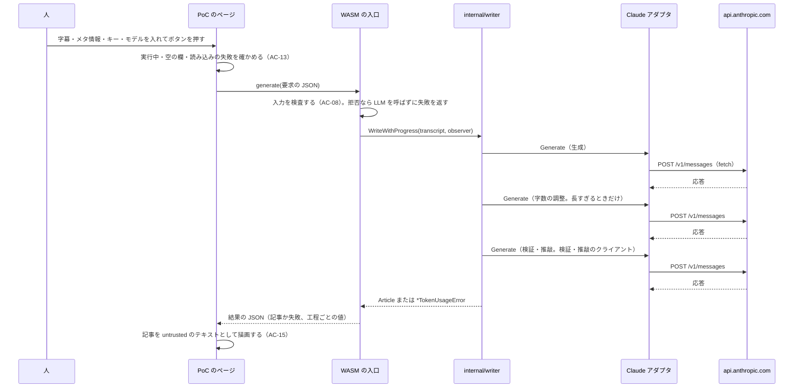
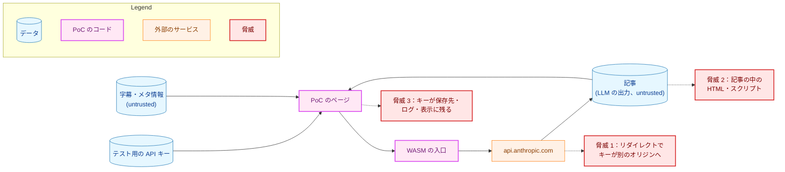
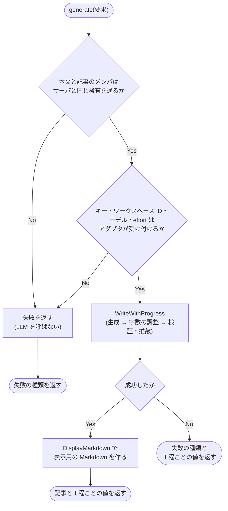
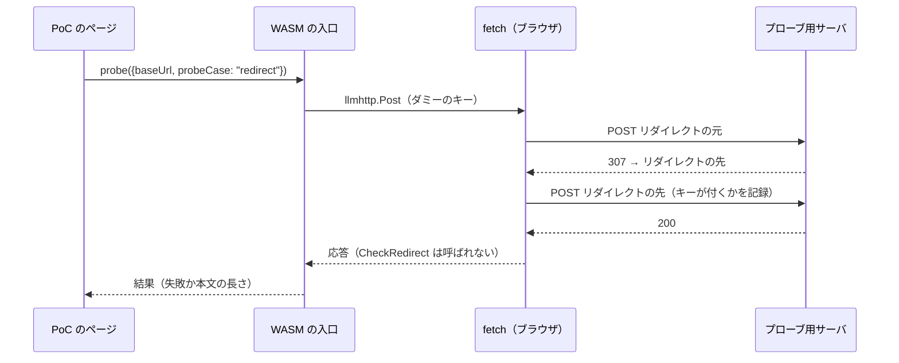

# アーキテクチャ設計書：Go の WASM 版のパイプラインを拡張のページで動かす PoC と、構成の判断に要る値の測定

## Document Status

| Item | Value |
|---|---|
| Status | `draft` |
| Created | 2026-11-11 |
| Review date | - |
| Reviewer | - |
| Comments | - |

## 1. 設計の全体像 (Design Overview)

本書は、[01_requirements.md](01_requirements.md) の F-001〜F-005 を実現する設計を定める。成果は性質の違う 3 つに分かれる。

-   **`main` に入れるコアの分割（F-001）。** `internal/transcript` から yt-dlp の経路を新しいパッケージ `internal/ytdlpsource` に移し、`internal/writer` の上書き用のテンプレートを開く処理を `js` のビルドとそれ以外に分ける。CLI とサーバの振る舞いは変えない。
-   **PoC のブランチだけに置くコード（F-002・F-003）。** WASM の入口、測定の呼び出し、守りを確かめるためのプローブ、拡張の PoC のページである。`main` にはマージしない。
-   **測定と調査記録（F-004・F-005）。** PoC で値を測り、`docs/research/` の下の調査記録として `main` に入れる。

### 1.1. 設計原則

-   **`main` の変更は移動に限る。** F-001 は、宣言をパッケージの間で移し、import と修飾を書き換えるだけにする。例外は、AC-04・AC-05 が挙げる書き換えだけである（§3.1.3）。これにより、CLI とサーバの振る舞いが変わらないことを、差分の形で確かめられる。
-   **PoC は既存のコードを変えずに使う。** WASM の入口は、`internal/writer`・`internal/llm/claude`・`internal/pricing`・`internal/transcript` を、CLI やサーバと同じ API で呼ぶ。アダプタの守り（リダイレクトの拒否・本文の上限・期限）も変えない。働かない守りがあれば、PoC の中で直さずに観測として記録する（要件書 §4.2）。
-   **測定は人の承認ごとに 1 回ずつ行う。** PoC は、API への送信を自動では繰り返さない（[ADR-0028](../../dev/adr/0028-no-automatic-resend.md) と同じ考え）。
-   **API キーはタブのメモリの外に出さない。** API キーは、入力欄から WASM の呼び出しの引数に渡すだけにする。Go の側では、受け取った直後に `secret.Secret` に包む（[ADR-0031](../../dev/adr/0031-secret-closure.md)）。

### 1.2. 設計の際に決めたこと（2026-11-11）

-   **yt-dlp の経路は、兄弟のパッケージ `internal/ytdlpsource` に移す（H-01）。** `internal/transcript` には、データ型・`TranscriptSource`・`CopiedSource`・動画 URL の検証と、それらの番兵（`ErrInvalidVideoURL`・`ErrCopiedTranscriptFormat`）を残す。`YtDlpSource`・`Options`・キャッシュ・json3 と info.json の解析・コマンドの実行と、yt-dlp の経路に固有の番兵（`ErrYtDlpExec`・`ErrParseSubtitles`・`ErrParseInfo`・`ErrNoSubtitles`・`ParseError`）は、`internal/ytdlpsource` に移す。理由は 3 つある。1 つ目に、パッケージの単位で分けると、AC-02 の「依存に含まれない」を `go list -deps` で示せる。2 つ目に、ビルドタグで分けると、同じパッケージの API がプラットフォームによって変わる。3 つ目に、`internal/transcript` の子パッケージにすると、テストが `testdata/` を指す相対パスのリテラルを書き換える必要がある。パッケージ名を `ytdlp` にすると、`ytdlp.YtDlpSource` が revive の stutter の検査で拒否される。AC-05 は識別子の改名を許さないので、名前を `ytdlpsource` とした。ADR: [ADR-0019](../../dev/adr/0019-pipeline-component-interfaces.md) を更新した（構成要素の境界を変える決定で、後のタスクの置き場所を縛るため）。
-   **分割に要る書き換えのために、要件書の AC-04・AC-05 を改めた（H-01）。** 移す側の `pruneCandidateID`（`internal/transcript/cache.go:403`、コミット 04dc4824）とテストの補助の `testVideoID`（`internal/transcript/test_helpers.go:283`）は、残る側の非公開の `videoIDPattern`（`internal/transcript/video_id.go:11`）を使う。テストの補助の `readTestdataFile`（`internal/transcript/test_helpers.go:232`）は、残る側の `copied_test.go` と、移す側の `info_test.go`・`json3_test.go`・`ytdlp_test.go` が使う。これらは、移動・import・修飾の書き換えだけでは移せない。そこで、要件書の AC-04・AC-05 に次の 4 つを足した。1 つ目は、公開の `NormalizedVideoURL` を使う等価な形への書き換えである。`NormalizedVideoURL` は、`videoIDPattern` に一致しないときだけ false を返す（`internal/transcript/video_id.go:64`〜`69`、コミット 04dc4824）。2 つ目は補助の関数の複製、3 つ目は新しいパッケージのパッケージのコメント、4 つ目は `Makefile` の統合テストの目標のパスの書き換えである。要件書は `draft` に戻り、本書の PR で再承認する。ADR: 上の ADR-0019 の更新に含まれる。
-   **`js` のビルドで上書き用のテンプレートのパスを受け取ったら、ファイルシステムに触れずに拒否する（H-02）。** 拒否のエラーは、`ErrInvalidTemplate` と `errors.ErrUnsupported` の両方を包む。新しい番兵は作らない。`os.O_RDONLY` だけで開く案は、拒否されるかどうかが `wasm_exec.js` の fs の作りに依存するので採らなかった。ADR: なし（`internal/writer` の中で閉じる）。
-   **PoC の画面は、拡張の別のページ `poc.html` とする（F-003）。** 今のビューア（`extension/src/viewerApp.ts`）は、URL の記事のキーでサーバに状態を問い合わせる作りで、PoC の処理と混ぜると両方が読みにくくなる。記事の描画は、今のビューアの部品（`parseArticleMarkdown` と `extension/src/ui/articleBody.ts` の `buildArticleBody`）をそのまま使う。同じ拡張のタブで開くページなので、問い 2 の条件（拡張のページのタブを背面に置く）はビューアと同じである。要件書の「ビューア」は、PoC ではこのページを指す。ADR: なし（PoC の中に閉じる）。
-   **`fetch` の上での守りは、localhost のプローブ用サーバで確かめる（H-04）。** PoC のブランチに、3xx の応答・上限を超える本文・応答しない要求を返す小さなサーバを置く。WASM から `llmhttp.Post` をダミーのキーで呼ぶ。費用はかからず、本物の API キーを Anthropic 以外へ送らない。`api.anthropic.com` だけを観測する案では、リダイレクトと本文の上限を確かめられない。ADR: なし（PoC の中に閉じる）。
-   **字幕とメタ情報は、PoC のページの貼り付けの欄から渡す（H-06）。** 申し送りの候補のとおりである。字幕は、文字起こしパネルからコピーしたものを貼り付ける（AC-20）。ポップアップの収集を使う案は、PoC の実装の量が増える割に、測る値（WASM と `fetch` の振る舞い）を変えない。ADR: なし。
-   **WASM はページのメインスレッドで動かす（H-07）。** 申し送りの候補のとおりである。Web Worker で動かす案は #772 の検討に残す。ADR: なし。
-   **入口が受け取るモデルと effort は、生成（字数の調整にも使う）と検証・推敲の 2 組とする（F-002・AC-07）。** CLI は、字数の調整に生成と同じクライアントを使う（`internal/writer/writer.go:122` の `ShortenOptions` の説明、[production_profile.md](../../dev/production_profile.md) の工程の表）。AC-07 は「CLI と同じ条件」を求めるので、字数の調整のモデルを別に受け取らない。3 つの工程のそれぞれのモデルは、この 2 組で決まる。ADR: なし。
-   **CORS は、まず manifest の `host_permissions` だけで試し、通らなければ PoC の入口でヘッダを足す（H-03）。** 申し送りの候補のとおりである。ヘッダを足すときは、`cmd/yt2column-wasm` が `http.DefaultTransport` を包み、`anthropic-dangerous-direct-browser-access` を加える。`internal/llm/claude` は変えない。Anthropic API がこのヘッダのない `Origin` 付きの要求を拒否するかは確かめていない。PoC の最初の Haiku の呼び出しで観測する（§5.3）。ADR: なし（どちらを本番に採るかは #772 が決める）。

### 1.3. 概念モデル

矢印 A → B は「A が B を生む、または B の材料になる」を表す。



## 2. システム構成 (System Structure)

### 2.1. 全体の構成

`main` と PoC のブランチの関係を示す。PoC のブランチは、F-001 を `main` に入れた後の `main` から分ける。矢印 A → B は「B は A から作られる」を表す。



調査記録の PR は、記録に書いた SHA の PoC のコードも見る（要件書 §5）。PoC のブランチだけの PR は開かない。

### 2.2. パッケージの依存（F-001 の前と後）

矢印 A → B は「A が B を import する」を表す。前の図は、コミット 04dc4824 の import を示す（`grep -rl 'internal/transcript"'` で確かめた）。



`internal/writer` は `internal/transcript` の型だけを使う（`internal/writer/writer.go`・`prompt.go`・`artifact.go`）。分割の後は、`internal/writer` から `internal/ytdlpsource` へ至る依存がない。`internal/pipeline`・`internal/artifact` も型だけを使い、import は変わらない。`internal/cachelock` のテストと `docs/tasks/0018_article_quality/_material_check/main.go` は `NewYtDlpSource` を使うので、修飾を書き換える。

### 2.3. PoC の構成要素の配置

PoC のブランチの構成要素と、その間のデータの流れを示す。矢印 A → B は「A が B を呼ぶ、または B へ送る」を表す。



`internal/publisher` は、記事の表示用の Markdown（`DisplayMarkdown`）を作るためだけに使う。`internal/publisher` が F-001 の後に WASM でビルドできることは、`go build -overlay` による試行（2026-11-11、Go 1.27.1）で確かめた。AC-01 の対象ではないので、`main` ではこれを保証しない。

### 2.4. 記事の生成のデータの流れ



工程ごとの開始と終了の時刻は、入口が `ProgressObserver` の `StageStarted`・`StageFinished`・`StageSkipped` を受けて記録する。失敗した工程の終了の時刻は、`WriteWithProgress` が戻った時刻とする。

## 3. コンポーネント設計 (Component Design)

### 3.1. F-001：コアの分割（`main`）

#### 3.1.1. 分けた後の各パッケージが持つもの

| パッケージ | 持つもの | 変わる点 |
|---|---|---|
| `internal/transcript` | `Segment`・`Transcript`・`TranscriptSource`・`CopiedInput`・`CopiedSource`・`NewCopiedSource`・`ValidateVideoURL`・`NormalizedVideoURL`・`ErrInvalidVideoURL`・`ErrCopiedTranscriptFormat`・コピーした字幕のパーサ | yt-dlp の経路のファイルと番兵が出ていく。公開の API の名前は変わらない |
| `internal/ytdlpsource`（新規） | `YtDlpSource`・`Options`・`NewYtDlpSource`・`Fetch`・`RemoveCache`・`PruneCache`・`SeedCacheForTest`（`-tags test`・`-tags integration` だけ）・コマンドの実行・キャッシュ・json3 と info.json のパーサ・`ErrYtDlpExec`・`ErrParseSubtitles`・`ErrParseInfo`・`ErrNoSubtitles`・`ParseError` | `internal/transcript` から移す。宣言の名前と中身は変わらない（§3.1.3 の例外を除く） |
| `internal/transcript/testutil` | `FakeTranscriptSource`、偽の yt-dlp のスクリプト | 変えない。偽の yt-dlp のスクリプトは `internal/transcript` を import せず、場所を変える必要がない |
| `internal/writer` | 上書き用のテンプレートを開く処理を、`js` のビルドとそれ以外の 2 つのファイルに分ける | `js` 以外のビルドで開くフラグと処理は変わらない（AC-05） |

`internal/ytdlpsource` のパッケージ名は `ytdlpsource` とする。`YtDlpSource` の名前はパッケージ名と同じ長さなので、revive の stutter の検査に当たらない。

#### 3.1.2. `internal/writer` の上書き用のテンプレートを開く処理（H-02）

`readOverrideFile` と `overrideOpenFlags` を `internal/writer/template.go` から外し、ビルドの制約の違う 2 つのファイルに置く。関数の形は両方で同じである。

```go
// template_open.go (//go:build !js): moved unchanged from template.go.
const overrideOpenFlags = os.O_RDONLY | syscall.O_NONBLOCK | syscall.O_NOCTTY

func readOverrideFile(src templateSource) ([]byte, error)

// template_open_js.go (//go:build js): never touches the file system.
// Every call returns an error that matches both ErrInvalidTemplate and
// errors.ErrUnsupported under errors.Is.
func readOverrideFile(src templateSource) ([]byte, error)
```

`loadTemplate` は、パスが空でないときだけ `readOverrideFile` を呼ぶ（`internal/writer/template.go:93`〜`99`）。そのため、埋め込みの既定のテンプレートを使う呼び出しの振る舞いは、`js` のビルドでも変わらない。

#### 3.1.3. 移動だけでは移せない箇所

次の 3 つは、要件書の AC-04・AC-05 が許す書き換えである（§1.2）。行の番号はコミット 04dc4824 のものである。

| 箇所 | 今の形 | 分けた後の形 |
|---|---|---|
| `internal/transcript/cache.go:405` の `pruneCandidateID` | 非公開の `videoIDPattern.MatchString(id)` | `transcript.NormalizedVideoURL(id)` の 2 つ目の戻り値。`NormalizedVideoURL` は `videoIDPattern` に一致しないときだけ false を返すので、判定は同じである（`internal/transcript/video_id.go:64`〜`69`） |
| `internal/transcript/test_helpers.go:285` の `testVideoID` | 同上 | 同上 |
| `internal/transcript/test_helpers.go:232` の `readTestdataFile` | 1 つの定義を両方の側のテストが使う | `internal/transcript` と `internal/ytdlpsource` の両方のテストの補助に、同じ定義を置く |

ほかに、新しいパッケージのパッケージのコメントと、`Makefile` の `test-integration` の目標のパス（`./internal/transcript` から `./internal/ytdlpsource`）を書き換える。`test-parse-norace` の目標（`TestParseCopiedLargeInputs`）は、コピーした字幕のテストなので `./internal/transcript` に残る。

`internal/ytdlpsource` は `internal/transcript` と同じ階層にあるので、テストが `testdata/` を指す相対パス（`../../testdata/...`）は変わらない。

#### 3.1.4. 変わるファイル

| ファイル | 変更 |
|---|---|
| `internal/transcript/exec.go`・`ytdlp.go`・`cache.go`・`info.go`・`json3.go` | `internal/ytdlpsource/` へ移す。`cache.go` は §3.1.3 の書き換えを含む |
| `internal/transcript/errors.go` | yt-dlp の経路に固有の番兵と `ParseError` を `internal/ytdlpsource/errors.go` へ移す |
| `internal/transcript/cache_test.go`・`exec_test.go`・`info_test.go`・`json3_test.go`・`ytdlp_test.go`・`integration_test.go`・`test_helpers_cache_seed.go` | `internal/ytdlpsource/` へ移す |
| `internal/transcript/test_helpers.go` | yt-dlp の経路の補助を `internal/ytdlpsource/test_helpers.go` へ移す。§3.1.3 の 2 つを含む |
| `internal/ytdlpsource/doc.go`（新規） | パッケージのコメント |
| `internal/writer/template.go` | `overrideOpenFlags` と `readOverrideFile` を外す |
| `internal/writer/template_open.go`（新規）・`template_open_js.go`（新規） | §3.1.2 |
| `cmd/yt2column/run.go`・`run_test.go`・`test_helpers_integration.go` | import と修飾の書き換え |
| `internal/job/job.go`・`job_test.go` | import と修飾の書き換え |
| `internal/cachelock/cachelock_test.go` | import と修飾の書き換え |
| `docs/tasks/0018_article_quality/_material_check/main.go` | import と修飾の書き換え（モジュールの一部としてビルドされるため） |
| `Makefile` | `test-integration` のパス |
| `docs/dev/conventions/package_reference.md` | `internal/transcript` の行を分け、`internal/ytdlpsource` の行を足す |
| `CLAUDE.md` | 「Architecture Overview」の `TranscriptSource` の段落の、`YtDlpSource` の置き場所 |
| `docs/dev/project_overview.md` | ディレクトリの構成の一覧の `internal/transcript/` の行と、`internal/ytdlpsource/` の行 |
| `docs/dev/cache_consistency.md` | キャッシュのコードの場所（`internal/transcript/cache.go` などのパスと、関数の表の見出し） |

既存のテストのうち、振る舞いを変えるために書き換えるものはない。テストは移動・import・修飾の書き換えだけを受ける（AC-04）。文書のコードのパス（`cache_consistency.md` の `internal/transcript/cache.go` など）は、文書のパスを確かめる既存のテスト（`cmd/yt2column/docpaths_test.go` の `TestInstructionDocPaths`）の対象外である。このテストが確かめるのは `docs/dev/` の下のパスだけなので、書き換えの漏れは PR のレビューで読んで確かめる。

### 3.2. F-002：WASM の入口（PoC のブランチ）

`cmd/yt2column-wasm` を、`//go:build js && wasm` の `main` パッケージとして置く。起動すると、JavaScript の全体のオブジェクトに `yt2column` を登録し、呼べる状態になったことをページに知らせる。登録する関数は 3 つで、どれも要求を JSON の文字列で受け取り、結果を JSON の文字列で解決する Promise を返す。

```ts
// The object cmd/yt2column-wasm registers on globalThis.
interface Yt2ColumnWasm {
  generate(request: string): Promise<string>; // GenerateRequest -> GenerateResult
  longOutput(request: string): Promise<string>; // LongOutputRequest -> LongOutputResult
  probe(request: string): Promise<string>; // ProbeRequest -> ProbeResult
}

interface ModelSetting {
  model: string; // e.g. "claude-haiku-5-5"
  effort: string; // a value claudeparam.ParseEffort accepts
}

interface Credentials {
  apiKey: string;
  workspaceId: string;
}

interface GenerateRequest extends Credentials {
  videoUrl: string;
  transcript: string;
  title?: string;
  channelName?: string;
  description?: string;
  generation: ModelSetting; // used by the generation and the shorten step
  review: ModelSetting;
}

type StageName = "generation" | "shorten" | "review";

interface StageReport {
  stage: StageName;
  status: "done" | "skipped" | "failed" | "not_run";
  elapsedMs: number | null;
  model: string | null;
  inputTokens: number | null;
  outputTokens: number | null;
  costUsd: string | null; // internal/pricing's estimate; null when unknown
}

type FailureKind =
  | "invalid_input" | "invalid_video_url" | "transcript_format"
  | "invalid_config" | "http_status" | "transport" | "invalid_response"
  | "truncated" | "empty_response" | "unexpected_finish"
  | "malformed_output" | "invalid_review" | "too_long"
  | "timeout" | "canceled" | "unknown";

interface Failure {
  kind: FailureKind;
  httpStatus: number | null; // set only for "http_status"
  message: string; // the Go error message (ADR-0031 keeps the key out of it)
}

type GenerateResult =
  | { ok: true; markdown: string; stages: StageReport[] }
  | { ok: false; failure: Failure; stages: StageReport[] };
```

-   **受け付ける形（AC-08）。** 記事のメンバ（`videoUrl`・`transcript`・`title`・`channelName`・`description`）は、サーバの `validateBody`（`internal/server/request.go:63`）と同じ順で、同じ関数で検査する。順は、`strictjson` による本文の検査、必須の文字列、任意の文字列、`writer.CheckChannelName`、`transcript.ValidateVideoURL`、`transcript.NewCopiedSource` である。`mode` は受け取らない。`mode` は、サーバの記事のキャッシュで同じ動画を扱う方法を選ぶ値で、キャッシュのない PoC には意味がないためである。設定のメンバ（`apiKey`・`workspaceId`・`generation`・`review`）は、`secret.New`・`claudeparam.ParseWorkspaceID`・`claudeparam.ParseEffort`・`claude.New` で検査する。すべての検査が通ってから、最初の LLM の呼び出しを行う。
-   **CLI と同じ条件（AC-07）。** `writer.NewProgressWriter` に、埋め込みの既定のテンプレート（上書きのパスは空）、`ShortenOptions{Enabled: true}`、`ReviewOptions{Enabled: true, Client: 検証・推敲のクライアント}` を渡す。両方のクライアントの `Timeout` は 15 分（`provider.LLMTimeout` と同じ値）とする。`internal/llm/provider` は WASM でビルドできないので、値は入口に定数として置き、その出典を書く。`max_tokens` はアダプタの既定に任せる。
-   **返す記事（AC-07）。** 成功したときの `markdown` は、`publisher.DisplayMarkdown` が作る、今のビューアが表示するものと同じ Markdown である。その本文は `internal/writer` が組み立てたもの（見出し・本文・出典の段落）である。
-   **失敗の種類（AC-09）。** 入口は、返ってきたエラーを `errors.Is`・`errors.AsType` で番兵と照らし、`switch` で `FailureKind` を選ぶ。どれにも当たらないエラーは `unknown` とする。エラーの文の中身では選ばない（[CLAUDE.md](../../../CLAUDE.md)「Declare, don't infer」）。照らす番兵は §4.2 の表のとおりである。
-   **工程ごとの値（AC-11）。** トークン数とモデル名は、成功したときは `Article.RunUsage`、失敗したときは `*writer.TokenUsageError` の `RunUsage` から取る。料金は `pricing.Estimate` で工程ごとに出す。所要時間は §2.4 の時刻から出す。

`longOutput`（AC-10）と `probe`（H-04）の形は次のとおりである。

```ts
interface LongOutputRequest extends Credentials {
  setting: ModelSetting;
  promptVariant: number; // selects one of the fixed long-output prompts in the PoC
}

interface LongOutputResult {
  outcome: "completed" | "truncated" | "unexpected_finish" | "failed";
  outputTokens: number | null; // null when the usage is unknown
  inputTokens: number | null;
  outputChars: number | null; // length only; the text itself is never returned
  elapsedMs: number;
  failure: Failure | null; // set only when outcome is "failed"
}

type ProbeCase = "redirect" | "redirect_manual" | "large_body" | "slow";

interface ProbeRequest {
  baseUrl: string; // must be http://127.0.0.1:<port>
  probeCase: ProbeCase;
}

interface ProbeResult {
  probeCase: ProbeCase;
  failure: Failure | null; // null when llmhttp.Post returned a body
  bodyBytes: number | null;
  elapsedMs: number;
}
```

-   **`longOutput`。** `generate` と同じ条件（`max_tokens` の既定と 15 分の期限）で Claude アダプタを作る。固定の長い出力を求めるプロンプトの 1 つを、`promptVariant` で選んで 1 回送る。`outcome` は、成功を `completed` とし、`llm.ErrTruncated` を `truncated`、`llm.ErrUnexpectedFinishReason` を `unexpected_finish`、それ以外の失敗を `failed` とする。打ち切りでもトークン数を返せるのは、アダプタが打ち切りのときも使用量を返すためである（[ADR-0021](../../dev/adr/0021-llm-client-contract.md)）。出力の本文は、長さだけを返して捨てる。
-   **`probe`。** `llmhttp.Post` を、ダミーのキーのヘッダを付けた要求で、`baseUrl` のプローブ用サーバへ送る。`baseUrl` が `http://127.0.0.1:` で始まる形でなければ、送らずに `invalid_input` を返す。`redirect_manual` は、要求に `js.fetch:redirect: manual` のヘッダを足す。Go の `js` の `net/http` が、このヘッダを `fetch` の `redirect` の指定に変える（Go 1.27.1 の `src/net/http/roundtrip_js.go` の `jsFetchRedirect`）。#772 が直し方を選ぶときの材料にするための試行である。`slow` の期限は、15 分を待たないよう、短い値（数秒）にする。

### 3.3. F-002：プローブ用サーバ（PoC のブランチ）

`cmd/yt2column-wasmprobe` は、`127.0.0.1` だけで待ち受ける、ネイティブの Go のプログラムである。経路ごとに次の応答を返し、受けた要求を標準出力に記録する。

| 経路 | 応答 | 記録すること |
|---|---|---|
| リダイレクトの元 | 307 で、別のポートのリダイレクトの先へ | 要求が届いたこと |
| リダイレクトの先 | 200 と短い本文 | 要求が届いたか、ダミーのキーのヘッダが付いていたか |
| 大きな本文 | 200 と、`llmhttp.MaxResponseBytes`（8 MiB）を超える本文 | 送りきれたか、途中で接続が閉じられたか |
| 応答しない要求 | 応答を返さずに待つ | 接続がクライアントから閉じられた時刻 |

ダミーのキーは固定の文字列で、本物の API キーではない。サーバのログは調査記録の根拠に使えるが、リポジトリにはコミットしない（AC-28）。

### 3.4. F-003：PoC のページ（PoC のブランチ）

| ファイル | 役割 |
|---|---|
| `extension/static/poc.html` | PoC のページ。字幕・メタ情報・API キー・ワークスペース ID・モデルと effort の入力欄、3 つのボタン（記事の生成・長い応答の測定・プローブ）、結果の表示の領域を持つ |
| `extension/src/poc.ts` | WASM の読み込み、入力の確かめ（AC-13）、呼び出し、結果の表示（AC-15）。記事は `parseArticleMarkdown` と `buildArticleBody` で描く |
| `extension/static/poc/wasm_exec.js`・`yt2column.wasm` | ビルドで作る成果物。`.gitignore` に入れ、コミットしない |
| `extension/static/manifest.json` | `content_security_policy.extension_pages` に `'wasm-unsafe-eval'` を加える。`host_permissions` に `https://api.anthropic.com/*` と `http://127.0.0.1/*` を加える |
| `extension/scripts/check-dist.ts` | 成果物の検査が `poc/` の WASM と `wasm_exec.js` を拒否するなら、PoC のブランチでそれを許す（H-05） |
| `Makefile` | WASM をビルドし、`wasm_exec.js`（`$(go env GOROOT)/lib/wasm/wasm_exec.js`）を写す目標 |

-   **ボタンの規則（AC-12・AC-13）。** WASM が呼べる状態になるまでは、どのボタンも呼び出しを行わず、理由を表示する。記事の生成と長い応答の測定は、API キーかワークスペース ID の欄が空なら呼ばない。どれかの呼び出しの実行中は、新しい呼び出しを始めない。
-   **API キーの扱い（AC-14）。** API キーとワークスペース ID は、入力欄の値と、呼び出しの間だけの変数にだけ置く。`chrome.storage`・Web Storage・IndexedDB・Cookie・URL に書かない。`console` に要求を出さない。入力欄の `autocomplete` は `off` にする。
-   **タブの中だけで行う（AC-16）。** ページは、記事の生成のために Service Worker へメッセージを送らない。タブを閉じると、WASM の実行と `fetch` はタブとともに終わる。
-   **読み込みの時間（AC-18・H-08）。** `performance.now()` で、ページの読み込みの開始（`performance.timeOrigin`）から、WASM が呼べる状態になったと知らせるまでを測り、ページに表示する。

### 3.5. AC-21 の場合だけ：Offscreen Document での実行（PoC のブランチ）

問い 2 が失敗したブラウザでだけ、記事の生成を Offscreen Document に移した形を作る。PoC のページは入力と表示だけを受け持ち、`chrome.runtime` のメッセージで要求を Service Worker に渡す。Service Worker は Offscreen Document を作り、要求を渡す。Offscreen Document は、同じ WASM の入口を読み込んで実行する。manifest には `offscreen` の権限を加える。API キーはメッセージで渡すだけで、どこにも保存しない（AC-14 は、この形にも当てはめる）。Offscreen Document を作るときに指定する理由（`reasons`）は、作るときに選び、調査記録に書く。この形は AC-16 の対象外である（要件書 AC-16）。

### 3.6. F-005：調査記録

調査記録は `docs/research/wasm_pipeline_poc/README.md` に置く。見出しは、3 つの問いへの答え（AC-24）、測定の条件（AC-25）、測った値、確かめていない事項（AC-27）とする。PoC のブランチの名前と、測ったコミットの SHA を書く（AC-25・AC-26）。

## 4. エラーハンドリング設計 (Error Handling Design)

### 4.1. F-001

-   F-001 は、新しい番兵を作らない。`internal/ytdlpsource` に移した番兵は、名前とエラーの文を変えない。呼び出し側は、`errors.Is(err, ytdlpsource.ErrParseSubtitles)` のように、修飾だけを変えて同じ判別を行う（`cmd/yt2column/run.go:868`）。
-   `js` のビルドの `readOverrideFile` は、`ErrInvalidTemplate` と `errors.ErrUnsupported` の両方を包むエラーを返す。エラーの文は、今の上書きの失敗と同じく、テンプレートの名前と指定されたパスを含む（`templateSource.String`）。

### 4.2. PoC の入口の失敗の種類

入口は、次の表の順にエラーを照らし、最初に当たった種類を返す。入口の検査（AC-08）での拒否は、検査のどの段で拒否したかで種類を決める。

| 種類 | 照らすもの |
|---|---|
| `invalid_input` | 入口の検査の、本文と必須・任意の文字列の段、`writer.CheckChannelName` |
| `invalid_video_url` | 入口の検査の、`transcript.ValidateVideoURL` の段 |
| `transcript_format` | `transcript.ErrCopiedTranscriptFormat` |
| `invalid_config` | 入口の検査の、`secret.New`・`claudeparam.ParseWorkspaceID`・`claudeparam.ParseEffort`・`claude.New` の段 |
| `timeout` | `context.DeadlineExceeded` |
| `canceled` | `context.Canceled` |
| `http_status` | `claude.ErrHTTPStatus`。状態コードは `*claude.HTTPStatusError` から取る |
| `transport` | `claude.ErrTransport` |
| `invalid_response` | `claude.ErrInvalidResponse` |
| `truncated` | `llm.ErrTruncated` |
| `empty_response` | `llm.ErrEmptyResponse` |
| `unexpected_finish` | `llm.ErrUnexpectedFinishReason` |
| `malformed_output` | `writer.ErrMalformedOutput`・`writer.ErrInvalidArticle` |
| `invalid_review` | `writer.ErrInvalidReview` |
| `too_long` | `writer.ErrTooLong` |
| `unknown` | 上のどれにも当たらないもの |

`timeout` と `canceled` を `http_status` より先に照らすのは、アダプタが期限切れとキャンセルを `context` のエラーとして返すためである（`internal/llm/claude/claude.go` の `Generate` のコメント）。

## 5. セキュリティ考慮事項 (Security Considerations)

### 5.1. F-001

F-001 は、セキュリティの規則を変えない。`js` 以外のビルドで上書き用のテンプレートを開くフラグは変わらない（§3.1.2）。yt-dlp の起動の守り（[security.md](../../dev/security.md) §1）は、コードを移すだけで変わらない。

### 5.2. PoC の脅威モデル

守るものは、テスト用の API キーと、利用者のブラウザのページである。矢印 A → B は「A から B へデータが流れる」を表す。



| 脅威 | 守り | 残るもの |
|---|---|---|
| 1. リダイレクトで、キーが別のオリジンへ送られる | 送り先は `api.anthropic.com` だけである。テスト用の API キーには、ワークスペースの利用の上限がある（[security.md](../../dev/security.md) §2） | `fetch` はリダイレクトに従い、`CheckRedirect` は呼ばれない（Go 1.27.1 の `src/net/http/roundtrip_js.go`。`redirect` の既定は `follow`）。別のオリジンへのリダイレクトで `fetch` が外すのは `Authorization` だけなので、`x-api-key` は転送されうる。PoC の中では受け入れ（要件書 §4.2）、プローブで観測して記録する（AC-18） |
| 2. 記事の中の HTML やスクリプトが実行される | 今のビューアと同じ描画（`parseArticleMarkdown` と `buildArticleBody`。[ADR-0017](../../dev/adr/0017-viewer-markdown-rendering.md)）を使い、HTML を解釈しない（AC-15）。CSP は `'wasm-unsafe-eval'` を加えるだけで、`'unsafe-eval'` や外部のスクリプトの元は加えない | なし |
| 3. キーが保存先・ログ・表示に残る | §3.4 の API キーの扱い。Go の側では `secret.Secret` に包み、どの出力にも流さない（ADR-0031）。エラーの文にもキーは入らない | 入力欄の値は、タブが開いている間はページのメモリにある。測定の途中で取るログ（`chrome://net-export` の記録、HAR）にはキーが含まれうるので、AC-28 に従って扱う |

### 5.3. 方針の例外（PoC のブランチの中だけ）

要件書 §4.2 が挙げる例外を、次のとおり実現する。どれも PoC のブランチにだけ置き、`main` にはマージしない。

-   [security.md](../../dev/security.md) §2（API キーの読み元）と、テスト用の API キーの用途：PoC のページの入力欄から受け取る（§3.4）。
-   [security.md](../../dev/security.md) §3（リダイレクトと応答の大きさの守り）：アダプタの守りを変えずに使い、働くかをプローブで観測する（§3.2・§3.3）。
-   [security.md](../../dev/security.md) §8.1（CSP）と [ADR-0010](../../dev/adr/0010-extension-stores-nothing.md)（権限を加えない）：manifest に `'wasm-unsafe-eval'` と 2 つの `host_permissions` を加える（§3.4）。CORS が `host_permissions` だけでは通らないときは、`cmd/yt2column-wasm` が `http.DefaultTransport` を包んで `anthropic-dangerous-direct-browser-access` のヘッダを足す（§1.2）。通らなかったときの応答（状態コード）と、ヘッダを足した後の結果を、問い 1 の仕組みの答えと分けて記録する（H-03）。
-   [ADR-0026](../../dev/adr/0026-extension-platform.md)（成果物と Go の手順）：成果物に `wasm_exec.js` と WASM が入り、`Makefile` の目標が Go と拡張にまたがる（§3.4）。
-   [ADR-0009](../../dev/adr/0009-viewer-opening.md)（ビューアの開き方）：人が PoC のページを開き、ボタンで始める。

PoC のブランチでは、これらの例外を前提とする既存のテストが失敗しうる。例は、manifest の権限を確かめる拡張のテスト（`extension/test/manifest.test.ts`）と、成果物の検査（`extension/scripts/check-dist.ts`）である。PoC のブランチでは、拡張の読み込みに要る `make ext-build` が通ることだけを求める。`make ext-check` が通ることは求めない。`main` のこれらのテストは変えない。

## 6. 処理フローの詳細 (Processing Flow Details)

### 6.1. 入口の検査と実行



`DisplayMarkdown` が `CheckPublishable` で記事を拒否したときも、失敗として返し、記事は返さない（AC-09）。

### 6.2. プローブ



`redirect_manual` では、`fetch` がリダイレクトに従わないかを、サーバのログで確かめる。`large_body` では、`llmhttp.Post` が `claude.ErrInvalidResponse` に当たる失敗を返すかを確かめる（入口は、`probe` の呼び出しでも `Errors` に `claude` の番兵を渡す）。`slow` では、期限で `timeout` が返り、サーバの側で接続が閉じられるかを確かめる。

### 6.3. 測定の進め方（F-004）

測定は、§7.3 の順に行う。実 API を呼ぶ回は、その都度、人の承認を得てから行う。各回の後に、テスト用のワークスペースのコンソールの使用量を確かめ、約 4 USD の目安を超えそうなら、超える前に止めて人に尋ねる（AC-23）。

## 7. テスト戦略 (Test Strategy)

### 7.1. F-001（`main`）

| AC | 確かめ方 |
|---|---|
| AC-01 | `docs/tasks/0084_wasm_pipeline_poc/_checks/` のスクリプトで、4 つのパッケージを `GOOS=js GOARCH=wasm go build` する |
| AC-02 | 同じスクリプトで、`GOOS=js GOARCH=wasm go list -deps` の結果に `internal/ytdlpsource` がないことと、依存のうちこのリポジトリのパッケージがどれも `os/exec` を import しないことを確かめる |
| AC-03 | `make test`・`make lint`・`make deadcode` |
| AC-04・AC-05 | `diff` の検証（[requirements_process.md](../../dev/conventions/requirements_process.md) §4）。移した宣言が、§3.1.3 の箇所を除いて、修飾の書き換えのほかは同じであることを、`_checks/` のスクリプトで確かめる |
| AC-06 | `.golangci.yml` の差分がないことを確かめる |

これらのスクリプトは、タスクの検証に一度使うもので、`make test` と CI には加えない（要件書 §2.3）。`template_open_js.go` は、`make test` のネイティブのビルドではコンパイルされないので、`make test` では確かめられない。AC-01 のビルドと、PoC のブランチでの実行で確かめる。

### 7.2. PoC（PoC のブランチ）

PoC のコードにはテストを書かない（要件書 §5「受け入れの確かめ方の例外」）。AC-07〜AC-23 は、調査記録の PR のレビューで、記録した値と観測、記録した SHA のコードを読んで確かめる。

### 7.3. 測定の順

1.  プローブ（費用なし）で、AC-18 の守りの 3 つを Chrome と Brave で観測する。
2.  Haiku で記事の生成を 1 回行い、CORS の通り方（H-03）と、Haiku が `effort` を受け付けるかを確かめる。Claude のリファレンス（2026-11-03 時点）は、Haiku 5.5 の effort を `low`〜`max`（既定は `medium`）としているが、実際の応答で確かめて記録する。
3.  Haiku で、問い 1・2 の試行（AC-17・AC-18・AC-22）を Chrome と Brave で行う。
4.  Haiku で、長い応答の測定（AC-19）を行う。
5.  問い 2 が失敗したブラウザがあれば、Offscreen Document の形で同じ試行を行う（AC-21）。
6.  本番の構成で、3 本の動画を Chrome で 1 回ずつ生成する（AC-20）。

### 7.4. セキュリティの確かめ方

-   AC-14 は、PoC のコードを読むことと、測定の後に DevTools で拡張のストレージと Cookie が空であることを確かめることで確かめる。
-   AC-18 のリダイレクトの観測は、プローブ用サーバのログでダミーのキーの転送の有無を見る。本物の API キーでは確かめない。

## 8. 実装の優先順位 (Implementation Priorities)

| 順 | 段階 | 成果 |
|---|---|---|
| 1 | F-001 の分割 | `main` への PR。`internal/ytdlpsource` への移動、`internal/writer` の分割、文書の追随、`_checks/` のスクリプト |
| 2 | PoC のブランチの作成 | 1 の後の `main` から分け、§3.2〜§3.4 を作り、origin に push する |
| 3 | 測定 | §7.3 の順。各回の承認と費用の確認 |
| 4 | 調査記録 | `docs/research/wasm_pipeline_poc/README.md` を `main` に入れる PR |

1 の PR は `/runplan` と `/runpr` で進める。2 と 3 は PR を開かない（要件書 §1「要件定義の際に決めたこと」）。4 の PR は、PoC のブランチのコードもレビューの対象にする。

## 9. 将来の拡張性 (Future Extensibility)

-   #772 が Go の WASM の構成を選んだときは、本タスクの分割がそのまま土台になる。そのときの課題は、調査記録が示すものになる見込みである。たとえば、`fetch` の上でリダイレクトの守りが働かなければ、`js.fetch:redirect` で直す方法がある（`redirect_manual` の試行の結果による）。WASM でビルドできることを守る検査を加えるかは、#772・#773 が ADR とともに決める。
-   TS に一本化する構成を選んだときは、`internal/ytdlpsource` の分割は、CLI の字幕の取得とコアの境界として残る。
-   ストリーミングが要ると分かったときは、#772 の設計の範囲に入る（要件書 §2.3）。

## 付録 A. 設計への申し送りの扱い

| ID | 扱い |
|---|---|
| H-01 | 候補を改め、兄弟のパッケージ `internal/ytdlpsource` に移す（§1.2・§3.1）。候補が挙げた `video_id.go` は、`CopiedSource` とサーバが使うので `internal/transcript` に残す |
| H-02 | `js` のビルドでは、ファイルシステムに触れずに `ErrInvalidTemplate` と `errors.ErrUnsupported` で拒否する（§3.1.2） |
| H-03 | 候補のとおり、`host_permissions` を先に試し、通らなければ入口でヘッダを足す。アダプタは変えない（§1.2・§5.3） |
| H-04 | localhost のプローブ用サーバと `llmhttp.Post` で、リダイレクト・本文の上限・期限を確かめる（§3.2・§3.3・§6.2） |
| H-05 | 候補のとおり、PoC のブランチで manifest の CSP と成果物の検査を変える（§3.4・§5.3） |
| H-06 | 候補のとおり、PoC のページに貼り付けの欄を置く（§1.2・§3.4） |
| H-07 | 候補のとおり、メインスレッドで動かす。止まった時間が目立てば調査記録に書く（§1.2） |
| H-08 | 読み込みの時間は §3.4、工程ごとの時間は §3.2、タブを閉じたときの中止は `chrome://net-export` の記録とコンソールの使用量、Brave の破棄は Brave のタブの破棄の画面で行う。記録の扱いは AC-28 に従う |

## 付録 B. 要件と設計の対応

| AC | 設計の箇所 |
|---|---|
| AC-01・AC-02 | §3.1、§7.1 |
| AC-03〜AC-06 | §3.1.3・§3.1.4、§7.1 |
| AC-07・AC-08・AC-09・AC-11 | §3.2、§4.2、§6.1 |
| AC-10 | §3.2（`longOutput`） |
| AC-12〜AC-16 | §3.4 |
| AC-17〜AC-20・AC-22・AC-23 | §6.3、§7.3 |
| AC-18（守り） | §3.2（`probe`）、§3.3、§6.2 |
| AC-21 | §3.5 |
| AC-24〜AC-28 | §3.6、§5.2 |
