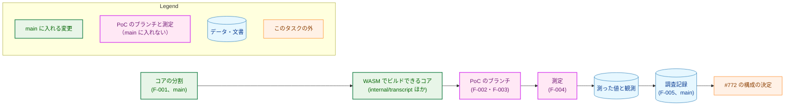
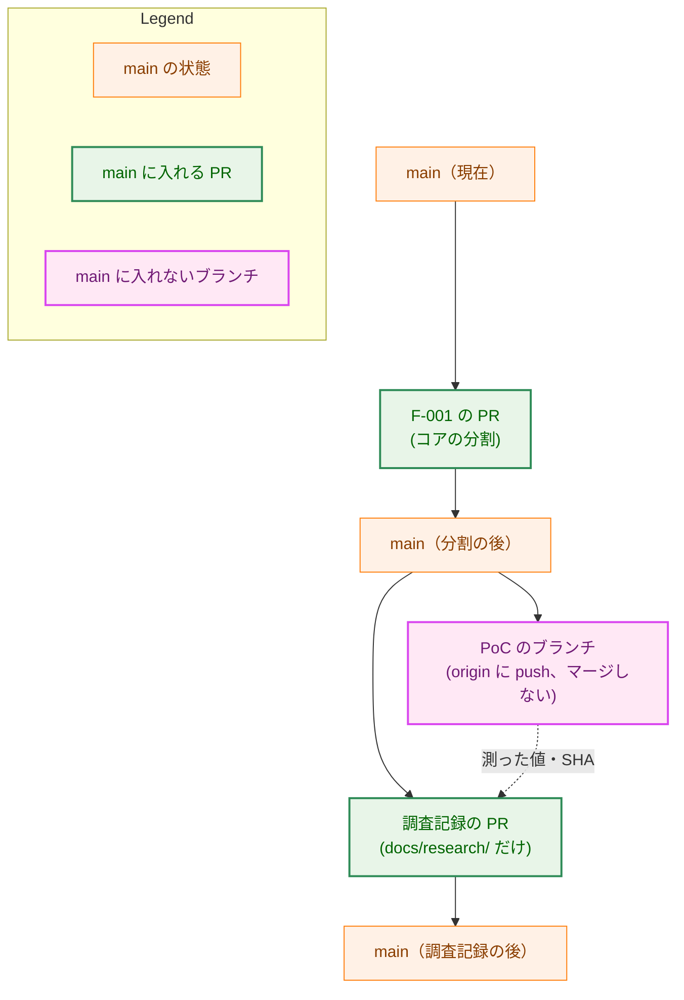
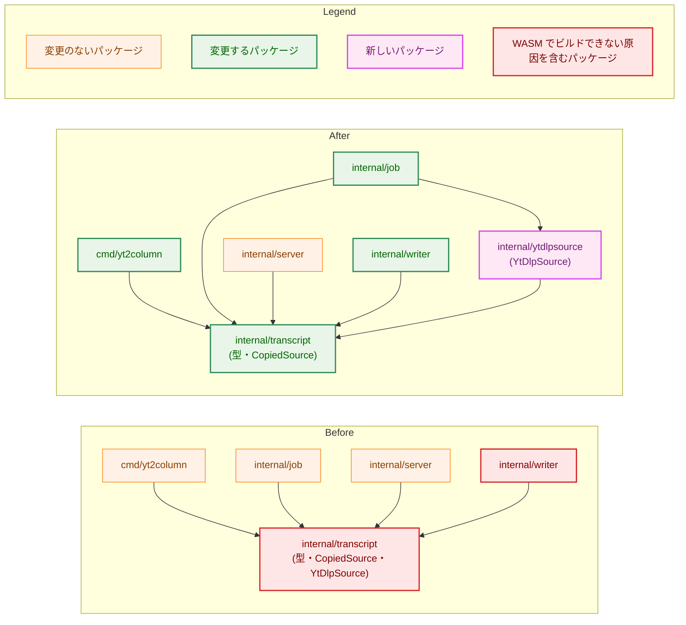
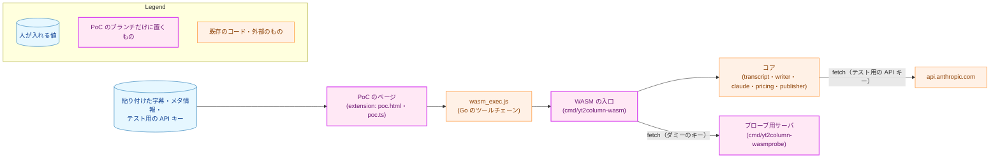
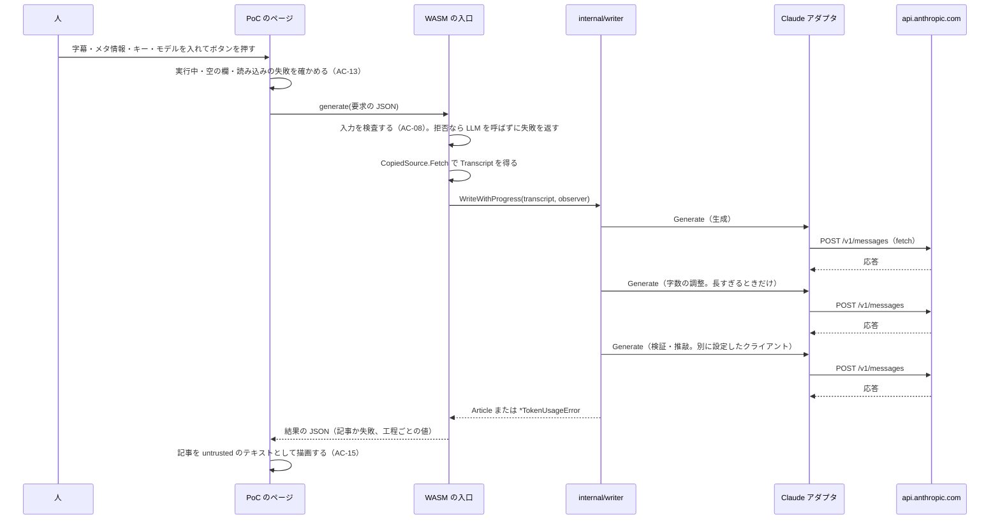
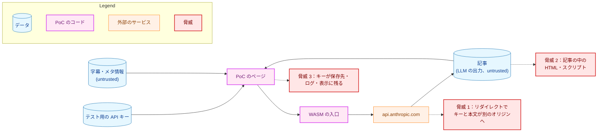
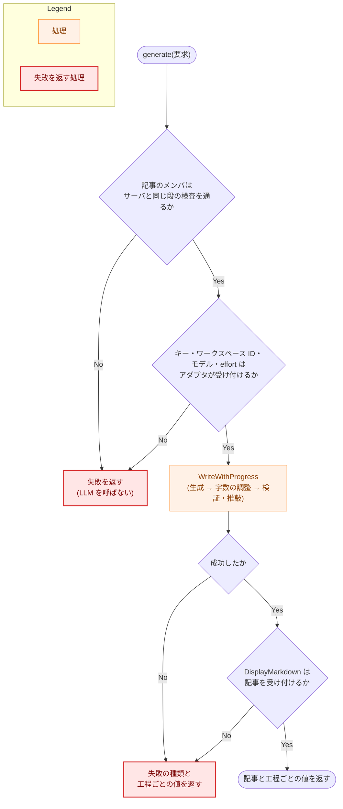
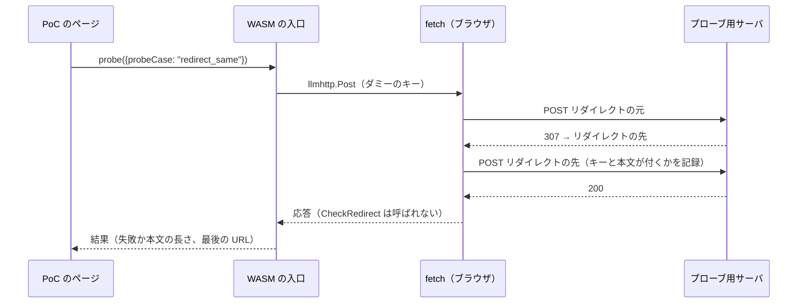

# アーキテクチャ設計書：Go の WASM 版のパイプラインを拡張のページで動かす PoC と、構成の判断に要る値の測定

## Document Status

| Item | Value |
|---|---|
| Status | `approved` |
| Created | 2026-11-11 |
| Review date | 2026-11-11 |
| Reviewer | isseis |
| Comments | - |

## 1. 設計の全体像 (Design Overview)

本書は、[01_requirements.md](01_requirements.md) の F-001〜F-005 を実現する設計を定める。成果は性質の違う 3 つに分かれる。

-   **`main` に入れるコアの分割（F-001）。** `internal/transcript` から yt-dlp の経路を新しいパッケージ `internal/ytdlpsource` に移し、`internal/writer` の上書き用のテンプレートを開く処理を `js` のビルドとそれ以外に分ける。CLI とサーバの振る舞いは変えない。
-   **PoC のブランチだけに置くコード（F-002・F-003）。** WASM の入口、測定の呼び出し、守りを確かめるためのプローブ、拡張の PoC のページである。`main` にはマージしない。
-   **測定と調査記録（F-004・F-005）。** PoC で値を測り、`docs/research/` の下の調査記録として `main` に入れる。

本書の行の番号は、すべてコミット 04dc4824 のものである。

### 1.1. 設計原則

-   **`main` の変更は移動に限る。** F-001 は、宣言をパッケージの間で移し、import と修飾を書き換えるだけにする。例外は、AC-04・AC-05 が挙げる書き換え（§3.1.2・§3.1.3）だけである。これにより、CLI とサーバの振る舞いが変わらないことを、差分の形で確かめられる。
-   **PoC は既存のコードを変えずに使う。** WASM の入口は、`internal/writer`・`internal/llm/claude`・`internal/pricing`・`internal/transcript` を、CLI やサーバと同じ API で呼ぶ。アダプタの守り（リダイレクトの拒否・本文の上限・期限）も変えない。働かない守りがあれば、PoC の中で直さずに観測として記録する（要件書 §4.2）。
-   **測定は人の承認ごとに 1 回ずつ行う。** PoC は、API への送信を自動では繰り返さない（[ADR-0028](../../dev/adr/0028-no-automatic-resend.md) と同じ考え）。
-   **API キーはタブのメモリの外に出さない。** API キーは、入力欄から WASM の呼び出しの引数に渡すだけにする。Go の側では、受け取った直後に `secret.Secret` に包む（[ADR-0031](../../dev/adr/0031-secret-closure.md)）。
-   **何が要ったかは、足す前に確かめる。** CSP・`host_permissions`・ブラウザから直接呼ぶためのヘッダは、PoC に最初から入れず、要るかどうかを試してから足す（§7.3）。本番の構成を決める #772 が判断する権限の要否を、測定の結果から読めるようにするためである。

### 1.2. 設計の際に決めたこと（2026-11-11）

括弧の中の H-NN は、[design_handoff.md](design_handoff.md) の項目の ID である（扱いは付録 A）。問い 1〜3 は、要件書の背景が挙げる 3 つの問い（問い 1：WASM が拡張のページで動くか、問い 2：記事の生成が背面のタブで完走するか、問い 3：ストリーミングが要るか）である。

-   **yt-dlp の経路は、兄弟のパッケージ `internal/ytdlpsource` に移す（H-01）。** 移すのは、`YtDlpSource`・`Options`・キャッシュ・json3 と info.json の解析・コマンドの実行である。`internal/transcript` には、データ型・`TranscriptSource`・`CopiedSource`・動画 URL の検証と、字幕のステージの番兵をすべて残す。残す番兵には、yt-dlp の経路の番兵（`ErrYtDlpExec`・`ErrParseSubtitles`・`ErrParseInfo`・`ErrNoSubtitles`・`ParseError`）も含まれる。
    -   パッケージで分け、ビルドタグや子パッケージにしない理由は 3 つある。
        1.  パッケージの単位で分けると、AC-02 の「依存に含まれない」を `go list -deps` で示せる。
        2.  ビルドタグで分けると、`internal/transcript` の型と関数の集合がプラットフォームによって変わる。
        3.  `internal/transcript` の子パッケージにすると、テストが `testdata/` を指す相対パスのリテラルを書き換える必要がある。
    -   **パッケージ名。** `ytdlp` にすると、revive の stutter の検査が `ytdlp.YtDlpSource` を拒否する。AC-05 は識別子の改名を許さないので、名前を `ytdlpsource` とした。
    -   **番兵を残す理由。** `internal/transcript/video_id_test.go:87` は、`package transcript` のテストの中で yt-dlp の経路の番兵を参照している。番兵を移すと、このテストは `internal/ytdlpsource` を import できず（import の循環になる）、AC-04 の許す書き換えでは直せない。番兵を残せば、呼び出し側の番兵による判別（`cmd/yt2column/run.go:868`・`internal/job/job_test.go:535`）も変わらない。
    -   ADR: [ADR-0019](../../dev/adr/0019-pipeline-component-interfaces.md) を更新した（構成要素の境界を変える決定で、後のタスクの置き場所を縛るため）。
-   **分割に要る書き換えのために、要件書の AC-04・AC-05 を改めた（H-01）。** 移動・import・修飾の書き換えだけでは移せない箇所が 4 つある（計画の際に見つけた 5 つ目は §3.1.3 の表にある）。
    -   移す側の `pruneCandidateID`（宣言は `internal/transcript/cache.go:403`）は、残る側の非公開の `videoIDPattern`（`internal/transcript/video_id.go:11`）を使う。
    -   テストの補助の `testVideoID`（宣言は `internal/transcript/test_helpers.go:283`）も、同じ `videoIDPattern` を使う。
    -   テストの補助の `readTestdataFile`（宣言は `internal/transcript/test_helpers.go:232`）は、残る側の `copied_test.go` と、移す側の `info_test.go`・`json3_test.go`・`ytdlp_test.go` が使う。
    -   環境変数を読む入口を限る検査（`internal/config/envaccess_test.go`、[ADR-0024](../../dev/adr/0024-env-access-in-config.md)）は、`os.Environ` を呼ぶ `internal/transcript/ytdlp.go` を、パスの文字列で許可している（`:69`・`:392`〜`393`・`:412`・`:599`〜`600`・`:611`）。

    そこで、要件書の AC-04・AC-05 に次のものを足した。

    -   公開の `NormalizedVideoURL` を使う等価な形への書き換え。`NormalizedVideoURL` は、`videoIDPattern` に一致しないときだけ false を返す（`internal/transcript/video_id.go:64`〜`69`）。
    -   補助の関数の複製。
    -   移したファイルを指すパスの文字列の書き換え。許可する参照の種類と数は変えない。
    -   新しいパッケージの doc コメント。
    -   `Makefile` の統合テストの目標のパスの書き換え。

    要件書は `draft` に戻り、本書の PR で再承認する。ADR: 上の ADR-0019 の更新に含まれる。ADR-0024 の決定（環境変数を読む入口）は変わらない。
-   **`js` のビルドで上書き用のテンプレートのパスを受け取ったら、ファイルシステムに触れずに拒否する（H-02）。** 拒否するときのエラーは、`ErrInvalidTemplate` と `errors.ErrUnsupported` の両方を包む。新しい番兵は作らない。
    -   `os.O_RDONLY` だけで開く案は採らなかった。拒否されるかどうかが、`wasm_exec.js` の fs の作りに依存するためである。
    -   `js` のビルドから上書きを受け取る経路（`Options` のパスのフィールド）を外す案も採らなかった。`writer.Options` の形がプラットフォームによって変わり、AC-05 の許す書き換えに収まらないためである。
    -   `internal/writer` の分け方はビルドタグだが、上の H-01 の理由 2 には当てはまらない。型と関数の集合は両方のビルドで同じで、変わるのは上書きのパスを受け取ったときの振る舞いだけだからである。
    -   ADR: なし（`internal/writer` の中で閉じる）。
-   **WASM でビルドできることの検査は、`make wasm-check` の目標とし、`make lint` と CI の `lint` のジョブから呼ぶ（AC-29）。** 目標は、AC-01 の 4 つのパッケージを `GOOS=js GOARCH=wasm go build` し、`internal/writer` と `internal/transcript` に `GOOS=js GOARCH=wasm go vet` を掛ける。`go vet` は、ネイティブのビルドではコンパイルされない `template_open_js.go` も検査するためである。`make lint` から呼ぶのは、`make lint` がすでにビルドのタグを変えた `go vet` を走らせる、静的な検査の目標だからである。CI の `lint` のジョブは golangci-lint の action を使い `make lint` を呼ばないので、`make wasm-check` を 1 つの手順として足す。このジョブは Go のコードを変える PR だけで走るが、文書だけの変更はコアのビルドを壊さないので足りる。AC-02 の依存の検査は加えない。yt-dlp の経路のファイルは `js` のビルドに失敗する `syscall` のフィールドを使うので（要件書の背景）、4 つのパッケージがそれを import すれば、ビルドの検査が失敗するためである。ADR: [ADR-0019](../../dev/adr/0019-pipeline-component-interfaces.md) を更新する（検査を置く決定）。
-   **PoC の画面は、拡張の別のページ `poc.html` とする（F-003）。** 今のビューア（`extension/src/viewerApp.ts`）は、URL の記事のキーでサーバに状態を問い合わせる作りで、PoC の処理と混ぜると両方が読みにくくなる。記事の描画は、今のビューアの部品（`parseArticleMarkdown` と `extension/src/ui/articleBody.ts` の `buildArticleBody`）をそのまま使う。同じ拡張のタブで開くページなので、問い 2 の条件（拡張のページのタブを背面に置く）はビューアと同じである。要件書の F-003・F-004 の「ビューア」は、PoC ではこのページを指す（要件書の「要件定義の際に決めたこと」にも書いた）。ADR: なし（PoC の中に閉じる）。
-   **`fetch` を通した送信でアダプタの守りが働くかは、localhost のプローブ用サーバで確かめる（H-04）。** PoC のブランチに、リダイレクト・上限を超える本文・止まる応答を返す小さなサーバを置き、WASM から `llmhttp.Post` をダミーのキーで呼ぶ。費用はかからず、本物の API キーを Anthropic 以外へ送らない。`api.anthropic.com` だけを観測する案では、リダイレクトと本文の上限を確かめられない。ADR: なし（PoC の中に閉じる）。
-   **字幕とメタ情報は、PoC のページの貼り付けの欄から渡す（H-06）。** 申し送りの候補のとおりである。字幕は、文字起こしパネルからコピーしたものを貼り付ける（AC-20）。ポップアップの収集を使う案は、PoC の実装の量が増える割に、測る値（WASM と `fetch` の振る舞い）を変えない。ADR: なし。
-   **WASM はページのメインスレッドで動かす（H-07）。** 申し送りの候補のとおりである。Web Worker で動かす案は #772 の検討に残す。ADR: なし。
-   **入口が受け取るモデルと effort は、生成（字数の調整にも使う）と検証・推敲の 2 組とする（F-002・AC-07）。** CLI は、字数の調整に生成と同じクライアントを使う（`internal/writer/writer.go:122` の `ShortenOptions` の説明）。AC-07 は「CLI と同じ条件」を求めるので、字数の調整のモデルを別に受け取らない。要件書の F-002 も、この 2 組に改めた。ADR: なし。
-   **入口は `mode` を使わない（AC-08）。** `mode` は、サーバの記事のキャッシュで同じ動画の記事をどう扱うかを選ぶ値で、キャッシュのない PoC には意味がない。入口は、トップレベルの知らないメンバをサーバ（`strictjson` の `Collect`）と同じく読み飛ばすので、`mode` があってもなくても受け付ける。ほかの記事のメンバ（サーバの生成の開始の要求と共通の `videoUrl`・`transcript`・`title`・`channelName`・`description`）は、サーバと同じ形で受け付ける。ADR: なし。
-   **CSP・`host_permissions`・ブラウザから直接呼ぶためのヘッダは、試して要ったものだけを足す（H-03・H-05）。**
    -   **CSP。** manifest に `content_security_policy` を書かずに WASM を読み込んでみる。読み込めなかったときだけ `'wasm-unsafe-eval'` を加える。MV3 の拡張のページの既定の CSP が `'wasm-unsafe-eval'` を含むかは、本書の作成時に確かめていない。
    -   **CORS。** 次の 3 つの組み合わせで Haiku を 1 回ずつ呼び、それぞれ通ったかを記録する（§7.3）。
        -   `host_permissions` に `https://api.anthropic.com/*` を加え、ヘッダは送らない。
        -   `host_permissions` を加えず、`anthropic-dangerous-direct-browser-access` のヘッダを送る。
        -   両方を使う。
    -   **ヘッダの付け方。** ヘッダは、`cmd/yt2column-wasm` が `http.DefaultTransport` を包んで加え、`internal/llm/claude` は変えない。これが効くのは、アダプタの HTTP クライアントが `Transport` を空のままにして `http.DefaultTransport` を使うためである（`internal/llm/llmhttp/llmhttp.go:57`〜`66`）。この包みは WASM の中のすべての送信に掛かる。そこで、要求の `browserAccessHeader` が真のときだけヘッダを加え、プローブの送信には加えない。呼び出しは同時に 1 つだけなので（AC-13）、ある呼び出しの指定が別の呼び出しに混ざることはない。
    -   Anthropic API がこのヘッダのない `Origin` 付きの要求を拒否するかは、確かめていない。
    -   ADR: なし（本番でどれを採るかは #772 が決める）。

### 1.3. 概念モデル

矢印 A → B は「A が B を生む、または B の材料になる」を表す。



## 2. システム構成 (System Structure)

### 2.1. 全体の構成

`main` と PoC のブランチの関係を示す。PoC のブランチは、F-001 を `main` に入れた後の `main` から分ける。実線の矢印 A → B は「B は A から作られる」を、点線の矢印は「A の内容を B に書き写す」を表す。



調査記録の PR は、記録に書いた SHA の PoC のコードもレビューの対象にする（要件書 §5）。PoC のブランチだけの PR は開かない。

### 2.2. パッケージの依存（F-001 の前と後）

矢印 A → B は「A が B を import する」を表す。図は、分割に関わる主な import だけを示す。`internal/pipeline`・`internal/artifact` は `internal/transcript` の型だけを使い、import は変わらないので省いた。`internal/cachelock` のテストは、`internal/job` と同じく `NewYtDlpSource` を使う。



-   `internal/writer` は、`internal/transcript` の型だけを使う（`internal/writer/writer.go`・`prompt.go`・`artifact.go`）。分割の後は、`internal/writer` から `internal/ytdlpsource` へ至る依存がない。
-   `cmd/yt2column` の製品のコードは、yt-dlp の経路を `internal/job` を通して使う。変わるのは、`SeedCacheForTest` を使うテストの修飾だけである。

### 2.3. PoC の構成要素の配置

PoC のブランチの構成要素と、その間のデータの流れを示す。矢印 A → B は「A が B を呼ぶ、または B へ送る」を表す。



`internal/publisher` は、記事の表示用の Markdown（`DisplayMarkdown`）を作るためだけに使う。`internal/publisher` が F-001 の後に WASM でビルドできることは、`go build -overlay` による試行（2026-11-11、Go 1.27.1）で確かめた。AC-01 の対象ではないので、`main` ではこれを保証しない。

### 2.4. 記事の生成のデータの流れ



工程ごとの開始と終了の時刻は、入口が `ProgressObserver` の `StageStarted`・`StageFinished`・`StageSkipped` を受けて記録する。失敗した工程の終了の時刻は、`WriteWithProgress` が戻った時刻とする。

## 3. コンポーネント設計 (Component Design)

### 3.1. F-001：コアの分割（`main`）

#### 3.1.1. 分けた後の各パッケージが持つもの

| パッケージ | 持つもの | 変わる点 |
|---|---|---|
| `internal/transcript` | `Segment`・`Transcript`・`TranscriptSource`・`CopiedInput`・`CopiedSource`・`NewCopiedSource`・`ValidateVideoURL`・`NormalizedVideoURL`・コピーした字幕のパーサ・字幕のステージの番兵（`errors.go` のすべて） | yt-dlp の経路のファイルが出ていく。公開の名前は、移す型と関数を除いて変わらない |
| `internal/ytdlpsource`（新規） | `YtDlpSource`・`Options`・`NewYtDlpSource`・`Fetch`・`RemoveCache`・`PruneCache`・`SeedCacheForTest`（`-tags test`・`-tags integration` だけ）・コマンドの実行・キャッシュ・json3 と info.json のパーサ | `internal/transcript` から移す。番兵は `internal/transcript` のものを使う。宣言の名前と中身は変わらない（§3.1.3 の例外を除く） |
| `internal/transcript/testutil` | `FakeTranscriptSource`、偽の yt-dlp のスクリプト | 変えない。偽の yt-dlp のスクリプトは `internal/transcript` を import せず、場所を変える必要がない |
| `internal/writer` | 上書き用のテンプレートを開く処理を、`js` のビルドとそれ以外の 2 つのファイルに分ける | `js` 以外のビルドで開くフラグと処理は変わらない（AC-05） |

`internal/ytdlpsource` のパッケージ名は `ytdlpsource` とする。`YtDlpSource` はパッケージ名より長くないので、revive の stutter の検査に当たらない（§1.2）。

#### 3.1.2. `internal/writer` の上書き用のテンプレートを開く処理（H-02）

`readOverrideFile` と `overrideOpenFlags` を `internal/writer/template.go` から外し、ビルドの制約の違う 2 つのファイルに置く。関数の形は両方で同じである。

```go
// template_open.go (//go:build !js): moved unchanged from template.go.
const overrideOpenFlags = os.O_RDONLY | syscall.O_NONBLOCK | syscall.O_NOCTTY

func readOverrideFile(src templateSource) ([]byte, error)

// template_open_js.go (//go:build js): never touches the file system.
// Every call returns an error that matches both ErrInvalidTemplate and
// errors.ErrUnsupported under errors.Is.
func readOverrideFile(src templateSource) ([]byte, error)
```

`loadTemplate` は、パスが空でないときだけ `readOverrideFile` を呼ぶ（`internal/writer/template.go:93`〜`99`）。そのため、埋め込みの既定のテンプレートを使う呼び出しの振る舞いは、`js` のビルドでも変わらない。

#### 3.1.3. 移動だけでは移せない箇所

次の箇所は、要件書の AC-04・AC-05 が許す書き換えである（§1.2）。

| 箇所 | 今の形 | 分けた後の形 |
|---|---|---|
| `pruneCandidateID`（`internal/transcript/cache.go:403`。使う行は `:405`） | 非公開の `videoIDPattern.MatchString(id)` | `transcript.NormalizedVideoURL(id)` の 2 つ目の戻り値。`NormalizedVideoURL` は `videoIDPattern` に一致しないときだけ false を返すので、判定は同じである（`internal/transcript/video_id.go:64`〜`69`） |
| `testVideoID`（`internal/transcript/test_helpers.go:283`。使う行は `:285`） | 同上 | 同上 |
| `YtDlpSource.Fetch`（`internal/transcript/ytdlp.go:69`〜`74`） | ローカル変数 `transcript` のスコープの中で `Transcript{}` を返す。移した後に `transcript.Transcript{}` と修飾すると、ローカル変数がパッケージ名を隠してコンパイルできない | ローカル変数を `cached` に改名する。振る舞いは変わらない（計画の際に足した。要件書の「要件定義の際に決めたこと」） |
| `readTestdataFile`（`internal/transcript/test_helpers.go:232`） | 1 つの定義を両方の側のテストが使う | `internal/transcript` と `internal/ytdlpsource` の両方のテストの補助に、同じ定義を置く |
| `internal/config/envaccess_test.go` の `internal/transcript/ytdlp.go`（`:69`・`:392`〜`393`・`:412`・`:599`〜`600`・`:611`） | 移す前のパスの文字列 | `internal/ytdlpsource/ytdlp.go`。許可する参照の種類（`call:os.Environ`）と数（1）は変えない |

ほかに、新しいパッケージの doc コメントと、`Makefile` の `test-integration` の目標のパス（`./internal/transcript` から `./internal/ytdlpsource`）を書き換える。`test-parse-norace` の目標（`TestParseCopiedLargeInputs`）は、コピーした字幕のテストなので `./internal/transcript` に残る。

`internal/ytdlpsource` は `internal/transcript` と同じ階層にあるので、テストが `testdata/` を指す相対パス（`../../testdata/...`）は変わらない。

#### 3.1.4. 変わるファイル

| ファイル | 変更 |
|---|---|
| `internal/transcript/exec.go`・`ytdlp.go`・`cache.go`・`info.go`・`json3.go` | `internal/ytdlpsource/` へ移す。`cache.go`・`ytdlp.go` は §3.1.3 の書き換えを含む |
| `internal/transcript/cache_test.go`・`exec_test.go`・`info_test.go`・`json3_test.go`・`ytdlp_test.go`・`integration_test.go`・`test_helpers_cache_seed.go` | `internal/ytdlpsource/` へ移す |
| `internal/transcript/test_helpers.go` | yt-dlp の経路の補助を `internal/ytdlpsource/test_helpers.go` へ移す。§3.1.3 の `testVideoID`・`readTestdataFile` を含む |
| `internal/ytdlpsource/doc.go`（新規） | パッケージの doc コメント |
| `internal/writer/template.go` | `overrideOpenFlags` と `readOverrideFile` を外す |
| `internal/writer/template_open.go`（新規）・`template_open_js.go`（新規） | §3.1.2 |
| `cmd/yt2column/run_test.go`・`test_helpers_integration.go` | `SeedCacheForTest` の import と修飾 |
| `internal/job/job.go`・`job_test.go` | `NewYtDlpSource`・`Options`・`SeedCacheForTest` の import と修飾 |
| `internal/cachelock/cachelock_test.go` | import と修飾 |
| `internal/config/envaccess_test.go` | §3.1.3 のパスの文字列 |
| `docs/tasks/0018_article_quality/_material_check/main.go` | import と修飾。`_` で始まるディレクトリは `./...` に含まれないので、ビルドの検査は落ちない。過去のタスクの道具を `go run` で動かせるように保つために直す |
| `Makefile` | `test-integration` のパス。`wasm-check` の目標を足し、`lint` から呼ぶ（AC-29） |
| `.github/workflows/ci.yml` | `lint` のジョブに `make wasm-check` の手順を足す（AC-29） |
| `docs/dev/conventions/package_reference.md` | `internal/transcript` の行を分け、`internal/ytdlpsource` の行を足す。`internal/strictjson` の行の「Shared by」の一覧で、`internal/transcript` を `internal/ytdlpsource` に替える（`internal/transcript` で `internal/strictjson` を import するのは、移す `info.go`・`json3.go` だけである。一覧は `internal/pipeline/strictjson_users_test.go` が import の実際と照らす） |
| `CLAUDE.md` | 「Architecture Overview」の `TranscriptSource` の段落の、`YtDlpSource` の置き場所。「Code Quality」の目標の一覧に `make wasm-check` を足し、`make lint` の説明に `wasm-check` を呼ぶことを足す（AC-29） |
| `docs/dev/guides/development.md` | `make` のターゲットの一覧に `make wasm-check` を足す（AC-29） |
| `docs/dev/adr/0019-pipeline-component-interfaces.md` | 分割と検査で解消する食い違いの記述を消し、検査の目標の参照先を `make wasm-check` に直す。編集上の訂正である |
| `.claude/commands/runplan.md`・`mkplan.md` | 例に挙げた json3 のパーサと `TestParseJSON3` の場所（`internal/transcript`） |
| `docs/dev/project_overview.md` | ディレクトリの構成の一覧の `internal/transcript/` の行と、`internal/ytdlpsource/` の行 |
| `docs/dev/cache_consistency.md` | キャッシュのコードの場所（`internal/transcript/cache.go` などのパスと、関数の表の見出し） |
| `docs/dev/adr/0033-transcript-cache-slots.md` | 決定の「`internal/transcript` は排他を持たず」の、キャッシュを持つパッケージの名前。決定は変えず、編集上の訂正として直す |

-   AC-04・AC-05 が限るのは、Go のテストのコードと製品のコード（と `package_reference.md` の表）の差分である。上の表の文書（`CLAUDE.md`・`.claude/commands/`・`docs/`）の変更は、その対象外で、移動に合わせて記述を直すだけである。過去のタスクの一度だけの検査（`docs/tasks/*/_checks/`）は、移したパスを指していても直さない（記録として残す）。
-   既存のテストのうち、振る舞いを変えるために書き換えるものはない。テストは、移動・import・修飾の書き換えと、§3.1.3 の書き換えだけを受ける（AC-04）。
-   文書が書いているコードのパス（`cache_consistency.md` の `internal/transcript/cache.go` など）は、文書のパスを確かめる既存のテスト（`cmd/yt2column/docpaths_test.go` の `TestInstructionDocPaths`）の対象外である。このテストが確かめるのは `docs/dev/` の下のパスだけなので、書き換えの漏れは PR のレビューで読んで確かめる。

### 3.2. F-002：WASM の入口（PoC のブランチ）

`cmd/yt2column-wasm` を、`//go:build js && wasm` の `main` パッケージとして置く。起動すると、JavaScript のグローバルオブジェクト（`globalThis`）に `yt2column` を登録し、呼べる状態になったことをページに知らせる。登録する関数は 4 つである。`buildInfo` のほかは、要求を JSON の文字列で受け取り、結果を JSON の文字列で解決する Promise を返す。

```ts
// The object cmd/yt2column-wasm registers on globalThis.
interface Yt2ColumnWasm {
  buildInfo(): string; // BuildInfo
  generate(request: string): Promise<string>; // GenerateRequest -> GenerateResult
  longOutput(request: string): Promise<string>; // LongOutputRequest -> LongOutputResult
  probe(request: string): Promise<string>; // ProbeRequest -> ProbeResult
}

interface BuildInfo {
  goVersion: string;
  vcsRevision: string | null; // debug.ReadBuildInfo's vcs.revision
  vcsModified: boolean | null; // debug.ReadBuildInfo's vcs.modified
}

interface ModelSetting {
  model: string; // e.g. "claude-haiku-5-5"
  effort: string; // a value claudeparam.ParseEffort accepts
}

interface ApiCall {
  apiKey: string;
  workspaceId: string;
  browserAccessHeader: boolean; // send anthropic-dangerous-direct-browser-access
}

interface GenerateRequest extends ApiCall {
  videoUrl: string;
  transcript: string;
  title?: string;
  channelName?: string;
  description?: string;
  generation: ModelSetting; // used by the generation and the shorten step
  review: ModelSetting;
}

type StageName = "generation" | "shorten" | "review";

interface StageReport {
  stage: StageName;
  // done: StageFinished was observed. skipped: StageSkipped was observed.
  // failed: StageStarted without StageFinished. not_run: none of the three.
  status: "done" | "skipped" | "failed" | "not_run";
  elapsedMs: number | null;
  model: string | null;
  inputTokens: number | null;
  outputTokens: number | null;
  costUsd: string | null; // internal/pricing's estimate; null when unknown
}

type FailureKind =
  | "invalid_input" | "invalid_video_url" | "transcript_format"
  | "invalid_config" | "invalid_transcript" | "prompt_too_large"
  | "invalid_template" | "invalid_request"
  | "http_status" | "transport" | "invalid_response"
  | "truncated" | "empty_response" | "unexpected_finish"
  | "malformed_output" | "invalid_review" | "too_long" | "unpublishable"
  | "timeout" | "canceled" | "panic" | "unknown";

interface Failure {
  kind: FailureKind;
  httpStatus: number | null; // set only for "http_status"
  message: string; // fixed text for "invalid_config"; the Go error text otherwise
}

type GenerateResult =
  | { ok: true; markdown: string; stages: StageReport[] }
  | { ok: false; failure: Failure; stages: StageReport[] };
```

-   **受け付ける形（AC-08）。** 記事のメンバは、サーバの `validateBody`（`internal/server/request.go:63`〜`122`）と同じ段を、同じ順で行う。
    -   `validateBody` は `*Server` の非公開のメソッドで、非公開の `optionalMember` を使う。また、`internal/server` は WASM でビルドできない。そのため、入口はこの段の並びを写す。写したものの正しさは、PoC のコードのレビューで `request.go:63`〜`122` と見比べて確かめる。
    -   段の順は次のとおりである。
        1.  要求の大きさの上限（`maxBodyBytes`、4 MiB、`request.go:19`）。サーバは本文を読む前にこれで拒否する。入口では、受け取った要求の文字列全体の大きさで判定する。PoC で加えたメンバの分だけサーバより厳しくなるが、サーバが受け付けない大きさの要求を入口が受け付けることはない。
        2.  `strictjson` による本文の検査。
        3.  必須の `videoUrl`・`transcript`（空白だけも拒否）。
        4.  `title`、`channelName` と `writer.CheckChannelName`、`description`。
        5.  `transcript.ValidateVideoURL`。
        6.  `transcript.NewCopiedSource`。
    -   トップレベルの知らないメンバは、サーバと同じく読み飛ばし、宣言したメンバの重複は拒否する。PoC で加えたメンバは必須とし、入れ子のオブジェクト（`generation`・`review`・`setting`）の中では、知らないメンバと重複したメンバを拒否する。加えたメンバは、`apiKey`・`workspaceId`・`browserAccessHeader`・`generation`・`review`（入れ子のオブジェクト）、`longOutput` の `setting`・`variant`、`probe` の全メンバである。`null` と型の違う値も拒否する。
    -   設定のメンバは、`secret.New`・`claudeparam.ParseWorkspaceID`・`claudeparam.ParseEffort`・`claude.New` で検査する。
    -   すべての検査が通ってから、最初の LLM の呼び出しを行う。
-   **CLI と同じ条件（AC-07）。** `writer.NewProgressWriter` に、次のものを渡す。
    -   埋め込みの既定のテンプレート（上書きのパスは空）。
    -   `ShortenOptions{Enabled: true}`。
    -   `ReviewOptions{Enabled: true, Client: 検証・推敲のクライアント}`。

    両方のクライアントの `Timeout` は 15 分（`provider.LLMTimeout` と同じ値）とする。`internal/llm/provider` は WASM でビルドできないので、値は入口に定数として置き、その出典を書く。`max_tokens` はアダプタの既定に任せる。
-   **返す記事（AC-07）。** 成功したときの `markdown` は、`publisher.DisplayMarkdown` が作る、今のビューアが表示するものと同じ Markdown である。その本文は `internal/writer` が組み立てたもの（見出し・本文・出典の段落）である。
-   **失敗の種類（AC-09）。** 入口は、返ってきたエラーを `errors.Is`・`errors.AsType` で番兵と照らし、`switch` で `FailureKind` を選ぶ（§4.2）。どれにも当たらないエラーは `unknown` とする。エラーの文の中身では選ばない（[CLAUDE.md](../../../CLAUDE.md)「Declare, don't infer」）。
-   **`invalid_config` の `message` は固定の文にする。** `claudeparam.ParseEffort` と `claude.New` のエラーの文は、受け取った値を含みうる。API キーを誤ってモデルや effort の欄に貼り付けると、キーが画面に出る（AC-14）。
-   **panic。** 4 つの関数は、それぞれの処理の panic を回復し、`{ok: false, failure: {kind: "panic"}}` として返す。回復しないと Go のランタイムが終わり、Promise が解決されないまま、それまでの工程の値も失われるためである。
-   **工程ごとの値（AC-11）。** トークン数とモデル名は、成功したときは `Article.RunUsage`、失敗したときは `*writer.TokenUsageError` の `RunUsage` から取る。料金は `pricing.Estimate` で工程ごとに出す。所要時間は §2.4 の時刻から出す。

`longOutput`（AC-10）と `probe`（H-04）の形は次のとおりである。

```ts
type LongOutputVariant = "essay" | "essay_longer"; // fixed prompts in the PoC

interface LongOutputRequest extends ApiCall {
  setting: ModelSetting;
  variant: LongOutputVariant;
}

interface LongOutputResult {
  outcome: "completed" | "truncated" | "unexpected_finish" | "failed";
  outputTokens: number | null; // null when the usage is unknown
  inputTokens: number | null;
  outputChars: number | null; // length only; the text itself is never returned
  elapsedMs: number;
  failure: Failure | null; // set only when outcome is "failed"
}

type ProbeCase =
  | "redirect_same" // target on 127.0.0.1, inside host_permissions
  | "redirect_foreign" // target on localhost, outside host_permissions
  | "redirect_manual" // redirect_foreign with js.fetch:redirect: manual
  | "large_body" | "stall_header" | "stall_body"
  | "cancel_header" | "cancel_body";

interface ProbeRequest {
  baseUrl: string; // http://127.0.0.1:<port>
  foreignUrl: string; // http://localhost:<port>, the redirect_foreign target
  probeCase: ProbeCase;
}

interface ProbeResult {
  probeCase: ProbeCase;
  failure: Failure | null; // null when llmhttp.Post returned a body
  bodyBytes: number | null;
  finalUrl: string | null; // the response's Request.URL, which fetch updates on a redirect
  elapsedMs: number;
}
```

-   **`longOutput`。** `generate` と同じ条件（`max_tokens` の既定と 15 分の期限）で Claude アダプタを作り、固定の長い出力を求めるプロンプトの 1 つを `variant` で選んで 1 回送る。
    -   `outcome` は番兵から選ぶ。成功を `completed`、`llm.ErrTruncated` を `truncated`、`llm.ErrUnexpectedFinishReason` を `unexpected_finish`、それ以外の失敗を `failed` とする。
    -   アダプタは API の `stop_reason` そのものを返さない（`internal/llm/llm.go:55`〜`60` の `GenerateResponse`）。そのため、AC-10 の「終了の理由」はこの 4 つの区分で記録する。`unexpected_finish` のときの `stop_reason` の値は、DevTools の応答で確かめる。
    -   打ち切りでもトークン数を返せるのは、アダプタが打ち切りのときも使用量を返すためである（[ADR-0021](../../dev/adr/0021-llm-client-contract.md)）。
    -   出力の本文は、長さだけを返して捨てる。
-   **`probe`。** `llmhttp.Post` を、ダミーのキーのヘッダを付けた要求で、プローブ用サーバへ送る。`probe` の要求は API キーを持たない（`ApiCall` を含まない）ので、本物の API キーはプローブへ送られない。
    -   **送り先の検査。** `baseUrl` と `foreignUrl` は `net/url` で解析し、次の条件をすべて満たさなければ、送らずに `invalid_input` を返す。scheme が `http` で、ホスト名がそれぞれ `127.0.0.1` と `localhost` で、ポートがあり、userinfo がないことである。
    -   **`redirect_manual`。** 要求に `js.fetch:redirect: manual` のヘッダを足す。Go の `js` の `net/http` は、このヘッダを `fetch` の `redirect` の指定に変える（Go 1.27.1 の `src/net/http/roundtrip_js.go` の `jsFetchRedirect`）。#772 が直し方を選ぶときの材料にするための試行である。`fetch` は中身の見えないリダイレクトの応答（状態コード 0）を返すので、`http_status`（`httpStatus` が 0）が返る見込みである。
    -   **期限とキャンセル。** `stall_*` は短い期限（数秒）で送る。`cancel_*` は、入口が送信の後に短い時間で `context` をキャンセルする。`*_header` は応答ヘッダを返す前、`*_body` は本文の途中で、サーバが止まる。Go 1.27.1 の `roundtrip_js.go` は、応答ヘッダを待つ間だけ `context` を見て `AbortController` で中止し、本文を読む間は `context` を見ない。そのため、`*_body` では期限とキャンセルが効かない見込みである。`llmhttp.Post` の「期限は本文の読み込みまで覆う」という前提（`internal/llm/llmhttp/llmhttp.go:101`〜`103`）が `js` でも成り立つかを、この試行で確かめる。

### 3.3. F-002：プローブ用サーバ（PoC のブランチ）

`cmd/yt2column-wasmprobe` は、ネイティブの Go のプログラムである。`127.0.0.1` の 1 つのポートと、`localhost` の別のポート（`host_permissions` の外のオリジン）で待ち受ける。`localhost` のポートは、ブラウザがどちらに解決しても届くよう、`127.0.0.1` と `::1` の両方で同じ番号で待ち受ける。経路ごとに次の応答を返し、受けた要求を標準出力に記録する。

| 経路 | 応答 | 記録すること |
|---|---|---|
| リダイレクトの元（2 つ） | 307 で、`127.0.0.1` の先か `localhost` の先へ | 要求が届いたこと |
| リダイレクトの先（`127.0.0.1`） | 200 と短い本文 | 要求が届いたか、ダミーのキーのヘッダと本文が付いていたか |
| リダイレクトの先（`localhost`） | `OPTIONS` の事前の確認に、許す応答か拒む応答（起動時に選ぶ）。本番の要求に 200 と短い本文 | `OPTIONS` が届いたか、本番の要求が届いたか、ダミーのキーのヘッダと本文が付いていたか |
| 大きな本文 | 200 と、`llmhttp.MaxResponseBytes`（8 MiB）を超える本文 | 送りきれたか、途中で接続が閉じられたか |
| 応答ヘッダの前で止まる | 応答を返さずに待つ | 接続がクライアントから閉じられた時刻 |
| 本文の途中で止まる | 200 の応答ヘッダと本文の一部を送って待つ | 同上 |

ダミーのキーは固定の文字列で、本物の API キーではない。サーバのログは調査記録の根拠に使えるが、リポジトリにはコミットしない（AC-28）。

### 3.4. F-003：PoC のページ（PoC のブランチ）

| ファイル | 役割 |
|---|---|
| `extension/static/poc.html` | PoC のページ。字幕・メタ情報・API キー・ワークスペース ID・モデルと effort の入力欄、ヘッダを送るかの選択、3 つのボタン（記事の生成・長い応答の測定・プローブ）、結果の表示の領域を持つ |
| `extension/src/poc.ts` | WASM の読み込み、入力の確かめ（AC-13）、呼び出し、結果の表示（AC-15）。記事は `parseArticleMarkdown` と `buildArticleBody` で描く |
| `extension/static/poc/wasm_exec.js`・`yt2column.wasm` | ビルドで作る成果物。`.gitignore` に入れ、コミットしない |
| `extension/static/manifest.json` | §7.3 の試行で要ったものだけを加える。候補は、`content_security_policy.extension_pages` の `'wasm-unsafe-eval'`、`host_permissions` の `https://api.anthropic.com/*`、プローブのための `http://127.0.0.1/*` である |
| `extension/scripts/check-dist.ts` | 成果物の検査が `poc/` の WASM と `wasm_exec.js` を拒否するなら、PoC のブランチでそれを許す（H-05） |
| `Makefile` | WASM のビルド、`wasm_exec.js`（`$(go env GOROOT)/lib/wasm/wasm_exec.js`）の写し、拡張のビルドを 1 回で行う目標。作業ツリーに変更があれば、何もビルドせずに失敗する。ビルドのフラグ（`-trimpath`）を固定し、調査記録に書く |

-   **ボタンの規則（AC-12・AC-13）。**
    -   WASM が呼べる状態になるまでは、どのボタンも呼び出しを行わず、理由を表示する。
    -   記事の生成と長い応答の測定は、API キーかワークスペース ID の欄が空なら呼ばない。
    -   どれかの呼び出しの実行中は、新しい呼び出しを始めない。
-   **ランタイムの終わり。** ページは `go.run()` の Promise を見る。Go のランタイムが終わったら、実行中の状態を解き、「WASM のランタイムが終了した」と表示して、以後の呼び出しを止める。1 回の呼び出しが 20 分を超えたときは、止まった呼び出しとして表示し、ページを読み込み直すまで新しい呼び出しを始めない。§3.2 の `*_body` の試行のとおり、本文の途中で止まった送信は期限で終わらない見込みで、実行中の状態を解くと、後から再開した呼び出しと新しい呼び出しが重なりうるためである（AC-13）。
-   **ビルドの同一性（AC-25・AC-26）。** ページは、`buildInfo()` の Go の版・`vcsRevision`・`vcsModified` を表示し、各回の記録に残す。`vcsModified` が真なら、測定のボタンを押せないようにする。`vcsModified` が示すのは WASM のビルドの作業ツリーの状態だけなので、拡張の側は、上の `Makefile` の目標で WASM と一緒に、変更のない作業ツリーからビルドする。測定の前には毎回この目標でビルドし直す。同じ SHA で別のコードを測るのを防ぐためである。
-   **API キーの扱い（AC-14）。**
    -   API キーとワークスペース ID は、入力欄の値と、呼び出しの間だけの変数にだけ置く。`chrome.storage`・Web Storage・IndexedDB・Cookie・URL に書かない。`console` に要求を出さない。
    -   API キーの入力欄は `type=password` とし、`<form>` の中に置かない。ボタンは `type=button` とする。パスワードの保存の確認をブラウザに出させないためである。
-   **表示（AC-15）。** 記事は §3.2 のとおりに描く。失敗の `message` と工程ごとの値は、`textContent` でだけ表示する。
-   **タブの中だけで行う（AC-16）。** ページは、記事の生成のために Service Worker へメッセージを送らない。タブを閉じると、WASM の実行と `fetch` はタブとともに終わる。
-   **WASM のサイズと読み込みの時間（AC-18・H-08）。**
    -   サイズは、ビルドした `yt2column.wasm` の大きさと、`gzip -9` で圧縮した大きさを記録する。
    -   読み込みは `WebAssembly.instantiateStreaming` で行う。時間は、`performance.now()` で、ページの読み込みの開始（`performance.timeOrigin`）から WASM が呼べる状態になったと知らせるまでを測り、ページに表示する。
    -   ブラウザを起動し直した直後の回と、ページを読み込み直した回を、それぞれ 3 回以上測る。

### 3.5. AC-21 の場合だけ：Offscreen Document での実行（PoC のブランチ）

問い 2 が失敗したブラウザでだけ、記事の生成を Offscreen Document に移した形を作る。

-   **役割の分け方。** PoC のページは入力と表示だけを受け持ち、`chrome.runtime` のメッセージで要求を Service Worker に渡す。Service Worker は Offscreen Document を作り、要求を渡す。Offscreen Document は、同じ WASM の入口を読み込んで実行する。
-   **API キー。** メッセージで渡すだけで、どこにも保存しない。ただし、この形では、PoC のページのタブを閉じても、記事の生成が終わるまで Offscreen Document のメモリにキーが残る。これは AC-14 の「タブを閉じると、どこにも残らない」と両立しない。この形を作ることになったら、作る前に、この点の例外を人に承認してもらう。
-   **`reasons` の値。** Offscreen Document を作るときに指定する `reasons` は、実装の際に選び、調査記録に書く。
-   **AC-16 との関係。** この形は AC-16 の対象外である（要件書 AC-16）。

| ファイル | 役割 |
|---|---|
| `extension/static/offscreen.html`・`extension/src/offscreen.ts` | WASM を読み込み、Service Worker から受けた要求で入口を呼ぶ |
| `extension/src/background.ts` | Offscreen Document を作り、PoC のページとの間でメッセージを渡す |
| `extension/static/manifest.json` | `offscreen` の権限 |

### 3.6. F-005：調査記録

調査記録は `docs/research/wasm_pipeline_poc/README.md` に置く。

-   **見出し。** 3 つの問いへの答え（AC-24）、測定の条件（AC-25）、測った値、確かめていない事項（AC-27）とする。
-   **ビルドの同一性。** PoC のブランチの名前、測ったコミットの SHA、`buildInfo()` の値を書く（AC-25・AC-26）。
-   **AC-25 に加える条件。** AC-25 の条件に、次のものを加えて書く。
    -   Energy Saver（省エネルギー）の設定と、電源（電池か外部の電源か）。背面のタブの止まり方に関わるためである。
    -   ビルドのフラグと gzip の圧縮の段階。
    -   CSP・`host_permissions`・ヘッダの試行の結果（§7.3）。

## 4. エラーハンドリング設計 (Error Handling Design)

### 4.1. F-001

-   F-001 は、新しい番兵を作らず、番兵の置き場所も変えない。呼び出し側の判別（`errors.Is(err, transcript.ErrParseSubtitles)` など）は変わらない。
-   `js` のビルドの `readOverrideFile` は、`ErrInvalidTemplate` と `errors.ErrUnsupported` の両方を包むエラーを返す。エラーの文は、今の上書きの失敗と同じく、テンプレートの名前と指定されたパスを含む（`templateSource.String`）。

### 4.2. PoC の入口の失敗の種類

入口の検査（AC-08）での拒否は、検査のどの段で拒否したかで種類を決める。

| 種類 | 段 |
|---|---|
| `invalid_input` | 要求の大きさ、`strictjson` の検査、必須と任意の文字列、`writer.CheckChannelName`、PoC で加えたメンバの形 |
| `invalid_video_url` | `transcript.ValidateVideoURL` |
| `transcript_format` | `transcript.NewCopiedSource`（`transcript.ErrCopiedTranscriptFormat`） |
| `invalid_config` | `secret.New`・`claudeparam.ParseWorkspaceID`・`claudeparam.ParseEffort`・`claude.New` |

検査の後に返るエラーは、次の番兵で照らす。

| 種類 | 照らすもの |
|---|---|
| `timeout` | `context.DeadlineExceeded` |
| `canceled` | `context.Canceled` |
| `http_status` | `claude.ErrHTTPStatus`。状態コードは `*claude.HTTPStatusError` から取る |
| `transport` | `claude.ErrTransport` |
| `invalid_response` | `claude.ErrInvalidResponse` |
| `invalid_request` | `llm.ErrInvalidRequest` |
| `truncated` | `llm.ErrTruncated` |
| `empty_response` | `llm.ErrEmptyResponse` |
| `unexpected_finish` | `llm.ErrUnexpectedFinishReason` |
| `invalid_transcript` | `writer.ErrInvalidTranscript` |
| `prompt_too_large` | `writer.ErrPromptTooLarge` |
| `invalid_template` | `writer.ErrInvalidTemplate` |
| `malformed_output` | `writer.ErrMalformedOutput`・`writer.ErrInvalidArticle` |
| `invalid_review` | `writer.ErrInvalidReview` |
| `too_long` | `writer.ErrTooLong` |
| `unpublishable` | `publisher.DisplayMarkdown`（`CheckPublishable`）の拒否 |
| `panic` | 入口が回復した panic |
| `unknown` | 上のどれにも当たらないもの |

-   `llmhttp` は、期限切れとキャンセルのエラーに、アダプタの番兵を一緒に包まない（`internal/llm/llmhttp/llmhttp.go:164`〜`167`）。そのため、1 つのエラーが 2 つの種類に当たることはない。
-   API の失敗の応答の本文（エラーの `type` と `message`）は、`llmhttp.Post` が読まないので、入口からは得られない（`internal/llm/llmhttp/llmhttp.go:125`〜`128`）。CORS で拒否された送信も、`fetch` の失敗（`transport`）としか分からない。これらは DevTools の Network の画面で確かめ、AC-28 に従って扱う。

## 5. セキュリティ考慮事項 (Security Considerations)

### 5.1. F-001

F-001 は、セキュリティの規則を変えない。

-   `js` 以外のビルドで上書き用のテンプレートを開くフラグは変わらない（§3.1.2）。
-   yt-dlp の起動の守り（[security.md](../../dev/security.md) §1）は、コードを移すだけで変わらない。
-   環境変数を読む入口を限る検査（ADR-0024）は、許可するパスを移したファイルに合わせるだけで、許可する参照の種類と数は変わらない（§3.1.3）。

### 5.2. PoC の脅威モデル

守るものは、テスト用の API キーと、利用者のブラウザのページである。実線の矢印 A → B は「A から B へデータが流れる」を、点線は「その箇所で脅威が起こりうる」を表す。



**脅威 1：リダイレクトで、キーと本文が別のオリジンへ送られる。**

-   **守り。**
    -   送り先は `api.anthropic.com` だけである。
    -   テスト用の API キーには、ワークスペースの利用の上限がある（[security.md](../../dev/security.md) §2）。
-   **残るもの。**
    -   `fetch` はリダイレクトに従い、`CheckRedirect` は呼ばれない。Go 1.27.1 の `src/net/http/roundtrip_js.go` では、`redirect` の既定が `follow` である。
    -   307 では、本文（字幕とプロンプト）も送り直される。
    -   リダイレクトの先が `host_permissions` の外のオリジンなら、`fetch` は事前の確認（`OPTIONS`）を先に送る。その先が事前の確認を許可すれば、`x-api-key` が届きうる。
    -   PoC の中では受け入れる（要件書 §4.2）。2 つの経路を、プローブの `redirect_same` と `redirect_foreign` で観測して記録する（AC-18）。

**脅威 2：記事の中の HTML やスクリプトが実行される。**

-   **守り。**
    -   今のビューアと同じ描画（`parseArticleMarkdown` と `buildArticleBody`。[ADR-0017](../../dev/adr/0017-viewer-markdown-rendering.md)）を使い、HTML を解釈しない（AC-15）。
    -   失敗の文は `textContent` でだけ表示する。
    -   CSP は、加えるとしても `'wasm-unsafe-eval'` だけで、`'unsafe-eval'` や外部のスクリプトの読み込み元は加えない。
-   **残るもの。** なし。

**脅威 3：キーが保存先・ログ・表示に残る。**

-   **守り。**
    -   §3.4 の API キーの扱い。Go の側では `secret.Secret` に包み、どの出力にも流さない（ADR-0031）。
    -   `invalid_config` の文は固定にする（§3.2）。
    -   測定は、そのための専用のブラウザのプロファイルで、クラッシュの報告を切って行う。
    -   測定がすべて終わったら、テスト用の API キーを失効させ、新しいキーに替える。そのことを調査記録に書く。
-   **残るもの。** 次の経路にはキーが残りうるが、測定の後にキーを失効させることで対処する。測定の途中で取る記録は、AC-28 に従って扱う。
    -   入力欄の値は、タブが開いている間はページのメモリにある。
    -   DevTools の Network の画面は、要求のヘッダの `x-api-key` を表示する。
    -   `chrome://net-export` の記録と HAR は、`x-api-key` を含みうる。

### 5.3. 方針の例外（PoC のブランチの中だけ）

要件書 §4.2 が挙げる例外を、次のとおり実現する。どれも PoC のブランチにだけ置き、`main` にはマージしない。

-   **[security.md](../../dev/security.md) §2（API キーの読み元）と、テスト用の API キーの用途。** PoC のページの入力欄から受け取る（§3.4）。
-   **[security.md](../../dev/security.md) §3（リダイレクトと応答の大きさの守り）。** アダプタの守りを変えずに使い、働くかをプローブで観測する（§3.2・§3.3）。
-   **[security.md](../../dev/security.md) §8.1（CSP）と [ADR-0010](../../dev/adr/0010-extension-stores-nothing.md)（権限を加えない）。** §7.3 の試行で要ったものだけを manifest に加える（§1.2・§3.4）。ヘッダを送る形を試し、通らなかったときの観測と、ヘッダを足した後の結果を、問い 1 の仕組みの答えと分けて記録する（H-03）。
-   **[ADR-0026](../../dev/adr/0026-extension-platform.md)（成果物と Go の手順）。** 成果物に `wasm_exec.js` と WASM が入り、`Makefile` の目標が Go と拡張にまたがる（§3.4）。
-   **[ADR-0009](../../dev/adr/0009-viewer-opening.md)（ビューアの開き方）。** 人が PoC のページを開き、ボタンで始める。

PoC のブランチでは、これらの例外を前提とする既存のテストが失敗しうる。例は、manifest の権限を確かめる拡張のテスト（`extension/test/manifest.test.ts`）と、成果物の検査（`extension/scripts/check-dist.ts`）である。PoC のブランチでは、拡張の読み込みに要る `make ext-build` が通ることだけを求める。`make ext-check` が通ることは求めない。`main` のこれらのテストは変えない。

PoC の拡張は、manifest の `key` により、普段使う拡張と同じ ID を持つ。そのため、PoC は専用のブラウザのプロファイルにだけ読み込む。普段のプロファイルに読み込んだときは、測定の後に `main` の版を読み込み直して戻す。

## 6. 処理フローの詳細 (Processing Flow Details)

### 6.1. 入口の検査と実行

矢印は処理の順を、ひし形は判定を表す。



### 6.2. プローブ

`redirect_same` の流れを示す。



各試行で確かめることは、次のとおりである。

| 試行 | 確かめること |
|---|---|
| `redirect_foreign` | 事前の確認が `localhost` の先へ届くかと、それを許したとき・拒んだときに、ダミーのキーと本文が届くか |
| `redirect_manual` | `fetch` がリダイレクトに従わないか。サーバのログで確かめる |
| `large_body` | `llmhttp.Post` が、`invalid_response` に当たる失敗を返すか。入口は、`probe` の呼び出しでも `Errors` に `claude` の番兵を渡す |
| `stall_*`・`cancel_*` | `timeout` か `canceled` が返るか、それまでの時間、サーバの側で接続が閉じられたか |

### 6.3. 測定の進め方（F-004）

-   **順と承認。** 測定は §7.3 の順に行う。実 API を呼ぶ回は、その都度、人の承認を得てから行う。
-   **費用（AC-23）。**
    -   費用は、AC-23 のとおりテスト用のワークスペースのコンソールの使用量で数える。
    -   コンソールの使用量は遅れて反映されるので、止めるかどうかの判断には、各回の料金の概算の合計も使う。値が「不明」の回（中止・期限切れ）には、その回の構成の上限に近い額を見込んで足す。どちらかが約 4 USD の目安を超えそうなら、超える前に止めて人に尋ねる。
    -   テスト用のワークスペースの利用の上限を、最後の歯止めとして調査記録に書く。
-   **背面のタブの試行。**
    -   試行ごとにページを読み込み直す。同じタブで続けると、Go の WASM のメモリが減らずに増え、メモリセーバーに破棄されるかに影響するためである。
    -   試行の前のタブのメモリの量（`chrome://discards`）を記録する。
-   **タイマーの遅れ。** 背面のタブが長く隠れると、ブラウザはタイマーを間引く。そのため、Go の期限（`setTimeout` による）が遅れて発火しうる。所要時間は時刻の差から測るので正しいが、期限切れの時刻が遅れうることを調査記録に書く。

## 7. テスト戦略 (Test Strategy)

### 7.1. F-001（`main`）

| AC | 確かめ方 |
|---|---|
| AC-01 | `docs/tasks/0084_wasm_pipeline_poc/_checks/` のスクリプトで、4 つのパッケージを `GOOS=js GOARCH=wasm go build` する。同じスクリプトで、`GOOS=js GOARCH=wasm go vet` を `internal/writer` と `internal/transcript` に掛け、`template_open_js.go` を検査する |
| AC-02 | 同じスクリプトで、`GOOS=js GOARCH=wasm go list -deps` の結果に `internal/ytdlpsource` がないことと、依存のうちこのリポジトリのパッケージがどれも `os/exec` を import しないことを確かめる |
| AC-03 | `make test`・`make lint`・`make deadcode` |
| AC-04・AC-05 | `diff` の検証（[requirements_process.md](../../dev/conventions/requirements_process.md) §4）。`_checks/` のスクリプトで、移した宣言が修飾の書き換えのほかは同じであることを確かめる。例外は §3.1.3 の箇所（`envaccess_test.go` のパスの文字列を含む）だけである |
| AC-06 | `.golangci.yml` の差分がないことを確かめる |
| AC-29 | `make wasm-check` が分割の後の `main` で通ることと、検査が失敗しうることを確かめる。後者は、作業用のコミットで `template_open_js.go` を消して `make wasm-check` が失敗することを見て、そのコミットを捨てる。CI の手順は、PR の CI の `lint` のジョブの記録で確かめる |

-   AC-01・AC-02・AC-04・AC-05 のスクリプトは、タスクの検証に一度使うもので、`make test` と CI には加えない。`main` に残って WASM でビルドできることを守るのは、AC-29 の `make wasm-check` である。
-   `template_open_js.go` は、`make test` のネイティブのビルドではコンパイルされない。`make wasm-check` の `go vet` が `make lint` と CI で検査する。

### 7.2. PoC（PoC のブランチ）

PoC のコードにはテストを書かない（要件書 §5「受け入れの確かめ方の例外」）。AC-07〜AC-23 は、調査記録の PR のレビューで、記録した値と観測、記録した SHA のコードを読んで確かめる。

### 7.3. 測定の順

1.  **プローブ（費用なし）。** AC-18 の守りの試行（§6.2）を Chrome と Brave で行う。
2.  **読み込みと CSP。** `content_security_policy` を書かずに WASM を読み込み、読み込めるかを Chrome と Brave で確かめる。読み込めなければ `'wasm-unsafe-eval'` を加えて確かめ直す。サイズと読み込みの時間（§3.4）を測る。
3.  **CORS。** Haiku で記事の生成を、§1.2 の 3 つの組み合わせで 1 回ずつ行う（`host_permissions` だけ、ヘッダだけ、両方）。
    -   それぞれ通ったかと、通らなかったときの状態コードや `fetch` の失敗を、DevTools の Network の画面で記録する。
    -   Haiku が `effort` を受け付けるか、受け付けないときの応答も記録する。Claude の API のリファレンス（2026-11-03 時点）は、Haiku 5.5 の effort を `low`〜`max`（既定は `medium`）としている。
    -   以後の測定には、通った組み合わせのうち、追加する設定が最も少ないものを使う。
4.  **問い 1・2 の試行。** Haiku で、AC-17・AC-18・AC-22 の試行を Chrome と Brave で行う。
5.  **長い応答。** Haiku で、長い応答の測定（AC-19）を行う。
6.  **本番の構成。** 3 本の動画を Chrome で 1 回ずつ生成する（AC-20）。
7.  **Offscreen Document。** 4 と 6 の結果で問い 2 が失敗したブラウザがあれば、Offscreen Document の形で同じ試行を行う（AC-21）。本番の構成の回で背面での中断や破棄が起きた場合も、問い 2 の失敗に数える（AC-17）。
8.  **後片付け。** テスト用の API キーを失効させ、新しいキーに替える（§5.2）。

### 7.4. セキュリティの確かめ方

-   AC-14 は、PoC のコードを読むことで確かめる。測定の後には、DevTools で次のものを確かめる。
    -   拡張のストレージと Cookie が空であること。
    -   ブラウザのパスワードの管理に、拡張のオリジンのものが保存されていないこと。
-   AC-18 のリダイレクトの観測は、プローブ用サーバのログで、ダミーのキーと本文の転送の有無を見る。本物の API キーでは確かめない。

## 8. 実装の優先順位 (Implementation Priorities)

| 順 | 段階 | 成果 |
|---|---|---|
| 1 | F-001 の分割 | `main` への PR。`internal/ytdlpsource` への移動、`internal/writer` の分割、文書の追随、`_checks/` のスクリプト |
| 2 | PoC のブランチの作成 | 1 の後の `main` から分け、§3.2〜§3.4 を作り、origin に push する |
| 3 | 測定 | §7.3 の順。各回の承認と費用の確認 |
| 4 | 調査記録 | `docs/research/wasm_pipeline_poc/README.md` を `main` に入れる PR |

1 の PR は `/runplan` と `/runpr` で進める。2 と 3 は PR を開かない（要件書 §1「要件定義の際に決めたこと」）。4 の PR は、PoC のブランチのコードもレビューの対象にする。

## 9. 将来の拡張性 (Future Extensibility)

-   #772 が Go の WASM の構成を選んだときは、本タスクの分割がそのまま土台になる。そのときの課題は、調査記録が示すものになる見込みである。候補は 2 つある。
    -   `fetch` を通した送信でリダイレクトの守りが働かなければ、`js.fetch:redirect` で直す（`redirect_manual` の試行の結果による）。
    -   本文の途中で期限が効かなければ、`context` の終わりを見て応答の本文を閉じる（`stall_body` の試行の結果による）。

    `make wasm-check` は残る。#773 で WASM の入口を `main` に入れるときに、その `cmd/` のパッケージを対象に足すかを決める。
-   `make wasm-check` を残すか外すかは、#772 が [ADR-0019](../../dev/adr/0019-pipeline-component-interfaces.md) とともに決める。TS に一本化するなら、目標と CI の手順を外す。
-   TypeScript に一本化する構成を選んだときは、`internal/ytdlpsource` の分割は、CLI の字幕の取得とコアの境界として残る。
-   ストリーミングが要ると分かったときは、#772 の設計の範囲に入る（要件書 §2.3）。

## 付録 A. 設計への申し送りの扱い

| ID | 扱い |
|---|---|
| H-01 | 候補を改め、兄弟のパッケージ `internal/ytdlpsource` に移す。候補が挙げた `video_id.go` は、`CopiedSource` とサーバが使うので `internal/transcript` に残す。番兵も残す（§1.2・§3.1） |
| H-02 | `js` のビルドでは、ファイルシステムに触れずに `ErrInvalidTemplate` と `errors.ErrUnsupported` で拒否する。上書きの経路を外す案は、`writer.Options` の形がプラットフォームで変わるので採らない（§1.2・§3.1.2） |
| H-03 | `host_permissions` だけ、ヘッダだけ、両方の 3 つを試して記録する。アダプタは変えない（§1.2・§5.3・§7.3） |
| H-04 | localhost のプローブ用サーバと `llmhttp.Post` で、リダイレクト（`host_permissions` の内と外）・本文の上限・期限とキャンセル（応答ヘッダの前と本文の途中）を確かめる（§3.2・§3.3・§6.2） |
| H-05 | CSP は試して要るときだけ加える。成果物の検査は PoC のブランチで変える（§3.4・§5.3・§7.3） |
| H-06 | 候補のとおり、PoC のページに貼り付けの欄を置く（§1.2・§3.4） |
| H-07 | 候補のとおり、メインスレッドで動かす。止まった時間が目立てば調査記録に書く（§1.2） |
| H-08 | WASM のサイズと読み込みの時間は §3.4、工程ごとの時間は §3.2 で測る。タブを閉じたときの中止は、`chrome://net-export` の記録とコンソールの使用量で確かめる。Brave の破棄は、Brave のタブの破棄の画面で行う。記録の扱いは AC-28 に従う |

## 付録 B. 要件と設計の対応

| AC | 設計の箇所 |
|---|---|
| AC-01・AC-02 | §3.1、§7.1 |
| AC-03〜AC-06 | §3.1.3・§3.1.4、§7.1 |
| AC-29 | §1.2、§3.1.4、§7.1 |
| AC-07・AC-08・AC-09・AC-11 | §3.2、§4.2、§6.1 |
| AC-10 | §3.2（`longOutput`） |
| AC-12〜AC-16 | §3.4 |
| AC-17・AC-19・AC-20・AC-22・AC-23 | §6.3、§7.3 |
| AC-18 | §3.2（`probe`）、§3.3、§3.4（サイズと読み込みの時間）、§6.2、§7.3 |
| AC-21 | §3.5 |
| AC-24〜AC-28 | §3.6、§5.2 |

## 変更履歴

-   2026-11-11 承認（isseis、#820）
-   2026-11-11 draft への戻し：§3.1.3 に、パッケージ名を隠すローカル変数の改名（`YtDlpSource.Fetch` の `transcript`）を足した（#830）
-   2026-11-11 承認（isseis、#830）
