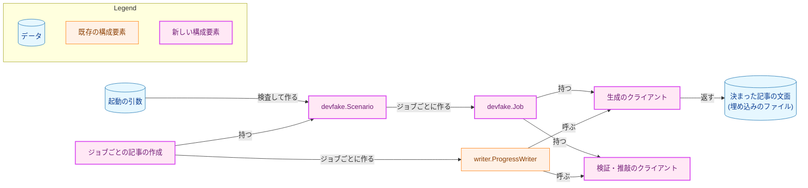
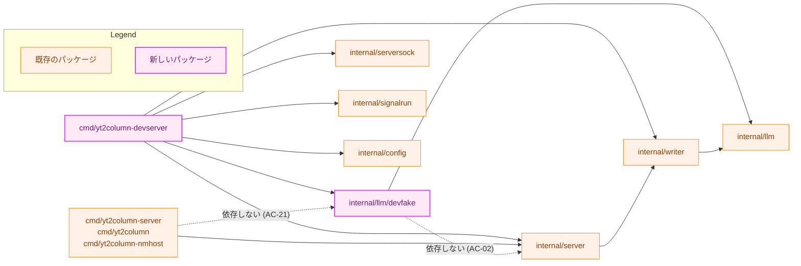
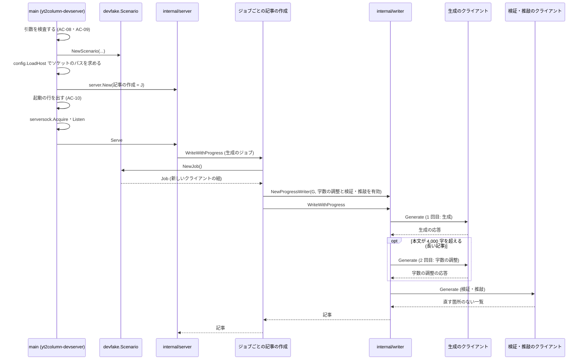
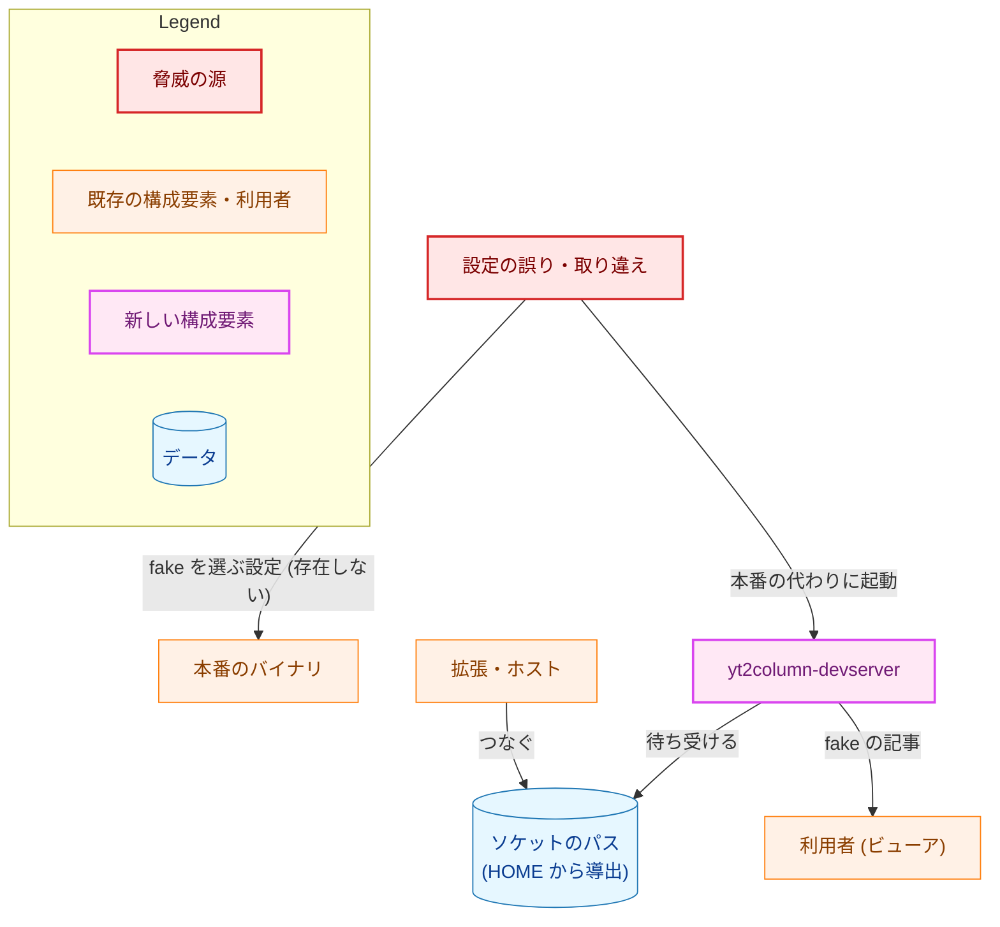
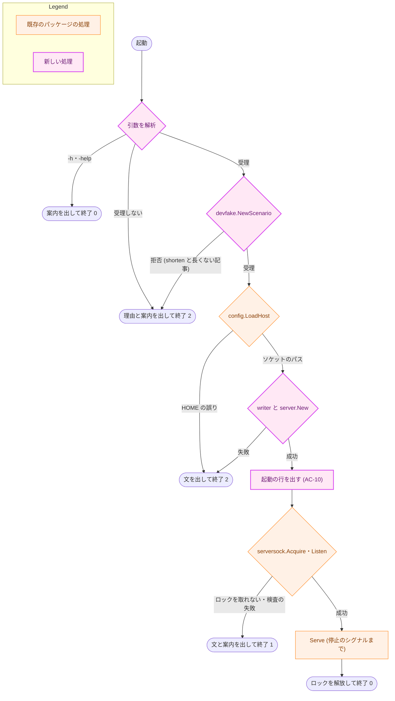
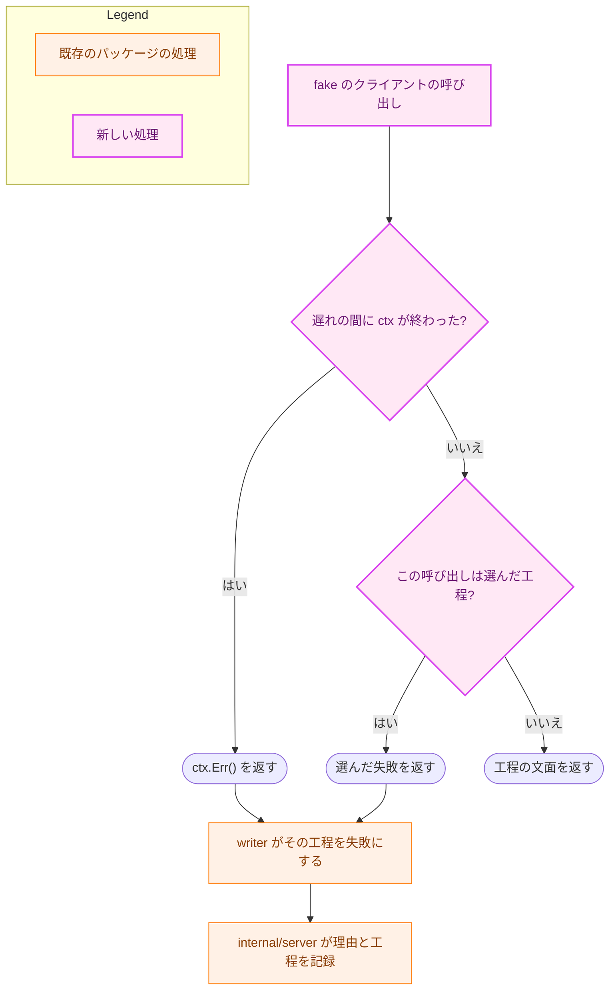

# アーキテクチャ設計書：fake の LLM を使う開発用のサーバ

## Document Status

| Item | Value |
|---|---|
| Status | `draft` |
| Created | 2026-11-11 |
| Review date | - |
| Reviewer | - |
| Comments | - |

## 1. 設計の全体像 (Design Overview)

本書は、[01_requirements.md](01_requirements.md) の F-001〜F-006 を実現する設計を定める。

構成要素は 2 つある。1 つは、`internal/llm` の `LLMClient` を満たす fake の構成要素 `internal/llm/devfake` である。もう 1 つは、それを使う開発用のサーバ `cmd/yt2column-devserver` で、成果物のバイナリは `yt2column-devserver` になる。`devfake` は `internal/llm` と標準ライブラリだけに依存し、サーバにも記事の作成（`internal/writer`）にも依存しない。開発用のサーバは、本番のサーバと同じ `internal/server`・`internal/serversock`・`internal/signalrun` と、本番と同じ `internal/writer` を使う。本番のサーバと違うのは、LLM のクライアントと、起動のときに読む入力（設定ファイルの代わりにコマンドライン引数）だけである。

### 1.1. 前提

-   **タスク 0083 の実装の後に実装する**（要件書の「要件定義の際に決めたこと」）。本書は、0083 の実装が `main` に入った後のサーバを前提にする。投稿の API・`server.Options.Webhook`・`WebhookPublisher` は消えている（[0083 設計書](../0083_remove_slack_webhook/02_architecture.md) の「設定」「起動」の項）。開発用のサーバが `server.New` に渡すのは、記事の作成・ログの出力先・伏せ字にする秘密の 3 つだけである。
-   **#771 の F-001 の実装（`make wasm-check` を含む）の後に実装する**（「設計の際に決めたこと」の 3 つ目）。`make wasm-check` は [0084 設計書](../0084_wasm_pipeline_poc/02_architecture.md) が定め、[ADR-0019](../../dev/adr/0019-pipeline-component-interfaces.md) が記録した目標で、`make lint` と CI の `lint` のジョブから呼ばれる。

### 1.2. 設計原則

-   **本番のバイナリは fake を知らない。** 本番の 3 つのバイナリは、`devfake` にも開発用のサーバにも依存しない。これを `make test` のテストが推移的な依存で確かめる（AC-21・AC-22）。
-   **振る舞いは型で宣言する。** 記事の種類・失敗の種類・失敗させる工程は列挙値で、組み合わせは検査を通った `devfake.Scenario` でしか表せない。fake はプロンプトの文字列を読まない（CLAUDE.md「Declare, don't infer」、AC-04）。
-   **ジョブごとに新しいクライアントを作る。** 生成のジョブのたびに、シナリオから新しいクライアントの組を作る。同時に動くジョブや前のジョブとは状態を共有しない（AC-04、H-01）。
-   **本番と同じ検査を、本番と同じコードで通す。** fake の応答は、本番の `internal/writer` の検査と工程（字数の調整、検証・推敲）を通る。ソケットとロックの検査は、本番の `internal/serversock` が行う（AC-11）。
-   **受理しない入力は直さずに拒否する。** 引数の誤りは起動を中止して終了コード `2` で終わる（CLAUDE.md「Reject, don't normalize」、AC-09）。

### 1.3. 概念モデル

矢印 A → B は「A が B を作る、または B を持つ」を表す。



-   **シナリオ**（`devfake.Scenario`）は、記事の種類・失敗の種類・失敗させる工程・遅れの組である。要件書の用語集は遅れをシナリオに含めないが、`devfake` の型では、1 回の起動で決まる値として遅れも同じ値に持つ。
-   **ジョブ**（`devfake.Job`）は、1 つの生成のジョブが使うクライアントの組である。生成のクライアントは、ジョブの中の 1 回目の呼び出しに生成の応答を、2 回目に字数の調整の応答を返す。検証・推敲のクライアントは、検証・推敲の応答を返す。
-   **ジョブごとの記事の作成**は、開発用のサーバが `internal/server` に渡す `writer.ProgressWriter` である。`WriteWithProgress` のたびに新しいジョブを作り、そのクライアントで本番と同じ `writer` を作って呼ぶ。

### 設計の際に決めたこと（2026-11-11）

-   **開発用のサーバの起動の手順は、開発用の `cmd/` に書く。ソケット・ロック・シグナル・HTTP の処理は本番と同じパッケージを使う（H-03）。** 起動の検査（ソケットのディレクトリ・ロック・stale の判定）は `internal/serversock` の `Acquire` と `Listen`（`internal/serversock/serversock.go:159`・`:222`、5a098660）にあり、2 つのシグナルの扱いは `internal/signalrun.Run`（`internal/signalrun/signalrun.go:42`）にある。開発用のサーバがこれらを呼べば、AC-11 の規則は本番と同じコードで守られる。`cmd/yt2column-server/run.go` に残るのは、標準エラー出力への書き込みの直列化・失敗の案内・停止の案内のようなつなぎのコードだけで、開発用のサーバは同じ役目の短いコードを持つ。本番の `run.go` は変えない。採らなかった案は、つなぎのコードを新しい `internal/` のパッケージに移して両方から使う案である。本番のバイナリと `cmd/yt2column-server/run_test.go` を書き換えることになり、0083 の `run.go` の変更とも重なる。一方、開発用のサーバは #773 でサーバと一緒に消える。ADR: なし（タスクの中で閉じる）。
-   **本番のバイナリから fake を締め出す検査は、`go list -deps` を使う Go のテストとし、`make test` で走らせる（H-02、AC-02・AC-21・AC-22）。** テストは、本番の 3 つの `cmd/` の推移的な依存に `devfake` と `cmd/yt2column-devserver` がないことと、`devfake` の推移的な依存にサーバだけが使うパッケージと `cmd/` の下のパッケージがないことを確かめる。要件の「推移的な依存」をそのまま確かめられる。テストから外部のコマンドを起動する前例は `cmd/yt2column/deadcode_test.go` にある。採らなかった案は、`depguard` で `devfake` の import を開発用の `cmd/` だけに許す案である。`main` のパッケージは import できないので AC-21 には足りるが、AC-02 は直接の import しか確かめられない。ADR: [ADR-0045](../../dev/adr/0045-dev-fake-llm.md) を更新する（「機械的に確かめる」の手段を決定に書く）。
-   **fake の WASM のビルドの検査は、0084 の `make wasm-check` に `devfake` を加えて行う。0086 の実装は #771 の F-001 の実装の後にする（AC-03）。** 要件書を書いたとき、要件書と ADR-0045 は「0084 は WASM の検査を加えないと決めた。その例外として置く」としていた。その後、0084 は #820 で判断を改め、`internal/transcript`・`internal/writer`・`internal/llm/claude`・`internal/pricing` を `GOOS=js GOARCH=wasm` でビルドする `make wasm-check` を置くことにした（ADR-0019）。fake の検査を同じ目標に加えれば、検査の目標は 1 つで済み、#772 が見直すときも 1 か所で済む。`internal/llm` は今も WASM でビルドできる（5a098660 で `GOOS=js GOARCH=wasm go build ./internal/llm` が通る）。採らなかった案は、実装のときに `make wasm-check` がなければ 0086 が同じ形の目標を作る案である。2 つのタスクが同じ目標を作りうる。要件書の古い記述は、本 PR で編集上の訂正として直す（決めたことは変わらない）。ADR: ADR-0045 を更新する（「0084 の例外」をやめ、`make wasm-check` で検査すると書く）。
-   **fake の構成要素は `internal/llm/devfake` に置く（H-05）。** `LLMClient` の実装は `internal/llm/<名前>` に置くという今の配置に合わせる。`devfake` という名前で、単体テスト用の fake（`internal/llm/testutil`、ビルドタグ `test`）とも、`internal/llm/provider` が選ぶ本番のアダプタとも区別する。`testutil/` の下には置かない（AC-28）。ADR: なし（タスクの中で閉じる）。
-   **fake はジョブごとに、シナリオから新しいクライアントの組（`devfake.Job`）を作り、生成のクライアントは呼ばれた回数で生成と字数の調整を区別する（H-01、AC-04）。** 申し送りの候補のとおりである。1 つのジョブの中では、`writer` は生成のクライアントを生成で 1 回、字数の調整で多くとも 1 回、この順に呼ぶ（`internal/writer/writer.go:417-445`、5a098660）。ジョブごとのクライアントなら、数えるのはそのジョブの呼び出しだけになる。`context` の値やプロンプトで工程を区別する案は採らなかった。前者は本番のサーバと `writer` を変えることになり（§4.4）、後者は CLAUDE.md「Declare, don't infer」に反する。ADR: ADR-0045 の決定（ジョブごとに独立）の手段で、ADR は変えない。
-   **決まった記事の文面は、`devfake` の中のファイルにして `go:embed` で埋め込む（H-06）。** 記事の文面は日本語である。CLAUDE.md は Go の文字列のリテラルを英語にすると定めるので、文面を Go のリテラルにせず、`prompts` のテンプレートと同じく埋め込みのファイルにする。`go:embed` は `GOOS=js GOARCH=wasm` のビルドでも使える。文面は実在の動画や人物の内容を含まない作文にする（`docs/dev/security.md` §7）。ADR: なし（タスクの中で閉じる）。
-   **検証・推敲のクライアントは、直す箇所のない一覧（`revisions` が空の配列）を返す（H-06）。** 空の一覧は、記事の種類によらず検証を通り、見出しを変えない。直しを含めると、記事の文面を変えるたびに直しの `before` が文面に 1 回だけ現れることを保たなければならない。AC は直しの表示を求めていない。ADR: なし（タスクの中で閉じる）。
-   **fake の応答のトークンの使用量は「報告しない」（`llm.Usage` のゼロ値）とする（AC-16）。** ゼロ値は「読んでいない」不明の使用量で（`internal/llm/usage.go` の `Usage` の説明）、本番のクライアントが使用量を報告しなかったときと同じ扱いになる。料金は、モデル名が単価の表にないことと合わせて不明になる。架空のトークン数を作らずに済む。ADR: なし（タスクの中で閉じる）。
-   **名前と引数の綴りは次のとおりとする（H-05）。** どれもタスクの中で閉じる決定で、ADR にしない。
    -   バイナリと `cmd/`: `yt2column-devserver`、`cmd/yt2column-devserver`。本番の名前に `dev` を加え、一覧で本番と並ぶようにする。
    -   `make` のターゲット: `make build-dev`。成果物は `build/yt2column-devserver` で、`make build` は変えない（AC-23）。
    -   記事の種類: `-article` に `standard`・`long`・`elements`。
    -   失敗: `-fail` に `empty`・`truncated`・`api-error`・`timeout`、失敗させる工程は `-fail-step` に `draft`・`shorten`・`review`。工程の綴りは、ジョブの API の工程のコード（`internal/server/status.go` の `statusSteps`）と同じにする。
    -   遅れ: `-delay` に秒数。
    -   使い方の案内: `-h`・`-help`。
    -   fake のモデル名: `yt2column-devfake`。単価の表（`internal/pricing`）にない。
    -   タイトルの印: `[FAKE] `（大文字の `FAKE` を角括弧で囲み、空白を 1 つ続ける）。スクリーンショットの中でも目立つように大文字にする。
-   **引数の解析には標準ライブラリの `flag` を使い、申し送りの 3 つの扱いを AC-09 に合わせて抑える（H-05）。** 値を受け取る型（`flag.Value`）を引数ごとに作り、受理する値の検査と、2 回目の指定の拒否をその型で行う。解析の後に残る語があれば拒否する。`-h`・`-help` は `flag` が `flag.ErrHelp` を返すので、それを使い方の案内の要求として終了コード `0` にする。外部のライブラリは加えない。自前の解析器を書く案は採らなかった。`flag` の上記の扱いは型で抑えられ、残りの規則（`-name=value` と `-name value` の両方の形）を書き直す理由がない。ADR: なし（タスクの中で閉じる）。
-   **開発用のサーバは、ソケットのパスを `config.LoadHost` で求める（H-04、AC-05・AC-07）。** `config.LoadHost` は `HOME` だけを読み、`config.LoadServer` と同じ関数でソケットのパスを導出する（`internal/config/config.go:401`・`:436`、5a098660）。開発用のサーバの `main` は、本番のサーバの `main` と同じく、プロセスの環境を引く関数 `os.LookupEnv` を渡すだけで、ほかの場所で環境を読まない。環境を読める場所の一覧（`internal/config/envaccess_test.go` の `allowedEnvRefs`）に `cmd/yt2column-devserver/main.go` の行を 1 つ加える。ADR: [ADR-0024](../../dev/adr/0024-env-access-in-config.md) を更新する（入口の種類の 1 つ目に開発用のサーバの `main` を加える）。
-   **要素を網羅した記事が 0063 の規則を網羅していることは、PR のレビューで読んで確かめる（H-06、AC-14）。** 要素の一覧をテストで持つと、ビューアの解析器（TypeScript）の規則を Go か別のテストで書き直すことになり、0063 の規則が変わるたびに古くなる。テストは、その記事が各工程を通って完成すること（AC-24）を確かめる。読んで確かめるときの対応表（規則ごとの該当の箇所）の置き場所は、実装計画で決める。ADR: なし（タスクの中で閉じる）。

## 2. システム構成 (System Structure)

### 2.1. 全体の構成

矢印 A → B は「A のパッケージが B のパッケージを import する」を表す。点線の矢印は、本書が持ち込まないことをテストで確かめる依存である。



`cmd/yt2column-devserver` が import するパッケージは、図のほかに `internal/redact`（ログの伏せ字と非表示の文字のエスケープ）を含む。本番のサーバも同じものを使う。

### 2.2. コンポーネントの配置

| パッケージ | 置き場所の理由 |
|---|---|
| `internal/llm/devfake` | `LLMClient` の実装なので `internal/llm` の下に置く。依存は `internal/llm` と標準ライブラリだけで、`GOOS=js GOARCH=wasm` でビルドできる。移行の後の開発用のビルドも、ここから使う |
| `cmd/yt2column-devserver` | 開発用のバイナリの入口。`devfake` を import してよい唯一の本番のコード（テストを除く）である。#773 でサーバと一緒に消す |

`internal/writer` は `internal/transcript` を import し、`internal/transcript` は今は `GOOS=js` でビルドできない（`internal/transcript/exec.go:99`、5a098660）。`devfake` は `internal/writer` に依存しないので、この状態にも、#771 での分割にも左右されない。`devfake` は `writer` の出力の形（1 行目の `# ` の見出し、検証・推敲の応答の JSON）を知っている必要があるが、その形は埋め込みの文面と応答に書かれ、`writer` の型や関数は使わない。文面が `writer` の検査を通ることは、`writer` を使うテスト（§7）が確かめる。

### 2.3. データの流れ

開発用のサーバの起動から、1 つのジョブの完成までを示す。



失敗のシナリオでは、選んだ工程の呼び出しが、遅れの後に失敗の応答を返す。`writer` はそこで止まり、`internal/server` が失敗の理由と工程を記録する（§4）。

## 3. コンポーネント設計 (Component Design)

### 3.1. `internal/llm/devfake` の型

```go
package devfake

// Article selects the fixed article the fake returns.
type Article int

const (
	ArticleStandard Article = iota // the zero value: an article the shorten step leaves alone
	ArticleLong                    // a draft over the body limit, so the shorten step runs
	ArticleElements                // an article holding every viewer Markdown rule the writer accepts
)

// Failure selects the failure the fake returns at the failing step.
type Failure int

const (
	FailureNone      Failure = iota // the zero value: no call fails
	FailureEmpty                    // wraps llm.ErrEmptyResponse
	FailureTruncated                // wraps llm.ErrTruncated
	FailureAPIError                 // wraps ErrSimulatedAPIFailure and no llm sentinel
	FailureTimeout                  // wraps context.DeadlineExceeded
)

// Step is the writer step a failure is returned at.
type Step int

const (
	StepNone    Step = iota // the zero value: no failing step
	StepDraft               // the first call of the generation client
	StepShorten             // the second call of the generation client
	StepReview              // the call of the review client
)

// MaxDelay is the longest delay NewScenario accepts.
const MaxDelay = 600 * time.Second

// ModelName is the model every fake response reports. It is not in the
// pricing table, so the cost of a fake article is unknown.
const ModelName = "yt2column-devfake"

// TitleMarker starts the title of every fake article.
const TitleMarker = "[FAKE] "

// Scenario is a checked scenario. Its fields are unexported, so a Scenario
// can only come from NewScenario; the zero value is the standard article
// with no failure and no delay.
type Scenario struct {
	article Article
	failure Failure
	step    Step
	delay   time.Duration
}

// NewScenario checks the combination and returns the Scenario. It rejects,
// with an error wrapping ErrInvalidScenario, a value outside an enumeration,
// a failure without a step or a step without a failure, StepShorten with an
// article other than ArticleLong, and a delay that is negative or over
// MaxDelay.
func NewScenario(article Article, failure Failure, step Step, delay time.Duration) (Scenario, error)

// Job is the pair of clients one generation job uses. Each NewJob returns
// clients that share no state with any other Job.
type Job struct {
	Generation llm.LLMClient // the draft call, then the shorten call
	Review     llm.LLMClient // the review call
}

// NewJob returns new clients for one generation job.
func (s Scenario) NewJob() Job
```

-   列挙値のゼロ値は、どれも「何もしない」側である（標準の記事、失敗なし、失敗の工程なし）。列挙値の外の値は `NewScenario` が拒否する。クライアントの中の `switch` の `default` も、成功ではなく `ErrUnexpectedCall` を包むエラーを返す（失敗に倒す）。
-   `NewScenario` が `StepShorten` を長い記事のときだけ受理するのは、字数の調整が本文が 4,000 字を超えるときだけ動くからである（`internal/writer/writer.go:435`、5a098660）。ほかの記事で受理すると、その工程は呼ばれず、選んだ失敗が起きない。
-   `Scenario` が持つ値（記事の種類・失敗・工程・遅れ）を外に返すのは、起動の行のための表示用のメソッドだけで、その名前と文字列は実装計画で決める。

### 3.2. fake のクライアントの振る舞い

| 呼び出し | 失敗させない場合の応答 | 失敗させる場合 |
|---|---|---|
| 生成のクライアントの 1 回目（生成） | 選んだ記事の生成の文面 | `StepDraft` を選んだとき、選んだ失敗 |
| 生成のクライアントの 2 回目（字数の調整） | 長い記事の字数の調整の後の文面 | `StepShorten` を選んだとき、選んだ失敗 |
| 生成のクライアントの 3 回目以降 | `ErrUnexpectedCall` を包むエラー | 同左 |
| 検証・推敲のクライアントの 1 回目 | `{"revisions":[]}` | `StepReview` を選んだとき、選んだ失敗 |
| 検証・推敲のクライアントの 2 回目以降 | `ErrUnexpectedCall` を包むエラー | 同左 |

-   **成功の応答**は、`Text` に文面、`Model` に `ModelName` を持つ。`ModelVersion` は空、`Usage` はゼロ値である。
-   **失敗の応答**は、`LLMClient` の契約（[ADR-0021](../../dev/adr/0021-llm-client-contract.md)、`internal/llm/llm.go` の `LLMClient` の説明）に従う。空の応答と出力の打ち切りでは、`Model` を `ModelName` にし、`Text` を空にした応答とエラーを返す。API のエラーとタイムアウトでは、ゼロ値の応答とエラーを返す。
-   **遅れ**は、呼び出しのたびに、応答（成功も失敗も）を返す前に待つ。待っている間に `ctx` が終われば、待ち終わるのを待たずに `ctx.Err()` を包まずに返す（AC-20）。遅れが 0 なら待たない（§4.1 の性能）。待ち方は、`time.Sleep` ではなく、タイマーと `ctx.Done()` の両方を待つ形にする。
-   **プロンプトを読まない。** `GenerateRequest` の `SystemPrompt`・`UserPrompt`・`MaxOutputTokens` は、応答も失敗も変えない（AC-04）。`Validate` も呼ばない。本番のアダプタは不正なリクエストを拒否するが、`writer` は検査済みのリクエストだけを送り、fake の役目は記事と失敗の再現だからである。
-   **呼び出しの数え方。** 生成のクライアントの回数は、そのクライアントの中で排他的に数える。`writer` は 1 つのジョブの中で順に呼ぶが、数え方を呼び出し側の順序に頼らないためである。

### 3.3. 決まった記事の文面

文面は `internal/llm/devfake` の下のファイルに置き、`go:embed` で埋め込む。ファイルは 4 つで、ファイル名は実装計画で決める。

| 文面 | 条件（要件） |
|---|---|
| 標準の記事の生成の文面 | 本文が 4,000 字以下（`internal/writer/length.go` の数え方）。見出しは 2 つ以上（AC-12） |
| 長い記事の生成の文面 | 本文が 4,000 字を超え、字数の調整が動く（AC-13） |
| 長い記事の字数の調整の後の文面 | 本文が 4,000 字以下。見出しが標準の記事より多い（AC-13） |
| 要素を網羅した記事の生成の文面 | 本文が 4,000 字以下。0063 の §3.2 の規則のうち、`writer` の検査（`checkBodyMarkdown`）を通る入力で現れうるものを、それぞれ 1 つ以上含む（AC-14） |

-   どの文面も、1 行目が `# ` と `TitleMarker` で始まるタイトルの行である（AC-15）。`writer` は 1 行目の `# ` を除き、前後の空白だけを取り除いてタイトルにするので（`internal/writer/output.go` の `checkGeneratedText`）、完成した記事のタイトルは `TitleMarker` で始まる。
-   長い記事の字数の調整の後の文面は、検証・推敲の後の最後の字数の検査（4,000 字）も通る。直す箇所がないので、本文は字数の調整の後のままである。
-   文面は作文で、実在の動画・人物・団体の内容を含まない（`docs/dev/security.md` §7）。

### 3.4. 開発用のサーバ（`cmd/yt2column-devserver`）

| 部分 | 責務 |
|---|---|
| `main` | `SIGPIPE` を無視し、`signalrun.Run` に `run` を渡す。`os.Args[1:]`・`os.LookupEnv`・`os.Stderr` を渡すのはここだけである（本番の `cmd/yt2column-server/main.go` と同じ形） |
| 引数の解析 | `flag.FlagSet` と引数ごとの `flag.Value` の型で、AC-08 の引数を受理し、AC-09 の指定を拒否する。結果を `devfake.NewScenario` に渡す |
| 起動の手順 | ソケットのパスを `config.LoadHost` で求める。ジョブごとの記事の作成と `server.New` でサーバを作る。起動の行を出す。`serversock.Acquire`・`Listen` で待ち受け、`Serve` が返るまでロックを持つ。停止の案内を出す |
| ジョブごとの記事の作成 | `writer.ProgressWriter` を満たす。`Write`・`WriteWithProgress` のたびに `Scenario.NewJob` で新しいクライアントの組を作り、`writer.NewProgressWriter` で本番と同じ設定（字数の調整と検証・推敲を有効）の `writer` を作って呼ぶ |

-   **本番と同じ `writer` の設定。** 本番のサーバの設定は `cmd/yt2column-server/run.go` の `writerOptions` で、字数の調整と検証・推敲を有効にする。`package main` なので開発用のサーバからは使えず、開発用のサーバは同じ値を自分で持つ。値は 2 つの真偽値と検証・推敲のクライアントだけなので、重複を受け入れる。
-   **`writer` を作れないときは起動を中止する。** ジョブごとに作る `writer` は、埋め込みのテンプレートを読むだけで失敗しないが、起動のときに 1 度作って確かめ、失敗すれば終了コード `2` で中止する。ジョブの中で作れなかったときは、そのエラーをジョブの失敗として返す（本番のサーバの分類では `llm_failed` になる）。
-   **`server.New` に渡す値。** 記事の作成はジョブごとの記事の作成、ログの出力先は標準エラー出力（書き込みを直列化したもの）、秘密は空である。開発用のサーバは秘密を持たない。
-   **終了コード。** 本番のサーバと同じ 3 つを使う。待ち受ける前の失敗（引数・`HOME`・構成要素の作成）は `2`、待ち受けの失敗（ソケットのディレクトリ・ロック・ソケットのパスの名前）と `Serve` の失敗は `1`、シグナルによる停止と使い方の案内の要求は `0` である。ロックを取れないときは、本番と同じく、別のサーバが動いていることを案内に書く。
-   **起動の行（AC-10）。** 構成要素を作った後、待ち受ける前に、標準エラー出力に 1 行を出す。行は、プログラムの名前、fake の LLM で動いていること、記事の種類・失敗（なしか、種類と工程）・遅れの秒数を、引数の綴りで示す。行の文言は実装計画で決め、`development.md` に例を書く。待ち受けた後の `listening` のログの行は、本番と同じくソケットのパスを記録し、加えて `model` に `ModelName` を記録する。
-   **停止の案内。** 0083 の後の本番のサーバと同じく、処理中の生成を取り消すことと、2 度目のシグナルですぐに終わることを案内する。

### 3.5. 既存のファイルの変更

| ファイル | 変更 |
|---|---|
| `Makefile` | `build-dev` の目標を加える（`build/yt2column-devserver` を作る）。`make build` は変えない（AC-23）。`wasm-check` の目標のビルドの対象に `./internal/llm/devfake` を加える（AC-03） |
| `internal/config/envaccess_test.go` | `allowedEnvRefs` に `cmd/yt2column-devserver/main.go` の `value:os.LookupEnv` を 1 回加える（H-04） |
| `docs/dev/security.md` | §8.2 に開発用のサーバの規則の項を加える（AC-25、§5） |
| `docs/dev/guides/development.md` | 「make のターゲット」の一覧に `make build-dev` を加え、新しい節「fake の LLM でサーバを動かす」を加える（AC-26） |
| `docs/dev/project_overview.md` | 想定ディレクトリ構成に 2 つのパッケージを加える（AC-27） |
| `docs/dev/conventions/package_reference.md` | パッケージの表に 2 つの行を加える（AC-27） |
| `docs/dev/conventions/test_organization.md` | 「Pipeline fakes」に、`internal/llm/devfake` が例外であることを範囲と理由とともに書く（AC-28） |
| `CLAUDE.md` | 「Build Commands」に `make build-dev` を加える（AC-27） |
| `docs/dev/adr/0045-dev-fake-llm.md` | 本 PR で、検査の手段（`go list -deps` のテスト、`make wasm-check`）を決定に書く。実装の PR で、「まだコードと security.md に反映していない」の文を消す（AC-29） |
| `docs/dev/adr/0024-env-access-in-config.md` | 本 PR で、入口の種類の 1 つ目に開発用のサーバの `main` を加える |

本番のサーバ・ホスト・拡張・`internal/server`・`internal/writer`・`internal/llm`・`internal/pricing` のコードは変えない（要件書 §4.4）。この変更が既存のテストの期待を変えるのは、`internal/config/envaccess_test.go` の一覧だけである。そのテストの `TestEnvAccess` の観測の検査（`envaccess_test.go:392-399` の、各入口の参照の数の検査）は、開発用のサーバの行を加えても変わらない。

### 3.6. 新しいファイル

| ファイル | 責務 |
|---|---|
| `internal/llm/devfake/` の Go のファイル | §3.1 の型、§3.2 のクライアント |
| `internal/llm/devfake/` の文面のファイル（4 つ） | §3.3 の文面 |
| `internal/llm/devfake/` のテスト | §7.1 |
| `cmd/yt2column-devserver/` の Go のファイル | §3.4 の `main`・引数の解析・起動の手順・ジョブごとの記事の作成 |
| `cmd/yt2column-devserver/` のテスト | §7.2〜§7.4 |

ファイルの分け方とテストの補助の置き場所（`test_helpers.go`）は実装計画で決める。

## 4. エラーハンドリング設計 (Error Handling Design)

### 4.1. `devfake` のエラー

```go
var (
	// ErrInvalidScenario reports a combination NewScenario does not accept.
	ErrInvalidScenario = errors.New("invalid fake scenario")
	// ErrSimulatedAPIFailure is the failure FailureAPIError returns. It wraps
	// no llm sentinel, so a caller classifies it as an LLM failure.
	ErrSimulatedAPIFailure = errors.New("simulated LLM API failure")
	// ErrUnexpectedCall reports a call the scenario does not expect: a third
	// call of the generation client or a second call of the review client.
	ErrUnexpectedCall = errors.New("unexpected call to the fake LLM client")
)
```

### 4.2. 失敗の種類と、状態の取得が返す理由のコード

本番のサーバは、`writer` が返したエラーを `classifyWrite`（`internal/server/generation.go:163-180`、5a098660）で分類する。fake のエラーは、次のコードになるように作る（AC-17）。

| 失敗の種類 | fake のエラー | 分類（`classifyWrite` の該当の `case`） | 理由のコード |
|---|---|---|---|
| 空の応答 | `llm.ErrEmptyResponse` を包む | `errors.Is(err, llm.ErrEmptyResponse)` | `llm_empty` |
| 出力の打ち切り | `llm.ErrTruncated` を包む | `errors.Is(err, llm.ErrTruncated)` | `llm_truncated` |
| API のエラー | `ErrSimulatedAPIFailure` を包み、`llm` の番兵も `context` のエラーも包まない | `default` | `llm_failed` |
| タイムアウト | `context.DeadlineExceeded` を包む | `errors.Is(err, context.DeadlineExceeded)` | `llm_timeout` |
| 遅れの間の取り消し（AC-20） | `ctx.Err()`（停止では `context.Canceled`） | 本番と同じ分類 | 本番と同じ |

-   失敗の工程は、`writer` が失敗した工程を開始済みで未完了のまま残し、`internal/server` の `failedStep`（`generation.go:146-158`）がその工程を示す（AC-17）。生成の失敗は `draft`、字数の調整の失敗は `shorten`、検証・推敲の失敗は `review` になる。
-   失敗した工程より前の工程は、成功の応答を返すので完了する（AC-18）。`writer` は失敗のときにゼロ値の記事を返すので、失敗したジョブは記事を持たない（CLAUDE.md「Empty is an error」）。
-   AC-20 の取り消しの例はサーバの停止で、このとき本番のサーバは失敗をログに `generation job canceled by the shutdown` として書く（`generation.go:127-129`）。

### 4.3. 開発用のサーバのエラーの文

-   引数の拒否は、標準エラー出力に、拒否した理由の 1 行と、受理する値を示す使い方の案内を出す。案内は、`-h` の案内と同じものである（AC-09）。理由の行は、知らない引数の名前と受理しない値を、本番のサーバの起動の行と同じく `redact.Line` を通して書く（非表示の文字をエスケープする）。開発用のサーバは秘密を持たないので、伏せ字にする値はない。
-   `HOME` の誤りは、本番と同じ `*config.VarError` の文で、値を含めない。
-   ソケットとロックの失敗は、本番と同じ `serversock` のエラーの文と、同じ案内（別のサーバが動いている、ソケットのパスのものを確かめる）である。

## 5. セキュリティ考慮事項 (Security Considerations)

`docs/dev/security.md` を適用する。要件書 §4.2 のとおり、このタスクは条件付きのガイドの条件のうち、API キーと Webhook URL の扱い、ネットワークへの送信、公開する記事に埋め込むテキストに当たる。

### 5.1. 脅威モデル

矢印 A → B は「A が B に働きかける」を表す。



| 脅威 | 対策 |
|---|---|
| 本番のバイナリが、設定の誤りで fake の記事を出す | 本番のバイナリは `devfake` に依存しない。fake を選ぶ設定そのものがない。`go list -deps` のテストが確かめる（AC-21・AC-22） |
| 開発用のサーバが秘密を読み、出力に流す | 開発用のサーバは設定ファイルを読まず、環境から読むのは `HOME` だけである（AC-06・AC-07）。`devfake` はネットワークにもファイルにも触れない（AC-01） |
| 利用者が本番の代わりに開発用のサーバを動かし、fake の記事を本物と取り違える | 残余のリスクとして受け入れる（要件書 §4.2）。タイトルの印・起動の行・料金の不明で気づけるようにし、`security.md` で開発用のバイナリを常用の環境に置かないことを求める。同一ユーザーの信頼の範囲（[ADR-0006](../../dev/adr/0006-threat-model.md)） |
| 開発用のサーバと本番のサーバが同時に動き、互いのソケットを消す | 同じ `serversock` の起動のロックで、後から起動した方が中止する（AC-11） |
| 拡張から不正な入力が届く | 入力の検査は本番と同じ `internal/server` が行う。fake はプロンプトを読まないので、字幕の中身は fake の応答を変えない |

### 5.2. 記事の外部由来の部分

fake が返すタイトルと本文は決まった文面である。チャンネル名と出典の URL は、本番と同じく `internal/writer` が拡張の送った値から付け（`internal/writer/output.go:216-227`）、本番と同じ規則がかかる。`devfake` も開発用のサーバもこの部分を扱わない。

### 5.3. `security.md` §8.2 に加える項

§8.2 の「Native Messaging のホスト」の項の前に、「開発用のサーバ（`cmd/yt2column-devserver`・`internal/llm/devfake`）」の項を加え、AC-25 の 5 つを書く。本番のバイナリに fake を入れないこと（`go list -deps` のテストで確かめる）、設定ファイルも API キーも読まず環境から読むのは `HOME` だけであること、本番のサーバと同じソケットのパスと起動のロックを使うこと、開発用のバイナリを常用の環境に置かないこと、要件書 §4.2 の残余のリスクである。残余のリスクは、§8.2 の「残余のリスク（許容する）」の一覧にも 1 項を加える。

## 6. 処理フローの詳細 (Processing Flow Details)

### 6.1. 起動



-   引数の解析とシナリオの検査は、ファイルにもネットワークにも触れない。終了コード `2` で中止するときは、ソケットのディレクトリもロックのファイルも作らない（AC-09「何も待ち受けずに」）。
-   `Serve` が失敗したときは、本番と同じくロックを解放してから終了コード `1` で終わる（図では省いた）。

### 6.2. 1 つの生成のジョブ

§2.3 のシーケンス図のとおりである。失敗のシナリオでの流れを示す。



遅れを指定すると、1 つのジョブの待ち時間の合計は、呼び出しの回数と遅れの積になる（AC-19）。標準の記事と要素を網羅した記事では 2 回（生成、検証・推敲）、長い記事では 3 回（生成、字数の調整、検証・推敲）で、失敗した場合はその工程までの回数である。

## 7. テスト戦略 (Test Strategy)

単体テストは、実際の LLM・ネットワーク・Webhook を呼ばない。タイミングに頼るテストは、[ADR-0038](../../dev/adr/0038-deadcode-and-race-free-timing.md) の決定に従い、レースのない形にする。

### 7.1. `internal/llm/devfake` の単体テスト

-   `NewScenario` の受理と拒否の表（列挙値の外、片方だけの失敗の指定、長くない記事での `StepShorten`、負の遅れ、`MaxDelay` を超える遅れ）。
-   シナリオごとの、各呼び出しの応答と失敗のエラー（`errors.Is` で確かめる）、3 回目以降と 2 回目以降の呼び出しの `ErrUnexpectedCall`（§3.2）。
-   ジョブの独立（AC-04）。2 つのジョブのクライアントを交互に、また並行に呼んでも、それぞれが 1 回目に生成の応答を返す。前のジョブを呼んだ後に作ったジョブも同じ応答を返す。
-   プロンプトを変えても応答が変わらないこと（AC-04）。
-   遅れと取り消し（AC-19・AC-20）。待ち方を差し替える口をテストの補助に置き、待った長さと回数を観測する。待っている間に `ctx` を取り消すと、待ち終わる前に `ctx.Err()` が返る。具体的な形は実装計画で決める。
-   文面が `writer` の検査と工程を通ること（AC-12〜AC-15）。外部のテストのパッケージ（`devfake_test`）から本物の `writer` を使う。テストの依存は `go list -deps` の非テストの依存にも、WASM のビルドにも入らない。本文の字数・見出しの数・タイトルの印・字数の調整の有無を確かめる。

### 7.2. 開発用のサーバのテスト

`cmd/yt2column-devserver` のテストは、本番の `cmd/yt2column-server` のテストと同じく、`run` に一時ディレクトリの `HOME` と環境を引く関数を渡して起動し、ソケットにジョブの API のリクエストを送る。

-   **引数（AC-08・AC-09）。** 受理する指定と拒否する指定の表。拒否では終了コード `2`、使い方の案内、ソケットのディレクトリを作らないこと。`-h`・`-help` では終了コード `0`。
-   **組み合わせ（AC-24）。** AC-08・AC-09 が受理する記事の種類と失敗の組み合わせのすべて（標準と要素を網羅した記事でそれぞれ 9 通り、長い記事で 13 通り、計 31 通り）について、生成の開始と状態の取得を行い、記事が完成するか、選んだ工程・理由のコードで失敗するかを確かめる。完成した記事では、タイトルの印と、料金の `cost.state` が `unknown` であること（AC-16）も確かめる。
-   **同時のジョブ（AC-04）。** 生成のジョブを 2 つ同時に始め、どちらも同じ結果（同じタイトルと本文、または同じ工程の同じ失敗）になることを確かめる。続けて始めたジョブも同じ結果になる。
-   **設定ファイルと環境（AC-06・AC-07）。** 設定ファイルがない場合・モードが `0600` でない場合・書式が誤っている場合に、同じように起動すること。環境を引く関数が引いた名前が `HOME` だけであること。
-   **起動の行（AC-10）とロック（AC-11）。** 起動の行の内容。`serversock.Acquire` で同じソケットのパスのロックを持った状態で起動すると、終了コード `1` と別のサーバが動いていることの案内で中止すること。逆向き（開発用のサーバがロックを持つときの本番のサーバ）は、本番のサーバが同じ `serversock.Acquire` を使うことと、`internal/serversock` のロックのテストで確かめる。

### 7.3. 本番のバイナリとの分離のテスト（AC-02・AC-21・AC-22）

`go list -deps` を実行する Go のテストを `make test` で走らせる。ビルドタグを付けずに依存を求め、次を確かめる。

-   `./cmd/yt2column`・`./cmd/yt2column-server`・`./cmd/yt2column-nmhost` の依存に、`internal/llm/devfake` と `cmd/yt2column-devserver` がない（AC-21）。
-   `./internal/llm/devfake` の依存に、`internal/server`・`internal/articlecache`・`internal/serversock`・`internal/privatefile`・`internal/nmhost` と、`cmd/` の下のパッケージがない（AC-02）。

テストを置くパッケージ、`go` のコマンドの見つけ方、テストが失敗しうることの確かめ方（本番の `cmd/` に `devfake` の import を足して失敗を見る）は、実装計画で決める。

### 7.4. 統合と静的な検査

-   **WASM（AC-03）。** `make wasm-check` が `./internal/llm/devfake` をビルドする。`make lint` と CI の `lint` のジョブが呼ぶ。
-   **環境を読む場所（H-04）。** `internal/config/envaccess_test.go` の一覧の行。
-   **`make build` と `make build-dev`（AC-23）。** `make build` の成果物が今までの 3 つだけであること、`make build-dev` が開発用のバイナリを作ることは、実装の PR で `make` を実行して確かめ、記録する。
-   **要素を網羅した記事（AC-14）。** PR のレビューで、文面を 0063 の §3.2 の規則と突き合わせて読む（「設計の際に決めたこと」）。
-   **拡張からの手での確認（AC-05）。** 実装の PR で、拡張から開発用のサーバに生成の開始と状態の取得ができることを手で確かめ、記録する。
-   **文書（AC-25〜AC-29）。** 読んで確かめる。ADR の形は `TestADRRecords` が確かめる。

### 7.5. セキュリティのテスト

-   本番のバイナリとの分離（§7.3）。
-   環境から読む名前が `HOME` だけであること（§7.2）。
-   `devfake` がネットワーク・外部コマンド・ファイルに触れないこと（AC-01）は、§7.3 の依存の検査で `os/exec`・`net` などの依存がないことを確かめる形にするか、レビューで読むかを、実装計画で決める。

## 8. 実装の優先順位 (Implementation Priorities)

着手の条件は 2 つある。タスク 0083 の実装が `main` に入っていることと、#771 の F-001（`make wasm-check` を含む）の実装が `main` に入っていることである。

1.  **`internal/llm/devfake`。** 型・クライアント・文面・単体テスト・`make wasm-check` への追加。この段階で、本番のバイナリとの分離のテストも置く（`devfake` が存在し、まだどこからも import されない）。
2.  **`cmd/yt2column-devserver`。** 引数の解析・起動の手順・ジョブごとの記事の作成・テスト・`make build-dev`・`envaccess_test.go` の行。
3.  **文書。** `security.md` §8.2、`development.md`、`project_overview.md`、`package_reference.md`、`test_organization.md`、`CLAUDE.md`、ADR-0045 の反映の差の文の削除。

PR の分け方は実装計画で決める。

## 9. 将来の拡張性 (Future Extensibility)

-   **記事の種類・失敗の種類・工程を足す。** 列挙値に値を足し、`NewScenario` の検査とクライアントの `switch`、引数の値の表を足す。プロンプトの中身から推測する分岐は作らない（要件書 §4.5）。
-   **移行の後の開発用のビルド（#772・#773）。** `devfake` は `internal/llm` だけに依存し、WASM でビルドできるので、拡張だけの構成の開発用のビルドからも `Scenario` と `Job` を使える。そこで記事の作成にどう配線するか（ジョブごとのクライアントの組を作る場所）は、#772・#773 で決める。開発用のサーバは #773 でサーバと一緒に消す。
-   **TS に一本化する場合。** #772 が TS に一本化すると決めたら、`make wasm-check` の `devfake` の行と ADR-0045 の該当の項を #772 が見直す。

## 付録 A. 要件との対応

| AC | 設計の箇所 |
|---|---|
| AC-01 | §3.1・§3.2（標準ライブラリと `internal/llm` だけ）、§7.5 |
| AC-02 | §2.1、§7.3 |
| AC-03 | 「設計の際に決めたこと」、§3.5、§7.4 |
| AC-04 | §1.2、§3.1・§3.2、§7.1・§7.2 |
| AC-05 | 「設計の際に決めたこと」（`config.LoadHost`）、§3.4、§7.4 |
| AC-06・AC-07 | §3.4、§7.2 |
| AC-08・AC-09 | 「設計の際に決めたこと」（名前と `flag`）、§3.4、§4.3、§6.1、§7.2 |
| AC-10 | §3.4、§7.2 |
| AC-11 | 「設計の際に決めたこと」（H-03）、§3.4、§7.2 |
| AC-12〜AC-15 | §3.3、§7.1 |
| AC-16 | 「設計の際に決めたこと」（使用量）、§3.2、§7.2 |
| AC-17・AC-18 | §4.2、§7.2 |
| AC-19・AC-20 | §3.2、§6.2、§7.1 |
| AC-21・AC-22 | §7.3 |
| AC-23 | §3.5、§7.4 |
| AC-24 | §7.2 |
| AC-25 | §5.3 |
| AC-26〜AC-28 | §3.5 |
| AC-29 | §3.5（ADR-0045） |

## 付録 B. 設計への申し送り（design_handoff.md）の扱い

| 項目 | 扱い |
|---|---|
| H-01 | 申し送りの候補のとおり、ジョブごとに新しいクライアントの組を作る（「設計の際に決めたこと」、§3.1・§3.4） |
| H-02 | `go list -deps` のテスト（§7.3）。`devfake` は `internal/writer`・`internal/transcript` に依存しないので、WASM の検査の範囲はそれらに広がらない。それらは 0084 の `make wasm-check` が別に検査する |
| H-03 | 開発用の `cmd/` に起動の手順を書き、`serversock`・`signalrun`・`server` を共有する（「設計の際に決めたこと」） |
| H-04 | `config.LoadHost` を使い、`envaccess_test.go` の一覧に行を加え、ADR-0024 を更新する（「設計の際に決めたこと」） |
| H-05 | 名前と綴り、`flag` の扱い（「設計の際に決めたこと」） |
| H-06 | 埋め込みの文面、検証・推敲は空の一覧、要素の網羅はレビューで読む（「設計の際に決めたこと」、§3.3） |
