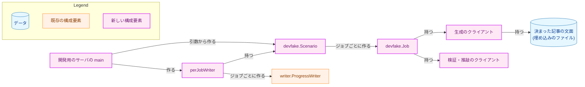
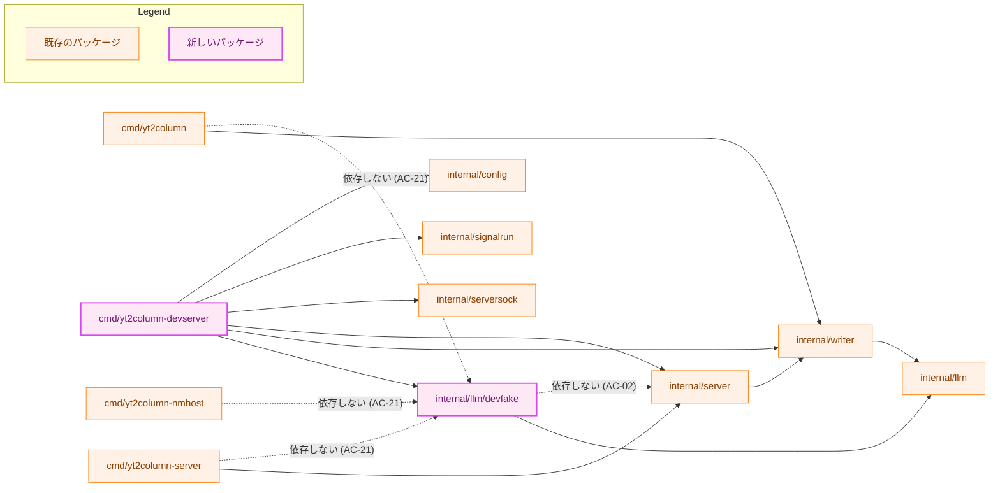
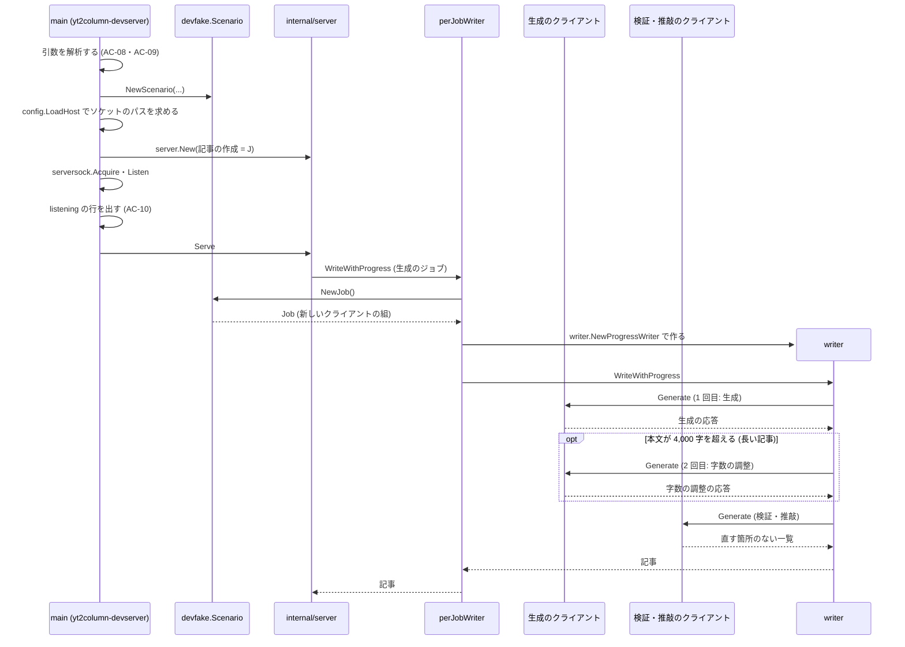
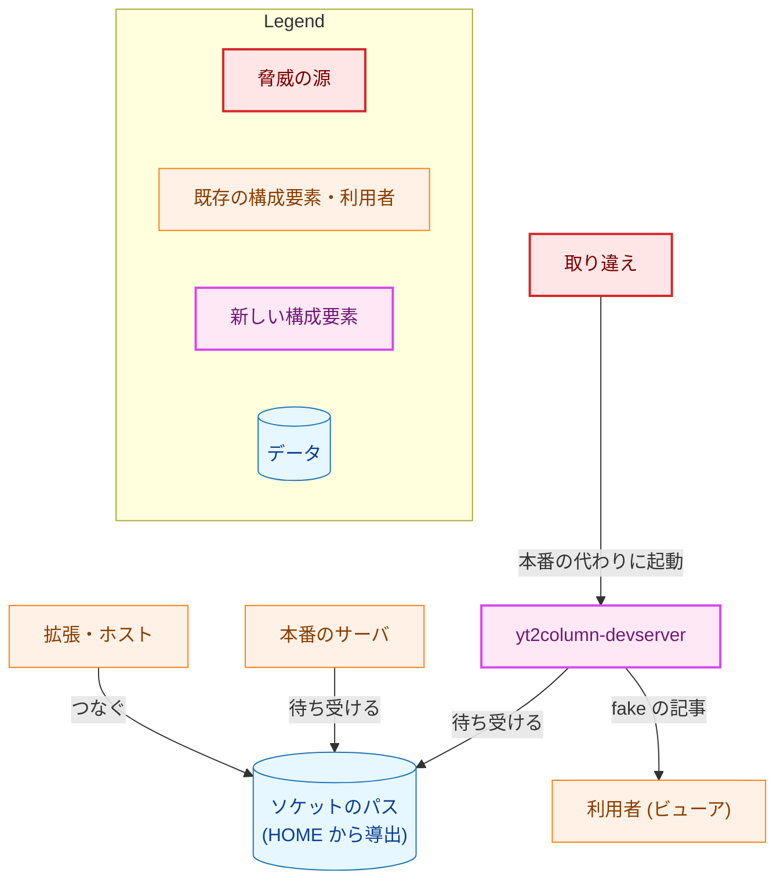
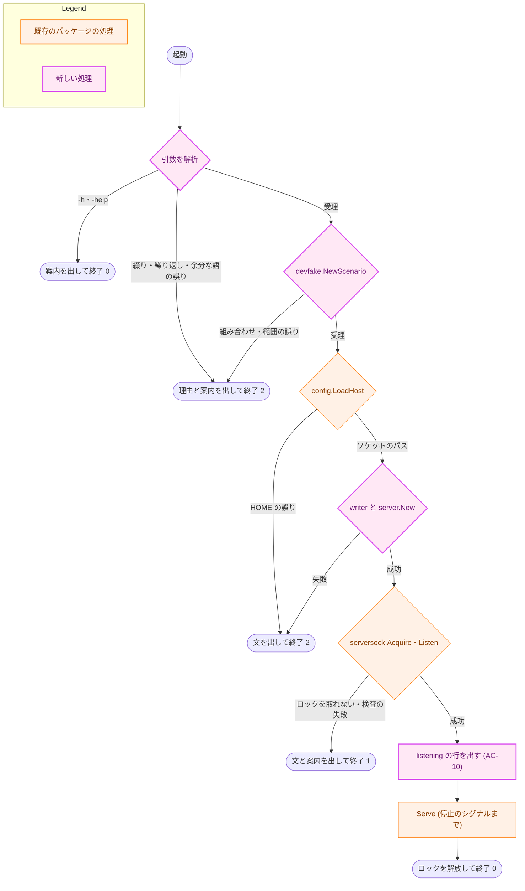
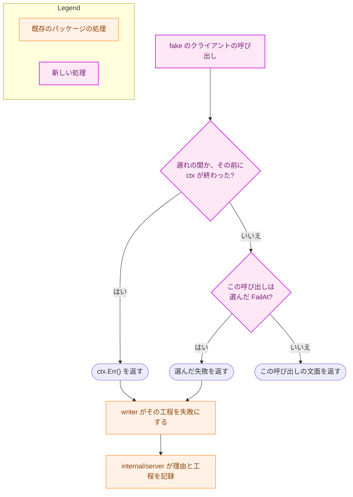

# アーキテクチャ設計書：fake の LLM を使う開発用のサーバ

## Document Status

| Item | Value |
|---|---|
| Status | `approved` |
| Created | 2026-11-11 |
| Review date | 2026-11-11 |
| Reviewer | isseis |
| Comments | - |

## 1. 設計の全体像 (Design Overview)

本書は、[01_requirements.md](01_requirements.md) の F-001〜F-006 を実現する設計を定める。

構成要素は 2 つある。1 つは、`internal/llm` の `LLMClient` を満たす fake の構成要素 `internal/llm/devfake` である。もう 1 つは、それを使う開発用のサーバ `cmd/yt2column-devserver` で、成果物のバイナリは `yt2column-devserver` になる。`devfake` は `internal/llm` と標準ライブラリだけに依存し、サーバにも記事の作成（`internal/writer`）にも依存しない。開発用のサーバは、本番のサーバと同じ `internal/server`・`internal/serversock`・`internal/signalrun` と、本番と同じ `internal/writer` を使う。本番のサーバと違うのは、LLM のクライアントと、起動のときに読む入力（設定ファイルの代わりにコマンドライン引数）だけである。

### 1.1. 前提

-   **タスク 0083 の最後の実装の PR が `main` に入った後に実装する**（要件書の「要件定義の際に決めたこと」）。本書は、0083 の実装がすべて `main` に入った後のサーバを前提にする。投稿の API・`server.Options.Webhook`・`WebhookPublisher` は消えている（[0083 設計書](../0083_remove_slack_webhook/02_architecture.md) の「設定」「起動」の項）。開発用のサーバが `server.New` に渡すのは、記事の作成・ログの出力先・伏せ字にする秘密の 3 つだけである。
-   **#771 の F-001 の実装（`make wasm-check` を含む）が `main` に入った後に実装する**（「設計の際に決めたこと」の 3 つ目）。`make wasm-check` は [0084 設計書](../0084_wasm_pipeline_poc/02_architecture.md) が定め、[ADR-0019](../../dev/adr/0019-pipeline-component-interfaces.md) が記録したターゲットで、`make lint` と CI の `lint` のジョブから呼ばれる。#772 が #771 の F-001 より先に TS（TypeScript）への一本化を決め、`make wasm-check` を置かないことになった場合は、#772 が AC-03 と ADR-0045 の該当の項を見直す。0086 はその結果に従って着手する。

### 1.2. 設計原則

-   **本番のバイナリは fake を知らない。** 本番の 3 つのバイナリは、`devfake` にも開発用のサーバにも依存しない。これを `make test` のテストが推移的な依存で確かめる（AC-21・AC-22）。
-   **振る舞いは型で宣言する。** 記事の種類・失敗の種類・失敗させる呼び出しは列挙値で、組み合わせは検査を通った `devfake.Scenario` でしか表せない。fake はプロンプトの文字列を読まない（CLAUDE.md「Declare, don't infer」、AC-04）。
-   **ジョブごとに新しいクライアントを作る。** 生成のジョブのたびに、シナリオから新しいクライアントの組を作る。同時に動くジョブや前のジョブとは状態を共有しない（AC-04、H-01）。
-   **本番と同じ検査を、本番と同じコードで通す。** fake の応答は、本番の `internal/writer` の検査と工程（字数の調整、検証・推敲）を通る。ソケットとロックの検査は、本番の `internal/serversock` が行う（AC-11）。
-   **受理しない入力は直さずに拒否する。** 引数の誤りは起動を中止して終了コード `2` で終わる（CLAUDE.md「Reject, don't normalize」、AC-09）。

### 1.3. 概念モデル

矢印 A → B は「A が B を作る、または A が B を持つ」を表す。



-   **シナリオ**（`devfake.Scenario`）は、記事の種類・失敗の種類・失敗させる呼び出し・遅れの組である。要件書の用語集は遅れをシナリオに含めないが、`devfake` の型では、1 回の起動で決まる値として遅れも同じ値に持つ。本書で「シナリオ」と書くときは、この型の値（遅れを含む）を指す。
-   **ジョブ**（`devfake.Job`）は、1 つの生成のジョブが使うクライアントの組である。生成のクライアントは、ジョブの中の 1 回目の呼び出しに生成の応答を、2 回目に字数の調整の応答を返す。検証・推敲のクライアントは、検証・推敲の応答を返す。
-   **`perJobWriter`** は、開発用のサーバが `internal/server` に渡す `writer.ProgressWriter` の実装（`cmd/yt2column-devserver` の非公開の型）である。`WriteWithProgress` のたびに新しいジョブを作り、そのクライアントで本番と同じ設定の `writer` を作って呼ぶ。

### 設計の際に決めたこと（2026-11-11）

-   **開発用のサーバの起動の手順は、開発用の `cmd/` に書く。ソケット・ロック・シグナル・HTTP の処理は本番と同じパッケージを使う（H-03）。** 起動の検査（ソケットのディレクトリ・ロック・stale の判定）は `internal/serversock` の `Acquire` と `Listen`（`internal/serversock/serversock.go:159`・`:222`、5a098660）にあり、2 つのシグナルの扱いは `internal/signalrun.Run`（`internal/signalrun/signalrun.go:42`）にある。開発用のサーバがこれらを呼べば、AC-11 の規則は本番と同じコードで守られる。本番の `run.go` は変えない。開発用のサーバは、`cmd/yt2column-server/run.go` の次のつなぎのコードと同じ役目のコードを持つ（行は 5a098660）。
    -   `redact.Line` を通して 1 行を書く `stderrWriter`（`:88-97`）。
    -   標準エラー出力への書き込みを直列化する `lockedWriter`（`:100-110`）。
    -   ロックとソケットの失敗に案内を付ける `listenHint`（`:249-258`）と、ロックを解放して失敗を報告する `releaseLock`（`:262-266`）。
    -   `Acquire` → `Listen` → `listening` のログ → `Serve` → ロックの解放、の順序。
    -   停止の案内（本番の `stopNoticeLogger`、`:271`）。文は、0083 の後の本番と同じく投稿の待ちに触れない。本番は、案内を `Serve` の返る前に必ず書き終える `cancelHook`（`:287-321`）を使う。開発用のサーバは、この順序の保証を写さない。案内は `context.AfterFunc` で書き、`Serve` が返った後に書かれることがあっても受け入れる。開発用のログの 1 行の順序は、保証の複雑さ（とそのテスト）まで写す理由にならないためである。

    写したコードの振る舞い（終了コード、案内の文、ロックの解放）は、開発用のサーバのテスト（§7.2）で確かめる。採らなかった案は 2 つある。つなぎのコードをすべて新しい `internal/` のパッケージに移して両方から使う案は、本番のバイナリと `cmd/yt2column-server/run_test.go` を書き換えることになり、0083 の `run.go` の変更とも重なる。`cancelHook` など状態を持たない部品だけを移す案は、本番の `run.go` を変える点は同じで、開発用のサーバでは上のとおり `cancelHook` の保証が要らない。開発用のサーバは #773 でサーバと一緒に消える。ADR: なし（タスクの中で閉じる）。
-   **本番のバイナリから fake を締め出す検査は、`go list -deps` を使う Go のテストとし、`make test` で走らせる（H-02、AC-02・AC-21・AC-22）。** 要件の「推移的な依存」をそのまま確かめられる。テストから外部のコマンドを起動する前例は `cmd/yt2column/deadcode_test.go` にある。検査が失敗すべきときに通らないよう、テストの置き場所と失敗の扱いを §7.3 で定める。採らなかった案は、`depguard` で `devfake` の import を開発用の `cmd/` だけに許す案である。`main` のパッケージは import できないので AC-21 には足りるが、AC-02 は直接の import しか確かめられない。ADR: [ADR-0045](../../dev/adr/0045-dev-fake-llm.md) を更新する（「機械的に確かめる」の手段を決定に書く）。
-   **fake の WASM のビルドの検査は、0084 の `make wasm-check` に `devfake` を加えて行う。0086 の実装は #771 の F-001 の実装の後にする（AC-03）。** 0084 は `internal/transcript`・`internal/writer`・`internal/llm/claude`・`internal/pricing` を `GOOS=js GOARCH=wasm` でビルドする `make wasm-check` を置くと決めている（ADR-0019）。fake の検査を同じターゲットに加えれば、検査のターゲットは 1 つで済み、#772 が見直すときも 1 か所で済む。`internal/llm` は今も WASM でビルドできる（5a098660 で `GOOS=js GOARCH=wasm go build ./internal/llm` が通る）。採らなかった案は、実装のときに `make wasm-check` がなければ 0086 が同じ形のターゲットを作る案である。0084 と 0086 が同じ役目のターゲットをそれぞれ作るおそれがある。ADR: ADR-0045 を更新する（`make wasm-check` で検査すると書く）。

    > 要件書の初版と ADR-0045 は、この検査を「0084 の『WASM の検査を加えない』という決定の例外」としていた。0084 が #820 で判断を改めたので、本 PR で要件書を編集上の訂正として直し、ADR-0045 の決定を更新した。

-   **fake の構成要素は `internal/llm/devfake` に置く（H-05）。** `LLMClient` の実装は `internal/llm/<名前>` に置くという今の配置に合わせる。`devfake` という名前で、単体テスト用の fake（`internal/llm/testutil`、ビルドタグ `test`）とも、`internal/llm/provider` が選ぶ本番のアダプタとも区別する。単体テスト用の `testutil.FakeLLMSequence`（`internal/llm/testutil/mocks.go:53-74`）も呼び出しの順に応答を返すが、ビルドタグ `test` のファイルにあるので開発用のバイナリから使えない（AC-28 と同じ理由）。`testutil/` の下には置かない（AC-28）。ADR: なし（タスクの中で閉じる）。
-   **fake はジョブごとに、シナリオから新しいクライアントの組（`devfake.Job`）を作り、生成のクライアントは呼ばれた回数で生成と字数の調整を区別する（H-01、AC-04）。** 申し送りの候補のとおりである。1 つのジョブの中では、`writer` は生成のクライアントを生成で 1 回、字数の調整で多くとも 1 回、この順に呼ぶ（`internal/writer/writer.go:417-445`、5a098660）。ジョブごとのクライアントなら、数えるのはそのジョブの呼び出しだけになる。`context` の値やプロンプトで工程を区別する案は採らなかった。前者は本番のサーバと `writer` を変えることになり（要件書 §4.4）、後者は CLAUDE.md「Declare, don't infer」に反する。ADR: ADR-0045 の決定（ジョブごとに独立）の手段で、ADR は変えない。
-   **決まった記事の文面は、`devfake` の中のファイルにして `go:embed` で埋め込む（H-06）。** 記事の文面は日本語である。CLAUDE.md は Go の文字列のリテラルを英語にすると定めるので、文面を Go のリテラルにせず、`prompts` のテンプレートと同じく埋め込みのファイルにする。`go:embed` は `GOOS=js GOARCH=wasm` のビルドでも使える。文面は実在の動画や人物の内容を含まない作文にする（`docs/dev/security.md` §7）。ADR: なし（タスクの中で閉じる）。
-   **検証・推敲のクライアントは、直す箇所のない一覧（`revisions` が空の配列）を返す（H-06）。** 空の一覧は、記事の種類によらず検証を通り、見出しを変えない。直しを含めると、記事の文面を変えるたびに直しの `before` が文面に 1 回だけ現れることを保たなければならない。AC は直しの表示を求めていない。ADR: なし（タスクの中で閉じる）。
-   **fake の応答のトークンの使用量は「報告しない」（`llm.Usage` のゼロ値）とする（AC-16）。** ゼロ値は「読み取っていない」不明の使用量を表し（`internal/llm/usage.go` の `Usage` の説明）、本番のクライアントが使用量を報告しなかったときと同じ扱いになる。料金は、モデル名が単価の表にないことと合わせて不明になる。架空のトークン数を作らずに済む。ADR: なし（タスクの中で閉じる）。
-   **名前と引数の綴りは次のとおりとする（H-05）。** どれもタスクの中で閉じる決定で、ADR にしない。
    -   バイナリと `cmd/`: `yt2column-devserver`、`cmd/yt2column-devserver`。本番の名前に `dev` を加え、一覧で本番と並ぶようにする。
    -   `make` のターゲット: `make build-dev`。成果物は `build/dev/yt2column-devserver` で、本番の 3 つのバイナリ（`build/` の直下）とはディレクトリを分ける。README の `./build/...` の手順で取り違えないようにするためである。`make build` は変えない（AC-23）。
    -   記事の種類: `-article` に `standard`・`long`・`elements`。
    -   失敗: `-fail` に `empty`・`truncated`・`api-error`・`timeout`、失敗させる工程は `-fail-step` に `draft`・`shorten`・`review`。工程の綴りは、ジョブの API の工程のコード（`internal/server/status.go` の `statusSteps`）と同じにする。
    -   遅れ: `-delay` に秒数。
    -   使い方の案内: `-h`・`-help`。
    -   fake のモデル名: `yt2column-devfake`。単価の表（`internal/pricing`）にない。
    -   タイトルの印: `[FAKE] `（大文字の `FAKE` を角括弧で囲み、空白を 1 つ続ける）。スクリーンショットの中でも目立つように大文字にする。
-   **引数の解析には標準ライブラリの `flag` を使い、申し送り（付録 B）の H-05 が挙げた `flag` の 3 つの振る舞いを AC-09 に合わせて制御する。** 3 つの振る舞いとは、最初の位置引数で解析を止めて残りを残すこと、`-h`・`-help` を特別に扱うこと、同じ引数を繰り返すと後の値が勝つことである。値を受け取る型（`flag.Value`）を引数ごとに作り、綴りの検査と、2 回目の指定の拒否をその型で行う。解析の後に残る語があれば拒否する。`-h`・`-help` は `flag` が `flag.ErrHelp` を返すので、それを使い方の案内の要求として終了コード `0` にする。外部のライブラリは加えない。自前の解析器を書く案は採らなかった。`flag` の上記の 3 つは型と解析の後の検査で制御でき、残りの規則（`-name=value` と `-name value` の両方の形）を書き直す理由がない。ADR: なし（タスクの中で閉じる）。
-   **開発用のサーバは、ソケットのパスを `config.LoadHost` で求める（H-04、AC-05・AC-07）。** `config.LoadHost` は `HOME` だけを読み、`config.LoadServer` と同じ関数でソケットのパスを導出する（`internal/config/config.go:401`・`:436`、5a098660）。開発用のサーバの AC-07（読むのは `HOME` だけ）は、`LoadHost` の「`HOME` だけを読む」という契約（`config.go:430-434` の説明）に依る。そこで、`HostConfig` と `LoadHost` の説明に、開発用のサーバも使うことと、契約が 2 つの入口を縛ることを書き加える。開発用のサーバの `main` は、本番のサーバの `main` と同じく、プロセスの環境を引く関数 `os.LookupEnv` を渡すだけで、ほかの場所で環境を読まない。環境を読める場所の一覧（`internal/config/envaccess_test.go` の `allowedEnvRefs`）に `cmd/yt2column-devserver/main.go` の行を 1 つ加える。ADR: [ADR-0024](../../dev/adr/0024-env-access-in-config.md) を更新する（入口の種類の 1 つ目に開発用のサーバの `main` を加える）。
-   **要素を網羅した記事が 0063 の規則を網羅していることは、PR のレビューで読んで確かめる（H-06、AC-14）。** 要素の一覧をテストで持つと、ビューアの解析器（TypeScript）の規則を Go か別のテストで書き直すことになり、0063 の規則が変わるたびに古くなる。テストは、その記事が各工程を通って完成すること（AC-24）を確かめる。読んで確かめるときの対応表（規則ごとの該当の箇所）の置き場所は、実装計画で決める。ADR: なし（タスクの中で閉じる）。

## 2. システム構成 (System Structure)

### 2.1. 全体の構成

矢印 A → B は「A のパッケージが B のパッケージを import する」を表す。点線の矢印は、依存がないことを §7.3 のテストで確かめる組である。



図は、本書に関わる依存だけを示す（本番のバイナリのほかの依存は省いた）。`cmd/yt2column-devserver` は、図のほかに `internal/redact`（ログの伏せ字と非表示の文字のエスケープ）を import する。本番のサーバも同じものを使う。

### 2.2. コンポーネントの配置

| パッケージ | 置き場所の理由 |
|---|---|
| `internal/llm/devfake` | `LLMClient` の実装なので `internal/llm` の下に置く。依存は `internal/llm` と標準ライブラリだけで、`GOOS=js GOARCH=wasm` でビルドできる。移行（#772・#773）の後の開発用のビルドも、ここから使う |
| `cmd/yt2column-devserver` | 開発用のバイナリの入口。`devfake` を import する唯一の本番のコード（テストを除く）である。#773 でサーバと一緒に消す |

`internal/writer` は `internal/transcript` を import し、`internal/transcript` は今は `GOOS=js` でビルドできない（`internal/transcript/exec.go:99`、5a098660）。`devfake` は `internal/writer` に依存しないので、この状態にも、#771 での分割にも左右されない。`devfake` は `writer` の出力の形（1 行目の `# ` の見出し、検証・推敲の応答の JSON）を知っている必要があるが、その形は埋め込みの文面と応答に書かれ、`writer` の型や関数は使わない。文面が `writer` の検査を通ることは、`writer` を使うテスト（§7.1）が確かめる。

### 2.3. データの流れ

開発用のサーバの起動から、1 つのジョブの完成までを示す。実線の矢印は呼び出し、点線の矢印は戻り値を表す。



失敗のシナリオでは、選んだ呼び出しが、遅れの後に失敗の応答を返す。`writer` はそこで止まり、`internal/server` が失敗の理由と工程を記録する（§4）。

## 3. コンポーネント設計 (Component Design)

### 3.1. `internal/llm/devfake` の型

```go
package devfake

// Article selects the fixed article the fake returns.
type Article int

const (
	ArticleStandard Article = iota // the zero value: an article the shorten step leaves alone
	ArticleLong                    // a draft over the body limit, so the shorten step runs
	ArticleElements                // an article holding every viewer Markdown rule the writer accepts
)

// Failure selects the failure the fake returns at FailAt.
type Failure int

const (
	FailureNone      Failure = iota // the zero value: no call fails
	FailureEmpty                    // wraps llm.ErrEmptyResponse
	FailureTruncated                // wraps llm.ErrTruncated
	FailureAPIError                 // wraps ErrSimulatedAPIFailure and no llm sentinel
	FailureTimeout                  // wraps context.DeadlineExceeded
)

// FailAt is the call a failure is returned at. It names a call of a Job's
// clients, not a writer step: the writer decides which step makes the call.
type FailAt int

const (
	FailAtNone    FailAt = iota // the zero value: no call fails
	FailAtDraft                 // the first call of the generation client
	FailAtShorten               // the second call of the generation client
	FailAtReview                // the first call of the review client
)

// MaxDelay is the longest delay NewScenario accepts.
const MaxDelay = 600 * time.Second

// ModelName is the model every fake response reports. It is not in the
// pricing table, so the cost of a fake article is unknown.
const ModelName = "yt2column-devfake"

// TitleMarker starts the title of every fake article.
const TitleMarker = "[FAKE] "

// Scenario is a checked scenario. Its fields are unexported, so a Scenario
// can only come from NewScenario; the zero value is the standard article
// with no failure and no delay.
type Scenario struct {
	article Article
	failure Failure
	failAt  FailAt
	delay   time.Duration
}

// NewScenario checks the combination and returns the Scenario. It rejects,
// with an error wrapping ErrInvalidScenario, a value outside an enumeration,
// a failure without a FailAt or a FailAt without a failure, FailAtShorten
// with an article other than ArticleLong, and a delay that is negative or
// over MaxDelay.
func NewScenario(article Article, failure Failure, failAt FailAt, delay time.Duration) (Scenario, error)

// Job is the pair of clients one generation job uses. Its fields are
// unexported, so a Job can only come from Scenario.NewJob, and its clients
// share no state with any other Job.
type Job struct {
	generation llm.LLMClient
	review     llm.LLMClient
}

// NewJob returns new clients for one generation job.
func (s Scenario) NewJob() Job

// Generation returns the client of the draft call and the shorten call.
func (j Job) Generation() llm.LLMClient

// Review returns the client of the review call.
func (j Job) Review() llm.LLMClient
```

-   列挙値のゼロ値は、どれも「何もしない」側である（標準の記事、失敗なし、失敗させる呼び出しなし）。列挙値の外の値は `NewScenario` が拒否する。クライアントの中の `switch` の `default` も、成功ではなく `ErrUnexpectedCall` を含めて返すエラーを返す（失敗に倒す）。
-   **`writer.Step`・`writer.Stage` を使わない理由。** `internal/writer` には工程を表す `Step`（`errors.go`）と `Stage`（`artifact.go`）がある。`devfake` はそれらを使わない。`writer` を import すると `internal/transcript` と `prompts` にも依存し、AC-02 と AC-03 の検査の範囲が広がるためである。名前も `Step` にせず `FailAt` にし、`writer` の工程ではなく「クライアントの何回目の呼び出しか」を表すことを示す。開発用のサーバは `devfake` と `writer` の両方を import するので、同じ名前を避ける。
-   **規則を検査する場所。** 組み合わせと範囲の規則（失敗の種類と失敗させる呼び出しの片方だけを指定すること、長い記事でない記事での `FailAtShorten`、遅れの範囲）は、`NewScenario` だけが検査する。開発用のサーバの引数の解析は、綴り（知らない引数・知らない値・遅れの数字の形）、繰り返し、余分な語だけを検査し、組み合わせを `NewScenario` に任せる（§3.4、§6.1）。
-   `NewScenario` が `FailAtShorten` を長い記事のときだけ受理するのは、字数の調整が本文が 4,000 字を超えるときだけ動くからである（`internal/writer/writer.go:435`、5a098660）。ほかの記事で受理すると、その呼び出しは起きず、選んだ失敗が起きない。
-   `Scenario` が持つ値（記事の種類・失敗・呼び出し・遅れ）を外に返すのは、起動の行のための表示用のメソッドだけで、その名前と文字列は実装計画で決める。

### 3.2. fake のクライアントの振る舞い

| 呼び出し | 失敗させない場合の応答 | 失敗させる場合 |
|---|---|---|
| 生成のクライアントの 1 回目（生成） | 選んだ記事の生成の文面 | `FailAtDraft` を選んだとき、選んだ失敗 |
| 生成のクライアントの 2 回目（字数の調整） | 長い記事の字数の調整の後の文面 | `FailAtShorten` を選んだとき、選んだ失敗 |
| 生成のクライアントの 3 回目以降 | `ErrUnexpectedCall` を含めて返すエラー | 同左 |
| 検証・推敲のクライアントの 1 回目 | `{"revisions":[]}` | `FailAtReview` を選んだとき、選んだ失敗 |
| 検証・推敲のクライアントの 2 回目以降 | `ErrUnexpectedCall` を含めて返すエラー | 同左 |

-   **成功の応答**は、`Text` に文面、`Model` に `ModelName` を持つ。`ModelVersion` は空、`Usage` はゼロ値である。
-   **失敗の応答**は、`LLMClient` の契約（[ADR-0021](../../dev/adr/0021-llm-client-contract.md)、`internal/llm/llm.go` の `LLMClient` の説明）に従う。空の応答と出力の打ち切りでは、`Model` を `ModelName` にし、`Text` を空にした応答とエラーを返す。API のエラーとタイムアウトでは、ゼロ値の応答とエラーを返す。
-   **失敗のエラーの文は、fake が作った失敗であることを示す。** 4 つの失敗のエラーは、どれも `devfake` の文（例: `devfake: simulated ...`）に番兵を含めて返す。`errors.Is` での判別は変わらず、サーバのログの `error` の属性を読めば、本物の LLM の失敗と区別できる。
-   **遅れと取り消し。** 呼び出しのたびに、応答（成功も失敗も）を返す前に遅れの分だけ待つ。待つときは、タイマーと `ctx.Done()` の両方を待ち、`ctx` が先に終われば、待ち終わるのを待たずに `ctx.Err()` を返す（AC-20）。遅れが 0 ならタイマーを使わない（要件書 §4.1）。テストの補助（§7.1）が待ち方を差し替えられるように、待ち方を呼ぶ位置は、遅れが 0 の呼び出しでも必ず通る場所にする。遅れによらず、応答を返す前に `ctx.Err()` を確かめ、`ctx` が終わっていれば `ctx.Err()` を返す。本番のアダプタと同じく、取り消された呼び出しを成功させないためである。
-   **プロンプトを読まない。** `GenerateRequest` の `SystemPrompt`・`UserPrompt`・`MaxOutputTokens` は、応答も失敗も変えない（AC-04）。`Validate` も呼ばない。本番のアダプタは不正なリクエストを拒否するが、`writer` は検査済みのリクエストだけを送り、fake の役目は記事と失敗の再現だからである。
-   **呼び出しの数え方。** 生成のクライアントの回数は、そのクライアントの中で排他制御をかけて数える。`writer` は 1 つのジョブの中で順に呼ぶが、数え方を呼び出し側の順序に頼らないためである。

### 3.3. 決まった記事の文面

文面は `internal/llm/devfake` の下のファイルに置き、`go:embed` で埋め込む。ファイルは 4 つで、ファイル名は実装計画で決める。

| 文面 | 条件（要件） |
|---|---|
| 標準の記事の生成の文面 | 本文が 4,000 字以下（`internal/writer/length.go` の数え方）。見出しは 2 つ以上（AC-12） |
| 長い記事の生成の文面 | 本文が 4,000 字を超え、字数の調整が動く（AC-13） |
| 長い記事の字数の調整の後の文面 | 本文が 4,000 字以下。見出しが標準の記事より多い（AC-13） |
| 要素を網羅した記事の生成の文面 | 本文が 4,000 字以下。0063 の §3.2 の規則のうち、`writer` の検査（`checkBodyMarkdown`）を通る入力で現れうるものを、それぞれ 1 つ以上含む（AC-14） |

-   どの文面も、1 行目が `# ` と `TitleMarker` で始まるタイトルの行である（AC-15）。`writer` は 1 行目の `# ` を除き、前後の空白とタブだけを取り除いてタイトルにするので（`internal/writer/output.go:26`・`:60`、5a098660）、完成した記事のタイトルは `TitleMarker` で始まる。
-   長い記事の字数の調整の後の文面は、検証・推敲の後の最後の字数の検査（4,000 字）も通る。直す箇所がないので、本文は字数の調整の後のままである。
-   文面は作文で、実在の動画・人物・団体の内容を含まない（`docs/dev/security.md` §7）。

### 3.4. 開発用のサーバ（`cmd/yt2column-devserver`）

| 部分 | 責務 |
|---|---|
| `main` | `SIGPIPE` を無視し、`signalrun.Run` に `run` を渡す。`os.Args[1:]`・`os.LookupEnv`・`os.Stderr` を渡すのはここだけである（本番の `cmd/yt2column-server/main.go` と同じ形） |
| 引数の解析 | `flag.FlagSet` と引数ごとの `flag.Value` の型で、AC-08 の引数の綴りを受理し、AC-09 の指定のうち綴り・繰り返し・余分な語の誤りを拒否する。結果を `devfake.NewScenario` に渡し、組み合わせと範囲の拒否は `NewScenario` に任せる |
| 起動の手順 | ソケットのパスを `config.LoadHost` で求める。`perJobWriter` と `server.New` でサーバを作る。`serversock.Acquire`・`Listen` で待ち受け、起動の行を出し、`Serve` が返るまでロックを持つ。停止の案内を出す |
| `perJobWriter` | `writer.ProgressWriter` を満たす。`Write`・`WriteWithProgress` のたびに `Scenario.NewJob` で新しいクライアントの組を作り、`writer.NewProgressWriter` で本番と同じ設定（字数の調整と検証・推敲を有効）の `writer` を作って呼ぶ |

-   **本番と同じ `writer` の設定。** 本番のサーバの設定は `cmd/yt2column-server/run.go` の `writerOptions` で、字数の調整と検証・推敲を有効にする。`package main` なので開発用のサーバからは使えず、開発用のサーバは同じ値を自分で持つ。値は 2 つの真偽値と検証・推敲のクライアントだけなので、重複を受け入れる。
-   **`writer` は起動のときに 1 度作って確かめる。** `writer.NewProgressWriter` が失敗しうるのは、テンプレートの読み込み（埋め込みのテンプレートだけを使う）と設定の検査（固定の設定）である。どちらもジョブごとに同じ入力なので、起動のときに作れればジョブの中でも作れる。起動のときに失敗すれば、終了コード `2` で中止する。ジョブの中で失敗した場合は、`ArticleWriter` の契約（`internal/writer/writer.go:72-76`、失敗は `*writer.TokenUsageError` に含めて返す）に従い、使用量が空の `*writer.TokenUsageError` に含めて返す。
-   **`server.New` に渡す値。** 記事の作成は `perJobWriter`、ログの出力先は標準エラー出力（書き込みを直列化したもの）、秘密は空である。開発用のサーバは秘密を持たない。
-   **終了コード。** 本番のサーバと同じ 3 つを使う。待ち受ける前の失敗（引数・`HOME`・構成要素の作成）は `2`、待ち受けの失敗（ソケットのディレクトリ・ロック・ソケットのパスの名前）と `Serve` の失敗は `1`、シグナルによる停止と使い方の案内の要求は `0` である。ロックを取れないときは、本番と同じく、別のサーバが動いていることを案内に書く。
-   **起動の行（AC-10）。** 待ち受けを始めた後に出す `listening` のログの行を、AC-10 の 1 行とする。本番と同じくソケットのパスを記録し、加えて、fake の LLM で動いていること、`model` に `ModelName`、記事の種類・失敗（なしか、種類と工程）・遅れの秒数を、引数の綴りで記録する。待ち受ける前に出すと、ロックを取れずに中止したときにも「fake で動いている」と読めてしまうためである。属性の名前は実装計画で決め、`development.md` に例を書く。
-   **停止の案内。** 0083 の後の本番のサーバと同じく、処理中の生成を取り消すことと、2 度目のシグナルですぐに終わることを案内する。書く順序の扱いは「設計の際に決めたこと」の 1 つ目のとおりである。

### 3.5. 既存のファイルの変更

| ファイル | 変更 |
|---|---|
| `Makefile` | `build-dev` のターゲットを加える（`build/dev/yt2column-devserver` を作る）。`make build` は変えない（AC-23）。`wasm-check` のターゲットのビルドの対象に `./internal/llm/devfake` を加える（AC-03） |
| `internal/config/config.go` | `HostConfig` と `LoadHost` の説明に、開発用のサーバも使うことを書き加える（H-04）。振る舞いは変えない |
| `internal/config/envaccess_test.go` | `allowedEnvRefs` に `cmd/yt2column-devserver/main.go` の `value:os.LookupEnv` を 1 回加え、`TestEnvAccessConfined` の観測の検査（`envaccess_test.go:392-399`、5a098660。各入口の参照の数の検査）に同じ行を加える（H-04） |
| `docs/dev/security.md` | §8.2 に開発用のサーバの規則の項を加える（AC-25、§5.3） |
| `docs/dev/guides/development.md` | 「make のターゲット」の一覧に `make build-dev` を加え、新しい節「fake の LLM でサーバを動かす」を加える（AC-26）。生成の枠（2 つ）が遅れの間も埋まることも書く |
| `docs/dev/project_overview.md` | 想定ディレクトリ構成に 2 つのパッケージを加える（AC-27） |
| `docs/dev/conventions/package_reference.md` | パッケージの表に 2 つの行を加える（AC-27） |
| `docs/dev/conventions/test_organization.md` | 「Pipeline fakes」に、`internal/llm/devfake` が例外であることを範囲と理由とともに書く（AC-28） |
| `CLAUDE.md` | 「Build Commands」に `make build-dev` を加える（AC-27）。「Architecture Overview」の `LLMClient` の項に、`internal/llm/devfake` が本番のアダプタではない開発用の実装であることを書き加える |
| `docs/dev/adr/0045-dev-fake-llm.md` | 本 PR で、検査の手段（`go list -deps` のテスト、`make wasm-check`）を決定に書く。実装の PR で、「まだコードと security.md に反映していない」の文を消す（AC-29） |
| `docs/dev/adr/0024-env-access-in-config.md` | 本 PR で、入口の種類の 1 つ目に開発用のサーバの `main` を加える |

本番のサーバ・ホスト・拡張・`internal/server`・`internal/writer`・`internal/llm`・`internal/pricing` のコードは変えない（要件書 §4.4）。`internal/config` は説明の文だけを変える。この変更が既存のテストの期待を変えるのは、`internal/config/envaccess_test.go` の一覧と観測の検査だけである。

### 3.6. 新しいファイル

| ファイル | 責務 |
|---|---|
| `internal/llm/devfake/` の Go のファイル | §3.1 の型、§3.2 のクライアント |
| `internal/llm/devfake/` の文面のファイル（4 つ） | §3.3 の文面 |
| `internal/llm/devfake/` のテスト | §7.1、§7.3 の AC-02 の検査 |
| `cmd/yt2column-devserver/` の Go のファイル | §3.4 の `main`・引数の解析・起動の手順・`perJobWriter` |
| `cmd/yt2column-devserver/` のテスト | §7.2 |
| 本番の 3 つの `cmd/` のテスト（各 1 つ） | §7.3 の AC-21 の検査 |

ファイルの分け方とテストの補助の置き場所（`test_helpers.go`、§7.3 の共通の補助）は実装計画で決める。

## 4. エラーハンドリング設計 (Error Handling Design)

### 4.1. `devfake` のエラー

```go
var (
	// ErrInvalidScenario reports a combination NewScenario does not accept.
	ErrInvalidScenario = errors.New("invalid fake scenario")
	// ErrSimulatedAPIFailure is the failure FailureAPIError returns. It wraps
	// no llm sentinel, so a caller classifies it as an LLM failure.
	ErrSimulatedAPIFailure = errors.New("simulated LLM API failure")
	// ErrUnexpectedCall reports a call the scenario does not expect: a third
	// call of the generation client or a second call of the review client.
	ErrUnexpectedCall = errors.New("unexpected call to the fake LLM client")
)
```

`ErrUnexpectedCall` は、本番のサーバの分類では `llm_failed` になり、API のエラーのシナリオと同じコードになる。2 つを区別するのはエラーの文とテストである。§7.1 のテストは、API のエラーのシナリオのどの呼び出しでも `errors.Is(err, ErrSimulatedAPIFailure)` を確かめる。

### 4.2. 失敗の種類と、状態の取得が返す理由のコード

本番のサーバは、`writer` が返したエラーを `classifyWrite`（`internal/server/generation.go:163-180`、5a098660）で分類する。fake のエラーは、次のコードになるように作る（AC-17）。

| 失敗の種類 | fake のエラー | 分類（`classifyWrite` の該当の `case`） | 理由のコード |
|---|---|---|---|
| 空の応答 | `llm.ErrEmptyResponse` を含めて返す | `errors.Is(err, llm.ErrEmptyResponse)` | `llm_empty` |
| 出力の打ち切り | `llm.ErrTruncated` を含めて返す | `errors.Is(err, llm.ErrTruncated)` | `llm_truncated` |
| API のエラー | `ErrSimulatedAPIFailure` を含めて返し、`llm` の番兵も `context` のエラーも含めない | `default` | `llm_failed` |
| タイムアウト | `context.DeadlineExceeded` を含めて返す | `errors.Is(err, context.DeadlineExceeded)` | `llm_timeout` |
| 呼び出しの取り消し（AC-20） | `ctx.Err()`（停止では `context.Canceled`） | 本番と同じ分類 | 本番と同じ |

-   失敗の工程は、`writer` が失敗した工程を開始済みで未完了のまま残し、`internal/server` の `failedStep`（`generation.go:146-158`）がその工程を示す（AC-17）。生成の失敗は `draft`、字数の調整の失敗は `shorten`、検証・推敲の失敗は `review` になる。
-   失敗した工程より前の工程は、成功の応答を返すので完了する（AC-18）。`writer` は失敗のときにゼロ値の記事を返すので、失敗したジョブは記事を持たない（CLAUDE.md「Empty is an error」）。
-   AC-20 の取り消しの例はサーバの停止で、このとき本番のサーバは失敗をログに `generation job canceled by the shutdown` として書く（`generation.go:127-129`）。

### 4.3. 開発用のサーバのエラーの文

-   引数の拒否は、標準エラー出力に、拒否した理由の 1 行と、受理する値を示す使い方の案内を出す。案内は、`-h` の案内と同じものである（AC-09）。理由の行は、知らない引数の名前と受理しない値を、本番のサーバの起動の行と同じく `redact.Line` を通して書く（非表示の文字をエスケープする）。開発用のサーバは秘密を持たないので、伏せ字にする値はない。
-   `HOME` の誤りは、本番と同じ `*config.VarError` の文で、値を含めない。
-   ソケットとロックの失敗は、本番と同じ `serversock` のエラーの文と、同じ案内（別のサーバが動いている、ソケットのパスのものを確かめる）である。

## 5. セキュリティ考慮事項 (Security Considerations)

`docs/dev/security.md` を適用する。要件書 §4.2 のとおり、このタスクは条件付きのガイドの条件のうち、API キーと Webhook URL の扱い、ネットワークへの送信、公開する記事に埋め込むテキストに当たる。

### 5.1. 脅威モデル

矢印 A → B は「A が B に働きかける」を表す。



本番のサーバには fake を選ぶ設定がないので、本番のサーバを fake で動かす経路は図にない。

| 脅威 | 対策 |
|---|---|
| 本番のバイナリが、設定の誤りで fake の記事を出す | 本番のバイナリは `devfake` に依存しない。fake を選ぶ設定そのものがない。`go list -deps` のテストが確かめる（AC-21・AC-22、§7.3） |
| 開発用のサーバが秘密を読み、出力に流す | 開発用のサーバは設定ファイルを読まず、環境から読むのは `HOME` だけである（AC-06・AC-07）。`devfake` はネットワークにも外部コマンドにも触れない（AC-01、§7.5） |
| 利用者が本番の代わりに開発用のサーバを動かし、fake の記事を本物と取り違える | 残余のリスクとして受け入れる（要件書 §4.2）。タイトルの印・起動の行・料金の不明で気づけるようにする。成果物を `build/dev/` に分け、`security.md` で開発用のバイナリを常用の環境に置かないことを求める。`go install ./...` が開発用のバイナリも `GOPATH/bin` に入れることも、`security.md` に書く。この取り違えは、同一ユーザーの信頼の範囲（[ADR-0006](../../dev/adr/0006-threat-model.md)）に含める |
| 開発用のサーバと本番のサーバが同時に動き、互いのソケットを消す | 同じ `serversock` の起動のロックで、後から起動した方が中止する（AC-11） |
| 拡張から不正な入力が届く | 入力の検査は本番と同じ `internal/server` が行う。fake はプロンプトを読まないので、字幕の中身は fake の応答を変えない |

### 5.2. 記事の外部由来の部分

fake が返すタイトルと本文は決まった文面である。チャンネル名と出典の URL は、本番と同じく `internal/writer` が拡張の送った値から付け（`internal/writer/output.go:216-227`）、本番と同じ規則がかかる。`devfake` も開発用のサーバもこの部分を扱わない。

### 5.3. `security.md` §8.2 に加える項

§8.2 の「Native Messaging のホスト」の項の前に、「開発用のサーバ（`cmd/yt2column-devserver`・`internal/llm/devfake`）」の項を加え、AC-25 の 5 つを書く。(1) 本番のバイナリに fake を入れないこと（`go list -deps` のテストで確かめる）、(2) 設定ファイルも API キーも読まず、環境から読むのは `HOME` だけであること、(3) 本番のサーバと同じソケットのパスと起動のロックを使うこと、(4) 開発用のバイナリを常用の環境に置かないこと（`go install ./...` で入ることを含む）、(5) 要件書 §4.2 の残余のリスク。残余のリスクは、§8.2 の「残余のリスク（許容する）」の一覧にも 1 項を加える。

## 6. 処理フローの詳細 (Processing Flow Details)

### 6.1. 起動



矢印は処理の順序と、分岐の条件を表す。

-   引数の解析とシナリオの検査は、ファイルにもネットワークにも触れない。終了コード `2` で中止するときは、ソケットのディレクトリもロックのファイルも作らない（AC-09「何も待ち受けずに」）。
-   `Serve` が失敗したときは、本番と同じくロックを解放してから終了コード `1` で終わる（図では省いた）。

### 6.2. fake のクライアントの 1 回の呼び出し

1 つの生成のジョブの全体は §2.3 のシーケンス図のとおりである。ここでは、fake のクライアントの 1 回の呼び出しの流れを示す。矢印は処理の順序と、分岐の条件を表す。



遅れを指定すると、1 つのジョブの待ち時間の合計は、呼び出しの回数と遅れの積になる（AC-19）。標準の記事と要素を網羅した記事では 2 回（生成、検証・推敲）、長い記事では 3 回（生成、字数の調整、検証・推敲）で、失敗した場合はその工程までの回数である。遅れの間もジョブは生成の枠を持つので、遅れの長いジョブが 2 つ動いている間の 3 つ目の生成の開始は、本番と同じく `too_many_requests` で拒否される（`internal/server/jobs_api.go:15` の `maxInFlight`）。

## 7. テスト戦略 (Test Strategy)

単体テストは、実際の LLM・ネットワーク・Webhook を呼ばない。タイミングに頼るテストは、[ADR-0038](../../dev/adr/0038-deadcode-and-race-free-timing.md) の決定に従い、レースのない形にする。

### 7.1. `internal/llm/devfake` の単体テスト

-   `NewScenario` の受理と拒否の表（列挙値の外、片方だけの失敗の指定、長くない記事での `FailAtShorten`、負の遅れ、`MaxDelay` を超える遅れ）。
-   シナリオごとの、各呼び出しの応答と失敗のエラー（`errors.Is` で確かめる）、3 回目以降と 2 回目以降の呼び出しの `ErrUnexpectedCall`（§3.2）。API のエラーのシナリオでは、どの呼び出しでも `ErrSimulatedAPIFailure` を確かめる（§4.1）。
-   ジョブの独立（AC-04）。2 つのジョブのクライアントを交互に呼んでも、並行に呼んでも、それぞれが 1 回目に生成の応答を返す。並行の呼び出しは、下の待ち方の差し替えで両方のジョブを 1 回目の呼び出しの中で止めてから進め、重なりをレースなしに作る。前のジョブを呼んだ後に作ったジョブも同じ応答を返す。
-   プロンプトを変えても応答が変わらないこと（AC-04）。
-   遅れと取り消し（AC-19・AC-20）。待ち方を差し替えるための入口をテストの補助に置き、待った長さと回数を観測する。待っている間に `ctx` を取り消すと、待ち終わる前に `ctx.Err()` が返る。遅れが 0 で取り消し済みの `ctx` でも `ctx.Err()` が返る。具体的な形は実装計画で決める。
-   文面が `writer` の検査と工程を通ること（AC-12〜AC-15）。外部のテストのパッケージ（`devfake_test`）から本物の `writer` を使う。テストの依存は、`go list -deps`（`-test` なし）の依存にも、WASM のビルドにも入らない。本文の字数・見出しの数・タイトルの印・字数の調整の有無を確かめる。

### 7.2. 開発用のサーバのテスト

`cmd/yt2column-devserver` のテストは、本番の `cmd/yt2column-server` のテストと同じく、`run` に一時ディレクトリの `HOME` と環境を引く関数を渡して起動し、ソケットにジョブの API のリクエストを送る。

-   **引数（AC-08・AC-09）。** 受理する指定と拒否する指定の表。拒否では終了コード `2`、使い方の案内、ソケットのディレクトリを作らないこと。`-h`・`-help` では終了コード `0`。
-   **組み合わせ（AC-24）。** AC-08・AC-09 が受理する記事の種類と失敗の組み合わせのすべて（標準と要素を網羅した記事でそれぞれ 9 通り、長い記事で 13 通り、計 31 通り）について、生成の開始と状態の取得を行い、記事が完成するか、選んだ工程・理由のコードで失敗するかを確かめる。完成した記事では、タイトルの印と、料金の `cost.state` が `unknown` であること（AC-16）も確かめる。
-   **同時のジョブと続けたジョブ（AC-04）。** サーバは、同じ入力の生成の開始を 1 つの記録にまとめる。記事のキーは入力から決まり（`internal/articlecache/key.go`）、`Cache.Begin` は動いているか完了したキーに既存の記録を返す（`internal/articlecache/cache.go`）。このため、ジョブごとに別の動画の別の入力を `plain` の送り方で送り、それぞれが新しいジョブとして始まることを確かめる。2 つのジョブの重なりは、fake の待ち方の差し替えで両方を呼び出しの中で止めてから進め、レースなしに作る。2 つが終わった後に、別の入力で 3 つ目のジョブを始める。3 つのジョブがどれも同じ結果（同じタイトルと本文、または同じ工程の同じ失敗）になることを確かめる。差し替えの入口を開発用のサーバのテストから使う形は、実装計画で決める。
-   **設定ファイルと環境（AC-06・AC-07）。** 設定ファイルがない場合・モードが `0600` でない場合・書式が誤っている場合に、同じように起動すること。環境を引く関数が引いた名前が `HOME` だけであること。
-   **起動の行（AC-10）とロック（AC-11）。** `listening` の行の内容。`serversock.Acquire` で同じソケットのパスのロックを持った状態で起動すると、終了コード `1` と別のサーバが動いていることの案内で中止し、fake で動いていることを示す行を出さないこと。逆向き（開発用のサーバがロックを持つときの本番のサーバ）は、本番のサーバが同じ `serversock.Acquire` を使うことと、`internal/serversock` のロックのテストで確かめる。
-   **写したコード。** 「設計の際に決めたこと」の 1 つ目で写したコードの振る舞い（終了コード、案内の文、ロックの解放、標準エラー出力への書き込みの直列化）を、上のテストの中で確かめる。

### 7.3. 本番のバイナリとの分離のテスト（AC-02・AC-21・AC-22）

`go list -deps` を実行する Go のテストを `make test` で走らせる。このテストは本番のバイナリを守る検査なので、失敗すべきときに必ず失敗するよう、次の形にする。

-   **置き場所。** AC-21 の検査は、本番の 3 つの `cmd/`（`cmd/yt2column`・`cmd/yt2column-server`・`cmd/yt2column-nmhost`）のそれぞれのテストに置き、自分のパッケージの依存を調べる。AC-02 の検査は `internal/llm/devfake` のテストに置き、`devfake` の依存を調べる。テストのバイナリは調べる対象のパッケージの依存をすべて含むので、依存が変われば Go のテストのキャッシュも無効になる。別のパッケージに置くと、`make test`（`-count=1` を付けない、`Makefile:96`）がキャッシュの結果で通りうる。共通の処理は、ビルドタグ `test` の補助にまとめる。
-   **依存の求め方。** ビルドタグを付けず（`make build` と同じ）、`GOOS=darwin` と `GOOS=linux` のそれぞれで求める。OS ごとのビルドの条件で現れる依存も捉えるためである。子の `go` のコマンドには、`make coverage-compare` と同じく、ツールチェーンの取得と利用者の設定を止める環境（`Makefile:146` の `COVERAGE_COMPARE_GOENV` の `GOTOOLCHAIN=local GOENV=off GOFLAGS= GOPROXY=off GOWORK=off`）を与える。
-   **失敗に倒す。** `go` のコマンドが見つからない、`go list` が 0 でない状態で終わる、出力が読めない場合は、テストを飛ばさず（`t.Skip` にせず）失敗にする。`-e` は付けない。
-   **空の結果で通さない。** 調べた依存に、必ずあるはずのパッケージがあることを先に確かめる（例: `cmd/yt2column-server` では `internal/server`、`devfake` では `internal/llm`）。
-   **禁止するパスを型から求める。** `devfake` のパッケージのパスは、`devfake` の型から求める（例: `reflect.TypeOf(devfake.Scenario{}).PkgPath()`）。`devfake` の名前や置き場所が変わっても、検査が黙って空振りしない。`cmd/yt2column-devserver` は `main` のパッケージで型から求められないので、そのパスを `go list ./cmd/yt2column-devserver` で求め、見つかることを先に確かめる。この部分は、開発用のサーバを作るとき（§8 の 2）に加える。
-   **確かめる内容。** AC-21: 各 `cmd/` の依存に、`devfake` と `cmd/yt2column-devserver` がない。AC-02: `devfake` の依存に、`internal/server`・`internal/articlecache`・`internal/serversock`・`internal/privatefile`・`internal/nmhost` と、`cmd/` の下のパッケージがない。

テストが失敗しうることは、本番の `cmd/` と `internal/server` のそれぞれに `devfake` の import を足して失敗を見ることで確かめる。本番のバイナリを足すときは、その `cmd/` にも同じテストを置く（§9）。

### 7.4. 統合と静的な検査

-   **WASM（AC-03）。** `make wasm-check` が `./internal/llm/devfake` をビルドする。`make lint` と CI の `lint` のジョブが呼ぶ。
-   **環境を読む場所（H-04）。** `internal/config/envaccess_test.go` の一覧と観測の検査。
-   **`make build` と `make build-dev`（AC-23）。** `make build` の成果物が今までの 3 つだけであること、`make build-dev` が開発用のバイナリを作ることは、実装の PR で `make` を実行して確かめ、記録する。
-   **要素を網羅した記事（AC-14）。** PR のレビューで、文面を 0063 の §3.2 の規則と突き合わせて読む（「設計の際に決めたこと」）。
-   **拡張からの手での確認（AC-05）。** 実装の PR で、拡張から開発用のサーバに生成の開始と状態の取得ができることを手で確かめ、記録する。
-   **文書（AC-25〜AC-29）。** 読んで確かめる。`package_reference.md` の行は `TestPackageReferenceListsPackages`（`internal/pipeline/pipeline_test.go:629`）が、ADR の形は `TestADRRecords` が確かめる。

### 7.5. セキュリティのテスト

-   本番のバイナリとの分離（§7.3）。
-   環境から読む名前が `HOME` だけであること（§7.2）。
-   `devfake` がネットワークにも外部コマンドにも触れないこと（AC-01）は、§7.3 の `devfake` の依存の検査で、`net` と `os/exec` がないことを確かめる。ファイルに触れないことは依存では確かめられない（`os` は `fmt` を通して `internal/llm` の依存にすでにある）ので、PR のレビューで読んで確かめる。

## 8. 実装の優先順位 (Implementation Priorities)

着手の条件は 2 つある。タスク 0083 の最後の実装の PR が `main` に入っていることと、#771 の F-001（`make wasm-check` を含む）の実装が `main` に入っていることである（§1.1）。

1.  **`internal/llm/devfake`。** 型・クライアント・文面・単体テスト・`make wasm-check` への追加。この項目で、本番のバイナリとの分離のテストのうち、`devfake` の依存の検査（AC-02）と、本番の `cmd/` の依存に `devfake` がないことの検査を置く（`devfake` が存在し、まだどこからも import されない）。
2.  **`cmd/yt2column-devserver`。** 引数の解析・起動の手順・`perJobWriter`・テスト・`make build-dev`・`internal/config` の説明と `envaccess_test.go`。分離のテストに、本番の `cmd/` の依存に `cmd/yt2column-devserver` がないことの検査を加える。
3.  **文書。** `security.md` §8.2、`development.md`、`project_overview.md`、`package_reference.md`、`test_organization.md`、`CLAUDE.md`、ADR-0045 の反映の差の文の削除。

PR の分け方は実装計画で決める。

## 9. 将来の拡張性 (Future Extensibility)

-   **記事の種類・失敗の種類・呼び出しを足す。** 列挙値に値を足し、`NewScenario` の検査とクライアントの `switch`、引数の値の表を足す。プロンプトの中身から推測する分岐は作らない（要件書 §4.5）。
-   **本番のバイナリを足す。** 新しい本番の `cmd/` には、§7.3 の分離のテストを置く。
-   **移行の後の開発用のビルド（#772・#773）。** `devfake` は `internal/llm` だけに依存し、WASM でビルドできるので、拡張だけの構成の開発用のビルドからも `Scenario` と `Job` を使える。その場合に、記事の作成へどう配線するか（ジョブごとのクライアントの組を作る場所）は、#772・#773 で決める。開発用のサーバは #773 でサーバと一緒に消す。
-   **TS に一本化する場合。** #772 が TS に一本化すると決めたら、`make wasm-check` の `devfake` の行と ADR-0045 の該当の項を #772 が見直す。

## 付録 A. 要件との対応

| AC | 設計の箇所 |
|---|---|
| AC-01 | §3.1・§3.2（標準ライブラリと `internal/llm` だけ）、§7.5 |
| AC-02 | §2.1、§7.3 |
| AC-03 | 「設計の際に決めたこと」、§3.5、§7.4 |
| AC-04 | §1.2、§3.1・§3.2、§7.1・§7.2 |
| AC-05 | 「設計の際に決めたこと」（`config.LoadHost`）、§3.4、§7.4 |
| AC-06・AC-07 | §3.4、§7.2 |
| AC-08・AC-09 | 「設計の際に決めたこと」（名前と `flag`）、§3.1（規則の持ち主）、§3.4、§4.3、§6.1、§7.2 |
| AC-10 | §3.4、§7.2 |
| AC-11 | 「設計の際に決めたこと」（H-03）、§3.4、§7.2 |
| AC-12〜AC-15 | §3.3、§7.1、§7.4（AC-14） |
| AC-16 | 「設計の際に決めたこと」（使用量）、§3.2、§7.2 |
| AC-17・AC-18 | §4.2、§7.2 |
| AC-19・AC-20 | §3.2、§6.2、§7.1 |
| AC-21・AC-22 | §7.3 |
| AC-23 | §3.5、§7.4 |
| AC-24 | §7.2 |
| AC-25 | §5.3、§7.4 |
| AC-26〜AC-28 | §3.5、§7.4 |
| AC-29 | §3.5（ADR-0045）、§7.4 |

## 付録 B. 設計への申し送り（design_handoff.md）の扱い

| 項目 | 扱い |
|---|---|
| H-01 | 申し送りの候補のとおり、ジョブごとに新しいクライアントの組を作る（「設計の際に決めたこと」、§3.1・§3.4） |
| H-02 | `go list -deps` のテスト（§7.3）。`devfake` は `internal/writer`・`internal/transcript` に依存しないので、WASM の検査の範囲はそれらに広がらない。それらは 0084 の `make wasm-check` が別に検査する |
| H-03 | 開発用の `cmd/` に起動の手順を書き、`serversock`・`signalrun`・`server` を共有する。写すコードの一覧と、`cancelHook` の保証を写さない理由（「設計の際に決めたこと」） |
| H-04 | `config.LoadHost` を使い、その説明に開発用のサーバを書き加え、`envaccess_test.go` に行を加え、ADR-0024 を更新する（「設計の際に決めたこと」） |
| H-05 | 名前と綴り、`flag` の扱い（「設計の際に決めたこと」） |
| H-06 | 埋め込みの文面、検証・推敲は空の一覧、要素の網羅はレビューで読む（「設計の際に決めたこと」、§3.3） |

## 変更履歴

- 2026-11-11 承認（isseis、#832）
