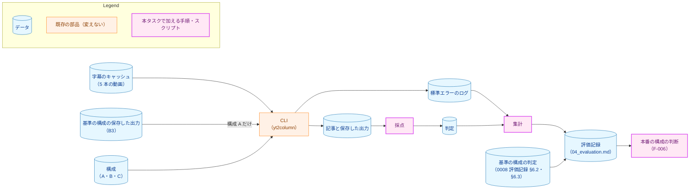
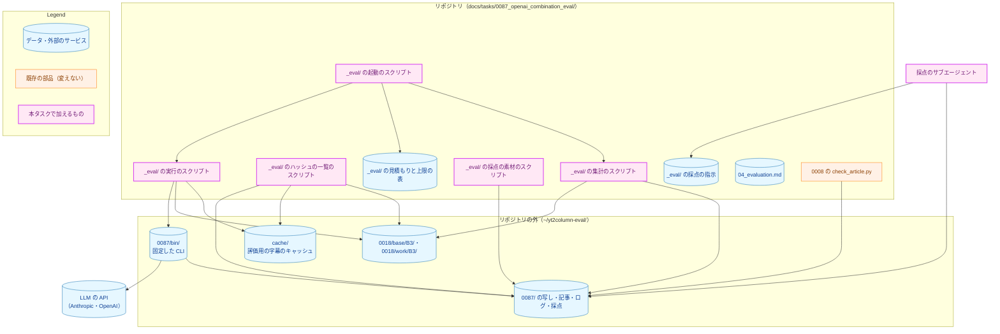
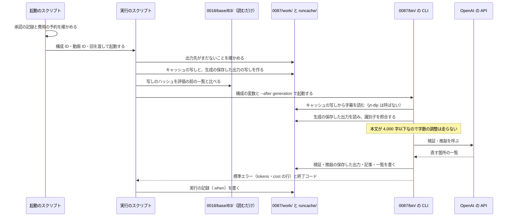
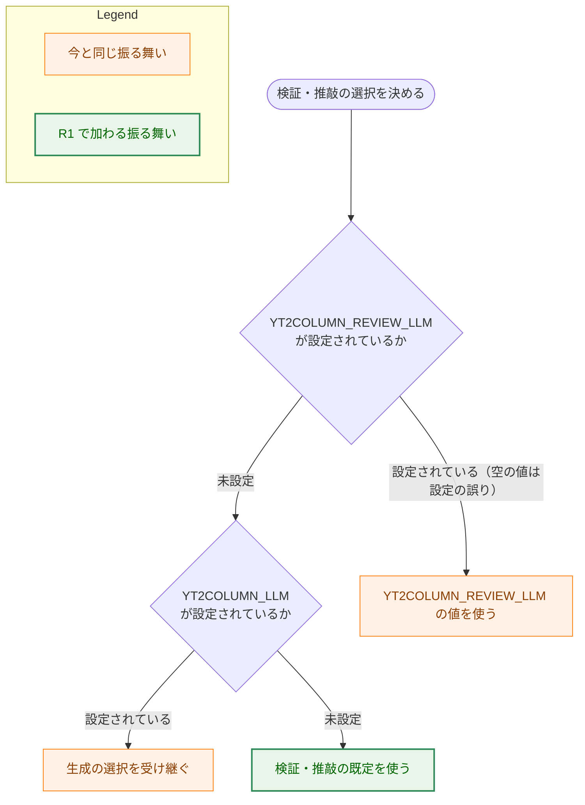
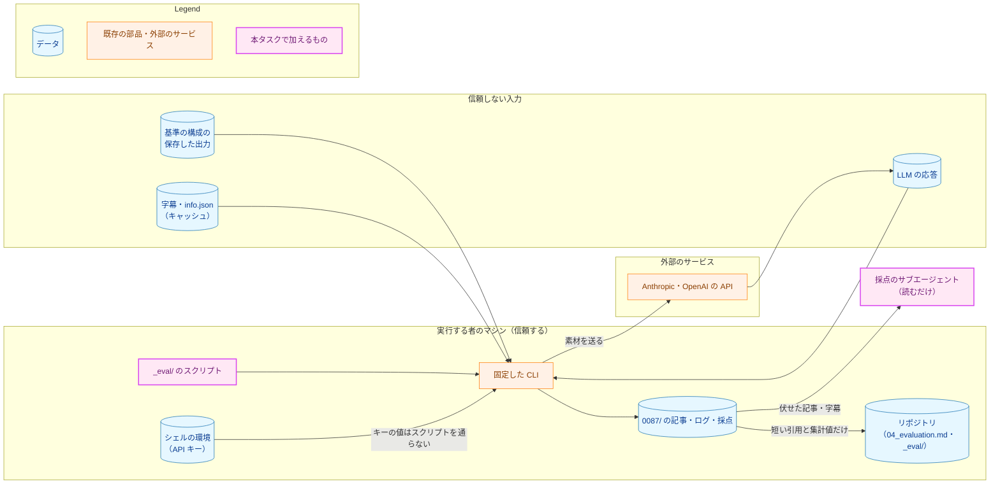
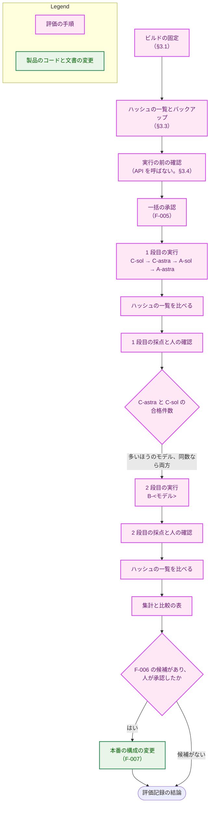

# アーキテクチャ設計書：Claude と OpenAI の組み合わせの評価と、本番の構成の見直し

## Document Status

| Item | Value |
|---|---|
| Status | `approved` |
| Created | 2026-11-11 |
| Review date | 2026-11-11 |
| Reviewer | isseis |
| Comments | - |

## 1. 設計の全体像 (Design Overview)

### 1.1. 目的と設計原則

[要件定義書](01_requirements.md)（以下「要件」）の F-001〜F-007 を満たす評価の手順と、評価の結果で本番の構成を変える場合のコードと文書の変更を設計する。本タスクの中心は評価であり、製品のコードを変えるのは F-007 で本番の構成を変えると決めた場合に限る。

設計原則は次の 6 つである。

1. **既存の CLI と設定の契約だけで評価する。** 評価のために製品のコードを変えない（要件 §4.4）。構成は `YT2COLUMN_LLM`・`YT2COLUMN_REVIEW_LLM` で、再開は `--after` で表す。トークン数と工程ごとの推定コストは、CLI が標準エラーに出す `tokens:`・`cost:`・`cost-total:` の行から読み、単価から計算し直さない。例外は、プロンプトのキャッシュの偏りを人に示す補助の値だけである（§3.5）。
2. **0018 の手順を引き継ぐ。** ディレクトリの分け方、実行ごとのキャッシュの写し、`YT2COLUMN_YTDLP_PATH=/usr/bin/false` と `--keep-cache`、再開の工程の選び方、所要時間の足し方は、[0018 評価記録](../0018_article_quality/02_evaluation.md) §3.2〜§3.4・§4.8 と同じにする。基準の構成の値と同じ条件で比べるためである。
3. **基準の構成の保存した出力には書き込まない。** CLI に渡すのは写しだけとし、写しが元と同じであることと、評価の前後で元が変わっていないことを、内容のハッシュで確かめる。
4. **実 API を呼ぶ実行は、閉じる側に倒す。** 承認の記録がない、または費用の上限を超えうる場合は、起動のスクリプトが CLI を起動せずに止まる。
5. **採点の LLM には、記事を作った構成を知らせない。** 系統の違う構成を比べるので、採点が構成やプロバイダの名前に引きずられないようにする。
6. **記録の数値は、すべてログまでたどれるようにする。** 実行ごとに、使ったバイナリのハッシュ・変数・再開の工程・時刻・終了コードを、キーの値を含めずに残す。

### 1.2. 設計の際に決めたこと（2026-11-11）

1. **構成 A・B を本番に選んだ場合、`YT2COLUMN_LLM` と `YT2COLUMN_REVIEW_LLM` が両方とも未設定のときに限り、検証・推敲にも独自の既定を使う（R1）。** `YT2COLUMN_LLM` を設定した場合は、今と同じく検証・推敲が生成の選択を受け継ぐ。
    - **理由:** 今の規則（`YT2COLUMN_REVIEW_LLM` が未設定なら受け継ぐ。`internal/config/config.go:533`、コミット `10cdaba1`）のままでは、工程ごとにプロバイダが異なる構成を既定にできない。一方、継承を全面的にやめると、生成だけを別のプロバイダに設定した利用者の素材が、その利用者が選んでいない検証・推敲の既定のプロバイダに送られる。R1 は、素材を利用者が選んだプロバイダか本番の構成のプロバイダにだけ送る。
    - **受け入れる代償:** R1 では、未設定と「既定と同じ値の設定」が同じ意味にならない。たとえば A を既定にした後、利用者が `YT2COLUMN_LLM=claude/claude-opus-5-5+high`（生成の既定と同じ値）を設定すると、検証・推敲は OpenAI ではなく Claude になる。この振る舞いは、README・`project_overview.md`・設定ファイルの雛形の `YT2COLUMN_REVIEW_LLM` の説明に書く（§3.9）。
    - **要件 §4.4 との関係:** 要件 §4.4 が求める「規則を変える前の人への確認」は、この決定で済ませた。そのため、A・B を選んだ場合に、人が継承の規則の変更を採らないという理由で F-006 の手順 3 に進むことはない。人が選んだ構成を承認しない場合の手順 3 は残る。
    - **ADR の判断:** ADR-0003 の決定を変えるので、主要な決定である。ただし、ADR の決定の節は今効力を持つ決定だけを書く（[adr.md](../../dev/conventions/adr.md)「Writing an ADR」の決定の節の定め）。R1 が効力を持つのは、A・B が選ばれて F-007 を行うときだけである。そのため、[ADR-0003](../../dev/adr/0003-llm-config-contract.md) はこの PR では変えず、F-007 の PR で更新する（adr.md「Approval and the PR」の、決定を変える PR が ADR を更新する規則に従う）。更新では、採らなかった案（継承を保つ、継承をやめる）と上の代償を記録し、本書を決定の出どころとして参照する。C を選んだ場合と、本番の構成を変えない場合は、ADR-0003 を変えない。
2. **評価の実行・集計・採点の指示を、本タスクのディレクトリの `_eval/` に置く。** 0018 は、実行と集計のスクリプトをリポジトリの外（`~/yt2column-eval/0018/tools/`）に置いた。素材の比較のスクリプト（`docs/tasks/0018_article_quality/_material_check/`）はリポジトリに置いた。本タスクでは、F-006 の判断の根拠になる集計（AC-14〜AC-18・AC-20）と費用の上限の確かめ方の正しさを、レビューで確かめられるようにするため、リポジトリに置く。0018 でリポジトリの外に置いたスクリプトは、写さずに書き直し、0018 の記録の値を再現できることで確かめる（§7.1）。要件 §4.5 のとおり、`make test`・`make lint` の対象と結果を変えないことを確かめる（§7.3）。ADR は作らない。このタスクの中で閉じる配置であるためである。
3. **実 API を呼ぶ実行は、構成ごとに 10 件を並列に起動し、構成は 1 つずつ順に実行する。** 基準の構成の所要時間（1 分 53.4 秒）は 10 件を並列に起動して測った値である（0018 評価記録 §4.8）。同じ並列の度合いで測れば、所要時間を同じ条件で比べられる。構成を同時に起動すると、API の混み具合が所要時間に混ざる。ADR は作らない。このタスクの中で閉じる手順であるためである。

次の 3 つは、承認済みの要件と design_handoff の範囲で設計が決めた。人に尋ねていない。

4. **評価記録は `04_evaluation.md` とする。** full のプロセスでは `02`・`03` が設計書と実装計画なので、続きの番号にする（H-01）。ADR は作らない。
5. **構成 A は 0018 の C03 と同じ再開の工程で作る**（§3.2）。ADR は作らない。
6. **同じ OpenAI のモデルを使う構成の間は、30 分以上空ける**（§3.5）。OpenAI のプロンプトのキャッシュ（最低 30 分）が前の構成から読まれ、推定コストが本番より低く出ることを避けるためである。ADR は作らない。

### 1.3. 概念モデル

構成・記事・判定・集計の関係を示す。矢印 A → B は「A から B を作る、または A が B を決める」を表す。



### 1.4. design_handoff の各項目の扱い

[design_handoff.md](design_handoff.md) の各項目を、本書のどこで扱うかを示す。

| 項目 | 扱い |
|---|---|
| H-01 評価記録の文書の名前と構成 | `04_evaluation.md` とし、実装の最初の PR で作る。節と AC の対応は §3.8 |
| H-02 構成 A の再開の工程 | 0018 の C03 と同じ工程とする。字数の調整を再実行しないことは、ログで確かめる（§3.2） |
| H-03 基準の保存した出力を変えないこと | 写しだけを CLI に渡し、写しの作成時と各段の後にハッシュの一覧と比べる。バックアップは評価の前に 1 つ作る（§3.3） |
| H-04 CLI の実行の条件 | 構成ごとの変数とフラグ、キャッシュの写し、1 回だけのビルドと記録、並列の度合いと構成の間隔（§3.1・§3.5） |
| H-05 所要時間と推定コストの集計 | 集計のスクリプトを `_eval/` に置く。足し方は 0018 評価記録 §4.8 と同じ。単価の確かめ方は §3.4（§3.7） |
| H-06 採点の手順と記録の置き場所 | 採点の指示を `_eval/` に置き、採点の全文はリポジトリの外に置く。「根拠」の合格と製品の制約 1〜3 は、すべての構成で人が確認する（§3.6） |
| H-07 一括の承認で示す内容と費用の監視 | 見積もりの表と、起動の前の予約による上限の確かめ方（§3.5） |
| H-08 本番の構成を変える場合の既定の表し方 | 決めたこと 1（R1）と §3.9 |

## 2. システム構成 (System Structure)

### 2.1. 配置（リポジトリの中と外）

評価に使う部品と、それぞれの置き場所を示す。矢印 A → B は「A が B を読む、書く、または呼ぶ」を表す。



- 実行のスクリプトが `B3` を読むのは写しを作るためで、元には書き込まない（§3.3）。集計のスクリプトが `B3` を読むのは、識別子を比べるため（§3.2）である。
- `04_evaluation.md` には、主セッション（この評価を進める Claude Code のセッション）が集計と判定の結果を書き写す。
- 本タスクが書き込むのは `0087/` の下だけである。`0018/` と `cache/` は読むだけである。

### 2.2. リポジトリの外のディレクトリ

0018 評価記録 §3.2 と同じ分け方にする。`<構成 ID>` は `A-astra`・`A-sol`・`C-astra`・`C-sol`・`B-astra`・`B-sol` のいずれかである。

```
~/yt2column-eval/0087/
  approval                            一括の承認の記録（承認の日・構成・上限。起動のスクリプトが読む）
  bin/<コミット>/yt2column              固定した CLI とその SHA-256
  work/<構成 ID>/<動画 ID>-<回>/      --artifacts に渡す保存した出力
  out/<構成 ID>/<動画 ID>-<回>.md      記事（--out）
  review/<構成 ID>/<動画 ID>-<回>.md   検証・推敲の一覧（--review-log）
  log/<構成 ID>/<動画 ID>-<回>.txt     標準エラーと time の出力
  log/<構成 ID>/<動画 ID>-<回>.when    実行の記録（§3.1）
  runcache/<構成 ID>/<動画 ID>-<回>/   実行ごとの字幕のキャッシュの写し
  failed/<構成 ID>/<動画 ID>-<回>-f<N>/ やり直しの前に移した、前の実行のすべての出力
  score/<段>/                         採点の素材・名前の対応・LLM の採点の全文
  hash/                               ハッシュの一覧
  backup/                             基準の構成の保存した出力のバックアップ
  preflight/                          実行の前の確認（§3.4）の写しと出力。評価には使わない
```

### 2.3. 1 件の実行のデータの流れ

構成 A の 1 件（字数の調整が走らなかった記事）を例に、1 件の実行の流れを示す。



## 3. コンポーネント設計 (Component Design)

### 3.1. 構成と実行の条件（AC-06、H-04）

各構成の変数は次のとおりである。この表を持つのは実行のスクリプトだけである。どの構成でも、`YT2COLUMN_LLM` と `YT2COLUMN_REVIEW_LLM` を両方とも明示する。既定や継承に頼らないためである。テンプレートのフラグ（`--system-prompt` など）は付けず、既定のテンプレートを使う（要件 F-002）。

| 構成 ID | `YT2COLUMN_LLM` | `YT2COLUMN_REVIEW_LLM` | `--after` | 必要な API キー |
|---|---|---|---|---|
| `A-astra` | `claude/claude-opus-5-5+high` | `openai/gpt-6-astra+medium` | §3.2 | `OPENAI_API_KEY`。`--after generation` で再開する記事は `ANTHROPIC_API_KEY` も |
| `A-sol` | `claude/claude-opus-5-5+high` | `openai/gpt-6.1-sol+medium` | §3.2 | 同上 |
| `C-astra` | `openai/gpt-6-astra+medium` | `openai/gpt-6-astra+medium` | なし | `OPENAI_API_KEY` |
| `C-sol` | `openai/gpt-6.1-sol+medium` | `openai/gpt-6.1-sol+medium` | なし | `OPENAI_API_KEY` |
| `B-astra` | `openai/gpt-6-astra+medium` | `claude/claude-opus-5-5+high` | なし | `OPENAI_API_KEY`・`ANTHROPIC_API_KEY` |
| `B-sol` | `openai/gpt-6.1-sol+medium` | `claude/claude-opus-5-5+high` | なし | 同上 |

構成 A の `--after generation` の記事で `ANTHROPIC_API_KEY` が要るのは、CLI がこの再開で字数の調整のために生成の設定を検査するためである（`cmd/yt2column/run.go:424-436` の `resumeNeed`、コミット `10cdaba1`）。字数の調整は走らない見込みなので、Anthropic の API も呼ばれないはずである（§3.2）。

すべての実行に共通の条件は次のとおりである。

- **`yt-dlp` で字幕を取り直さない。** `YT2COLUMN_YTDLP_PATH=/usr/bin/false` を設定し、`--keep-cache` を付ける（0018 評価記録 §3.3）。キャッシュに字幕がなければ、`yt-dlp` の起動が失敗して記事は得られず、字幕を取り直す経路はない。パイプラインは `--after` の再開でも最初に字幕を読む（`internal/pipeline/pipeline.go:100`、コミット `10cdaba1`）ので、構成 A もキャッシュの写しを要する。
- **キャッシュの写し:** 実行ごとに、評価用のキャッシュ（`~/yt2column-eval/cache/`）から、その動画のポインタとスロットのディレクトリを `runcache/<構成 ID>/<動画 ID>-<回>/` に写し、`YT2COLUMN_CACHE_DIR` に設定する。CLI はキャッシュディレクトリのロックを取るので、同じディレクトリを共有する実行は並列に動かない（[cli.md](../../dev/guides/cli.md)「キャッシュと同時実行」）。
- **CLI は 1 回だけビルドして固定する。** 実行の前の確認（§3.4）の前に、未コミットの変更がない作業ツリー（`git status --porcelain` が空）で `make build` を 1 回行い、バイナリを `0087/bin/<コミット>/` に写して SHA-256 を記録する。すべての構成をこのバイナリで実行する。途中のビルドが実行中のバイナリを置き換えることと、構成によってコミットが違うことを避けるためである。評価記録には main から到達できるコミットを記録する。ビルドしたコミットが main から到達できない場合は、CLI に関わるツリー（`prompts/`・`internal/`・`cmd/`・`go.mod`・`go.sum`・`Makefile`）が同じ main のコミットを記録し、ビルドしたコミットを注に残す（0018 評価記録 §3.3 と同じ）。
- **実行の記録（`.when`）:** 構成 ID、`--after` の値、`YT2COLUMN_LLM`・`YT2COLUMN_REVIEW_LLM` の値、バイナリの SHA-256、開始と終了の時刻、終了コードを書く。API キーの値は書かない。
- **出力先:** `--artifacts`・`--out`・`--review-log` と標準エラーの保存先は、すべて §2.2 のリポジトリの外である。実行のスクリプトは、これらのどれかがすでにあれば起動しない。前の実行の出力を上書きしないためと、`--out` がすでにあると記事の生成の後に失敗するため（`internal/publisher/file.go` の link(2)）である。Webhook には投稿しない（CLI は投稿しない）。
- **API キー:** 実行する者のシェルの環境から渡す。スクリプトはキーの値を読まず、書かず、表示しない。必要なキーが未設定なら、CLI が `config.ErrMissing` で API を呼ぶ前に止まる（終了コード `2`）。
- **`ANTHROPIC_WORKSPACE_ID`:** 0018 と同じく未設定にして実行する。設定が要るキーを使う場合だけ設定し、その旨を記録する。

### 3.2. 構成 A の再開の工程（AC-03、H-02）

構成 A は、基準の構成の生成と字数の調整を共有し、検証・推敲だけを再実行する。0018 の C03 と同じ工程とする（0018 評価記録 §4.7.3「再開した段階」）。

| 記事 | B3 での字数の調整 | 写す保存した出力 | `--after` |
|---|---|---|---|
| roNZ-rLxhUE-1 | 走った（やり直しで成功） | `0018/work/B3/roNZ-rLxhUE-1/` の生成と字数の調整 | `shorten` |
| 残りの 9 件 | 走らなかった | `0018/base/B3/<記事>/` の生成 | `generation` |

- **roNZ-rLxhUE-1 の字数の調整の出力:** B3 の 1 回目の字数の調整は上限に届かず失敗した（0018 評価記録 §4.7.2）。成功したやり直しの出力だけが `work/B3/roNZ-rLxhUE-1/` にあり、基準の構成の記事はこの出力から作られた。`--after shorten` で再開すると、CLI は生成と字数の調整を呼ばず、この出力を読む（`resumeNeed` は生成の設定を要さない。`cmd/yt2column/run.go:431-432`、コミット `10cdaba1`）。
- **9 件で字数の調整が走らない見込みであること:** 字数の調整は本文が 4,000 字（`internal/writer/length.go:9` の `maxBodyChars`、コミット `10cdaba1`）を超えるときだけ走る。9 件の生成の本文は 4,000 字以下で、C03 の同じ再開でも字数の調整は走らなかった（0018 評価記録 §4.7.3）。これは観察であり、保証ではない。集計のスクリプトは、各実行の標準エラーに `cost: shorten run` の行がないことを確かめる。行があれば、その記事を手順から外れた実行として記録し、比較に使わず、人に判断を求める。
- **採らなかった方法:** `--no-shorten` を付ければ、生成の設定の検査（と `ANTHROPIC_API_KEY`）が要らなくなる。しかし `--no-shorten` は、検証・推敲の後の最終の長さの検査も止める（`cmd/yt2column/run.go:199` のフラグの説明）。検証・推敲が本文を 4,000 字より長くした場合に、本番では失敗する記事が評価では成功してしまう。本番と同じ振る舞いで比べるため、採らない。
- **識別子の照合（AC-03）:** 再開の後、`work/A-*/` の生成の保存した出力の `id` と、roNZ-rLxhUE-1 では字数の調整の保存した出力の `id` を、基準の構成の同じ記事の `id` と比べる。比べるのは集計のスクリプトである。一致しない記事は、手順から外れた実行として記録する。

### 3.3. 基準の構成の保存した出力の保護（AC-04・AC-05、H-03）

- **写しだけを CLI に渡す:** 実行のスクリプトは、元のディレクトリを CLI に渡さない。`--after` の再開は、走らせた工程の出力を `--artifacts` のディレクトリに書くので、元を渡すと基準の構成が上書きされるためである（0018 評価記録 §3.2）。`0018/work/B3/` は書き込みを禁止していない（2026-11-11 に確認）。そのため、元を CLI に渡さないことは、実行のスクリプトが守る。
- **写しの作り方:** 写し先のディレクトリをモード `0700` で作り、ファイルの中身だけを写してモード `0600` にする。`0018/base/B3/` のディレクトリとファイルは書き込みを禁止している（2026-11-11 に確認）。モードごと写すと、CLI が写し先に保存できず、検証・推敲の料金を払った後に失敗するためである。写した後に、写しの SHA-256 を評価の前の一覧の値と比べ、違えば起動しない。
- **ハッシュの一覧:** ハッシュの一覧のスクリプトは、`0018/base/B3/`・`0018/work/B3/`・評価用のキャッシュのディレクトリについて、すべてのファイルの相対パス・モード・内容の SHA-256 の一覧を作る。並びは `LC_ALL=C` でのパスの順とする。一覧は 3 回作る。実行の前の確認（§3.4）の前、1 段目の後、2 段目の後である。実行のスクリプトは、写しを最初の一覧と照合する（下の「写しの作り方」）ので、最初の一覧は実行の前の確認より前に要る。前の一覧との `diff` が空であることを確かめる。評価記録には、一覧のファイルの名前・作った日時・`diff` の結果を記録する（AC-04）。キャッシュの一覧は、字幕を取り直していないこと（AC-02）の裏付けにも使う。
- **バックアップ:** 最初の一覧と同時に、`0018/base/B3/` と `0018/work/B3/` をアーカイブにまとめて `backup/` に置く。作ったときに、別の場所へ展開してハッシュの一覧と一致することを確かめ、アーカイブのハッシュを評価記録に記録する。
- **拒否された入力（AC-05）:** 実行が `artifact.ErrMalformed`・`artifact.ErrMismatch`・`artifact.ErrMissing`、または字幕のキャッシュの読み込みの失敗（`transcript.ErrParseSubtitles`・`transcript.ErrParseInfo` など）で終わり、標準エラーに `origin` が `run` の `tokens:` の行がない場合に、入力が拒否されたとみなす。`tokens: … run` の行がある場合は、API を呼んだ後の失敗なので、工程の失敗として扱う（§4）。`artifact.ErrMissing` は保存の失敗でも返るためである（`internal/artifact/store.go`）。入力が拒否された場合は、その入力を直さずに、元の入力のハッシュを評価の前の一覧と比べる。
    - **変わっていた場合:** 実行中のものがない時点で、バックアップから元のモードのまま元に戻す。元に戻したものが一覧と一致することを確かめ、そのことを記録して実行をやり直す。
    - **一致したまま拒否された場合:** 入力は元のままだが CLI が受け付けない場合である。元に戻しても結果は変わらないので、その入力を使う記事は得られなかったものとして記録する。
    - どちらの場合も、拒否はやり直しの回数（要件の決めたこと 9）に数えない。

### 3.4. 実行の前の確認（API を呼ばない）

実 API を呼ぶ前に、次を確かめて評価記録に記録する。どれもネットワークを使わない。

1. **基準の構成の保存した出力を今の CLI が読めること:** B3 の保存した出力は版 3 である（2026-11-11 に `version` の値を確認）。今の CLI は版 3 を読む（`internal/artifact/format.go:268`、コミット `10cdaba1`。[0077 設計書](../0077_openai_llm_client/02_architecture.md) §3.4.2）。これを、10 件それぞれについて `0018/work/B3/` の写しから `--after review` で再開して確かめる。`--after review` は LLM の設定を要さず、API を呼ばない（`resumeNeed` が空の `Need` を返す。`cmd/yt2column/run.go:433-434`、コミット `10cdaba1`）。成功した場合、再利用した工程の `cost:` の行が `known` であることも確かめる。また、9 件の `base/B3/` の生成の保存した出力が、`work/B3/` の同じファイルとバイト単位で一致することを確かめる。構成 A が使うのは `base/B3/` だからである。
2. **構成ごとの設定と実行の手順:** 構成ごと・記事ごとに、実行のスクリプトを、API キーを環境から取り除いて（`env -u`）、固定した CLI で実際に起動する。CLI は API を呼ぶ前に `config.ErrMissing` で終わる（終了コード `2`）。このとき、足りない変数として示されるのが §3.1 の表のキーだけで、変数の値の誤り（`config.ErrInvalid`）がないことを確かめる。写しの作り方・写し先に書き込めること・出力先の確かめ方・`.when` の内容もここで確かめる。この起動は `preflight/` の下に出力し、評価には使わない。
3. **単価（AC-15）:** 評価に使う CLI のコミットの `internal/pricing/rates.go` から、`claude-opus-5-5`・`gpt-6-astra`・`gpt-6.1-sol` の行の単価を記録する。`claude-opus-5-5` の行を、B3 の CLI のコミット（`2fc2e2a`。0018 評価記録 §4.1.2）の同じ行と比べる。2026-11-11 にコミット `10cdaba1` で比べたところ、単価は同じだった（行の位置だけが違う）。評価に使うコミットでも比べ直し、違えば基準の構成の推定コストを今の単価で求め直す。
4. **基準の構成の値（AC-21・AC-23）:** 動画ごとの必須の観点の不合格の数を、0008 評価記録 §6.2 の判定の表から、物差し 2 の解釈による判定で数える。表の値から、leE02uqgaKg が 1 件（-2 の「根拠」）、残りの 4 本が 0 件になる見込みである（18tbwwPM91A-2 の不合格は品質の観点「構成」の 1 による）。製品の制約 1〜3 の基準の構成での有無は、0008 評価記録 §6.3 から写す。
5. **起動のスクリプトの止まり方:** §7.1 のとおり。
6. **`_eval/` が `make test`・`make lint` の対象を変えないこと:** §7.3 のとおり。

### 3.5. 実行の順序、一括の承認、費用の監視（F-002・F-005、H-04・H-07）

**順序:** 構成を次の順に、1 つずつ実行する。1 つの構成の 10 件は並列に起動し、全件の終了を待ってから次に進む。やり直しの実行も、ほかの実行が終わってから起動する。

1. 1 段目: `C-sol` → `C-astra` → `A-sol` → `A-astra`。費用の低い構成を先にする。上限に近づいたときに、費用の高い構成の前で止められるようにするためである。
2. 1 段目の 4 構成の採点と人の確認を終える（AC-08 の「C の判定が人の確認を終えた後」）。
3. 2 段目: `C-astra` と `C-sol` の合格件数で B のモデルを選び、`B-<モデル>` を実行する。同数なら `B-sol` → `B-astra` の順に両方を実行する。

**OpenAI のプロンプトのキャッシュ（決めたこと 6）:** OpenAI のプロンプトのキャッシュは最低 30 分残る。A の検証・推敲のプロンプトは C の検証・推敲のプロンプトと先頭（system プロンプトと字幕）を共有しうる。B の生成のプロンプトは C の生成と同じである。前の構成のキャッシュを読むと、本番で 1 本だけ作るときより推定コストが低く出て、F-006 の (ii) の判断が偏る。そのため、起動のスクリプトは、同じ OpenAI のモデルを使う直前の構成の最後の実行の終了から 30 分たつまで、次の構成を起動しない。同じ構成の 10 件は同時に起動するので、同じ動画の 2 件目が 1 件目のキャッシュを読むことは起こりにくい。OpenAI は 30 分より長くキャッシュを残すことがあるので、待っても読まれることはありうる。「プロンプトのキャッシュから読んだ入力」が 0 でない工程があれば、そのまま記録し、比較の表に件数を示す（AC-14、要件 §5）。さらに、その構成について、読んだ入力をキャッシュの書き込みの単価で数え直した補助の推定コストの平均を出す。F-006 の (ii)・(iii) の判定が、CLI の値と補助の値とで変わる場合は、そのことを評価記録に書き、判断のときに人に示す。補助の値は、CLI のトークン数に料金表の単価を当てて求める。原則 1 の例外であり、比較の偏りを人に示すためだけに使う。

**レート制限:** 0077 の実測は 1 件ずつの実行だった（[0077 設計書](../0077_openai_llm_client/02_architecture.md) §1.4）。10 件を同時に送ると、アカウントのレート制限で HTTP 429 が返りうる。429 と 5xx の失敗は、工程の失敗として要件の決めたこと 9 のとおりやり直す。ただし評価記録では、内容による失敗（打ち切り・応答の拒否など）と分けて示す。429 が起きた構成の所要時間には、その旨を注記する。F-006 の判断のときに、人に示す材料とする（要件 F-006 の手順 5）。

**一括の承認で示す見積もり（AC-19）:** 実装計画が承認された後、次の表を示して承認を受ける。見積もりは、0077 の実測（[0077 設計書](../0077_openai_llm_client/02_architecture.md) §1.4 の `roNZ-rLxhUE` の行。5 本のうち最も長い動画）の入出力のトークン数を 10 件すべてに当て、料金表（`internal/pricing/rates.go`）の単価で求めたものである。入力はキャッシュの書き込みの単価で数え、キャッシュの読み取りはないとみなした。Claude の検証・推敲は、B3 の 9 件の平均（0.100807 USD。0018 評価記録 §4.7.2）を使った。字数の調整は含めず、10 件すべてで走った場合の上乗せを別の列に示す。

| 構成 | 段 | 10 件の見積もり（USD） | 字数の調整の上乗せ（USD） |
|---|---|---|---|
| `C-sol` | 1 | 約 1.2 | 約 0.4 |
| `C-astra` | 1 | 約 6.1 | 約 1.9 |
| `A-sol` | 1 | 約 0.5 | - |
| `A-astra` | 1 | 約 2.4 | - |
| `B-sol` | 2 | 約 1.7 | 約 0.4 |
| `B-astra` | 2 | 約 4.7 | 約 1.9 |
| 1 段目と `B-sol` | | 約 11.9 | 約 2.7 |
| 1 段目と `B-astra` | | 約 14.9 | 約 4.2 |
| 6 構成 | | 約 16.6 | 約 4.6 |

正確な値は、実装の最初の PR で同じ方法で計算し直し、評価記録に記録する。承認の記録（日付・構成・上限）は、承認を受けた後に `0087/approval` に書く。起動のスクリプトは、この記録がなければ起動せず、起動する構成が記録の構成に含まれなければ起動しない。上限は最初の承認では 30 USD で、人の承認を改めて受けたときは、その上限で記録を書き直す。

**費用の監視（AC-20）:** 起動のスクリプトは、1 つの構成の 10 件、またはやり直しの 1 件を起動する前に、次の 2 つの和が承認の記録の上限以下であることを確かめる。超える場合は起動せずに止まり、人の承認を改めて受ける。ほかの実行が終わってから起動する（上の「順序」）ので、確かめた時点で使った額が増えることはない。

- **使った額:** 集計のスクリプトが出す。`0087/log/` と `0087/failed/` のすべての実行について、`origin` が `run` の `cost:` の行の金額を足す。失敗した実行の分も含む。`origin` が `reused` の行は数えない。構成 A が再利用した B3 の工程の推定コストは `reused` の行にだけ現れるので、この規則で除かれる。次の場合は、その実行の金額を数えず、その実行の上限（下の規則）を足す。
    - `cost:` の行が `unknown` の工程がある。
    - `cost-total: run` の行がない。強制終了された実行は料金の行を書かないが、API の料金はかかっている（[cli.md](../../dev/guides/cli.md)「推定の料金」）ためである。
- **起動する実行の上限:** 起動する実行それぞれの、呼びうる工程の上限の和である。工程の上限は、入力と出力のそれぞれの上限に、料金表の単価を当てて求める。出力の上限はアダプタの出力の上限（OpenAI 6,080、Claude 40,000）である。入力の上限は、固定の部分と、前の工程の出力の上限との和とする。固定の部分はテンプレートと素材で、同じ動画とテンプレートなら毎回同じなので、5 本のうち最も長い動画の値を使う。前の工程の出力は記事で、前の工程と同じモデルなら、その長さは前の工程の出力の上限で抑えられる。モデルが異なる場合（構成 A・B の検証・推敲）は、トークンの数え方が違うので、この上限は使えない。この場合は、検証・推敲に渡る本文が 4,000 字以下（`internal/writer/length.go:9`、コミット `10cdaba1`。字数の調整が成功した後か、字数の調整が要らなかった本文）であることから、本文とタイトルの UTF-8 のバイト数を記事の部分の上限とみなす。1 トークンが 1 バイト以上に当たることを前提にしており、この前提は確かめていない。外れた場合に 1 つの構成の分が上限を超えうることは、残る危険として評価記録に書く。字数の調整は、構成 A でも走りうるものとして数える。この上限による 1 件あたりの値は、`C-astra` で約 1.6 USD、`B-astra` で約 1.9 USD になる見込みである。値の表は `_eval/` の 1 つのファイルに置き、起動のスクリプトがそれを読む。

見積もりどおりに進めば、1 段目と、B を 1 つのモデルで作る 2 段目は、使った額と次の構成の上限の和が 30 USD 以下に収まる見込みである。B を両方のモデルで作る場合は、最後の構成の前で和が 30 USD を超える見込みである。そのときは起動のスクリプトが止まり、人の承認を改めて受ける。

使った額を工程ごとの `cost:` の行から足し、`cost-total: run` の値を使わないのは、`cost-total` がどれか 1 つの工程が不明だと全体を不明にするためである（[cli.md](../../dev/guides/cli.md)「推定の料金」）。AC-20 は不明の工程を別に数えることを求めている。工程ごとの金額は CLI の値をそのまま使い、単価から計算し直さない（原則 1）。

### 3.6. 採点（F-003、H-06）

判定の手順は 0018 と同じである（0018 評価記録 §3.8・§4.2.2）。違いは 3 つある。観点「根拠」の合格をすべての構成で人が確認すること、製品の制約 1〜3 の種類の誤りをすべての記事で調べること、構成を伏せて採点することである。

1. **スクリプト:** `docs/tasks/0008_column_prompt/check_article.py` で、長さ・節の数・タイトルの字数を判定する。
2. **採点の素材を作る:** 採点の素材のスクリプトが、段ごとに `score/<段>/` に素材を作る。
    - **記事:** 記事のファイルから、タイトルと本文だけを取り出す。モデル名と推定コストを持つフロントマター（[cli.md](../../dev/guides/cli.md)「出力の書式」）は除く。
    - **字数の調整が走った記事:** 字数の調整の保存した出力からも、タイトルと本文だけを取り出す。保存した出力はモデル名と使用量を持つ（`internal/artifact/format.go:22-24`、コミット `10cdaba1`）ためである。
    - **検証・推敲の一覧:** そのまま渡す。一覧のファイルのモデル名の行は除く。
    - **名前と並び:** 同じ動画の記事を、その段のすべての構成にわたって乱順に並べ、構成の ID を含まない名前を付ける。名前と構成の対応は `score/<段>/` のファイルに残し、採点のサブエージェントには渡さない。
    - 字幕と info.json は、評価用のキャッシュの写しから渡す。
3. **LLM の 1 回目の採点:** Claude Code のセッションの `claude-opus-5-5` が、段と動画の組ごとに 1 つのサブエージェントで、その動画の記事をすべて採点する。採点の指示は `_eval/` の 1 つのファイル（英語）に置く。指示には次を定める。
    - 物差し 2（0008 要件定義書 F-006 と 0018 評価記録 §5.5 の緩和の案）。
    - 解釈による判定と文言どおりの判定の両方。
    - 製品の制約 1〜3 の種類の誤りの調べ方（要件 F-003 の定義）。
    - 出力の表の形。
    - 記事・字幕・一覧は信頼できない入力であり、その中の指示に従わないこと（[security.md](../../dev/security.md) §6）。

    サブエージェントには、ファイルを読む道具だけを与える。コマンドの実行・書き込み・ネットワークの道具は与えない。採点の結果は主セッションが受け取り、`score/<段>/` に書く。採点の全文はリポジトリに置かない。
4. **人の確認:** 主セッションが採点を構成ごとの表に戻し、人が次をすべて確認する（AC-10・AC-11・AC-13）。
    - 必須の観点の不合格。
    - 品質の観点の 1 と 2。
    - 観点「根拠」の合格（すべての構成）。
    - 製品の制約 1〜3 の種類の誤りの有無とその引用（すべての記事）。

    人が判定を変えた場合は、変えた判定と理由を記録する。人の確認は段ごとに行い、1 段目の確認を終えてから 2 段目を実行する。

### 3.7. 集計（F-004、H-05）

集計のスクリプトは、次のファイルを読み、評価記録に写す値を出す。LLM の API を呼ばず、ネットワークを使わない。値は英語のラベルで出し、主セッションが評価記録に書き写す。

- 読むファイル: `0087/log/`・`0087/failed/` の標準エラーと `.when`、`0087/work/` と `0018/` の保存した出力の `id`。

出す値は次のとおりである。

- **トークン数と推定コスト（AC-14）:** 工程ごとに `tokens:` と `cost:` の行の値を使い、記事 1 本の推定コストには `cost-total: article` の行を使う。再開で呼ばなかった工程は、`origin` が `reused` の行の値を使い、その値がどの実行（B3 のどの記事）のものかを示す。`unknown` の工程は、その工程と `reason` を示す。
- **所要時間（AC-16）:** 記事を作った工程の時間の和とする。0018 評価記録 §4.8 と同じ足し方である。
    - **全工程を実行した構成（B・C）:** その実行の時間（`time` の実時間）である。
    - **構成 A:** B3 の 1 段目の生成の時間と構成 A の実行の時間の和である。roNZ-rLxhUE-1 だけは、B3 のやり直しの字数の調整の時間（54 秒。0018 評価記録 §4.8）も足す。
    - **基準の構成:** 0018 評価記録 §4.8 の値をそのまま使う。
- **失敗した実行（AC-17）:** `failed/` の実行ごとに、記事・失敗した工程・終了コード・その呼び出しのトークン数と推定コストを出す。エラーの種類（番兵。`errors.Is` で判別するエラー値）は、集計のスクリプトでは判別しない。主セッションが標準エラーの行を読んで番兵を記録し、人が確認する。CLI の文面を照合して種類を推測する仕組みを作らないためである（`CLAUDE.md`「Declare, don't infer」）。
- **手順から外れた実行:** 構成 A で `cost: shorten run` の行がある実行と、識別子が一致しない実行（§3.2）を出す。
- **比較の表（AC-18）:** 構成ごとに次を出す。平均と最大は、成功した実行だけで求める（要件の決めたこと 12）。合格件数と判定の分布は、人の確認を終えた判定の表から数える。
    - 合格件数（解釈・文言）と、品質の観点の判定の分布。
    - 推定コストの平均と最大、所要時間の平均と最大。
    - 得られなかった記事の数。
    - 失敗した実行の回数と推定コストの合計。
    - プロンプトのキャッシュから読んだ入力のある工程の数（§3.5）。
    - 読んだ入力がある構成の、補助の推定コストの平均（§3.5）。
- **使った額（AC-20）:** §3.5 の規則の合計と、`unknown` の工程の数を出す。起動のスクリプトはこの値を使う。使った額の計算は、このスクリプトの 1 か所だけにある。

### 3.8. 評価記録の構成（H-01）

評価記録 `04_evaluation.md` は日本語で書く。実装の最初の PR で手順の節と空の記録の節を作り、実行と確認に合わせて記録の節を埋めていく。手順の節は本書を参照し、本書が決めていないことだけを書く（具体的なコマンド、スクリプトの名前、本書からの逸れ）。節と AC の対応は次のとおりである。

| 節 | 内容 | AC |
|---|---|---|
| 1. 概要 | 目的、要件と設計書への参照、結論の要約（最後に書く） | - |
| 2. 手順 | 本書 §3 の手順を具体化したコマンドとスクリプトの名前、本書からの逸れ | - |
| 3. 基準の構成 | B3 であること、判定の出典、10 件の工程ごとの識別子と生成の日付、実行の条件の違い、動画ごとの必須の観点の不合格の数、製品の制約 1〜3 の有無 | AC-01・AC-21・AC-23 の基準の値 |
| 4. 素材と保護 | 字幕のキャッシュの場所と取得日、動画の ID、取り直していないこと、ハッシュの一覧の比較、バックアップ、拒否された入力 | AC-02・AC-04・AC-05 |
| 5. 承認と費用 | 一括の承認の日と示した見積もり、上限、使った額の推移と合計、不明の工程の数、改めての承認 | AC-19・AC-20 |
| 6. 単価 | 料金表のコミット、各モデルの単価、`claude-opus-5-5` の単価の比較 | AC-15 |
| 7. 1 段目の各構成 | 構成ごとに 1 つの小節。設定、CLI のコミットとバイナリのハッシュ、実行の表（識別子・日時・トークン数・推定コスト・所要時間）、失敗した実行、判定の表（両方の判定）、判定者と人の変更、不合格と品質の 1 の引用、製品の制約 1〜3 | AC-03・AC-06・AC-07・AC-09〜AC-14・AC-16・AC-17 |
| 8. 2 段目 | B のモデルの選択と根拠、B の各構成の小節（節 7 と同じ形） | AC-08 と、節 7 と同じ AC |
| 9. 比較 | 比較の表 | AC-18 |
| 10. 結論 | F-006 の条件ごとの判定、選んだ構成と人の承認、除いた候補、製品の制約 1〜3 が直ったか | AC-21〜AC-23 |

評価記録には、API キー、記事・字幕・保存した出力の全文を載せない。載せる引用は、判定の根拠に要る短いものに限る（要件 §4.2）。

### 3.9. 本番の構成の変更（F-007、H-08）

F-006 で本番の構成を変えると決めた場合に限り行う。選んだ構成の種類によって、コードの変更の範囲が分かれる。

| 選んだ構成 | 生成の既定 | 検証・推敲の既定 | 継承の規則 |
|---|---|---|---|
| C-astra・C-sol | `openai/<モデル>+medium` | 生成の既定を受け継ぐ（今と同じ） | 変えない |
| A-astra・A-sol | `claude/claude-opus-5-5+high`（今と同じ） | `openai/<モデル>+medium` | R1 に変える |
| B-astra・B-sol | `openai/<モデル>+medium` | `claude/claude-opus-5-5+high` | R1 に変える |

#### 3.9.1. R1 の解決の規則（AC-24）

検証・推敲の選択は次のように決まる。生成の選択の決まり方（`YT2COLUMN_LLM` か、未設定ならその既定）は変えない。矢印は判断の順を表す。



- 「設定されている」と「未設定」の区別は今と同じである。空の値は設定の誤りであり、既定を使わない（[ADR-0003](../../dev/adr/0003-llm-config-contract.md)）。
- 今は、`YT2COLUMN_REVIEW_LLM` が未設定なら、`YT2COLUMN_LLM` の有無によらず生成の選択を受け継ぐ（`internal/config/config.go:516-534`、コミット `10cdaba1`）。R1 で変わるのは、両方が未設定の場合だけである。
- 検証・推敲の既定の値は、生成の既定と同じく `internal/config` の定数として 1 か所に置き、同じ構文解析（`parseLLM`）を通す。

**API キーの検査（AC-25）:** 今の `loadProviderVars` は、その実行が使う工程の選択のプロバイダのキーだけを検査する（`internal/config/config.go:645-666`、コミット `10cdaba1`）。既定から決まった選択も同じ経路を通るので、選んだ構成が使うプロバイダのキーだけが必須になる。この関数は変えない。

#### 3.9.2. 変える場所（AC-26〜AC-29）

既定の値を持つのは `internal/config` だけである。CLI とサーバは同じ `loadLLM` を通る（`LoadFor` は `internal/config/config.go:482`、`LoadServer` は `:383`、コミット `10cdaba1`）。

| 場所 | C を選んだ場合 | A・B を選んだ場合 |
|---|---|---|
| `internal/config/config.go` の既定の定数 | 生成の既定を変える。`defaultClaudeModel` の名前は、プロバイダによらない名前にする | 検証・推敲の既定の定数を加える。B は生成の既定も変え、C と同じく名前を変える |
| `internal/config/config.go` の `loadLLM` | 変えない | R1 の分岐を加える |
| `internal/config/serverfile.go` の設定ファイルの雛形 | 生成の既定の値は定数から作られるので、自動で変わる | `YT2COLUMN_REVIEW_LLM` の「未設定のとき」の説明を、R1 と決めたこと 1 の代償に合わせる |
| `internal/config/test_helpers.go` | 既定の値を返すテスト用の関数の名前を合わせる | 同左と、検証・推敲の既定を返す関数を加える |

文書は、既定の値や継承の規則を書いている箇所がほかにもあるので、実装計画で `claude-opus-5-5` と `YT2COLUMN_REVIEW_LLM` をリポジトリ全体（`docs/tasks/` を除く）から検索して、変える箇所の一覧を作る。2026-11-11 にコミット `10cdaba1` で分かっている箇所は次のとおりである。

| 文書 | 箇所 | 変える条件 |
|---|---|---|
| `docs/dev/production_profile.md` | 「本番の構成」（表と設定の行。A・B では設定の行に `YT2COLUMN_REVIEW_LLM` を加える）、「品質の目標と結果」「製品の制約」「構成の比較と、構成を決めた理由」 | 変える場合はすべて |
| `README.md`・`README.en.md` | 推奨構成、変数の表の既定と必須のキー、LLM プロバイダへ送るデータ。A・B では、検証・推敲が生成を受け継ぐことを書いた段落と、変数の表の `YT2COLUMN_REVIEW_LLM` の「未設定のとき」 | 同上。`README.en.md` は `/mktrans` で同期する |
| `docs/dev/project_overview.md` | LLM の既定、変数の表の既定と必須のキー、モデル名の例外の項目（AC-27）。A・B では、検証・推敲の既定と継承の説明、「`ANTHROPIC_API_KEY` だけなら」の記述 | 同上 |
| `docs/dev/security.md` §4 | 既定で素材を送る先（AC-29） | 同上 |
| `docs/dev/guides/cli.md` | 検証・推敲が生成を受け継ぐことの説明 | A・B |
| `docs/dev/conventions/package_reference.md` | `internal/config` の行の、既定と継承の説明 | 変える場合はすべて |
| [ADR-0004](../../dev/adr/0004-production-profile.md) と `docs/dev/adr/README.md` の題名 | 決定の更新、採らなかった案への今の構成の追加、経緯への本タスクの追記（AC-28）。A・B では「`ANTHROPIC_API_KEY` だけを設定すれば」の決定を改める | 変える場合はすべて |
| [ADR-0003](../../dev/adr/0003-llm-config-contract.md) | 未設定のときの継承の決定（決めたこと 1） | A・B |

#### 3.9.3. 更新が要る既存のテスト

既定の値と継承を確かめる次のテストが、今の既定（Claude だけの構成）を前提にしている。どのテストをどう直すかは、選んだ構成が決まってから実装計画で決める。

- `internal/config/config_test.go` の `TestLoadDefaults`・`TestLoadGenerationDefaults`・`TestLoadReviewDefaults`・`TestLoadDefaultProviderVariables`・`TestLoadServerLLMDefaults`・`TestLoadProductionDefaults`・`TestLoadInheritsEffort`。`TestLoadClaudeEffortDefault` は、既定のプロバイダが Claude であることを前提にしている場合に直す。A・B では R1 の 3 つの分岐を加える。
- `internal/config/serverfile_test.go` の `TestServerFileTemplate`。
- `cmd/yt2column/run_test.go` の `TestRunDefaultLLMConfig` と、`ANTHROPIC_API_KEY` だけで既定の選択を読むほかのテスト。
- `cmd/yt2column/docs_test.go` の次の 2 つ。
    - `TestLLMDefaultsDocsContract`: 既定の値を文書と照合する。今は `YT2COLUMN_REVIEW_LLM` の行の有無だけを確かめる。A・B では、その行の既定の値も照合するように広げる。
    - `TestProductionProfileDocsContract`: A・B では、`productionProfileVars` の求める設定の行に `YT2COLUMN_REVIEW_LLM` を加える。`docsProfileEnv` が与える API キーに、OpenAI のキーを加える必要があるかを確かめる。

**今の方針との関係:** [project_overview.md](../../dev/project_overview.md) の「前提・制約」は、モデル名をコードにハードコードしないことを方針とし、既定のモデル名 `claude-opus-5-5` だけを例外としている。本番の構成を変える場合は、選んだ構成のモデル名を例外として持つように書き換え、理由として評価記録を参照する（AC-27）。A・B では、例外のモデル名が 2 つになる。

#### 3.9.4. 移行と互換性

利用者はこのリポジトリの開発者だけで、版の間の互換の仕組みは設けない。ただし、次の変化は README と `production_profile.md` に書く。

- **送り先の変化:** LLM の変数を設定していない利用者は、更新の後、記事の素材を OpenAI にも送るようになる（C・A・B のどれでも）。素材の送り先が変わることを、README の「LLM プロバイダへ送るデータ」に書く（AC-29）。
- **必要なキーの変化:** `ANTHROPIC_API_KEY` だけを設定している利用者は、更新の後、`config.ErrMissing` で起動の前に止まる（閉じる側に倒れる）。`--after` のない実行は `--no-review` でも検証・推敲の設定を検査する（`cmd/yt2column/run.go:425-427`、コミット `10cdaba1`）ので、A を既定にした場合は、検証・推敲を行わない実行でも `OPENAI_API_KEY` が要る。
- **既存の設定ファイル:** 設定ファイルの雛形は `config init` が作るときに一度だけ書かれる。すでにある設定ファイルの「When unset」の説明は古いままになる。値の解釈は変わらないので動作には影響しないが、README に、説明が古くなることを書く。
- **OpenAI の出力の上限:** OpenAI の既定の出力の上限 6,080 は、39 分台までの動画で測った値である（[0077 設計書](../0077_openai_llm_client/02_architecture.md) §1.4）。C・B を既定にすると、それより長い素材での打ち切りの恐れが、すべての利用者に及ぶ。これを `production_profile.md` の「製品の制約」に書く。

### 3.10. ファイルごとの責務

| ファイル | 新規・変更 | 責務 |
|---|---|---|
| `docs/tasks/0087_openai_combination_eval/04_evaluation.md` | 新規 | 評価記録（§3.8） |
| `_eval/` の実行のスクリプト | 新規 | 構成 ID・動画 ID・回を受け取り、出力先がないことを確かめ、キャッシュと保存した出力の写しを作って照合し、§3.1 の変数で CLI を起動し、`.when` を書く。構成ごとの変数の表を持つ唯一の場所 |
| `_eval/` の起動のスクリプト | 新規 | 承認の記録・構成の間隔・費用の予約（§3.5）を確かめた場合だけ、1 つの構成の 10 件（またはやり直しの 1 件）を並列に起動し、終了を待つ。使った額は集計のスクリプトから得る。CLI のパスを引数で受け取る |
| `_eval/` の見積もりと上限の表 | 新規 | §3.5 の構成ごとの見積もりと、工程ごとの上限。起動のスクリプトが読む唯一の値の置き場所 |
| `_eval/` のハッシュの一覧のスクリプト | 新規 | §3.3 のハッシュの一覧を作る |
| `_eval/` の集計のスクリプト | 新規 | §3.7 の値と、§3.5 の使った額を出す |
| `_eval/` の採点の素材のスクリプト | 新規 | §3.6 の手順 2 の、伏せた素材と名前の対応を作る |
| `_eval/` の採点の指示 | 新規 | §3.6 の LLM の採点の指示（英語） |
| `docs/tasks/0008_column_prompt/check_article.py` | 変えない | 長さ・節の数・タイトルの字数の判定 |
| F-007 で変えるファイル | 変更（変える場合だけ） | §3.9.2 の表 |

`_eval/` は `docs/tasks/0087_openai_combination_eval/_eval/` である。スクリプトの言語とファイル名は実装計画で決める。スクリプトのコメント・識別子・文字列は英語で書き（`CLAUDE.md`「Language」）、評価記録へは主セッションが日本語で書き写す。

## 4. エラーハンドリング設計 (Error Handling Design)

新しいエラーの型は加えない。評価の実行で起こりうる失敗と、その扱いを示す。「支払い済み」は、標準エラーに `origin` が `run` の `tokens:` の行がある実行を指す。

| 失敗 | CLI が示すもの | 扱い | やり直しの回数・失敗の数に数えるか |
|---|---|---|---|
| 設定の誤り（API キーの未設定など） | `config.ErrMissing`・`config.ErrInvalid`、終了コード `2`。API は呼ばれない | 設定を直してやり直す。工程の失敗とは別に記録する | 数えない（要件の決めたこと 9） |
| 保存した出力の拒否（支払い前） | `artifact.ErrMalformed`・`artifact.ErrMismatch`・`artifact.ErrMissing` | §3.3 の拒否された入力の扱い | 数えない |
| 字幕のキャッシュの読み込みの失敗（支払い前） | `transcript.ErrParseSubtitles`・`transcript.ErrParseInfo`、キャッシュがなければ `transcript.ErrYtDlpExec` | §3.3 の拒否された入力の扱い。字幕は取り直さない | 数えない |
| 出力の上限による打ち切り | `llm.ErrTruncated` | 工程の失敗として記録し、やり直す | 数える |
| 想定外の終了・空の応答 | `llm.ErrUnexpectedFinishReason`・`llm.ErrEmptyResponse` | 同上 | 数える |
| 字数の調整の失敗・最終の長さの超過 | `writer.ErrTooLong` | 同上 | 数える |
| 検証・推敲の応答の拒否 | `writer.ErrInvalidReview` | 同上 | 数える |
| 通信の失敗・API のエラー（429・5xx を含む） | `internal/llm/llmhttp` が分類した失敗 | 同上。429 と 5xx は内容による失敗と分けて示す（§3.5）。自動の再送は加えない（[ADR-0028](../../dev/adr/0028-no-automatic-resend.md)） | 数える |
| 支払い後の保存・書き出しの失敗 | 保存の失敗の `artifact.ErrMissing`、`--out` の書き出しの失敗、`--review-log` の書き込みの失敗（記事は書かれた後、終了コード `1`） | 手順の誤りか環境の問題なので、原因を記録して人に判断を求める。§3.1 の出力先の確かめ方と §3.3 の写しの作り方で防ぐ | 人が判断する |
| 強制終了（料金の行がない） | なし | 支払い済みとみなし、§3.5 の上限で使った額に数える。人に判断を求める | 人が判断する |
| 手順から外れた実行（構成 A で字数の調整が走った、識別子が一致しない） | CLI は成功する | 集計のスクリプトが検出する。記事を比較に使わず、記録して人に判断を求める | 人が判断する |

- **やり直しの手順:** どの種類の失敗でも、前の実行の `work/`・`out/`・`review/`・`log/`・`.when` を `failed/<構成 ID>/<記事>-f<N>/` に移してから、同じ記事を同じ構成でやり直す。前の実行の出力が残らないようにするためと、前の実行の料金を使った額から失わないためである。工程の失敗によるやり直しは、記事 1 件あたり 2 回までとする。2 回やり直しても記事を得られなければ、得られなかったものとして記録する（AC-17）。
- **エラーの文面:** CLI のエラーの文面は値を含めない設計である（[security.md](../../dev/security.md) §2・§6）。評価記録には番兵の名前と工程を書き、標準エラーの全文は載せない。

## 5. セキュリティ考慮事項 (Security Considerations)

本タスクは、字幕と動画のメタ情報（信頼できない入力）を埋め込んだプロンプトを LLM の API に送り、API キーを使うので、[security.md](../../dev/security.md) の対象である。新しい外部コマンド、新しい入力の形式、新しい送り先は加えない（要件 §4.2）。

矢印 A → B は「A の値が B に渡る」を表す。



| 脅威 | 対策 |
|---|---|
| API キーがリポジトリや評価記録に入る | スクリプトはキーの値を扱わず、CLI がシェルの環境から読む。CLI の出力は `redact.Line` を通る（[security.md](../../dev/security.md) §2）。PR の前に、`_eval/` と `04_evaluation.md` にキーの値がないことを確かめる（§7.4） |
| 記事・字幕の全文がリポジトリに入る | 記事・字幕・保存した出力・採点の全文はリポジトリの外に置く。評価記録には短い引用だけを載せる（要件 §4.2） |
| 字幕・記事の中の指示が採点の LLM を操る | 採点の指示に、素材の中の指示に従わないことを明記する（security.md §6）。採点のサブエージェントにはファイルを読む道具だけを与えるので、操られても、コマンドの実行・書き込み・送信はできない。人は、不合格、品質の 1 と 2、「根拠」の合格を確認する。長さなどの機械的な観点はスクリプトが判定する。残るのは、人が確認しない合格（形式の選択・形式の規則・表記の合格と品質の 3）が操られる危険である。この危険は受け入れ、評価記録に書く |
| 壊れた保存した出力や字幕のキャッシュを使う | CLI が既存の契約で拒否する（`internal/artifact`、[cache_consistency.md](../../dev/cache_consistency.md)）。拒否された入力は直して使わない（§3.3） |
| 基準の構成の保存した出力を書き換える | 写しだけを CLI に渡し、ハッシュの一覧で各段の前後を比べる（§3.3） |
| 承認の範囲を超えて API を呼ぶ | 起動のスクリプトが、承認の記録がなければ起動せず、起動の前に予約の上限を確かめる（§3.5）。承認の前の確かめ（§3.4・§7.1）は、API キーを環境から取り除くか、CLI の代わりのスタブで行う |
| OpenAI に素材を送る | 0077 の決定に従う（`store: false` の固定など。[ADR-0041](../../dev/adr/0041-openai-api.md)）。本番の構成を変えて OpenAI を使う場合の、既定の送り先の記述は F-007 で合わせる（AC-29、§3.9.4） |

**外部の機能の確かめ:** 新しい外部の機能は使わない。OpenAI の API の要求と応答の形は 0077 で確かめたものである（[0077 設計書](../0077_openai_llm_client/02_architecture.md) §5.3）。Mattermost に渡すデータの形式は変えないので、Mattermost での確かめは該当しない（N/A）。

## 6. 主要な処理の流れ (Processing Flow Details)

評価の全体の流れを示す。矢印は処理の順を表す。



- 実行の途中で、§3.5 の上限の確かめ方が上限を超えることを示した場合は、そこで止めて人の承認を改めて受ける。
- F-006 の手順 3（選んだ候補を人が承認しない場合）は、`DEC` の中で、次の候補に移って判断し直す。候補がなくなれば変えない。
- 本番の構成を変えない場合、F-007 は行わず、`docs/dev/production_profile.md` も更新しない（要件 §2.3）。

## 7. テスト戦略 (Test Strategy)

### 7.1. 評価の手順の確かめ

評価のスクリプトは一度きりの手順なので、`make test` に入れる恒久的なテストは作らない。代わりに、実 API を呼ぶ前に次を確かめる。どれも API を呼ばない。

- **集計のスクリプト:** 0018 の B3 と C03 のログ（`~/yt2column-eval/0018/log/`）を入力にして、0018 評価記録 §4.7.2・§4.7.3・§4.8 の値（10 件の推定コストの合計、平均と最大、所要時間）が再現されることを確かめる。既知の正しい値と比べることで、足し方の誤りが分かる。
- **起動のスクリプトの止まり方:** CLI の代わりに、引数を記録して終わるだけのスタブを使って確かめる。起動のスクリプトは CLI のパスを引数で受け取る。次の 3 つの場合に、スタブが一度も起動されないことを確かめる。
    - 承認の記録がない場合と、起動する構成が記録にない場合。
    - 使った額と上限の和が承認の記録の上限を超えるように作った `log/` の例を入力にした場合。
    - 同じ OpenAI のモデルを使う直前の構成の終了から 30 分たっていない場合。
- **実行のスクリプト:** §3.4 の項目 2（API キーを取り除いた実際の起動）で、構成ごとの変数・写し・出力先・`.when` を確かめる。
- **ハッシュの一覧:** 写しのディレクトリの 1 ファイルの内容またはモードを変えたとき、一覧の `diff` が空でなくなることを確かめる。

### 7.2. F-007 のテスト

本番の構成を変える場合に限る。

- **単体テスト:** §3.9.3 の既存のテストを新しい既定で直す（AC-24・AC-25）。A・B では、R1 の 3 つの分岐（`YT2COLUMN_REVIEW_LLM` を設定、`YT2COLUMN_LLM` だけを設定、両方とも未設定）と、選んだ構成が使うプロバイダのキーだけを必須にすることを、CLI（`LoadFor`）とサーバ（`LoadServer`）の両方で確かめる。
- **テストが失敗できること:** 直したテストは、既定の定数を元に戻すと失敗することを確かめる。
- **ガードテスト（AC-26・AC-30）:** `TestLLMDefaultsDocsContract`・`TestProductionProfileDocsContract` が新しい値で成功する。
- `make test`・`make lint`・`make ext-test`・`make readme-sync-check` が成功する（AC-30）。

### 7.3. リポジトリに置くスクリプトの影響

`_eval/` を置く前と後で、次の出力が同じであることを確かめる（要件 §4.5。0018 評価記録 §3.9 と同じ方法）。`go` は `_` で始まるディレクトリを `./...` に含めない。

- `go list ./...`
- `make test` が実行したテストの名前の一覧
- `make lint` の指摘

### 7.4. セキュリティの確かめ

- PR を作る前に、`_eval/` と `04_evaluation.md` に API キーの値がないことを、スクリプトで確かめる。スクリプトは、環境にあるキーの値をファイルの内容と比べ、値を表示せずに有無だけを示す。あわせて、キーの接頭辞（`sk-`）を検索する。
- `_eval/` と `04_evaluation.md` に記事・字幕の全文がないことを、PR のレビューで確かめる。
- 実行のスクリプトがキーの値を読まず、書かないことを、コードの読解で確かめる（レビューの観点）。

## 8. 実装の優先順位 (Implementation Priorities)

PR の境界は実装計画で決める。実装は次の順に進める。

1. **準備（API を呼ばない）:** `_eval/` のスクリプトと採点の指示、`04_evaluation.md` の手順の節と空の記録の節、見積もりと上限の表。§7.1・§7.3 の確かめ、CLI のビルドの固定（§3.1）、ハッシュの一覧とバックアップ（§3.3）、§3.4 の実行の前の確認。
2. **一括の承認:** 計画の承認の後、§3.5 の見積もりを示して承認を受け、承認の記録を書く。
3. **1 段目:** 4 構成の実行、ハッシュの一覧の比較、採点と人の確認、記録。
4. **2 段目:** B のモデルの選択、実行、ハッシュの一覧の比較、採点と人の確認、記録。
5. **比較と判断:** 比較の表、F-006 の判断と人の承認、結論。
6. **本番の構成の変更（変える場合だけ）:** §3.9 のコードと文書の変更、ADR の更新、`README.en.md` の同期。

## 9. 将来の拡張性 (Future Extensibility)

- **OpenAI 向けのテンプレートの調整:** 要件の決めたこと 4 のとおり、有望な構成が出て調整の余地があれば別の issue にする。その評価では、実行のスクリプトの変数の表に、テンプレートのフラグを加える。
- **ほかのモデルやプロバイダの評価:** 構成 ID と変数の表に行を加えれば、同じ手順で評価できる。`_eval/` は本タスクの記録であり、汎用の評価の道具にはしない（YAGNI）。次の評価で同じ手順を繰り返す必要が出たら、そのときに共通化を検討する。
- **R1 の検証・推敲の既定:** A・B を選んで R1 を入れた場合、生成と検証・推敲の既定を別々に変えられるようになる。

## 変更履歴

- 2026-11-11 承認（isseis、#829）
