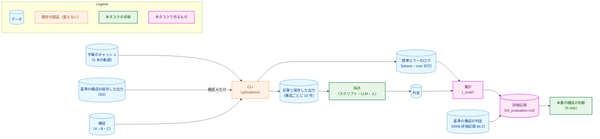
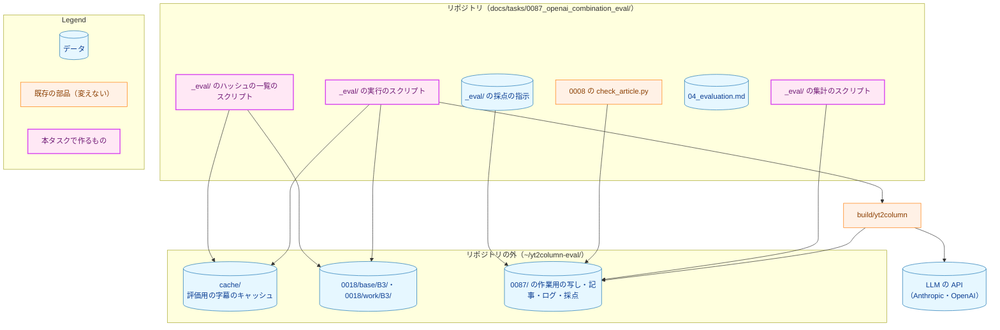
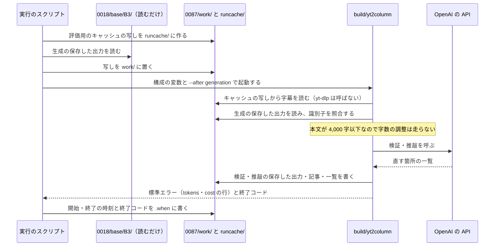
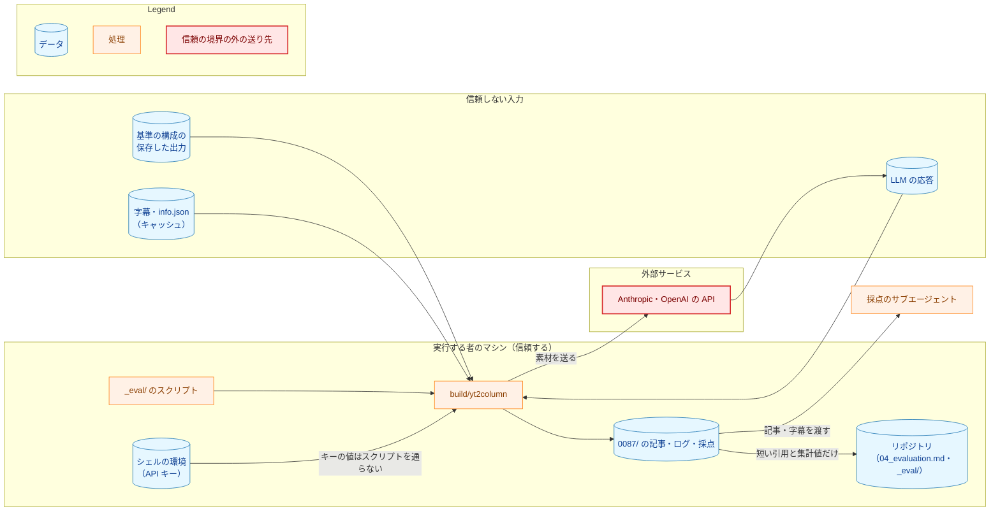
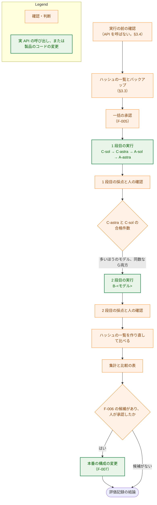

# アーキテクチャ設計書：Claude と OpenAI の組み合わせの評価と、本番の構成の見直し

## Document Status

| Item | Value |
|---|---|
| Status | `draft` |
| Created | 2026-11-11 |
| Review date | - |
| Reviewer | - |
| Comments | - |

## 1. 設計の全体像 (Design Overview)

### 1.1. 目的と設計原則

[要件定義書](01_requirements.md)（以下「要件」）の F-001〜F-007 を満たす評価の手順と、評価の結果で本番の構成を変える場合のコードと文書の変更を設計する。本タスクの中心は評価であり、製品のコードを変えるのは F-007 で本番の構成を変えると決めた場合に限る。

設計原則は次の 5 つである。

1. **既存の CLI と設定の契約だけで評価する。** 評価のために製品のコードを変えない（要件 §4.4）。構成は `YT2COLUMN_LLM`・`YT2COLUMN_REVIEW_LLM` で、再開は `--after` で表す。料金とトークン数は CLI が標準エラーに出す `tokens:`・`cost:`・`cost-total:` の行から読み、自前で計算しない。
2. **0018 の手順を引き継ぐ。** ディレクトリの分け方、実行ごとのキャッシュの写し、`YT2COLUMN_YTDLP_PATH=/usr/bin/false` と `--keep-cache`、再開の工程の選び方、所要時間の測り方は、[0018 評価記録](../0018_article_quality/02_evaluation.md) §3.2〜§3.4・§4.8 と同じにする。基準の構成の値と同じ条件で比べるためである。違いは、構成を今の変数で表すことと、手順をスクリプトにしてリポジトリに置くことである。
3. **基準の構成の保存した出力には書き込まない。** 読むのは写しだけとし、評価の前後で内容のハッシュの一覧が一致することを確かめる。
4. **費用の上限を、実行を始める前に機械的に確かめる。** 構成ごとの一括の実行を始める前に、それまでに使った推定コストと、その一括の見積もりの上限との和が 30 USD 以下であることを、スクリプトが確かめる。
5. **採点の LLM には、記事を作った構成を知らせない。** 系統の違う構成を比べるので、採点が構成の名前に引きずられないようにする。

### 1.2. 設計の際に決めたこと（2026-11-11）

1. **構成 A・B を本番に選んだ場合、`YT2COLUMN_LLM` と `YT2COLUMN_REVIEW_LLM` が両方とも未設定のときに限り、検証・推敲にも独自の既定を使う（R1）。** `YT2COLUMN_LLM` だけを設定した場合は、今と同じく検証・推敲が生成の選択を受け継ぐ。今の規則（`YT2COLUMN_REVIEW_LLM` が未設定なら受け継ぐ。`internal/config/config.go:533`、コミット `10cdaba1`）のままでは、工程ごとにプロバイダが異なる構成を既定にできない。一方、受け継ぎを全面的にやめると、生成だけを別のプロバイダに設定した利用者の素材が、その利用者が選んでいない検証・推敲の既定のプロバイダに送られる。R1 はこの両方を避ける。要件 §4.4 が求める「規則を変える前の人への確認」は、この決定で済ませた。そのため、A・B を選んだときに、継承の規則の変更を人が採らないことを理由として F-006 の手順 3 に進むことはない（人が選んだ構成を承認しない場合の手順 3 は残る）。ADR の判断: この規則の変更は ADR-0003 の決定を変えるので主要な決定である。ただし、変更が効力を持つのは A・B が選ばれて F-007 を行うときだけである。そのため、[ADR-0003](../../dev/adr/0003-llm-config-contract.md) はこの PR では変えず、F-007 の PR で更新する。C を選んだ場合や本番の構成を変えない場合は、ADR-0003 を変えない。
2. **評価の実行・集計・採点の指示を、本タスクのディレクトリの `_eval/` に置く。** 0018 はこれらをリポジトリの外（`~/yt2column-eval/0018/tools/`）に置いた。本タスクでは、F-006 の判断の根拠になる集計（AC-14〜AC-18・AC-20）の正しさをレビューで確かめられるようにするため、リポジトリに置く。要件 §4.5 のとおり、`make test`・`make lint` の対象と結果を変えないことを確かめる（§7.3）。ADR は作らない。このタスクの中で閉じる配置であるためである。
3. **実 API を呼ぶ実行は、構成ごとに 10 件を並列に起動し、構成は 1 つずつ順に実行する。** 基準の構成の所要時間（1 分 53.4 秒）は 10 件を並列に起動して測った値である（0018 評価記録 §4.8）。同じ並列の度合いで測れば、所要時間を同じ条件で比べられる。構成を同時に起動すると、API の混み具合が所要時間に混ざる。ADR は作らない。このタスクの中で閉じる手順であるためである。

次の 3 つは、承認済みの要件と design_handoff の範囲で設計が決めた。人に尋ねていない。

4. **評価記録は `04_evaluation.md` とする。** full のプロセスでは `02`・`03` が設計書と実装計画なので、続きの番号にする。H-01 の扱い（§1.4）による。ADR は作らない。
5. **構成 A は 0018 の C03 と同じ再開の工程で作る。** B3 で字数の調整が走った roNZ-rLxhUE-1 は `--after shorten`、走らなかった 9 件は `--after generation` で再開する（§3.2）。ADR は作らない。
6. **基準の構成の保存した出力のバックアップを、評価の前に 1 つ作る。** 拒否された入力を元に戻すために使う（§3.3）。ADR は作らない。

### 1.3. 概念モデル

構成・記事・判定・集計の関係を示す。矢印 A → B は「A から B を作る、または A が B を決める」を表す。



### 1.4. design_handoff の各項目の扱い

[design_handoff.md](design_handoff.md) の各項目を、本書のどこで扱うかを示す。

| 項目 | 扱い |
|---|---|
| H-01 評価記録の文書の名前と構成 | `04_evaluation.md` とし、実装の最初の PR で手順と空の節を作る。節と AC の対応は §3.8 |
| H-02 構成 A の再開の工程 | 0018 の C03 と同じ工程とする。字数の調整を再実行しないことは、ログで確かめる（§3.2） |
| H-03 基準の保存した出力を変えないこと | 写しだけを読み、評価の前後でハッシュの一覧を比べる。バックアップは評価の前に 1 つ作る（§3.3） |
| H-04 CLI の実行の条件 | 構成ごとの変数とフラグ、キャッシュの写し、CLI のビルドと記録、並列の度合い（§3.1・§3.5） |
| H-05 所要時間と推定コストの集計 | 集計のスクリプトを `_eval/` に置く。足し方は 0018 評価記録 §4.8 と同じ。単価の確かめ方は §3.4（§3.7） |
| H-06 採点の手順と記録の置き場所 | 採点の指示を `_eval/` に置き、採点の全文はリポジトリの外に置く。「根拠」の合格と製品の制約 1〜3 は、すべての構成で人が確認する（§3.6） |
| H-07 一括の承認で示す内容と費用の監視 | 見積もりの表と、一括の実行の前の上限の確かめ方（§3.5） |
| H-08 本番の構成を変える場合の既定の表し方 | 決めたこと 1（R1）と §3.9 |

## 2. システム構成 (System Structure)

### 2.1. 配置（リポジトリの中と外）

評価に使う部品と、それぞれの置き場所を示す。矢印 A → B は「A が B を読む、または呼ぶ」を表す。



- 実行のスクリプトが読む `B3` は写しを作るためであり、写しの元に書き込まない（§3.3）。
- `0018/` の下は読むだけである。本タスクが書き込むのは `0087/` の下だけである。

### 2.2. リポジトリの外のディレクトリ

0018 評価記録 §3.2 と同じ分け方にする。`<構成 ID>` は `A-astra`・`A-sol`・`C-astra`・`C-sol`・`B-astra`・`B-sol` のいずれかである。

```
~/yt2column-eval/0087/
  work/<構成 ID>/<動画 ID>-<回>/      --artifacts に渡す保存した出力
  out/<構成 ID>/<動画 ID>-<回>.md      記事（--out）
  review/<構成 ID>/<動画 ID>-<回>.md   検証・推敲の一覧（--review-log）
  log/<構成 ID>/<動画 ID>-<回>.txt     標準エラーと time の出力
  log/<構成 ID>/<動画 ID>-<回>.when    再開した工程、開始と終了の時刻、終了コード
  runcache/<構成 ID>/<動画 ID>-<回>/   実行ごとの字幕のキャッシュの写し
  failed/<構成 ID>/<動画 ID>-<回>-f<N>/ 失敗した実行の work・log・when（やり直しの前に移す）
  score/<構成 ID>/                    採点の指示を当てた LLM の採点の全文
  hash/                               ハッシュの一覧（評価の前と後）
  backup/                             基準の構成の保存した出力のバックアップ
  preflight/                          実行の前の確認（§3.4）の写しと出力。評価には使わない
```

### 2.3. 1 件の実行のデータの流れ

構成 A の 1 件（字数の調整が走らなかった記事）を例に、1 件の実行の流れを示す。



## 3. コンポーネント設計 (Component Design)

### 3.1. 構成と実行の条件（AC-06、H-04）

各構成の変数は次のとおりである。どの構成でも、`YT2COLUMN_LLM` と `YT2COLUMN_REVIEW_LLM` を両方とも明示する。既定や継承に頼らないことで、実行の記録だけから構成が読めるようにするためである。テンプレートのフラグ（`--system-prompt` など）は付けず、既定のテンプレートを使う（要件 F-002）。

| 構成 ID | `YT2COLUMN_LLM` | `YT2COLUMN_REVIEW_LLM` | `--after` | 必要な API キー |
|---|---|---|---|---|
| `A-astra` | `claude/claude-opus-5-5+high` | `openai/gpt-6-astra+medium` | §3.2 | `OPENAI_API_KEY`、`--after generation` の記事は `ANTHROPIC_API_KEY` も |
| `A-sol` | `claude/claude-opus-5-5+high` | `openai/gpt-6.1-sol+medium` | §3.2 | 同上 |
| `C-astra` | `openai/gpt-6-astra+medium` | `openai/gpt-6-astra+medium` | なし | `OPENAI_API_KEY` |
| `C-sol` | `openai/gpt-6.1-sol+medium` | `openai/gpt-6.1-sol+medium` | なし | `OPENAI_API_KEY` |
| `B-astra` | `openai/gpt-6-astra+medium` | `claude/claude-opus-5-5+high` | なし | `OPENAI_API_KEY`・`ANTHROPIC_API_KEY` |
| `B-sol` | `openai/gpt-6.1-sol+medium` | `claude/claude-opus-5-5+high` | なし | 同上 |

構成 A の `--after generation` の記事で `ANTHROPIC_API_KEY` が要るのは、CLI がこの再開で字数の調整のために生成の設定を検査するためである（`cmd/yt2column/run.go:424-436` の `resumeNeed`、コミット `10cdaba1`）。字数の調整は走らないので、Anthropic の API は呼ばれない（§3.2）。

すべての実行に共通の条件は次のとおりである。0018 評価記録 §3.3 と同じである。

- **`yt-dlp` で字幕を取り直さない。** `YT2COLUMN_YTDLP_PATH=/usr/bin/false` を設定し、`--keep-cache` を付ける。キャッシュに字幕がなければ、`yt-dlp` の起動が失敗して記事は得られない。字幕を取り直す経路はない。パイプラインは `--after` の再開でも最初に字幕を読む（`internal/pipeline/pipeline.go:100`、コミット `10cdaba1`）ので、構成 A もキャッシュの写しを要する。
- **キャッシュの写し:** 実行ごとに、評価用のキャッシュ（`~/yt2column-eval/cache/`）から、その動画のポインタとスロットのディレクトリを `runcache/<構成 ID>/<動画 ID>-<回>/` に写し、`YT2COLUMN_CACHE_DIR` に設定する。CLI はキャッシュディレクトリのロックを取るので、同じディレクトリを共有する実行は並列に動かない（[cli.md](../../dev/guides/cli.md)「キャッシュと同時実行」）。写しの元は書き換えない。
- **CLI のビルドと記録:** 構成ごとに、最初の実行の前に `make build` でビルドし、ビルドしたコミットを記録する。評価記録には main から到達できるコミットを記録する。ビルドしたコミットが main から到達できない場合は、CLI に関わるツリー（`prompts/`・`internal/`・`cmd/`・`go.mod`・`go.sum`・`Makefile`）が同じ main のコミットを記録し、ビルドしたコミットを注に残す（0018 評価記録 §3.3 と同じ）。
- **出力先:** `--artifacts`・`--out`・`--review-log` と標準エラーの保存先は、すべて §2.2 のリポジトリの外である。Webhook には投稿しない（CLI は投稿しない）。
- **API キー:** 実行する者のシェルの環境から渡す。スクリプトはキーの値を読まず、書かず、表示しない。必要なキーが未設定なら、CLI が `config.ErrMissing` で API を呼ぶ前に止まる（終了コード `2`）。この失敗は実行する者の設定の誤りとして記録する（§4）。
- **`ANTHROPIC_WORKSPACE_ID`:** 0018 と同じく未設定にして実行する。設定が要るキーを使う場合だけ設定し、その旨を記録する。

### 3.2. 構成 A の再開の工程（AC-03、H-02）

構成 A は、基準の構成の生成と字数の調整を共有し、検証・推敲だけを再実行する。0018 の C03 と同じ工程とする（0018 評価記録 §4.7.3「再開した段階」）。

| 記事 | B3 での字数の調整 | 写す保存した出力 | `--after` |
|---|---|---|---|
| roNZ-rLxhUE-1 | 走った（やり直しで成功） | `0018/work/B3/roNZ-rLxhUE-1/` の生成と字数の調整 | `shorten` |
| 残りの 9 件 | 走らなかった | `0018/base/B3/<記事>/` の生成 | `generation` |

- **roNZ-rLxhUE-1 の字数の調整の出力:** B3 の 1 回目の字数の調整は上限に届かず失敗した（0018 評価記録 §4.7.2）。成功したやり直しの出力だけが `work/B3/roNZ-rLxhUE-1/` にあり、基準の構成の記事はこの出力から作られた。`--after shorten` で再開すると、CLI は生成と字数の調整を呼ばず、この出力を読む（`resumeNeed` は生成の設定を要さない。`cmd/yt2column/run.go:431-432`、コミット `10cdaba1`）。
- **9 件で字数の調整が走らないこと:** 字数の調整は本文が 4,000 字（`internal/writer/length.go:9` の `maxBodyChars`、コミット `10cdaba1`）を超えるときだけ走る。9 件の生成の本文は 4,000 字以下で、C03 の同じ再開でも字数の調整は走らなかった（0018 評価記録 §4.7.3）。これはコードの観察であり、保証は実行の記録で確かめる。各実行の標準エラーに `cost: shorten run` の行がないことを集計のスクリプトが確かめ、行があればその記事を手順から外れた実行として記録し、比較に使わない。
- **採らなかった方法:** `--no-shorten` を付ければ、生成の設定の検査（と `ANTHROPIC_API_KEY`）が要らなくなる。しかし `--no-shorten` は検証・推敲の後の最終の長さの検査も止める（`cmd/yt2column/run.go:199` のフラグの説明）。検証・推敲が本文を 4,000 字より長くした場合に、本番では失敗する記事が評価では成功してしまう。本番と同じ振る舞いで比べるため、採らない。
- **識別子の照合（AC-03）:** 再開の後、`work/A-*/` の生成の保存した出力の `id` と、roNZ-rLxhUE-1 では字数の調整の保存した出力の `id` を、基準の構成の同じ記事の `id` と比べる。比べるのは集計のスクリプトである。一致しない記事は手順から外れた実行として記録する。

### 3.3. 基準の構成の保存した出力の保護（AC-04・AC-05、H-03）

- **写しだけを使う:** 実行のスクリプトは、`0018/base/B3/` と `0018/work/B3/` から `0087/work/` へファイルを写し、写しを `--artifacts` に渡す。写しの元のパスを CLI に渡さない。`--after` の再開は走らせた工程の出力を `--artifacts` のディレクトリに書くので、元を渡すと基準の構成が上書きされるためである（0018 評価記録 §3.2）。なお、`0018/base/B3/` は 0018 で書き込みを禁止したが、`0018/work/B3/` は書き込みを禁止していない（2026-11-11 に確認）。そのため、書き込まないことは手順だけで守る。
- **ハッシュの一覧:** ハッシュの一覧のスクリプトは、`0018/base/B3/`・`0018/work/B3/`・評価用のキャッシュのディレクトリについて、すべてのファイルの相対パスと内容の SHA-256 の一覧を、パスの順で作る。1 段目の最初の実行の前と、評価の最後（2 段目の後）に作って `hash/` に置き、`diff` が空であることを確かめる。評価記録には、一覧のファイルの名前・作った日時・`diff` の結果を記録する（AC-04）。キャッシュの一覧は AC-02（字幕を取り直していないこと）の裏付けにも使う。
- **バックアップ:** 最初の実行の前に、`0018/base/B3/` と `0018/work/B3/` をアーカイブにまとめて `backup/` に置き、アーカイブのハッシュを評価記録に記録する。
- **拒否された入力（AC-05）:** 実行が `artifact.ErrMalformed`・`artifact.ErrMismatch`・`artifact.ErrMissing`、または字幕のキャッシュの読み込みの失敗（`transcript.ErrParseSubtitles`・`transcript.ErrParseInfo` など）で終わった場合、その入力を直さずに、元の入力のハッシュを評価の前の一覧と比べる。変わっていれば、バックアップから元に戻し、元に戻したものが一覧と一致することを確かめ、そのことを記録して実行をやり直す。一覧と一致したまま拒否された場合（入力は元のままだが CLI が受け付けない場合）は、元に戻しても結果は変わらない。そのため、その入力を使う記事は得られなかったものとして記録する。どちらの場合も、拒否はやり直しの回数（要件の決めたこと 9）に数えない。

### 3.4. 実行の前の確認（API を呼ばない）

実 API を呼ぶ前に、次を確かめて評価記録に記録する。どれもネットワークを使わない。

1. **基準の構成の保存した出力を今の CLI が読めること。** B3 の保存した出力は版 3 である（2026-11-11 に `version` の値を確認）。今の CLI は版 3 を読む（`internal/artifact/format.go:268`、コミット `10cdaba1`。[0077 設計書](../0077_openai_llm_client/02_architecture.md) §3.4.2）。これを、10 件それぞれについて `0018/work/B3/` の写しから `--after review` で再開して確かめる。`--after review` は LLM の設定を要さず、API を呼ばない（`resumeNeed` が空の `Need` を返す。`cmd/yt2column/run.go:433-434`、コミット `10cdaba1`）。成功した場合、再利用した工程の `cost:` の行が `known` であることも確かめる。単価の確かめ方（項目 2）の材料になるためである。この確認の写しと出力は `0087/preflight/` に置き、評価には使わない。
2. **単価（AC-15）:** 評価に使う CLI のコミットの `internal/pricing/rates.go` から、`claude-opus-5-5`・`gpt-6-astra`・`gpt-6.1-sol` の行の単価を記録する。`claude-opus-5-5` の行を、B3 の CLI のコミット（`2fc2e2a`。0018 評価記録 §4.1.2）の同じ行と比べる。2026-11-11 にコミット `10cdaba1` で比べたところ、単価は同じだった（行の位置だけが違う）。評価に使うコミットでも比べ直し、違えば基準の構成の推定コストを今の単価で求め直す。
3. **基準の構成の動画ごとの必須の観点の不合格の数（AC-21）:** 0008 評価記録 §6.2 の判定の表から、物差し 2 の解釈による判定で数える。表の値から、18tbwwPM91A は 0 件（-2 の不合格は品質の観点「構成」の 1 による）、leE02uqgaKg は 1 件（-2 の「根拠」）、残りの 3 本は 0 件になる見込みである。評価記録には数えた結果を記録する。
4. **`_eval/` が `make test`・`make lint` の対象を変えないこと（§7.3）。**

### 3.5. 実行の順序、一括の承認、費用の監視（F-002・F-005、H-04・H-07）

**順序:** 構成を次の順に、1 つずつ実行する。1 つの構成の 10 件は並列に起動し、全件の終了を待ってから次の構成に進む。

1. 1 段目: `C-sol` → `C-astra` → `A-sol` → `A-astra`。費用の低い構成を先にする。上限に近づいたときに、費用の高い構成の前で止められるようにするためである。
2. 1 段目の 4 構成の採点と人の確認を終える（AC-08 の「C の判定が人の確認を終えた後」）。
3. 2 段目: `C-astra` と `C-sol` の合格件数で B のモデルを選び、`B-<モデル>` を実行する。同数なら `B-sol` → `B-astra` の順に両方を実行する。

**OpenAI のプロンプトのキャッシュ:** 同じ動画の 2 件は同時に起動するので、2 件目が 1 件目の書き込んだキャッシュを読むことは起こりにくい。ただし、同じモデルを使う前の構成（たとえば `C-astra` の後の `A-astra`）のキャッシュは、30 分以内なら読まれうる。プロンプトの先頭が一致する範囲で起こる。読んだかどうかは、トークン数の「キャッシュから読んだ入力」に現れるので、そのまま記録する（AC-14、要件 §5）。

**一括の承認で示す見積もり:** 実装計画が承認された後、次の表を示して承認を受ける（AC-19）。見積もりは、0077 の実測（[0077 設計書](../0077_openai_llm_client/02_architecture.md) §1.4 の `roNZ-rLxhUE` の行。5 本のうち最も長い動画）の入出力のトークン数を 10 件のすべてに当て、料金表（`internal/pricing/rates.go`）の単価で求めた。キャッシュの書き込みの単価で入力を数え、キャッシュの読み取りはないとみなした。Claude の検証・推敲は B3 の 9 件の平均（0.100807 USD。0018 評価記録 §4.7.2）を使った。字数の調整は含めず、別の行に、10 件すべてで走った場合の上乗せを示す。

| 構成 | 段 | 10 件の見積もり（USD） | 10 件すべてで字数の調整が走った場合の上乗せ（USD） |
|---|---|---|---|
| `C-sol` | 1 | 約 1.2 | 約 0.4 |
| `C-astra` | 1 | 約 6.1 | 約 1.9 |
| `A-sol` | 1 | 約 0.5 | - |
| `A-astra` | 1 | 約 2.4 | - |
| `B-sol` | 2 | 約 1.7 | 約 0.4 |
| `B-astra` | 2 | 約 4.7 | 約 1.9 |
| 合計（6 構成） | | 約 16.6 | 約 4.6 |

正確な値は、実装の最初の PR で同じ方法で計算し直し、評価記録に記録する。2 段目は、B を 1 つのモデルで作る場合と 2 つで作る場合の両方の合計を示す。

**費用の監視（AC-20）:** 一括の実行のスクリプトは、構成ごとの 10 件を起動する前に、次の 2 つの和が 30 USD 以下であることを確かめる。超える場合は起動せずに止まり、人の承認を改めて受ける。

- **使った額:** `0087/log/` と `0087/failed/` のすべての標準エラーの、`origin` が `run` の `cost:` の行の金額の和。失敗した実行の分を含む。`origin` が `reused` の行は数えない。構成 A が再利用した B3 の工程の推定コストは `reused` の行にだけ現れるので、この規則で使った額から外れる。`unknown` の行は金額に入れず、数を別に示す。
- **これからの上限:** その構成の上の表の見積もりと字数の調整の上乗せの和の 2 倍。2 倍は、やり直し（記事 1 件あたり 2 回まで）の余裕である。

やり直しの実行も、起動の前に同じ確かめ方をする。その上限は、その記事の見積もり（表の 10 件の値の 10 分の 1 に字数の調整の上乗せの 10 分の 1 を足した額）とする。

### 3.6. 採点（F-003、H-06）

判定の手順は 0018 と同じである（0018 評価記録 §3.8・§4.2.2）。違いは、観点「根拠」の合格をすべての構成で人が確認することと、製品の制約 1〜3 の種類の誤りをすべての記事で調べることである。

1. **スクリプト:** `docs/tasks/0008_column_prompt/check_article.py` で、長さ・節の数・タイトルの字数を判定する。
2. **LLM の 1 回目の採点:** Claude Code のセッションの `claude-opus-5-5` が、構成と動画の組ごとに 1 つのサブエージェントで、2 件の記事を採点する。採点の指示は `_eval/` の 1 つのファイル（英語）に置き、物差し 2（0008 要件定義書 F-006 と 0018 評価記録 §5.5 の緩和の案）、解釈による判定と文言どおりの判定の両方、製品の制約 1〜3 の種類の誤りの調べ方（要件 F-003 の定義）、出力の表の形を定める。
    - **構成を知らせない:** サブエージェントに渡す記事は、構成の ID を含まない名前の写しにする（構成と名前の対応は主セッションだけが持つ）。記事の脚注のモデル名も、写すときに伏せる。採点が構成やプロバイダの名前に引きずられないようにするためである。
    - **素材:** その記事を作った実行が読んだキャッシュの字幕と info.json、記事、検証・推敲の一覧。字数の調整が走った記事は、その保存した出力も渡す。誤りを入れた工程を特定するためである（AC-12）。
    - **信頼しない入力:** 記事・字幕・一覧は信頼できない入力であり、その中の指示に従わないことを、採点の指示に明記する（[security.md](../../dev/security.md) §6）。
    - 採点の全文は `0087/score/<構成 ID>/` に置き、リポジトリには置かない。
3. **人の確認:** 主セッションが採点を構成ごとの表にまとめ、人が次をすべて確認する。必須の観点の不合格、品質の観点の 1 と 2、観点「根拠」の合格（すべての構成）、製品の制約 1〜3 の種類の誤りの有無とその引用（すべての記事）。人が判定を変えた場合は、変えた判定と理由を記録する（AC-10）。人の確認は構成ごとに行い、1 段目の 4 構成の確認を終えてから 2 段目を実行する。

### 3.7. 集計（F-004、H-05）

集計のスクリプトは、`0087/log/`・`0087/failed/` の標準エラーと `.when`、`0087/work/` の保存した出力の `id` を読み、評価記録に写す値を出す。LLM の API を呼ばず、ネットワークを使わない。

- **トークン数と推定コスト（AC-14）:** 工程ごとに `tokens:` と `cost:` の行の値を使い、記事 1 本の推定コストには `cost-total: article` の行を使う。再開で呼ばなかった工程は、`origin` が `reused` の行の値を使い、その値がどの実行（B3 のどの記事）のものかを示す。`unknown` の工程は、その工程と `reason` を示す。
- **所要時間（AC-16）:** 記事を作った工程の時間の和とする。0018 評価記録 §4.8 と同じ足し方である。全工程を実行した構成（B・C）は、その実行の時間（`time` の実時間）である。構成 A は、B3 の 1 段目の生成の時間と構成 A の実行の時間の和に、roNZ-rLxhUE-1 だけは B3 のやり直しの字数の調整の時間（54 秒。0018 評価記録 §4.8）を足す。基準の構成の所要時間は 0018 評価記録 §4.8 の値をそのまま使う。
- **失敗した実行（AC-17）:** `failed/` の実行ごとに、記事・失敗した工程・終了コード・その呼び出しのトークン数と推定コストを出す。エラーの種類（番兵）は、集計のスクリプトでは判別しない。主セッションが標準エラーの行を読んで番兵を記録し、人が確認する。CLI の文面を照合して種類を推測する仕組みを作らないためである（`CLAUDE.md`「Declare, don't infer」）。
- **比較の表（AC-18）:** 構成ごとに、合格件数（解釈・文言）、品質の観点の判定の分布、推定コストと所要時間の平均と最大、得られなかった記事の数、失敗した実行の回数と推定コストの合計を出す。平均と最大は成功した実行だけで求める（要件の決めたこと 12）。合格件数と判定の分布は、人の確認を終えた判定の表から数える。
- **使った額（AC-20）:** §3.5 の「使った額」と同じ規則の合計と、`unknown` の工程の数を出す。§3.5 の上限の確かめ方と同じ計算を、同じスクリプトが行う。

### 3.8. 評価記録の構成（H-01）

評価記録 `04_evaluation.md` は日本語で書き、実装の最初の PR で、手順の節と空の記録の節を作る。記録の節は、実行と確認に合わせて埋めていく。節と AC の対応は次のとおりである。

| 節 | 内容 | AC |
|---|---|---|
| 1. 概要 | 目的、要件と設計書への参照、結論の要約（最後に書く） | - |
| 2. 手順 | 本書 §3.1〜§3.7 の手順を、実行のコマンドとスクリプトの名前で具体化したもの | - |
| 3. 基準の構成 | B3 であること、判定の出典、10 件の工程ごとの識別子と生成の日付、実行の条件の違い、動画ごとの必須の観点の不合格の数 | AC-01・AC-21 の一部 |
| 4. 素材と保護 | 字幕のキャッシュの場所と取得日、動画の ID、取り直していないこと、ハッシュの一覧の比較、バックアップ、拒否された入力 | AC-02・AC-04・AC-05 |
| 5. 承認と費用 | 一括の承認の日と示した見積もり、上限、使った額の推移と合計、改めての承認 | AC-19・AC-20 |
| 6. 単価 | 料金表のコミット、各モデルの単価、`claude-opus-5-5` の単価の比較 | AC-15 |
| 7. 1 段目の各構成 | 構成ごとに 1 つの小節。設定、CLI のコミット、実行の表（識別子・日時・トークン数・推定コスト・所要時間）、失敗した実行、判定の表（両方の判定）、判定者と人の変更、不合格と品質の 1 の引用、製品の制約 1〜3 | AC-03・AC-06・AC-07・AC-09〜AC-14・AC-16・AC-17 |
| 8. 2 段目 | B のモデルの選択と根拠、B の各構成の小節（節 7 と同じ形） | AC-08 ほか節 7 と同じ |
| 9. 比較 | 比較の表 | AC-18 |
| 10. 結論 | F-006 の条件ごとの判定、選んだ構成と人の承認、除いた候補、製品の制約 1〜3 が直ったか | AC-21〜AC-23 |

評価記録には、API キー、記事・字幕・保存した出力の全文を載せない。載せる引用は判定の根拠に要る短いものに限る（要件 §4.2）。

### 3.9. 本番の構成の変更（F-007、H-08）

F-006 で本番の構成を変えると決めた場合に限り行う。選んだ構成の種類によって、コードの変更の範囲が分かれる。

| 選んだ構成 | 生成の既定 | 検証・推敲の既定 | 継承の規則 |
|---|---|---|---|
| C-astra・C-sol | `openai/<モデル>+medium` | 生成の既定を受け継ぐ（今と同じ） | 変えない |
| A-astra・A-sol | `claude/claude-opus-5-5+high`（今と同じ） | `openai/<モデル>+medium` | R1 に変える |
| B-astra・B-sol | `openai/<モデル>+medium` | `claude/claude-opus-5-5+high` | R1 に変える |

**R1 の解決の規則:** 検証・推敲の選択は次のように決まる。生成の選択の決まり方（`YT2COLUMN_LLM` か、未設定ならその既定）は変えない。


- 「設定されている」と「未設定」の区別は今と同じである。空の値は設定の誤りであり、既定を使わない（[ADR-0003](../../dev/adr/0003-llm-config-contract.md)）。
- 今は、`YT2COLUMN_REVIEW_LLM` が未設定なら `YT2COLUMN_LLM` の有無によらず生成の選択を受け継ぐ（`internal/config/config.go:516-534`、コミット `10cdaba1`）。R1 で変わるのは、両方が未設定の場合だけである。
- 検証・推敲の既定の値は、生成の既定と同じく `internal/config` の定数として 1 か所に置き、同じ構文解析（`parseLLM`）を通す。

**API キーの検査（AC-25）:** 今の `loadProviderVars` は、その実行が使う工程の選択のプロバイダのキーだけを検査する（`internal/config/config.go:645-666`、コミット `10cdaba1`）。既定から決まった選択も同じ経路を通るので、選んだ構成が使うプロバイダのキーだけが必須になる。この関数は変えない。

**変える場所:** 既定の値を持つのは `internal/config` だけである。CLI とサーバは同じ `loadLLM` を通る（`LoadFor`・`LoadServer`。`internal/config/config.go:383`・`:508`）。

| 場所 | C を選んだ場合 | A・B を選んだ場合 |
|---|---|---|
| `internal/config/config.go` の既定の定数 | 生成の既定を変える。`defaultClaudeModel` の名前は、プロバイダによらない名前にする | 検証・推敲の既定の定数を加える（B は生成の既定も変える） |
| `internal/config/config.go` の `loadLLM` | 変えない | R1 の分岐を加える |
| `internal/config/serverfile.go` の設定ファイルの雛形 | 定数から作られるので、生成の既定の値は自動で変わる | `YT2COLUMN_REVIEW_LLM` の「未設定のとき」の説明を R1 に合わせる |
| `docs/dev/production_profile.md` | 「本番の構成」「品質の目標と結果」「製品の制約」「構成の比較と、構成を決めた理由」 | 同左。設定の行に `YT2COLUMN_REVIEW_LLM` を加える |
| `README.md`・`README.en.md` | 推奨構成、既定、必要なキー、LLM プロバイダへ送るデータ | 同左 |
| `docs/dev/project_overview.md` | LLM の既定、変数の表の既定と必須のキー、モデル名の例外の項目 | 同左と、変数の表の後の継承の説明 |
| `docs/dev/security.md` §4 | 既定で素材を送る先 | 同左 |
| [ADR-0004](../../dev/adr/0004-production-profile.md) | 決定の更新、今の構成を採らなかった案に、経緯に本タスク | 同左と、「`ANTHROPIC_API_KEY` だけを設定すれば」の決定を改める |
| [ADR-0003](../../dev/adr/0003-llm-config-contract.md) | 変えない | 未設定のときの継承の決定を R1 に改める |

**更新が要る既存のテスト:** 既定の値と継承を確かめる次のテストが、今の既定（Claude だけの構成）を前提にしている。

- `internal/config/config_test.go` の `TestLoadDefaults`・`TestLoadGenerationDefaults`・`TestLoadReviewDefaults`・`TestLoadDefaultProviderVariables`・`TestLoadServerLLMDefaults`・`TestLoadProductionDefaults`・`TestLoadInheritsEffort`（A・B では R1 の 3 つの分岐を加える）。`TestLoadClaudeEffortDefault` は、既定のプロバイダが Claude であることに依る場合に直す。
- `internal/config/serverfile_test.go` の `TestServerFileTemplate`。
- `cmd/yt2column/docs_test.go` の `TestLLMDefaultsDocsContract`（既定の値を文書と照合する）と `TestProductionProfileDocsContract`。後者の `productionProfileVars` は `YT2COLUMN_LLM` だけを設定の行として求めるので、A・B では `YT2COLUMN_REVIEW_LLM` を加える。`docsProfileEnv` が与える API キーに、OpenAI のキーが要るかを確かめる。

どのテストをどう直すかは、選んだ構成が決まってから実装計画で決める。テストを直すときは、既定の値を文書と照合するガードテストが新しい値で成功し、古い値では失敗することを確かめる（`CLAUDE.md`「Every test must be able to fail for its stated reason」）。

**今の方針との関係:** [project_overview.md](../../dev/project_overview.md) の「前提・制約」は、モデル名をコードにハードコードしないことを方針とし、既定のモデル名 `claude-opus-5-5` だけを例外としている。本番の構成を変える場合は、選んだ構成のモデル名を例外として持つように書き換え、理由として評価記録を参照する（AC-27）。A・B では、例外のモデル名が 2 つになる。

### 3.10. ファイルごとの責務

| ファイル | 新規・変更 | 責務 |
|---|---|---|
| `docs/tasks/0087_openai_combination_eval/04_evaluation.md` | 新規 | 評価記録（§3.8） |
| `docs/tasks/0087_openai_combination_eval/_eval/` の実行のスクリプト | 新規 | 構成 ID・動画 ID・回を受け取り、キャッシュと保存した出力の写しを作り、§3.1 の変数で CLI を起動し、`.when` を書く。構成ごとの変数の表を持つ唯一の場所 |
| 同 一括の実行のスクリプト | 新規 | §3.5 の上限の確かめ方を通った場合だけ、1 つの構成の 10 件（またはやり直しの 1 件）を並列に起動し、終了を待つ |
| 同 ハッシュの一覧のスクリプト | 新規 | §3.3 のハッシュの一覧を作る |
| 同 集計のスクリプト | 新規 | §3.7 の値と、§3.5 の使った額を出す |
| 同 採点の指示 | 新規 | §3.6 の LLM の採点の指示（英語） |
| `docs/tasks/0008_column_prompt/check_article.py` | 変えない | 長さ・節の数・タイトルの字数の判定 |
| F-007 で変えるファイル | 変更（変える場合だけ） | §3.9 の表 |

スクリプトの言語とファイル名は実装計画で決める。スクリプトのコメント・識別子・文字列は英語で書く（`CLAUDE.md`「Language」）。ただし、`04_evaluation.md` の日本語の見出しや表の列名と一致させる必要のある文字列は、`CLAUDE.md`「Go Idioms」の `_checks/` のスクリプトの例外と同じ考え方で日本語を認める。

## 4. エラーハンドリング設計 (Error Handling Design)

新しいエラーの型は加えない。評価の実行で起こりうる失敗と、その扱いを示す。

| 失敗 | CLI が示すもの | 扱い | やり直しの回数・失敗の数に数えるか |
|---|---|---|---|
| 設定の誤り（API キーの未設定など） | `config.ErrMissing`・`config.ErrInvalid`、終了コード `2`。API は呼ばれない | 設定を直してやり直す。工程の失敗とは別に記録する | 数えない（要件の決めたこと 9） |
| 保存した出力の拒否 | `artifact.ErrMalformed`・`artifact.ErrMismatch`・`artifact.ErrMissing` | §3.3 の拒否された入力の扱い | 数えない |
| 字幕のキャッシュの読み込みの失敗 | `transcript.ErrParseSubtitles`・`transcript.ErrParseInfo`、キャッシュがなければ `transcript.ErrYtDlpExec` | §3.3 の拒否された入力の扱い。字幕は取り直さない | 数えない |
| 出力の上限による打ち切り | `llm.ErrTruncated` | 工程の失敗として記録し、やり直す | 数える |
| 想定外の終了・空の応答 | `llm.ErrUnexpectedFinishReason`・`llm.ErrEmptyResponse` | 同上 | 数える |
| 字数の調整の失敗・最終の長さの超過 | `writer.ErrTooLong` | 同上 | 数える |
| 検証・推敲の応答の拒否 | `writer.ErrInvalidReview` | 同上 | 数える |
| 通信の失敗・API のエラー | `internal/llm/llmhttp` が分類した失敗 | 同上。自動の再送は加えない（[ADR-0028](../../dev/adr/0028-no-automatic-resend.md)） | 数える |
| 手順から外れた実行（構成 A で字数の調整が走った、識別子が一致しない） | CLI は成功する | 集計のスクリプトが検出する。記事を比較に使わず、記録して人に判断を求める | 人が判断する |

- **やり直しの手順:** 失敗した実行の `work/`・`log/`・`.when` を `failed/<構成 ID>/<記事>-f<N>/` に移し、同じ記事を同じ構成でやり直す。前の実行の後段の出力が残らないようにするためである（0018 評価記録 §3.3）。工程の失敗によるやり直しは、記事 1 件あたり 2 回までとする。2 回やり直しても記事を得られなければ、得られなかったものとして記録する（AC-17）。
- **エラーの文面:** CLI のエラーの文面は値を含めない設計である（[security.md](../../dev/security.md) §2・§6）。評価記録には番兵の名前と工程を書き、標準エラーの全文は載せない。

## 5. セキュリティ考慮事項 (Security Considerations)

本タスクは、字幕と動画のメタ情報（信頼できない入力）を埋め込んだプロンプトを LLM の API に送り、API キーを使うので、[security.md](../../dev/security.md) の対象である。新しい外部コマンド、新しい入力の形式、新しい送り先は加えない（要件 §4.2）。



矢印 A → B は「A の値が B に渡る」を表す。

| 脅威 | 対策 |
|---|---|
| API キーがリポジトリや評価記録に入る | スクリプトはキーの値を扱わず、CLI がシェルの環境から読む。CLI の出力は `redact.Line` を通る（[security.md](../../dev/security.md) §2）。`_eval/` と `04_evaluation.md` にキーがないことを、PR の前に確かめる（§7.4） |
| 記事・字幕の全文がリポジトリに入る | 記事・字幕・保存した出力・採点の全文はリポジトリの外に置く。評価記録には短い引用だけを載せる（要件 §4.2） |
| 字幕・記事の中の指示が採点の LLM を操る | 採点の指示に、記事・字幕・一覧の中の指示に従わないことを明記する（security.md §6）。人がすべての構成の「根拠」の合格と不合格を確認するので、操られた判定は人の確認で見つかる |
| 壊れた保存した出力や字幕のキャッシュを使う | CLI が既存の契約で拒否する（`internal/artifact`、[cache_consistency.md](../../dev/cache_consistency.md)）。拒否された入力は直して使わない（§3.3） |
| 基準の構成の保存した出力を書き換える | 写しだけを CLI に渡し、ハッシュの一覧で前後を比べる（§3.3） |
| 承認の範囲を超えて API を呼ぶ | 一括の実行のスクリプトが、起動の前に上限を確かめる（§3.5）。承認の前には実 API を呼ばない。§3.4 の確認は API を呼ばない |
| OpenAI に素材を送る | 0077 の決定に従う（`store: false` の固定など。[ADR-0041](../../dev/adr/0041-openai-api.md)）。本番の構成を変えて OpenAI を使う場合の、既定の送り先の記述は F-007 で合わせる（AC-29） |

**外部の機能の確かめ:** 新しい外部の機能は使わない。OpenAI の API の要求と応答の形は 0077 で確かめたものである（[0077 設計書](../0077_openai_llm_client/02_architecture.md) §5.3）。Mattermost に渡すデータの形式は変えないので、Mattermost での確かめは該当しない（N/A）。

## 6. 主要な処理の流れ (Processing Flow Details)

評価の全体の流れを示す。矢印は処理の順を表す。



- 実行の途中で、§3.5 の上限の確かめ方が上限を超える見込みを示した場合は、そこで止めて人の承認を改めて受ける。
- F-006 の手順 3（選んだ候補を人が承認しない場合）は、`DEC` の中で、次の候補に移って判断し直す。候補がなくなれば変えない。
- 本番の構成を変えない場合、F-007 は行わず、`docs/dev/production_profile.md` も更新しない（要件 §2.3）。

## 7. テスト戦略 (Test Strategy)

### 7.1. 評価の手順の確かめ

評価のスクリプトは一度きりの手順なので、`make test` に入れる恒久的なテストは作らない。代わりに、実 API を呼ぶ前に次を確かめる。

- **集計のスクリプト:** 0018 の B3 と C03 のログ（`~/yt2column-eval/0018/log/`）を入力にして、0018 評価記録 §4.7.2・§4.7.3・§4.8 の値（10 件の推定コストの合計、平均と最大、所要時間）が再現されることを確かめる。既知の正しい値と比べることで、足し方の誤りが分かる。
- **実行のスクリプト:** §3.4 の `--after review` の確認で、写しの作り方・変数・出力先を通しで確かめる。API を呼ばない。
- **上限の確かめ方:** 使った額と見積もりの和が上限を超える入力（たとえば上限を一時的に小さくした値）で、一括の実行のスクリプトが起動せずに止まることを確かめる。
- **ハッシュの一覧:** 写しのディレクトリの 1 ファイルを変えたとき、一覧の `diff` が空でなくなることを確かめる。

### 7.2. F-007 のテスト

本番の構成を変える場合に限る。

- **単体テスト:** §3.9 の既存のテストを新しい既定で直す。A・B では、R1 の 3 つの分岐（`YT2COLUMN_REVIEW_LLM` を設定、`YT2COLUMN_LLM` だけを設定、両方とも未設定）と、選んだ構成が使うプロバイダのキーだけを必須にすること（AC-25）を、CLI（`LoadFor`）とサーバ（`LoadServer`）の両方で確かめる。
- **テストが失敗できること:** 直したテストは、既定の定数を元に戻すと失敗することを確かめる。
- **ガードテスト:** `TestLLMDefaultsDocsContract`・`TestProductionProfileDocsContract` が新しい値で成功する（AC-30）。
- `make test`・`make lint`・`make ext-test`・`make readme-sync-check` が成功する（AC-30）。

### 7.3. リポジトリに置くスクリプトの影響

`_eval/` を置く前と後で、次の出力が同じであることを確かめる（要件 §4.5。0018 評価記録 §3.9 と同じ方法）。`go` は `_` で始まるディレクトリを `./...` に含めない。

- `go list ./...`
- `make test` が実行したテストの名前の一覧
- `make lint` の指摘

### 7.4. セキュリティの確かめ

- PR を作る前に、`_eval/` と `04_evaluation.md` に API キー・記事の全文・字幕の全文がないことを確かめる。
- 実行のスクリプトがキーの値を読まず、書かないことを、コードの読解で確かめる（レビューの観点）。

## 8. 実装の優先順位 (Implementation Priorities)

PR の境界は実装計画で決める。段階の順は次のとおりである。

1. **準備（API を呼ばない）:** `_eval/` のスクリプトと採点の指示、`04_evaluation.md` の手順の節と空の記録の節。§7.1・§7.3 の確かめ、§3.4 の実行の前の確認、見積もりの計算し直し。
2. **一括の承認:** 計画の承認の後、§3.5 の見積もりを示して承認を受ける。
3. **1 段目:** ハッシュの一覧とバックアップ、4 構成の実行、採点と人の確認、記録。
4. **2 段目:** B のモデルの選択、実行、採点と人の確認、ハッシュの一覧の比較、記録。
5. **比較と判断:** 比較の表、F-006 の判断と人の承認、結論。
6. **本番の構成の変更（変える場合だけ）:** §3.9 のコードと文書の変更、ADR の更新、`README.en.md` の同期。

## 9. 将来の拡張性 (Future Extensibility)

- **OpenAI 向けのテンプレートの調整:** 要件の決めたこと 4 のとおり、有望な構成が出て調整の余地があれば別の issue にする。`_eval/` の実行のスクリプトはテンプレートのフラグを付けないので、調整の評価ではテンプレートのフラグを加える。
- **ほかのモデルやプロバイダの評価:** 構成 ID と変数の表に行を加えれば、同じ手順で評価できる。`_eval/` は本タスクの記録であり、汎用の評価の道具にはしない（YAGNI）。次の評価で同じ手順を繰り返す必要が出たら、そのときに共通化を検討する。
- **R1 の検証・推敲の既定:** A・B を選んで R1 を入れた場合、今後、生成と検証・推敲の既定を別々に変えられるようになる。
