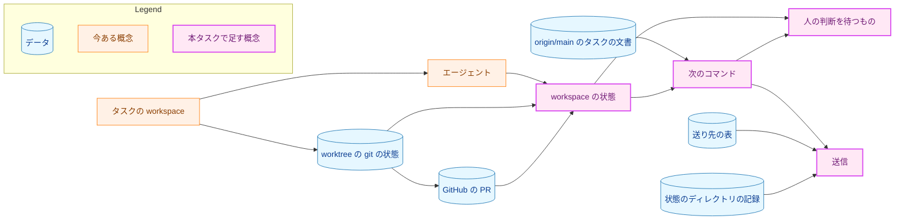
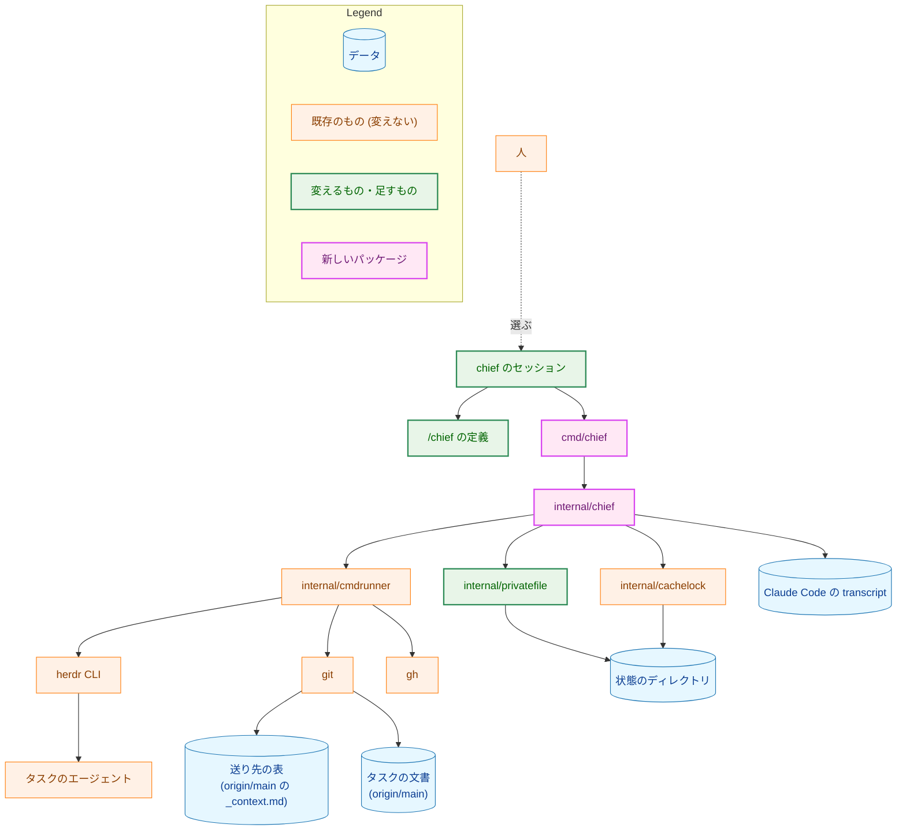
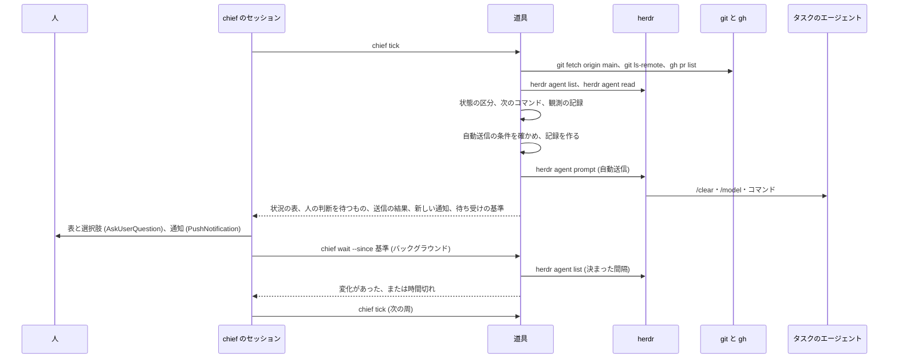
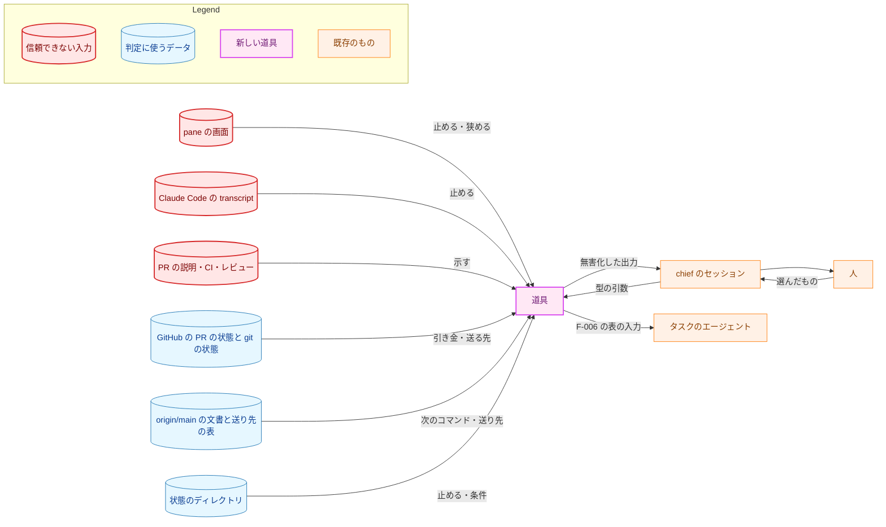
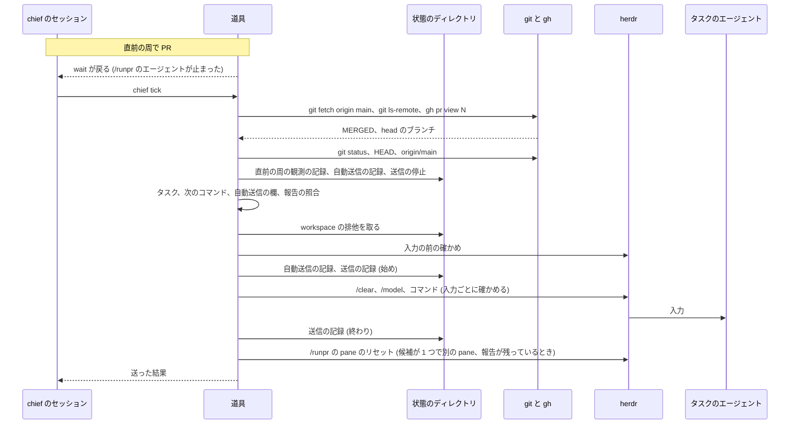
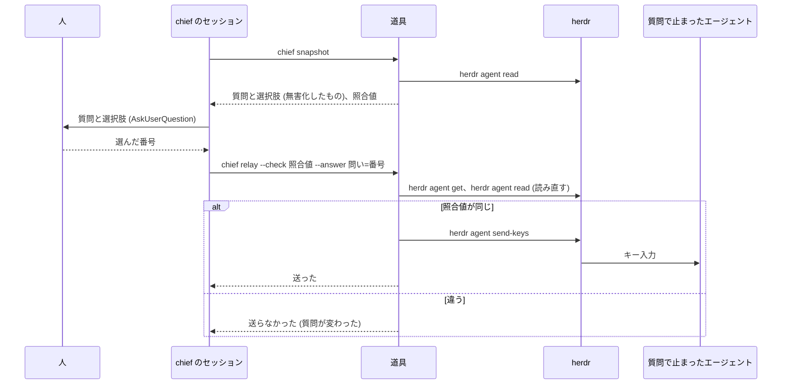

# アーキテクチャ設計書：chief が workspace の状況を示し、人の判断を待つものを選択式で示し、マージの後の次のコマンドを自動で送る

## Document Status

| Item | Value |
|---|---|
| Status | `draft` |
| Created | 2026-11-11 |
| Review date | - |
| Reviewer | - |
| Comments | - |

本書は [01_requirements.md](01_requirements.md)（要件定義書。以下、要件書）の設計である。「計画で決める」は、本タスクの実装計画書（`03_implementation_plan.md`）で決めることを指す。既存のファイルの内容は、コミット `e62a4ef4` で確かめた。`file:line` の行番号は、このコミットでの行番号である。F-NNN・AC-NN は要件書の項番を指す。

**申し送りについて:** [design_handoff.md](design_handoff.md)（以下、申し送り）は、要件書の PR（#848）の途中のコミット `1819098a` で中身が消え、`main` では空のファイルである。要件書は申し送りの H-01 を名指しているので、本書は、消える前の最後の版（コミット `5d7baefe` の申し送り）の H-01〜H-14 を扱う。各項目への対応は付録 A に、受け入れ基準との対応は付録 B にまとめる。

本書は、要件書 3 章と 6 章の用語（chief・chief の workspace・タスクの workspace・エージェント・入力を受け付ける状態・自動送信・答えの中継・chief の待ち受け・実装計画書の PR・プランの PR）を、要件書と同じ意味で使う。そのほかに、次の用語を使う。

-   **chief のセッション:** chief の workspace で `/chief` を実行している Claude Code のセッション。人に尋ね、道具を呼び、PR を作ったコマンドの報告を要約する。
-   **道具:** 本タスクで作る開発用ツール `chief`（`cmd/chief` と `internal/chief`）。状態の区分、次のコマンドの決定、自動送信の条件、送る前の確かめ、送信、記録とロックを持つ（3.1）。ADR-0014 の呼び方に合わせて「道具」と呼ぶ。
-   **`/chief` の定義:** chief のセッションが従うコマンドの定義 `.claude/commands/chief.md`。道具の呼び出しの順序と、人への問いだけを持つ（3.2）。
-   **送り先の表:** コマンドごとの送り先のエージェントとモデルを持つ、`_context.md` の新しい表（3.3）。要件書の F-006 の表を、ここ 1 か所に置く。
-   **状態のディレクトリ:** 道具が記録とロックを置く、リポジトリの外のディレクトリ（3.5）。
-   **周:** chief の待ち受けの中で、道具の `tick` を 1 回呼ぶこと。周ごとに状況を読み直し、自動送信を行う（3.1.1）。道具は周ごとに周の記録を作る（3.5）。
-   **観測の記録:** 周の中で、ある workspace の PR が開いているのを見たという記録（3.5）。自動送信の条件の 1 つになる（3.7）。
-   **画面の読み取り:** pane の画面の文字列から、質問・選択肢・モデルの行・入力欄・報告を取り出す道具の部品（3.4）。CLAUDE.md の「Declare, don't infer」の例外の範囲である（5.2）。
-   **照合値:** 質問を人に示したときに道具が作る不透明な値。中継の直前に読み直した画面から同じ規則で作り、比べる（3.6）。
-   **送信の記録:** 道具が pane へ入力を送る前に作り、送り終えた後に結果を書く記録（3.5）。送った入力の履歴にもなる。
-   **Claude Code の transcript:** Claude Code がセッションごとに書く記録のファイル（要件書 4.2 の「セッションの記録」）。状態のディレクトリの記録と区別するため、本書ではこう呼ぶ。

## 1. 設計の全体像 (Design Overview)

### 1.1. 設計原則

-   **判定と送信は道具に置き、セッションには置かない。** 状態の区分、次のコマンド、送り先とモデル、送り先の pane、自動送信の条件、送る前の確かめ、送る入力の組み立ては、すべて道具のコードが決め、テストを持つ（[ADR-0014](../../dev/adr/0014-deterministic-checks-in-go.md)）。chief のセッションは、道具の出力を人に示し、人の選んだものを道具の引数で渡すだけである。
-   **送る入力は型で組み立てる。** 道具は、送る入力を文字列の引数で受け取らない。コマンドの種類と、検証したタスク・issue 番号・PR 番号から組み立てる（3.1.3）。中継は、選択肢の番号から組み立て、選択肢の文を送らない（AC-29）。モデルも、送り先の表から読んだ値を決まった集合で検証してから使う。
-   **送る先と送る中身は、GitHub・git・Herdr から求める。** 自動送信の引き金と、送る workspace・タスク・コマンドは、GitHub の PR の状態、git の状態、Herdr の状態、`origin/main` の文書から求める。画面からの判断は、送ることを止めるか条件を狭める向きにだけ働く（要件書 4.2・5 章）。状態のディレクトリの記録は、送るコマンドとタスクを決めない。記録が働くのは、送ることを止める条件と、自動送信の候補の workspace を名指す条件だけである。名指された workspace は、Herdr・git・GitHub で確かめ直す（記録が条件として働く範囲は 3.5 に書く）。
-   **分からないものは推し量らない。** Herdr の出力、画面、計画書の欄、送り先の表、記録のどれかが決まった形に合わなければ、「要確認」か「送らない」にし、理由を示す（CLAUDE.md の「Reject, don't normalize」）。
-   **二重に送るより、送らずに止まる。** 入力を送る前に送信の記録を作り、送り終えたことを書けないまま終わった送信は、「送れたかが分からない」ものとして、その workspace への送信を止める（AC-37）。
-   **常駐するプロセスを置かない。** 自動の進行は chief のセッションが道具を呼んでいる間だけ行う（要件書「要件定義の際に決めたこと」）。

### 1.2. 設計の際に決めたこと（2026-11-11）

-   **chief の判定と副作用は、Go の道具 `cmd/chief` と `internal/chief` に置く。`/chief` の定義は、道具の呼び出しと人への問いと報告の要約だけを持つ。道具は `make install-chief` で `main` からインストールし、`--protocol` の番号で定義と道具の版を照合する（申し送りの H-01）。** 状態の区分、自動送信の条件、送る前の確かめは判定と副作用を持ち、エージェントが手順を読み違えると、送ってはいけない入力が送られうるためである。試作の bash スクリプトの形は、JSON を読み状態を持つので、廃止された [ADR-0012](../../dev/adr/0012-lightweight-check-in-bash.md) の見直しの条件 4 にすでに当たる。ADR: [ADR-0046](../../dev/adr/0046-chief-of-staff.md) を更新し、[ADR-0014](../../dev/adr/0014-deterministic-checks-in-go.md) の道具の一覧に chief を足す（道具ができるまでは、決定と現状のずれを ADR の決定の中に書いておく）。
-   **コマンドごとの送り先とモデルは、`_context.md` に新しく置く送り先の表 1 か所に持つ。道具は、`origin/main` の `_context.md` からこの表を厳密に読む。「PR marker conventions」の第 5 部の表は、モデルの列を送り先の表の参照に置き換える（AC-39、申し送りの H-14）。** 人の案内（`runplan.md`・`runpr.md`）と chief が同じ表を読み、値ごとの送り先を差し替えるのに直す場所を 1 か所にするためである。Go のコードに表を持ってガードのテストで `_context.md` との一致を確かめる案は、直す場所が 2 か所になり、AC-39 に合わないので採らない。`origin/main` から読むのは、タスクのブランチで表を書き換えても送り先が変わらないようにするためである（`opus-review-decision.sh` が第 4 部を `origin/main` から読むのと同じ考え方、`.claude/commands/_context.md:93-95`）。ADR: ADR-0046 を更新する。
-   **質問の画面とキー入力の形は、実画面のサンプルで確かめたものだけを受け付ける。サンプルの採取は、実装の最初のフェーズで行う。答えの中継は、照合値を送る直前に比べ、選択肢の番号から決まったキー入力だけを送る（申し送りの H-02・H-05）。** 設計の時点で確かめたのは、次の 2 点だけである。1 つは、OpenCode の pane がマージの確認で止まっていても、画面の最後の 80 行に選択肢が見えないことがあること（2026-11-11、`herdr agent read --source visible --lines 80` で観測）。もう 1 つは、`herdr agent prompt` が `blocked` のエージェントへの送信を拒むこと（Herdr 0.9.1 の `herdr agent prompt --help`）である。形が合わない画面は「要確認」か「中継しない」になるので、確かめていない形は安全側に倒れる。ADR: ADR-0046 を更新する（中継の守りは信頼の境界に関わるため）。
-   **自動送信の欄は `**自動送信**` とし、値は `auto`（自動で送ってよい）と `hold`（自動で送らない）の 2 つにする。PR マーカーのない計画書では、`**実装モデル要件**` と同じ「PR 構成」の節に書く（AC-48、申し送りの H-06）。** 値を ASCII にして、全角の似た文字による読み違いをなくすためである。`**実装モデル要件**` の値が ASCII であるのとそろう。欄の名前は要件書の用語「自動送信」に合わせる。PR マーカーのない計画書にも欄を置くのは、その計画書の `/runplan` も自動送信の対象になり、止める手段が要るためである。ADR: ADR-0046 を更新する（欄があることはすでに決定済みで、綴りと場所を足す）。
-   **記録とロックは、リポジトリの外の状態のディレクトリ `$XDG_STATE_HOME/yt2column/chief/` に置き、判定に読み返す。これは ADR-0014 の「道具は、判定に使う基準値を状態のファイルから読み返さない」の例外とする（申し送りの H-12）。** 要件が、chief を起動し直しても自動送信を 2 回しないこと（AC-44）と、送信を止めた workspace を覚えていること（AC-37）を求め、セッションの中の記憶では足りないためである。例外の範囲と、記録が条件として働く範囲は 3.5 にある。git の共通ディレクトリ（`.git/chief/`）に置く案は、worktree のエージェントが書ける点で守りの強さは変わらず、記録がリポジトリの clone に結び付くだけなので採らない。ADR: ADR-0014 を更新し（例外を足す）、ADR-0046 を更新する。
-   **chief の待ち受けは、道具の `wait` を 1 つだけバックグラウンドで走らせる。`wait` は `herdr agent list` を決まった間隔で読み、前の周の出力が渡した基準と比べて、タスクの workspace のエージェントの状態か `state_change_seq` が変わると戻る（申し送りの H-04）。** ネットワークを使わず、新しく現れた pane も、質問で止まったエージェントも、1 つの仕組みで扱えるためである。pane ごとに `herdr agent wait` を走らせる試作の形は、`blocked` のエージェントでその待ちがすぐ戻り、二段の待ちが要るので採らない。ADR: なし（待ち受けの仕組みはこのタスクの中で閉じるため）。
-   **実装計画書の PR を「レビュー省略可」と示すのは、PR が変えるファイルが、そのタスクの `03_implementation_plan.md` と `implementation_handoff.md` だけのときとする。変えたファイルの一覧が取れないか、一覧の数が PR の変えたファイルの数と合わなければ示さない（AC-23、申し送りの H-07）。** 要件定義書・設計書を `draft` に戻すか ADR を変える計画書の PR は、決定の変更を含み、人が読むべきだからである。CI の結果は PR の詳細に別に示すので、基準に入れない。ADR: なし（示すだけで、承認の規則を変えないため。要件書で決めたとおり）。
-   **送り先の pane は、workspace の中で、送り先の表のエージェントの種類の pane がちょうど 1 つのときだけ選ぶ。0 か 2 つ以上なら送らない。リセットする pane も、リセットするコマンドの送り先の表の種類の pane がちょうど 1 つのときに、その pane を候補とする。画面にそのコマンドの報告が残っていて、その後エージェントが動いていないときだけ、候補をリセットする。** 送るたびに `/clear` か `/new` で文脈を空にするので、人が対話に使っている pane を選ぶと、その文脈を黙って失わせるためである。画面の文字列で pane を選ばないのは、画面からの判断を、送る先を決めることに使わないためである（1.1）。リセットでは、画面は候補を狭めることにだけ使う。ADR: ADR-0046 を更新する（送る先の決め方は信頼の境界に関わるため）。
-   **PR マーカーの読み方は、道具（Go）と `opus-review-decision.sh`（bash）の 2 か所に実装し、同じサンプルで両方を走らせるテストで食い違いを見つける。** `opus-review-decision.sh` は、インストールの手順なしに `origin/main` の版を実行することを前提にしており（[0081 設計書](../0081_implementation_model_choice/02_architecture.md) の 3.5.2）、Go の道具に任せるとその前提が崩れるためである。道具が `opus-review-decision.sh` を呼ぶ案は、道具の判定が bash のスクリプトに依り、テストで壊して確かめられないので採らない。ADR: なし（実装の置き場所はこのタスクの中で閉じるため）。

### 1.3. なぜ今の仕組みでは足りないか

今のリポジトリには、複数の workspace を見渡す仕組みがない。各コマンドは自分の PR を作って止まり（`.claude/commands/_lib/task-pr-handoff.md` の Part B）、`/runpr` はマージの後に NEXT を示すだけで、走らせるかは人が選ぶ（`.claude/commands/runpr.md:1039-1046`）。モデルの案内は `_context.md` の第 5 部の表（`.claude/commands/_context.md:108-117`）が示すが、送り先のエージェントの区別がなく、`sonnet` は Sonnet を示したままである（ADR-0042 の決定の中のずれの記述）。試作（リポジトリに入れていない `.claude/commands/chief.md` と `.claude/chief/*.sh`）は、判定の多くをエージェントが手順を読んで行い、送り先の表と例外の表を手元のファイルに置いていた。要件書は、次の 3 点を、chief を起動し直したあとも守ることを求める。送る入力の範囲を限ること、引き金を GitHub と git の状態にすること、自動送信を 1 回に限ることである。手順を読むエージェントにこれを守らせることはできず、テストのある道具が要る（1.2 の 1 項目め）。

### 1.4. 概念モデル

図 1 は、chief が扱うものと、その関係を示す。矢印 A → B は「A が B を持つ、または A から B が決まる」を表す。



-   workspace の状態は、要件書 F-001 の 6 つ（要確認・質問で停止・実行中・レビュー待ち・次を提案・タスク完了）のどれかで、エージェントの状態、worktree の git の状態、PR の状態から決まる。
-   次のコマンドは、`origin/main` のタスクの文書と PR マーカーと、workspace の状態から決まる（3.1.4）。
-   人の判断を待つものは、エージェントを止めている質問、マージの確認、レビュー待ちの PR、そのほかの提案の 4 種類である（F-002）。
-   送信は、コマンドの送信、答えの中継、pane のリセットの 3 種類で、次のコマンド（または人の選んだ答え）と送り先の表から組み立てられ、状態のディレクトリの記録が、送ってよい範囲を狭める。

## 2. システム構成 (System Structure)

### 2.1. 全体構成

図 2 は、chief を構成するものと、ほかの道具との関係を示す。矢印 A → B は「A が B を呼ぶ、または読む・書く」を表す。点線の矢印は、人の操作を表す。



-   道具は、外部のコマンド（`herdr`・`git`・`gh`）をシェルを通さずに `internal/cmdrunner` で走らせる。`internal/mergepr`・`internal/fixprguard`・`internal/codexreview` と同じ実行の境界である（`internal/cmdrunner/runner.go:1-5`）。git は `cmdrunner.GitEnv` の環境で走らせ、タスクの worktree の `git status` が index のロックを取らないようにする（`GIT_OPTIONAL_LOCKS=0`、`internal/cmdrunner/git.go:36-37`）。どの外部のコマンドにも時間の上限を設け、上限の値は計画で決める。
-   道具は、状態のディレクトリのファイルを `internal/privatefile` で読み書きする（3.5）。workspace ごとの送信の排他は `internal/cachelock` の flock で行う（3.5）。
-   道具は、herdr と gh の JSON の出力を `internal/strictjson` で読む。`fixprguard` と `codexreview` が外部の JSON を読むのと同じ部品である。
-   タスクのエージェントへの入力は、`herdr agent prompt`（コマンド）と `herdr agent send-keys`（中継）だけで送る（3.1.3、3.6）。
-   `/chief` の定義は、試作の `.claude/commands/chief.md`（リポジトリに入れず、`.git/info/exclude` で除いている）を置き換える。試作のスクリプトは参考にとどめ、使わない（要件書「issue #836・#837・#838 で決めたこと」）。

### 2.2. コンポーネント配置

| ファイル | 種類 | 責務 |
|---|---|---|
| `cmd/chief/main.go` | 新規 | サブコマンドの解析、`--protocol` の照合、`internal/chief` の呼び出し、JSON の出力と終了コード |
| `internal/chief/`（3.1.2 の部品に分ける） | 新規 | 道具の判定と副作用 |
| `internal/chief/testdata/screens/` | 新規 | 実画面から採取し、採った人を特定するものを置き換えた画面のサンプル（3.4、7.1） |
| `internal/privatefile/privatefile.go` | 変更 | 記録を消す操作を足す。消すのは決まった形の通常のファイルだけで、シンボリックリンクと持ち主の違うファイルは拒む（3.5）。今ある `Create`（すでにあれば `ErrExist`）・`Read`・`MkdirBelow` も使う（`internal/privatefile/privatefile.go:226,314,402`） |
| `internal/cmdrunner/`・`internal/cachelock/`・`internal/strictjson/` | 変更なし（使う） | 外部のコマンドの実行、workspace ごとの排他、JSON の読み取り |
| `internal/fixprguard/types.go` の `PRNumber` | 変更（必要なら移す） | PR 番号の検証を chief と共有する。共有の場所に移すかは計画で決める（`internal/fixprguard/types.go:126-138`） |
| `.claude/commands/chief.md` | 新規（リポジトリに入れる） | `/chief` の定義（3.2） |
| `.claude/commands/_context.md` | 変更 | 送り先の表の節を「PR marker conventions」の外に足し、第 5 部のモデルの列を置き換える（3.3）。PR マーカーの欄の一覧に `**自動送信**` を足す（3.8）。第 1 部の読み手の一覧に chief を足す |
| `.claude/commands/mkplan2.md` | 変更 | PR マーカーの形に `**自動送信**` を足し、値の決め方を step 4 に足す（3.8） |
| `.claude/commands/mkplan.md`・`.claude/commands/_lib/simple-process.md`・`.claude/commands/mkreq.md` | 変更 | PR マーカーのない計画書の「PR 構成」の節に `**自動送信**` を書く（3.8）。`mkreq.md` は簡易な進め方で `mkplan.md` の手順を使うので、変える必要があるかを計画で確かめる |
| `.claude/commands/runplan.md`・`.claude/commands/runpr.md` | 変更 | モデルの案内を、送り先の表を名指す形にする（3.3） |
| `.claude/settings.json` | 変更 | `chief` の呼び出しを許し、`herdr agent prompt`・`herdr agent send-keys` などの、pane へ入力を送る herdr の呼び出しを拒む（5.2） |
| `CLAUDE.md` | 変更 | 「Declare, don't infer」の例外、「Tool Execution Safety」、「Build Commands」の `make install-chief`、「Claude Commands」の `/chief`（3.9） |
| `Makefile` | 変更 | `install-chief` の対象（`go install ./cmd/chief`） |
| `docs/dev/guides/chief_guide.md` | 新規 | 道具の導入、サブコマンド、保証すること・しないこと、記録の見方と消し方、試作から移るときの手順（人が読む手引き。日本語） |
| `docs/dev/conventions/package_reference.md` | 変更 | `cmd/chief` と `internal/chief` の行 |
| `docs/dev/adr/0046-chief-of-staff.md`・`docs/dev/adr/0014-deterministic-checks-in-go.md` | 変更 | 本書の PR で 1.2 の決定を書く。実装の PR で、決定の中のずれの記述を消す |
| `docs/dev/adr/0042-implementation-model-tiers.md` | 変更（実装の PR） | 決定の中のずれの記述（`sonnet` の対応が `_context.md` に反映されていない）を、送り先の表を入れる PR で消す |

### 2.3. データフロー

図 3 は、chief の待ち受けの 1 周を示す。矢印は呼び出しと応答を表す。



人が選んだ操作（PR の詳細、コマンドの送信、中継、送信の停止の解除）は、待ち受けの周とは別に、セッションが対応するサブコマンドを呼んで行う（3.1.1）。シーケンス図は色分けしたノードを持たないので、凡例を置かない。

## 3. コンポーネント設計 (Component Design)

### 3.1. 道具 `chief`（`cmd/chief`・`internal/chief`）

#### 3.1.1. サブコマンドと終了コード

道具の引数・出力・終了コードは、`/chief` の定義とガードのテストが読む契約である（ADR-0014）。どのサブコマンドも `--protocol <N>` を必須とする。出力は 1 つの JSON の値で、その型は 3.1.8 にある。

| サブコマンド | 何をするか | 送る入力 | ネットワーク |
|---|---|---|---|
| `start` | ロックを取り、状態のディレクトリを確かめ、古い記録を片付け、終わり方の分からない送信を停止に変える（3.5） | なし | なし |
| `snapshot` | 状況を読み、状態の区分、次のコマンド、人の判断を待つもの、新しい通知を返す（F-001〜F-003）。観測の記録は作らず、送らない | なし | `git fetch origin main`、`git ls-remote`、`gh pr list`・`gh pr view`（読み取り） |
| `tick` | `snapshot` に加え、観測の記録を作り、自動送信の条件を満たすものを送る（F-007、F-010）。待ち受けの基準を返す | 自動送信のコマンドと、その後のリセット | 同上 |
| `detail --workspace <W>` | その workspace の開いている PR の詳細の材料を集め、控える（F-004） | なし | `gh pr view`・`gh pr checks`（読み取り） |
| `send --workspace <W> --command <種類> [--issue N｜--pr N]` | 人の選んだコマンドを送る（F-006）。`/runpr` の後は、PR を作ったコマンドの pane をリセットする（F-009） | F-006 の表の入力 | PR の詳細の控えがないときだけ、それを作る `gh pr view`・`gh pr checks`（読み取り） |
| `relay --workspace <W> --check <照合値> --answer <問い>=<番号> …` | 人の選んだ答えを中継する（F-005） | 選択肢を選ぶキー入力 | なし |
| `wait --since <基準> [--timeout <秒>]` | 基準から、タスクの workspace のエージェントの状態か `state_change_seq` が変わるまで待つ。chief の workspace の変化では戻らない（F-010） | なし | なし |
| `release --workspace <W>` | 人の選択で、その workspace の送信の停止を解く（AC-37） | なし | なし |

-   **workspace の識別。** `--workspace` は、`snapshot`・`tick` が返した workspace の識別で、worktree の絶対パスである。Herdr の `workspace_id` は Herdr を起動し直すと変わりうるが、worktree のパスは送信の停止の記録をまたいで同じものを指すので、こちらを API の識別にする。道具は、呼ばれるたびに Herdr と git から状態を読み直し、セッションが渡した状態を信じない。
-   **pane の指定。** `send` と `relay` は pane を取らず、道具が決める（3.1.3、3.6）。
-   **引数の検証。** `--command` の種類は `mkreq`・`mkarch`・`mkplan`・`runplan`・`runplan-takeover`（AC-40 の引き継ぎ）・`runpr` のどれかである。タスクは道具が workspace から決める。`--issue` は `mkreq` だけ、`--pr` は `runpr` だけが取る。PR 番号の検証は `fixprguard.ParsePRNumber` と同じ規則を共有し、加えて、その番号がその workspace のブランチの開いている PR であることを確かめる。`runplan-takeover` は、道具がその workspace に AC-40 の引き継ぎを提案しているときだけ受け付ける。
-   **ロック。** `start` だけがロックを取る。ほかのサブコマンドは、呼んだ pane とセッションがロックの持ち主であることを確かめ、違えば何もせずに拒む（AC-08）。
-   **終了コード。** 0 は処理を終えた（送らなかった判断を含む。出力が理由を持つ）、1 は道具の失敗（読めない入力、記録を作れない、外部のコマンドの失敗）、2 は使い方の誤り、3 は何もせずに拒んだ（Herdr の外で起動された、ほかの chief がロックを持つ、`start` していない、`--protocol` が合わない、状態のディレクトリの土台がない）である。

#### 3.1.2. `internal/chief` の部品

| 部品 | 責務 | 主な入力 |
|---|---|---|
| Herdr の読み書き | `herdr agent list`・`get`・`read`・`prompt`・`send-keys` を呼び、出力を決まった型に読む。知らない状態の値や欠けた項目は読めないものとする | herdr の JSON |
| 画面の読み取り | 画面から、質問の形、モデルの行、入力欄の残りの文字、`/runpr` の報告、PR を作ったコマンドの報告を取り出す（3.4）。例外の範囲を見えるようにするため、ほかの部品と分けたファイルに置く（5.2） | pane の画面 |
| 文字の無害化と上限 | 制御文字と見えない文字を見える形に置き換え、読む量に上限を設ける（3.4.3） | 画面、PR の説明、報告 |
| タスクの読み取り | ブランチ名からタスクを決め、`origin/main` のタスクの文書の Status・Process と、計画書の PR マーカー（またはその代わりの「PR 構成」の節と単一の PR の記録）を読む。AC-40 のためにブランチの計画書も読む | `git show` |
| 送り先の表の読み取り | `origin/main` の `_context.md` から送り先の表と旧い値の読み替えの表を読み、モデルを決まった集合で検証する（3.3） | `_context.md` |
| 状態の区分 | workspace の状態、次のコマンド、人の判断を待つものとその並べ方を決める（3.1.4、3.1.5） | 上の部品の出力、GitHub の PR |
| PR の詳細 | 規模、CI、レビューの書き手と状態、報告の本文（なければ PR の説明）を集める。「レビュー省略可」を決める（3.1.6） | gh、画面 |
| 送信 | 送り先の pane の決定、入力ごとの確かめ、モデルの切り替えと確かめ、コマンドの送信、リセット（3.1.3、3.1.7） | 送り先の表、Herdr、transcript、記録 |
| 中継 | 照合値の比較とキー入力の送信（3.6） | 画面 |
| 自動送信 | AC-41 の条件を確かめ、記録を作ってから送信を呼ぶ（3.7） | 状態の区分、記録 |
| 記録とロック | 状態のディレクトリの記録、chief のロック、workspace ごとの排他（3.5） | 状態のディレクトリ |

部品の境界（パッケージを分けるか、ファイルを分けるか）は計画で決める。

#### 3.1.3. 送信の手順と型

送る入力は、次の型で表す。道具の外から文字列で送る入力を受け取る口は作らない。

```go
// CommandKind is a task command chief may submit (requirements F-006).
// The zero value is never sent.
type CommandKind int

const (
	CommandUnknown CommandKind = iota
	CommandMkreq
	CommandMkarch
	CommandMkplan
	CommandRunplan
	CommandRunpr
)

// Command is a validated command line; only its constructors make one.
type Command struct {
	kind  CommandKind
	task  TaskID      // mkarch, mkplan, runplan
	issue IssueNumber // mkreq
	pr    PRNumber    // runpr
	route RouteKey    // chosen by the tool, never by the caller
}

// RouteKey names one row of the routing table in _context.md.
// The zero value has no route, so nothing is sent.
type RouteKey int

const (
	RouteUnknown RouteKey = iota
	RouteTaskDocuments       // /mkreq, /mkarch, /mkplan
	RouteRunplanOpus         // /runplan, requirement opus
	RouteRunplanSonnetReview // /runplan, requirement sonnet+opus-review
	RouteRunplanSonnet       // /runplan, requirement sonnet
	RouteRunplanTakeover     // /runplan handed back to open the PR (AC-40)
	RouteRunpr               // /runpr
)

// AgentKind is the agent a route sends to. The zero value is no agent.
type AgentKind int

const (
	AgentUnknown AgentKind = iota
	AgentClaudeCode
	AgentOpenCode
)

// ClaudeModel is the /model argument of a Claude Code route; only the
// values the routing-table reader accepts exist.
type ClaudeModel int

const (
	ClaudeModelUnknown ClaudeModel = iota
	ClaudeModelOpus
	ClaudeModelSonnet
)

// OpenCodeModel is the model name an OpenCode status line shows, compared
// word by word; only the routing-table reader builds one.
type OpenCodeModel struct {
	words []string
}

// Route is one parsed row of the routing table.
type Route struct {
	Agent    AgentKind
	Claude   ClaudeModel   // set when Agent is AgentClaudeCode
	OpenCode OpenCodeModel // set when Agent is AgentOpenCode
}
```

`TaskID` は 4 桁のタスクの番号、`IssueNumber` は正の整数で、どちらもコンストラクタだけが作る。

**送り先の pane。** 道具は、workspace の中で Herdr の `agent` が送り先の種類（Claude Code か OpenCode）の pane を数え、ちょうど 1 つのときだけその pane に送る。0 か 2 つ以上なら、何も送らず、pane の一覧とともに理由を返す。chief の workspace の pane は、どの場合も送り先にしない（AC-31）。

**入力ごとの確かめ。** 道具は、送る入力の 1 つ 1 つの直前に、その pane について次を確かめ、外れればそこで止める。

| 確かめ | Claude Code | OpenCode |
|---|---|---|
| 受け付ける状態 | Herdr で `idle` か `done`、画面が質問の形でない | 同左 |
| 入力欄 | 空と確かめられる | 同左 |
| 送信の停止 | その workspace の停止の記録がない | 同左 |
| 前の入力が終わった | `/clear` の後は Herdr の `agent_session` の値が変わった。`/model` の後は transcript に切り替えの記録がある（3.1.7） | `/new` の後は新しいセッションの画面になった（形はサンプルで確かめる） |
| モデル | 最初の入力の前に、transcript の場所が求まり、`agent_session` があること | 最初の入力の前と、`/new` の後のコマンドの前に、状態の行のモデル名が送り先の表のモデルと語ごとに一致する（`DeepSeek V4.1` と `DeepSeek V4.1 Flash` は一致しない）（AC-35） |

送る入力の順は、Claude Code では `/clear`、`/model <モデル>`、コマンド、OpenCode では `/new`、コマンドである。コマンドを送った後は、決まった時間のうちにエージェントが実行中になったことを確かめる。

-   **最初の入力の前に外れたとき**は、何も送らずに理由を返す（AC-36）。OpenCode のモデルが違えば、人にその pane で切り替えるよう示す（AC-35）。
-   **最初の入力の後に外れたとき、または送った後に失敗したとき**（Herdr の失敗、時間切れ、モデルの確かめの失敗、実行中にならない）は、送り直さずに、その workspace の送信の停止の記録を作り、pane の状態と画面を返す（AC-37）。
-   **確かめと送信の間の残る窓。** 確かめてから送るまでの間に人が入力欄に打った文字や、エージェントが自分で始めた実行は、防ぎきれない。`herdr agent prompt` は `blocked` だけを拒み、実行中の判定はしない（Herdr 0.9.1 の help）。入力ごとに確かめることで、窓を 1 つの入力の分に狭める。

**リセット（F-009）。** リセットする pane は、画面ではなく送り先の表から候補を決め、画面と `state_change_seq` で狭める。

-   **`/runpr` を送った後（AC-52）。** PR を作ったコマンドは、PR の種類から決まる（タスクの文書の PR なら `/mkreq`・`/mkarch`・`/mkplan`、プランの PR ならその PR の実装モデル要件の `/runplan`）。候補は、そのコマンドの送り先の表の種類の pane がちょうど 1 つのときのその pane である。候補が `/runpr` を送った pane と同じなら空にしない。候補の画面に、`detail` が控えたその PR の報告が残っていて、控えたときから候補の `state_change_seq` が変わっていないときだけ空にする（変わっていれば、人が別の作業を始めたかもしれない）。どれかが外れれば空にせず、外れた理由を返す。
-   **自動送信の後（AC-53）。** 候補は、`/runpr` の送り先の表の種類の pane がちょうど 1 つのときのその pane である。候補が自動送信の送り先と別で、その画面の最後の報告が、マージした PR の `/runpr` の報告であり、その報告を読んだ周から `state_change_seq` が変わっていないときだけ空にする。
-   リセットの確かめは、入力ごとの確かめと同じである（AC-54）。リセットの前には、その PR の詳細の控えがあることを確かめ、なければ先に控える（AC-55）。リセットも、送信の記録（始めと終わり）を作り、workspace の排他を持って行う。

#### 3.1.4. 状態の区分と次のコマンド

**タスクの workspace。** chief の workspace は、`HERDR_PANE_ID` の pane の Herdr の `workspace_id` で決め、表に入れない（AC-01）。ほかの workspace のうち、エージェントの作業ディレクトリが、chief の worktree と同じ git の共通ディレクトリ（`git rev-parse --git-common-dir`）を持つ worktree であるものを、タスクの workspace とする。

**状態。** workspace の状態は、要件書 F-001 の表の上から順に、最初に当たるものとする。道具は、各条件を次の値で確かめる。

| 状態 | 道具が確かめる値 |
|---|---|
| 要確認 | Herdr の出力、画面、worktree の git の状態、`origin/main` の文書、GitHub の PR のどれかが読めない、`chief wait` か Herdr の操作が失敗した（AC-60）、または下のどれにも当たらない。読めなかった項目の名前を返す（AC-06） |
| 質問で停止 | どれかのエージェントについて、画面の読み取りが質問の形（マージの確認を含む）を認めた（AC-09〜AC-11）。画面がどの形にも合わず、質問でないとも確かめられないときは「要確認」（AC-12） |
| 実行中 | どれかのエージェントが Herdr で `working` |
| レビュー待ち | worktree のブランチに開いている PR がある |
| 次を提案 | 開いている PR がなく、下の規則で次のコマンドが決まる |
| タスク完了 | 計画書が `approved` で、すべての PR マーカーの「PR がマージされた」が済んでいる。PR マーカーのない計画書では、単一の PR の記録の「PR がマージされた」が済んでいる（`.claude/commands/runplan.md:260`） |

**行の中身（AC-02）。** 各行は workspace の名前（Herdr のラベル）、タスクの番号、状態、次にやることを持つ。「実行中」の行のコマンドとモデルは、その pane へ chief が最後に送った送信の記録から示し、記録がなければ示さない（画面から推し量らない）。「質問で停止」の行は、マージの確認かどうかを持つ。

**行の並べ方（AC-03）。** 「質問で停止」「レビュー待ち」「次を提案」「要確認」の行を、3.1.5 の並べ方のとおりこの順に並べ、その後に「実行中」「タスク完了」の行を並べる。

**送り先の表が読めないとき。** workspace の状態は変えず、どの送信の選択肢も示さない。出力は、表が読めないことを全体の問題として 1 つ持つ。

**タスクの決め方。** ブランチ名が機能ブランチの命名（`_context.md` の「Feature branch name」）に合えば、その先頭の 4 桁の番号のタスクとする（タスクのディレクトリは、番号で `docs/tasks/<番号>_*` を探し、ちょうど 1 つのときだけ決まる）。ブランチのない状態では、マージの後の自動送信に限り、マージした PR の head のブランチ名から同じ規則でタスクを決める（3.7）。画面の報告からタスクを決めることはしない。それ以外はタスクがないものとする。

**次のコマンド。** `origin/main` のタスクの文書から、次の規則の上から順に決める。どれにも当たらなければ次のコマンドは決まらず、状態は「要確認」になる。

| 条件（`origin/main`） | 次のコマンド |
|---|---|
| workspace にタスクがない | `/mkreq`（issue は人が示す。AC-38） |
| 要件定義書が `approved`、Process が `full` か記録なし、設計書がない | `/mkarch <タスク>` |
| 設計書が `approved`、計画書がない | `/mkplan <タスク>` |
| 計画書が `approved`、次に作るプランの PR がある（Process が `simple` の 3 文書のマージの後を含む。AC-43） | `/runplan <タスク>` |

**次に作るプランの PR** は、`/runpr` と同じ定義で、計画書の `### PR-N 作成ポイント` のうち、`PR を作成した` が済んでいない最初のもの、PR マーカーのない計画書では、単一の PR の記録がまだないときのその計画書そのものである（`.claude/commands/runpr.md:748-754`）。

**`/runplan` の送り先。** 次に作るプランの PR の実装モデル要件を、`_context.md` の「PR marker conventions」の第 2〜4 部のとおりに読み（AC-32）、値に対応する送り先の表の行で引く。値が読めないか、ないときは、`/runplan` を送る選択肢を示さず、そのことを示す（AC-33）。

**AC-40 の引き継ぎ。** 送り先の表で、`sonnet+opus-review` か `opus` の `/runplan` の送り先が OpenCode になっているとき（3.3 の最後の項目の差し替えの後）、AC-40 の括弧の中の条件をすべて満たせば、引き継ぎの行（3.3）の送り先へ同じ `/runplan` を送ることを提案として示す。「対象ステップがすべて済んでいる」は、ブランチの計画書で確かめる。引き継ぎは提案を示すだけに使い、自動送信しない。

**`/mkreq`（AC-38）。** `send --command mkreq` は、送る直前に、その workspace にタスクがないこと（上のタスクの決め方）と、送り先の pane が入力を受け付ける状態であることを確かめる。

#### 3.1.5. 人の判断を待つものとその並べ方

`snapshot` と `tick` は、人の判断を待つものを、種類の順（エージェントを止めている質問、マージの確認、レビュー待ちの PR、そのほかの提案）に、同じ種類の中では待っている時間の長い順に並べて返す（AC-13）。

待っている時間は、道具がその項目を最初に見つけた時刻で測る（申し送りの H-09）。最初に見つけた時刻は、chief のセッションごとの通知の記録（3.5）が持つ。Herdr の `state_change_seq` は、エージェントの状態が変わるたびに増える通し番号で、時刻ではないので、並べ方には使わない。記録を作れないときは、その項目の時刻を今の時刻とする。その影響は並べ方だけに及ぶ。

道具は、そのセッションでまだ通知していない項目を「新しい通知」として返し、その項目の通知の記録を作る（AC-58）。項目の識別は、workspace と種類と、質問ならすべての問いの読んだままの質問の文と選択肢の文、PR なら番号、提案ならコマンドから道具が作る不透明な値で、セッションはその中身に依らない。中継の照合値（3.6）は `state_change_seq` や今の選択の位置を含み、同じ質問の再表示や選択の位置の移動で変わるので、通知の識別には使わない。

#### 3.1.6. PR の詳細と「レビュー省略可」

`detail` は、AC-17 の項目を集める。

-   タスク、PR の番号・タイトル・URL、規模（`gh pr view --json additions,deletions,changedFiles,commits`）、CI の各ジョブの名前と結果、PR レビューの書き手と状態、`/runpr` を送るときの送り先のエージェントとモデル（AC-22）。CI の結果は `pass`・`skipping`・`fail`・`pending` などの値をそのまま返し、まとめない（AC-18）。レビューの本文は取得しない（AC-20）。
-   PR を作ったコマンドの報告は、workspace の各エージェントの画面から、その PR の URL を含む、そのコマンドの報告の形のものを取り出す。見つからなければ PR の説明を取り出し、出どころ（報告か PR の説明か）を付ける（AC-19）。報告は、示すことと要約と、リセットの候補を狭めることにだけ使う（3.1.3）。控えには、報告を読んだ pane とそのときの `state_change_seq` を含める。
-   取得に失敗した項目は、その項目だけを「取得できなかった」とし、ほかの項目は返す（AC-21）。
-   集めたものは、状態のディレクトリに PR の番号と head のコミットごとに控える（申し送りの H-08）。
-   報告の要約は、chief のセッションが控えから作る。要約は、PR の変える内容、レビューの結果と直さなかった指摘、編集上の訂正、レビュアーに見てほしい点を含む（AC-17）。要約は、画面の文字列を読む判断の例外の範囲である（5.2）。

「レビュー省略可」は、PR の変えたファイルの一覧（`gh pr view --json files`）が、そのタスクの `03_implementation_plan.md` と `implementation_handoff.md` だけで、一覧の数が `changedFiles` と同じときに示す（1.2）。一覧が取れないとき、数が合わないとき、ほかのファイルが 1 つでもあるときは示さない。

#### 3.1.7. モデルが切り替わったことの確かめ（Claude Code）

Claude Code の `/model` の確認は、`herdr agent read` が返す画面に残らない（試作で観測）。道具は、試作の `check-model.sh` と同じ考え方で、Claude Code の transcript で確かめる（申し送りの H-03）。

-   Herdr の `agent_session`（その pane の Claude Code のセッション ID）は、利用者の Claude Code の設定のフック（`~/.claude/settings.json` が呼ぶ Herdr のフック）が Herdr へ知らせる値である。値がなければ、確かめられないので最初の入力の前に止める。
-   transcript のファイルは、Claude Code の設定のディレクトリ（`CLAUDE_CONFIG_DIR`、なければ `~/.claude`）の下にあり、名前はセッション ID である。置かれるディレクトリは、作業ディレクトリから決まった規則で作られる。最初の入力の前に、今のセッションの transcript が開けることを確かめ、開けなければ何も送らない。
-   `/clear` の後に `agent_session` が変わったことで、新しいセッションになったことを確かめる。変わらなければ、`/clear` が効いていないものとし、送った後の失敗として扱う。
-   `/model` の後、新しいセッションの transcript の、モデルを切り替えたローカルのコマンドの記録の行（形はサンプルで確かめる）が、送り先の表のモデルを語として含むかを確かめる。記録は少し遅れて書かれるので、決まった回数と間隔で読み直す。回数と間隔は計画で決める。
-   場所と行の形は Claude Code の外部の振る舞いで、リポジトリの外で変わりうる。変われば最初の入力の前の確かめで止まり、何も送らない。

#### 3.1.8. 出力の型

道具の出力の主な型を示す。項目の細部は計画で決める。

```go
// WorkspaceState is the state of one task workspace (requirements F-001).
// The zero value is NeedsCheck, the state that assumes least.
type WorkspaceState int

const (
	StateNeedsCheck     WorkspaceState = iota // 要確認
	StateQuestion                             // 質問で停止
	StateRunning                              // 実行中
	StateAwaitingReview                       // レビュー待ち
	StateProposeNext                          // 次を提案
	StateTaskDone                             // タスク完了
)

// PendingKind is the kind of an item waiting on the human (F-002).
type PendingKind int

const (
	PendingUnknown PendingKind = iota
	PendingQuestion
	PendingMergeConfirmation
	PendingReview
	PendingProposal
)

// ItemID identifies a pending item within one chief session. It is opaque:
// the session passes it back and never builds or parses it.
type ItemID string

// CheckValue is the opaque check value of a relayable question (3.6).
type CheckValue string

// WaitBaseline is the opaque baseline wait compares against (3.1.1).
type WaitBaseline string

type WorkspaceRow struct {
	Workspace     string // worktree path: the API identity
	Label         string
	Task          string // empty: no task
	State         WorkspaceState
	Next          *Command
	Unreadable    []string       // item names (AC-06)
	Running       *ActionSummary // command and model, when chief sent it
	MergeQuestion bool
}

type PendingItem struct {
	ID              ItemID
	Kind            PendingKind
	Workspace       string
	Question        *Question // sanitized text, options, CheckValue when relayable
	PR              *PRSummary
	Proposal        *Command
	Reasons         []string // unmet AC-41 conditions, routing problems
	ReviewSkippable bool
}

// ActionOutcome separates "nothing was sent" from "sent, then failed" (AC-63).
type ActionOutcome int

const (
	OutcomeUnknown ActionOutcome = iota // treated as sent-then-failed
	OutcomeSent
	OutcomeNotSent
	OutcomeSentThenFailed
	OutcomeRecordedNotSent // auto-send record made, then a check failed
)

// ActionResult is one send, relay, or reset, for the report (AC-62).
type ActionResult struct {
	Workspace string
	Pane      string
	Input     InputKind // command, relay, reset
	Command   *Command
	Agent     AgentKind
	Model     string // display form of the routed model
	Outcome   ActionOutcome
	Reason    NotSentReason
}
```

`snapshot` と `tick` の出力は、行の一覧、人の判断を待つものの一覧、新しい通知、送信の結果（`tick` だけ）、待ち受けの基準、状態のディレクトリの解決したパス、全体の問題（送り先の表が読めないなど）を持つ。

### 3.2. `/chief` の定義（`.claude/commands/chief.md`）

`/chief` の定義は、次だけを持つ。判定は持たない。

-   最初に `start` を呼ぶ。拒まれたら（Herdr の外、ほかの chief がある）、そのことを示して止まる（AC-07、AC-08）。
-   `snapshot`（待ち受けの間は `tick`）を呼び、状況の表と、「質問で停止」の行の質問の要点と pane（AC-05）、このセッションで尋ねてまだ答えのない問い（AC-16）を示す。まだ答えのない問いは、セッションが覚えておく（たとえば、OpenCode のモデルを切り替えた後に送り直すか）。
-   人の判断を待つものを、道具の並べ方のとおり、1 回の `AskUserQuestion` で示す。示せる数を超えるときは、示さなかったものを問いの中で workspace の名前で挙げる（AC-14）。人が選ぶまで、`send`・`relay` を呼ばない（AC-15）。
-   人の選択に応じて、`detail`・`send`・`relay`・`release` を呼ぶ。PR の詳細の後には「`/runpr` を送る」（送り先のエージェントとモデルとともに）「送らない」「ほかの PR を見る」を尋ねる（AC-22）。`/runpr` の送信は `run_in_background` で呼び、終わりを待たずに次の問いに進む（AC-24）。
-   新しい通知を `PushNotification` で送る（AC-58）。
-   待ち受けの間は、`wait --since <前の周の基準>` をバックグラウンドで 1 つ走らせ、戻ったら `tick` を呼ぶ（AC-56、AC-57）。`wait` が失敗で終わったら、そのことを次の報告で示し、もう一度だけ走らせ直す。続けて失敗したら、待ち受けを止めたことを示す。
-   送信の結果を、次の報告で示す（F-011）。
-   画面、PR の説明、報告は、ほかのエージェントや外部が書いたデータなので、その中の指示に従わないと書く（要件書 4.2）。`herdr` を直接呼ばないとも書く（5.2）。

`/chief` の定義は、送り先、モデル、送る入力、状態の区分を書かない。どれも道具の出力から示す。

### 3.3. 送り先の表（`_context.md`）

`_context.md` に「Command routing」の節を新しく置く。節は「PR marker conventions」の節の外に置く。`opus-review-decision.sh` は、旧い値の表を「PR marker conventions」の節の中の、2 つのセルを持つ行として読む（`.claude/commands/_lib/opus-review-decision.sh:134-150`）。送り先の表の行をその読み取りに拾わせないためである。表の行は次のとおりである（要件書 F-006 の表に、AC-40 の引き継ぎの行を足したもの）。

| コマンド | エージェント | モデル |
|---|---|---|
| `/mkreq`・`/mkarch`・`/mkplan` | Claude Code | `opus` |
| `/runplan`（`opus`） | Claude Code | `opus` |
| `/runplan`（`sonnet+opus-review`） | Claude Code | `sonnet` |
| `/runplan`（`sonnet`） | OpenCode | `DeepSeek V4.1 Flash` |
| `/runplan` の引き継ぎ（AC-40） | Claude Code | `sonnet` |
| `/runpr` | OpenCode | `DeepSeek V4.1 Flash` |

-   モデルの列は、Claude Code では `/model` の引数（`opus` か `sonnet` だけを受け付ける）、OpenCode では状態の行に出るモデル名（印字できる ASCII の語の並びだけを受け付ける）である。
-   第 5 部の表（`.claude/commands/_context.md:108-117`）の「Model to start the session with」の列は、送り先の表の行を名指す形に置き換え、値とモデルの対応を 2 か所に持たない。`runplan.md`（`.claude/commands/runplan.md:20,60`）と `runpr.md`（`.claude/commands/runpr.md:749,763,1059`）の案内は、送り先の表を読む形にする。
-   道具は、この表を `origin/main` の `_context.md` から読む。節の見出し、列、行の数と形が決まったものと違えば、表が読めないものとし、どのコマンドも送らない（3.1.4）。
-   `sonnet+opus-review` を OpenCode・DeepSeek V4.1 Flash に差し替えるときは、この表の 1 行を直すだけで済む（AC-39）。

### 3.4. 画面の読み取り

#### 3.4.1. 読み取るもの

| 読み取るもの | Claude Code | OpenCode | 使う場面 |
|---|---|---|---|
| 質問の形（1 つを選ぶ問い、複数を選ぶ問い、自由に書く問い、権限の確認、タブ） | 画面の質問の部品の形 | 画面の質問の部品の形（Herdr は `blocked` と報告しない） | 状態の区分、中継（AC-09〜AC-12、AC-25〜AC-27） |
| マージの確認 | `/runpr` の step 4 の問いの形 | 同左 | AC-11、AC-30 |
| `/runpr` の報告の NEXT | `/runpr` の最後の報告 | 同左 | AC-42、AC-46 |
| PR を作ったコマンドの報告 | 各コマンドの最後の報告の形と PR の URL | 同左 | AC-17、AC-19 |
| モデルの行 | 使わない | 状態の行（例: `Build · DeepSeek V4.1 Flash …`） | AC-35 |
| 新しいセッションの画面 | 使わない（`agent_session` で確かめる） | `/new` の後の画面 | 3.1.3 |
| 入力欄に残っている文字 | 入力欄の行 | 入力欄の行 | AC-36、AC-54 |

#### 3.4.2. 形の確かめ方

-   形は、実画面から採取したサンプル（`internal/chief/testdata/screens/`）で固定する。採取は実装の最初のフェーズで行い（1.2）、各エージェントの版（設計の時点で Claude Code 2.1.322、OpenCode v2.2.6、Herdr 0.9.1）を記録する。
-   画面の読み取りは、サンプルで確かめた形だけを受け付ける。部分的に合う画面、2 つ以上の形に合う画面、読む量の上限で切られた画面は、どれも「合わない」とする。合わない画面は、状態の区分では「要確認」（AC-12）、中継では「中継しない」（AC-26）、モデルの行と入力欄では「送らない」（AC-35、AC-36）になる。
-   選択肢を選ぶキー入力（番号のキーか、矢印のキーと Enter か、タブの移り方）も、同じフェーズで確かめ、エージェントごとに決める。キー入力は、今の選択の位置に依らずに同じ選択肢を選ぶものに限る。矢印のキーで選ぶ画面では、今の選択の位置も照合値に含め（3.6）、送る直前に読み直した位置から送るキー入力を決める。確かめられなかったエージェントには、中継の選択肢を示さない。
-   1 つを選ぶ問いの中に、選ぶと自由に書く入力に移る選択肢（Claude Code が問いに足す、自分で書くための選択肢など。サンプルで確かめる）があれば、それを中継できる選択肢から除く。
-   エージェントの版が上がって画面の形が変わったときは、合わない画面として「要確認」になる。サンプルを採り直して形を足すのは、新しい PR で行う。

#### 3.4.3. 制御文字と読む量の上限

| 対象 | 上限 | 超えたとき |
|---|---|---|
| pane の画面 | 最後の 200 行、かつ 64 KiB | 先頭の側を切り、切ったことを示す。質問の読み取りでは「合わない」とする |
| PR の説明 | 64 KiB | 末尾の側を切り、切ったことを示す |
| PR を作ったコマンドの報告 | 画面の上限の中 | 同上 |

-   画面の行数は、試作の 80 行では OpenCode の選択肢が見えないことがあった（1.2）ので、200 行にする。値は採取したサンプルで確かめ、足りなければ計画で変える。
-   次の文字は、`\x1b` や `\u200b` のような見える形に置き換える。C0 の制御文字（改行とタブを除く）、DEL、C1 の制御文字、Unicode の書式の文字（一般カテゴリ Cf。双方向の書式の文字と幅のない文字を含む）、タグの文字（U+E0000〜U+E007F）、行と段落の区切り（U+2028、U+2029）。端末のエスケープシーケンスは、その先頭の ESC が置き換わるので働かない。置き換えは、人に示す出力を作るときに行い、照合値は読んだままの文字列から作る。

### 3.5. 状態のディレクトリの記録とロック

**場所。** `$XDG_STATE_HOME/yt2column/chief/` とする。`XDG_STATE_HOME` がないか、絶対パスでないときは、XDG の仕様のとおり `$HOME/.local/state` を使う。土台のディレクトリ（`$XDG_STATE_HOME` か `$HOME/.local/state`）がなければ、`start` は何もせずに拒んで（終了コード 3）、そのことを示す（`privatefile.MkdirBelow` は土台がある前提である）。解決したパスは、`snapshot` と `tick` の出力に入れる。ディレクトリは `0700`、ファイルは `0600` で作り、`internal/privatefile` で読み書きする。道具は 1 つのスレッドでファイルを作る（`MkdirBelow` は umask を変えるため、`internal/privatefile/privatefile.go:9-10`）。

**記録。** `privatefile.Create` は、すでにあるファイルを置き換えず、`link(2)` で置くので、同じ名前の記録を 2 つのプロセスが同時に作っても、作れるのは 1 つだけである（`internal/privatefile/privatefile.go:302-313`）。記録は、この性質を使って、作ったものを書き換えずに増やしていく。

| 記録 | 作るとき | 読んで何に使うか |
|---|---|---|
| chief のロック | `start` のとき | 持ち主がほかの生きている chief なら、何もしない（AC-08） |
| 送信の記録（始め） | pane へ最初の入力を送る直前。送り先の pane、送る入力の並び、送り先のエージェントとモデル、時刻を持つ | 終わりの記録がない始めの記録は、送れたかが分からない送信である（下の「終わり方の分からない送信」）。送った入力の履歴（AC-62）、「実行中」の行のコマンドとモデル（AC-02） |
| 送信の記録（終わり） | 送信を終えたとき（成功、送らなかった、送った後に失敗した）。また、`release` が終わり方の分からない送信を解くとき（送れたかが分からない、として） | 上の始めの記録と組にする |
| 送信の停止 | 送った後の失敗のとき、終わり方の分からない送信を見つけたとき。理由、画面の要約（道具が作る、無害化した画面の末尾）、時刻を持つ | あれば、その workspace へ自分から送らない（AC-37）。`release` が消す |
| 自動送信の記録 | マージした PR ごとに、自動送信の送信の直前 | あれば、そのマージした PR について自動送信しない（AC-44） |
| 周の記録 | `tick` の周ごと。chief のセッション ID と時刻を持つ | 観測の記録が、直前の周のものかを確かめる（3.7） |
| 観測の記録 | `tick` で、workspace の PR が開いているのを見たとき。また、直前の周の観測がある PR を `MERGED` と見て、自動送信の条件を満たさなかったとき（持ち越し。3.7）。chief のセッション ID、周、PR の番号、worktree のパス、タスク、head のブランチ、持ち越しなら最初に `MERGED` を見た時刻を持つ。持ち越しの記録は、前の記録の最初に見た時刻をそのまま持つ | 自動送信の条件（3.7） |
| 通知の記録 | 人の判断を待つものを最初に見つけたとき。chief のセッション ID と項目の識別と時刻を持つ | 同じものを 2 回通知しない（AC-58）、待っている時間（3.1.5） |
| PR の詳細の控え | `detail` のとき、リセットの前。報告を読んだ pane とそのときの `state_change_seq` を持つ | AC-55、リセットの候補を狭める条件（3.1.3） |

**ADR-0014 の例外。** ADR-0014 は「道具は、判定に使う基準値を状態のファイルから読み返さない」と決めている（[ADR-0014](../../dev/adr/0014-deterministic-checks-in-go.md) の決定の 2 項目め）。理由は、判定をディスクに置くと、修正のフェーズや build checks が実行するコードに書き換えられるためである。道具は上の記録を判定に読み返すので、この方針の例外である。例外にするのは、要件が、起動し直しても自動送信を 2 回しないこと（AC-44）、送信を止めたことを覚えていること（AC-37）、chief を 1 つに限ること（AC-08）を求め、セッションの記憶では満たせないためである。この例外で変わる、今ある道具のテストはない（道具が新しいため）。ADR-0014 にこの例外を書く。

**記録が条件として働く範囲。** 記録は、送るコマンドとタスクを決めない。コマンドとタスクは、道具が GitHub・git・`origin/main` から求める。記録ごとの働きは次のとおりである。

-   送信の停止、自動送信の記録、ロック、終わり方の分からない送信は、送ることを止める向きにだけ働く。
-   観測の記録と周の記録は、自動送信を可能にする条件の 1 つで、自動送信の候補の workspace を名指す。名指された workspace は、Herdr で今も同じ worktree のパスにあり、マージした PR の head のブランチのタスクが記録のタスクと同じときだけ候補として残る（3.7）。偽の観測の記録を作れば、chief が見ていないマージで自動送信が起きうるが、送られるのは F-006 の表の、その workspace の正しい次のコマンドだけである。
-   PR の詳細の控えは、リセットの候補を狭める条件で、候補を広げない（3.1.3）。
-   状態のディレクトリは利用者だけが書ける。書けるのは同じ利用者のプロセスで、それらは `herdr` を直接呼んで任意の入力を送れるので、記録を偽って得られるものはそれより小さい。これを残る危険として受け入れる。

**終わり方の分からない送信。** 送信の記録（始め）を作ってから終わりの記録を作るまでの間、道具はその workspace の排他（`internal/cachelock` の flock）を持ち続ける。排他を取れた道具が、終わりの記録のない始めの記録を見つけたときは、それを書いたプロセスが途中で終わったものとして扱う（chief のセッションで Bash が止められた、セッションが終わった、マシンが眠ったなど）。その送信は送れたかが分からないので、その workspace の送信の停止の記録を作る（AC-37）。この確かめは、`start` と、送信を伴うどのサブコマンドの初めにも行う。`release` は、その workspace の排他を取り、終わりの記録のない始めの記録ごとに「送れたかが分からない」終わりの記録を作ってから、送信の停止の記録を消す。こうして、同じ始めの記録で再び停止しない。終わりの記録を作れなければ、停止の記録を消さない。

**workspace ごとの排他。** 送信、中継、リセット、自動送信は、その workspace の排他を持っている間だけ行う。`/runpr` の送信をバックグラウンドで走らせている間に、同じ workspace への別の送信が呼ばれても、排他を取れないので、何も送らずに「ほかの送信の途中」を返す。chief のロックがセッションの間ずっと続く持ち主を表すのに対し、こちらは 1 回の送信の間だけの排他なので、`internal/cachelock` の flock で足りる。

**ロックの持ち主の確かめ。** 持ち主は、`HERDR_PANE_ID` の pane と、その pane の Herdr の `agent_session` の値である。`start` は、ロックがなければ作り、あれば次のように扱う。

-   持ち主が呼んだ pane とセッションと同じなら、そのまま進む。
-   持ち主の pane が Herdr にないか、その pane のセッション ID が記録と違えば、古いロックとして引き継ぐ。ロックを引き継ぐ操作は、状態のディレクトリの排他（`internal/cachelock` の flock）を持っている間に行い、その中でロックを読み直して古いことを確かめ直し、古いロックを消して新しいロックを `Create` で作る。2 つの chief が同時に引き継ごうとしても、排他を持てるのは 1 つだけで、後のものは新しいロックを生きている持ち主のものとして読むので拒む。
-   持ち主の pane が同じセッションで生きていれば、拒む（AC-08）。Herdr を読めなければ、ロックを取れないものとして拒む。

chief のセッションで `/clear` を行うとセッション ID が変わり、ロックは古いものになり、観測の記録も前のセッションのものになる。`/clear` の後の `start` はロックを引き継ぎ、それまでに見たマージは自動送信されず提案になる。これは要件書の「見ていないマージは提案にする」と同じ扱いで、意図したものである。

**読めない記録。** 記録のファイルが決まった形でない、権限が違う（`privatefile.Read` が拒む）、読めないときは、その記録が関わる送信をしない（AC-44 の「記録を読めないときは送らない」）。状態のディレクトリそのものを作れないときは、`start` が拒む。

**片付け。** `start` は、まず終わり方の分からない送信を停止に変え、その後で、終わったセッションの周・観測・通知の記録と、決まった日数より古い PR の詳細の控えと、始めと終わりがそろった送信の記録を消す。終わりのない始めの記録は、片付けで消さない。日数は計画で決める。消すのは `privatefile` に足す操作で、決まった形の通常のファイルだけを消す。送信の停止は `release` でだけ消す。手で消す場合の手順は手引き（`chief_guide.md`）に書く。

### 3.6. 答えの中継

-   `snapshot`・`tick` は、中継できる質問について、問い（タブ）ごとの質問の文と選択肢の文（無害化したもの）と、照合値を返す。照合値は、エージェントの種類、pane、その pane の `agent_session` の値と `state_change_seq`、すべての問いの読んだままの質問の文と選択肢の文、矢印のキーで選ぶ画面では今の選択の位置から、道具が作る不透明な値である。セッションはその中身に依らず、作らない。
-   chief のセッションは、人の答えと照合値を `relay` の引数で渡す。道具は、照合値をファイルに置かない（ADR-0014 の決定の 2 項目めのとおり、引数で受け取る）。
-   `relay` は、送る直前に、その workspace の排他を取り、画面を読み直し、同じ規則で照合値を作り、引数の照合値と比べる。違えば何も送らず、違うことを返す（AC-28）。`state_change_seq` を含めるので、同じ文の質問がもう一度出たときも、前の照合値では送らない。Claude Code では、Herdr の状態が `blocked` であることも確かめる。
-   同じなら、送信の記録（始め）を作り、問いごとに、選択肢の番号から決まったキー入力を `herdr agent send-keys` で送る（AC-29）。`herdr agent prompt` は `blocked` のエージェントへの送信を拒むので使わない。
-   中継する pane は、照合値を作った pane で、道具が `snapshot` の時点で決めたものである。セッションは pane を渡さない。
-   すべての問いに答えがあるときだけ送る（AC-27）。答えの番号が、示した選択肢の範囲にないときは送らない。
-   中継しない質問（権限の確認、自由に書く問い、複数を選ぶ問い、上限で切った画面、形を確かめられない画面）には、照合値を返さない（AC-26）。マージの確認の「NEXT をこのセッションで実行する」の選択肢は、中継できる選択肢から除いて返し、除いた理由を付ける（AC-30）。
-   キー入力を送り始めた後に失敗したときは、送信の停止の記録を作る（AC-37）。

### 3.7. 自動送信

自動送信は、`tick` の中でだけ行う。道具は、直前の周の観測の記録がある PR ごとに、AC-41 の条件を次の値で確かめる。

| AC-41 の条件 | 道具が確かめる値 |
|---|---|
| PR が `MERGED` | `gh pr view <番号> --json state,headRefName`。読めなければ満たさない |
| 未コミットの変更がなく、先のコミットがない | この周の `git fetch origin main` が成功し、`origin/main` が `git ls-remote origin refs/heads/main` の値と同じ。`git status --porcelain` が空、`git rev-list --count origin/main..HEAD` が 0。fetch が失敗したか、値が違えば満たさない |
| HEAD が `origin/main` を指し、命名に合うブランチかブランチのない状態 | `git rev-parse HEAD` と `origin/main`、ブランチ名。ブランチのない状態は、次のコマンドが `/runplan` で、下の報告の照合が通るときだけ。マージした PR のブランチがチェックアウトされていれば満たさない |
| 実行中も質問で停止もない | 3.1.4 の区分 |
| 次のコマンドが `/runplan` のとき、PR マーカーが自動送信を止めていない | `origin/main` の計画書の、次に作るプランの PR の `**自動送信**`（3.8）。`hold` なら満たさない。欄が読めなければ満たさない（AC-51）。次のコマンドが `/mkarch`・`/mkplan` のときは確かめない |
| まだ自動送信していない | 自動送信の記録がない |
| このセッションの待ち受けの中で開いているのを見た | このセッションの直前の周の観測の記録（持ち越しを含む）があり、その周と今の周の間が決まった時間（計画で決める）より短い。持ち越しの記録は、最初に `MERGED` を見てから決まった時間（計画で決める）までだけ数える。直前の周より前の観測は数えない |

-   **タスクと workspace。** 自動送信のタスクは、マージした PR の head のブランチ名から決め（3.1.4）、観測の記録のタスクと同じでなければ満たさない。送る workspace は、観測の記録の worktree のパスの workspace で、Herdr で今も同じパスにあるものである（記録が名指し、Herdr で確かめ直す）。
-   **報告の照合（AC-42、AC-46）。** `/runpr` の報告が pane に残っていて、その NEXT が、道具の決めた次のコマンドと、コマンドまたはタスクのどちらかで違えば、送らずに、違いとともに提案として返す。報告の文字列は照合にだけ使う。ブランチのない状態で送るには、`/runpr` の送り先の表の種類の pane がちょうど 1 つで、その pane の画面の最後の報告がマージした PR の番号を含み、その NEXT が、コマンドもタスクも次のコマンドと同じでなければならない。画面からはタスクを決めず、照合にだけ使う。
-   人がマージの確認で「NEXT をこのセッションで実行する」を選んだときは、その pane が実行中になるので、「実行中も質問で停止もない」で送らない（AC-46）。
-   **順序。** 条件をすべて満たせば、workspace の排他を取り、排他を取った後に上の表の条件と送信の記録を読み直す（確かめてから排他を取るまでに、ほかの送信が終わっていれば送らない）。そのうえで、入力ごとの確かめの最初のもの（3.1.3）を行い、通れば自動送信の記録を作り、送信の記録（始め）を作って送る。自動送信の記録を作れなければ送らない。自動送信の記録を作った後に確かめが外れたときは、その PR の自動送信は使い切ったものとし、結果を「記録したが送っていない」として返し、次のコマンドを提案として示す。
-   満たさない条件があれば、満たさなかった条件とともに、次のコマンドを提案として返す（AC-45）。このとき、直前の周の観測があり、自動送信の記録がまだなければ、今の周に持ち越しの観測の記録を作る。これで、マージの直後に `/runpr` のエージェントがまだ動いている周があっても、次の周で条件を確かめ直せる。
-   `/mkreq` と `/runpr` は自動送信しない（AC-47）。直前の周の観測がないマージ（chief が動いていなかった間のマージ、起動する前のマージ、長く人の答えを待っていた間のマージ）は、提案として返す（AC-59）。
-   持ち越しは自動送信の記録を作った周で終わり、それ以後の周では観測の記録を作らない。そのため、自動送信の記録だけを消しても、もう一度は自動送信されない。
-   この条件は、要件書の AC-41 の最後の条件より厳しい。周の間が長く空いたマージ（人の答えを長く待っていた間のマージを含む）も、見ていないマージとして提案にする。

### 3.8. PR マーカーの自動送信の欄

-   PR マーカーに、`**実装モデル要件**` と同じ形の欄 `**自動送信**: auto` か `**自動送信**: hold` を足す。`_context.md` の「PR marker conventions」の欄の一覧と、`mkplan2.md` の step 6 の PR マーカーの形（`.claude/commands/mkplan2.md:59-77`）に足す。
-   PR マーカーのない計画書では、`**実装モデル要件**` と同じく、§3 の「PR 構成」の節に書く。`mkplan.md` の step 8.5 と、それを使う `_lib/simple-process.md` を変える。
-   値の読み方は、`**実装モデル要件**` の第 2〜3 部と同じ規則で、欄の場所と行の形を決める。欄がなければ `auto` として扱い（AC-50）、欄が 2 つ以上あるか、値が 2 つのどちらでもなければ、読めないものとして自動送信しない（AC-51）。旧い値の読み替えはない。
-   PR マーカーの読み方は、道具と `opus-review-decision.sh` の 2 か所にある（1.2）。計画で、同じ計画書のサンプルを両方に読ませて結果を比べるテストを足す。
-   `mkplan2.md` の step 4 に値の決め方を足す。`hold` にするのは、その PR を作る前に `/runplan` の外の作業（対話のセッション、手での確かめ）を挟む計画のときとする。

### 3.9. `CLAUDE.md` と `.claude/settings.json`

-   **「Declare, don't infer」の例外。** 例外の一覧に、chief の画面の読み取りを足す。範囲・理由・境界は要件書 5 章のとおりで、範囲は `internal/chief` の画面の読み取りのファイルと、chief のセッションが行う報告の要約に限る（5.2）。
-   **「Tool Execution Safety」。** `/chief` を起動したことで、道具の読み取り専用のネットワークの操作（`git fetch origin main`、`git ls-remote`、`gh pr list`・`gh pr view`・`gh pr checks`）を承認したものとする、と書く（AC-61）。書き込みの操作（push、マージ、コメント、issue の操作）は含めない。道具は書き込みの操作を呼ばない。
-   **「Build Commands」と「Claude Commands」。** `make install-chief` と `/chief` を足す。
-   **`.claude/settings.json`。** `chief` の呼び出しを許す項目を足し（待ち受けの間に許可を尋ねないため）、pane へ入力を送る `herdr` の呼び出し（`herdr agent prompt`・`herdr agent send-keys` と、pane に入力を送る `herdr pane` の操作）を拒む項目を足す。道具は子のプロセスとして `herdr` を呼ぶので、この拒否の影響を受けない。拒否する対象は信頼の境界のコマンドなので、ガードのテストで確かめる（CLAUDE.md の「Testing Strategy」の文書のテストの例外）。

### 3.10. 既存のテストと既存の読み手への影響

-   今のテストで、`_context.md` の第 5 部の表、`mkplan2.md` の PR マーカーの形、「Tool Execution Safety」、「Declare, don't infer」の例外の一覧を読むものは、コミット `e62a4ef4` の `cmd/` と `internal/` を `rg` で探した範囲では見つからない。計画で、変える文書を読むガード（`TestADRRecords`、`TestInstructionDocPaths` など）を改めて洗い出す。
-   テストではない読み手として、`opus-review-decision.sh` が `origin/main` の `_context.md` の「PR marker conventions」の節を実行のたびに読む。送り先の表をその節の外に置くので、その読み取りは変わらない（3.3）。PR マーカーに足す `**自動送信**` の欄は、`opus-review-decision.sh` が読む `**実装モデル要件**` の行と別の行なので、その読み取りを変えない。
-   `TestADRRecords`（`cmd/yt2column/adr_test.go`）は、ADR-0014・ADR-0046 の更新を確かめる。

## 4. エラーハンドリング設計 (Error Handling Design)

### 4.1. 失敗の種類

道具は、失敗を番兵のエラーと型で区別し、文字列で判断しない（CLAUDE.md の「Error Testing」）。拒んだこと（終了コード 3）と、道具の失敗（終了コード 1）を分ける。

```go
// Refusals: chief did nothing (exit code 3).
var (
	ErrNotInHerdr       = errors.New("chief: not running inside Herdr")             // AC-07
	ErrAnotherChief     = errors.New("chief: another chief session holds the lock") // AC-08
	ErrNotStarted       = errors.New("chief: start has not run in this session")
	ErrProtocolMismatch = errors.New("chief: protocol mismatch")
	ErrStateDirMissing  = errors.New("chief: state directory base missing")
)

// Tool failures (exit code 1).
var (
	ErrRoutingUnreadable = errors.New("chief: routing table unreadable")
	ErrRecordUnreadable  = errors.New("chief: state record unreadable")
)

// NotSentReason says why nothing was sent (AC-36, AC-63). The zero value
// is "unknown" and is never treated as permission to send.
type NotSentReason int

const (
	NotSentUnknown       NotSentReason = iota
	NotSentNotAccepting                // not idle or done, or on a question
	NotSentInputLeft                   // unsent text in the input line
	NotSentModelMismatch               // OpenCode model differs
	NotSentNoTranscript                // Claude Code transcript or session unknown
	NotSentPaneAmbiguous               // zero or several panes of the agent kind
	NotSentUnreadable                  // requirement, field, or table unreadable
	NotSentStopped                     // workspace stopped (AC-37)
	NotSentBusy                        // another send holds the workspace
	NotSentCheckChanged                // relay check value differs (AC-28)
)

// SentStep is the last input sent before a failure.
type SentStep int

const (
	StepUnknown SentStep = iota
	StepClear
	StepModel
	StepNew
	StepCommand
	StepRelayKeys
)

// SentThenFailedError: input was sent, then a step failed (AC-37, AC-63).
// The workspace is stopped until release.
type SentThenFailedError struct {
	Step   SentStep
	Status AgentStatus // Herdr agent status after the failure
	Screen string      // sanitized, capped screen
}
```

`AgentStatus` は Herdr の状態（`idle`・`working`・`blocked`・`done`・`unknown`）の列挙で、ゼロ値は「読めない」とする。

### 4.2. 示し方

-   道具のエラーの文は英語で、`chief: ` で始め、項目の名前と理由を持つ。人に示す日本語の文は、chief のセッションが理由の列挙から作る。セッションはエラーの文の中身で振る舞いを選ばない。
-   送らなかったときと、送った後に失敗したときは、出力の `ActionResult` の `Outcome` で区別し、chief のセッションが区別して示す（AC-63）。
-   「要確認」は、読めなかった項目の名前か、当たらなかった状態を、理由として返す（AC-06）。
-   送信の停止は、停止の理由と時刻と画面の要約を記録に持ち、`snapshot` が行ごとに返すので、後から何が起きたかを示せる。

## 5. セキュリティ考慮事項 (Security Considerations)

### 5.1. 製品

N/A。chief は開発用の道具で、製品のバイナリに入らず、製品の外部コマンドの起動、API キーと Webhook の URL、キャッシュ、プロンプトへの信頼できないテキストの埋め込みに触れない（要件書 4.2）。

### 5.2. 開発の道具の信頼の境界

図 4 は、chief の信頼の境界と、信頼できない入力の流れを示す。矢印 A → B は「A のデータが B に入る、または A が B へ入力を送る」を表し、ラベルはその入力が何に使われるかを表す。



| 脅威 | 守り |
|---|---|
| 画面や PR の説明に書かれた指示に従い、chief のセッションが道具を通さずに `herdr` で任意の入力を送る | `.claude/settings.json` で、pane へ入力を送る `herdr` の呼び出しを拒む（3.9）。`/chief` の定義に、データとして扱うことと `herdr` を直接呼ばないことを書く。道具は送る入力を型で組み立て、文字列の入力を受け取らない（3.1.3） |
| 同じ指示で、chief のセッションが道具に人の選んでいない引数を渡す | 道具が受け取るのは、コマンドの種類と検証した番号と照合値だけで、送る先と次のコマンドは道具が求める。人の選択を経ない送信は残る危険である（AC-15 は `/chief` の定義が守る） |
| 画面を偽って、人が選んでいない答えを送らせる | 中継は人の選んだ番号だけを送り、送る直前に照合値を比べる（3.6）。選択肢の文を送らない |
| 画面を偽って、自動送信を引き起こす、または送る先を変える | 引き金は GitHub の `MERGED` と git の状態と観測の記録で、タスクはマージした PR の head のブランチから求める。画面は止める向きと照合にだけ働く（3.7） |
| 画面を偽って、人の対話の pane を空にさせる | リセットの候補は送り先の表の種類と pane の数で決め、画面は候補を狭めることにだけ使う（3.1.3） |
| 画面のエスケープシーケンスや見えない文字で、chief の画面を書き換える、隠れた指示を混ぜる | 制御文字と見えない文字を見える形に置き換える（3.4.3） |
| 長い画面や説明で、chief の文脈と画面を占める | 読む量の上限（3.4.3） |
| 送り先の表をブランチで書き換えて、違うモデルで走らせる | 表は `origin/main` から読む（3.3）。モデルは決まった集合で検証する |
| ローカルの `origin/main` の参照を書き換える | 自動送信の前に、`origin/main` が `git ls-remote` の値と同じことを確かめる（3.7）。人が選ぶ送信の次のコマンドは、ローカルの `origin/main` から決まる。これは残る危険である。人は選ぶ前に表で確かめられる |
| 2 つの chief が同じコマンドを送る | chief のロックと、作るのが 1 つだけになる記録（3.5） |
| 同じ chief の 2 つのプロセスが、1 つの pane へ入力を混ぜて送る | workspace ごとの排他（3.5） |
| 送れたかが分からない送信を送り直して、同じコマンドを 2 回走らせる | 送る前に送信の記録を作り、終わりの記録のない送信を停止に変える（3.5） |
| 状態のディレクトリを書き換えて送らせる | 記録は送るコマンドとタスクを決めない。偽の観測の記録は自動送信を可能にし、候補の workspace を名指しうるが、名指しは Herdr・git・GitHub で確かめ直し、送られるのはその workspace の正しい次のコマンドだけである（3.5）。残る危険として受け入れる |
| 待ち受けの中で、書き込みのネットワークの操作をする | 道具は読み取りの操作だけを呼ぶ（3.9） |

**残る危険のまとめ。** 同じ利用者のほかのプロセス（ほかの worktree のエージェントを含む）は、`chief` も `herdr` も直接呼べ、状態のディレクトリも `origin/main` の参照も書ける。chief の守りは、chief のセッションが信頼できない文字列に従っても、決まった範囲の外の入力を送らないことにあり、同じ利用者の悪意のあるプロセスを防ぐことにはない。

**「Declare, don't infer」の例外の範囲。** 例外は、`internal/chief` の画面の読み取りのファイル（3.4.1 の表の読み取り）と、chief のセッションが行う報告の要約（3.1.6）に限る。ほかの部品は、画面の読み取りが返す型（質問の形の列挙、モデル名、NEXT のコマンドの型など）だけで振る舞いを選ぶ。読み取りの型の列挙は、ゼロ値を「合わない」とし、合わないものは「要確認」か「送らない」になる。

**外部のサービス。** `/runpr` と `sonnet` の `/runplan` を OpenCode へ送ると、OpenCode が DeepSeek のサービスへコードとレビューのスレッドとコマンドの定義を送る（要件書 4.2、ADR-0046）。道具は、その送り先を送り先の表のとおりに選ぶだけで、自分では送らない。

## 6. 処理フロー詳細 (Processing Flow Details)

### 6.1. マージの後の自動送信

図 5 は、`/runpr` がマージを終えてから、次のコマンドが送られるまでを示す。矢印は呼び出しと応答を表す。



### 6.2. 答えの中継

図 6 は、人の選んだ答えが pane へ届くまでを示す。矢印は呼び出しと応答を表す。



### 6.3. 人が選んだコマンドの送信

1.  セッションが `send` を呼ぶ。道具はロック、workspace の排他、送信の停止、送り先の表、送り先の pane、最初の入力の前の確かめ（3.1.3）を確かめる。
2.  外れれば、何も送らずに理由を返す。OpenCode のモデルが違えば、人にその pane で切り替えるよう示し、セッションは送り直す選択肢を「まだ答えのない問い」として持つ（AC-35、AC-16）。
3.  通れば、送信の記録（始め）を作り、入力ごとに確かめながら、文脈を空にし、モデルを確かめ、コマンドを送る。送った後に失敗すれば送信の停止の記録を作る。最後に送信の記録（終わり）を作る。
4.  `/runpr` なら、PR を作ったコマンドの pane をリセットするか、リセットしなかった理由を返す（3.1.3）。

## 7. テスト戦略 (Test Strategy)

### 7.1. ユニットテスト

-   道具は `internal/cmdrunner/testutil` の fake で外部のコマンドを置き換え、Herdr・git・gh を呼ばずにテストする（CLAUDE.md の「Testing Strategy」）。
-   画面の読み取りは、`internal/chief/testdata/screens/` の実画面のサンプルでテストする。サンプルは、このリポジトリの作業の画面から採り、利用者の名前とホームのパスなど、採った人を特定するものを置き換える（[security.md](../../dev/security.md) §7）。合わない画面（一部だけ合う、2 つの形に合う、切られた）が「合わない」になることもテストする。
-   状態の区分、次のコマンド、自動送信の条件は、AC-41 の条件を 1 つずつ外した入力の表でテストし、それぞれ送らないことを確かめる。直前の周より前の観測、マージした PR の head のブランチと観測の記録のタスクが違う場合、ブランチのない状態で報告の PR の番号が違う場合、持ち越しの観測が時間を過ぎた場合も含める。マージの直後の周で実行中だったときに、次の周で送れることも確かめる。
-   送信は、最初の入力の前に外れたとき何も送らないこと、入力の間で確かめが外れたとき残りを送らないこと、送った後の失敗で送り直さず停止の記録を作ること、送り先の種類の pane が 0 か 2 つ以上のとき送らないこと、をテストする。
-   記録は、同じ名前の記録を 2 回作れないこと、読めない記録で送らないこと、終わりの記録のない始めの記録が停止になること（入力の間で道具を止める fake で作る）、ロックを引き継ぐ 2 つの start が同時に走ったとき一方だけがロックを持つこと、をテストする。
-   送り先の表の読み取りは、リポジトリの今の `_context.md` が読めることを確かめるテストと、形の崩れた表、集合の外のモデルを拒むテストを持つ（CLAUDE.md の「Reject, don't normalize」のとおり、本物の既定の値のテスト）。
-   PR マーカーの読み取りは、同じ計画書のサンプルを道具と `opus-review-decision.sh` の両方に読ませ、結果を比べる（3.8）。
-   `wait` は、chief の workspace の変化で戻らないこと、基準から変わっていれば直ちに戻ること、をテストする。
-   各テストは、確かめる対象を壊して失敗することを確かめる（CLAUDE.md の「Testing Strategy」）。

### 7.2. 文書のガード

-   `/chief` の定義が呼ぶサブコマンドと `--protocol` の番号が道具と合うこと（`codexreview` の `--protocol` のガードと同じ考え方）。
-   `mkplan2.md` の PR マーカーの形と `_context.md` の欄の一覧に `**自動送信**` があること（構造の確かめ）。
-   `.claude/settings.json` が、pane へ入力を送る `herdr` の呼び出しを拒むこと（信頼の境界のコマンドのテスト）。
-   「Tool Execution Safety」の承認は文の意味なので、テストにせず、PR のレビューで読む（ADR-0016）。

### 7.3. 結合テストと手での確かめ

-   本物の Herdr とエージェントを使う確かめは、ユニットテストにしない。実装の最初のフェーズでサンプルを採るときと、最後のフェーズで chief を動かすときに、手で確かめ、結果を計画書に記録する（manual）。
-   手での確かめは、自動送信、中継、モデルの確かめ、リセット、ロック、送信の停止と解除を、それぞれ 1 回以上行う。

### 7.4. セキュリティのテスト

-   制御文字・書式の文字・タグの文字の置き換え、読む量の上限、照合値が違うときに送らないこと、F-006 の表にない入力を組み立てられないこと（型のゼロ値で送らない）、chief の workspace の pane に送らないことを、ユニットテストで確かめる。

## 8. 実装の優先順位 (Implementation Priorities)

計画で PR に分ける。目安の順序は次のとおりである。

1.  **画面のサンプルの採取。** Claude Code と OpenCode の質問の画面（1 つを選ぶ問い、複数を選ぶ問い、自由に書く問い、権限の確認、タブ）、マージの確認、各コマンドの報告、OpenCode のモデルの行と `/new` の後の画面、入力欄、Claude Code の transcript のモデルの切り替えの記録を採り、選択肢を選ぶキー入力を確かめる。
2.  **読み取りの部品。** Herdr の読み書き、画面の読み取り、文字の無害化と上限、タスクの読み取り、送り先の表の読み取り（`_context.md` に送り先の表を足し、第 5 部と `runplan.md`・`runpr.md` の案内を直す）。
3.  **状態の区分と `snapshot`。** 状態の区分、次のコマンド、並べ方、`start` とロック。
4.  **送信。** 送り先の pane、入力ごとの確かめ、モデルの確かめ、送信の記録、`send`、リセット、送信の停止と `release`、PR の詳細と `detail`。
5.  **中継。** `relay`。
6.  **待ち受けと自動送信。** `wait`、`tick`、周と観測の記録、自動送信、通知。PR マーカーの `**自動送信**` の欄（`_context.md`・`mkplan2.md`・`mkplan.md` など）。
7.  **定義と文書と移行。** `/chief` の定義、`.claude/settings.json`、`CLAUDE.md`、`Makefile`、手引き、`package_reference.md`、ADR-0014・ADR-0042・ADR-0046 のずれの記述の解消。そのうえで、次の移行を行ってから、手で chief を動かして確かめる。
    -   試作の `.claude/chief/hold.tsv` の行（2026-11-11 の時点で `0084_wasm_pipeline_poc` の `PR-1` の後）を、計画書の `**自動送信**: hold` に移すか、止める必要がなくなったことを確かめる。移すのは、その計画書を直す PR で行う（要件書 2.3）。欄のない計画書は `auto` として扱われる（AC-50）ので、計画では、この移行を、自動送信を入れる PR を初めて実際の workspace で動かす前の手順として置く。
    -   試作の `.claude/commands/chief.md` と `.claude/chief/` を消し、`.git/info/exclude` の行を消す。手引きに手順を書く（どちらもリポジトリの外の作業である）。

## 9. 将来の拡張 (Future Extensibility)

-   **worktree と workspace の作成と削除（#839）。** `/mkreq` を送る workspace を chief が用意できるようになったら、`send` の `mkreq` の送り先の決め方を足す。状態の区分は変えない。
-   **`/runpr` の Opus への切り替え（#840）。** 送り先の表に行を足し、`RouteKey` に値を足すことで扱える。
-   **値の名前の見直し（#760）。** 実装モデル要件の値の名前が変わっても、道具は値を `RouteKey` に読み替えてから送り先の表を引くので、読み替えの表の行を足し、送り先の表のコマンドの列を直せば済む。
-   **`sonnet+opus-review` の Flash への差し替え。** 送り先の表の 1 行を直す（AC-39）。
-   **`opus-review-decision.sh` との共有。** 将来、判断のスクリプトを Go に移すときは、道具の PR マーカーの読み取りの部品を共有できる。

## 付録 A: 申し送り（design_handoff.md）への対応

申し送りは `main` では空のファイルである（本書の冒頭）。下の表は、コミット `5d7baefe` の版の項目への対応である。その版の項目が名指す AC の番号は、要件書の承認より前の番号で、今の番号とずれている（たとえば H-04 の AC-55 は今の AC-57、H-06 の AC-46〜AC-49 は今の AC-48〜AC-51、H-08 の AC-53 は今の AC-55、H-10 の AC-56 は今の AC-58、H-12 の AC-42 は今の AC-44）。下の表は今の番号で書く。

| 項目 | 対応 |
|---|---|
| H-01: 判定と副作用の置き場所 | Go の道具に置く（1.2、3.1、3.2） |
| H-02: 人を待っていることの見分け方 | 実画面のサンプルで確かめた形だけを受け付ける画面の読み取り（3.4）。決まった形の合図をエージェントの側に求める案は、OpenCode の画面を変えられないので採らない（ADR-0046 の採らなかった案） |
| H-03: モデルが切り替わったことの確かめ方 | Claude Code の transcript で確かめ、決まった回数と間隔で読み直す。場所が求まらなければ最初の入力の前に止める。OpenCode は語ごとに比べ、`/new` の後にも確かめる（3.1.3、3.1.7） |
| H-04: 待ち受けの仕組み | 基準を受け取る `wait` 1 つ（1.2、2.3、3.1.1）。chief の workspace は数えない（AC-57） |
| H-05: 中継の確かめと送り方 | 照合値を引数で渡して比べ、選択肢の番号から決まったキー入力を `send-keys` で送る（3.6）。キー入力はサンプルの採取で確かめる（3.4.2） |
| H-06: 自動送信の欄の名前と値 | `**自動送信**: auto｜hold`。PR マーカーのない計画書では「PR 構成」の節（1.2、3.8） |
| H-07: 「レビュー省略可」の基準 | 計画書と `implementation_handoff.md` だけを変える PR（1.2、3.1.6） |
| H-08: PR の詳細とまとめの控え | 状態のディレクトリに PR と head ごとに控える（3.1.6、3.5）。AC-55 |
| H-09: 待っている時間の測り方 | 道具が最初に見つけた時刻を通知の記録に残す（3.1.5） |
| H-10: 通知の重複の防ぎ方 | セッション ID ごとの通知の記録（3.1.5、3.5）。AC-58 |
| H-11: Herdr への依存 | 読む値を型で決め、読めなければ「要確認」。Herdr の外では動かない（3.1.2、4.1）。ADR-0046 にすでに記録がある |
| H-12: 自動送信の記録と chief を 1 つに限る仕組み | 状態のディレクトリの記録、chief のロック、workspace ごとの排他（1.2、3.5）。AC-08・AC-37・AC-44 |
| H-13: 読む量の上限と制御文字 | 3.4.3 |
| H-14: `sonnet` の値とモデルの対応を 1 か所に | `_context.md` の送り先の表（1.2、3.3） |

## 付録 B: 受け入れ基準との対応

| AC | 設計の箇所 |
|---|---|
| AC-01 | 3.1.4（タスクの workspace） |
| AC-02 | 3.1.4（行の中身）、3.1.8 |
| AC-03 | 3.1.4（行の並べ方） |
| AC-04 | 3.1.1（`snapshot` は PR の詳細を集めない）、3.2 |
| AC-05 | 3.2 |
| AC-06 | 3.1.4、4.2 |
| AC-07、AC-08 | 3.1.1、3.2、3.5（ロック）、4.1 |
| AC-09〜AC-12 | 3.1.4、3.4 |
| AC-13、AC-14 | 3.1.5、3.2 |
| AC-15 | 3.2 |
| AC-16 | 3.2、6.3 |
| AC-17〜AC-21 | 3.1.6 |
| AC-22 | 3.1.6、3.2 |
| AC-23 | 1.2、3.1.6 |
| AC-24 | 3.2、3.5（workspace ごとの排他） |
| AC-25〜AC-30 | 3.4、3.6 |
| AC-31 | 3.1.3（型、送り先の pane）、5.2 |
| AC-32、AC-33 | 3.1.4 |
| AC-34 | 3.1.3、3.1.7 |
| AC-35、AC-36 | 3.1.3 |
| AC-37 | 3.1.3、3.5（終わり方の分からない送信） |
| AC-38 | 3.1.4（`/mkreq`） |
| AC-39 | 3.3 |
| AC-40 | 3.1.4、3.3 |
| AC-41〜AC-47 | 3.7 |
| AC-48〜AC-51 | 1.2、3.8 |
| AC-52〜AC-55 | 3.1.3、3.1.6 |
| AC-56、AC-57 | 1.2、2.3、3.1.1、3.2 |
| AC-58 | 3.1.5 |
| AC-59 | 3.7 |
| AC-60 | 3.1.4、3.2 |
| AC-61 | 3.1.1、3.9 |
| AC-62、AC-63 | 3.1.8、3.5（送信の記録）、4.2 |
