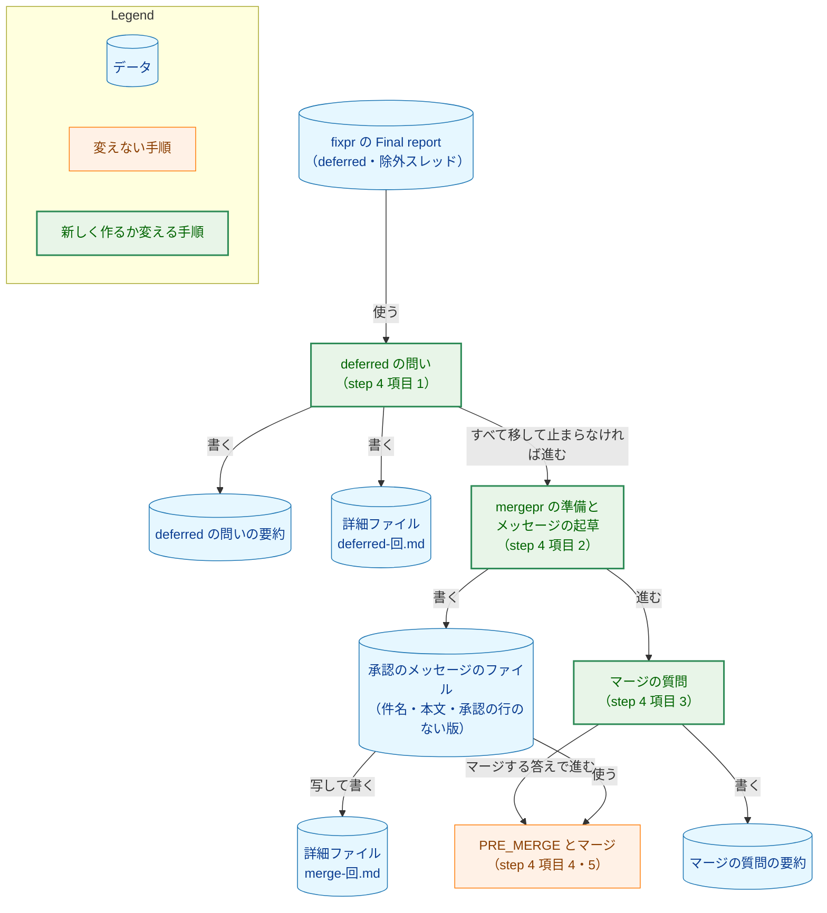
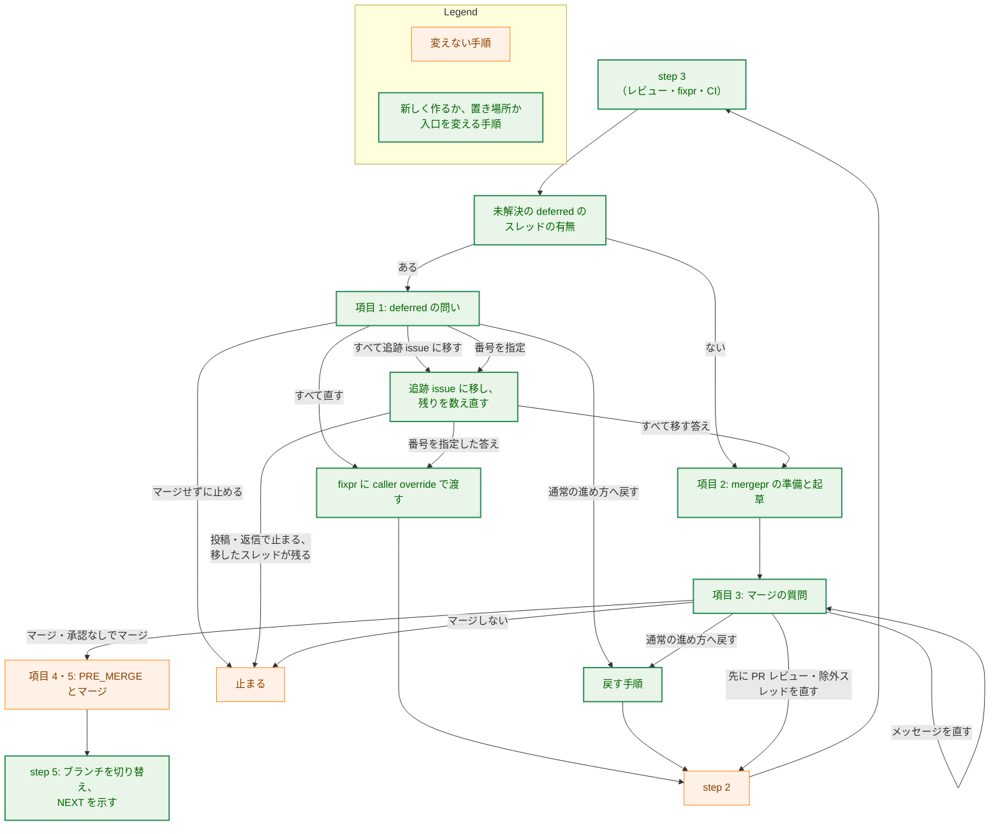
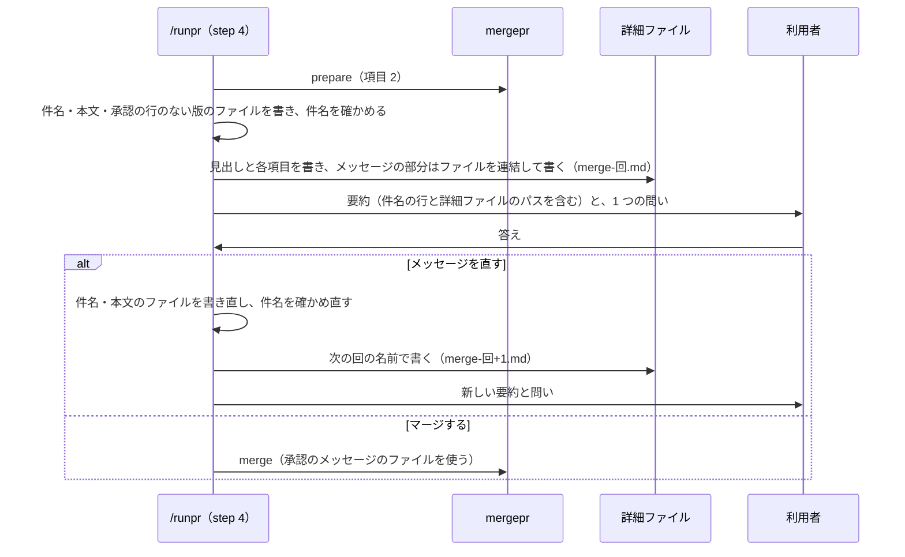
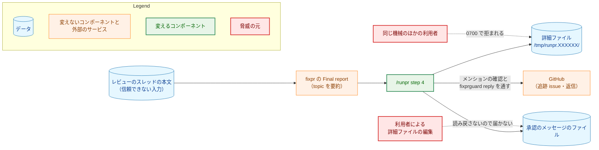
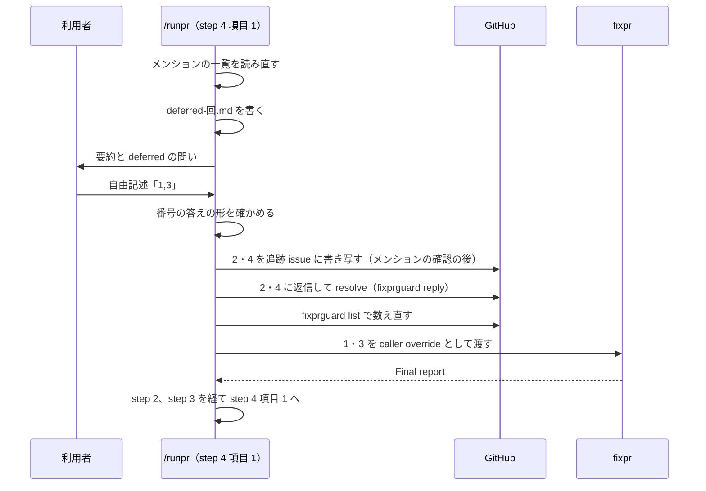

# アーキテクチャ設計書：/runpr のマージの質問を、画面に収まる 1 つの問いにする

## Document Status

| Item | Value |
|---|---|
| Status | `approved` |
| Created | 2026-11-12 |
| Review date | 2026-11-12 |
| Reviewer | isseis |
| Comments | - |

本書は [01_requirements.md](01_requirements.md)（要件定義書。以下、要件書）の設計である。既存のファイルの内容は、コミット `41b2d31e` で確かめた。`file:line` の行番号は、このコミットでの行番号である。F-NNN・AC-NN は要件書の項番を、H-NN は [design_handoff.md](design_handoff.md)（以下、設計の申し送り）の項番を指す。設計の申し送りへの対応は付録 A に、受け入れ基準との対応は付録 B にまとめる。

本書は、要件書 6 章の用語（マージの質問・deferred のスレッド・deferred の問い・除外スレッド・追跡 issue・詳細ファイル・要約・NEXT・PRE_MERGE・LAST_REVIEWED・Escalation・LIMITS_NOTE・旧値）を、要件書と同じ意味で使う。ただし、**要約**は、要件書ではマージの質問のメッセージだけを指すが、本書では deferred の問いのときに会話に出すメッセージも指す（3.1）。そのほかに、次の用語を使う。

-   **詳細ディレクトリ:** `/runpr` の 1 回の実行で 1 つ作る、詳細ファイルを置くディレクトリ（3.2）。
-   **問いの回:** 1 回の実行の中で、deferred の問いかマージの質問を尋ねるたびに 1 つ増える番号。1 から数える。詳細ファイルの名前と、question の文に使う（3.2）。
-   **承認のメッセージのファイル:** マージに使うメッセージの、唯一の元になるファイル。`mergepr.md` step 2 が準備のディレクトリに書く squash commit の件名のファイルと本文のファイル、および項目 2 で書く承認の行のない版の本文のファイル（3.2）。PRE_MERGE を記録する答えでは、準備を破棄する前にこれらを詳細ディレクトリへ写し、その写しでマージする（3.2）。
-   **番号の答え:** 自由記述の答えのうち、スレッドの番号だけを並べたもの。形は 3.1 で 1 回だけ定める。

## 1. 設計の全体像 (Design Overview)

### 1.1. 設計原則

-   **step の番号と見出しを変えずに、step 4 の中で組み替える。** deferred の問いは step 4 の新しい項目 1 にし、今の項目 1〜4 を 2〜5 に繰り下げる。`_lib/simple-process.md` は `runpr.md` の step 2〜4 と戻す手順を番号と見出しで参照し（`runpr.md:44-46`）、文書のガードのテストは step の見出しを定数として読む（`cmd/yt2column/fixpr_docs_test.go:42-44`、`cmd/yt2column/codex_review_docs_test.go:84`）。step の番号を保てば、それらを直さずに済む。変わる見出しは、要件どおり step 5 の 1 つだけである（AC-16）。
-   **人が読む本文は、マージに使うファイルそのものの写しにする。** 詳細ファイルの squash commit のメッセージの部分は、承認のメッセージのファイルをシェルで連結して作る。エージェントが打ち直すことはしない。詳細ファイルには、マージに渡すファイルの絶対パスも書くので、利用者はその中身を直接開ける（3.2）。
-   **マージに使うのは承認のメッセージのファイルだけで、詳細ファイルは読み戻さない。** 人が詳細ファイルを編集しても、マージのメッセージは変わらない（AC-12、H-01）。
-   **古い回の詳細ファイルを指さない。** 問いの回ごとに新しい名前のファイルを書き、前の回のファイルは上書きも再利用もしない。要約が示すパスは、常にその回のファイルである（AC-11、H-01）。
-   **今の手順を移し、写さない。** 追跡 issue に移す手順（`runpr.md:929-961`）は、マージの答えの後から deferred の問いの答えの後へ移す。戻す手順（`runpr.md:835-927`）は、deferred の問いからも同じ手順を呼び、読み替える点だけを書く。PR レビューを依頼する答え、承認なしでマージする答え、マージしない答え、PRE_MERGE の記録とマージの手順は、本書が挙げる点のほかは変えない（AC-18）。
-   **移した後も、残ったスレッドを数え直す。** 追跡 issue に移す手順を前へ移すと、マージの質問はもう deferred のスレッドを示さない。そのため、移した後に未解決のスレッドを読み直し、移したはずのスレッドが残っていれば止まる（3.6）。
-   **会話には 1 項目 1 行の要約、詳細はファイルに置く。** 要約の行の種類と形は 3.3 で固定し、どの PR でも 12 行を超えないようにする。値が長くなりうるもの（squash commit の本文、PRE_MERGE の行、diff 記録、旧値や読めない値の詳細、LIMITS_NOTE の全文）は、すべて詳細ファイルに置く（AC-06〜AC-09）。
-   **新しい道具とテストは足さない。** 変更は、コマンドの定義と、それを説明する文書だけである。テストの変更は、step 5 の見出しの定数 1 つだけにする（7 章、H-03）。

### 1.2. 設計の際に決めたこと（2026-11-12）

-   **deferred の問いは、`runpr.md` step 4 の新しい項目 1 に置き、今の項目 1〜4 を 2〜5 に繰り下げる（H-02）。** ADR: なし（`runpr.md` の中で閉じる配置であり、後のタスクもほかのコンポーネントも縛らないため）。
    -   **理由:** step の番号と見出しが変わらないので、`_lib/simple-process.md` の参照も、`postingSections` の節（`codex_review_docs_test.go:60-77`）と `TestFixprguardCallSites` の節（`fixpr_docs_test.go:726-730`）も、そのまま使える。`SectionByHeading` は同じ水準かそれより上の見出しまでを節とする（`internal/doctestutil/markdown.go:90-113`）ので、step 4 の中の項目はすべて step 4 の節に入る。戻す手順と同じ step にあるので、deferred の問いから戻す入口（AC-05a）も同じ節の中で書ける。step 4 の項目の番号を参照する箇所は、戻す手順 1 の「ask step 4 again, from its item 1」（`runpr.md:843`）だけで、ほかの文書は step 4 の項目を番号で参照していない（`git grep` で確かめた）。
    -   **採らなかった案:** step 3 の末尾に置く案。`postingSections` に step 3 の節を足し、step 3 のメンションの確認と投稿の命令の順序を新しく保つ必要がある。新しい step を作る案。後ろの step の番号がすべて変わり、`simple-process.md` とテストの定数を直すことになる。
-   **詳細ファイルは、実行ごとに `mktemp -d /tmp/runpr.XXXXXX` で作る詳細ディレクトリに、問いの回ごとに別の名前で書く（H-01）。** 名前は、deferred の問いでは `deferred-<回>.md`、マージの質問では `merge-<回>.md` とする（例: `/tmp/runpr.Ab12Cd/merge-3.md`）。Claude Code でも OpenCode でも、同じ場所に書く。ADR: なし（`runpr.md` の中で閉じる、ファイルの置き場所の決定であるため）。
    -   **理由:** パスは約 30 桁で、要約の 1 行として表示幅 80 桁に収まる（AC-07）。`mktemp -d` は、ほかの利用者が読めない（モード `0700`）、名前を推測できないディレクトリを作る。作業ツリーの外にあるので、`git status --short` の出力は変わらない（AC-06）。回ごとに別の名前にするので、エディタで開いたままの前の回のファイルと、今の回のファイルを取り違えない。OpenCode は、作業ディレクトリの外のパスを `external_directory` の権限で判定する。その公式ドキュメント「Permissions」は「The default policy allows `external_directory`, so external paths are not prompted unless you add a rule」と述べる（2026-11-12 に確かめた）。利用者の OpenCode の設定には、この権限の規則がない。
    -   **採らなかった案:** Claude Code ではスクラッチパッドに書く案。スクラッチパッドのパスは、worktree の名前とセッションの ID を含んで 100 桁を超え、AC-07 の 80 桁に収まらない。`mergepr prepare` の準備のディレクトリに書く案。linked worktree ではそれが作業ツリーの中にあり（`.claude/commands/mergepr.md:34-41`）、`discard` で消え、deferred の問いを尋ねる時点ではまだない（AC-01a）。`.claude/settings.json` に `/tmp/runpr.*` への書き込みの許可を足す案。エージェントの権限の設定を変えることになり、開発用の道具の信頼の境界に触れる。同じ名前のファイルに上書きする案。古い中身を開いたままの利用者が、取り違えうる。
    -   **受け入れること:** Claude Code では、権限のモードによって、詳細ディレクトリを作るときと詳細ファイルを書くときに承認を求められることがある。OpenCode でも、利用者が `external_directory` に `ask` の規則を足せば同じになる。そのときは、利用者がそのつど許可する。
-   **AC-22 の手動の確認は、見本の値で書いた要約と選択肢を、OpenCode のエージェントに `runpr.md` の書式どおりに出させて行う（H-04）。** ADR: なし（確かめ方はこのタスクの中で閉じるため）。
    -   **理由:** 画面に収まるかは、要約の行数と各行の長さ、question の文、選択肢の数と文言だけで決まり、値が本物かどうかには左右されない。AC-22 の状態（diff 記録の再記録、PR の説明に追記できなかった訂正、`#未記入` の行、期限が近い LIMITS_NOTE、読めない実装モデル要件がすべてそろう PR）を実際に作るのは、手間に見合わない。
    -   **採らなかった案:** AC-22 の状態をすべて満たす PR を作り、`/runpr` を走らせて確かめる案。
-   **マージの質問の question の 1 行に、PR 番号、問いの回、要約と詳細ファイルを確認するよう促す句を入れる（H-04）。** 例:「PR #859 をどうしますか（第 3 回。要約と詳細ファイルを確認のうえ）」。deferred の問いの question も、同じく問いの回を含める（3.1）。ADR: なし（文言はこのタスクの中で閉じるため）。
    -   **理由:** 0088 の chief は、質問と選択肢を画面のとおりに人へ示して中継し、送る直前に、それが人に示したときと同じであることを確かめる（[ADR-0046](../../dev/adr/0046-chief-of-staff.md)）。question の文に促す句を入れておけば、chief を通して答える人も、要約を見ずに選ぶことを避けやすい。問いの回を入れると、尋ね直した問いは前の回と文が変わる。そのため、前の回を見て選んだ答えは、chief の確かめで送られなくなる。question の文は 1 行のままなので、AC-10 を満たす。
    -   **採らなかった案:** question の文を PR 番号と問いだけにする案。尋ね直しても文が変わらず、前の回を見て選んだ答えが新しい回の答えとして送られうる。

**実装の際に決めたこと（2026-11-12）:** AC-22 の手動の確認は、利用者が普段使う OpenCode の環境で行う（要件書の「実装の際に決めたこと（2026-11-12）」）。高さ 24 行の pane に見本の表示を出したところ収まらなかったが、人が、普段の環境で十分に収まるとして受け入れた。理由：確かめたいのは、この利用者が実際に選べることだからである。9 章の description を除く直しは行わない。ADR: なし（確かめ方はこのタスクの中で閉じるため）。

### 1.3. なぜ今の仕組みでは足りないか

今のマージの質問は、`mergepr.md` step 3 の承認に要る項目（件名と本文の全文を含む）、PRE_MERGE、diff 記録の再記録、deferred と除外スレッド、NEXT とモデルを 1 つのメッセージに出す（`runpr.md:729-766`）。そして、最大 3 問を 1 回の `AskUserQuestion` で尋ねる（`runpr.md:766-806`）。問いの数を減らすだけでは、本文と PRE_MERGE が長い PR で、メッセージが画面からはみ出す。メッセージを短くするだけでは、3 つの問いの選択肢が画面からはみ出す。そのため、メッセージと問いの両方を変える必要がある（要件書 1 章）。deferred のスレッドを扱う問いを残したまま 1 問にまとめると、選択肢が 4 つを超える。そのため、deferred のスレッドは、マージの質問より前に尋ねる別の問いへ移す（F-001）。

### 1.4. 概念モデル

`/runpr` step 4 の 2 つの問いと、それぞれが書き、読むデータの関係を示す。矢印 A → B は、ラベルのとおり、A が B を書くこと、A を写して B を書くこと、A を B が使うこと、A の答えで B へ進むことのどれかを表す。



詳細ファイルからマージへの矢印はない。マージは承認のメッセージのファイルだけを使う（1.1）。

## 2. システム構成 (System Structure)

### 2.1. 全体構成

step 3 を終えてから step 5 に至るまでの流れを示す。矢印は処理の順を表し、ラベルはその分岐の条件か答えである。止まる経路のうち、戻す手順の中で止まる経路は、図を簡単にするために省く（今と同じである）。



`ISS` と `FIX` と `RET` の中身は今の手順である。変わるのは、それを呼ぶ場所と、`ISS` の後の数え直し（3.6）である（1.1）。PRE_MERGE の push が拒まれたとき、PRE_MERGE の後に新しいスレッドが現れたとき、マージの時に head が動いていたときは、今と同じく step 2 か step 3 に戻る（`runpr.md:968-991`）。そこから step 4 へ戻るときは、項目 1 から始める。そのため、新しく現れたスレッドが deferred のスレッドなら、マージの質問の前に deferred の問いを尋ねる（AC-11）。

### 2.2. コンポーネント配置

変えるファイルと、その変更の範囲を示す。新しく作るファイルはない。

| ファイル | 変更 | 関わる AC |
|---|---|---|
| `.claude/commands/runpr.md` | description（`:2`）、導入の段落（`:48-50`）、Authorization（`:82-83`、`:90-91`）、step 1 の LIMITS_NOTE の扱い（`:232-234`）、step 3 の deferred と Escalation の扱い（`:669`、`:672`、`:691`）、step 4 全体（`:712-991`）、step 5 の見出しと終わり方（`:993`、`:1035-1061`） | AC-01〜AC-18、AC-20、AC-21 |
| `.claude/commands/mergepr.md` | step 3 の「`runpr.md` の中で実行するとき」を述べる文（`:122-126`）だけ | AC-19 |
| `.claude/commands/fixpr.md` | deferred のスレッドを誰が尋ねるか（`:144-146`）と、caller override の呼び出し元（`:167-168`） | AC-21 |
| `.claude/commands/_lib/simple-process.md` | 除外スレッドと「fix all」の関係（`:334-339`）、戻す手順を呼ぶ箇所（`:364-367`）、THREADS の入力（`:380-384`） | AC-21、AC-05a |
| `.claude/commands/_lib/task-pr-handoff.md` | `/runpr` が 1 つの問いで次のコマンドを実行しうると述べる文（`:27-32`） | AC-20 |
| `CLAUDE.md` | 「Claude Commands」の `/runpr` の行（`:207`）と、その下の流れの説明（`:226-230`） | AC-20 |
| `docs/dev/conventions/requirements_process.md` | `/runpr` が 1 つの問いで次のコマンドを実行しうると述べる文（`:89`）と、3 文書の PR を戻せるのはマージの質問の答えだけだと述べる文（`:572-575`） | AC-20、AC-05a |
| `cmd/yt2column/codex_review_docs_test.go` | 定数 `runprStep5`（`:84`）を新しい見出しに合わせる | AC-16 |
| `docs/dev/adr/0047-runpr-merge-question.md`、`docs/dev/adr/0046-chief-of-staff.md` | 実装の PR で、0089 の実装を待つずれの記述を直す（3.10） | - |

### 2.3. データフロー

マージの質問の 1 回で、承認のメッセージが会話と詳細ファイルとマージにどう渡るかを示す。



詳細ファイルは、この図のどこでも読み戻さない。

## 3. コンポーネント設計 (Component Design)

本章の文言の例は、`runpr.md` が実際に出す文の形を示す。`runpr.md` は英語で書くが、要約・選択肢・詳細ファイルの文は、会話の言語である日本語で出すよう指示する（`CLAUDE.md`「Language」）。

### 3.1. deferred の問い（`runpr.md` step 4 項目 1。F-001、H-02、H-04）

**尋ねる時点（AC-01a）。** step 3 を最後まで終えて step 4 に来た時点で、未解決の deferred のスレッドがあれば尋ねる。step 3 は、次の場合に止まり、step 4 に来ない。信頼できないスレッドが残るとき（`runpr.md:689-706`）。deferred と除外スレッドのほかに未解決のスレッドがあるとき（`runpr.md:684-688`）。CI が通らないとき（`runpr.md:707-710`）。未コミットの変更があるとき（`runpr.md:646-652`）。そのため、step 4 の先頭に置けば、AC-01a の条件はそのまま満たされる。項目 1 は項目 2（`mergepr prepare`）より前にあるので、deferred の問いを尋ねる時点では、マージの準備はまだない。step 3 の、deferred のスレッドを「step 4 のために残す」とする 2 か所（`runpr.md:672`、`:691`）は、「step 4 の deferred の問いのために残す」と書き直す（AC-21）。

step 4 の冒頭の、問いの前に毎回メンションの一覧を読み直す規則（`runpr.md:717-720`）は、deferred の問いにも当てはめる。deferred の問いの答えは GitHub に投稿するので、問いの前に、ほかのアカウントのメンションがないことを確かめる。

対象は、最新の `fixpr` の Final report が deferred として挙げたスレッドで、`fixprguard list` の最新の出力で未解決のものである。除外スレッドは含めない（AC-05）。

**問いの形（AC-01）。** 1 つの問いだけを持つ単一選択の `AskUserQuestion` で、推奨の印はどの選択肢にも付けない。

-   **question の文:** 「PR #<番号> の deferred のスレッド <件数> 件をどうしますか（第 <回> 回。要約と詳細ファイルを確認のうえ）」。1 行である。
-   **選択肢（この順）:**

    | label | description | 示す条件 |
    |---|---|---|
    | すべて追跡 issue に移す | 追跡 issue に書き写し、各スレッドに返信して resolve する | 常に |
    | すべて直す | /fixpr で直し、レビューと CI を経てから次の問いへ進む | 常に |
    | 通常の進め方へ戻す | マージせず、要件定義書だけの PR に作り直す | 3 文書の PR のときだけ |
    | マージせずに止める | 何も投稿せずに止まる | 常に |

    選択肢は 3 つか 4 つで、`AskUserQuestion` の上限に収まる。

**要約（AC-01）。** 会話には、問いの前に次の行だけを出す。12 行以内である。

```text
deferred のスレッド: 4 件（PR #859）
[1] fixpr.md の round cap の説明が step 番号と合わない
[2] テストの名前が確かめる内容を表していない
[3] ...
[4] ...
一部だけ直す: 半角の番号を , か空白で区切る（例: 1,3）。残りは追跡 issue へ
要確認: 操作制限の期限が近い（2026-11-20、詳細ファイル）
詳細: /tmp/runpr.Ab12Cd/deferred-1.md
```

-   1 行目は件数と PR 番号、続く行はスレッドごとに番号と要旨を 1 行ずつ示す。要旨は `fixpr` の Final report の `topic` を基に `/runpr` が自分の言葉で書いたもので、スレッドの本文をそのまま写さない（要件書 4.2）。
-   固定の行は、件数の行、自由記述の行、詳細ファイルの行、LIMITS_NOTE の行（あるときだけ）の最大 4 行である。スレッドの行がこれと合わせて 12 行を超えるとき（スレッドが 9 件以上のとき）は、スレッドの行を出さずに「一覧は詳細ファイル」の 1 行に置き換え、一覧は詳細ファイルにだけ書く。AC-01 はこのとき「件数とパスだけ」を示すとするが、同じ AC が求める自由記述の行と、step 1 が求める LIMITS_NOTE の行（`runpr.md:232-234`）も残す。本書は、AC-01 の「件数とパス」を、スレッドの一覧の代わりに示すものと読む。
-   LIMITS_NOTE の行は、step 1 が「step 4 の問いのメッセージに含める」としているので、deferred の問いでも出す。会話には状態と期限だけを示し、全文は詳細ファイルに書く（AC-08 と同じ形）。
-   各行は表示幅 80 桁以内とする。要旨が収まらないときは、要旨を短く書き直す。

**詳細ファイル（AC-01）。** `deferred-<回>.md` に、次を書く。

-   PR 番号、head のコミット、問いの回、問いの種類。
-   各スレッドの番号、要旨、直すと何が変わるか、ファイルのパス、URL。
-   番号の答えの書き方（下の形）と、指定しなかったスレッドを追跡 issue に移すこと。
-   3 文書の PR では、追跡 issue に移したスレッドは、後で通常の進め方へ戻しても申し送りのファイルの項目にならないこと。戻すなら、この問いで「通常の進め方へ戻す」を選ぶこと（3.7）。
-   LIMITS_NOTE の全文（あるとき）。

**番号の答え（AC-01）。** `runpr.md` は、番号の答えの形をこの項目 1 で 1 回だけ定め、項目 3 の除外スレッドの番号はそれを参照する（3.4）。受け付けるのは、`1` から、その問いが示すスレッドの件数（項目 1 では deferred のスレッド、項目 3 では除外スレッドの件数）までの半角の整数を、半角の `,` か空白で区切って並べたものだけである。重複してはならず、ほかの文を含めてはならない。全角の数字や読点（`１，３`、`1、3`）は、直さずに受け付けない（`CLAUDE.md`「Reject, don't normalize」）。要約の自由記述の行が「半角の番号」と示すのは、このためである。

それ以外の答え（番号を読めない、範囲の外の番号を含む、重複がある、選択肢の答えや別の文と番号を混ぜている）では、何もせずに、新しい問いの回として同じ問いを尋ね直す。すべての番号を指定した答えは、「すべて直す」と同じに扱う。

step 3 の信頼できないスレッドの問いが受け付ける番号の自由記述（`runpr.md:695-697`）は、本タスクの範囲の外なので変えない。

**答えごとの動き。**

| 答え | 動き |
|---|---|
| すべて追跡 issue に移す | すべての deferred のスレッドを、3.6 の手順で移し、数え直す。止まらなければ項目 2 へ進む（AC-02） |
| 番号の答え | 指定しなかったスレッドを 3.6 の手順で移し、数え直す。そこで止まったら、直さずに止まる。止まらなければ、指定したスレッドの ID を caller override として `fixpr.md` に渡し（`fixpr.md:167-170`）、step 2 に戻る（AC-02、AC-03） |
| すべて直す | すべての deferred のスレッドの ID を caller override として `fixpr.md` に渡し、step 2 に戻る（AC-03） |
| 通常の進め方へ戻す（3 文書の PR） | 3.7 の読み替えで、戻す手順を行う（AC-05a） |
| マージせずに止める | 何も投稿せずに止まる。deferred のスレッドは未解決のまま残る（AC-04） |

step 2 に戻った後は、今の「deferred のスレッドを直す答え」（`runpr.md:823-828`）と同じく、step 3 を経て step 4 の項目 1 から始める。未解決の deferred のスレッドが残っていれば deferred の問いを尋ね、なければ項目 2 へ進む（AC-03）。どの答えでも、項目 1 ではマージしない。

番号の答えで、移した後に `fixpr` が止まったときは、`fixpr` の報告に加えて、追跡 issue の URL、移したスレッドの URL、直すはずだったまま未解決のスレッドの URL を報告する。直すはずだったスレッドは、次の実行では deferred の問いでもう一度選ぶ。

### 3.2. 詳細ディレクトリと詳細ファイル（F-002、H-01）

**場所と名前。** 1 回の実行で、最初の問いを尋ねる直前に `mktemp -d /tmp/runpr.XXXXXX` で詳細ディレクトリを 1 つ作る。以後、その実行のすべての問いの詳細ファイルを、そこに書く。ファイルの名前は `<種類>-<回>.md` で、種類は `deferred` か `merge`、回は問いの回である。回は deferred の問いとマージの質問で共通に数えるので、同じ名前のファイルは 1 回の実行の中に 2 つできない。尋ね直しも、新しい回である。書く前に、その名前のファイルがまだないことを確かめ、あれば書かずに止まる。回の数え違いで前の回のファイルを上書きしないためである。後の実行は、新しい詳細ディレクトリを作り、前の実行の詳細ディレクトリを使わない。

**書く時点と中身。**

-   deferred の問いは、問いを尋ねる直前に書く。中身は 3.1 のとおりである。
-   マージの質問は、承認のメッセージのファイルを書き、件名を確かめた後（`mergepr.md` step 2 の確認を通った後）、問いを尋ねる直前に書く。承認の行のない版の本文は、項目 2 で、件名と本文のファイルと同じ準備のディレクトリに、ファイルとして書く。今の `runpr.md` は、これを「second version」とだけ述べている（`runpr.md:724-725`）。詳細ファイルの中身は、AC-06 の項目のすべてである。
    -   PR の URL、ベースブランチ、CI の結果。
    -   squash commit の件名と本文の全文、承認の行のない版の本文（承認なしでマージする選択肢を示すとき）。この部分は、承認のメッセージのファイルを `cat` で詳細ファイルに連結して書き、エージェントが打ち直さない。あわせて、マージに渡すファイルの絶対パスを書く。
    -   接頭辞を決めた規則の記録（`mergepr.md` step 2）。
    -   PRE_MERGE の変更。どのファイルのどの行か、承認の行が書くレビュアーの名前と日付、PR 番号の記入の行を分けて書く。分けるのは、承認なしでマージする答えが記入の行だけを commit するためである（今の `runpr.md:732-735` と同じ）。
    -   diff 記録の再記録。AC の文、記録した出力と新しい出力の違い、新しい出力で AC が成り立つという判断を書く。
    -   PR の説明に追記できなかった編集上の訂正と、`#未記入` の行。
    -   3 文書の PR の除外スレッド。番号、除外の印、要旨、理由、URL を書く。
    -   Escalation の判定とその理由（未レビューの変更があるとき）。
    -   NEXT。NEXT が `/runplan` のときは、実装モデル要件の値と推奨するモデル、および読み方の詳細も書く。旧値ならその値と読み替えた値、読めない値なら値の文、値がないならその理由である（今の `runpr.md:748-761` の内容）。
    -   LIMITS_NOTE の全文（あるとき）。
-   どちらの詳細ファイルも、先頭に、PR 番号、head のコミット、問いの回、問いの種類と、「このファイルを編集しても、マージのメッセージもほかの動きも変わらない」旨を書く（H-01）。

**PRE_MERGE を記録するときの写し。** 今の `runpr.md` の項目 3（本書の項目 4）は、PRE_MERGE の commit の前に、承認された件名と本文のファイルをスクラッチパッドへ写してから準備を破棄し、その写しでマージする（`runpr.md:964-966`、`:986-987`）。スクラッチパッドは OpenCode にはないので、写す先を詳細ディレクトリに変える。写すのは、答えを決めた回の承認のメッセージのファイル（承認なしでマージする答えでは、件名のファイルと承認の行のない版の本文のファイル）で、名前は `approved-<回>.subject` と `approved-<回>.body` にし、詳細ファイルと区別する。写しは今のスクラッチパッドの写しと同じく、利用者が編集できる場所にある。人が写しを書き換えた場合は、承認したメッセージと同じであることを保証しない（今と同じ）。

**読み戻さない。** `/runpr` は詳細ファイルを読まない。マージは承認のメッセージのファイルか、その写しで行う。

**書けないとき。** 詳細ディレクトリを作れないとき、詳細ファイルを書けないとき、同じ名前のファイルがすでにあるときは、問いを尋ねずに止まり、何に失敗したかを報告する。マージの質問の詳細ファイルを書けないときは、止まる前に `mergepr discard --state <state-file>` を行う。詳細ファイルのない問いは尋ねない。

**報告。** 止まるときの報告と step 5 の最終の報告には、詳細ディレクトリのパスを書く。マージしたときは、マージを決めた回の詳細ファイルのパスと、その head のコミットも書く。詳細ファイルは、承認したものの記録だからである。

**片付け。** 詳細ディレクトリは、`/runpr` が消さない。マージの後に利用者が読み返せるようにするためである。`/tmp` に置くので、再起動や OS の定期の掃除で消えうる。中身については 5 章で扱う。

### 3.3. マージの質問の要約（AC-07〜AC-09、H-04）

会話には、問いの前に次の行だけを、この順で出す。括弧の中は、その行を出す条件である。

| 順 | 行の形（例） | 出す条件 |
|---|---|---|
| 1 | `PR #859 → main ／ CI: 成功` | 常に |
| 2 | `件名: docs(0089): draft the architecture ... (#859)` | 常に |
| 3 | `PRE_MERGE: 承認 1 件・PR 番号の記入 2 行（2 ファイル）` または `PRE_MERGE: なし` | 常に |
| 4 | `未レビューの変更: あり（Escalation: ask）` または `未レビューの変更: なし` | 常に |
| 5 | `除外スレッド: 2 件（番号で判定を覆せる）` | 3 文書の PR で、未解決の除外スレッドがあるとき |
| 6 | `NEXT: /runplan 0083（要件 sonnet → Sonnet）` など（下の表） | 常に |
| 7 | `要確認: diff 記録の再記録 1 件（詳細ファイル）` | 再記録があるとき |
| 8 | `要確認: PR の説明に追記できなかった訂正 2 件（詳細ファイル）` | 追記できなかった訂正があるとき |
| 9 | `要確認: #未記入 の行 1 件（詳細ファイル）` | `#未記入` の行があるとき |
| 10 | `要確認: 操作制限の期限が近い（2026-11-20、詳細ファイル）` | LIMITS_NOTE があるとき |
| 11 | `自由記述: メッセージの修正 ／ 除外スレッドの判定を半角の番号で覆す` | 常に（後半は、5 行目を出すときだけ） |
| 12 | `詳細: /tmp/runpr.Ab12Cd/merge-3.md` | 常に |

-   **行数（AC-07）。** 行の種類は 12 で、各種類は最大 1 行である。どの PR でも 12 行を超えない。AC-22 の 2 つの状態は、(1) 5 行目のない 11 行、(2) 12 行のすべてである。
-   **桁（AC-07）。** 2 行目のほかは、固定の文と短い値（PR 番号、ベースブランチ、件数、日付、タスク ID、実装モデル要件の値、モデル名、詳細ファイルのパス）だけからなる。全角の文字を 2 桁と数えて 80 桁以内に収まるよう、文言を決める。2 行目は、承認する件名を省かずに示すため、桁の上限を設けない。
-   **2 行目。** 件名のファイルは、`mergepr.md` step 2 が確かめ済みである。要約の件名は、そのファイルから表示のために書くもので、マージには件名のファイルを使う。同じ件名は、詳細ファイルにもファイルの連結で書く（3.2）。
-   **3 行目（AC-07）。** 変えるファイルの数と行の数、承認か PR 番号の記入かを示す。どのファイルのどの行かは、詳細ファイルに書く。
-   **4 行目（AC-07）。** 未レビューの変更があるのは、LAST_REVIEWED が head より前か、ないときである（今の `runpr.md:776-777` と同じ）。そのとき、Escalation の判定（`ask`・`skip` など）を同じ行に示す。理由は詳細ファイルに書く。step 3 が Escalation の `ask` の理由を「step 4 の PR レビューの問い」へ持ち越すとする記述（`runpr.md:669`）は、マージの質問の「先に PR レビューを依頼」の選択肢と詳細ファイルへ持ち越す、と書き直す。
-   **7〜10 行目（AC-08）。** 該当するものがある種類だけを出す。7〜9 行目は種類と件数を示し、10 行目は件数ではなく状態と期限を示す。
-   **6 行目（AC-09）。** 次の形にする。

    | NEXT | 6 行目の形 |
    |---|---|
    | ない | `NEXT: なし` |
    | `/runplan`、値が 3 つの値のどれか | `NEXT: /runplan 0083（要件 sonnet → Sonnet）` |
    | `/runplan`、旧値 | `NEXT: /runplan 0083（要件 standard＝sonnet → Sonnet）` |
    | `/runplan`、読めない値 | `NEXT: /runplan 0083（要件の値を読めない、推奨モデルなし）` |
    | `/runplan`、値がない | `NEXT: /runplan 0083（要件の値がない、推奨モデルなし）` |
    | `/mkarch`・`/mkplan` | `NEXT: /mkarch 0089` |

    読めない値の文と、値がない理由は、詳細ファイルに書く。実装モデル要件の値と推奨するモデルの読み方は、今と同じく `_context.md`「PR marker conventions」に従う。step 5 は、今と同じく、マージを決めた回の問いで示した値とモデルを使う（`runpr.md:763-766`）。

squash commit の本文、接頭辞を決めた規則の記録、承認の行のない版は、会話に出さない（AC-07）。

### 3.4. マージの質問の問いと選択肢（F-003、AC-10、AC-13〜AC-15、AC-17）

**問い。** 1 つの問いだけを持つ単一選択の `AskUserQuestion` である（AC-13）。question の文は「PR #<番号> をどうしますか（第 <回> 回。要約と詳細ファイルを確認のうえ）」の 1 行で、要約の行も詳細ファイルの中身も含まない（AC-10、1.2）。

**選択肢（除外スレッドが残っていないとき。AC-14）。** 次の表の条件に合うものを、表の順に示す。

| label | description | 示す条件 | 推奨 |
|---|---|---|---|
| 先に PR レビューを依頼 | Codex に PR レビューを頼み、終わったらこの問いに戻る | 未レビューの変更があり、Escalation の判定が `ask` のとき | 推奨 |
| PRE_MERGE を記録してマージ（PRE_MERGE がないときは「マージ」） | 要約の件名と詳細ファイルの本文でマージする | 常に | `ask` でないとき推奨 |
| 先に PR レビューを依頼 | （同上） | 未レビューの変更があり、Escalation の判定が `ask` でないとき | しない |
| 承認なしでマージ | 文書は draft のまま、承認の行のない本文でマージする | 今と同じ条件（`runpr.md:788-799`） | しない |
| 通常の進め方へ戻す | マージせず、要件定義書だけの PR に作り直す | 3 文書の PR | しない |
| マージしない | 何もせずに止まる | 常に。最後に置く | しない |

「先に PR レビューを依頼」は、1 行目か 3 行目のどちらか一方だけに示す。「承認なしでマージ」は 3 文書の PR に示さないので、「通常の進め方へ戻す」と同時には示されない。そのため、示す選択肢は最大 4 つである。推奨は、label の後に推奨の印を付けて示す（`AskUserQuestion` の決まり）。「承認なしでマージ」が PR 番号の記入をするかどうかは、詳細ファイルの PRE_MERGE の項で示す。

**選択肢（3 文書の PR で除外スレッドが残っているとき。AC-15）。** 「先に PR レビューを依頼」（未レビューの変更があるときだけ。`ask` なら推奨）、「通常の進め方へ戻す」、「マージしない」だけを、この順に示す。2 つか 3 つである。

**自由記述（AC-17）。** 要約の 11 行目が、自由記述でできる操作を示す。自由記述の答えは、どれもマージしない。選択肢を選んだことにもならない。

-   **除外スレッドの判定を覆す（除外スレッドがあるときだけ）:** 3.1 の番号の答えの形のときだけ、これに当たる。番号は要約と詳細ファイルの除外スレッドの番号である。今と同じく、覆すスレッドとして `<threadId>=<fingerprint>` の形で `fixpr.md` に渡し（`runpr.md:829-833`）、`mergepr discard` をして step 2 に戻る（AC-15）。
-   **番号に見えるが番号の答えでない答え:** 半角の数字と区切りだけからなるが、範囲の外の番号や重複を含む答え、除外スレッドがないときの番号は、メッセージを直さずに、新しい回として項目 3 を尋ね直す。
-   **メッセージを直す:** 上の 2 つに当たらない自由記述は、すべてメッセージを直す求めとして扱う。今と同じく、件名と本文のファイル（と承認の行のない版のファイル）を書き直し、件名を `mergepr.md` step 2 と同じく確かめ直す（`runpr.md:808-811`）。そのうえで、項目 3 を新しい問いの回として尋ね直す。マージの準備は残っているので、項目 1・2 には戻らない（AC-12）。「件名を直してマージ」のように書かれても、直して尋ね直すだけで、マージしない。

「NEXT をこのセッションで実行」の選択肢はない（AC-16）。

### 3.5. 答えの後の手順（AC-11、AC-12、AC-18）

項目 3 の答えを受けた手順は、今の `runpr.md:808-991` から、次の 4 点だけを変える（AC-18）。

1.  **deferred のスレッドの手順の移動。** 「deferred threads to fix now」の答え（`runpr.md:823-828`）と、マージの答えの前に追跡 issue に移す手順（`runpr.md:929-961`）を、項目 1 に移す（3.1、3.6）。除外スレッドを覆す答え（`runpr.md:829-833`）は、自由記述の答えとして項目 3 に残す。
2.  **NEXT を実行する答えの削除と step 5（AC-16）。** 「record PRE_MERGE, merge, and run NEXT in this session」（`runpr.md:786-787`）と、それを受ける step 5 の分岐（`runpr.md:1039-1041`）を除く（3.8）。
3.  **尋ね直しのたびの書き直し（AC-11）と、マージのメッセージ（AC-12）。** 項目 3 を尋ねるたびに、そのときの head と承認のメッセージのファイルから、新しい回の詳細ファイルと要約を書く。尋ね直す場面は、今と同じである（6.2）。そのうちメッセージを直した場合のほかは、step 2 と step 3 を経て項目 1 から始め直すので、新しい deferred のスレッドがあれば、先に deferred の問いを尋ねる。マージする答えは、その回の承認のメッセージのファイル（承認なしでマージする答えでは承認の行のない版）でマージする。PRE_MERGE を記録するときは、3.2 のとおり、その写しを詳細ディレクトリに置いてマージに使う。
4.  **deferred の問いから戻す入口（AC-05a）。** 戻す手順に、項目 1 から入るときの読み替えを足す（3.7）。

本書のほかの節が足す変更は、この 4 点のどれかに当たる。追跡 issue を覚えておくこと、移した後の数え直し、止まったときの報告（3.6）、戻す手順 1 で `fixprguard list` を呼んで THREADS を未解決のものに限ること（3.7）は、1 点目の移動に伴う。移動によって、最新の Final report が resolve 済みのスレッドを挙げたままになりうるためである。7.2 の AC-18 の diff の確かめでは、これらの変更を、上の 4 点のうち対応するものとして読む。承認の行のない版をファイルにすること、PRE_MERGE のときの写し先、詳細ファイルのパスを報告すること（3.2）は、3 点目のメッセージの扱いに当たる。

PR レビューを依頼する答え（`runpr.md:815-821`）、承認なしでマージする答え（`runpr.md:788-799`）、通常の進め方へ戻す答え（`runpr.md:835-927`）、マージしない答え（`runpr.md:812-813`）、PRE_MERGE の記録とマージ（`runpr.md:962-991`）は、上の点のほかは変えない。

マージの答えは、追跡 issue に移す手順を通らなくなる。そのため、マージの答えの後からマージまでの間に、issue への投稿もスレッドへの返信もなくなる。

**step 4 の冒頭の文。** 「Ask the user once」（`runpr.md:714-715`）は、deferred のスレッドがあるときは、その前に deferred の問いを尋ねることを書き足す。マージの質問は今と同じく 1 回である。

### 3.6. 追跡 issue に移す手順の移動（AC-02、H-03）

今の `runpr.md:929-961` の手順を、項目 1 へ移す。追跡 issue を探し（`gh issue list --state open --search "PR #<number> のレビュー指摘の追跡 in:title"`）、すでに書いたスレッドを除き、投稿する文と各スレッドへの返信にメンションの確認をし、`gh issue comment` か `gh issue create` で書き、`fixprguard reply` で返信して resolve する。変えるのは、次の 4 点である。

1.  **止まるとき。** 今は止まる前に `mergepr discard --state <state-file>` をする（`runpr.md:939-940`、`:955-957`）。移した後はマージの準備がまだないので、準備を破棄せずに止まる。報告の中身（止まったスレッドの URL と止まった種類、`reply-not-resolved` のときは手で resolve するよう頼むこと、追跡 issue にはもう書いてあること）は変えない。
2.  **追跡 issue を覚えておく。** 項目 1 は、1 回の実行の中で何度も通りうる。見つけたか作った追跡 issue の番号は、その実行の間覚えておき、2 回目からは探さずにそれを使う。GitHub の検索は作ったばかりの issue をすぐには見つけないことがあり、2 つ目の追跡 issue を作らないためである。
3.  **数え直す。** 移した後、項目 2 へ進む前（番号の答えでは `fixpr` を呼ぶ前）に、`fixprguard list` で未解決のスレッドを読み直す。移すはずだったスレッドのどれかが未解決のまま残っていれば、止まって、そのスレッドの URL を報告する。たとえば、前の実行の `reply-not-resolved` で止まったスレッドは、追跡 issue にもう書いてあるので、今の手順では返信も resolve もせずに飛ばす。数え直さないと、それが未解決のまま、deferred のスレッドを示さないマージの質問へ進んでしまう。
4.  **止まったときの報告。** 3.1 のとおり、移した後に止まったときは、追跡 issue の URL と、移したスレッドと残ったスレッドの URL を報告する。

追跡 issue に移したスレッドは、後のマージの質問でどの答えを選んでも、移して resolve した状態のまま残る（AC-02）。

**文書のガードのテストへの影響（H-03）。** 手順は step 4 の節の中に残るので、`postingSections` の「runpr.md step 4」の節と命令の一覧（`codex_review_docs_test.go:65-68`）は、そのまま当てはまる。`TestPostingCommandsInventory` は、各節で最初の `**Mention check.**` が、その節の投稿の命令より前にあることを確かめる（`codex_review_docs_test.go:200-259`）。移した後は、step 4 の最初の投稿の命令が項目 1 の `gh issue comment`・`gh issue create` になる。その前に、項目 1 のメンションの確認の段落を置く。今の step 4 でも、最初のメンションの確認は戻す手順 5 にあり、それより後に最初の投稿の命令（戻す手順 5 の `fixprguard edit-pr`）がある。この関係を保つ。`TestFixprguardCallSites` の step 4 の `fixprguard reply ` も、そのまま当てはまる（`fixpr_docs_test.go:729`）。

### 3.7. 戻す手順の入口と THREADS（AC-05a、H-02）

戻す手順（今の `runpr.md:835-927`）を、項目 3 の答えからだけでなく、項目 1 の答えからも行う。項目 1 から入るときは、戻す手順 1 の準備の破棄（`runpr.md:840`）を行わない。マージの準備がまだないからである。手順 2〜7 は変えない。

**ほかの答えと混ぜた答えと REASON。** 戻す手順 1 は、戻す答えとほかの答えを混ぜた答えを尋ね直し（`runpr.md:842-843`）、REASON を答えの自由記述から取る（`runpr.md:843-845`）。どちらの問いも単一選択の 1 問になるので、「通常の進め方へ戻す」は選択肢でだけ選ばれる。選択肢の答えには自由記述が付かないので、REASON は `理由の記載なし` になる。自由記述は、3.1 と 3.4 の規則で番号の答えかメッセージを直す求めとして扱うので、戻す答えと混ざることはない。混ぜた答えを尋ね直す文と REASON の規則（推測しないこと）は、AC-18 の限定に従って変えずに残す。混ぜた答えの文は、今後は起こらない場合を述べるだけになるが、害はない。この結果、戻した理由は要件定義書に `理由の記載なし` と記録される。理由は、利用者が後で PR の説明か要件定義書の決定の項に書ける。

**THREADS。** 今の THREADS は、最新の `fixpr` の Final report の deferred と除外スレッドのうち、パスが `02_architecture.md` か `03_implementation_plan.md` のものである（`simple-process.md:380-384`）。項目 1 で追跡 issue に移した後に、項目 3 で戻すと、その間に `fixpr` が走らないことがある。そのとき、最新の Final report は、移して resolve したスレッドも挙げたままである。そのまま使うと、そのスレッドを申し送りのファイルの項目にも書き、戻す手順 6 で resolve 済みのスレッドに返信しようとして止まる。

そこで、戻す手順 1 に `fixprguard list` の呼び出しを 1 つ足し（今の戻す手順 1 は、それを呼ばない。`runpr.md:840-849`）、THREADS を、最新の Final report のスレッドのうち、その出力に同じ `threadId` が未解決として現れるものに限る。各スレッドの `databaseId`・`fingerprint` などは、今と同じく Final report から取る。項目 1 から戻すときは、まだ何も移していないので、deferred のスレッドはすべて申し送りのファイルの項目になる。

足す呼び出しは step 4 の節の中にある。`fixprguard list` の呼び出しの場所を確かめるテスト（`TestFixprguardCallSites`）は、step 3 に `list` があることだけを確かめるので、テストは変わらない。

`simple-process.md` の「Returning to the full process」の冒頭（`:364-367`）の「`/runpr` runs this from step 4, return step 2」には、項目 1 からも入ることを書き足し、THREADS の定義（`:380-384`）を上のとおりに改める（AC-21）。

戻す手順 7（`runpr.md:924-927`）の後は、step 2、step 3 を経て step 4 の項目 1 から始め直す。戻した後の PR は 3 文書の PR ではないので、`01_requirements.md` に残る deferred のスレッドがあれば、deferred の問いを、「通常の進め方へ戻す」のない形で尋ねる。

### 3.8. step 5 と、`/runpr` を説明する文（AC-16、AC-20）

-   **step 5 の見出し:** `## 5. Switch branch, then show NEXT` にする。NEXT を実行すると述べない。
-   **step 5 の終わり方（`runpr.md:1035-1048`）:** 「answer chose to run NEXT」の分岐を除く。NEXT があり、次のブランチの用意が終わったときは、`/clear` の案内（`runpr.md:1052-1061`）を付けて最終の状態を報告して終わる。最終の報告には、3.2 のとおり、マージを決めた回の詳細ファイルのパスを書く。用意の前に止まったときの報告（`runpr.md:1063-1103`）の「whichever Merge option the answer chose, and do not run NEXT」は、選んだ選択肢による区別がなくなるので、「do not run NEXT」を除く。
-   **AC-20 の記述:** 次の記述を、「次のコマンドを示し、実行しない」と述べるように書き直す。あわせて、「1 つの問い（one question）」と述べる箇所は、deferred のスレッドがあればその前に deferred の問いを尋ねることがわかるように書き直す。
    -   `runpr.md:2`（description）と `runpr.md:48-50`。
    -   `runpr.md:90-91`（Authorization の「the next command (NEXT) when the user chooses to run it in step 4」）。この句を除く。
    -   `CLAUDE.md:207` と `CLAUDE.md:226-230`。
    -   `_lib/task-pr-handoff.md:27-32`。
    -   `requirements_process.md:89`。
-   **Authorization の追跡 issue（`runpr.md:82-83`、AC-21）:** 「the deferred findings the user moves to an issue in step 4」を、「in step 4's deferred question」に書き直す。

### 3.9. `mergepr.md` と、deferred のスレッドを説明する文（AC-19、AC-21）

-   **`mergepr.md` step 3（AC-19）:** 「When this command runs inside `runpr.md`」で始まる文（`mergepr.md:122-126`）だけを書き直す。新しい文は次の 2 点を述べる。`runpr.md` step 4 は、件名を会話に、本文と接頭辞を決めた規則の記録を作業ツリーの外の詳細ファイルに示してマージの質問を尋ねること。マージの質問は次のコマンドを実行するかを尋ねないこと。PRE_MERGE とあわせて尋ねること、記録の commit の後に準備をやり直す方法を `runpr.md` が述べることは、今の文のまま残す。単独の `/mergepr` の振る舞いを述べる文（`mergepr.md:118-122` の、この文より前の部分）は変えない。
-   **`fixpr.md`（AC-21）:** `:144-146` の「`runpr.md` step 4 asks whether to fix each one now or move it to an issue」を、step 4 の deferred の問いで尋ねると書き直す。`:167-168` の caller override の呼び出し元「`runpr.md` step 4, the ones the user chose」を、step 4 の deferred の問いで利用者が選んだもの、と書き直す。除外スレッドを述べる `:157`、`:184`、`:494`、`:1192` は、除外スレッドを step 4 のマージの質問で扱う点が変わらないので、変えない。
-   **`simple-process.md`（AC-21）:** `:334-339` は、除外スレッドを step 4 のマージの質問で示し、判定を覆すスレッドを番号で選ぶことを述べる形にする。「fix all」は deferred の問いの選択肢で、除外スレッドを含まないことを書く（AC-05）。マージの質問で示す選択肢が「通常の進め方へ戻す」と「マージしない」に限られることは、「先に PR レビューを依頼」が加わりうることとあわせて書く（AC-15）。戻す手順を呼ぶ箇所と THREADS は、3.7 のとおりに改める。
-   **`requirements_process.md`（AC-05a）:** 「Simple Process」の「Returning to the full process」の冒頭（`:572-575`）は、3 文書の PR を通常の進め方へ戻せるのを `/runpr` のマージの質問の答えか `/runpr` への依頼だけとしている。deferred の問いの答えでも戻せることを書き足す。ほかの文は変えない。

### 3.10. ADR

このタスクの決定は、要件定義の PR（#859）で [ADR-0047](../../dev/adr/0047-runpr-merge-question.md) を作り、[ADR-0040](../../dev/adr/0040-simple-task-documents.md) と [ADR-0046](../../dev/adr/0046-chief-of-staff.md) を更新して記録した。本書の 1.2 の決定は、どれも主要な決定に当たらない（各項の ADR の判断）。本書の設計は、ADR-0047 の「決定」の各項と合う。そのため、この PR では ADR を変えない。

実装の PR は、0089 の実装を待つずれの記述を、[adr.md](../../dev/conventions/adr.md) の扱いに従って直す。ADR-0047 の「この決定は、まだ…反映していない」の文を除く。ADR-0046 の「0089 の実装より前は、この答えを中継しない」の句（`docs/dev/adr/0046-chief-of-staff.md:41`）も、0089 の実装で前提を失うので、その文の残りとあわせて直す。

## 4. エラーハンドリング設計 (Error Handling Design)

### 4.1. 実行時のエラー

コマンドの定義だけを変え、Go の型もエラーの型も足さない。N/A。

### 4.2. 手順の中で止まる場合

| 場面 | 止まり方 | 報告 |
|---|---|---|
| 詳細ディレクトリを作れない、詳細ファイルを書けない、同じ名前のファイルがすでにある | 問いを尋ねずに止まる。マージの質問の詳細ファイルなら、先に `mergepr discard` をする | 失敗した操作とパス |
| deferred の問いの前のメンションの一覧に、ほかのアカウントのメンションがある | 今の step 3 の「Mentions by other accounts」のとおり止まるか尋ねる | 今と同じ |
| 追跡 issue の文か返信が、メンションの確認に通らない | 投稿せずに止まる。準備の破棄はない | 今と同じ（3.6）、加えて追跡 issue と移したスレッドの URL |
| `fixprguard reply` が止まる | 止まる。準備の破棄はない | 止まったスレッドの URL と止まった種類。今と同じ |
| 移した後の数え直しで、移すはずのスレッドが残っている | 止まる | 残ったスレッドの URL と追跡 issue の URL |
| 番号の答えで、移した後に `fixpr` が止まる | 止まる | `fixpr` の報告に加え、追跡 issue、移したスレッド、未解決のまま残るスレッドの URL |
| deferred の問いの自由記述が番号の答えでない | 止まらず、新しい回として尋ね直す | なし |

どの場合も、詳細ファイルのない問いは尋ねず、問いを尋ねた後に詳細ファイルを読み戻して判断を変えることもない。

## 5. セキュリティ考慮事項 (Security Considerations)

### 5.1. 脅威モデル

実線の矢印 A → B は「A が B に届きうる」を表す。点線の矢印は、届こうとするが設計が止める経路を表し、ラベルが止める仕組みを示す。この図では、`problem` の色を脅威の元に使う（Legend のとおり）。



-   **詳細ファイルの中身。** squash commit の件名と本文、PRE_MERGE の行、スレッドの要旨と URL など、PR と GitHub にすでにあるか、マージで `main` に入る情報である。秘密（API キー、Webhook の URL）は含まない。どこにも送らない（要件書 4.2）。
-   **ほかの利用者。** 詳細ディレクトリは `mktemp -d` が作るので、名前を推測できず、モードは `0700` である。ほかの利用者は読めず、先にシンボリックリンクを置いて書き込み先を差し替えることもできない。
-   **見せたものとマージするものの食い違い。** 詳細ファイルのメッセージの部分は、承認のメッセージのファイルを連結して作り、エージェントが打ち直さない（3.2）。マージは承認のメッセージのファイルか、その写しだけで行い、詳細ファイルは読み戻さない（1.1）。回ごとに別の名前にし、同じ名前のファイルがあれば止まるので、要約が古い回のファイルを指すことはない（3.2）。
-   **前の回を見て選んだ答え。** question の文に問いの回を入れるので、chief を通した答えでも、前の回の答えは新しい回の答えとして送られない（1.2）。
-   **信頼できないスレッドの本文。** 要旨は、今と同じく `/runpr` が自分の言葉で書いたデータで、指示として読まない。deferred の問いでも、スレッドの本文を取りに行かない（`fixprguard list` は本文を出さない。`runpr.md:12-19`）。
-   **GitHub への投稿。** 追跡 issue への投稿とスレッドへの返信は、投稿する時点が前に移るだけで、今と同じメンションの確認と `fixprguard reply` を通す（AC-02、3.6）。移した後に数え直すので、移しきれなかったスレッドを残したままマージの質問へは進まない（3.6）。

### 5.2. 残余のリスク

-   **要約の件名の行。** 要約の 2 行目は、エージェントが件名のファイルから会話に書く表示である。今のマージの質問でも件名と本文を会話に書いており、同じである。マージに使うのは件名のファイルで、その文字は `mergepr.md` step 2 が確かめる。詳細ファイルには件名がファイルの連結で入る。
-   **chief を通した承認。** chief を通して答える人は、question の文と選択肢を見るが、要約と詳細ファイルを見るかは人による（ADR-0046）。question の文は要約と詳細ファイルの確認を促すが、見ないまま選ぶことは防げない。今のマージの質問でも、chief が示すのは質問と選択肢である。
-   **詳細ディレクトリの残り。** `/runpr` は詳細ディレクトリを消さないので、`/tmp` に残る。中身は 5.1 のとおりで、秘密を含まないので受け入れる。後の実行は新しいディレクトリを作るので、古いものを使うことはない。
-   **権限の確認。** Claude Code では、権限のモードによって、詳細ファイルを書くたびに承認を求められうる（1.2）。承認を求められても、安全の側に倒れる。chief は権限の確認を中継しないので、そのときは人がその pane で答える。

## 6. 処理フロー詳細 (Processing Flow Details)

### 6.1. deferred の問いで番号の答えを選んだとき



追跡 issue への投稿か返信で止まったとき、数え直しで 2・4 のどれかが残っていたときは、`fixpr` を呼ばずに止まる（AC-03）。

### 6.2. マージの質問の尋ね直し

| 尋ね直す理由 | たどる道 | 詳細ファイル |
|---|---|---|
| メッセージを直す | 項目 3 | 新しい回の `merge-<回>.md` |
| 先に PR レビューを依頼 | レビューを待ち、開いたスレッドを step 3 のとおり扱う → step 2 → step 3 → 項目 1 | 新しい回 |
| 除外スレッドの判定を覆す | step 2 → step 3 → 項目 1 | 新しい回 |
| PRE_MERGE の push が拒まれた | step 2 → step 3 → 項目 1 | 新しい回 |
| PRE_MERGE の後に新しいスレッドが現れた | step 3 → step 2 → step 3 → 項目 1 | 新しい回 |
| マージの時に head が動いていた | step 2 → step 3 → 項目 1 | 新しい回 |

## 7. テスト戦略 (Test Strategy)

### 7.1. ユニットテスト

-   **直すテスト:** `cmd/yt2column/codex_review_docs_test.go:84` の定数 `runprStep5` を、新しい見出し `## 5. Switch branch, then show NEXT` に合わせる。この定数を使う `postingSections` の「runpr.md step 5」（`gh issue close`）は、ほかは変えない。
-   **そのまま当てはまるテスト:** `postingSections` の step 4 の節と命令の一覧、`TestPostingPathsCheckMention`、`TestPostingCommandsInventory`、`TestFixprguardCallSites`、`cmd/fixprguard/docs_test.go` の `runpr.md` の呼び出しの検査、`TestRunprDocContract`。3.6 のとおり、step 4 の中の順序の関係を保つので、これらは変えずに通る。実装の後に `make test` で確かめる。
-   **足さないテスト:** 要約の行の形、選択肢の文言、問いの数は、文の意味に当たる。そのため、テストにせず PR のレビューで読む（`CLAUDE.md`「Testing Strategy」の文書のテストの規則、[ADR-0016](../../dev/adr/0016-document-test-policy.md)、H-03）。

### 7.2. 読んで確かめる（manual）と diff の確かめ

-   AC-01〜AC-17、AC-20、AC-21 は、実装の PR のレビューで、`runpr.md` ほかの記述を読んで確かめる。
-   AC-18（step 4・5 の答えを受けた手順の diff の限定）と AC-19（`mergepr.md` の diff の限定）は、マージベースとの diff を読んで記録する（`requirements_process.md` §4「`diff` verification」）。AC-18 の 4 種類に加わる変更は、3.5 の対応で読む。
-   AC-22 は、1.2 のとおり、利用者が普段使う OpenCode の環境（高さ 24 行の pane に限らない。1.3 の前の「実装の際に決めたこと（2026-11-12）」）で、見本の値で書いた要約と選択肢を出して確かめる。次の 3 つを出す。(1) 要約 11 行と選択肢 4 つ（タスク文書の PR）。(2) 要約 12 行と選択肢 3 つ（3 文書の PR で除外スレッドあり）。(3) deferred のスレッドが 4 件の deferred の問い。それぞれで、すべての選択肢が画面の中に見えて選べることを確かめ、画面の写しか所見を PR に記録する。

### 7.3. 結合テスト・セキュリティテスト

-   結合テスト: N/A。コマンドの定義の文書だけを変える。実装の PR を `/runpr` で回すとき、その PR のマージの質問が新しい形で出ることを、あわせて見る。
-   セキュリティテスト: メンションの確認は、7.1 の既存のテストが step 4 の節で確かめ続ける。

## 8. 実装の優先順位 (Implementation Priorities)

変更は、コマンドの定義、その説明の文書、テストの定数 1 つで、互いに参照し合う。そのため、1 本の PR で行う。順序は次のとおりである。

1.  `runpr.md` step 4 の組み替え（項目 1 の deferred の問い、移した後の数え直し、項目 2 の承認の行のない版のファイル、項目 3 の要約と詳細ファイルと問い、答えの後の手順、PRE_MERGE のときの写し先、戻す入口）と、step 1・step 3 の記述。
2.  `runpr.md` step 5 の見出しと終わり方、description、導入の段落、Authorization。テストの定数 `runprStep5`。
3.  `mergepr.md`、`fixpr.md`、`_lib/simple-process.md`、`_lib/task-pr-handoff.md`、`CLAUDE.md`、`requirements_process.md`。
4.  ADR-0047 と ADR-0046 の、0089 の実装を待つずれの記述を直す。
5.  `make test`・`make lint`、AC-18・AC-19 の diff の確かめ、AC-22 の手動の確認。

## 9. 将来の拡張 (Future Extensibility)

-   0088 の chief は、deferred の問いとマージの質問の選択肢を中継できる。どちらも、1 つの問いだけを持つ単一選択の問いだからである。番号とメッセージの修正の自由記述は中継しないので、人がその pane で答える（ADR-0046）。
-   AC-22 の確かめで画面に収まらなかったときは、選択肢の description を除いて行を減らせる。これは文言の変更で、本書の構成は変わらない。
-   この変更より前に分岐したブランチの PR では、`/runpr` を始めたブランチの `runpr.md` と、PR のブランチの `mergepr.md`・`simple-process.md` が食い違うことがある。利用者は 1 人で、どちらの形でも誤ったマージにはならないので、要件書 4.4 のとおり移行の仕組みは設けない。揃えたいときは、PR のブランチに `main` を取り込んでから `/runpr` を走らせる。

## 付録 A: 申し送り（design_handoff.md）への対応

| 項目 | とった方針 | 本書の箇所 |
|---|---|---|
| H-01（詳細ファイルの場所・名前、古い中身で承認しない書き方） | `mktemp -d /tmp/runpr.XXXXXX` の詳細ディレクトリに、問いの回ごとに別の名前で書き、同じ名前のファイルがあれば止まる。メッセージの部分は承認のメッセージのファイルを連結して書き、マージはそのファイルだけで行い、詳細ファイルは読み戻さない。編集しても変わらないことを詳細ファイルの先頭に書く。PR 番号と head は、名前ではなく詳細ファイルの先頭に書く（パスを 80 桁に収めるため）。候補の「準備のディレクトリ」は、作業ツリーの中にあり、deferred の問いの時点ではまだないので採らない | 1.2、3.2、5.1 |
| H-02（deferred の問いの置き場所） | step 4 の新しい項目 1 に置き、今の項目を 2〜5 に繰り下げる。戻す手順の読み替えは、項目 1 から入るときに準備を破棄しないことだけ。混ぜた答えの規則は起こらなくなるが、AC-18 の限定に従って残す | 1.2、3.1、3.7 |
| H-03（文書のガードのテストの直し方） | 手順は step 4 の節に残るので、`postingSections` は変えない。変えるのは step 5 の見出しの定数だけ。文言と要約の形はテストにしない | 3.6、7.1 |
| H-04（要約の行と選択肢の文言、chief への配慮、画面の見積もり、AC-22 の確かめ方） | 要約の 12 種類の行と選択肢の文言を固定した。question の 1 行で問いの回を示し、要約と詳細ファイルの確認を促す。AC-22 は見本の値で表示を再現して確かめる。画面の見積もりは下に示す | 1.2、3.1、3.3、3.4、7.2 |

**画面の行の見積もり（H-04）。** 高さ 24 行の pane で、AC-22 の (1) は、要約 11 行、question の 1 行、選択肢 4 つ（label と description で各 2 行として 8 行）、自由記述の欄 1 行、OpenCode の枠と区切りで約 23〜24 行になる。(2) は、要約 12 行、question の 1 行、選択肢 3 つ（6 行）、自由記述の欄 1 行と枠で約 22〜23 行になる。どちらも上限に近い。OpenCode の質問の画面の正確な行数は、AC-22 の手動の確認で確かめる。収まらなければ、9 章のとおり description を除く。

## 付録 B: 受け入れ基準との対応

| AC | 本書の箇所 |
|---|---|
| AC-01 | 3.1（問いの形、要約、詳細ファイル、番号の答え） |
| AC-01a | 3.1（尋ねる時点） |
| AC-02 | 3.1（答えごとの動き）、3.6 |
| AC-03 | 3.1（答えごとの動き）、6.1 |
| AC-04 | 3.1（答えごとの動き） |
| AC-05 | 3.1（対象）、3.9（`simple-process.md`） |
| AC-05a | 3.7 |
| AC-06 | 3.2 |
| AC-07 | 3.3 |
| AC-08 | 3.3（7〜10 行目） |
| AC-09 | 3.3（6 行目） |
| AC-10 | 3.4（問い） |
| AC-11 | 3.5（3 点目）、6.2 |
| AC-12 | 1.1、3.2（読み戻さない、PRE_MERGE のときの写し）、3.4（メッセージを直す） |
| AC-13 | 3.4（問い） |
| AC-14 | 3.4（除外スレッドが残っていないとき） |
| AC-15 | 3.4（除外スレッドが残っているとき） |
| AC-16 | 3.4、3.5（2 点目）、3.8 |
| AC-17 | 3.3（11 行目）、3.4（自由記述） |
| AC-18 | 3.5、7.2 |
| AC-19 | 3.9、7.2 |
| AC-20 | 3.8 |
| AC-21 | 3.1、3.7、3.8、3.9 |
| AC-22 | 1.2、7.2、付録 A（画面の行の見積もり） |

## 変更履歴

- 2026-11-12 承認（isseis、#863）
- 2026-11-12 セッション中の再承認：AC-22 の手動の確認の環境を、高さ 24 行の pane から利用者が普段使う環境に改めた（isseis、#未記入）
