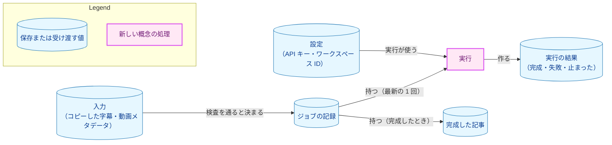
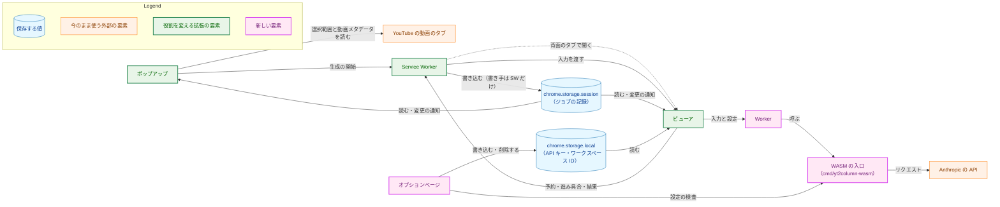
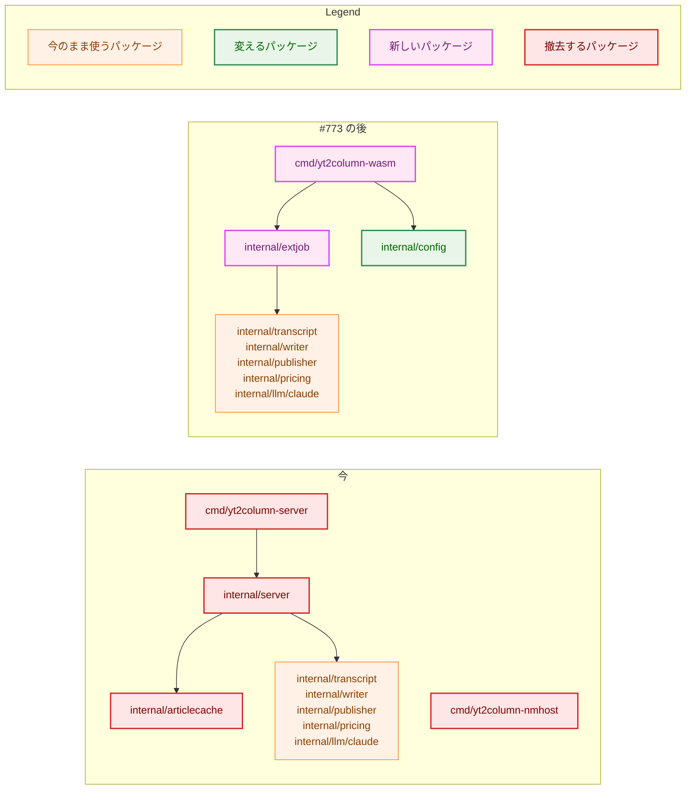
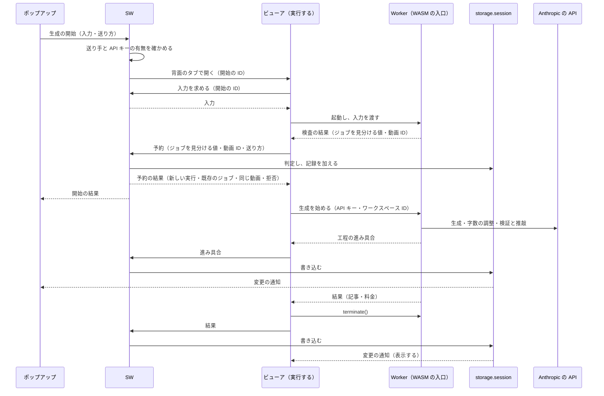
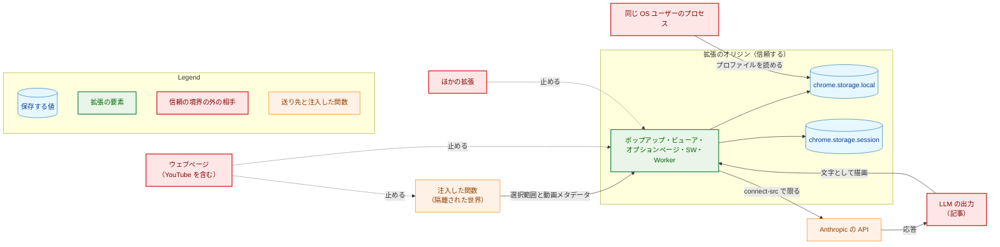
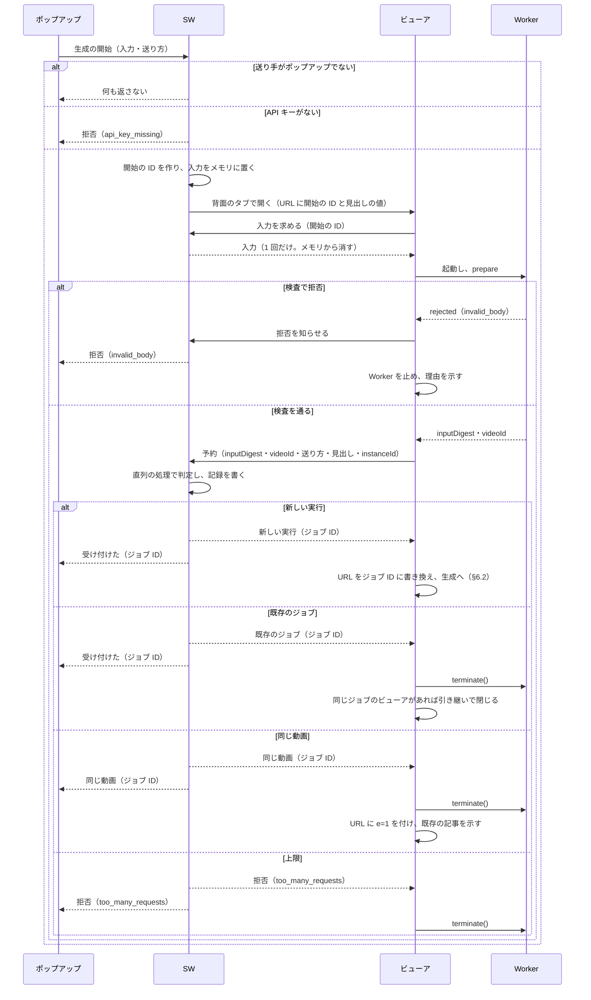
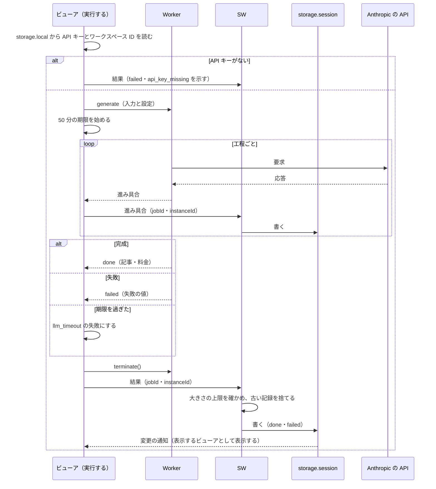
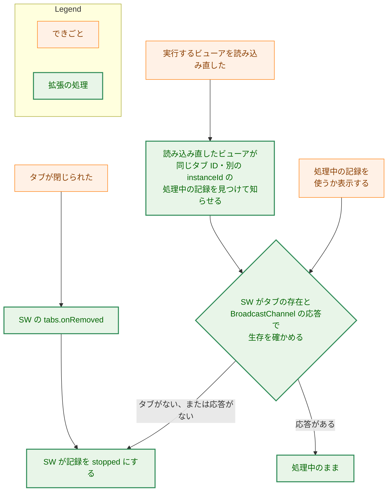
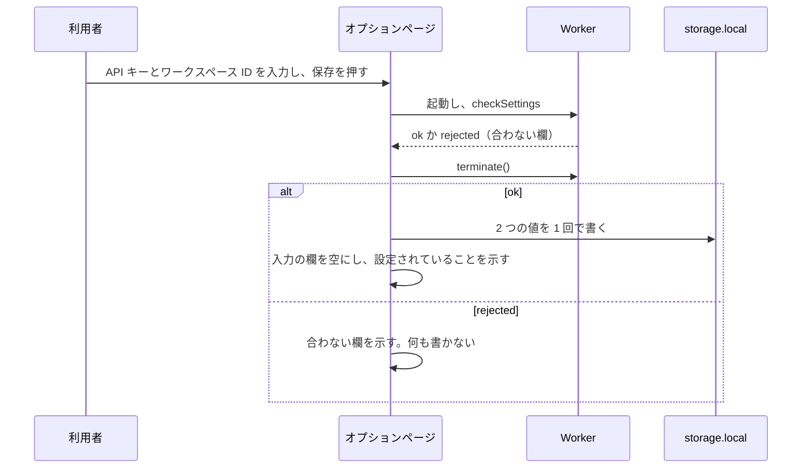

# アーキテクチャ設計書：記事を拡張だけで作る構成

## Document Status

| Item | Value |
|---|---|
| Status | `draft` |
| Created | 2026-11-12 |
| Review date | - |
| Reviewer | - |
| Comments | - |

## 1. 設計の全体像 (Design Overview)

本書は、[01_requirements.md](01_requirements.md)（以下、要件書）が定める「拡張だけの構成」を設計する。拡張だけの構成では、localhost サーバと Native Messaging のホストを使わない。ブラウザ拡張が、Go の記事を作る処理を WebAssembly（WASM）にしたものを自分のページで動かし、利用者の API キーで Claude API を直接呼ぶ。本書の決定は ADR に記録する（§3.15）。実装は [#773](https://github.com/isseis/yt2column/issues/773) が行う。本タスクは、`cmd/`・`internal/`・`extension/` を変えない。

本書の用語は要件書 §6 による。加えて、次の語を使う。

-   **SW:** 拡張の Service Worker。
-   **ジョブ:** 1 つの入力（コピーした字幕と動画メタデータ）についての記事の生成の記録の単位。同じ入力の実行は、同じジョブに属する。
-   **ジョブの記録:** ジョブの状態と、完成した記事を持つ値。`chrome.storage.session` に置く（§3.2）。
-   **ジョブ ID:** ジョブを指す不透明な値。今の記事のキーに当たる（§3.2.2）。
-   **実行するビューア:** 記事の生成を実行しているビューアのタブ。実行するビューアは、専用の Web Worker（以下、Worker）を 1 つ起動し、その中で WASM を動かす（§3.4）。
-   **表示するビューア:** 記事の生成を実行せず、ジョブの記録を表示するだけのビューアのタブ。実行するビューアは、実行を終えると表示するビューアになる。
-   **WASM の入口:** Go の `cmd/yt2column-wasm` を WASM にしたもの。拡張のページは、JavaScript の関数として呼ぶ（§3.1）。

### 1.1. 設計原則

-   **記事を作る規則は、Go の 1 か所に置く。** 入力の検査、字幕の解析、3 つの工程、完了の時点の検査、メンションの無効化、保存するファイルの中身、料金の概算は、CLI と拡張で同じ Go のコードを使う（要件書 AC-12・§4.5）。拡張の TypeScript は、収集、調停、表示、保存の手段だけを持つ。
-   **状態の正しい値は 1 か所に置き、書き手を 1 つにする。** ジョブの記録は `chrome.storage.session` に置き、書き込むのは SW だけにする。同じ入力・同じ動画の判定と記録の追加を、SW の 1 つの直列の処理で行い、二重の生成を防ぐ（§3.3）。
-   **生成はページの寿命に従う。** 記事の生成は、それを実行するビューアのタブの中の Worker だけが行う。タブが閉じられれば止まり、ほかの場所で続かない（[ADR-0048](../../dev/adr/0048-extension-only-generation.md)、要件書 AC-08）。
-   **料金のかかる操作は、利用者の明示の操作のときだけ行い、自動で繰り返さない。** 生成を始めるのは、ポップアップのボタンの押下だけである（[ADR-0008](../../dev/adr/0008-launch-path.md)・[ADR-0028](../../dev/adr/0028-no-automatic-resend.md)、要件書 AC-07）。
-   **API キーは、保存する場所と Anthropic の API へのリクエストのほかに出さない。** 送信の守りは二重にする。Go の送信がリダイレクトを拒否し、拡張のページの Content Security Policy（CSP）が Anthropic の API のほかの先への送信を止める（§5.3）。
-   **受理する形に合わない値は、補正せずに拒否する。** どの境界でも同じである（CLAUDE.md「Reject, don't normalize」、§5.2）。
-   **測った値と確かめた振る舞いだけを前提にする。** 測った値は調査記録の節を挙げて引用する。確かめていない振る舞いは、マージの前に実測するか、外れたときの決定を用意して受け入れる（§3.13）。

### 1.2. 設計の際に決めたこと（2026-11-12）

-   **記事の生成は、ビューアのタブの中の専用の Web Worker で実行し、完成か失敗で Worker を止める（§3.4）。** SW は、ポップアップのボタンが押されると、今と同じくビューアを背面のタブで開く。そのビューアが Worker を 1 つ起動し、Worker が WASM の入口を読み込んで記事を生成する。完成か失敗の後、ビューアは `Worker.terminate()` を呼び、表示するビューアになる。WASM を読み込んだまま開き続けたページは、1 枚ごとに数十 MB のメモリを使い続けるためである（[申し送り](design_handoff.md) H-12）。PoC は、このメモリを、記事の生成を実行したタブの試行の前後で 61.6〜85.8 MB と測った（[調査記録](../../research/wasm_pipeline_poc/README.md)「測定 6：本番の構成（Chrome、`83ef12bd`、背面のまま）」）。採らなかった案は、ビューアのメインスレッドで動かして完成の後に読み込み直す案と、Offscreen Document で動かす案である。前者は、読み込み直すときに画面が切り替わり、状態の知らせが途切れうる。後者は、拡張に 1 つしか置けず、ビューアを閉じても止まらないので、生成の寿命をページの寿命とする決定（ADR-0048）から外れる。背面で開いたまま一度も前面にならないタブで Worker が完走することは、マージの前に確かめる（下の項目）。ADR: [ADR-0009](../../dev/adr/0009-viewer-opening.md) と ADR-0048 を更新した。
-   **記事を作る処理は、Go のコアを WASM にして CLI と共有する（§3.1）。** 規則を Go の 1 か所に保ち、要件書 §4.5 の「同じ規則を、Go と TypeScript の両方に書かない」を満たすためである。TypeScript に一本化する案は採らなかった。字幕の解析、メンションの無効化、3 つの工程、料金の概算を TypeScript で書き直すことになり、CLI が Go の同じ規則を持ち続けるので、規則が 2 つになる。WASM のサイズ（17,300,194 バイト、`gzip -9` で 4,138,823 バイト）と読み込みの時間（Chrome で 62.4〜171.2 ms、Brave で 49.9〜206.5 ms）は受け入れる（調査記録「測定 2：読み込みと CSP、サイズと読み込みの時間」）。読み込みは生成 1 回に 1 度で、生成の所要時間（本番の構成で 95〜151 秒。調査記録「測定 6」）に比べて小さいためである。ADR: [ADR-0049](../../dev/adr/0049-wasm-core-sharing.md) を新設し、[ADR-0019](../../dev/adr/0019-pipeline-component-interfaces.md) と [ADR-0026](../../dev/adr/0026-extension-platform.md) を更新した。
-   **ジョブの記録は `chrome.storage.session` に置き、書き込むのは SW だけにする（§3.2・§3.3）。** 実行するビューアは、工程の進み具合と結果を SW へ知らせる。SW は、同じ入力・同じ動画の判定と記録の追加を、1 つの直列の処理の中で行う。ポップアップとビューアは、記録を読み、`chrome.storage.onChanged` で表示を更新する。状態の取得のポーリングはやめる。探すことと始めることが分かれると、同時に押された 2 つの開始がどちらも記事を見つけず、同じ動画の記事を二重に生成しうるためである（申し送り H-06）。採らなかった案は、処理中の状態を実行するページが持ち、ほかのページが `BroadcastChannel` で尋ねる案である。ページの間の問い合わせが増え、判定の排他を保つのが難しい。ADR: [ADR-0027](../../dev/adr/0027-article-job-api.md)・[ADR-0010](../../dev/adr/0010-extension-stores-nothing.md)・ADR-0008 を更新した。
-   **API キーとワークスペース ID は、オプションページで設定する（§3.6）。** 記事を描画するビューアとも、生成の操作をするポップアップとも、画面を分けるためである。採らなかった案は、ポップアップの中に設定の欄を置く案である。画面が狭く、生成の操作と混ざる。ADR: ADR-0010 と ADR-0008 を更新した。
-   **確かめていない事項のうち、構成の前提になる 4 つを、設計の PR のマージの前に PoC で確かめる（§3.13）。** (a) 一度も前面にならなかった背面のビューアのタブで、Worker の中の WASM が記事を完成させるか。(b) Worker からの送信で、リダイレクトの拒否と、CSP の `connect-src` による送り先の制限が効くか。(c) `chrome.storage.local` を、注入したスクリプトから読めなくできるか。(d) `chrome.storage.session` の容量の上限。ほかの項目は確かめずに受け入れ、外れたときに変わる決定を記録する。前提が外れたまま #773 が実装すると、構成を作り直すことになるためである。確かめるためのコードは、PoC のブランチ `poc/0090-extension-only-checks` に置き、`main` には入れない（要件書 AC-22）。ADR: なし（確かめ方の決定で、本タスクの中で閉じる。結果は、ADR-0048 と ADR-0049 の背景に根拠として引用する）。
-   **Opus で 40,000 トークンを出力する長さの、ストリーミングなしの応答は、確かめずに受け入れる（§3.13）。** 見積もりは約 313〜408 秒で、呼び出しごとの期限（15 分）の半分以下である（調査記録「問い 3：ストリーミングは要るか」）。外れたときは、Claude アダプタにストリーミングを加える。ADR: なし（受け入れの判断で、外れたときの決定は [ADR-0025](../../dev/adr/0025-claude-output-limit.md) を改める決定になる）。
-   **タスク 0086 は、PR-1（fake の LLM の部品と依存の検査）だけを実装し、開発用のサーバ（PR-2）と、その文書と手動の確認（PR-3）は行わない（§3.9）。** fake の部品を開発用の拡張のビルドにつなぐのは、#773 が行う。開発用のサーバは、廃止するサーバの上に作る計画で、#773 で撤去するまでの短い間しか使わないためである。0086 の計画の書き換えは、0086 の側の PR で行う。ADR: [ADR-0045](../../dev/adr/0045-dev-fake-llm.md) を更新した。
-   **拡張が要求する Chrome の最小の版を 112 に上げる（§3.7.3）。** `chrome.storage.session` の容量は、Chrome 112 から約 10 MB で、111 以前は 1 MB である（§3.12 の C-04）。記事を持つ上限（§3.2.3）を 1 つの値にするためである。採らなかった案は、110 のままにする案である。111 以前では記事を 1 MB しか持てず、上限を版ごとに変えることになる。ADR: [ADR-0030](../../dev/adr/0030-minimum-chrome-version.md) を更新した。
-   **manifest の `key` は残し、Web Store の項目を作るときに Web Store の公開鍵に置き換える（§3.7.3）。** 置き換えは、Web Store の申請を扱う issue（§3.12）の作業にする。開発用に読み込んだ拡張の ID を、ワークツリーによらず同じにし、Web Store から導入した拡張の ID とも同じにするためである。ID が変わると、`chrome.storage.local` に保存した API キーは引き継がれない。採らなかった案は、`key` を除く案である。読み込んだディレクトリごとに ID が変わり、ワークツリーを替えるたびに API キーを入れ直すことになる。ADR: ADR-0026 を更新した。
-   **公式の文書の取得を承認した。** AC-20 の外部の条件と、Chrome の拡張の API の振る舞いを、公式の文書で確かめるためである。取得したのは公開の文書だけで、利用者と本プロジェクトの情報は送っていない。ADR: なし（作業の承認である）。

### 1.3. 概念モデル

拡張だけの構成の主な概念と、その関係を示す。矢印 A → B は、「A が B を持つ、または作る」を表す。



-   ジョブは、入力ごとに 1 つである。同じ入力の開始は、ジョブが処理中か完成していれば、生成を始めずにそのジョブを示す。失敗したか止まったジョブは、同じ入力の開始で、同じジョブ ID のまま生成し直す（今の「失敗したキーは生成し直す」と同じ。ADR-0027）。
-   ジョブの記録は、最新の実行の状態だけを持つ。過去の実行の結果は持たない。
-   ジョブの記録は、コピーした字幕を持たない（要件書 AC-09）。字幕は、実行するビューアの Worker のメモリにだけあり、実行の終わりとともに消える。

## 2. システム構成 (System Structure)

### 2.1. 全体の構成

拡張だけの構成の要素と、その間の受け渡しを示す。矢印 A → B は、「A が B へ値を渡すか、B を呼ぶ」を表す。点線の矢印は、ページを開く操作を表す。



-   オプションページも、設定の検査のために Worker を 1 つ起動して WASM の入口を呼ぶ。図では、オプションページから WASM の入口への矢印にまとめた（§3.6）。
-   今の構成の Native Messaging のホスト（`cmd/yt2column-nmhost`）と localhost サーバ（`cmd/yt2column-server`）は、この図にない。#773 が撤去する（§3.14）。

### 2.2. コンポーネント配置

| 置き場所 | 役割 | 今との違い |
|---|---|---|
| ポップアップ | 起動したタブの選択範囲と動画メタデータを読み、生成の開始を SW に頼む。開始の結果と、ジョブの記録の状態を表示する。同じ動画の記事があれば、既存の記事を表示するか、現在の選択範囲で生成するかを選ばせる | 状態の取得のポーリングをやめ、ジョブの記録を読む。API キーが設定されていないときに、オプションページを開く操作を示す |
| SW | 生成の開始を、拡張自身のポップアップからだけ受け付ける。ビューアを背面のタブで開き、入力をビューアに渡す。予約（同じ入力・同じ動画の判定と記録の追加）、進み具合と結果の書き込み、止まった実行の判定を、1 つの直列の処理で行う。ジョブの記録の唯一の書き手である | ホストへの送信をやめ、ジョブの記録の書き手と調停役になる |
| ビューア | 実行するビューアは、Worker を起動して記事を生成し、進み具合と結果を SW に知らせる。表示するビューアは、ジョブの記録を表示し、保存とコピーを行う | 状態の取得のポーリングをやめる。実行するビューアの役割が加わる |
| Worker | 実行するビューアとオプションページが起動する専用の Web Worker。WASM の入口を読み込んで呼ぶ。拡張の API（`chrome.*`）は使わない | 新しい |
| WASM の入口 | 入力の検査、ジョブを見分ける値の計算、記事の生成、完了の時点の検査、表示とコピーと保存の値の組み立て、設定の検査を行う | 新しい。今の `internal/server` の生成の組み立てを引き継ぐ |
| オプションページ | API キーとワークスペース ID を設定・変更・削除する | 新しい |
| `chrome.storage.local` | API キーとワークスペース ID を、ブラウザの再起動の後も残る形で持つ | 新しい |
| `chrome.storage.session` | ジョブの記録を、ブラウザを終了するまでメモリに持つ | 新しい。今はサーバのメモリの記事のキャッシュ |

### 2.3. Go のパッケージの構成

#773 の前と後の、記事を作る処理に関わるパッケージの依存を示す。矢印 A → B は、「A が B を import する」を表す。



-   **`internal/extjob`（新しい）:** 拡張のジョブ 1 回分の処理を持つ。入力の検査（今の `internal/server` の `validateBody` の規則）、ジョブを見分ける値の計算（今の `internal/articlecache` の記事のキーの計算から、秘密の鍵を除いたもの）、記事の生成と工程の進み具合の通知、完了の時点の検査（今の `completeGeneration`）、結果の組み立て（今の `articleStatus`）、失敗の分類（今の `classifyWrite` に、API キーが拒まれたことを加えたもの）である。CLI は使わない。
-   **`cmd/yt2column-wasm`（新しい）:** `GOOS=js GOARCH=wasm` だけでビルドする `main` のパッケージ。`syscall/js` で JavaScript の関数を登録し、JSON の文字列を厳格に検査して `internal/extjob` と `internal/config` に渡す（§3.1）。
-   **`internal/config`（変える）:** 拡張の入口のために、LLM の設定だけを読む関数を加える。今の `LoadServer` が設定ファイルから LLM の設定を読む部分を引き継ぎ、名前を引く関数として、拡張が保存した 2 つの値だけを渡す（§3.1.3）。サーバとホストの設定の読み込み（`LoadServer`・`LoadHost`・`LoadHostHome`、設定ファイルとソケットのパスの導出）は撤去する。
-   **撤去するパッケージ:** サーバとホストだけが使うもの。`cmd/yt2column-server`・`cmd/yt2column-nmhost`・`internal/server`・`internal/articlecache`・`internal/serversock`・`internal/nmhost`・`internal/privatefile` と、それらだけが使うテストの補助（`internal/udstest` の一部など）である。どのパッケージがサーバとホストだけから使われるかは、#773 が `go list -deps` で確かめてから撤去する。`internal/cachelock`・`internal/signalrun`・`internal/redact` は CLI も使うので残す（`cmd/yt2column` が import する。2026-11-12 の `main`（`28358348`）で確かめた）。

### 2.4. データの流れ

生成の開始から記事の表示までのデータの流れを示す。詳しい手順と失敗の経路は §6 にある。



## 3. コンポーネント設計 (Component Design)

### 3.1. WASM の入口と、CLI と共有する処理

#### 3.1.1. 共有する処理の範囲

WASM の入口は、記事を作る処理のうち、次のすべてを Go のコードで行う。拡張の TypeScript は、これらの規則を持たない。

| 処理 | 置き場所 | CLI との共有 |
|---|---|---|
| 生成の開始の入力の検査（動画の URL、コピーした字幕、動画のタイトル・チャンネル名・概要欄） | `internal/transcript`・`internal/extjob` | 動画の URL の検査と字幕の解析を共有する |
| ジョブを見分ける値と動画 ID の計算 | `internal/extjob` | 拡張だけが使う |
| 3 つの工程（生成、字数の調整、検証・推敲） | `internal/writer`・`internal/llm/claude` | 共有する |
| 完了の時点の検査（`CheckPublishable` と、結果の大きさの上限） | `internal/writer`・`internal/extjob` | `CheckPublishable` を共有する |
| メンションの無効化（表示とコピーの値、見出しの値） | `internal/publisher` | 共有する（CLI は使わない） |
| 保存するファイルの中身（`--out` と同じバイト列） | `internal/publisher` | 共有する |
| 料金の概算 | `internal/pricing` | 共有する |
| API キーとワークスペース ID の検査 | `internal/config`・`internal/llm/llmhttp`・`internal/llm/claudeparam` | 共有する |

-   要件書 AC-15 の「メンションの無効化、保存するファイルの中身、完了の時点の検査を、共有する処理に含めるかどうか」は、3 つとも含める。今のサーバと同じ値を、同じコードで作るためである（[ADR-0043](../../dev/adr/0043-copy-mention-neutralization.md) の「規則を Go の 1 か所に置き、拡張に同じ規則を二重に書かない」）。
-   プロンプトのテンプレートは、埋め込みのものだけを使う。WASM の入口は、上書きのファイルを読まない（今のサーバと同じ。[ADR-0034](../../dev/adr/0034-template-allowlist.md)）。

#### 3.1.2. 入口が JavaScript に登録する関数

WASM の入口は、`globalThis` に 1 つの名前空間のオブジェクトを登録し、次の 3 つの関数を持たせる。どの関数も、引数を 1 つの JSON の文字列で受け取り、結果を 1 つの JSON の文字列で返す（`generate` は Promise で返す）。入力の JSON は厳格に検査し（`internal/strictjson`。§5.2）、合わなければ固定の理由で拒否する。結果の JSON の形は、ビューアの TypeScript が受理する形で検査する（§5.2）。

```typescript
// The functions the WASM entry registers. Each takes and returns one JSON
// string; the shapes below are the JSON values, not JS objects.
interface Yt2ColumnWasm {
  // Checks the settings the options page is about to save.
  checkSettings(request: string /* SettingsCheckRequest */): string /* SettingsCheckResult */;
  // Validates a start input and computes the values the reservation needs.
  prepare(request: string /* PrepareRequest */): string /* PrepareResult */;
  // Runs one generation of a prepared input. onProgress receives a
  // ProgressEvent JSON string at each step change.
  generate(request: string /* GenerateRequest */, onProgress: (event: string) => void): Promise<string /* GenerateResult */>;
}

type SettingsCheckRequest = { anthropicApiKey: string; anthropicWorkspaceId: string };
type SettingsCheckResult =
  | { status: "ok" }
  | { status: "rejected"; fields: Array<"anthropicApiKey" | "anthropicWorkspaceId"> };

type PrepareRequest = {
  videoUrl: string; transcript: string;
  title?: string; channelName?: string; description?: string;
};
type PrepareResult =
  | { status: "ok"; inputDigest: string; videoId: string }
  | { status: "rejected"; reason: StartRejection };

type GenerateRequest = PrepareRequest & {
  anthropicApiKey: string; anthropicWorkspaceId: string;
};
type ProgressEvent = { steps: Steps };
type GenerateResult =
  | { status: "done"; steps: Steps; article: ArticleResult }
  | { status: "failed"; steps: Steps; failure: Failure };

type ArticleResult = {
  markdown: string; mentionsNeutralized: boolean;
  videoTitle: string; channelName: string;
  file: string; cost: { state: "known"; usd: string } | { state: "unknown" };
};
```

-   `inputDigest` は、検査を通った後の 5 つの値（正規化した動画の URL、字幕、省略を空文字列としたタイトル・チャンネル名・概要欄）から計算する SHA-256 の 64 文字の小文字の 16 進である。今の記事のキーの計算（[0044 設計書](../0044_article_job_api/02_architecture.md) §3.2「記事のキー」）から、秘密の鍵だけを除いた。値は、同じ入力の判定にだけ使い、ジョブの記録の中から外へ出さない（§3.2.2）。
-   `generate` は、`prepare` と同じ検査をもう一度行う。`prepare` の後に入力が変わっていないことを、型ではなく検査で確かめるためである。検査の時間は、生成の時間に比べて小さい。
-   `Steps`・`Failure`・`StartRejection` の値の集合は §4.1 にある。
-   API キーとワークスペース ID は、`generate` の引数の JSON の中にだけ入る。Go の側では、受け取った直後に `secret.Secret` と `claudeparam.WorkspaceID` にし、JSON の文字列は保持しない（[ADR-0031](../../dev/adr/0031-secret-closure.md)）。結果と進み具合の JSON には入らない。

#### 3.1.3. 設定の読み込み

WASM の入口は、LLM の設定を `internal/config` の新しい関数で作る。その関数には、名前を引く関数として、`ANTHROPIC_API_KEY` と `ANTHROPIC_WORKSPACE_ID` の 2 つの名前だけに値を返すものを渡す。ほかの名前（`YT2COLUMN_LLM`・`YT2COLUMN_REVIEW_LLM` など）は未設定として扱われる。

-   3 つの工程のプロバイダとモデルと effort は、コード上の既定、すなわち本番の構成になる（[ADR-0004](../../dev/adr/0004-production-profile.md)）。拡張にモデルや effort を選ぶ設定がなく、本番の構成に固定される（要件書 AC-03）。
-   値の検査は、CLI と同じ関数で行う（[ADR-0003](../../dev/adr/0003-llm-config-contract.md)）。API キーは空でない印字可能な ASCII（0x21〜0x7E）、ワークスペース ID は `claudeparam.ParseWorkspaceID` の規則である。
-   WASM の入口は、プロセスの環境を読まない。`js` のビルドには、読むべき環境がない。[ADR-0024](../../dev/adr/0024-env-access-in-config.md) の「決めた入口」に、WASM の入口を、環境を読まずに名前を引く関数を渡す入口として加える。

#### 3.1.4. ビルドと成果物

-   `make ext-build` は、`GOOS=js GOARCH=wasm go build -trimpath` で `cmd/yt2column-wasm` をビルドして `extension/dist/` に置き、Go のツールチェーンの `wasm_exec.js` を同じ場所に写す。拡張のビルドが Go を呼ぶ。Go の手順（`make test`・`make lint` など）は、今までどおり拡張のディレクトリを含まず、Node.js を呼ばない（ADR-0026）。
-   成果物の検査（`extension/scripts/check-dist.ts`）は、成果物を「`tsc` の出力、`static/` の写し、WASM の入口、Go のツールチェーンの `wasm_exec.js`」に限る。`wasm_exec.js` は本リポジトリで書いたコードでないので、ADR-0026 の「成果物は本リポジトリで書いたコードだけ」の例外として宣言する。中身は、`go.mod` が定める Go の版のツールチェーンのものと一致することを検査する。理由は §5.5 にある。
-   `make wasm-check` は残す。対象を、今の 4 つのパッケージから、WASM の入口（`cmd/yt2column-wasm`）とその依存に改め、ADR-0019 の「#772 が決めるまで」という期限を除く。WASM の入口がビルドできなくなる変更を、拡張のビルドを待たずに Go の CI で止めるためである。fake の LLM の部品も、開発用の WASM の入口とともにこの検査の対象に入れる（ADR-0045、§3.9）。
-   成果物は、リモートのコードを読み込まない。WASM と `wasm_exec.js` は拡張のパッケージに入り、実行時にネットワークから取得するコードはない（§3.12）。

### 3.2. ジョブの記録と `chrome.storage.session`

#### 3.2.1. 記録の形

ジョブの記録は、`chrome.storage.session` に、ジョブごとに 1 つの項目として置く。項目の名前は `job:` とジョブ ID を連結したものである。値は次の形を持つ。

```typescript
// One job record in chrome.storage.session. Only the service worker writes it.
type JobRecord = {
  version: 1;
  jobId: string;              // 32 lowercase hex; opaque
  inputDigest: string;        // 64 lowercase hex; compared only
  videoId: string;            // compared only, for the same-video inquiry
  heading: { videoTitle: string; channelName: string }; // as collected, for the header before completion
  acceptedAt: number;         // ms since the epoch, when this run was reserved
  endedAt?: number;           // done, failed, or stopped only
  runner?: { tabId: number; instanceId: string }; // running only
  state: "running" | "done" | "failed" | "stopped";
  steps: Steps;
  article?: ArticleResult;    // done only
  failure?: Failure;          // failed only
};
```

-   記録は、コピーした字幕と概要欄を持たない（要件書 AC-09）。
-   `version` は、記録を読み戻すときの検査に使う。拡張の更新で `storage.session` は空になるので（§3.2.4）、版の移行の仕組みは作らない（要件書 AC-13）。
-   `instanceId` は、実行するビューアのページが読み込みのたびに作る 128 ビットの乱数である。同じタブで読み込み直したページを、元のページと区別する（§6.3）。

#### 3.2.2. ジョブ ID と、ジョブを見分ける値

-   **ジョブ ID は、SW が予約のときに作る 128 ビットの乱数（`crypto.getRandomValues`）の 32 文字の小文字の 16 進とする。** 不透明な値で、ビューアの URL とページの間のメッセージに入る。ほかの値から計算できず、入力の中身も表さない。
-   **同じ入力の判定は、`inputDigest` の比較で行う。** `inputDigest` は WASM の入口が計算し、ジョブの記録の中にだけ置く。URL にもメッセージの応答にも出さない。
-   採らなかった案は、今のキーと同じく入力から計算した値をジョブ ID にする案である。今のキーが秘密の鍵を使うのは、公開しない計算方法に利用者と拡張を依存させないためだった（ADR-0027）。拡張だけの構成では秘密を持つプロセスがなく、入力から計算した値を URL に置くと、計算方法に依存されうる（CLAUDE.md「Keep internals unobservable」）。乱数の ID なら、計算方法がない。
-   今のキーの計算にあった「秘密を使って、生成を始めずにキーを計算されることを防ぐ」という目的は、すでに当てにしていない（[security.md](../../dev/security.md) §8 の照会の再評価）。拡張だけの構成でも、ジョブの記録を読めるのは同じ拡張のページだけである（§5.1）。

#### 3.2.3. 上限と捨てる記録

| 上限 | 値 | 理由 |
|---|---|---|
| 記録の件数 | 50 | 今のサーバの 100 件の半分。`storage.session` の容量の中で、大きさの上限と合わせて持てる数にする |
| 記録の大きさの合計 | 8 MiB | `storage.session` の容量（§3.13 の (d) の結果）の中に、処理中の記録と書き込みの余裕を残す |
| 記録 1 つの記事の大きさ | 256 KiB | 今のサーバの状態の応答の上限（`internal/server/status.go:20`）を引き継ぐ。超える記事は `article_too_large` で失敗にする |
| 同時に走る実行 | 2 | 今のサーバの生成の枠と同じ。Worker 1 つが数十 MB のメモリを使い、料金を一度に多くかけないためである |

-   大きさは、記録を JSON にした文字列の UTF-8 のバイト数で数える。
-   上限を超える記録を加えるときは、完成・失敗・止まった記録のうち、`endedAt` の最も古いものから捨てる。処理中の記録は捨てない（今のサーバと同じ。ADR-0027）。
-   捨てられる記録がなく上限を超えるときと、処理中の実行が 2 つあるときは、予約を `too_many_requests` で拒否する。
-   捨てた記録のジョブ ID を持つビューアは、記事が失われたことを示す（§3.8）。
-   件数と大きさの値は、(d) の結果で `storage.session` の容量が想定と異なれば、マージの前に直す。

#### 3.2.4. 記録が消えるとき

| できごと | 記録 | 理由 |
|---|---|---|
| ブラウザの終了 | すべて消える | `storage.session` はメモリだけにある（§3.12） |
| 拡張の再読み込みと更新 | すべて消える。開いている拡張のページも閉じられる | `storage.session` は拡張の再読み込みと更新で空になる（§3.12）。記事をディスクに書かない決定（要件書 AC-09）のもとでは、残す手段がない |
| 上限による捨て | 古い記録から消える | §3.2.3 |
| タブの再読み込みと、閉じたタブの復元 | 残る | 要件書 AC-09 |

-   拡張の更新で、完成した記事が失われることは受け入れる。Chrome は、拡張が使われていないときにだけ更新を適用し、拡張のページが開いている間は適用しない（§3.12 の C-06）。そのため、ビューアのタブで実行している生成が、自動の更新で止まることはない。失われるのは、拡張のページを 1 つも開いていない間に更新が適用されたときの、完成した記事と失敗の記録である。`onUpdateAvailable` で更新を遅らせる仕組みは作らない。遅らせても、ブラウザの終了で記事は失われ、守れる時間が短いためである。
-   **採らなかった案（記事の持ち方）。** 完成した記事を `chrome.storage.local` か IndexedDB に置く案は、ディスクに書くので採らなかった（要件書 AC-09）。ビューアのページのメモリだけに持つ案は、再読み込みと閉じたタブの復元で記事を失うので採らなかった（同上）。

### 3.3. SW の調停

SW は、ジョブの記録の唯一の書き手で、次の 5 つの求めを受け付ける。どの求めも、送り手が拡張自身のページであることを確かめる（§5.2）。

| 求め | 送り手 | 処理 |
|---|---|---|
| 生成の開始 | ポップアップ（タブを持たず、URL がポップアップのページと完全に一致する） | API キーの有無を確かめ、ビューアを背面のタブで開き、入力を開始の ID とともにメモリに置く。予約の結果を待って応答する |
| 入力の受け取り | ビューア | 開始の ID に対応する入力を 1 回だけ渡し、メモリから消す |
| 予約 | ビューア | 同じ入力・同じ動画の判定、上限の判定、記録の追加を行い、結果を返す |
| 進み具合と結果 | 実行するビューア（記録の `runner` と一致するもの） | 記録を書き換える |
| 実行の終わりの知らせ | ビューア | 記録の `runner` のページがなくなったことを知らせる。SW が確かめて止まった状態にする（§6.3） |

-   **直列の処理。** SW は、受け付けた求めを 1 つずつ順に処理する。前の求めの `storage.session` の読み書きが終わるまで、次の求めを始めない。SW は 1 つの拡張に 1 つだけ動くので、この直列の処理が、記録の判定と書き込みの排他になる。SW が停止して起動し直しても、正しい値は `storage.session` にあり、直列の処理の待ち行列のほかに失うものはない。
-   **予約の判定の順。** 今のサーバの照会付きの生成の開始の順（[development.md](../../dev/guides/development.md)「ジョブの API」の表）を引き継ぐ。
    1.  同じ `inputDigest` の記録が処理中か完成なら、そのジョブ ID を返す（既存のジョブ）。
    2.  送り方が照会付きで、同じ動画 ID の別の記録が処理中か完成なら、そのうち `acceptedAt` の最も新しいものを、同じ動画として返す。記録を変えない。
    3.  それ以外は、同時に走る実行と上限を確かめ、新しい実行として記録を加える。同じ `inputDigest` の失敗か止まった記録があれば、そのジョブ ID のまま、記録を処理中に戻す。
-   **処理中の記録の生存の確認。** 判定 1・2 と同時に走る実行の数え上げで、処理中の記録を使う前に、その `runner` のページが生きているかを確かめる（§6.3）。生きていない実行を数えて開始を拒否したり、止まった実行を同じ動画の記事として示したりしないためである。
-   **入力をメモリに置く時間。** 開始の ID に対応する入力は、ビューアが受け取るまで SW のメモリにだけ置く。60 秒たっても受け取られなければ捨てる。字幕を `storage.session` に置かないためである。SW がその間に停止すると入力は失われ、ビューアは入力を受け取れなかったことを示す（§3.8）。この場合も、生成は始まらず、料金はかからない。
-   **ポップアップへの応答。** SW は、予約の結果（新しい実行、既存のジョブ、同じ動画、拒否）か、ビューアが入力の検査で拒否した理由を、ポップアップに返す。60 秒たっても予約の結果がなければ、結果不明として返す（§3.8）。
-   **待つ間の SW の停止。** SW は、30 秒の間イベントも拡張の API の呼び出しもなければ止まる（§3.12 の C-11）。開始から予約までの間は、SW のタブの作成と `storage.session` の読み書き、ビューアからの入力の求めと予約の求めが、この時間を延ばす。ビューアは開いてから数秒で入力を求める（WASM の読み込みは 50〜206 ms。調査記録「測定 2」）ので、ふつうは止まらない。それでも止まったときは、ポップアップの求めの応答の経路が閉じ、ポップアップは結果不明として示す。メモリの入力も失われるので、ビューアは入力を受け取れなかったことを示し、生成は始まらない。予約の後に止まったときは、記録が `storage.session` にあるので、ビューアの進み具合の知らせで SW が起き直して続ける。

### 3.4. ビューアと Worker

-   **実行するビューア。** SW が開いたビューアは、開始の ID で入力を受け取り、Worker を 1 つ起動して WASM の入口の `prepare` を呼ぶ。検査を通れば SW に予約を求める。新しい実行なら、`chrome.storage.local` から API キーとワークスペース ID を読み、Worker に `generate` を呼ばせる。進み具合と結果を SW に知らせ、結果を知らせた後に Worker を止める。
-   **表示するビューア。** 既存のジョブや同じ動画を示された開始のビューアと、URL にジョブ ID を持って開かれたビューア（再読み込み、閉じたタブの復元、履歴からの表示）は、Worker を起動しない。ジョブの記録を読んで表示し、`storage.onChanged` で表示を更新する。
-   **同じジョブのビューアの再利用。** 開始のビューアが既存のジョブを示されたとき、同じジョブ ID のビューアがすでにあれば、今と同じく新しいタブを閉じて既存のビューアに引き継ぐ（ADR-0009）。探す手段は、今の `BroadcastChannel`（`extension/src/viewerQuery.ts`）である。
-   **呼び出し全体の期限。** 実行するビューアは、`generate` を呼んでから 50 分たっても結果がなければ、Worker を止めて `llm_timeout` の失敗にする。50 分は、呼び出しごとの期限（15 分、`internal/llm/provider/provider.go:25`）の 3 工程分に余裕を加えた値で、PoC の「ページが止まった呼び出しとみなすまでの時間」と同じである（調査記録「試行の設定」）。Go の期限は、応答の本文の途中では効かない（申し送り H-02）。Worker を止めると、Worker の中の送信も止まる（(b) で確かめる）。期限のタイマーは、背面のタブでは遅れうる。50 分の期限の数分の遅れは受け入れる。
-   **ストリーミングを使わない。** Claude アダプタは、今と同じく応答を 1 回で受け取る（[ADR-0025](../../dev/adr/0025-claude-output-limit.md)）。PoC は、Haiku で 37,555〜37,673 トークンの応答と、本番の構成の 3 本のすべての工程を、ストリーミングなしで背面のまま受け取りきった（調査記録「問い 3：ストリーミングは要るか」「測定 5：長い応答（Haiku、`essay`）」）。採らなかった案は、ストリーミングを加える案である。応答の受け取り、打ち切りと使用量の判定、`fetch` を通した本文の途中の扱いをアダプタに加えることになり、測った範囲では要らなかった。Opus の 40,000 トークンの応答が受け取れないと分かったときは、この決定を変える（§3.13）。
-   **API キーの受け渡し。** Worker は拡張の API を使えないので、実行するビューアのメインスレッドが `chrome.storage.local` から読み、`postMessage` で Worker に渡す。ビューアのメインスレッドは、渡した後に値を持ち続けない。Worker の中では、`generate` の引数の JSON にだけ入る。

### 3.5. ポップアップ

-   主ボタンの押下は、今と同じく照会付きの生成の開始を SW に頼む。同じ動画の記事を示されたら、既存の記事を表示するか、現在の選択範囲で生成する（照会なしの生成の開始）かを選ばせる（ADR-0008・ADR-0009）。
-   開始の結果のジョブ ID で、ジョブの記録を読み、`storage.onChanged` で表示を更新する。状態の取得を送らない。
-   API キーが設定されていないと SW が答えたときは、その旨と、オプションページを開く操作を示す（要件書 AC-02）。オプションページは `chrome.runtime.openOptionsPage` で開く。生成の開始は送らない。

### 3.6. オプションページと API キーの保存

-   **保存の手段。** API キーとワークスペース ID は `chrome.storage.local` に保存する。ディスクに残り、ブラウザを再起動しても残る（要件書 AC-05）。`chrome.storage.sync` は使わない。ほかの端末へ同期させないためである（要件書 AC-06）。
-   **採らなかった保存の手段。** `chrome.storage.session` は、ブラウザの終了で消えるので、AC-05 を満たさない。IndexedDB と `localStorage` は、同じオリジンのページから読め、注入したスクリプトから読めないようにする仕組み（`setAccessLevel`）を持たない。ブラウザのパスワードの管理は、拡張から読み書きする API がない。
-   **API キーを、LLM の出力を描画するページと同じオリジンに置くことへの対策。** 拡張のページはすべて同じオリジンなので、ビューアで任意のスクリプトが動けば、`chrome.storage.local` の API キーに届く。対策は、ビューアでスクリプトを動かさないことと、動いた場合に外へ送れないことの 2 つである。ビューアは記事を自前の描画だけで表示し、HTML を解釈しない（[ADR-0017](../../dev/adr/0017-viewer-markdown-rendering.md)）。CSP は `eval` とインラインのスクリプトを許さない（§3.7.2）。`connect-src` が、Anthropic の API のほかの先への送信を止める（§5.3）。設定の画面をビューアと分けても、オリジンが同じなのでこの点は変わらない。分けるのは、画面の操作を混ぜないためである。採らなかった案は、API キーを読むページと記事を描画するページを別のオリジンにする案である。拡張の中でオリジンを分ける手段がない。
-   **項目の名前。** `anthropic.apiKey` と `anthropic.workspaceId` とする。プロバイダの名前を前に付け、プロバイダを足したときに同じ場所に並べられるようにする（申し送り H-10、§3.10）。
-   **読める文脈の限定。** 保存した値を読めるのは、拡張のページと SW に限る。`chrome.storage.local.setAccessLevel` で、注入したスクリプトから読めないようにする。この呼び出しが効くことは (c) で確かめる。効かない場合は §3.13 の決定に従う。
-   **設定・変更・削除の操作。** オプションページは、API キーの欄、ワークスペース ID の欄、保存のボタン、削除のボタンを持つ。保存のボタンは、2 つの値を WASM の入口の `checkSettings` で検査し、通ったときだけ 2 つを 1 回の書き込みで保存する。合わない値は、補正せずに拒否し、どの欄が合わないかを示す（要件書 §3.2）。削除のボタンは、2 つの値を消す。ワークスペース ID の欄が空なら、ワークスペース ID を保存しない（任意の値である）。
-   **保存した API キーを画面に再び表示しない。** オプションページは、API キーが設定されているかどうかだけを示す。変えるときは、新しい値を入力し直す。画面に出すと、画面の共有や肩越しの覗き見で漏れうるうえ、拡張のページの DOM に値が残るためである。採らなかった案は、末尾の数文字を示す案である。どのキーかを見分ける助けになるが、値の一部を出すことになり、要件書 AC-06 の「出さない先」に画面を含める判断と合わない。
-   **入力の欄。** API キーの欄は `type="password"` とし、`autocomplete="off"` を付ける。PoC では、この形の欄の値はパスワードの管理に保存されず、閉じたタブを開き直すと空だった（調査記録「測定の後の確かめ（API キーの扱い）」）。
-   **古い版が保存した値。** 0020 の版が `chrome.storage.local` に保存した共有トークンとポート（`sharedToken`・`serverPort`）は、拡張を更新しても残りうる。`storage` の権限で読めるようになるが、読まず、消しもしない。通用する相手のない値で、消す仕組みは版の移行の仕組みになるためである（要件書 AC-13）。利用者は、拡張を一度削除して読み込み直せば消せる。
-   **設定の検査の Worker。** オプションページは、`checkSettings` を呼ぶために Worker を起動し、検査が終わると止める。オプションページのメインスレッドに WASM を読み込まない。

### 3.7. manifest：権限、CSP、ID

#### 3.7.1. 権限

| 権限 | 扱い | 理由 |
|---|---|---|
| `activeTab` | 残す | 起動したタブの URL とタイトルを読み、関数を注入する（今と同じ） |
| `scripting` | 残す | 起動したタブに、選択範囲と動画メタデータを読む関数を注入する（今と同じ） |
| `nativeMessaging` | 除く | ホストを廃止する |
| `storage` | 加える | API キーとワークスペース ID を `chrome.storage.local` に、ジョブの記録を `chrome.storage.session` に置く |
| `host_permissions` の `https://api.anthropic.com/*` | 加えない | なくても、事前の確認を 1 往復増やすだけで API を呼べた（調査記録「測定 3：CSP・権限・ヘッダの試行（Chrome、Haiku）」）。加えないと、Web Store で説明する権限が減る |
| `tabs`・`history`・`downloads`・`clipboardWrite`・`unlimitedStorage`・`offscreen` | 加えない | 今と同じく、タブの作成・取得・削除・`onRemoved` と `chrome.windows.update` は `tabs` の権限なしで使え、保存とコピーは拡張のページの Blob のダウンロードとクリップボードへの書き込みで行う（ADR-0010）。`storage.session` の容量は §3.2.3 の上限の中に収める |

-   `content_scripts`・`web_accessible_resources`・`externally_connectable` は、今と同じく宣言しない（ADR-0008・ADR-0010）。
-   `options_ui` を加え、オプションページを `open_in_tab` で開く。

#### 3.7.2. CSP

拡張のページの CSP（`content_security_policy.extension_pages`）を、次の値にする。

```text
script-src 'self' 'wasm-unsafe-eval'; object-src 'self'; connect-src https://api.anthropic.com
```

| 指示 | 今の既定との違い | 理由 |
|---|---|---|
| `script-src 'self' 'wasm-unsafe-eval'` | `'wasm-unsafe-eval'` を加える | WASM を読み込むのに要る（調査記録「測定 2」）。JavaScript の `eval` と `new Function` は今と同じく許さない |
| `object-src 'self'` | 同じ | MV3 の既定の値を保つ |
| `connect-src https://api.anthropic.com` | 加える | 拡張のページと Worker からの送信を、Anthropic の API のオリジンだけに限る。リダイレクトの先も含め、ほかの先へ API キーを送らない守りの 2 つ目である（§5.3）。効くことは (b) で確かめる |

-   CSP は、拡張のページと Worker の両方に当たる（§3.12 の C-05）。`script-src`・`object-src`・`worker-src` に書ける値は限られているが、`connect-src` を加えることは禁じられていない。`connect-src` が実際に送信を止めることは、文書では確かめられなかったので、(b) で確かめる。
-   採らなかった案は、`connect-src` を加えず、Go の送信のリダイレクトの拒否だけに頼る案である。Go の守りが `fetch` の振る舞いに依存し、PoC で一度効かなかったことが分かっている（申し送り H-01）ので、Go に依存しない 2 つ目の守りを置く。
-   ビューアとオプションページを含むすべての拡張のページに、同じ CSP が当たる。記事を描画するビューアにも `'wasm-unsafe-eval'` が当たるが、許すのは WASM のコンパイルだけで、記事の文字列からスクリプトを動かす経路にはならない（§5.5）。

#### 3.7.3. ID と対象のブラウザ

-   **manifest の `key`：** 今の `key` を残す。ホストの `allowed_origins` がなくなっても、開発用に読み込んだ拡張の ID を固定する理由は残る。ID は `chrome.storage.local` の持ち主で、ID が変わると保存した API キーが引き継がれないためである。Web Store の項目を作るときに、ダッシュボードが示す Web Store の公開鍵に置き換え、開発用と Web Store の拡張の ID を同じにする（§3.12 の C-07）。秘密鍵をリポジトリに含めないことは今と同じである。
-   **対象のブラウザ：** 今と同じく Chrome と Brave だけとする。Brave は、Chrome Web Store の MV3 の拡張が Chrome と同じに動くとしている（§3.12 の C-13）。Brave では、権限なし・ヘッダありの組み合わせで API を呼べた（調査記録「3 つの問いへの答え」の問い 1）。本番の構成での Brave の測定は確かめずに受け入れ、外れたときは Brave を対象から外す（§3.13）。
-   **Chrome の最小の版：** 112 とする。使う機能の最小の版は、`chrome.storage.session` と `setAccessLevel` が 102、`'wasm-unsafe-eval'` が 102（103 からは CSP に明示が要る）、`storage.session` の約 10 MB の容量が 112 である（§3.12 の C-04・C-05）。`minimum_chrome_version` は、それより古い Chrome への導入と更新を止める。

### 3.8. 利用者に示す状態の種類

ポップアップとビューアが示す状態を、次の種類に分ける。画面の文言と配置は #773 の要件定義で決める（要件書 §2.3）。

| 状態 | いつ | 示すもの | ビューアの再読み込みの後 |
|---|---|---|---|
| API キーが設定されていない | 生成の開始で、`anthropic.apiKey` がない | 設定が要ること、オプションページを開く操作。ビューアは開かない | ― |
| 開始が拒否された | 入力の検査（`prepare`）の拒否、上限の拒否 | 固定の理由（§4.1）と手順 | 示さない（記録を作らない。今と同じく URL にジョブ ID がない） |
| 結果不明 | ポップアップが 60 秒たっても予約の結果を受け取れない | ビューアで状態を確かめる手順と、もう一度押しても処理中か完成の記事は二重に生成されないこと | ― |
| 入力を受け取れなかった | ビューアが SW から入力を受け取れない | もう一度ボタンを押す手順。料金はかかっていないこと | 示さない |
| 処理中 | 記録が `running` | 工程の進み具合と経過時間 | 示す（実行するビューア自身の再読み込みでは、止まった状態に変わる） |
| 完成した | 記録が `done` | 記事、推定の料金 | 示す |
| API が API キーを拒んだ | 記録が `failed` で、失敗が `api_key_rejected` | API キーを確かめる手順、オプションページを開く操作。料金は不明 | 示す |
| 記事の生成が失敗した | 記録が `failed` で、ほかの失敗 | 固定の失敗の理由（§4.1）。料金は不明 | 示す |
| 記事の生成がページとともに止まった | 記録が `stopped` | 実行するページが閉じられたか読み込み直されて止まったこと。料金は不明 | 示す |
| 記事が失われた | URL のジョブ ID の記録がない | ブラウザの終了、拡張の更新、上限による捨てで失われたこと | 示す |

-   **料金を不明と示す状態**は、記事が完成しなかった 3 つ（API キーを拒まれた、失敗した、止まった）である。金額は、工程ごとにも合計でも出さない。0 も出さない（要件書 AC-11、[ADR-0022](../../dev/adr/0022-cost-estimate.md)）。
-   **失敗した実行の状態を、再読み込みの後も示す。** 記録が残る限り、失敗と止まった状態も、完成した記事と同じく再読み込みの後に示す。利用者が料金のかかったかもしれない実行を見失わないためである。採らなかった案は、失敗した記録を持たない案である。再読み込みの後に「記事が失われた」と示すことになり、失敗の理由が分からなくなる。

### 3.9. 料金をかけずに拡張を動かす方法

-   **開発用のビルド。** `make ext-build-dev` は、fake の LLM（タスク 0086 の PR-1 が作る部品）を使う開発用の WASM の入口をビルドし、`extension/dist-dev/` に置く。公開する成果物（`extension/dist/`）は、fake を含まない。
-   **シナリオの選び方。** fake のシナリオは、`make ext-build-dev` の引数で選ぶ。変えるときは、ビルドし直して拡張を読み込み直す。設定の画面や保存した値でシナリオを選べるようにすると、公開する成果物にも開発用の分岐が入るためである。今の 0086 の開発用のサーバが、シナリオの変更に再起動を要するのと同じ水準である（ADR-0045）。
-   **公開する成果物に fake が入らないことの検査。** 公開用の WASM の入口（`cmd/yt2column-wasm`）が fake のパッケージに依存しないことを、ADR-0045 と同じく `go list -deps` のテストで確かめる。開発用の WASM の入口は、別の `main` のパッケージ（`cmd/yt2column-wasm-dev`）に置く。
-   **API キーを要らなくする。** 開発用のビルドは、Anthropic の API を呼ばない。生成の開始の前の API キーの有無の確認は、開発用のビルドでも同じに行う。手動の確認では、形の合うダミーの値を保存する。

### 3.10. プロバイダを足すときに変える箇所（要件書 AC-04）

拡張だけの構成は、プロバイダを選ぶ設定と、Anthropic の API のほかの送り先への権限を持たない。将来プロバイダを 1 つ足すときに変える箇所は、次のとおりである。

| 箇所 | 変えること |
|---|---|
| オプションページ | プロバイダを選ぶ欄と、そのプロバイダの API キーの欄を加える |
| `chrome.storage.local` | `<プロバイダ>.apiKey` の形の項目を加える（§3.6 の名前の付け方） |
| WASM の入口の `checkSettings`・`generate` の引数 | そのプロバイダの設定を加える |
| `internal/config` の拡張の入口用の関数に渡す、名前を引く関数 | `YT2COLUMN_LLM` と、そのプロバイダの API キーの名前を返すようにする（ADR-0003 の文法をそのまま使う） |
| CSP の `connect-src` | そのプロバイダの API のオリジンを加える |
| 調査記録・設計 | 拡張のページから直接呼べることを確かめる（CORS、リダイレクトの扱い） |
| Web Store の説明とプライバシーポリシー | 送り先を加える |

-   記事を作る処理（`internal/writer` など）と、ジョブの記録、ビューア、SW は、プロバイダに依存しないので変えない。

### 3.11. コンポーネントの責務（新しいファイルと変わるファイル）

#773 が加え、変え、撤去するものを挙げる。ファイルの単位の分け方は #773 の計画で決める。

| 区分 | 対象 | 責務または変更 |
|---|---|---|
| 新しい | `cmd/yt2column-wasm/` | WASM の入口（§3.1.2） |
| 新しい | `cmd/yt2column-wasm-dev/` | fake の LLM を使う開発用の WASM の入口（§3.9） |
| 新しい | `internal/extjob/` | 拡張のジョブ 1 回分の処理（§2.3） |
| 変える | `internal/config/` | 拡張の入口用の LLM の設定の読み込みを加え、サーバとホストの設定の読み込みを撤去する |
| 変える | `internal/llm/llmhttp/` | `js` のビルドで、リダイレクトに従わない指定を要求に付ける（§5.3） |
| 変える | `internal/llm/claude/` | `js` のビルドで、`anthropic-dangerous-direct-browser-access` のヘッダを付ける（§5.3） |
| 撤去 | `cmd/yt2column-server/`・`cmd/yt2column-nmhost/`・`internal/server/`・`internal/articlecache/`・`internal/serversock/`・`internal/nmhost/`・`internal/privatefile/` | サーバとホスト（§2.3） |
| 変える | `Makefile` | `make build` から 2 つのバイナリを除く。`ext-build` が WASM をビルドする。`ext-build-dev` を加える。`wasm-check` の対象を改める |
| 変える | `.github/workflows/ci.yml` | 拡張のビルドに Go を用意する。`doc-guard` の対象からサーバとホストのパッケージを除く |
| 変える | `extension/static/manifest.json` | §3.7 |
| 新しい | `extension/static/options.html`・`extension/src/options.ts` | オプションページ（§3.6） |
| 新しい | `extension/src/worker.ts`（または同等のもの） | Worker の中で `wasm_exec.js` と WASM の入口を読み込み、メッセージで関数を呼ぶ |
| 新しい | `extension/src/core/jobRecord.ts`（または同等のもの） | ジョブの記録の型と、読み戻すときの検査（§5.2） |
| 変える | `extension/src/startCoordinator.ts`・`extension/src/background.ts` | SW の調停（§3.3） |
| 変える | `extension/src/viewerApp.ts`・`extension/src/viewer.ts`・`extension/src/popup.ts`・`extension/src/launch.ts` | ジョブの記録を読む表示、実行するビューア（§3.4・§3.5） |
| 変える | `extension/src/core/viewerUrl.ts`・`extension/src/core/articleKey.ts` | URL の記事のキーをジョブ ID に替える |
| 変える | `extension/src/core/jobView.ts`・`extension/src/core/popupView.ts`・`extension/src/core/sendMessages.ts`・`extension/src/core/types.ts`・`extension/src/core/i18n/*` | §3.8 の状態の種類と、その文言 |
| 撤去 | `extension/src/send.ts`・`extension/src/poller.ts`・`extension/src/core/native.ts`・`extension/src/core/hostMessage.ts`・`extension/src/core/exchange.ts`・`extension/src/core/response.ts`・`extension/src/core/poll.ts` | ホストとの送信、応答の検査、ポーリング |
| 変える | `extension/scripts/check-dist.ts` | 成果物の検査に WASM と `wasm_exec.js` を加える（§3.1.4） |

今の振る舞いを確かめていて、#773 で直すか撤去するテストは、次のとおりである。

| テスト | 確かめていること | #773 での扱い |
|---|---|---|
| `extension/test/manifest.test.ts` | 権限が `activeTab`・`scripting`・`nativeMessaging` の 3 つであること、最上位のキーの集合、`minimum_chrome_version` が 110 で README がその値を述べること | §3.7 の値に直す |
| `extension/test/secretsAbsent.test.ts` | 拡張のソースが API キーを指す語を含まないこと | API キーの経路を確かめるテストに置き換える（§5.5・§7.3） |
| `extension/test/checkDist.test.ts` | 成果物が本リポジトリで書いたコードだけであること | WASM と `wasm_exec.js` の例外を加える |
| `extension/test/native.test.ts`・`send.test.ts`・`hostMessage.test.ts`・`exchange.test.ts`・`response.test.ts`・`poll.test.ts`・`poller.test.ts`・`serverReasons.test.ts` | ホストとの送信、応答の検査、ポーリング、サーバの拒否の理由の表 | 撤去する（テストの削除は CLAUDE.md の手順でカバレッジを比べる） |
| `extension/test/startCoordinator.test.ts`・`viewerApp.test.ts`・`viewerUrl.test.ts`・`articleKey.test.ts`・`popupView.test.ts` | 今の開始・表示・URL・キー | 新しい調停と表示に合わせて直す |
| `internal/pipeline/relay_guard_test.go` | ホストの標準出力の参照の場所 | 撤去する |
| `cmd/yt2column-nmhost` の `TestReadmeHostExitCodes` | README のホストの終了コード | 撤去する |
| `internal/config/envaccess_test.go` | 環境を参照してよい入口の一覧 | サーバとホストを除き、WASM の入口を加える |

`make wasm-check` の対象を確かめるテストは、今はない（2026-11-12 の `main`（`28358348`）の `cmd/`・`internal/`・`extension/test/` を `wasm-check` と `WASM_PACKAGES` で検索して確かめた）。

### 3.12. 構成を縛る外部の条件（要件書 AC-20）

構成を縛る外部の条件と、構成がそれを満たす方法を挙げる。どの出典も 2026-11-12 に確かめた。外部の仕様は変わりうるので、最後の列に、条件が変わったときに変わる決定を書く。

| ID | 条件 | 出典 | 構成が満たす方法 | 条件が変わったときに変わる決定 |
|---|---|---|---|---|
| C-01 | 利用者のデータを扱う拡張は、正確なプライバシーポリシーを掲げる。利用者のデータには、認証情報と、ウェブサイトの内容が含まれる。データをローカルだけで扱う場合も対象である | [Program Policies](https://developer.chrome.com/docs/webstore/program-policies/policies)、[User Data FAQ](https://developer.chrome.com/docs/webstore/program-policies/user-data-faq) | プライバシーポリシーは要る。API キーとワークスペース ID は認証情報に、コピーした字幕と動画メタデータはウェブサイトの内容に当たる。書くべき内容は下の「プライバシーポリシーに書く内容」にある | 扱うデータか送り先が変われば、ポリシーを直す |
| C-02 | 利用者のデータの使い方を、拡張の単一の目的に限る（Limited Use）。目的に要る場合だけ、ほかへ渡せる | [Limited Use](https://developer.chrome.com/docs/webstore/program-policies/limited-use) | 字幕と動画メタデータは、記事を作るためだけに Anthropic の API へ送る。開発者のサーバはなく、開発者は何も受け取らない。利用の計測や広告の送信を持たない | 利用の計測や開発者への送信を加えるなら、この条件を満たすかを確かめ直す |
| C-03 | 要求する権限は、機能に要る最も狭いものにし、ダッシュボードで権限ごとに理由を示す。単一の目的を、狭く分かりやすく示す | [Program Policies](https://developer.chrome.com/docs/webstore/program-policies/policies)、[Privacy practices](https://developer.chrome.com/docs/webstore/cws-dashboard-privacy) | 権限は `activeTab`・`scripting`・`storage` の 3 つで、理由は §3.7.1 の表にある。`host_permissions` を要求しない | 権限を足すときは、その理由を示せるかを確かめる |
| C-04 | `chrome.storage.session` はメモリだけにあり、ディスクに書かない。容量は約 10 MB（Chrome 111 以前は 1 MB）。拡張の無効化、再読み込み、更新、ブラウザの再起動で空になる | [chrome.storage](https://developer.chrome.com/docs/extensions/reference/api/storage)、[What's new](https://developer.chrome.com/docs/extensions/whats-new)（Chrome 112） | ジョブの記録を置き、上限を 8 MiB にする（§3.2.3）。最小の版を 112 にする（§3.7.3）。消えるときは §3.2.4 | 容量が変われば上限を直す。ディスクに書くようになれば、記事の置き場所を決め直す（要件書 AC-09） |
| C-05 | 拡張のページの CSP は、`script-src 'self' 'wasm-unsafe-eval'; object-src 'self'` より緩められない。`script-src`・`object-src`・`worker-src` に書ける値は限られる。`'wasm-unsafe-eval'` は 102 から使え、103 からは明示が要る。CSP は拡張のページと Worker に当たる | [Manifest - CSP](https://developer.chrome.com/docs/extensions/reference/manifest/content-security-policy)、[Improve security](https://developer.chrome.com/docs/extensions/develop/migrate/improve-security) | §3.7.2 の CSP。`connect-src` は文書が禁じていない指示で、効くことを (b) で確かめる | `'wasm-unsafe-eval'` が使えなくなれば、WASM で共有する決定（§1.2）を変える |
| C-06 | 拡張の更新は、拡張が使われていないときにだけ適用される。開いている拡張のページは、使われていることに当たる | [Extension update lifecycle](https://developer.chrome.com/docs/extensions/develop/concepts/extensions-update-lifecycle) | ビューアで実行している生成は、自動の更新で止まらない（§3.2.4） | 開いたページを閉じて更新するようになれば、更新を遅らせる仕組みを検討する |
| C-07 | manifest の `key` で、開発中の拡張の ID を固定できる。Web Store の公開鍵は、項目に zip を公開せずに上げると、ダッシュボードで得られる。Web Store が、上げた zip の `key` をどう扱うかは、文書に書かれていない | [Manifest - key](https://developer.chrome.com/docs/extensions/reference/manifest/key) | 今の `key` を残し、Web Store の項目を作るときに公開鍵に置き換える（§3.7.3）。上げた zip の `key` の扱いは、Web Store の申請の issue で確かめる | Web Store が `key` を拒むなら、公開用のパッケージから `key` を除く手順を加える |
| C-08 | Manifest V3 の拡張は、リモートでホストされるコードを実行しない。拡張自身のファイルから読み込む JavaScript と WASM は、これに当たらない。機能は、提出したコードから分かるものでなければならない | [Remote hosted code](https://developer.chrome.com/docs/extensions/develop/migrate/remote-hosted-code)、[Program Policies](https://developer.chrome.com/docs/webstore/program-policies/policies) | WASM と `wasm_exec.js` はパッケージに入れ、実行時にネットワークからコードを取得しない（§3.1.4）。WASM の元の Go のコードは、Web Store の申請の issue で、審査に示す方法を決める | 拡張自身のファイルの WASM が禁じられれば、共有の方法（§1.2）を変える |
| C-09 | `chrome.storage.local`・`sync`・`managed` は、既定でコンテンツスクリプトからも読める。`session` は既定で拡張のページと SW だけが読める。`setAccessLevel` は 102 から使えるが、`local` に効くかは文書に書かれていない | [StorageArea](https://developer.chrome.com/docs/extensions/reference/api/storage/StorageArea) | `chrome.storage.local.setAccessLevel` で読める文脈を限る。効くことは (c) で確かめる（§3.6） | 効かなければ §3.13 の (c) の決定に従う |
| C-10 | タブの作成・取得・削除の通知は、`tabs` の権限なしで使える。`tabs` の権限が要るのは、URL・タイトル・ファビコンを読むときだけである | [chrome.tabs](https://developer.chrome.com/docs/extensions/reference/api/tabs) | SW は、ビューアのタブを作り、`onRemoved` で実行するビューアのタブが閉じられたことを知る。`tabs` の権限を要求しない（§3.7.1） | ― |
| C-11 | SW は、30 秒の間何もなければ止まる。イベントと拡張の API の呼び出しで、この時間は延びる | [Service worker lifecycle](https://developer.chrome.com/docs/extensions/develop/concepts/service-workers/lifecycle) | 正しい値を `storage.session` に置き、SW のメモリには入力の受け渡しの 60 秒だけ値を置く（§3.3） | ― |
| C-12 | ブラウザから Claude API を呼ぶ要求は、`anthropic-dangerous-direct-browser-access: true` のヘッダを付けたときだけ受け付けられる。Anthropic は、API を自分のバックエンドから呼ぶことを勧める。ゼロデータ保持（ZDR）か Compliance API を有効にした組織は、ヘッダを付けてもブラウザから呼べず、401 になる | [Authentication - Browser-based applications](https://platform.claude.com/docs/en/manage-claude/authentication#browser-based-applications) | `js` のビルドでヘッダを付ける（§3.11）。バックエンドから呼ぶ勧めは、開発者の API キーを利用者のブラウザに出さないためのものと読む。この構成では、利用者が自分の API キーを自分のブラウザに置き、Anthropic のほかへ送らない。ZDR・Compliance API の組織の API キーでは使えないことを受け入れ、`api_key_rejected` の文言でその可能性を示す（§3.8） | ブラウザからの呼び出しが受け付けられなくなれば、構成（ADR-0048）が成り立たない |
| C-13 | API キーは共有せず、使う人が自分のキーを得る。第三者の道具に API キーを渡すと、その開発者に Console のアカウントへの手段を与えることになる。顧客は、自分のアカウントのもとのすべての利用に責任を持つ | [API key best practices](https://support.claude.com/en/articles/9767949-api-key-best-practices-keeping-your-keys-safe-and-secure)、[Commercial Terms](https://www.anthropic.com/legal/commercial-terms) | 利用者は自分の API キーを設定し、開発者は API キーを提供も受け取りもしない（ADR-0048）。API キーは Anthropic の API のほかへ送らない（§5.3・§5.4）。利用者が自分の API キーを設定する拡張の配布を、特に禁じる条項は見つからなかった | 禁じる条項ができれば、構成（ADR-0048）を見直す |
| C-14 | API の入力と出力は、明示の許可なく学習に使われない。保持の期間の記述は文書によって異なる（既定では保持しないとするものと、30 日以内に削除するとするもの） | [API and data retention](https://platform.claude.com/docs/en/manage-claude/api-and-data-retention)、[How long do you store my organization's data?](https://privacy.claude.com/en/articles/7996866-how-long-do-you-store-my-organization-s-data) | プライバシーポリシーは、両方の記述を出典とともに示し、長いほうを前提に書く | 記述が変われば、ポリシーと [security.md](../../dev/security.md) §4 を直す |
| C-15 | Brave は、Chrome Web Store の MV3 の拡張が Chrome と同じに動くとしている | [Using Chrome extensions in Brave](https://brave.com/learn/using-chrome-extensions-in-brave/) | 対象のブラウザを Chrome と Brave にする（§3.7.3） | ― |
| C-16 | `minimum_chrome_version` は、それより古い Chrome への導入と、既存の利用者への更新を止める | [Manifest](https://developer.chrome.com/docs/extensions/reference/manifest) | 112 にする（§3.7.3） | ― |

-   出典の文書は、2026-11-12 にサブエージェントが WebFetch で読み、要約を通して得た。#773 の要件定義の前に、人が各ページを開いて記述を確かめ直す（§3.14）。
-   **プライバシーポリシーに書く内容（本文は別の issue で書く）。** 扱うデータ（選択した字幕、動画の URL・タイトル・チャンネル名・概要欄、API キーとワークスペース ID、作った記事）、それぞれの置き場所と期間（API キーとワークスペース ID は利用者が消すまで端末のプロファイルに、記事はブラウザを終了するまでメモリに）、送り先（Anthropic の API だけで、開発者には送らない）、送り先での扱い（C-14）、利用の計測をしないこと、API キーの消し方である。
-   **Web Store の掲載の文面、プライバシーポリシーの本文、申請は、[#NNNN](https://github.com/isseis/yt2column/issues/NNNN) が扱う（要件書 AC-29）。** その issue は、C-07 の公開鍵への置き換えと、C-08 の審査に示す方法も扱う。

### 3.13. 確かめていない事項の判定（要件書 AC-21・AC-22）

調査記録の「確かめていない事項」の各項目と、本書の決定で新たに前提になった振る舞いを判定する。「確かめる」とした項目は、PoC のブランチ `poc/0090-extension-only-checks` で測り、結果を測った日と条件とともに調査記録に追記して引用する（要件書 AC-22）。

| 項目 | 構成の決定に関わるか | 扱い | 理由 | 見込みが外れたときに変わる決定 |
|---|---|---|---|---|
| 本番の構成での Brave の測定 | 関わる（対象のブラウザ） | 確かめずに受け入れる | Brave は Chrome と同じ Chromium の版で、Haiku の記事の生成は Brave でも完走した（調査記録「測定 4」）。違いが出るのはモデルの応答の長さで、ブラウザの振る舞いではない | Brave を対象から外す（ADR-0026） |
| 一度も前面にならなかった背面のタブでの記事の生成 | 関わる（実行の場所） | 確かめる（(a)） | 実行するビューアは背面で開き、前面にならないことがある（ADR-0009） | ビューアを前面で開く（ADR-0009 を改める） |
| Opus で 40,000 トークンを出力する、ストリーミングなしの応答 | 関わる（ストリーミング） | 確かめずに受け入れる | §1.2 | Claude アダプタにストリーミングを加える（ADR-0025） |
| Offscreen Document | 関わらない | ― | 使わない（§1.2） | ― |
| ブラウザが自動で行う破棄 | 関わる（実行の場所） | 確かめずに受け入れる | 拡張のページは、スキームの理由で破棄の対象にならなかった（調査記録「測定 4」の 4-4） | 破棄で止まった実行は、止まった状態として示される（§6.3）。生成が止まりやすいなら、実行の場所を決め直す |
| Brave でタブを閉じて中止した要求の、使用量への計上 | 関わらない | ― | 止まった実行の料金は一律に不明と示す（§3.8） | ― |
| Brave で、人が破棄を強制する操作を、生成の途中で行う試行 | 関わる（実行の場所） | 確かめずに受け入れる | 自動の破棄と同じ | 自動の破棄と同じ |
| Brave での、権限とヘッダの組み合わせの試行 | 関わらない | ― | 権限なし・ヘッダありの組み合わせを使い、これは Brave でも通った | ― |
| コンソールの使用量による全体の合計 | 関わらない | ― | 構成の決定の根拠にしない | ― |
| 字数の調整の工程の API の呼び出し | 関わる（共有の方法） | 確かめずに受け入れる | 生成と同じクライアントと送信の経路を使う（調査記録「問い 1」） | 原因を直す。構成は変えない |
| 背面のタブでの期限の遅れ | 関わる（送信の守り） | 確かめずに受け入れる | 呼び出し全体の期限（50 分）は、数分の遅れを許す（§3.4） | 遅れが大きければ、期限を SW の側の確かめに移す |
| Anthropic が 401 で返したエラーの種類 | 関わる（状態の種類） | 確かめずに受け入れる | 状態コードだけで `api_key_rejected` にし、本文を読まない（§4.1）。ZDR の組織の 401 も同じ状態にまとめる（§3.12 の C-12） | ― |
| Haiku の effort の `medium` 以外の値 | 関わらない | ― | 拡張は本番の構成に固定する | ― |
| 電池で動かしたときの振る舞い | 関わる（実行の場所） | 確かめずに受け入れる | 省エネモードがタイマーを間引いても、送信の応答の受け取りはイベントで進む | 背面のタブが止められるなら、ビューアを前面で開く |
| 測定 3・4 の動画の長さ | 関わらない | ― | 構成の決定の根拠にしない | ― |
| Worker からの送信と、`terminate()` による送信の中止 | 関わる（実行の場所、送信の守り） | 確かめる（(a)・(b)） | PoC は WASM をメインスレッドで動かした | Worker をやめ、ビューアのメインスレッドで動かして完成の後に読み込み直す（§1.2 の採らなかった案） |
| `js.fetch:redirect` と CSP の `connect-src` による送り先の制限 | 関わる（送信の守り） | 確かめる（(b)） | `connect-src` の効き目は文書に書かれていない（C-05） | 効かない守りを外し、もう一方の守りだけにして、受け入れるリスクに加える。どちらも効かなければ構成が AC-19 を満たさないので、設計をやり直す |
| `chrome.storage.local.setAccessLevel` | 関わる（API キーの保存） | 確かめる（(c)） | `local` に効くかは文書に書かれていない（C-09） | 呼び出しをやめ、注入したスクリプトから読めることを受け入れるリスクにする。注入する関数は本リポジトリで書いたもので、ページのスクリプトは注入した関数の世界の拡張の API に届かない（§5.1） |
| `chrome.storage.session` の容量 | 関わる（記事の上限） | 確かめる（(d)） | 文書の値を実機で確かめる | 上限（§3.2.3）を直す |
| 背面のタブへの `BroadcastChannel` の問い合わせの応答 | 関わる（止まった実行の判定） | 確かめる（(a) に含める） | 生存の確認が応答の遅れで誤ると、生きている実行を止まった状態にする（§6.3） | 生存の確認の待ち時間を延ばすか、タブの存在の確認だけにする |

-   確かめた結果は、調査記録の節「0090 の追加の測定」に追記する（要件書 AC-22）。<!-- 結果を追記したら、この節に結果の要点を書く -->

### 3.14. #773 への引き継ぎ（要件書 AC-28）

#### 3.14.1. #773 が実装するもの

§3.11 の表のすべてである。加えて、次を行う。

-   仕様の文書を、コードと一緒に書き換える（下の表）。
-   ADR の食い違いの記述（§3.15）を、解消した範囲で削除する。
-   §3.12 の出典を、要件定義の前に人が開いて確かめ直す。

#### 3.14.2. #773 が書き換える仕様の文書

| 文書 | 書き換える内容の要点 |
|---|---|
| [security.md](../../dev/security.md) | §2 に、拡張が API キーを `chrome.storage.local` に保存して使うことを加え、サーバの設定ファイルの記述を除く。§8 を、拡張だけの構成の脅威モデル（本書 §5.1）と、権限・CSP・保存・送信の守り・入力の境界（§3.7・§5.2〜§5.4）に書き換える。§8.2 のサーバとホストの節を除く。§6 の無効化の置き場所を、サーバから WASM の入口に改める |
| [project_overview.md](../../dev/project_overview.md) | 「決定済みの方針」の実行形式と、「前提・制約」のサーバが記事をメモリに持つことを、拡張だけの構成に改める。設定の節から、サーバの設定ファイルを除く |
| [production_profile.md](../../dev/production_profile.md) | 本番の構成を使う入口を、CLI と拡張にする。拡張では構成を選べないことを書く |
| README・`README.en.md` | サーバの起動とホストの登録の手順を除き、拡張の導入とオプションページでの API キーの設定の手順を書く。ZDR・Compliance API の組織では使えないこと（§3.12 の C-12）を書く。`README.md` を先に直し、`/mktrans` で `README.en.md` に移す |
| [development.md](../../dev/guides/development.md) | 「localhost サーバの API」「ジョブの API」「ジョブの API のコード」と「開発用に別のサーバを動かす」を除き、ジョブの記録の形、失敗の値の集合（本書 §4.1）、開発用のビルド（§3.9）、`make ext-build` が Go を呼ぶことを書く |
| [package_reference.md](../../dev/conventions/package_reference.md) | 撤去するパッケージの行を除き、`cmd/yt2column-wasm`・`cmd/yt2column-wasm-dev`・`internal/extjob` の行を加える |
| [CLAUDE.md](../../../CLAUDE.md) | 「Architecture Overview」の主経路の図と説明、「Build Commands」の 2 つのバイナリとホストの登録、`make wasm-check` の説明、「Development Notes」のサーバの設定ファイルの記述を改める。オプションページを「Accessibility」の対象に含める |

#### 3.14.3. #773 の受け入れ基準に引き継ぐもの

要件書 F-001 の AC-01〜AC-14 は、本書が定める構成が満たす性質である。#773 は、各基準を、コードが満たすことを確かめる受け入れ基準として引き継ぐ。とくに、次の 4 つは、テストか手動の確認で確かめる手段を #773 の要件定義で決める。

-   AC-06（API キーを出さない先）：§5.4 の表の各行。
-   AC-07（料金のかかる生成の始まり方）：ページを開く、再読み込み、閉じたタブの復元、履歴からの表示で生成が始まらないこと。
-   AC-08・AC-09（止まった実行と記事の残り方）：§3.2.4 と §6.3 の各経路。
-   AC-11（料金を不明と示す状態）：§3.8 の 3 つの状態。

画面の文言、配置、アクセシビリティの受け入れ基準は、#773 の要件定義で決める（要件書 §2.3）。オプションページは、CLAUDE.md「Accessibility」の対象である。

### 3.15. ADR の変更（要件書 AC-23〜AC-26）

本書の決定を、次のとおり ADR に記録する。対象は、有効な ADR のうち、localhost サーバまたはホストがあることを前提にした項目を持つものと、要件の PR が改めた ADR-0010 の決定と合わない記述を持つものである（要件書 AC-24）。`docs/dev/adr/` の有効な ADR を、サーバ・ホスト・ソケット・設定ファイル・ジョブの API・Native Messaging・何も保存しない、の語で検索し、該当する項目を読んで判定した（申し送り H-11）。

-   「状態」「背景」「決定」「結果」の記述を改める。「採らなかった案」と「経緯」は、その時点の判断の記録なので、サーバやホストに触れていても書き換えない。
-   決定を変えた ADR は、「経緯」に 2026-11-12 の項目を加える。
-   決定がまだコードと仕様の文書と食い違う ADR は、「決定」の最後に、[#773](https://github.com/isseis/yt2column/issues/773) にリンクする食い違いの記述を置く（要件書 AC-26）。issue #773 の本文は、それらの ADR の番号を挙げる（設計の PR のマージの前に更新する）。

| ADR | 改める項目 | 扱い |
|---|---|---|
| [ADR-0048](../../dev/adr/0048-extension-only-generation.md) | 残りの ADR を設計の PR で改める旨の段落 | 段落を削除する（要件書 AC-25）。記事の生成をビューアの Worker で実行することと、記事を作る処理を WASM で共有すること（ADR-0049）を決定に加える |
| ADR-0049（新設） | ― | 記事を作る処理を Go のコアの WASM で CLI と拡張が共有すること。WASM の入口の JSON の境界、ビルド（拡張のビルドが Go を呼ぶ）、成果物の `wasm_exec.js` の例外、CSP の `'wasm-unsafe-eval'`、`make wasm-check` を残すこと、WASM のサイズと読み込みの時間を受け入れることを記録する |
| [ADR-0006](../../dev/adr/0006-threat-model.md) | 題名、背景、決定のすべて（サーバ・UDS・ホストの `allowed_origins` を前提にした脅威モデル） | 拡張だけの構成の脅威モデル（§5.1）に書き換える。主題（拡張の脅威モデル）は続くので、廃止せずに改める |
| [ADR-0008](../../dev/adr/0008-launch-path.md) | ポップアップとビューアが状態の取得を繰り返すこと。`chrome.storage.session` を持たないこと | ジョブの記録を読んで表示を更新することに改める。`storage.session` は起動の経路には使わず、ジョブの記録に使うことを書く。API キーがないときに生成の開始を送らないことを加える |
| [ADR-0009](../../dev/adr/0009-viewer-opening.md) | SW が開いたビューアが状態を表示するだけであること。送信ごとの値を URL とページのメモリにだけ置くこと | SW が開いたビューアが記事の生成を実行し、終えると表示するビューアになることに改める。ジョブの記録を `storage.session` に置くことを ADR-0027 への参照で加える |
| [ADR-0010](../../dev/adr/0010-extension-stores-nothing.md) | 保存の手段・権限・設定の画面・ビューアと同じオリジンの対策を #772 に委ねる記述。権限が `activeTab`・`scripting`・`nativeMessaging` であること。状態の正しい値をサーバに置くこと。古い版の値を読めないこと。背景・採らなかった案のうち改めた決定と合わない記述 | §3.6・§3.7 の決定に改める。状態の正しい値を `storage.session` に置き、SW だけが書くことに改める。古い版の値（`sharedToken`・`serverPort`）は、`storage` の権限で読めるようになるが、読まず、消さないことにする（どこにも通用しない値で、利用者は開発者 1 人である）。背景と結果を、改めた決定に合わせる |
| [ADR-0017](../../dev/adr/0017-viewer-markdown-rendering.md) | 背景の「ビューアは `nativeMessaging` を呼べる」 | ビューアのオリジンから API キーに届くことに改める。HTML を解釈しない理由は強まる |
| [ADR-0019](../../dev/adr/0019-pipeline-component-interfaces.md) | 背景の「CLI と localhost サーバ」。「#772 が決めるまで」の WASM の検査の規則。サーバの構成を ADR-0005 が定めるという参照 | 検査を、WASM の入口を対象にした恒久の規則に改める（§3.1.4）。参照を ADR-0049 に改める |
| [ADR-0020](../../dev/adr/0020-strict-json.md) | 背景の「サーバとホストのメッセージ」 | 拡張の WASM の入口が受け取る JSON に改める。WASM の入口の境界の JSON も `internal/strictjson` で読むことを決定に加える（§3.1.2） |
| [ADR-0003](../../dev/adr/0003-llm-config-contract.md) | サーバが同じ名前のキーを設定ファイルから読むこと。廃止した変数の扱いのうちサーバの理由 | 拡張の WASM の入口が、2 つの名前だけを返す名前を引く関数で同じ検査を通ることに改める（§3.1.3） |
| [ADR-0004](../../dev/adr/0004-production-profile.md) | 「CLI も localhost サーバも」この構成で動くこと | CLI と拡張に改める。拡張では構成を選べないことを ADR-0048 への参照で書く |
| [ADR-0007](../../dev/adr/0007-manual-transcript-copy.md) | サーバが `CopiedSource` で解析すること。サーバは `yt-dlp` を呼ばないこと | 拡張の WASM の入口が解析し、`yt-dlp` を呼ばないことに改める |
| [ADR-0024](../../dev/adr/0024-env-access-in-config.md) | 入口の一覧のサーバ・ホスト・開発用のサーバ。結果の ADR-0018 の記述 | 一覧からサーバ・ホスト・開発用のサーバを除き、環境を読まない WASM の入口を加える（§3.1.3） |
| [ADR-0026](../../dev/adr/0026-extension-platform.md) | 背景の、ホストの `allowed_origins` が ID を指定すること。成果物を本リポジトリで書いたコードだけにすること。対象のブラウザの理由の、ホストの manifest の登録 | §3.1.4・§3.7.3 の決定に改める。`key` を残す理由を、保存した値の持ち主の ID を固定することに改め、Web Store の公開鍵に置き換えることを加える |
| [ADR-0027](../../dev/adr/0027-article-job-api.md) | 題名と決定のすべて（ジョブの API、ホストのメッセージ、HMAC のキー、サーバのメモリのキャッシュ） | ジョブの記録（§3.2）と SW の調停（§3.3）に書き換える。主題（記事の生成と状態の受け渡し）は続くので、廃止せずに改める |
| [ADR-0028](../../dev/adr/0028-no-automatic-resend.md) | ホストとのやり取り、ホストの接続、未送信の確定の規則 | 生成の開始と予約を自動で送り直さないこと、止まった実行を自動で生成し直さないこと、結果不明の扱い（§3.8）に改める |
| [ADR-0029](../../dev/adr/0029-extension-ui-languages.md) | 言語の設定を持たない理由の「拡張は設定を持たず、何も保存しない」 | 理由を「拡張の設定は API キーとワークスペース ID だけにする（ADR-0048）」に改める。決定（言語はブラウザの UI の言語から決める）は変えない。表示の言語の規則とページの `lang` の規則を当てる画面に、オプションページを加える |
| [ADR-0030](../../dev/adr/0030-minimum-chrome-version.md) | 最小の版の値 | 112 に改める（§1.2） |
| [ADR-0031](../../dev/adr/0031-secret-closure.md) | サーバが API キーを出力に流さないこと | 拡張が API キーを保存してから Go の `secret.Secret` にするまでの経路の規則（§5.4）を加え、サーバの記述を除く |
| [ADR-0033](../../dev/adr/0033-transcript-cache-slots.md) | 「localhost サーバは `yt-dlp` を呼ばないので、このキャッシュを使わない」。サーバのメモリの記事のキャッシュへの参照 | 拡張に改め、ジョブの記録への参照（ADR-0027）に改める |
| [ADR-0034](../../dev/adr/0034-template-allowlist.md) | 背景の「localhost サーバは上書きのファイルを読まず」。出典のブロックが「サーバが返す表示用の Markdown」に付くこと | WASM の入口に改める |
| [ADR-0038](../../dev/adr/0038-deadcode-and-race-free-timing.md) | 背景と決定の「本番の `yt2column-server` は `-race` なしでビルドされる」と、予算が守るのがサーバの解析であること | 予算が守るのを、CLI と WASM の入口の解析に改める。WASM は `-race` でビルドできないので、本番の WASM の入口も `-race` なしであることを書く。予算はネイティブのビルドで確かめ、WASM での解析の時間は測っていないことを結果に書く（Worker で動くので、長くかかっても画面は止まらない） |
| [ADR-0043](../../dev/adr/0043-copy-mention-neutralization.md) | 「無効化はサーバで行い」と、状態の取得の応答のメンバ | WASM の入口の Go の部品で行い、結果（§3.1.2 の `ArticleResult`）に入れることに改める。拡張の TypeScript は受け取った文字列を加工しないことは変えない |
| [ADR-0045](../../dev/adr/0045-dev-fake-llm.md) | 本番のバイナリの一覧のサーバとホスト。開発用のサーバの規則のすべて | 本番の成果物を `yt2column` と公開用の WASM の入口に改める。開発用のサーバの規則を、開発用の拡張のビルドの規則（§3.9）に置き換える。タスク 0086 は PR-1 だけを実装することを書く |

-   ADR-0001・0002・0013〜0016・0021・0022・0023・0025・0032・0035〜0037・0039〜0042・0044・0046・0047 は、検索で語が当たらないか、当たってもサーバやホストを前提にした項目ではなかった（ADR-0001 の「ホスト」は HTTP の送り先、ADR-0032 と ADR-0046 は別の意味の語だった）。ADR-0022 は要件の PR で改めた決定のままで、本書の決定と合う。
-   ADR-0005 と ADR-0018 は、要件の PR で廃止した。

## 4. エラーハンドリング設計 (Error Handling Design)

### 4.1. 値の集合

ジョブの記録と WASM の入口の結果が持つ値の集合を示す。どれも閉じた集合で、TypeScript の側も Go の側も、知らない値を受理しない。

```typescript
type StepState = "pending" | "running" | "done" | "skipped" | "failed";
type Steps = { draft: StepState; shorten: StepState; review: StepState };

// Why a run failed. The values are today's job API failure codes plus
// api_key_rejected and api_key_missing.
type Failure =
  | "internal" | "transcript_too_long" | "llm_timeout" | "llm_empty"
  | "llm_truncated" | "llm_failed" | "article_invalid" | "article_too_large"
  | "api_key_rejected" | "api_key_missing";

// Why a start did not reserve a run.
type StartRejection =
  | "invalid_body"       // prepare rejected the input
  | "api_key_missing"    // no API key is saved
  | "too_many_requests"; // two runs are running, or no record can be evicted
```

-   `Failure` は、今のジョブの API の失敗のコード（development.md「ジョブの API のコード」）に `api_key_rejected` と `api_key_missing` を加えたものである。`api_key_missing` は、予約の後に API キーが削除されていたときの失敗で、実行するビューアが `generate` を呼ばずに決める（§6.2）。Go の側では、`internal/extjob` の列挙型で持ち、ゼロ値を `internal` にする（今の `articlecache.FailureReason` と同じ）。
-   `api_key_rejected` は、Claude アダプタが状態 401 の `HTTPStatusError` を返したときの失敗である（`internal/llm/claude/errors.go`）。判定は、`errors.AsType` で取り出した状態コードで行い、応答の本文を読まない（security.md §3）。403 は、権限とワークスペースの問題を含むので、`llm_failed` のままにする。
-   今の拒否の理由のうち、サーバの HTTP に固有のもの（`body_too_large`・`invalid_key`・`not_found`・`method_not_allowed`）と、ホストに固有のもの（`server_unavailable`・`message_too_large`・`server_timeout`・`protocol_error`）はなくなる。入力の大きさの上限（4 MiB）は、`prepare` の `invalid_body` に含める。

### 4.2. 失敗の示し方

-   示す文は、値ごとの固定の文言だけである。Go のエラーの文、Anthropic の応答の本文、ブラウザの例外の文は、利用者に示さない。開発者向けのログには、固定のラベルと値の名前だけを書く（§5.4）。
-   `generate` の Promise が値を返さずに拒否されたとき（WASM の入口の panic、Worker の異常終了）は、`internal` の失敗にする。

## 5. セキュリティ考慮事項 (Security Considerations)

本節は、[security.md](../../dev/security.md) の観点を拡張だけの構成に当てはめる。拡張だけの構成は、API キーを扱い、LLM の API へデータを送り、字幕と動画メタデータ（信頼できないテキスト）をプロンプトに入れるので、条件つきのガイドの対象である（要件書 §4.2）。

### 5.1. 脅威モデル（要件書 AC-17）

#### 5.1.1. 守る資産

| 資産 | 置き場所 | 害 |
|---|---|---|
| API キーとワークスペース ID | `chrome.storage.local`（プロファイルのディスク）、生成の間の実行するビューアと Worker のメモリ | 他人が利用者の料金で API を使う |
| 利用者の料金 | Anthropic のアカウント | 利用者の意図しない生成で料金がかかる |
| 見た動画と、作った記事 | `chrome.storage.session`（メモリ）、ビューアの URL（履歴） | どの動画の記事を作ったかが知られる |
| コピーした字幕と動画メタデータ | 生成の間の SW と実行するビューアのメモリ | 送る先のほかへ漏れる |

#### 5.1.2. 信頼の境界

矢印 A → B は、「A が B へ届く経路がある」を表す。破線の矢印は、構成が止める経路を表す。



#### 5.1.3. 相手ごとの扱い

| 相手 | 扱い | 根拠 |
|---|---|---|
| 同じ OS ユーザーのプロセス（AI Agent を含む） | 信頼する（排除しない） | プロファイルのディレクトリを読めるので、`chrome.storage.local` の API キーを平文で読める。CLI の `.envrc` と同じ水準として受け入れる（ADR-0010、要件書「要件定義の際に決めたこと」）。拡張の側の手段では防げない |
| 他の OS ユーザーのプロセス | 排除する | プロファイルのディレクトリの権限（OS の既定）による。拡張は確かめない前提である |
| ウェブページ（YouTube を含む） | 排除する | 拡張のページを開くことも埋め込むこともできない（`web_accessible_resources` を宣言しない）。SW へ送れない（`externally_connectable` を宣言せず、`onMessageExternal` を使わない）。ページが注入した関数の世界を乗っ取れたとしても、その世界からの求めを SW は受け付けない（§5.2 の送り手の確かめ）。`chrome.storage` に届かない。注入した関数の隔離された世界の拡張の API に届かない。ページが偽れるのは、拡張が読む選択範囲と DOM の値だけで、それは信頼できない入力として検査する（§5.2） |
| 注入した関数 | 拡張のコードだが、隔離された世界で動き、SW への求めは受け付けない | 本リポジトリで書いた関数で、選択範囲と動画メタデータを読んで返すだけで、API キーを読まない。`setAccessLevel` で `chrome.storage.local` を読めないようにする（§3.6）。効かないと (c) で分かったときは、この世界から読めることを受け入れるリスクにする（§3.13・§5.1.4） |
| ほかの拡張 | 排除する | 別のオリジンで、`chrome.storage` と拡張のページに届かない。メッセージを送れない（`externally_connectable` なし）。`tabs` や `history` の権限を持つ拡張は、ビューアの URL（ジョブ ID・見出しの値）を読める。これは今と同じく受け入れる（ADR-0010） |
| プロンプトインジェクションで操作された LLM の出力 | 信頼しない | 記事は文字として描画し、HTML を解釈せず、スクリプトを動かせない（ADR-0017）。動いた場合も、CSP の `connect-src` が Anthropic の API のほかへの送信を止める（§5.3）。リンクは `https` の自動リンクだけで、利用者が押したときだけ開く（今と同じ） |
| Anthropic の API | 送り先として信頼する | 利用者が自分の API キーで使う先である。データの扱いは §3.12 の C-14 |
| ネットワークの途中の相手 | 排除する | `https://api.anthropic.com` へ TLS で送る。ブラウザが証明書を検証する |

#### 5.1.4. 受け入れるリスク

-   同じ OS ユーザーのプロセスは、`chrome.storage.local` の API キーを読める。
-   `tabs` や `history` の権限を持つほかの拡張と、ブラウザの同期は、ビューアの URL（ジョブ ID、動画のタイトル、チャンネル名、動画の URL）を読める。ジョブ ID は乱数で、記事の中身を表さない。
-   記事の `https` の自動リンクは、任意のサイトを指しうる（ADR-0017 の残余のリスクと同じ）。
-   利用者の組織が ZDR か Compliance API を有効にしていると、拡張を使えない（§3.12 の C-12）。
-   §3.13 の (c) の結果によっては、注入した関数の世界から `chrome.storage.local` を読める。

### 5.2. 信頼できない入力の境界（要件書 AC-18）

どの境界でも、受理する形に合わない値は補正せずに拒否する。拒否の理由と示す文は固定の値で、入力の値を含めない。

| 境界 | 受理する形 | 大きさの上限 | 構造を持つ入力の扱い | 拒否したときに利用者に示すもの |
|---|---|---|---|---|
| コピーした字幕と動画メタデータ（ポップアップが読み、WASM の入口の `prepare` が検査する） | 今のサーバの生成の開始の本文と同じ規則（security.md §8.2「受け取る入力の境界」）。動画の URL は `transcript.ValidateVideoURL`、字幕は `transcript.NewCopiedSource`、タイトル・チャンネル名・概要欄は今の規則。ポップアップの側の収集の検査（`acceptedUrl.ts`・`collect.ts`・`metadata.ts`）は今のまま残す | 本文全体で 4 MiB（今と同じ） | `PrepareRequest` のメンバの閉じた集合。知らないメンバと重複したメンバは拒否する（`internal/strictjson`） | 開始が拒否された状態（`invalid_body`）と、今の拒否の理由の文言 |
| LLM の API の応答 | 今のアダプタと同じ（応答の本文の上限、空の応答と打ち切りは失敗、`usage` は信頼しない）。security.md §3・§6 | 8 MiB（`llmhttp` の上限。`js` のビルドで効くことを測った。調査記録「測定 1」） | 今のアダプタの検査のまま | 記事の生成が失敗した状態と、失敗の値（§4.1） |
| 利用者が入力する API キーとワークスペース ID（オプションページの `checkSettings`） | API キーは空でない印字可能な ASCII（0x21〜0x7E）。ワークスペース ID は空か、同じ文字の集合。前後の空白を除かない | 各 1 KiB | `SettingsCheckRequest` のメンバの閉じた集合 | どの欄が合わないか。値は示さない |
| 保存した場所から読み戻す値（`chrome.storage.local` の設定） | 上と同じ規則。WASM の入口が `generate` で検査し直す | 上と同じ | 2 つの項目だけを読む。ほかの項目は読まない | API キーが設定されていない状態として扱い、設定し直す手順を示す。補正して使わない |
| 保存した場所から読み戻す値（`chrome.storage.session` のジョブの記録） | `JobRecord` の形（§3.2.1）。`version` が 1、メンバの閉じた集合、値の型、列挙の値、ジョブ ID と `inputDigest` の 16 進の桁数、状態ごとに持つメンバ | 記録 1 つ 512 KiB、合計は §3.2.3 | 知らないメンバと、状態に合わないメンバを持つ記録は拒否する | その記録を持たないものとして扱い、記事が失われた状態を示す |
| ビューアの URL | 今の規則（`viewerUrl.ts`）。記事のキーを、32 文字の小文字の 16 進のジョブ ID に替える | 今と同じ | クエリの名前の閉じた集合、重複の拒否（今と同じ） | 今と同じく、記事を表示せず何も送らない |
| ページの間のメッセージ（`chrome.runtime.sendMessage`） | 求めごとのメンバの閉じた集合。送り手の確かめ（下） | 生成の開始の入力は 4 MiB | 知らないメンバと重複は拒否する | 何もしない（開発者向けのログに固定のラベルだけを書く） |
| `BroadcastChannel` のメッセージ | 今の規則（`viewerQuery.ts`）に、生存の確認の問いと答えを加える | 今と同じ | 今と同じ | 何もしない |
| WASM の入口の結果と進み具合（Worker からビューアへ） | `GenerateResult`・`PrepareResult`・`ProgressEvent`・`SettingsCheckResult` の形（§3.1.2）。TypeScript の側で検査する | 結果は 512 KiB | 知らないメンバと重複は拒否する | `internal` の失敗 |

**送り手の確かめ。** SW は、どの求めも、送り手が自分の拡張（`sender.id` が自分の ID）であることを確かめる。加えて、求めごとに次を確かめる。

-   生成の開始：送り手がタブを持たず、URL がポップアップのページと完全に一致する（今と同じ。security.md §8.1）。
-   入力の受け取りと予約：送り手のタブが、その開始の ID のために SW が開いたタブである。
-   進み具合と結果：送り手のタブ ID とページの `instanceId` が、記録の `runner` と一致する。一致しない知らせは捨てる。

注入した関数（隔離された世界）は、`chrome.runtime.sendMessage` で SW へ送れる。上の確かめにより、注入した関数からの求めは、どれも受け付けない。

### 5.3. LLM の API への送信の守り（要件書 AC-19）

| 守り | 今（ネイティブのビルド） | 拡張からの送信での満たし方 | 確かめ |
|---|---|---|---|
| リダイレクトに従わない | `CheckRedirect` で拒否する（`internal/llm/llmhttp/llmhttp.go:65`） | 1 つ目：`js` のビルドで、要求に `js.fetch:redirect` を付け、`fetch` にリダイレクトを失敗として扱わせる（値は (b) の結果で `error` か `manual` に決める）。2 つ目：CSP の `connect-src https://api.anthropic.com` が、ほかのオリジンへの送信を、リダイレクトの先を含めて止める | `manual` は、どの先へも送らずに失敗した（調査記録「測定 1」）。Worker からの送信と `connect-src` は (b) で確かめる |
| 応答の本文の大きさに上限を設ける | 8 MiB で読むのをやめる | 同じコードで効く | 調査記録「測定 1」の `large_body` |
| 呼び出しに期限を設ける | 呼び出しごとに 15 分で、本文の読み込みまで覆う | 応答ヘッダの前は、Go の期限が効く。本文の途中は効かないので、実行するビューアが呼び出し全体に 50 分の期限を持ち、過ぎたら Worker を止める（§3.4） | Go の期限は調査記録「測定 1」の `stall_header`。Worker を止めたときの送信の中止は (b) で確かめる |
| 取り消し | 文脈の取り消しで止める | タブを閉じると送信が止まる（調査記録「測定 4」の 4-5）。Worker を止めても止まる（(b)） | 同上 |

-   **API キーを Anthropic の API のほかの先へ送らない。** Claude アダプタの送り先は、固定の `https://api.anthropic.com/v1/messages` である。リダイレクトの先へは、上の 2 つの守りのどちらでも送らない。これは受け入れるリスクにしない（要件書 AC-19）。2 つの守りのうち (b) で効かないと分かったものは外し、残る 1 つで満たす。どちらも効かなければ、設計をやり直す（§3.13）。
-   **受け入れるリスク。** 応答の本文の途中で止まった呼び出しは、呼び出しごとの期限（15 分）では終わらず、呼び出し全体の期限（50 分）まで続く。背面のタブでは、その期限のタイマーも遅れうる。利用者はビューアを閉じて止められる。

### 5.4. API キーを出さない先（要件書 AC-06）

API キーが通る経路は、次の 4 つだけである。オプションページの入力の欄から `chrome.storage.local` へ、`chrome.storage.local` から実行するビューアのメインスレッドへ、そこから `postMessage` で Worker へ、Worker の中で Go の `secret.Secret` を経て Anthropic の API の要求の `x-api-key` のヘッダへ。設定の検査のときは、オプションページから Worker の `checkSettings` へも渡る。

| 出さない先 | 守り方 |
|---|---|
| ログ（SW・ポップアップ・ビューア・オプションページ・Worker の開発者向けのログ） | 固定のラベル、状態、数、経過時間だけを書く（今の security.md §8.1「開発者向けのログに値を出さない」を引き継ぐ）。Go の側は `secret.Secret` で持ち、エラーに秘密を含めない（ADR-0031） |
| エラーの表示 | 固定の文言だけを示す（§4.2） |
| ビューアの URL | ジョブ ID と見出しの値だけを持つ（§5.2） |
| 保存するファイル、コピーする文章 | WASM の入口が記事の値だけから作る。API キーは `ArticleResult` に入らない |
| LLM に送るプロンプト | 今と同じく、字幕・動画メタデータ・生成した文面・テンプレートだけから作る（security.md §4） |
| ブラウザの外への同期 | `chrome.storage.sync` を使わない |
| `chrome.storage.session` と、SW へのメッセージ | API キーを入れない。SW は API キーを読まない（有無だけを確かめる） |
| `BroadcastChannel` | API キーを入れない |
| WASM の入口の結果と進み具合 | API キーを入れない（§3.1.2） |
| 画面 | 保存した API キーを再び表示しない（§3.6） |

### 5.5. 方針の例外

本書の決定のうち、今の方針の例外になるものを挙げる。今の方針は、ADR と security.md と、それを定めた前のタスクの設計書にある。

| 今の方針と置き場所 | 例外にする理由 | 今の振る舞いを確かめているテスト |
|---|---|---|
| 拡張のページの既定の CSP を緩めない（security.md §8.1、[0063 要件定義書](../0063_viewer_markdown/01_requirements.md)） | WASM を読み込むのに `'wasm-unsafe-eval'` が要る（§3.7.2）。許すのは WASM のコンパイルだけで、JavaScript の `eval` とインラインのスクリプトは今と同じく許さない。`connect-src` を加えて、送信は今より狭める | `extension/test/manifest.test.ts`（manifest の最上位のキーの集合が決めた一覧と一致すること。`content_security_policy` と `options_ui` を加えると失敗する） |
| 成果物は本リポジトリで書いたコードだけにする（ADR-0026、[0007 設計書](../0007_browser_extension_skeleton/02_architecture.md) §3.9） | Go の WASM を読み込むのに、Go のツールチェーンの `wasm_exec.js` が要る。中身は `go.mod` が定める版のものと一致することを検査する（§3.1.4）。WASM は本リポジトリの Go のコードからビルドする | `extension/test/checkDist.test.ts` |
| 拡張は何も保存しない、`storage` の権限を持たない（ADR-0010、security.md §8.1） | 要件の PR で改めた（ADR-0010）。本書は保存の手段を決める | `extension/test/manifest.test.ts`（権限が 3 つであること）、`extension/test/secretsAbsent.test.ts`（拡張のソースが `api key`・`ANTHROPIC_API_KEY` などの語を含まないこと） |
| ポップアップとビューアは状態の取得を繰り返す（ADR-0008、[0050 設計書](../0050_viewer_tab/02_architecture.md)） | 状態の正しい値がサーバからジョブの記録に移る（§1.2） | `extension/test/poll.test.ts`・`poller.test.ts` |
| 記事のキーはサーバの秘密を鍵とする HMAC で計算する（ADR-0027、[0044 設計書](../0044_article_job_api/02_architecture.md) §3.2） | 秘密を持つプロセスがなくなる。ジョブ ID を乱数にし、入力の判定を `inputDigest` に分ける（§3.2.2） | `internal/articlecache` のテスト（撤去する）、`extension/test/articleKey.test.ts` |
| 拡張は Native Messaging のホストだけに送り、ネットワークへ要求を送らない（security.md §8.1、[0026 設計書](../0026_native_messaging_relay/02_architecture.md)） | 構成の決定（ADR-0048）による | `extension/test/manifest.test.ts`、`extension/test/send.test.ts`・`native.test.ts` |

`extension/test/secretsAbsent.test.ts` は、拡張が API キーを持たないことを、語の不在で確かめている。拡張が API キーを持つ構成では成り立たないので、#773 は、API キーの経路を §5.4 の 4 つに限ることを確かめるテストに置き換える。

## 6. 処理フローの詳細 (Processing Flow Details)

### 6.1. 生成の開始と予約



-   ポップアップは、同じ動画を示されたら、今と同じく選択の状態を示す。「現在の選択範囲で生成する」は、照会なしの生成の開始として、この流れをもう一度行う。
-   ビューアのタブを開けなかったときは、SW は入力を捨て、ポップアップに結果不明ではなく拒否（`internal`）を返す。生成は始まっていない。今は、タブを開けなくても生成の開始を送る（ADR-0009）が、拡張だけの構成では生成を実行するのがそのタブなので、開けなければ生成できない。

### 6.2. 実行と完了



-   予約から `generate` の呼び出しまでの間に API キーが削除されていたときは、失敗の値を `api_key_missing` にする（§4.1）。予約で記録を加えたので、記録は `failed` で残り、API キーが設定されていない状態と同じ手順を示す。
-   SW は、記録の `runner` と一致しない進み具合と結果を捨てる。止まった状態にした後に、遅れて届いた知らせで記録を戻さないためである。

### 6.3. 止まった実行の判定

実行するビューアがなくなったことを、次の 3 つの経路で知る。どの経路でも、記録を `stopped` にするのは SW だけである。



矢印 A → B は、「A の後に B が起きる」を表す。

-   **タブが閉じられた。** SW は `chrome.tabs.onRemoved` で、記録の `runner` のタブ ID を持つ処理中の記録を止まった状態にする。`onRemoved` は `tabs` の権限なしで使える（§3.12 の C-10）。
-   **実行するビューアを読み込み直した。** 読み込み直したページは、URL のジョブ ID の記録が処理中で、`runner` のタブ ID が自分のタブ ID と同じで `instanceId` が違うとき、元のページがなくなったと SW に知らせる。再読み込みで生成を始め直さない（要件書 AC-07）。
-   **処理中の記録を使うか表示する。** SW が予約の判定（§3.3）で処理中の記録を使うとき、ポップアップかビューアが処理中の記録を表示し始めたときは、SW が生存を確かめる。確かめ方は、`chrome.tabs.get` で `runner` のタブがあることと、`BroadcastChannel` でジョブ ID と `instanceId` を問い、10 秒以内に実行するビューアが答えることである。答えがなければ止まった状態にする。タブを別の URL へ移した場合と、タブの描画が異常終了した場合は、この経路で分かる。
-   止まった記録は、料金を一律に不明と示す（§3.8）。止まった実行の結果は残らない（要件書 AC-08）。
-   生存の確認の応答の時間は (a) で測る。背面のタブの応答が 10 秒を超えうるなら、待ち時間を直す（§3.13）。

### 6.4. API キーの設定



-   削除のボタンは、2 つの値を消し、設定されていないことを示す。
-   保存の後、入力の欄を空にするのは、保存した API キーを画面に残さないためである（§3.6）。

## 7. テスト戦略 (Test Strategy)

### 7.1. 単体テスト

-   **Go の `internal/extjob`。** fake の `LLMClient` で、入力の検査（今の `internal/server` の `request_test.go` の行を引き継ぐ）、`inputDigest` が同じ入力で同じで、どの値を変えても変わること、工程の進み具合の通知、完了の時点の検査、失敗の分類（401 の `api_key_rejected` を含む）、結果の組み立て（今の `status_test.go` の行を引き継ぐ）を確かめる。ネイティブのビルドで実行する。
-   **Go の WASM の入口の JSON の境界。** JSON の解析と組み立ては `js` のビルドに依存しない関数に置き、ネイティブのビルドで、知らないメンバ・重複・型の違いの拒否と、結果に API キーが入らないことを確かめる。`syscall/js` に触れる薄い登録の部分は、ビルドと手動の確認で確かめる。Go の手順は Node.js を呼ばない（ADR-0026）ので、`GOOS=js` のテストは走らせない。
-   **Go の `internal/config`。** 拡張の入口用の関数が、2 つの名前のほかを読まず、本番の構成になり、CLI と同じ値を拒否することを確かめる。
-   **Go の `internal/llm/llmhttp`・`internal/llm/claude`。** `js` のビルドだけで付ける要求の指定とヘッダは、`js` のビルドのファイルに置き、ネイティブのビルドの要求が変わらないことを今のテストで確かめる。`js` のファイルが付ける値は、`make wasm-check` のビルドと手動の確認で確かめる。
-   **TypeScript の SW の調停。** `chrome.storage.session` と `chrome.tabs` の fake で、予約の判定の順（§3.3）、直列の処理（同時の 2 つの開始で二重に記録を加えないこと）、上限と捨てる記録、`runner` と一致しない知らせを捨てること、止まった実行の 3 つの経路を確かめる。
-   **TypeScript のジョブの記録の検査。** 形に合わない記録（知らないメンバ、状態に合わないメンバ、桁数の違うジョブ ID）を、記録がないものとして扱うことを確かめる。
-   **TypeScript のビューアとオプションページ。** Worker の fake で、実行の流れ（§6.2）、50 分の期限、`terminate()` を呼ぶこと、設定の検査の結果で書くか書かないかを確かめる。

### 7.2. 結合のテストと手動の確認

-   **開発用のビルド（§3.9）での手動の確認。** fake の LLM で、§3.8 のすべての状態を画面で確かめる。料金はかからない。
-   **本番の構成での手動の確認。** Chrome と Brave で 1 本ずつ、背面のまま記事を完成させる。費用の目安は 1 本あたり約 0.33〜0.46 USD である（調査記録「測定 6」）。
-   Claude アダプタの統合テスト（`make test-integration-claude`）は今のまま残す。

### 7.3. セキュリティのテスト

-   **manifest。** 権限が `activeTab`・`scripting`・`storage` の 3 つで、`host_permissions` がなく、CSP が §3.7.2 の値で、`minimum_chrome_version` が `"112"` であることを確かめる（`extension/test/manifest.test.ts` を直す）。
-   **成果物。** `extension/dist/` が、`tsc` の出力、`static/` の写し、WASM の入口、`go.mod` の版の `wasm_exec.js` だけであることを確かめる（`check-dist.ts`）。
-   **fake が公開する成果物に入らないこと。** `cmd/yt2column-wasm` と `cmd/yt2column` の `go list -deps` に fake の部品が出ないことを確かめる（ADR-0045）。
-   **API キーの経路。** API キーを `chrome.storage.local` から読むのが実行するビューアとオプションページの決まったファイルだけであること、`chrome.storage.sync` を使わないこと、ログの関数に API キーを渡さないことを、lint かソースの検査で確かめる（`secretsAbsent.test.ts` を置き換える。§5.5）。
-   **HTML を解釈しないこと。** 今の lint の禁止（ADR-0017）を、オプションページと Worker のファイルにも当てる。
-   **送り手の確かめ。** SW が、ポップアップのほか、注入したスクリプト、ほかのタブ、`runner` と一致しないページからの求めを受け付けないことを、単体テストで確かめる。

## 8. 実装の優先順位 (Implementation Priorities)

#773 の計画で PR の区切りを決める。依存の順は次のとおりである。新旧の経路を併存させる仕組みは作らない（要件書 AC-13）ので、拡張がサーバとホストを使わなくなる変更は 1 つの PR で行う。それより前の PR は、Go の部品と、まだ使われない拡張の部品を加えるだけにする。

1.  **Go の部品。** `internal/extjob`、`internal/config` の拡張の入口用の関数、`llmhttp` と Claude アダプタの `js` のビルドの指定、`cmd/yt2column-wasm`、`make wasm-check` の対象の改め。サーバは動いたまま。
2.  **拡張のビルド。** `make ext-build` が WASM と `wasm_exec.js` を成果物に入れること、成果物の検査、開発用のビルド（タスク 0086 の PR-1 の後）。
3.  **切り替え。** manifest、オプションページ、SW の調停、実行するビューアと Worker、ジョブの記録を読む表示を入れ、ホストとの送信とポーリングを撤去する。
4.  **撤去と文書。** サーバとホストとそれだけが使うパッケージの撤去、仕様の文書の書き換え（§3.14）、ADR の食い違いの記述の削除。3 と同じ PR にするかは、#773 の計画で決める。

## 9. 将来の拡張性 (Future Extensibility)

-   **プロバイダの追加。** §3.10 の箇所を変える。記事を作る処理とジョブの記録は変えない。
-   **ストリーミング。** Opus の長い応答が受け取れないと分かったときに、Claude アダプタにだけ加える（§3.13）。WASM の入口とジョブの記録の形は変えない。
-   **Web Store での公開。** 掲載の文面、プライバシーポリシー、`key` の置き換え、審査への説明は、§3.12 の issue が扱う。公開の後の自動の更新でも、開いているビューアの生成は止まらない（§3.12 の C-06）。
-   **記事を長く持つこと。** ブラウザの終了の後も記事を残したくなったときは、ディスクに書くことになり、要件書 AC-09 の決定を変える。そのときは、削除の操作と上限の設計が要る（要件書「要件定義の際に決めたこと」）。
-   **ZDR の組織の利用者。** ブラウザから呼べないので、使えるようにするには、利用者の側で API を中継する手段が要る。これは ADR-0048 の「ネイティブのバイナリを導入させない」と合わないので、要望が出たときに構成から決め直す。

## 付録 A. 申し送りの各項目の扱い

| ID | 扱い | 本書の箇所 |
|---|---|---|
| H-01 | 採った。`js.fetch:redirect` に加え、CSP の `connect-src` を 2 つ目の守りにした | §5.3 |
| H-02 | 採った。呼び出し全体の期限（50 分）を実行するビューアに持たせ、過ぎたら Worker を止める | §3.4・§5.3 |
| H-03 | 採った。`host_permissions` を加えず、ヘッダだけを付ける | §3.7.1・§3.11 |
| H-04 | 採った。CSP に `'wasm-unsafe-eval'` を加え、`wasm_exec.js` を成果物の検査の例外として宣言し、`make wasm-check` を残す。WASM は専用の Worker で動かす | §3.1.4・§3.7.2・§5.5 |
| H-05 | 採った。`chrome.storage.local` に保存し、`sync` を使わず、`setAccessLevel` で読める文脈を限る（(c) で確かめる）。設定の画面をビューアと分ける | §3.6 |
| H-06 | 一部を変えて採った。記事は `chrome.storage.session` に持つ。処理中の記事を `BroadcastChannel` で探す案の代わりに、ジョブの記録を `storage.session` に置き、SW の直列の処理で判定と追加を行って競合を防ぐ | §3.2・§3.3 |
| H-07 | 採った。背面で開いたまま一度も前面にならないタブでの完走を、マージの前に確かめる（(a)） | §1.2・§3.13 |
| H-08 | 採った。開発用のビルドだけが fake を含み、公開する成果物に入らないことを確かめる。シナリオはビルドの引数で選ぶ | §3.9 |
| H-09 | 採った。`key` を残し、Web Store の公開鍵に置き換える | §1.2・§3.7.3 |
| H-10 | 採った。保存する値の名前にプロバイダを付け、WASM の入口は CLI と同じ設定の検査を通る。プロバイダを選ぶ設定は作らない | §3.6・§3.1.3・§3.10 |
| H-11 | 採った。検索と判定の結果を表にした | §3.15 |
| H-12 | 採った。Worker で動かし、完成か失敗で止める。ビューアを読み込み直す案は採らなかった | §1.2・§3.4 |

## 付録 B. 受け入れ基準と本書の箇所

| AC | 本書の箇所 |
|---|---|
| AC-01 | §2.1（拡張のほかに何も導入しない）、§3.11（サーバとホストの撤去） |
| AC-02 | §3.5・§3.8・§6.1（API キーがないときに始めない） |
| AC-03 | §3.1.3（本番の構成に固定）、§3.6（設定は 2 つだけ） |
| AC-04 | §3.10 |
| AC-05 | §3.6 |
| AC-06 | §5.4 |
| AC-07 | §3.3・§6.1・§6.3（ボタンの押下だけで始まり、再読み込みで始め直さない）、ADR-0028 |
| AC-08 | §3.4・§6.3 |
| AC-09 | §3.2 |
| AC-10 | §3.3（予約の判定の順） |
| AC-11 | §3.8 |
| AC-12 | §3.1.1、CLI は変えない（§2.3） |
| AC-13 | §3.2.1（版の移行を作らない）、§8 |
| AC-14 | §3.15（変える ADR の決定の一覧）、§1.2（人と決めたこと） |
| AC-15 | 実行の場所と役割：§1.2・§2.2・§3.4。状態の置き場所と表示：§1.2・§3.2・§3.5。ストリーミング：§3.4。共有の方法・ビルド・`make wasm-check`：§1.2・§3.1.4。API キーの保存・操作・再表示・同じオリジンの対策：§3.6。記事の持ち方・上限・捨てる記録・ジョブ ID・再読み込みと更新：§3.2。同時に走る数と同じ入力：§3.2.3・§3.3。共有する処理の範囲：§3.1.1。権限と CSP：§3.7。`key`：§3.7.3。状態の種類：§3.8。料金をかけずに動かす方法：§3.9。対象のブラウザと最小の版：§3.7.3 |
| AC-16 | 調査記録の節を挙げて引用した箇所（§1.2・§3.4・§3.7・§5.3 など） |
| AC-17 | §5.1 |
| AC-18 | §5.2 |
| AC-19 | §5.3 |
| AC-20 | §3.12 |
| AC-21・AC-22 | §3.13 |
| AC-23〜AC-26 | §3.15 |
| AC-27 | 本タスクの PR の差分（`docs/tasks/0090_extension_only_architecture/`・`docs/dev/adr/`・`docs/research/`） |
| AC-28 | §3.14 |
| AC-29 | §3.12 |
