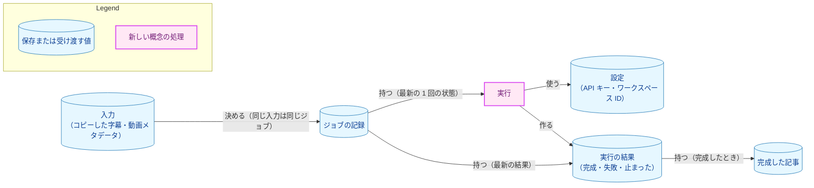
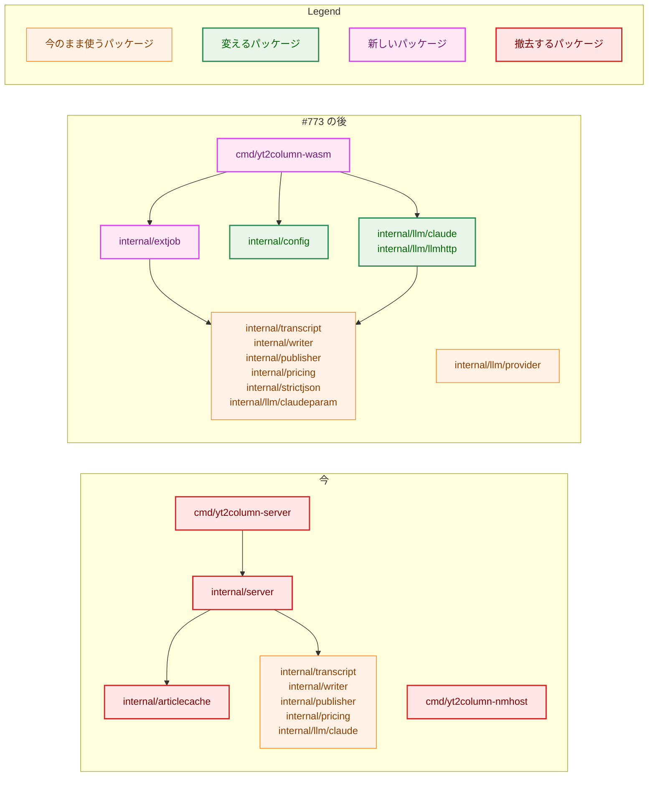
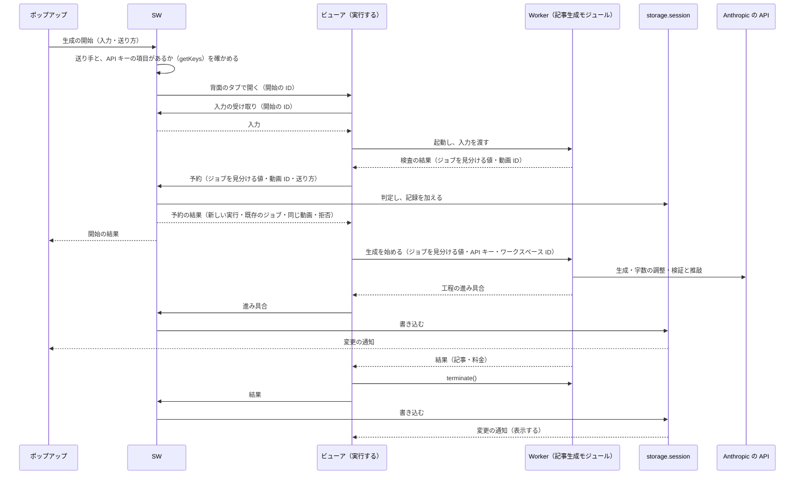
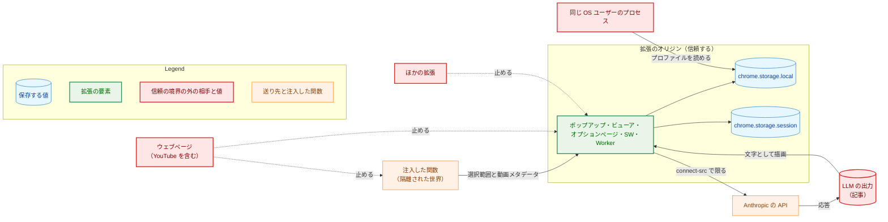
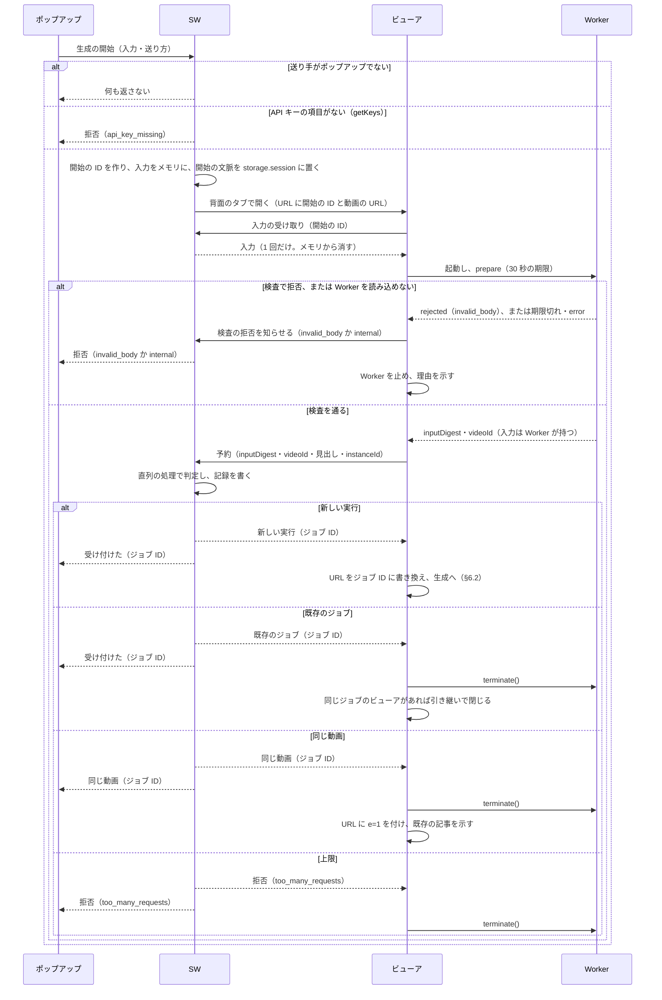
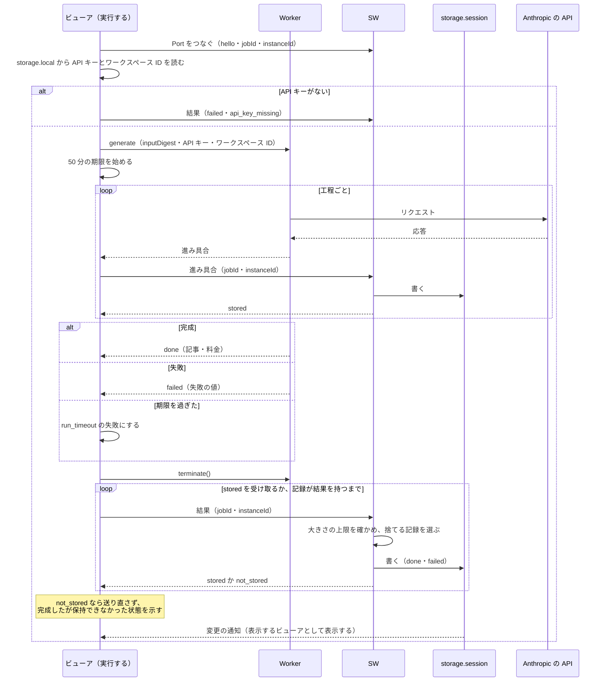
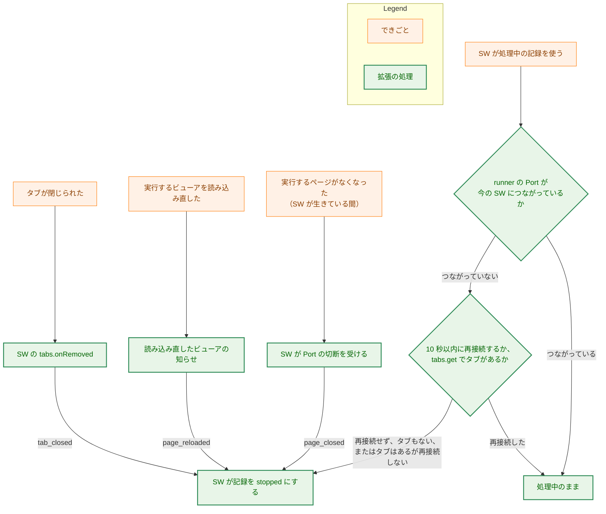
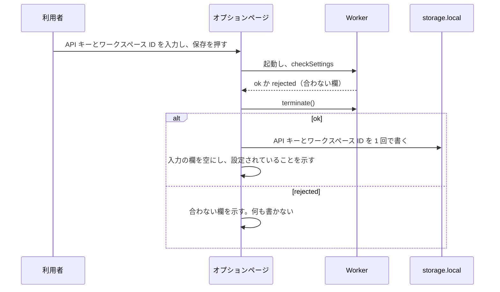

# アーキテクチャ設計書：記事を拡張だけで作る構成

## Document Status

| Item | Value |
|---|---|
| Status | `draft` |
| Created | 2026-11-12 |
| Review date | - |
| Reviewer | - |
| Comments | - |

## 1. 設計の全体像 (Design Overview)

本書は、[01_requirements.md](01_requirements.md)（以下、要件書）が定める「拡張だけの構成」を設計する。拡張だけの構成では、localhost サーバと Native Messaging のホストを使わない。ブラウザ拡張は、記事を作る Go の処理を WebAssembly（WASM）にビルドして自分のページで動かし、利用者の API キーで Claude API を直接呼ぶ。本書の決定は ADR に記録する（§3.15）。実装は [#773](https://github.com/isseis/yt2column/issues/773) が行う。本タスクは、`cmd/`・`internal/`・`extension/` を変えない。

本書の用語は要件書 §6 による。加えて、次の語を使う。

-   **SW:** 拡張の Service Worker。
-   **ジョブ:** 記事の生成を、1 つの入力（コピーした字幕と動画メタデータ）ごとにまとめて記録する単位。同じ入力の実行は、同じジョブに属する。
-   **ジョブの記録:** ジョブの状態と、完成した記事を持つ値。`chrome.storage.session` に置く（§3.2）。
-   **ジョブ ID:** ジョブを指す不透明な値。今の記事のキーに当たる（§3.2.2）。
-   **実行するビューア:** 記事の生成を実行しているビューアのタブ。実行するビューアは、専用の Web Worker（以下、Worker）を 1 つ起動し、その中で WASM を動かす（§3.4）。
-   **表示するビューア:** 記事の生成を実行せず、ジョブの記録を表示するだけのビューアのタブ。実行するビューアは、実行を終えると表示するビューアになる。
-   **記事生成モジュール:** `cmd/yt2column-wasm`（Go の `main` パッケージ）を WebAssembly にビルドした `.wasm` ファイル。拡張の Worker が読み込み、記事を作る関数（§3.1.2）を JavaScript に公開する。Go で書かれ WASM にコンパイルされたことを強調するときは、「WASM にコンパイルされた記事生成モジュール」と修飾する。
-   **予約:** 入力を検査したビューアが SW に、その入力の記事の生成を始めてよいかを問い合わせ、SW がジョブの記録を見て、既存のジョブ・同じ動画・拒否・新しい実行のどれかを決めるやり取り。新しい実行のときは、SW が記録を加え（止まったか失敗した記録は処理中に戻し）、そのビューアを実行するページとして記録に書く。生成はまだ始めないが、同時に走る実行の枠と記録を先に押さえるので、予約と呼ぶ（§3.3）。

### 1.1. 設計原則

-   **記事を作る規則は、Go の 1 か所に置く。** 入力の検査、字幕の解析、3 つの工程、完了の時点の検査、メンションの無効化、保存するファイルの中身、料金の概算は、CLI と拡張で同じ Go のコードを使う（要件書 AC-12・§4.5）。拡張の TypeScript は、収集、調停、表示、保存の手段だけを持つ。TypeScript に残る検査は、集める対象のタブかどうかの判定と、ページの間で受け渡す値の大きさの上限だけである。入力を受理するかどうかの規則は、Go が持つ（§5.2）。
-   **状態の正しい値は 1 か所に置き、書き手を 1 つにする。** ジョブの記録は `chrome.storage.session` に置き、書き込むのは SW だけにする。同じ入力・同じ動画の判定と記録の追加を、SW の 1 つの直列の処理で行い、二重の生成を防ぐ（§3.3）。
-   **生成はページの寿命に従う。** 記事の生成は、それを実行するビューアのタブの中の Worker だけが行う。タブが閉じられれば止まり、ほかの場所で続かない（[ADR-0048](../../dev/adr/0048-extension-only-generation.md)、要件書 AC-08）。
-   **料金のかかる操作は、利用者の明示の操作のときだけ行い、自動で繰り返さない。** 生成を始めるのは、ポップアップのボタンの押下だけである（[ADR-0008](../../dev/adr/0008-launch-path.md)・[ADR-0028](../../dev/adr/0028-no-automatic-resend.md)、要件書 AC-07）。
-   **API キーは、保存する場所と Anthropic の API へのリクエストのほかに出さない。** 送信の守りは二重にする。Go の送信がリダイレクトを拒否し、拡張のページの Content Security Policy（CSP）が Anthropic の API のほかの先への送信を止める（§5.3）。
-   **受理する形に合わない値は、補正せずに拒否する。** どの境界でも同じである（CLAUDE.md「Reject, don't normalize」、§5.2）。
-   **測った値と確かめた振る舞いだけを前提にする。** 測った値は調査記録の節を挙げて引用する。確かめていない振る舞いは、マージの前に実測するか、外れたときの決定を用意して受け入れる（§3.13）。

### 1.2. 設計の際に決めたこと（2026-11-12）

-   **記事の生成は、ビューアのタブの中の専用の Web Worker で実行し、完成か失敗で Worker を止める（§3.4）。** SW は、ポップアップのボタンが押されると、今と同じくビューアを背面のタブで開く。そのビューアが Worker を 1 つ起動し、Worker が記事生成モジュールを読み込んで記事を生成する。完成か失敗の後、ビューアは `Worker.terminate()` を呼び、表示するビューアになる。WASM のメモリは大きくなるだけで縮まないので、WASM を読み込んだまま開き続けたページは、そのメモリを使い続けるためである（[申し送り](design_handoff.md) H-12）。PoC は、記事の生成を実行したタブ全体のメモリを、試行の前後で 61.6〜85.8 MB と測った。そのうち WASM が占める量は測っていない（[調査記録](../../research/wasm_pipeline_poc/README.md)「測定 6：本番の構成（Chrome、`83ef12bd`、背面のまま）」）。採らなかった案は、ビューアのメインスレッドで動かして完成の後に読み込み直す案と、Offscreen Document で動かす案である。前者は、読み込み直すときに画面が切り替わり、状態の知らせが途切れうる。後者は、拡張に 1 つしか置けず、ビューアを閉じても止まらないので、生成の寿命をページの寿命とする決定（ADR-0048）から外れる。背面で開いたまま一度も前面にならないタブで Worker が完走することは、マージの前に確かめる（下の項目）。ADR: [ADR-0009](../../dev/adr/0009-viewer-opening.md) と ADR-0048 を更新した。
-   **記事を作る処理は、Go のコアを WASM にして CLI と共有する（§3.1）。** 規則を Go の 1 か所に保ち、要件書 §4.5 の「同じ規則を、Go と TypeScript の両方に書かない」を満たすためである。TypeScript に一本化する案は採らなかった。字幕の解析、メンションの無効化、3 つの工程、料金の概算を TypeScript で書き直すことになり、CLI が Go の同じ規則を持ち続けるので、規則が 2 つになる。WASM のサイズ（17,300,194 バイト、`gzip -9` で 4,138,823 バイト）と読み込みの時間（Chrome で 62.4〜171.2 ms、Brave で 49.9〜206.5 ms）は受け入れる（調査記録「測定 2：読み込みと CSP、サイズと読み込みの時間」）。読み込みは生成 1 回に 1 度で、生成の所要時間（本番の構成で 95〜151 秒。調査記録「測定 6」）に比べて小さいためである。ADR: [ADR-0049](../../dev/adr/0049-wasm-core-sharing.md) を新設し、[ADR-0019](../../dev/adr/0019-pipeline-component-interfaces.md) と [ADR-0026](../../dev/adr/0026-extension-platform.md) を更新した。
-   **ジョブの記録は `chrome.storage.session` に置き、書き込むのは SW だけにする（§3.2・§3.3）。** 実行するビューアは、工程の進み具合と結果を SW へ知らせる。SW は、同じ入力・同じ動画の判定と記録の追加を、1 つの直列の処理の中で行う。ポップアップとビューアは、記録を読み、`chrome.storage.onChanged` で表示を更新する。状態の取得のポーリングはやめる。探すことと始めることが分かれると、同時に押された 2 つの開始がどちらも記事を見つけず、同じ動画の記事を二重に生成しうるためである（申し送り H-06）。採らなかった案は、処理中の状態を実行するページが持ち、ほかのページが `BroadcastChannel` で尋ねる案である。ページの間の問い合わせが増え、判定の排他を保つのが難しい。ADR: [ADR-0027](../../dev/adr/0027-article-job-api.md)・[ADR-0010](../../dev/adr/0010-extension-stores-nothing.md)・ADR-0008 を更新した。
-   **API キーとワークスペース ID は、オプションページで設定する（§3.6）。** 記事を描画するビューアとも、生成の操作をするポップアップとも、画面を分けるためである。採らなかった案は、ポップアップの中に設定の欄を置く案である。画面が狭く、生成の操作と混ざる。ADR: ADR-0010 と ADR-0008 を更新した。
-   **確かめていない事項のうち、構成の前提になる 4 つを、設計の PR のマージの前に PoC で確かめる（§3.13）。** (a) 一度も前面にならなかった背面のビューアのタブで、Worker の中の WASM が記事を完成させるか。(b) Worker からの送信で、リダイレクトの拒否と、CSP の `connect-src` による送り先の制限が効くか。(c) `chrome.storage.local` を、注入したスクリプトから読めなくできるか。(d) `chrome.storage.session` の容量の上限。ほかの項目は確かめずに受け入れ、外れたときに変わる決定を記録する。前提が外れたまま #773 が実装すると、構成を作り直すことになるためである。確かめるためのコードは、PoC のブランチ `poc/0090-extension-only-checks` に置き、`main` には入れない（要件書 AC-22）。2026-11-12〜13 に Chrome と Brave で測り、4 つとも見込みどおりだった（§3.13、[調査記録](../../research/wasm_pipeline_poc/README.md)「0090 の追加の測定」）。ADR: なし（確かめ方の決定で、本タスクの中で閉じる。結果は、ADR-0048 と ADR-0049 の背景に根拠として引用する）。
-   **Opus で 40,000 トークンを出力する長さの、ストリーミングなしの応答は、確かめずに受け入れる（§3.13）。** 見積もりは約 313〜408 秒で、呼び出しごとの期限（15 分）の半分以下である（調査記録「問い 3：ストリーミングは要るか」）。外れたときは、Claude アダプタにストリーミングを加える。ADR: なし（受け入れの判断で、外れたときの決定は [ADR-0025](../../dev/adr/0025-claude-output-limit.md) を改める決定になる）。
-   **タスク 0086 は、PR-1（fake の LLM の部品と依存の検査）だけを実装し、開発用のサーバ（PR-2）と、その文書と手動の確認（PR-3）は行わない（§3.9）。** fake の部品を開発用の拡張のビルドにつなぐのは、#773 が行う。開発用のサーバは、廃止するサーバの上に作る計画で、#773 で撤去するまでの短い間しか使わないためである。0086 の計画の書き換えは、0086 の側の PR で行う。ADR: [ADR-0045](../../dev/adr/0045-dev-fake-llm.md) を更新した。
-   **拡張が要求する Chrome の最小の版は、決める日の 1 年前の時点の安定版とし、今は 142 にする（§3.7.3、2026-11-13 に決めた）。** 使う機能がそれより新しい版を要するときだけ、その版に上げる。Chrome はセキュリティの修正を最新の安定版にだけ入れ、延長の安定版も 1 つ前の版を約 8 週支えるだけなので、1 年以上前の版のブラウザは、拡張と関係なく危険である。古い版の利用者を守っても守れるものがなく、決まった規則にすれば機能を足すたびに版を調べずに済む。最小の版を上げても更新は強いず、古い版への導入と更新を止めるだけである（§3.12 の C-16）。2026-11-13 の 1 年前（2025-11-13）の安定版は Chrome 142（2025-10-28）である（[Chromium Dash](https://chromiumdash.appspot.com/schedule)、2026-11-13 に確かめた）。採らなかった案は、使う機能が要る版（今なら `getKeys()` の 130）にする案と、`chrome.storage.session` の容量に合わせて 112 にする案である。前者は、機能を足すたびに要る版を調べることになり、守れるものがない。後者は、`getKeys()` を使えず、API キーの有無を値を読まずに確かめるための秘密でない印を別に保存することになる。ADR: [ADR-0030](../../dev/adr/0030-minimum-chrome-version.md) を更新した。
-   **manifest の `key` は残し、Web Store の項目を作るときに Web Store の公開鍵に置き換える（§3.7.3）。** 置き換えは、Web Store の申請を扱う issue（§3.12）の作業にする。開発用に読み込んだ拡張の ID を、ワークツリーによらず同じにし、Web Store から導入した拡張の ID とも同じにするためである。ID が変わると、`chrome.storage.local` に保存した API キーは引き継がれない。採らなかった案は、`key` を除く案である。読み込んだディレクトリごとに ID が変わり、ワークツリーを替えるたびに API キーを入れ直すことになる。ADR: ADR-0026 を更新した。
-   **ビューアの URL は、ジョブ ID（予約の前は開始の ID）、動画の URL、既存の記事の印だけを持つ（§5.2、2026-11-13 に決めた）。** 予約の前は `r`（開始の ID）と `u`（動画の URL）、予約の後は `k`（ジョブ ID）と `u` と、同じ動画の既存の記事なら `e=1` を持つ。見出し・チャンネル名・動画のタイトル・送信の時刻（今の `h`・`c`・`t`・`s`）は URL から除く。今の URL は、日本語のタイトルと見出しを URL の形に直すと最大で約 18 KB になり、表示の値はすでに `storage.session`（開始の文脈とジョブの記録）にあるためである。履歴に残るのは、乱数の ID と、YouTube の履歴にもある動画の URL だけになる。動画の URL を残すのは、記事が失われた後も、ビューアから動画を開いて作り直せるようにするためである。採らなかった案は 4 つである。ID だけを持つ案は、記事が失われた後に動画へのリンクを示せず、利用者が動画を探し直すことになる。今のまますべての値を持つ案は、URL が長く、動画のタイトルが URL として履歴に残る。短く切ったタイトルを足す案は、ページのタイトル（次の項目）が同じ役目を果たすので要らない。乱数の ID の代わりに入力の値のハッシュを持つ案は、入力から計算できる値を外に出すことになる（CLAUDE.md「Keep internals unobservable」）。入力を見分ける `inputDigest` は、記録の中にだけ置く。ADR: [ADR-0010](../../dev/adr/0010-extension-stores-nothing.md) を更新した。
-   **ビューアは、ページのタイトル（`document.title`）に動画のタイトルを出す（§3.4、2026-11-13 に決めた）。** 動画のタイトルがないときは見出しを出す。拡張の名前を添えるかどうかは、#773 で決める文言である。ブラウザの履歴のページとタブに、どの動画の記事かが出るようにするためである。今の `viewer.html` のタイトルは、固定の「yt2column」である（`extension/static/viewer.html:5`）。0090 の要件定義書は変えず、#773 の要件定義で受け入れ基準にする（§3.14.3）。ADR: なし（ビューアの表示の決定で、#773 の要件で扱う）。
-   **公式の文書の取得を承認した。** AC-20 の外部の条件と、Chrome の拡張の API の振る舞いを、公式の文書で確かめるためである。取得したのは公開の文書だけで、利用者と本プロジェクトの情報は送っていない。ADR: なし（作業の承認である）。

### 1.3. 概念モデル

拡張だけの構成の主な概念と、その関係を示す。矢印 A → B は、「A が B を決める、持つ、使う、または作る」を表し、そのどれかをラベルで示す。



-   ジョブは、入力ごとに 1 つである。同じ入力の開始は、ジョブが処理中か完成していれば、生成を始めずにそのジョブを示す。失敗したか止まったジョブは、同じ入力の開始で、同じジョブ ID のまま生成し直す（今の「失敗したキーは生成し直す」と同じ。ADR-0027）。
-   ジョブの記録は、最新の実行の状態だけを持つ。過去の実行の結果は持たない。
-   ジョブの記録は、コピーした字幕を持たない（要件書 AC-09）。字幕は、実行するビューアの Worker のメモリにだけあり、実行の終わりとともに消える。

## 2. システム構成 (System Structure)

### 2.1. 全体の構成

拡張だけの構成の要素と、その間の受け渡しを示す。矢印 A → B は、「A が B へ値を渡すか、B を呼ぶ」を表す。点線の矢印は、ページを開く操作を表す。

```mermaid
flowchart LR
    classDef data fill:#e6f7ff,stroke:#1f77b4,stroke-width:1px,color:#0b3d91;
    classDef process fill:#fff1e6,stroke:#ff7f0e,stroke-width:1px,color:#8a3e00;
    classDef enhanced fill:#e8f5e8,stroke:#2e8b57,stroke-width:2px,color:#006400;
    classDef newpkg fill:#ffe8f5,stroke:#d946ef,stroke-width:2px,color:#701a75;

    YT["YouTube の動画のタブ"]
    POP["ポップアップ"]
    SW["Service Worker"]
    VIEW["ビューア"]
    WORKER["Worker"]
    WASM["記事生成モジュール<br>（cmd/yt2column-wasm）"]
    OPT["オプションページ"]
    LOCAL[("chrome.storage.local<br>（API キー・ワークスペース ID）")]
    SESSION[("chrome.storage.session<br>（ジョブの記録）")]
    API["Anthropic の API"]

    POP -->|"選択範囲と動画メタデータを読む"| YT
    POP -->|"生成の開始"| SW
    SW -.->|"背面のタブで開く"| VIEW
    SW -->|"入力を渡す"| VIEW
    VIEW -->|"予約・進み具合・結果"| SW
    SW -->|"書き込む（書き手は SW だけ）"| SESSION
    SESSION -->|"読む・変更の通知"| POP
    SESSION -->|"読む・変更の通知"| VIEW
    LOCAL -->|"読む"| VIEW
    LOCAL -->|"キーの名前だけを読む（getKeys）"| SW
    VIEW -->|"入力と設定"| WORKER
    WORKER -->|"呼ぶ"| WASM
    WASM -->|"リクエスト"| API
    OPT -->|"書き込む・削除する"| LOCAL
    OPT -->|"設定の検査"| WASM

    class YT,API process
    class POP,SW,VIEW enhanced
    class WORKER,WASM,OPT newpkg
    class LOCAL,SESSION data

    subgraph Legend["Legend"]
        L1[("保存する値")]
        L2["今のまま使う外部の要素"]
        L3["役割を変える拡張の要素"]
        L4["新しい要素"]
    end
    class L1 data
    class L2 process
    class L3 enhanced
    class L4 newpkg
```



-   オプションページも、設定の検査のために Worker を 1 つ起動して記事生成モジュールを呼ぶ。図では、オプションページから記事生成モジュールへの矢印にまとめた（§3.6）。
-   今の構成の Native Messaging のホスト（`cmd/yt2column-nmhost`）と localhost サーバ（`cmd/yt2column-server`）は、この図にない。#773 が撤去する（§3.14）。

### 2.2. コンポーネント配置

| 置き場所 | 役割 | 今との違い |
|---|---|---|
| ポップアップ | 起動したタブの選択範囲と動画メタデータを読み、生成の開始を SW に頼む。開始の結果と、ジョブの記録の状態を表示する。同じ動画の記事があれば、既存の記事を表示するか、現在の選択範囲で生成するかを選ばせる | 状態の取得のポーリングをやめ、ジョブの記録を読む。API キーが設定されていないときに、オプションページを開く操作を示す |
| SW | 生成の開始を、拡張自身のポップアップからだけ受け付ける。ビューアを背面のタブで開き、入力をビューアに渡す。予約（同じ入力・同じ動画の判定と記録の追加）、進み具合と結果の書き込み、止まった実行の判定を、1 つの直列の処理で行う。ジョブの記録の唯一の書き手である。API キーの値は読まない | ホストへの送信をやめ、ジョブの記録の書き手と調停役になる |
| ビューア | 実行するビューアは、Worker を起動して記事を生成し、実行の間 SW への Port を保ち、進み具合と結果を SW に知らせる。表示するビューアは、ジョブの記録を表示し、保存とコピーを行う | 状態の取得のポーリングをやめる。実行するビューアの役割が加わる |
| Worker | 実行するビューアとオプションページが起動する専用の Web Worker。記事生成モジュールを読み込んで呼ぶ。拡張の API（`chrome.*`）は使わない | 新しい |
| 記事生成モジュール | 入力の検査、ジョブを見分ける値の計算、記事の生成、完了の時点の検査、表示とコピーと保存の値の組み立て、設定の検査を行う。処理は `internal/extjob` にあり、`cmd/yt2column-wasm` は JavaScript への関数の登録だけを持つ | 新しい。今の `internal/server` の生成の組み立てを引き継ぐ |
| オプションページ | API キーとワークスペース ID を設定・変更・削除する | 新しい |
| `chrome.storage.local` | API キーとワークスペース ID を、ブラウザの再起動の後も残る形で持つ | 新しい |
| `chrome.storage.session` | ジョブの記録を、ブラウザを終了するまでメモリに持つ | 新しい。今はサーバのメモリの記事のキャッシュ |

### 2.3. Go のパッケージの構成

#773 の前と後の、記事を作る処理に関わるパッケージの依存を示す。矢印 A → B は、「A が B を import する」を表す。



-   **`internal/extjob`（新しい）:** 拡張のジョブ 1 回分の処理を持つ。入力の検査（今の `internal/server` の `validateBody` の規則）、ジョブを見分ける値の計算（今の `internal/articlecache` の記事のキーの計算から、秘密の鍵を除いたもの）、記事の生成と工程の進み具合の通知、完了の時点の検査（今の `completeGeneration`）、結果の組み立て（今の `articleStatus`）、失敗の分類（今の `classifyWrite` に、API キーが拒まれたことを加えたもの）である。CLI は使わない。
-   **`cmd/yt2column-wasm`（新しい）:** `GOOS=js GOARCH=wasm` だけでビルドする `main` のパッケージ。`syscall/js` で JavaScript の関数を登録し、受け取った JSON の文字列を `internal/extjob` に渡すことだけを持つ（§3.1）。JSON の解析と組み立ては `internal/extjob` にあり、ネイティブのビルドでテストできる。
-   **LLM のクライアントの組み立て:** 記事生成モジュールは、読み込んだ設定から `claude.New` で Claude のクライアントを直接作る。`internal/llm/provider` は使わない（図では、記事生成モジュールからの矢印がない）。`provider` は DeepSeek と OpenAI のアダプタを import し、WASM でビルドできないためである（PoC の `cmd/yt2column-wasm/generate.go` の `llmTimeout` の注記。`origin/poc/0084-wasm-pipeline` の `83ef12bd`）。呼び出しごとの期限は、`provider.LLMTimeout` と同じ 15 分を `internal/extjob` に置く。
-   **`internal/llm/claude`・`internal/llm/llmhttp`（変える）:** `js` のビルドだけで付けるヘッダとリダイレクトの指定を加える（§5.3）。
-   **`internal/config`（変える）:** 記事生成モジュールのために、LLM の設定だけを読む関数を加える。今の `LoadServer` が設定ファイルから LLM の設定を読む部分を引き継ぐ。渡す名前を引く関数は、拡張が保存した 2 つの値だけを返す（§3.1.3）。サーバとホストの設定の読み込み（`LoadServer`・`LoadHost`・`LoadHostHome`、設定ファイルとソケットのパスの導出）は撤去する。
-   **撤去するパッケージ:** サーバとホストだけが使うもの。`cmd/yt2column-server`・`cmd/yt2column-nmhost`・`internal/server`・`internal/articlecache`・`internal/serversock`・`internal/nmhost`・`internal/privatefile` と、それらだけが使うテストの補助（`internal/udstest` の一部など）である。どのパッケージがサーバとホストだけから使われるかは、#773 が `go list -deps` で確かめてから撤去する。`internal/cachelock`・`internal/signalrun`・`internal/redact` は CLI も使うので残す（`cmd/yt2column` が import する。2026-11-12 の `main`（`ca0570c6`）で確かめた）。

### 2.4. データの流れ

生成の開始から記事の表示までのデータの流れを示す。詳しい手順と失敗の経路は §6 にある。



## 3. コンポーネント設計 (Component Design)

### 3.1. 記事生成モジュールと、CLI と共有する処理

#### 3.1.1. 共有する処理の範囲

記事生成モジュールは、記事を作る処理のうち、次のすべてを Go のコードで行う。拡張の TypeScript は、これらの規則を持たない。

| 処理 | 置き場所 | CLI との共有 |
|---|---|---|
| 生成の開始の入力の検査（動画の URL、コピーした字幕、動画のタイトル・チャンネル名・概要欄） | `internal/transcript`・`internal/extjob` | 動画の URL の検査と字幕の解析を共有する |
| ジョブを見分ける値と動画 ID の計算 | `internal/extjob` | 拡張だけが使う |
| 3 つの工程（生成、字数の調整、検証・推敲） | `internal/writer`・`internal/llm/claude` | 共有する |
| 完了の時点の検査（`CheckPublishable` と、記事の大きさの上限） | `internal/writer`・`internal/extjob` | `CheckPublishable` を共有する |
| メンションの無効化（表示とコピーの値、見出しの値） | `internal/publisher` | 部品は CLI と同じパッケージにある。CLI の出力はこの無効化を使わない |
| 保存するファイルの中身（`--out` と同じバイト列） | `internal/publisher` | 共有する |
| 料金の概算 | `internal/pricing` | 共有する |
| API キーとワークスペース ID の検査 | `internal/config`・`internal/llm/llmhttp`（`CheckAPIKey`）・`internal/llm/claudeparam`（`ParseWorkspaceID`） | 共有する |

-   要件書 AC-15 の「メンションの無効化、保存するファイルの中身、完了の時点の検査を、共有する処理に含めるかどうか」は、3 つとも含める。今のサーバと同じ値を、同じコードで作るためである（[ADR-0043](../../dev/adr/0043-copy-mention-neutralization.md) の「規則を Go の 1 か所に置き、拡張に同じ規則を二重に書かない」）。
-   プロンプトのテンプレートは、埋め込みのものだけを使う。記事生成モジュールは、上書きのファイルを読まない（今のサーバと同じ。[ADR-0034](../../dev/adr/0034-template-allowlist.md)）。

#### 3.1.2. 記事生成モジュールが JavaScript に公開する関数

記事生成モジュールは、`globalThis` に 1 つの名前空間のオブジェクトを登録し、次の 4 つの関数を持たせる。どの関数も、引数を 1 つの JSON の文字列で受け取り、結果を 1 つの JSON の文字列で返す（`generate` は Promise で返す）。入力の JSON は厳格に検査し（`internal/strictjson`。§5.2）、合わなければ固定の理由で拒否する。結果の JSON の形は、ビューアとオプションページの TypeScript が受理する形で検査する（§5.2）。JSON の解析と組み立ては `internal/extjob` が行い、`cmd/yt2column-wasm` は登録だけを持つ。

```typescript
// The functions the article generation module registers. Each takes and returns one JSON
// string; the shapes below are the JSON values, not JS objects.
interface Yt2ColumnWasm {
  // Checks the settings the options page is about to save.
  checkSettings(request: string /* SettingsCheckRequest */): string /* SettingsCheckResult */;
  // Validates a start input, keeps it in the Worker's Go memory, and returns
  // the values the reservation needs.
  prepare(request: string /* PrepareRequest */): string /* PrepareResult */;
  // Runs one generation of the input prepare kept. onProgress receives a
  // ProgressEvent JSON string at each step change.
  generate(request: string /* GenerateRequest */, onProgress: (event: string) => void): Promise<string /* GenerateResult */>;
  // The build of the article generation module, for the options page's debug line.
  buildInfo(): string /* BuildInfo */;
}

type SettingsCheckRequest = { anthropicApiKey: string; anthropicWorkspaceId: string };
type SettingsCheckResult =
  | { status: "ok" }
  | { status: "rejected"; fields: Array<"anthropicApiKey" | "anthropicWorkspaceId"> };

type PrepareRequest = {
  videoUrl: string; transcript: string;
  title?: string; channelName?: string; description?: string;
};
type PrepareResult =
  | { status: "ok"; inputDigest: string; videoId: string }
  | { status: "rejected"; reason: PrepareRejection };

// Only the digest of the kept input and the credentials; never the input.
type GenerateRequest = {
  inputDigest: string; anthropicApiKey: string; anthropicWorkspaceId: string;
};
type ProgressEvent = { steps: Steps };
type GenerateResult =
  | { status: "done"; steps: Steps; article: ArticleResult }
  | { status: "failed"; steps: Steps; failure: WasmFailure; internalDetail?: InternalDetail };

type ArticleResult = {
  markdown: string; mentionsNeutralized: boolean;
  videoTitle: string; channelName: string;
  file: string; cost: { state: "known"; usd: string } | { state: "unknown" };
  durationMs: number;
};

type BuildInfo = { goVersion: string; vcsRevision: string; vcsModified: boolean };
```

`internal/extjob` の Go の型と関数の形は次のとおりである。

```go
// StartInput is a start input as received from the page, before validation.
type StartInput struct {
	VideoURL, Transcript, Title, ChannelName, Description string
}

// Prepared is a validated input. Its fields are unexported; only Prepare
// builds one, so a Prepared is always a validated input.
type Prepared struct{ /* unexported */ }

func Prepare(in StartInput) (Prepared, error) // error wraps ErrInvalidInput
func (p Prepared) InputDigest() string         // 64 lowercase hex
func (p Prepared) VideoID() string

// Observer receives each step change of a run.
type Observer interface {
	StepChanged(steps Steps)
}

// Deps are what a run needs besides its input: the generation and review
// clients built from the loaded configuration.
type Deps struct {
	Generation llm.LLMClient
	Review     llm.LLMClient
}

// Run generates the article of p and returns its result. It never panics
// to the caller: a panic becomes a Failure of FailureInternal.
func Run(ctx context.Context, p Prepared, deps Deps, obs Observer) Result

// Result is a run's outcome: an article, or a Failure with its steps.
type Result struct{ /* unexported; read through methods */ }

// Failure is why a run failed. The zero value is FailureInternal.
type Failure int

const (
	FailureInternal Failure = iota
	FailureTranscriptTooLong
	FailureLLMTimeout
	FailureLLMEmpty
	FailureLLMTruncated
	FailureLLM
	FailureArticleInvalid
	FailureArticleTooLarge
	FailureAPIKeyRejected
)

var ErrInvalidInput = errors.New("extjob: the start input is not accepted")
```

`internal/config` には、記事生成モジュール用の関数を加える。

```go
// LoadExtension reads the LLM configuration of the article generation module
// through lookup, with the same loaders and checks as Load. lookup answers
// only ANTHROPIC_API_KEY and ANTHROPIC_WORKSPACE_ID.
func LoadExtension(lookup LookupFunc) (LLMConfig, error)
```

-   `inputDigest` は、検査を通った後の 5 つの値（正規化した動画の URL、字幕、省略を空文字列としたタイトル・チャンネル名・概要欄）から計算する SHA-256 の 64 文字の小文字の 16 進である。今の記事のキーの計算（[0044 設計書](../0044_article_job_api/02_architecture.md) §3.2「記事のキー」）から、秘密の鍵だけを除いた。値は、同じ入力の判定にだけ使い、ジョブの記録の中から外へ出さない（§3.2.2）。
-   **予約と生成を同じ入力に結びつける。** `prepare` は、検査を通った入力を Worker の Go のメモリに持つ。`generate` は入力を受け取らず、予約に使った `inputDigest` だけを受け取る。記事生成モジュールは、持っている入力の `inputDigest` と比べ、違えば `internal` の失敗（`internalDetail` は `input_mismatch`）にする。ジョブの記録が、予約した入力と別の入力の記事を持たないためである。
-   `durationMs` は、記事生成モジュールが `generate` の始まりから測る。今のサーバは開始を受け付けた時点から数えるので、入力の受け渡しと `prepare` の分（ふつうは 1 秒に満たない）だけ短くなる。
-   `Steps`・`PrepareRejection`・`WasmFailure`・`InternalDetail` の値の集合は §4.1 にある。
-   API キーとワークスペース ID は、`checkSettings` と `generate` の引数の JSON の中にだけ入る。Go の側では、受け取った直後に `secret.Secret` と `claudeparam.WorkspaceID` にし、JSON の文字列は保持しない（[ADR-0031](../../dev/adr/0031-secret-closure.md)）。結果と進み具合の JSON には入らない。

#### 3.1.3. 設定の読み込み

記事生成モジュールは、LLM の設定を `config.LoadExtension` で作る。名前を引く関数として、`ANTHROPIC_API_KEY` と `ANTHROPIC_WORKSPACE_ID` の 2 つの名前だけに値を返すものを渡す。ワークスペース ID が保存されていないとき（空のとき）は、その名前を未設定として答える。ほかの名前（`YT2COLUMN_LLM`・`YT2COLUMN_REVIEW_LLM` など）には答えないので、それらは未設定になる。

-   3 つの工程のプロバイダとモデルと effort は、コード上の既定、すなわち本番の構成になる（[ADR-0004](../../dev/adr/0004-production-profile.md)）。拡張にモデルや effort を選ぶ設定がなく、本番の構成に固定される（要件書 AC-03）。
-   値の検査は、CLI と同じ関数で行う（[ADR-0003](../../dev/adr/0003-llm-config-contract.md)）。設定の読み込みは、API キーが空でないことと、ワークスペース ID が `claudeparam.ParseWorkspaceID` の規則に合うことを確かめる（`internal/config/config.go:671` と `:724`）。API キーが印字可能な ASCII（0x21〜0x7E）だけであることは、アダプタを作るときに `llmhttp.CheckAPIKey`（`internal/llm/llmhttp/llmhttp.go:46`）が確かめる。`checkSettings` は、この 2 つと同じ関数を呼ぶ。
-   CLI の「空の値は拒否する」規則は変えない。拡張は空のワークスペース ID を渡さず、未設定として答えるので、この規則に当たらない。
-   記事生成モジュールは、プロセスの環境を読まない。`js` のビルドには、読むべき環境がない。[ADR-0024](../../dev/adr/0024-env-access-in-config.md) の「決めた入口」に、記事生成モジュールを、環境を読まずに名前を引く関数を渡す入口として加える。

#### 3.1.4. ビルドと成果物

-   `make ext-build` は、`GOOS=js GOARCH=wasm go build -trimpath` で `cmd/yt2column-wasm` をビルドして `extension/dist/` に置き、Go のツールチェーンの `wasm_exec.js` を同じ場所に写す。拡張のビルドが Go を呼ぶ。Go の手順（`make test`・`make lint` など）は、今までどおり拡張のディレクトリを含まず、Node.js を呼ばない（ADR-0026）。
-   成果物の検査（`extension/scripts/check-dist.ts`）は、成果物を「`tsc` の出力、`static/` の写し、記事生成モジュール、Go のツールチェーンの `wasm_exec.js`」に限る。`wasm_exec.js` は本リポジトリで書いたコードでないので、ADR-0026 の「成果物は本リポジトリで書いたコードだけ」の例外として宣言する。中身は、`go.mod` が定める Go の版のツールチェーンのものと一致することを検査する。理由は §5.5 にある。
-   `make wasm-check` は残す。対象を、今の 4 つのパッケージから、記事生成モジュール（`cmd/yt2column-wasm`）とその依存に改め、ADR-0019 の「#772 が決めるまで」という期限を除く。記事生成モジュールがビルドできなくなる変更を、拡張のビルドを待たずに Go の CI で止めるためである。fake の LLM の部品も、開発用の記事生成モジュールとともにこの検査の対象に入れる（ADR-0045、§3.9）。
-   成果物は、リモートのコードを読み込まない。WASM と `wasm_exec.js` は拡張のパッケージに入り、実行時にネットワークから取得するコードはない（§3.12）。

### 3.2. ジョブの記録と `chrome.storage.session`

#### 3.2.1. 記録の形

ジョブの記録は、`chrome.storage.session` に、ジョブごとに 1 つの項目として置く。項目の名前は `job:` とジョブ ID を連結したものである。値は次の形を持つ。

```typescript
// One job record in chrome.storage.session. Only the service worker writes it.
type JobRecord = {
  version: 1;
  jobId: string;              // 32 lowercase hex; opaque
  inputDigest: string;        // 64 lowercase hex; compared only
  videoId: string;            // compared only, for the same-video inquiry
  heading: { videoTitle: string; channelName: string }; // as collected, for the header before completion
  videoUrl: string;           // as collected, for the link to the video
  acceptedAt: number;         // ms since the epoch, when this run was reserved
  endedAt?: number;           // done, failed, or stopped only
  runner?: { tabId: number; instanceId: string }; // running and stopped
  state: "running" | "done" | "failed" | "stopped";
  steps: Steps;
  article?: ArticleResult;    // done only
  failure?: RecordFailure;    // failed only
  internalDetail?: InternalDetail; // failed with failure "internal" only
  stopReason?: StopReason;    // stopped only
};

// Why the service worker marked a run stopped (§6.3).
type StopReason = "tab_closed" | "page_closed" | "page_reloaded" | "no_contact";
```

-   記録は、コピーした字幕と概要欄を持たない（要件書 AC-09）。
-   `version` は、記録を読み戻すときの検査に使う。拡張の更新で `storage.session` は空になるので（§3.2.4）、版の移行の仕組みは作らない（要件書 AC-13）。
-   `instanceId` は、実行するビューアのページが読み込みのたびに作る 128 ビットの乱数である。同じタブで読み込み直したページを、元のページと区別する（§6.3）。
-   `runner` は、止まった記録にも残す。止まった状態にした後に、同じ `runner` から結果が届いたときに受け取るためである（§6.3）。
-   `stopReason` と `internalDetail` は、止まった理由と内部の失敗の種類を、開発者が記録から読めるようにするための値である。利用者には文として示さない（§4.2）。

#### 3.2.2. ジョブ ID と、ジョブを見分ける値

-   **ジョブ ID は、SW が予約のときに作る 128 ビットの乱数（`crypto.getRandomValues`）の 32 文字の小文字の 16 進とする。** 不透明な値で、ビューアの URL とページの間のメッセージに入る。ほかの値から計算できず、入力の中身も表さない。
-   **同じ入力の判定は、`inputDigest` の比較で行う。** `inputDigest` は記事生成モジュールが計算し、ジョブの記録の中にだけ置く。URL にもメッセージの応答にも出さない。
-   採らなかった案は、今のキーと同じく入力から計算した値をジョブ ID にする案である。今のキーが秘密の鍵を使うのは、公開しない計算方法に利用者と拡張を依存させないためだった（ADR-0027）。拡張だけの構成では秘密を持つプロセスがなく、入力から計算した値を URL に置くと、計算方法に依存されうる（CLAUDE.md「Keep internals unobservable」）。乱数の ID なら、計算方法がない。
-   今のキーの計算にあった「秘密を使って、生成を始めずにキーを計算されることを防ぐ」という目的は、すでに当てにしていない（[security.md](../../dev/security.md) §8 の照会の再評価）。拡張だけの構成でも、ジョブの記録を読めるのは同じ拡張のページだけである（§5.1）。

#### 3.2.3. 上限と捨てる記録

| 上限 | 値 | 理由 |
|---|---|---|
| 記録の件数 | 50 | 今のサーバの 100 件（`internal/articlecache/cache.go:13`）の半分。`storage.session` の容量の中で、大きさの上限と合わせて持てる数にする |
| 記録の大きさの合計 | 8 MiB | `storage.session` の容量（§3.13 の (d) の結果）の中に、処理中の記録と書き込みの余裕を残す |
| 記録 1 つの記事の大きさ | 256 KiB | 今のサーバの状態の応答の上限（`internal/server/status.go:20`）の値を引き継ぐ。超える記事は `article_too_large` で失敗にする |
| 同時に走る実行 | 2 | 今のサーバの生成の枠（`internal/server/jobs_api.go:15`）と同じ。WASM を読み込んだタブは 1 枚で 61.6〜85.8 MB を使い（タブ全体の値。調査記録「測定 6」）、料金を一度に多くかけないためである |

-   大きさは、記録を JSON にした文字列の UTF-8 のバイト数で数える。
-   記事の大きさは、記録の `article` を JSON にしたものと見出しの値の UTF-8 のバイト数である。記事生成モジュールが完了の時点の検査で数える。今のサーバが状態の応答の大きさを数える処理（`internal/server/status.go:163`）に代わる。§5.2 の 512 KiB は、ページの間の受け渡しと読み戻しの上限で、この上限より大きい。
-   上限を超える記録を加えるときは、失敗と止まった記録のうち `endedAt` の最も古いものから捨て、それがなければ完成した記録のうち最も古いものを捨てる。料金のかかった記事を、失敗の記録より先に失わないためである。処理中の記録は捨てない（今のサーバと同じ。ADR-0027）。
-   捨てられる記録がなく上限を超えるときと、処理中の実行が 2 つあるときは、予約を `too_many_requests` で拒否する。
-   捨てた記録のジョブ ID を持つビューアは、記事が失われたことを示す（§3.8）。
-   `storage.session` の容量は、Chrome と Brave で 10,485,760 バイトだった（§3.13 の (d)、調査記録「測定 9」）。8 MiB は、この容量の中に約 2 MiB の余裕を残す。

#### 3.2.4. 記録が消えるとき

| できごと | 記録 | 理由 |
|---|---|---|
| ブラウザの終了 | すべて消える | `storage.session` はメモリだけにある（§3.12） |
| 拡張の再読み込みと更新 | すべて消える。開いている拡張のページも閉じられる | `storage.session` は拡張の再読み込みと更新で空になる（§3.12）。記事をディスクに書かない決定（要件書 AC-09）のもとでは、残す手段がない |
| 上限による捨て | 古い記録から消える | §3.2.3 |
| タブの再読み込みと、閉じたタブの復元 | 残る | 要件書 AC-09 |

-   拡張の更新で、完成した記事が失われることは受け入れる。Chrome は、拡張が使われていないときにだけ更新を適用し、拡張のページが開いている間は適用しない（§3.12 の C-06）。そのため、ビューアのタブで実行している生成が、自動の更新で止まることはない。失われるのは、拡張のページを 1 つも開いていない間に更新が適用されたときの、完成した記事と失敗の記録である。`onUpdateAvailable` で更新を遅らせる仕組みは作らない。遅らせても、ブラウザの終了で記事は失われ、守れる時間が短いためである。この判断は文書の記述に拠る（§3.13）。
-   **採らなかった案（記事の持ち方）。** 完成した記事を `chrome.storage.local` か IndexedDB に置く案は、ディスクに書くので採らなかった（要件書 AC-09）。ビューアのページのメモリだけに持つ案は、再読み込みと閉じたタブの復元で記事を失うので採らなかった（同上）。

### 3.3. SW の調停

SW は、ジョブの記録の唯一の書き手で、次のリクエストを受け付ける。メッセージの形は §3.3.1 にある。どのリクエストも、送り手が拡張自身のページであることを確かめる（§5.2）。SW は、API キーの値を読まない。

| リクエスト | 送り手 | 処理 |
|---|---|---|
| 生成の開始（`start`） | ポップアップ（タブを持たず、URL がポップアップのページと完全に一致する） | `chrome.storage.local.getKeys()` で API キーの項目（`anthropic.apiKey`）があるかを確かめる。項目がなければ `api_key_missing` で拒否し、`getKeys()` の呼び出しが失敗すれば `internal` で拒否する（キーの有無が分からないまま、設定されていないと示すことも、開始へ進むこともしない）。どちらの拒否でもビューアを開かない。項目があれば、ビューアを背面のタブで開き、入力をメモリに、開始の文脈を `storage.session` に置く。予約の結果を待って応答する |
| 入力の受け取り（`claimInput`） | ビューア（開始の文脈のタブ） | 開始の ID に対応する入力を 1 回だけ渡し、メモリから消す |
| 検査の拒否（`prepareRejected`） | ビューア（開始の文脈のタブ） | 入力の検査か Worker の読み込みの失敗を、ポップアップへの応答にする。記録は作らない |
| 予約（`reserve`） | ビューア（開始の文脈のタブ） | 同じ入力・同じ動画の判定、上限の判定、記録の追加を行い、結果を返す |
| 進み具合（`progress`） | 実行するビューア（記録の `runner` と一致するもの） | 記録を書き換え、書き込みが終わってから応答する |
| 結果（`result`） | 実行するビューア（記録の `runner` と一致するもの） | 記録を書き換え、書き込みが終わってから応答する |
| 読み込み直しの知らせ（`runnerReloaded`） | ビューア（記録の `runner` と同じタブ ID で、別の `instanceId`） | 記録を止まった状態（`page_reloaded`）にする |
| 実行の Port（`runner` の名前の `chrome.runtime.connect`） | 実行するビューア | 実行の間保つ。SW が生きている間に切れたら、記録を止まった状態（`page_closed`）にする（§6.3） |

-   **直列の処理。** SW は、受け付けたリクエストを 1 つずつ順に処理する。前のリクエストの `storage.session` の読み書きが終わるまで、次のリクエストを始めない。SW は 1 つの拡張に 1 つだけ動くので、この直列の処理が、記録の判定と書き込みの排他になる。SW が 2 つになるのは manifest の `incognito` を `split` にしたときだけで、この拡張はそうしない（§3.7.1）。SW が停止して起動し直しても、正しい値は `storage.session` にあり、直列の処理の待ち行列のほかに失うものはない。
-   **生成の開始は、直列の処理を占めたまま予約を待たない。** 生成の開始の処理は、送り手と API キーの項目の有無の確かめ、開始の文脈の書き込み、タブの作成、入力をメモリに置くことまでを直列の処理の中で行い、そこで直列の処理を離れる。予約の結果は直列の処理の外で待ち、届いたらポップアップに応答する。同じ直列の処理で受け付ける入力の受け取りと予約を、開始の処理が待たせないためである。連絡の確認の待ち時間も同じく直列の処理の外に置く。
-   **予約の判定の順。** 今のサーバの照会付きの生成の開始の順（[development.md](../../dev/guides/development.md)「ジョブの API」の表）を引き継ぐ。
    1.  同じ `inputDigest` の記録が処理中か完成なら、そのジョブ ID を返す（既存のジョブ）。
    2.  送り方が照会付きで、同じ動画 ID の別の記録が処理中か完成なら、そのうち `acceptedAt` の最も新しいものを、同じ動画として返す。記録を変えない。
    3.  それ以外は、同時に走る実行と上限を確かめ、新しい実行として記録を加える。同じ `inputDigest` の失敗か止まった記録があれば、そのジョブ ID のまま、`runner` を新しいビューアに替えて記録を処理中に戻す。
-   **処理中の記録の連絡の確認。** 判定 1・2 と同時に走る実行の数え上げで処理中の記録を使うとき、その `runner` の Port が今の SW につながっていなければ、連絡の確認をする。連絡の確認とは、実行するビューアが Port をつなぎ直すかを待って確かめ、つなぎ直さなければ記録を止まった状態にすることである（§6.3）。確かめた結果の書き込みは直列の処理の中で行うが、Port の再接続を待つ時間（最大 10 秒）は直列の処理の外で待つ。待つ間、ほかのリクエストを止めないためである。書き込む前に、直列の処理の中で記録を読み直し、まだ処理中で `runner` が変わっておらず、その `runner` の Port が今の SW につながっていないときだけ止まった状態にする。待つ間に結果、再接続、予約し直しが届きうるためである。
-   **書き込みと応答。** 進み具合と結果には、`storage.session` への書き込みが終わってから応答する。書き込みが失敗したときは、§3.2.3 の規則で記録を捨てて 1 回だけ書き直す。それでも失敗すれば、失敗を応答し、記録を `failed`（`internal`、`internalDetail` は `store_failed`）にする試みを 1 回だけ行う。予約の書き込みが失敗したときは、開始を `internal` で拒否する。
-   **入力と開始の文脈。** 字幕を含む入力は、ビューアが受け取るまで SW のメモリにだけ置く。字幕を `storage.session` に置かないためである。開始の文脈（`start:` と開始の ID を連結した名前の項目）は `storage.session` に置き、予約の送り手の確かめと、予約の前のビューアの表示に使う。開始の文脈が持つのは、開いたタブの ID、送り方、作った時刻と、表示の値（見出し、チャンネル名、動画のタイトル、動画の URL）だけで、字幕と概要欄を持たない。予約が済むか 60 秒たてば、入力も開始の文脈も消す。SW が予約の前に停止すると、メモリの入力は失われ、ビューアは入力を受け取れなかったことを示す（§3.8）。開始の文脈は残るので、入力を受け取った後に SW が停止しても、予約は受け付けられる。どの場合も、生成は始まらないか、予約の後に始まり、料金のかかる二重の生成は起きない。
-   **ポップアップへの応答。** SW は、予約の結果（新しい実行、既存のジョブ、同じ動画、拒否）か、ビューアが知らせた検査の拒否を、ポップアップに返す。60 秒たっても予約の結果がなければ、結果不明として返す（§3.8）。
-   **待つ間の SW の停止。** SW は、30 秒の間イベントも拡張の API の呼び出しもなければ止まる（§3.12 の C-11）。開始から予約までの間は、SW のタブの作成と `storage.session` の読み書き、ビューアからの入力の受け取りと予約のリクエストが、この時間を延ばす。ビューアは開いてから数秒で入力の受け取りをリクエストする（WASM の読み込みは 50〜206 ms。調査記録「測定 2」）ので、ふつうは止まらない。それでも止まったときは、ポップアップのリクエストの応答の経路が閉じ、ポップアップは結果不明として示す。予約の後に止まったときは、記録が `storage.session` にあり、実行するビューアの Port の再接続と知らせで SW が起き直して続ける。
-   **ビューアが計算した値を信頼する。** SW は、ビューアが送る `inputDigest` と動画 ID をそのまま使う。ビューアは、同じ拡張のオリジンのページで、信頼の境界の内側にある（§5.1.3）。

#### 3.3.1. ページの間のメッセージ

ページの間のメッセージの型は `extension/src/core/extensionMessages.ts` に置く。どのメッセージも、メンバの閉じた集合を持ち、受け手が形を検査する（§5.2）。

```typescript
// Requests to the service worker (chrome.runtime.sendMessage) and replies.
type SwRequest =
  | { type: "start"; mode: "inquiry" | "plain"; input: StartPayload }
  | { type: "claimInput"; startId: string }
  | { type: "prepareRejected"; startId: string; reason: PrepareRejection | "internal"; internalDetail?: InternalDetail }
  | { type: "reserve"; startId: string; inputDigest: string; videoId: string; instanceId: string;
      heading: { videoTitle: string; channelName: string }; videoUrl: string }
  | { type: "progress"; jobId: string; instanceId: string; steps: Steps }
  | { type: "result"; jobId: string; instanceId: string; result: RunResult }
  | { type: "runnerReloaded"; jobId: string; instanceId: string };

type StartPayload = {
  videoUrl: string; transcript: string;
  title?: string; channelName?: string; description?: string;
};

type StartReply =
  | { status: "accepted"; jobId: string }
  | { status: "same_video"; jobId: string }
  | { status: "rejected"; reason: StartRejection }
  | { status: "unknown" };
type ClaimInputReply = { status: "ok"; input: StartPayload } | { status: "gone" };
type ReserveReply =
  | { status: "new_run"; jobId: string }
  | { status: "existing"; jobId: string }
  | { status: "same_video"; jobId: string }
  | { status: "rejected"; reason: "too_many_requests" | "internal" };
type WriteReply = { status: "stored" } | { status: "not_stored" } | { status: "not_runner" };

// What a running viewer reports at the end of a run.
type RunResult =
  | { state: "done"; steps: Steps; article: ArticleResult }
  | { state: "failed"; steps: Steps; failure: RecordFailure; internalDetail?: InternalDetail };

// The runner's Port: chrome.runtime.connect({ name: "runner" }), whose first
// message identifies the run.
type RunnerHello = { type: "hello"; jobId: string; instanceId: string };

// The Worker <-> page envelope (postMessage). The page sends one call at a
// time and matches the reply by callId.
type WorkerCall =
  | { callId: number; fn: "checkSettings" | "prepare" | "generate" | "buildInfo"; request: string };
type WorkerMessage =
  | { callId: number; kind: "reply"; value: string }
  | { callId: number; kind: "progress"; event: string }
  | { callId: number; kind: "error" };
```

-   `WriteReply` の `not_runner` は、送り手が記録の `runner` と一致しないことを表す。実行するビューアは、これを受けたら Worker を止める（§3.4）。
-   `StartPayload` の大きさは、今のポップアップの上限（4 MiB。`extension/src/core/prepare.ts`）で抑える。これはページの間の受け渡しの上限で、入力を受理するかどうかは `prepare` が決める（§5.2）。

### 3.4. ビューアと Worker

-   **実行するビューア。** SW が開いたビューアは、開始の ID で入力を受け取り、Worker を 1 つ起動して記事生成モジュールの `prepare` を呼ぶ。Worker の読み込みと `prepare` には 30 秒の期限を持ち、期限を過ぎたときと Worker の `error` イベントでは、検査の拒否（`internal`、`internalDetail` は `worker_load`）を SW に知らせる。検査を通れば、SW に予約をリクエストする。新しい実行なら、SW への Port（§3.3）をつなぎ、`chrome.storage.local` から API キーとワークスペース ID を読み、Worker に `generate` を呼ばせる。進み具合と結果を SW に知らせる。
-   **結果の受け渡し。** 実行するビューアは、Worker から結果を受け取ると Worker を止め、結果をメモリに持ったまま SW に送る。SW が書き込みを終えたと応答するまで、同じ結果を送り直す（ジョブ ID と `instanceId` で同じものと分かるので、二重には書かれない）。自分の記録が結果を持ったと `storage.onChanged` で分かったときも、送り直しをやめる。送り直すのは記録への書き込みで、記事の生成を始め直すことではない（ADR-0028）。SW が書き込みに失敗したと応答したときは、メモリの記事を表示し続け、完成したが保持できなかった状態を示す（§3.8）。
-   **自分の記録を見張る。** 実行するビューアは、`storage.onChanged` で自分の記録を見張り、記録が消えたときと、`runner` が自分と一致しなくなったとき（同じ入力が別のビューアで予約し直されたとき）に、Worker を止める。記録が止まった状態になっただけでは止めない。連絡の確認の誤りで止まった状態にされても、結果を届ければ記録が完成か失敗に戻る（§6.3）。
-   **Port の再接続。** 実行するビューアは、実行の間、SW への Port を保ち、切れたらすぐにつなぎ直す。SW が止まると Port は切れ、つなぎ直しが新しい SW を起こす。
-   **読み込み直しの確認。** 実行するビューアは、実行の間 `beforeunload` で確かめの表示を出す。誤って読み込み直すと、料金のかかった実行が止まるためである。
-   **表示するビューア。** 既存のジョブや同じ動画を示された開始のビューアと、URL にジョブ ID を持って開かれたビューア（再読み込み、閉じたタブの復元、履歴からの表示）は、Worker を起動しない。ジョブの記録を読んで表示し、`storage.onChanged` で表示を更新する。
-   **URL の値は、表示と記録を探すためだけに使う。** ビューアの URL の値（`r`・`k`・`u`・`e`）を、記事の生成の入力にしない。生成の入力は、いつも SW から入力の受け取り（`claimInput`）で受け取る。URL は細工できるうえ、URL だけで入力がそろうと、読み込み直しで生成を始め直す道ができるためである（要件書 AC-07）。`r` だけを持つ URL を読み込み直したビューアは、入力をもう受け取れない（SW は 1 回だけ渡す）ので、入力を受け取れなかったことを示し、生成を始めない。予約の結果が届いたら、`history.replaceState` で `r` を除いて `k` を加える。`r` と `k` を同時に持たない。
-   **表示の値の出どころ。** 予約の前は開始の文脈から、予約の後はジョブの記録から、見出し・チャンネル名・動画へのリンク・経過時間を示す。経過時間は、予約の前は開始の文脈の作った時刻から、予約の後は記録の `acceptedAt` から数える。完成した後の見出しは、今と同じく記事生成モジュールが無効化した値（`ArticleResult` の `videoTitle`・`channelName`）を使う。記録がないとき（記事が失われたとき）は、URL の `u` から動画へのリンクを示す。
-   **ページのタイトル。** ビューアは、`document.title` に動画のタイトルを入れる。動画のタイトルがないときは見出しを入れる。値は表示の値と同じ出どころから取る。ブラウザの履歴のページとタブに、どの動画の記事かを出すためである。記録がないときに、履歴に残った動画のタイトルが固定のタイトルで上書きされるかは確かめていない（§3.13）。
-   **同じジョブのビューアの再利用。** 開始のビューアが既存のジョブを示されたとき、同じジョブ ID のビューアがすでにあれば、今と同じく新しいタブを閉じて既存のビューアに引き継ぐ（ADR-0009）。探す手段は、今の `BroadcastChannel`（`extension/src/viewerQuery.ts`）である。
-   **呼び出し全体の期限。** 実行するビューアは、`generate` を呼んでから 50 分たっても結果がなければ、Worker を止めて `run_timeout` の失敗にする（呼び出しごとの期限の `llm_timeout` と分ける）。50 分は、呼び出しごとの期限（15 分、`internal/llm/provider/provider.go:25`）の 3 工程分に余裕を加えた値で、PoC の「ページが止まった呼び出しとみなすまでの時間」と同じである（調査記録「試行の設定」）。Go の期限は、応答の本文の途中では効かない（申し送り H-02）。Worker を止めると、Worker の中の送信も止まる（(b) で確かめる）。期限のタイマーは、背面のタブでは遅れうる。50 分の期限の数分の遅れは受け入れる。
-   **ストリーミングを使わない。** Claude アダプタは、今と同じく応答を 1 回で受け取る（[ADR-0025](../../dev/adr/0025-claude-output-limit.md)）。PoC は、Haiku で 37,555〜37,673 トークンの応答と、本番の構成の 3 本のすべての工程を、ストリーミングなしで背面のまま受け取りきった（調査記録「問い 3：ストリーミングは要るか」「測定 5：長い応答（Haiku、`essay`）」）。採らなかった案は、ストリーミングを加える案である。応答の受け取り、打ち切りと使用量の判定、`fetch` を通した本文の途中の扱いをアダプタに加えることになり、測った範囲では要らなかった。Opus の 40,000 トークンの応答が受け取れないと分かったときは、この決定を変える（§3.13）。
-   **API キーの受け渡し。** Worker は拡張の API を使えないので、実行するビューアのメインスレッドが `chrome.storage.local` から読み、`postMessage` で Worker に渡す。ビューアのメインスレッドは、渡した後に値を持ち続けない。Worker の中では、`generate` の引数の JSON にだけ入る。予約の後に API キーが消されていたときは、`generate` を呼ばずに `api_key_missing` の失敗にする（§6.2）。

### 3.5. ポップアップ

-   主ボタンの押下は、今と同じく照会付きの生成の開始を SW にリクエストする。同じ動画の記事を示されたら、既存の記事を表示するか、現在の選択範囲で生成する（照会なしの生成の開始）かを選ばせる（ADR-0008・ADR-0009）。
-   開始の結果のジョブ ID で、ジョブの記録を読み、`storage.onChanged` で表示を更新する。状態の取得を送らない。
-   API キーが設定されていないと SW が答えたときは、その旨と、オプションページを開く操作を示す（要件書 AC-02）。オプションページは `chrome.runtime.openOptionsPage` で開く。生成の開始は送らない。SW は API キーの項目があるかを `getKeys()` で確かめるだけで、API キーの値は読まない（§3.6）。

### 3.6. オプションページと API キーの保存

-   **保存の手段。** API キーとワークスペース ID は `chrome.storage.local` に保存する。保存した値はディスクに残り、ブラウザを再起動しても残る（要件書 AC-05）。SW は、`chrome.storage.local.getKeys()` で項目の名前だけを得て API キーがあるかを判断し、API キーの値を読まない。`getKeys()` は Chrome 130 から使え（§3.12 の C-09）、最小の版（142）で使える。`chrome.storage.sync` は使わない。ほかの端末へ同期させないためである（要件書 AC-06）。
-   **採らなかった保存の手段。** `chrome.storage.session` は、ブラウザの終了で消えるので、AC-05 を満たさない。IndexedDB と `localStorage` は、同じオリジンのページから読め、注入したスクリプトから読めないようにする仕組み（`setAccessLevel`）を持たない。ブラウザのパスワードの管理は、拡張から読み書きする API がない。
-   **API キーを、LLM の出力を描画するページと同じオリジンに置くことへの対策。** 拡張のページはすべて同じオリジンなので、ビューアで任意のスクリプトが動けば、`chrome.storage.local` の API キーに届く。本当の守りは、ビューアでスクリプトを動かさないことである。ビューアは記事を自前の描画だけで表示し、HTML を解釈しない（[ADR-0017](../../dev/adr/0017-viewer-markdown-rendering.md)）。CSP は `eval` とインラインのスクリプトを許さない（§3.7.2）。CSP の `connect-src`・`img-src`・`frame-src`・`form-action` は、スクリプトが動いた場合に外へ送る経路の一部を狭めるが、ページの移動、`window.open`、`chrome.tabs.create` による送り出しは止めない（§5.1.4）。設定の画面をビューアと分けても、オリジンが同じなのでこの点は変わらない。分けるのは、画面の操作を混ぜないためである。採らなかった案は、API キーを読むページと記事を描画するページを別のオリジンにする案である。拡張の中でオリジンを分ける手段がない。
-   **項目の名前。** `anthropic.apiKey` と `anthropic.workspaceId` とする。プロバイダの名前を前に付け、プロバイダを足したときに同じ場所に並べられるようにする（申し送り H-10、§3.10）。
-   **読める文脈の限定。** 保存した値を読めるのは、拡張のページと SW に限る。SW は起動のたびに最上位の処理で、ポップアップは関数を注入する直前に、`chrome.storage.local.setAccessLevel` を呼び、注入したスクリプトから読めないようにする。関数を注入するのはポップアップで、ポップアップを開いたときに SW が動いているとは限らないので、注入する側でも呼ぶ。設定がブラウザの再起動や拡張の更新の後も残るかは文書に書かれていないので、起動のたびに呼ぶことを規則にする。この呼び出しが `local` に効くことは、Chrome と Brave で確かめた（§3.13 の (c)、調査記録「測定 9」）。再起動の後も効いていることは、#773 が確かめる。
-   **設定・変更・削除の操作。** オプションページは、API キーの欄、ワークスペース ID の欄、保存のボタン、削除のボタンを持つ。保存のボタンは、2 つの値を記事生成モジュールの `checkSettings` で検査し、通ったときだけ、API キーとワークスペース ID（空でないときだけ）を 1 回の書き込みで保存する。合わない値は、補正せずに拒否し、どの欄が合わないかを示す（要件書 §3.2）。削除のボタンは、2 つの項目を消す。ワークスペース ID の欄が空なら、ワークスペース ID を保存せず、保存済みのワークスペース ID があれば消す（任意の値で、空にしたことは指定の取り消しである）。
-   **保存した API キーを画面に再び表示しない。** オプションページは、API キーが設定されているかどうかだけを示す。変えるときは、新しい値を入力し直す。画面に出すと、画面の共有や肩越しの覗き見で漏れうるうえ、拡張のページの DOM に値が残るためである。採らなかった案は、末尾の数文字を示す案である。どのキーかを見分ける助けになるが、値の一部を出すことになり、要件書 AC-06 の「出さない先」に画面を含める判断と合わない。
-   **入力の欄。** 入力の欄を `<form>` に入れず、API キーの欄は `type="text"` に `-webkit-text-security: disc` で文字を伏せ、`autocomplete="off"` と `spellcheck="false"` を付ける。`type="password"` の欄と送信のある `<form>` は、ブラウザがパスワードの保存を勧め、保存した値がアカウントの同期でほかの端末へ渡りうるためである（要件書 AC-06 の「ブラウザの外への同期」）。PoC の確かめは、ログインしていないプロファイルで、保存の操作のないページについてのものだった（調査記録「測定の後の確かめ（API キーの扱い）」）。#773 は、ログインして同期を有効にしたプロファイルで、保存を勧められないことを手で確かめる。
-   **古い版が保存した値。** 0020 の版が `chrome.storage.local` に保存した共有トークンとポート（`sharedToken`・`serverPort`）は、拡張を更新しても残りうる。`storage` の権限で読めるようになるが、読まず、消しもしない。この値が残りうるのは、0020 の版を入れたことのある拡張だけで、それは開発者が手元で読み込んだものに限られる。公開する版を入れる利用者は、この値を書いた版を一度も入れていないので、値を持たない。Web Store の項目を作るときに manifest の `key` を Web Store の公開鍵に置き換える（§3.7.3）と、拡張の ID が変わり、開発者の手元の古い値も新しい ID の拡張からは見えなくなる。値はどこにも通用しないので、消す仕組みは、開発者の手元の 1 つの環境のためだけの移行の仕組みになる。そのような仕組みは作らない（要件書 AC-13）。開発者は、拡張を一度削除して読み込み直せば消せる。
-   **設定の検査の Worker。** オプションページは、`checkSettings` を呼ぶために Worker を起動し、検査が終わると止める。オプションページのメインスレッドに WASM を読み込まない。
-   **ビルドの情報。** オプションページは、記事生成モジュールの `buildInfo` が返すコミットと Go の版を、調べものの手がかりとして小さく示す。

### 3.7. manifest：権限、CSP、ID

#### 3.7.1. 権限

| 権限 | 扱い | 理由 |
|---|---|---|
| `activeTab` | 残す | 起動したタブの URL とタイトルを読み、関数を注入する（今と同じ） |
| `scripting` | 残す | 起動したタブに、選択範囲と動画メタデータを読む関数を注入する（今と同じ） |
| `nativeMessaging` | 除く | ホストを廃止する |
| `storage` | 加える | API キーとワークスペース ID を `chrome.storage.local` に、ジョブの記録を `chrome.storage.session` に置く |
| `host_permissions` の `https://api.anthropic.com/*` | 加えない | なくても、事前の確認を 1 往復増やすだけで API を呼べた（調査記録「測定 3：CSP・権限・ヘッダの試行（Chrome、Haiku）」）。加えないと、Web Store で説明する権限が減る |
| `tabs`・`history`・`downloads`・`clipboardWrite`・`unlimitedStorage`・`offscreen` | 加えない | 今と同じく、タブの作成・取得・削除・`onRemoved` と `chrome.windows.update` は `tabs` の権限なしで使え、保存とコピーは拡張のページの Blob のダウンロードとクリップボードへの書き込みで行う（ADR-0010）。`storage.session` の容量は §3.2.3 の上限の中に収める |

-   `content_scripts`・`web_accessible_resources`・`externally_connectable` は、今と同じく宣言しない（ADR-0008・ADR-0010）。
-   `options_ui` を加え、オプションページを `open_in_tab` で開く。
-   `"incognito": "not_allowed"` を宣言し、シークレットモードでは拡張を有効にできないようにする。既定の `spanning` でシークレットモードを許すと、拡張のページはシークレットモードのタブで開けないので、ビューアが通常のウィンドウで開き、動画の URL を持つビューアの URL と、動画のタイトルを出すページのタイトルが、通常のプロファイルの履歴に残る。ジョブの記録も、通常のプロファイルと共有される（§3.12 の C-17）。採らなかった案は、`"split"` にしてシークレットモードで使えるようにする案である。ビューアをシークレットモードのタブで開けるが、`chrome.storage` は共有されるので、記録の名前を側ごとに分け、シークレットモードを閉じたら消す設計が要り、確かめていない振る舞いも増える。シークレットモードで使うことは、[#874](https://github.com/isseis/yt2column/issues/874) で扱う（§9）。

#### 3.7.2. CSP

拡張のページの CSP（`content_security_policy.extension_pages`）を、次の値にする。

```text
script-src 'self' 'wasm-unsafe-eval'; object-src 'self'; connect-src 'self' https://api.anthropic.com; img-src 'self'; media-src 'none'; frame-src 'none'; form-action 'none'
```

| 指示 | 今の既定との違い | 理由 |
|---|---|---|
| `script-src 'self' 'wasm-unsafe-eval'` | `'wasm-unsafe-eval'` を加える | WASM を読み込むのに要る（調査記録「測定 2」）。JavaScript の `eval` と `new Function` は今と同じく許さない |
| `object-src 'self'` | 同じ | MV3 の既定の値を保つ |
| `connect-src 'self' https://api.anthropic.com` | 加える | 拡張のページと Worker からの送信を、拡張自身のファイルと Anthropic の API のオリジンだけに限る。`'self'` は、Worker がパッケージの WASM を `fetch` で読み込むのに要る。リダイレクトの先も含め、ほかの先へ API キーを送らない守りの 2 つ目である（§5.3）。効くことは (b) で確かめる |
| `img-src 'self'`・`media-src 'none'`・`frame-src 'none'`・`form-action 'none'` | 加える | 画像、メディア、フレーム、フォームの送信を使って外へ送る経路を閉じる。拡張のページは、パッケージの外の画像もフレームもフォームの送信も使わない |

-   CSP は、拡張のページと Worker の両方に当たる（§3.12 の C-05）。`script-src`・`object-src`・`worker-src` に書ける値は限られているが、ほかの指示を加えることは禁じられていない。`connect-src` が実際に送信を止めることは、文書では確かめられなかったので、`connect-src 'self' http://127.0.0.1:8787` の版で測った。Chrome と Brave で、拡張のページからも Worker からも、`connect-src` にないオリジンへの送信は、直接でもリダイレクトでも止まり、WASM は読み込めた（§3.13 の (b)、調査記録「測定 8」）。この節の値のままで WASM を読み込み、API を呼べることは、#773 が手で確かめる。
-   **CSP が守らないもの。** ビューアでスクリプトが動いたときに、ページの移動、`window.open`、`chrome.tabs.create` で値を外へ送ることは、CSP では止められない。本当の守りは、ビューアでスクリプトを動かさないことである（ADR-0017、§3.6）。この経路は受け入れるリスクにする（§5.1.4）。
-   採らなかった案は、`connect-src` を加えず、Go の送信のリダイレクトの拒否だけに頼る案である。Go の守りが `fetch` の振る舞いに依存し、PoC で一度効かなかったことが分かっている（申し送り H-01）ので、Go に依存しない 2 つ目の守りを置く。
-   ビューアとオプションページを含むすべての拡張のページに、同じ CSP が当たる。記事を描画するビューアにも `'wasm-unsafe-eval'` が当たるが、許すのは WASM のコンパイルだけで、記事の文字列からスクリプトを動かす経路にはならない（§5.5）。

#### 3.7.3. ID と対象のブラウザ

-   **manifest の `key`：** 今の `key` を残す。ホストの `allowed_origins` がなくなっても、開発用に読み込んだ拡張の ID を固定する理由は残る。ID は `chrome.storage.local` の持ち主で、ID が変わると保存した API キーが引き継がれないためである。Web Store の項目を作るときに、ダッシュボードが示す Web Store の公開鍵に置き換え、開発用と Web Store の拡張の ID を同じにする（§3.12 の C-07）。秘密鍵をリポジトリに含めないことは今と同じである。
-   **対象のブラウザ：** 今と同じく Chrome と Brave だけとする。Brave は、Chrome Web Store の MV3 の拡張が Chrome と同じに動くとしている（§3.12 の C-15）。Brave では、権限なし・ヘッダありの組み合わせで API を呼べた（調査記録「3 つの問いへの答え」の問い 1）。本番の構成での Brave の測定は確かめずに受け入れ、外れたときは Brave を対象から外す（§3.13）。
-   **Chrome の最小の版：** 142 とする。最小の版は、決める日の 1 年前の時点の安定版とし、使う機能がそれより新しい版を要するときだけ、その版に上げる（§1.2）。2026-11-13 の 1 年前の安定版が 142（2025-10-28）である。使う機能の最小の版は、`chrome.storage.session` と `setAccessLevel` が 102、`'wasm-unsafe-eval'` が 102（103 からは CSP に明示が要る）、`storage.session` の約 10 MB の容量が 112、`getKeys()` が 130 で、どれも 142 より古い（§3.12 の C-04・C-05・C-09）。`minimum_chrome_version` は、それより古い Chrome への導入と更新を止める。

### 3.8. 利用者に示す状態の種類

ポップアップとビューアが示す状態を、次の種類に分ける。画面の文言と配置は #773 の要件定義で決める（要件書 §2.3）。

| 状態 | いつ | 示すもの | ビューアの再読み込みの後 |
|---|---|---|---|
| API キーが設定されていない | 生成の開始で、API キーの項目がない。または、予約の後に API キーがない（失敗 `api_key_missing`） | 設定が要ること、オプションページを開く操作。開始のときはビューアを開かない | 予約の後の失敗は示す |
| 開始が拒否された | 入力の検査（`prepare`）の拒否、Worker の読み込みの失敗、上限の拒否、内部の失敗 | 固定の理由（§4.1）と手順 | 示さない（記録を作らない。今と同じく URL にジョブ ID がない） |
| 結果不明 | ポップアップが 60 秒たっても予約の結果を受け取れない | ビューアで状態を確かめる手順と、もう一度押しても処理中か完成の記事は二重に生成されないこと | ― |
| 入力を受け取れなかった | ビューアが SW から入力を受け取れない | もう一度ボタンを押す手順。料金はかかっていないこと | 示さない |
| 処理中 | 記録が `running` | 工程の進み具合と経過時間 | 示す（実行するビューア自身の再読み込みでは、止まった状態に変わる） |
| 完成した | 記録が `done` | 記事、推定の料金 | 示す |
| 完成したが保持できなかった | 実行するビューアが結果を持つが、SW が記録に書けなかった | 実行するビューアのメモリの記事、推定の料金、読み込み直すと失われること | 示さない（記事が失われた状態になる） |
| API が API キーを拒んだ | 記録が `failed` で、失敗が `api_key_rejected` | API キーを確かめる手順、オプションページを開く操作。料金は不明 | 示す |
| 記事の生成が失敗した | 記録が `failed` で、ほかの失敗 | 固定の失敗の理由（§4.1）。料金は不明 | 示す |
| 記事の生成がページとともに止まった | 記録が `stopped` | 実行するページが閉じられたか読み込み直されたか、連絡が取れなくなって止まったこと。料金は不明 | 示す |
| 記事が失われた | URL のジョブ ID の記録がない | ブラウザの終了、拡張の更新、上限による捨てで失われたこと。URL の `u` から、動画を開いて作り直すためのリンク | 示す |

-   **料金を不明と示す状態**は、記事が完成しなかった 3 つ（API キーを拒まれた、失敗した、止まった）である。金額は、工程ごとにも合計でも出さない。0 も出さない（要件書 AC-11、[ADR-0022](../../dev/adr/0022-cost-estimate.md)）。
-   **失敗した実行の状態を、再読み込みの後も示す。** 記録が残る限り、失敗と止まった状態も、完成した記事と同じく再読み込みの後に示す。利用者が料金のかかったかもしれない実行を見失わないためである。採らなかった案は、失敗した記録を持たない案である。再読み込みの後に「記事が失われた」と示すことになり、失敗の理由が分からなくなる。

### 3.9. 料金をかけずに拡張を動かす方法

-   **開発用のビルド。** `make ext-build-dev` は、fake の LLM（タスク 0086 の PR-1 が作る部品）を使う開発用の記事生成モジュールをビルドし、`extension/dist-dev/` に置く。公開する成果物（`extension/dist/`）は、fake を含まない。
-   **開発用のビルドを見分ける。** 開発用のビルドの manifest は `key` を持たず、拡張の名前に開発用の印を付ける。ID が公開用のビルドと別になるので、`chrome.storage.local` も別になり、開発用のビルドで保存したダミーの値が本物の API キーを上書きしない。ポップアップとビューアは、開発用のビルドであることを目に見える印で示す。
-   **シナリオの選び方。** fake のシナリオは、`make ext-build-dev` の引数で選ぶ。変えるときは、ビルドし直して拡張を読み込み直す。設定の画面や保存した値でシナリオを選べるようにすると、公開する成果物にも開発用の分岐が入るためである。今の 0086 の開発用のサーバが、シナリオの変更に再起動を要するのと同じ水準である（ADR-0045）。
-   **公開する成果物に fake が入らないことの検査。** 公開用の記事生成モジュール（`cmd/yt2column-wasm`）が fake のパッケージに依存しないことを、ADR-0045 と同じく `go list -deps` のテストで、`GOOS=js GOARCH=wasm` を付けて確かめる。開発用の記事生成モジュールは、別の `main` のパッケージ（`cmd/yt2column-wasm-dev`）に置く。成果物の検査（`check-dist.ts`）は、`dist/` の WASM が `cmd/yt2column-wasm` からビルドしたものであることを、`go version -m` が示す main のパッケージのパスで確かめる。
-   **API キーを要らなくする。** 開発用のビルドは、Anthropic の API を呼ばない。生成の開始の前の API キーの有無の確認は、開発用のビルドでも同じに行う。手動の確認では、形の合うダミーの値を保存する。

### 3.10. プロバイダを足すときに変える箇所（要件書 AC-04）

拡張だけの構成は、プロバイダを選ぶ設定と、Anthropic の API のほかの送り先への権限を持たない。将来プロバイダを 1 つ足すときに変える箇所は、次のとおりである。

| 箇所 | 変えること |
|---|---|
| オプションページ | プロバイダを選ぶ欄と、そのプロバイダの API キーの欄を加える |
| `chrome.storage.local` | `<プロバイダ>.apiKey` の形の項目を加える（§3.6 の名前の付け方） |
| 記事生成モジュールの `checkSettings`・`generate` の引数 | そのプロバイダの設定を加える |
| `config.LoadExtension` に渡す、名前を引く関数 | `YT2COLUMN_LLM` と、そのプロバイダの API キーの名前を返すようにする（ADR-0003 の文法をそのまま使う） |
| 記事生成モジュールのクライアントの組み立て | そのプロバイダのアダプタを直接組み立てるか、`internal/llm/provider` を WASM でビルドできるようにする（§2.3） |
| そのプロバイダのアダプタ | `js` のビルドだけのファイルで、ブラウザからの送信に要るヘッダとリダイレクトの指定を付ける（§5.3） |
| `make wasm-check` の対象 | そのアダプタを加える（記事生成モジュールの依存になるので、対象の決め方は変わらない） |
| WASM のサイズ | アダプタの分だけ大きくなる。読み込みの時間とともに測り直す |
| CSP の `connect-src` | そのプロバイダの API のオリジンを加える |
| 調査記録・設計 | 拡張のページから直接呼べることを確かめる（CORS、リダイレクトの扱い） |
| Web Store の説明とプライバシーポリシー | 送り先を加える |

-   記事を作る処理（`internal/writer` など）と、ジョブの記録、ビューア、SW は、プロバイダに依存しないので変えない。

### 3.11. コンポーネントの責務（新しいファイルと変わるファイル）

#773 が加え、変え、撤去するものを挙げる。ファイルの単位の分け方は #773 の計画で決める。

| 区分 | 対象 | 責務または変更 |
|---|---|---|
| 新しい | `cmd/yt2column-wasm/` | 記事生成モジュール（§3.1.2） |
| 新しい | `cmd/yt2column-wasm-dev/` | fake の LLM を使う開発用の記事生成モジュール（§3.9） |
| 新しい | `internal/extjob/` | 拡張のジョブ 1 回分の処理（§2.3） |
| 変える | `internal/config/` | 記事生成モジュール用の LLM の設定の読み込みを加え、サーバとホストの設定の読み込みを撤去する |
| 変える | `internal/llm/llmhttp/` | `js` のビルドで、リダイレクトに従わない指定をリクエストに付ける（§5.3） |
| 変える | `internal/llm/claude/` | `js` のビルドで、`anthropic-dangerous-direct-browser-access` のヘッダを付ける（§5.3） |
| 変えない | `internal/llm/provider/` | 記事生成モジュールは使わない（§2.3）。CLI は今のまま使う |
| 撤去 | `cmd/yt2column-server/`・`cmd/yt2column-nmhost/`・`internal/server/`・`internal/articlecache/`・`internal/serversock/`・`internal/nmhost/`・`internal/privatefile/` | サーバとホスト（§2.3） |
| 変える | `Makefile` | `make build` から 2 つのバイナリを除く。`ext-build` が WASM をビルドする。`ext-build-dev` を加える。`wasm-check` の対象を改める |
| 変える | `.github/workflows/ci.yml` | 拡張のビルドに Go を用意する。`doc-guard` の対象からサーバとホストのパッケージを除く |
| 変える | `extension/static/manifest.json` | §3.7 |
| 新しい | `extension/static/options.html`・`extension/src/options.ts` | オプションページ（§3.6） |
| 新しい | `extension/src/worker.ts`（または同等のもの） | Worker の中で `wasm_exec.js` と記事生成モジュールを読み込み、メッセージで関数を呼ぶ |
| 新しい | `extension/src/core/jobRecord.ts`（または同等のもの） | ジョブの記録の型と、読み戻すときの検査（§5.2） |
| 変える | `extension/src/startCoordinator.ts`・`extension/src/background.ts` | SW の調停（§3.3） |
| 変える | `extension/src/viewerApp.ts`・`extension/src/viewer.ts`・`extension/src/popup.ts`・`extension/src/launch.ts` | ジョブの記録を読む表示、実行するビューア（§3.4・§3.5） |
| 変える | `extension/src/core/viewerUrl.ts`・`extension/src/core/articleKey.ts` | URL の名前を `r`・`k`・`u`・`e` に限り、記事のキーをジョブ ID に替え、`h`・`c`・`t`・`s` を除く（§5.2） |
| 変える | `extension/src/core/extensionMessages.ts` | ページの間のメッセージの型と検査（§3.3.1）。今は撤去する `exchange.ts`・`response.ts` を import している |
| 変える | `extension/src/core/prepare.ts` | 生成の開始の本文を組み立てる処理を、`StartPayload` の大きさの上限（4 MiB）の確かめに改める |
| 変える | `extension/src/browser/chromeDeps.ts` | ホストの名前（`native.ts`）と送信の依存を除き、`chrome.storage`・`chrome.tabs.onRemoved`・`chrome.runtime.connect` の依存を加える |
| 変える | `extension/src/viewerQuery.ts` | 同じジョブのビューアを探す問いを、記事のキーからジョブ ID に改める |
| 変える | `extension/src/ui/renderJob.ts`・`extension/src/ui/renderViewer.ts` | §3.8 の状態の表示。経過時間の表示は `durationMs` と記録の時刻から作る |
| 変える | `extension/scripts/has-extension-changes.sh` | 拡張の検査を走らせる変更の一覧から `internal/server/response.go` を除き、記事生成モジュールとその依存（Go のファイル）を加える。Go だけの変更でも拡張の成果物が変わるためである |
| 変える | `extension/src/core/jobView.ts`・`extension/src/core/popupView.ts`・`extension/src/core/sendMessages.ts`・`extension/src/core/types.ts`・`extension/src/core/i18n/*` | §3.8 の状態の種類と、その文言 |
| 撤去 | `extension/src/send.ts`・`extension/src/poller.ts`・`extension/src/core/native.ts`・`extension/src/core/hostMessage.ts`・`extension/src/core/exchange.ts`・`extension/src/core/response.ts`・`extension/src/core/poll.ts` | ホストとの送信、応答の検査、ポーリング |
| 変える | `extension/scripts/check-dist.ts` | 成果物の検査に WASM と `wasm_exec.js` を加える（§3.1.4） |

今の振る舞いを確かめていて、#773 で直すか撤去するテストは、次のとおりである。

| テスト | 確かめていること | #773 での扱い |
|---|---|---|
| `extension/test/manifest.test.ts` | 権限が `activeTab`・`scripting`・`nativeMessaging` の 3 つであること、最上位のキーの集合、`minimum_chrome_version` が 110 で README がその値を述べること | §3.7 の値に直す |
| `extension/test/secretsAbsent.test.ts` | 拡張のソースが API キーを指す語を含まないこと | API キーの経路を確かめるテストに置き換える（§5.5・§7.3） |
| `extension/test/checkDist.test.ts` | 成果物が本リポジトリで書いたコードだけであること | WASM と `wasm_exec.js` の例外を加える |
| `extension/test/native.test.ts`・`send.test.ts`・`hostMessage.test.ts`・`exchange.test.ts`・`response.test.ts`・`poll.test.ts`・`poller.test.ts`・`serverReasons.test.ts` | ホストとの送信、応答の検査、ポーリング、サーバの拒否の理由の表 | 撤去する（テストの削除は CLAUDE.md の手順でカバレッジを比べる） |
| `extension/test/startCoordinator.test.ts`・`viewerApp.test.ts`・`viewerUrl.test.ts`・`articleKey.test.ts`・`popupView.test.ts` | 今の開始・表示・URL・キー | 新しい調停と表示に合わせて直す |
| `extension/test/jobCodes.test.ts` | `response.ts` のコードの集合と、development.md の「ジョブの API のコード」の表が一致すること | §4.1 の値の集合と、#773 が書き換える development.md の表に合わせて直す |
| `extension/test/entryPoints.test.ts` | メッセージを受け取る場所と、ホストへ送る場所 | ホストへの送信の確かめを除き、Port と `storage` の書き込みの場所の確かめを加える |
| `extension/test/extensionMessages.test.ts`・`viewerQuery.test.ts` | 今のページの間のメッセージと、ビューアの問い | §3.3.1 の形に合わせて直す |
| `extension/test/ciChanges.test.ts` | `has-extension-changes.sh` が拡張の検査を走らせる変更 | 上のスクリプトの変更に合わせて直す |
| `extension/test/lintRules.test.ts` | lint の規則（HTML を解釈する API の禁止など） | 対象のファイルにオプションページと Worker を加える（§7.3） |
| `extension/test/helpers/native.ts` | ホストの応答を作るテストの補助 | 撤去する |
| `internal/pipeline/strictjson_users_test.go` | package_reference.md の `internal/strictjson` の利用者の行が、import と一致すること | 利用者に `internal/extjob` が加わり、サーバとホストが外れる。#773 が package_reference.md を直す |
| `internal/pipeline/relay_guard_test.go` | ホストの標準出力の参照の場所 | 撤去する |
| `cmd/yt2column-nmhost` の `TestReadmeHostExitCodes` | README のホストの終了コード | 撤去する |
| `internal/config/envaccess_test.go` | 環境を参照してよい入口の一覧 | サーバとホストを除き、記事生成モジュールを加える |

`make wasm-check` の対象を確かめるテストは、今はない（2026-11-12 の `main`（`ca0570c6`）の `cmd/`・`internal/`・`extension/test/` を `wasm-check` と `WASM_PACKAGES` で検索して確かめた）。

### 3.12. 構成を縛る外部の条件（要件書 AC-20）

構成を縛る外部の条件と、構成がそれを満たす方法を挙げる。どの出典も 2026-11-12 に確かめた。外部の仕様は変わりうるので、最後の列に、条件が変わったときに変わる決定を書く。

| ID | 条件 | 出典 | 構成が満たす方法 | 条件が変わったときに変わる決定 |
|---|---|---|---|---|
| C-01 | 利用者のデータを扱う拡張は、正確なプライバシーポリシーを掲げる。利用者のデータには、認証情報と、ウェブサイトの内容が含まれる。データをローカルだけで扱う場合も対象である | [Program Policies](https://developer.chrome.com/docs/webstore/program-policies/policies)、[User Data FAQ](https://developer.chrome.com/docs/webstore/program-policies/user-data-faq) | プライバシーポリシーは要る。API キーとワークスペース ID は認証情報に、コピーした字幕と動画メタデータはウェブサイトの内容に当たる。書くべき内容は下の「プライバシーポリシーに書く内容」にある | 扱うデータか送り先が変われば、ポリシーを直す |
| C-02 | 利用者のデータの使い方を、拡張の単一の目的に限る（Limited Use）。目的に要る場合だけ、ほかへ渡せる | [Limited Use](https://developer.chrome.com/docs/webstore/program-policies/limited-use) | 字幕と動画メタデータは、記事を作るためだけに Anthropic の API へ送る。開発者のサーバはなく、開発者は何も受け取らない。利用の計測や広告の送信を持たない | 利用の計測や開発者への送信を加えるなら、この条件を満たすかを確かめ直す |
| C-03 | 要求する権限は、機能に要る最も狭いものにし、ダッシュボードで権限ごとに理由を示す。単一の目的を、狭く分かりやすく示す | [Program Policies](https://developer.chrome.com/docs/webstore/program-policies/policies)、[Privacy practices](https://developer.chrome.com/docs/webstore/cws-dashboard-privacy) | 権限は `activeTab`・`scripting`・`storage` の 3 つで、理由は §3.7.1 の表にある。`host_permissions` を要求しない | 権限を足すときは、その理由を示せるかを確かめる |
| C-04 | `chrome.storage.session` はメモリだけにあり、ディスクに書かない。容量は約 10 MB（Chrome 111 以前は 1 MB）。拡張の無効化、再読み込み、更新、ブラウザの再起動で空になる | [chrome.storage](https://developer.chrome.com/docs/extensions/reference/api/storage)、[What's new](https://developer.chrome.com/docs/extensions/whats-new)（Chrome 112） | ジョブの記録を置き、上限を 8 MiB にする（§3.2.3）。容量の約 10 MB は Chrome 112 からで、最小の版（142）で使える（§3.7.3）。消えるときは §3.2.4 | 容量が変われば上限を直す。ディスクに書くようになれば、記事の置き場所を決め直す（要件書 AC-09） |
| C-05 | 拡張のページの CSP は、`script-src 'self' 'wasm-unsafe-eval'; object-src 'self'` より緩められない。`script-src`・`object-src`・`worker-src` に書ける値は限られる。`'wasm-unsafe-eval'` は 102 から使え、103 からは明示が要る。CSP は拡張のページと Worker に当たる | [Manifest - CSP](https://developer.chrome.com/docs/extensions/reference/manifest/content-security-policy)、[Improve security](https://developer.chrome.com/docs/extensions/develop/migrate/improve-security) | §3.7.2 の CSP。`connect-src` は文書が禁じていない指示で、効くことを (b) で確かめる | `'wasm-unsafe-eval'` が使えなくなれば、WASM で共有する決定（§1.2）を変える |
| C-06 | 拡張の更新は、拡張が使われていないときにだけ適用される。開いている拡張のページは、使われていることに当たる | [Extension update lifecycle](https://developer.chrome.com/docs/extensions/develop/concepts/extensions-update-lifecycle) | ビューアで実行している生成は、自動の更新で止まらない（§3.2.4） | 開いたページを閉じて更新するようになれば、更新を遅らせる仕組みを検討する |
| C-07 | manifest の `key` で、開発中の拡張の ID を固定できる。Web Store の公開鍵は、項目に zip を公開せずに上げると、ダッシュボードで得られる。Web Store が、上げた zip の `key` をどう扱うかは、文書に書かれていない | [Manifest - key](https://developer.chrome.com/docs/extensions/reference/manifest/key) | 今の `key` を残し、Web Store の項目を作るときに公開鍵に置き換える（§3.7.3）。上げた zip の `key` の扱いは、Web Store の申請の issue で確かめる | Web Store が `key` を拒むなら、公開用のパッケージから `key` を除く手順を加える |
| C-08 | Manifest V3 の拡張は、リモートでホストされるコードを実行しない。拡張自身のファイルから読み込む JavaScript と WASM は、これに当たらない。機能は、提出したコードから分かるものでなければならない | [Remote hosted code](https://developer.chrome.com/docs/extensions/develop/migrate/remote-hosted-code)、[Program Policies](https://developer.chrome.com/docs/webstore/program-policies/policies) | WASM と `wasm_exec.js` はパッケージに入れ、実行時にネットワークからコードを取得しない（§3.1.4）。WASM の元の Go のコードは、Web Store の申請の issue で、審査に示す方法を決める | 拡張自身のファイルの WASM が禁じられれば、共有の方法（§1.2）を変える |
| C-09 | `chrome.storage.local`・`sync`・`managed` は、既定でコンテンツスクリプトからも読める。`session` は既定で拡張のページと SW だけが読める。`setAccessLevel` は 102 から使えるが、`local` に効くかは文書に書かれていない。値を読まずに項目の名前だけを得る `getKeys()` は 130 から使える | [StorageArea](https://developer.chrome.com/docs/extensions/reference/api/storage/StorageArea) | `chrome.storage.local.setAccessLevel` で読める文脈を限る。効くことは (c) で確かめる（§3.6） | 効かなければ §3.13 の (c) の決定に従う |
| C-10 | タブの作成・取得・削除の通知は、`tabs` の権限なしで使える。`tabs` の権限が要るのは、URL・タイトル・ファビコンを読むときだけである | [chrome.tabs](https://developer.chrome.com/docs/extensions/reference/api/tabs) | SW は、ビューアのタブを作り、`onRemoved` で実行するビューアのタブが閉じられたことを知る。`tabs` の権限を要求しない（§3.7.1） | ― |
| C-11 | SW は、30 秒の間何もなければ止まる。イベントと拡張の API の呼び出しで、この時間は延びる | [Service worker lifecycle](https://developer.chrome.com/docs/extensions/develop/concepts/service-workers/lifecycle) | 正しい値を `storage.session` に置き、SW のメモリには入力の受け渡しの 60 秒だけ値を置く（§3.3） | ― |
| C-12 | ブラウザから Claude API を呼ぶリクエストは、`anthropic-dangerous-direct-browser-access: true` のヘッダを付けたときだけ受け付けられる。Anthropic は、API を自分のバックエンドから呼ぶことを勧める。ゼロデータ保持（ZDR）か Compliance API を有効にした組織は、ヘッダを付けてもブラウザから呼べず、401 になる | [Authentication - Browser-based applications](https://platform.claude.com/docs/en/manage-claude/authentication#browser-based-applications) | `js` のビルドでヘッダを付ける（§3.11）。バックエンドから呼ぶ勧めは、開発者の API キーを利用者のブラウザに出さないためのものと読む。この構成では、利用者が自分の API キーを自分のブラウザに置き、Anthropic のほかへ送らない。ZDR・Compliance API の組織の API キーでは使えないことを受け入れ、`api_key_rejected` の文言でその可能性を示す（§3.8） | ブラウザからの呼び出しが受け付けられなくなれば、構成（ADR-0048）が成り立たない |
| C-13 | API キーは共有せず、使う人が自分のキーを得る。第三者の道具に API キーを渡すと、その開発者に Console のアカウントへの手段を与えることになる。顧客は、自分のアカウントのもとのすべての利用に責任を持つ | [API key best practices](https://support.claude.com/en/articles/9767949-api-key-best-practices-keeping-your-keys-safe-and-secure)、[Commercial Terms](https://www.anthropic.com/legal/commercial-terms) | 利用者は自分の API キーを設定し、開発者は API キーを提供も受け取りもしない（ADR-0048）。API キーは Anthropic の API のほかへ送らない（§5.3・§5.4）。利用者が自分の API キーを設定する拡張の配布を、特に禁じる条項は見つからなかった | 禁じる条項ができれば、構成（ADR-0048）を見直す |
| C-14 | API の入力と出力は、明示の許可なく学習に使われない。保持の期間の記述は文書によって異なる（既定では保持しないとするものと、30 日以内に削除するとするもの） | [API and data retention](https://platform.claude.com/docs/en/manage-claude/api-and-data-retention)、[How long do you store my organization's data?](https://privacy.claude.com/en/articles/7996866-how-long-do-you-store-my-organization-s-data) | プライバシーポリシーは、両方の記述を出典とともに示し、長いほうを前提に書く | 記述が変われば、ポリシーと [security.md](../../dev/security.md) §4 を直す |
| C-15 | Brave は、Chrome Web Store の MV3 の拡張が Chrome と同じに動くとしている | [Using Chrome extensions in Brave](https://brave.com/learn/using-chrome-extensions-in-brave/) | 対象のブラウザを Chrome と Brave にする（§3.7.3） | ― |
| C-16 | `minimum_chrome_version` は、それより古い Chrome への導入と、既存の利用者への更新を止める | [Manifest](https://developer.chrome.com/docs/extensions/reference/manifest) | 142 にする。最小の版を上げても、利用者に更新を強いることはない（§1.2・§3.7.3） | ― |
| C-17 | manifest の `incognito` は、既定の `spanning` では通常とシークレットモードで 1 つのプロセスを共有し、拡張のページをシークレットモードのタブで開けない。`split` ではシークレットモードのページが別のプロセスで動く。どちらでも `chrome.storage` は共有される。`not_allowed` では、シークレットモードで拡張を有効にできない | [Manifest - incognito](https://developer.chrome.com/docs/extensions/reference/manifest/incognito)（2026-11-13 に確認） | `not_allowed` にする（§3.7.1） | シークレットモードで使うときは、#874 で決め直す |

-   出典の文書は、2026-11-12 にサブエージェントが WebFetch で読み、要約を通して得た。#773 の要件定義の前に、人が各ページを開いて記述を確かめ直す（§3.14）。
-   **プライバシーポリシーに書く内容（本文は別の issue で書く）。** 扱うデータ（選択した字幕、動画の URL・タイトル・チャンネル名・概要欄、API キーとワークスペース ID、作った記事）、それぞれの置き場所と期間（API キーとワークスペース ID は利用者が消すまで端末のプロファイルに、記事はブラウザを終了するまでメモリに）、送り先（Anthropic の API だけで、開発者には送らない）、送り先での扱い（C-14）、利用の計測をしないこと、API キーの消し方である。
-   **Web Store の掲載の文面、プライバシーポリシーの本文、申請は、[#869](https://github.com/isseis/yt2column/issues/869) が扱う（要件書 AC-29）。** その issue は、C-07 の公開鍵への置き換えと、C-08 の審査に示す方法も扱う。

### 3.13. 確かめていない事項の判定（要件書 AC-21・AC-22）

調査記録の「確かめていない事項」の各項目と、本書の決定で新たに前提になった振る舞いを判定する。「確かめる」とした項目は、PoC のブランチ `poc/0090-extension-only-checks` で測り、結果を測った日と条件とともに調査記録に追記して引用する（要件書 AC-22）。

| 項目 | 構成の決定に関わるか | 扱い | 理由 | 見込みが外れたときに変わる決定 |
|---|---|---|---|---|
| 本番の構成での Brave の測定 | 関わる（対象のブラウザ） | 確かめずに受け入れる | Brave は Chrome と同じ Chromium の版で、Haiku の記事の生成は Brave でも完走した（調査記録「測定 4」）。違いが出るのはモデルの応答の長さで、ブラウザの振る舞いではない | Brave を対象から外す（ADR-0026） |
| 一度も前面にならなかった背面のタブでの記事の生成 | 関わる（実行の場所） | 確かめた（(a)）。Chrome と Brave で、Worker の 2 つの形とも、背面のまま記事が完成した（[調査記録](../../research/wasm_pipeline_poc/README.md)「測定 7：一度も前面にならなかった背面のタブでの記事の生成（Worker）」） | 実行するビューアは背面で開き、前面にならないことがある（ADR-0009） | ビューアを前面で開く（ADR-0009 を改める）。前面で開くとポップアップはすぐに閉じるので、ポップアップが結果を待って示す流れと結果不明の示し方（§3.3・§3.8）も決め直す |
| Opus で 40,000 トークンを出力する、ストリーミングなしの応答 | 関わる（ストリーミング） | 確かめずに受け入れる | §1.2 | Claude アダプタにストリーミングを加える（ADR-0025） |
| Offscreen Document | 関わらない | ― | 使わない（§1.2） | ― |
| ブラウザが自動で行う破棄 | 関わる（実行の場所） | 確かめずに受け入れる | 拡張のページは、スキームの理由で破棄の対象にならなかった（調査記録「測定 4」の 4-4） | 破棄で止まった実行は、Port の切断か連絡の確認で止まった状態として示される（§6.3）。生成が止まりやすいなら、実行の場所を決め直す |
| Brave でタブを閉じて中止した要求の、使用量への計上 | 関わらない | ― | 止まった実行の料金は一律に不明と示す（§3.8） | ― |
| Brave で、人が破棄を強制する操作を、生成の途中で行う試行 | 関わる（実行の場所） | 確かめずに受け入れる | 自動の破棄と同じ | 自動の破棄と同じ |
| Brave での、権限とヘッダの組み合わせの試行 | 関わらない | ― | 権限なし・ヘッダありの組み合わせを使い、これは Brave でも通った | ― |
| コンソールの使用量による全体の合計 | 関わらない | ― | 構成の決定の根拠にしない | ― |
| 字数の調整の工程の API の呼び出し | 関わる（共有の方法） | 確かめずに受け入れる | 生成と同じクライアントと送信の経路を使う（調査記録「問い 1」） | 原因を直す。構成は変えない |
| 背面のタブでの期限の遅れ | 関わる（送信の守り） | 確かめずに受け入れる | 呼び出し全体の期限（50 分）は、数分の遅れを許す（§3.4） | 遅れが大きければ、期限を SW の側の確かめに移す |
| Anthropic が 401 で返したエラーの種類 | 関わる（状態の種類） | 確かめずに受け入れる | 状態コードだけで `api_key_rejected` にし、本文を読まない（§4.1）。ZDR の組織の 401 も同じ状態にまとめる（§3.12 の C-12） | ― |
| Haiku の effort の `medium` 以外の値 | 関わらない | ― | 拡張は本番の構成に固定する | ― |
| 電池で動かしたときの振る舞い（省エネモードによるページの凍結） | 関わる（実行の場所、止まった実行の判定） | 確かめずに受け入れる | 凍結されたページは、イベントを処理せず、Port の再接続もしない。そのため、連絡の確認が誤って止まった状態（`no_contact`）にしうる。凍結が解けて結果が届けば、記録は完成か失敗に戻る（§6.3）。誤って止まった状態にした後に、利用者が同じ入力でもう一度押すと、新しい実行が始まる。凍結されたページは、凍結が解けて記録の変更を受け取るまで Worker を止めず、送り済みのリクエストは Anthropic の側で続くので、料金が二重にかかりうる。凍結と押し直しが重なる場合に限られ、害は記事の生成 1 回分の料金なので、これは受け入れる。凍結で生成そのものが止まるかは測っていない | 凍結で実行がよく止まるなら、ビューアを前面で開く。前面で開くとポップアップはすぐに閉じるので、ADR-0009 と、ポップアップが結果を待つ流れと結果不明の示し方を決め直す |
| 測定 3・4 の動画の長さ | 関わらない | ― | 構成の決定の根拠にしない | ― |
| Worker からの送信と、`terminate()` による送信の中止 | 関わる（実行の場所、送信の守り） | 確かめた（(a)・(b)）。Worker から API に送れ、期限で `terminate()` すると本文の途中の送信も閉じた（調査記録「測定 7」「測定 8：Worker からの送信の守り（プローブ、ダミーのキー）」） | PoC は WASM をメインスレッドで動かした | Worker をやめ、ビューアのメインスレッドで動かして完成の後に読み込み直す（§1.2 の採らなかった案） |
| `js.fetch:redirect` と CSP の `connect-src` による送り先の制限 | 関わる（送信の守り） | 確かめた（(b)）。Chrome と Brave で、どちらの守りも、それだけでリダイレクトの先へ送らなかった。`connect-src` は先への直接の送信も止め、`'self'` を含めれば WASM の読み込みを止めなかった（調査記録「測定 8」） | `connect-src` の効き目は文書に書かれていない（C-05） | 効かない守りを外し、もう一方の守りだけにして、受け入れるリスクに加える。どちらも効かなければ構成が AC-19 を満たさないので、設計をやり直す |
| `chrome.storage.local.setAccessLevel` | 関わる（API キーの保存） | 確かめた（(c)）。Chrome と Brave で `local` に効き、注入したスクリプトから読めなくなった。再起動の後も設定が残るかは測っていない（調査記録「測定 9：`chrome.storage.local` を読める文脈と、`chrome.storage.session` の容量」） | `local` に効くかは文書に書かれていない（C-09） | 呼び出しをやめ、注入したスクリプトから読めることを受け入れるリスクにする。注入する関数は本リポジトリで書いたもので、ページのスクリプトは注入した関数の世界の拡張の API に届かない（§5.1） |
| `chrome.storage.session` の容量 | 関わる（記事の上限） | 確かめた（(d)）。Chrome と Brave で 10,485,760 バイトで、超える書き込みは値を書かずに失敗した（調査記録「測定 9」） | 文書の値を実機で確かめる | 上限（§3.2.3）を直す |
| Port の切断と再接続 | 関わる（止まった実行の判定） | 確かめずに受け入れる | SW が止まると Port は切れ、ページが閉じられても切れる。SW が生きている間に切れたなら、ページが終わったことを表す。SW が止まっている間にページが終わったことは、連絡の確認で分かる（§6.3）。文書の記述（§3.12 の C-11）に拠る | 切断を見逃しても、連絡の確認が止まった状態にする。連絡の確認の誤りは、遅れて届いた結果で戻る |
| 拡張の更新のライフサイクル（拡張のページが開いている間は更新を適用しない） | 関わる（記事の残り方） | 文書の記述に拠って受け入れる | §3.12 の C-06 | 開いたページがあっても更新が適用されるなら、`onUpdateAvailable` を登録し、処理中の記録がある間は更新を遅らせる |
| 同じ URL を開き直したときの、履歴の項目のタイトルの書き換え | 関わる（ページのタイトル） | 確かめずに受け入れ、#773 の手動の確認で確かめる | Chrome は、同じ URL をもう一度開いたときに、履歴の項目のタイトルを書き換えることがある。ブラウザを起動し直して復元したビューアは記録を持たないので、固定のタイトルを出すと、履歴に残った動画のタイトルを上書きしうる | 上書きされるなら、記録がないときはページのタイトルを書き換えない（空のままにするなど）。それでも上書きされるなら、短く切った動画のタイトルを URL に加える（§1.2 の採らなかった案） |

-   確かめた結果は、測った日と条件とともに、調査記録の節「0090 の追加の測定」に追記した（要件書 AC-22）。測ったのは 2026-11-12〜13 で、Chrome 157.0.8103.51 と Brave 1.99.56（Chromium 157.0.8103.50）、テスト用の API キーと Haiku（生成と検証・推敲とも `claude-haiku-5-5`・`medium`）を使った。確かめるためのコードは PoC のブランチ `poc/0090-extension-only-checks`（`da994ad3`）にあり、`main` には入れない。
-   確かめた 4 つの事項は、どれも見込みどおりだったので、見込みが外れたときの決定はどれも使わない。
-   (a) の測定では、背面の実行のページが `BroadcastChannel` の問い合わせに 0.1〜5.4 ms で答えた（調査記録「測定 7」）。本書は生存の確認に `BroadcastChannel` を使わない（§6.3）が、同じジョブのビューアを探す今の仕組み（§3.4）が背面のタブでも働くことの根拠になる。
-   (c) の測定は、`setAccessLevel` の設定がブラウザの再起動の後も残るかを確かめていない。本書は、SW の起動のたびとポップアップが関数を注入する直前に呼ぶことを規則にしている（§3.6）ので、残らなくても守りは働く。再起動の後に効いていることは、#773 の手動の確認で確かめる。

### 3.14. #773 への引き継ぎ（要件書 AC-28）

#### 3.14.1. #773 が実装するもの

§3.11 の表のすべてである。加えて、次を行う。

-   仕様の文書を、コードと一緒に書き換える（下の表）。
-   ADR の食い違いの記述（§3.15）を、解消した範囲で削除する。
-   §3.12 の出典を、要件定義の前に人が開いて確かめ直す。

#### 3.14.2. #773 が書き換える仕様の文書

| 文書 | 書き換える内容の要点 |
|---|---|
| [security.md](../../dev/security.md) | §2 に、拡張が API キーを `chrome.storage.local` に保存して使うことを加え、サーバの設定ファイルの記述を除く。§8 を、拡張だけの構成の脅威モデル（本書 §5.1）と、権限・CSP・保存・送信の守り・入力の境界（§3.7・§5.2〜§5.4）に書き換える。§8.2 のサーバとホストの節を除く。§6 の無効化の置き場所を、サーバから記事生成モジュールに改める§3 に、LLM の API へのリクエストがリダイレクトに従わないことを明記する。今は 0003 要件定義書の AC-08 と `internal/llm/llmhttp` にだけあり、security.md に書かれていない。費用の小さいうちは保ち、費用が大きくなれば外すことを検討する多層の防御として位置づける（TLS が守れない、送り先の側の予期しないリダイレクトと将来のコードの誤りに備えるもので、防げる範囲は狭い）。 |
| [project_overview.md](../../dev/project_overview.md) | 「決定済みの方針」の実行形式と、「前提・制約」のサーバが記事をメモリに持つことを、拡張だけの構成に改める。設定の節から、サーバの設定ファイルを除く |
| [production_profile.md](../../dev/production_profile.md) | 本番の構成を使う入口を、CLI と拡張にする。拡張では構成を選べないことを書く |
| README・`README.en.md` | サーバの起動とホストの登録の手順を除き、拡張の導入とオプションページでの API キーの設定の手順を書く。ZDR・Compliance API の組織では使えないこと（§3.12 の C-12）を書く。移行の手順として、ホストの manifest の削除（`yt2column-nmhost uninstall`）と、サーバの設定ファイル（`~/.config/yt2column/config.env`。API キーの平文の写しを持つ）の削除を書く。API キーは、月の利用の上限を設けた専用のワークスペースで作ることを勧める（同じ OS ユーザーのプロセスはプロファイルの API キーを読めるため。§5.1.4）。`README.md` を先に直し、`/mktrans` で `README.en.md` に移す |
| [development.md](../../dev/guides/development.md) | 「localhost サーバの API」「ジョブの API」「ジョブの API のコード」と「開発用に別のサーバを動かす」を除き、ジョブの記録の形、失敗の値の集合（本書 §4.1）、開発用のビルド（§3.9）、`make ext-build` が Go を呼ぶことを書く |
| [package_reference.md](../../dev/conventions/package_reference.md) | 撤去するパッケージの行を除き、`cmd/yt2column-wasm`・`cmd/yt2column-wasm-dev`・`internal/extjob` の行を加える |
| [CLAUDE.md](../../../CLAUDE.md) | 「Architecture Overview」の主経路の図と説明、「Build Commands」の 2 つのバイナリとホストの登録、`make wasm-check` の説明、「Development Notes」のサーバの設定ファイルの記述を改める。オプションページを「Accessibility」の対象に含める |

#### 3.14.3. #773 の受け入れ基準に引き継ぐもの

要件書 F-001 の AC-01〜AC-14 は、本書が定める構成が満たす性質である。#773 は、各基準を、コードが満たすことを確かめる受け入れ基準として引き継ぐ。とくに、次の 4 つは、テストか手動の確認で確かめる手段を #773 の要件定義で決める。

-   AC-06（API キーを出さない先）：§5.4 の表の各行。
-   AC-07（料金のかかる生成の始まり方）：ページを開く、再読み込み、閉じたタブの復元、履歴からの表示で生成が始まらないこと。
-   AC-08・AC-09（止まった実行と記事の残り方）：§3.2.4 と §6.3 の各経路。
-   AC-11（料金を不明と示す状態）：§3.8 の 3 つの状態。

#773 の要件定義では、次も受け入れ基準にする（設計の際に決めたこと、§1.2）。

-   ビューアのページのタイトルが動画のタイトル（ないときは見出し）になり、ブラウザの履歴のページとタブに出ること。ブラウザを起動し直してビューアを復元した後も、履歴の項目の動画のタイトルが失われないことを、手動で確かめる（§3.13）。

画面の文言、配置、アクセシビリティの受け入れ基準は、#773 の要件定義で決める（要件書 §2.3）。オプションページは、CLAUDE.md「Accessibility」の対象である。

### 3.15. ADR の変更（要件書 AC-23〜AC-26）

本書の決定を、次のとおり ADR に記録する。対象は、有効な ADR のうち、localhost サーバまたはホストがあることを前提にした項目を持つものと、要件の PR が改めた ADR-0010 の決定と合わない記述を持つものである（要件書 AC-24）。`docs/dev/adr/` の有効な ADR を、サーバ・ホスト・ソケット・設定ファイル・ジョブの API・Native Messaging・何も保存しない、の語で検索し、該当する項目を読んで判定した（申し送り H-11）。

-   「状態」「背景」「決定」「結果」の記述を改める。「採らなかった案」と「経緯」は、その時点の判断の記録なので、サーバやホストに触れていても書き換えない。ただし、新しい決定が採った案は「採らなかった案」から除き、そのことを「経緯」の 2026-11-12 の項目に書く（ADR-0010）。
-   決定を変えた ADR は、「経緯」に 2026-11-12 の項目を加える。
-   決定がまだコードと仕様の文書と食い違う ADR は、「決定」の最後に、[#773](https://github.com/isseis/yt2column/issues/773) にリンクする食い違いの記述を置く（要件書 AC-26）。issue #773 の本文は、それらの ADR の番号を挙げる（設計の PR のマージの前に更新する）。

| ADR | 改める項目 | 扱い |
|---|---|---|
| [ADR-0048](../../dev/adr/0048-extension-only-generation.md) | 残りの ADR を設計の PR で改める旨の段落 | 段落を削除する（要件書 AC-25）。記事の生成をビューアの Worker で実行すること、記事を作る処理を WASM で共有すること（ADR-0049）、ストリーミングを使わないこと（ADR-0025 への参照）を決定に加える |
| ADR-0049（新設） | ― | 記事を作る処理を Go のコアの WASM で CLI と拡張が共有すること。JSON の境界と処理を `internal/extjob` に置き、Claude のクライアントを直接組み立てること、WASM のサイズと読み込みの時間を受け入れることを記録する。ビルドと成果物の規則は ADR-0026 に、`make wasm-check` は ADR-0019 に、CSP は ADR-0010 に置き、それぞれへリンクする |
| [ADR-0006](../../dev/adr/0006-threat-model.md) | 題名、背景、決定のすべて（サーバ・UDS・ホストの `allowed_origins` を前提にした脅威モデル） | 拡張だけの構成の脅威モデル（§5.1）に書き換える。CSP が止めない送り出しの経路を受け入れるリスクに加え、CSP の値は ADR-0010 を参照する。主題（拡張の脅威モデル）は続くので、廃止せずに改める |
| [ADR-0008](../../dev/adr/0008-launch-path.md) | ポップアップとビューアが状態の取得を繰り返すこと。`chrome.storage.session` を持たないこと | ジョブの記録を読んで表示を更新することに改める。`storage.session` は起動の経路には使わず、ジョブの記録に使うことを書く。API キーがないときに生成の開始を送らないことを加える。SW は `getKeys()` で API キーの項目の有無だけを確かめ、API キーの値を読まないことを書く |
| [ADR-0009](../../dev/adr/0009-viewer-opening.md) | SW が開いたビューアが状態を表示するだけであること。送信ごとの値を URL とページのメモリにだけ置くこと | SW が開いたビューアが記事の生成を実行し、終えると表示するビューアになることに改める。ジョブの記録を `storage.session` に置くことを ADR-0027 への参照で加える。実行するビューアが Port を保ち、自分の記録を見張ることを書く。タブを開けなかったときは開始を拒否することに改める（§6.1） |
| [ADR-0010](../../dev/adr/0010-extension-stores-nothing.md) | 保存の手段・権限・設定の画面・ビューアと同じオリジンの対策を #772 に委ねる記述。権限が `activeTab`・`scripting`・`nativeMessaging` であること。状態の正しい値をサーバに置くこと。古い版の値を読めないこと。背景・採らなかった案のうち改めた決定と合わない記述 | §3.6・§3.7 の決定（権限、CSP の全体、シークレットモードで動かさないこと、`getKeys()` による API キーの有無の確かめ）に改める。状態の正しい値を `storage.session` に置き、SW だけが書くことに改める。古い版の値（`sharedToken`・`serverPort`）は、`storage` の権限で読めるようになるが、読まず、消さないことにする（§3.6）。背景と結果を、改めた決定に合わせる。新しい決定が採った案（`storage` の権限、拡張に記事を保存すること）を「採らなかった案」から除く |
| [ADR-0017](../../dev/adr/0017-viewer-markdown-rendering.md) | 背景の「ビューアは `nativeMessaging` を呼べる」 | ビューアのオリジンから API キーに届くことに改める。HTML を解釈しない理由は強まる |
| [ADR-0019](../../dev/adr/0019-pipeline-component-interfaces.md) | 背景の「CLI と localhost サーバ」。「#772 が決めるまで」の WASM の検査の規則。サーバの構成を ADR-0005 が定めるという参照 | 検査を、記事生成モジュールを対象にした恒久の規則に改める（§3.1.4）。参照を ADR-0049 に改める。`make wasm-check` の規則はこの ADR だけに置く |
| [ADR-0020](../../dev/adr/0020-strict-json.md) | 背景の「サーバとホストのメッセージ」 | 拡張の記事生成モジュールが受け取る JSON に改める。記事生成モジュールの境界の JSON も `internal/strictjson` で読むことを決定に加える（§3.1.2） |
| [ADR-0003](../../dev/adr/0003-llm-config-contract.md) | サーバが同じ名前のキーを設定ファイルから読むこと。廃止した変数の扱いのうちサーバの理由 | 拡張の記事生成モジュールが、2 つの名前だけを返す名前を引く関数で同じ検査を通ることに改める（§3.1.3）。拡張は空のワークスペース ID を未設定として答えるので、CLI の空の値の規則は変えないことを書く |
| [ADR-0004](../../dev/adr/0004-production-profile.md) | 「CLI も localhost サーバも」この構成で動くこと | CLI と拡張に改める。拡張では構成を選べないことを ADR-0048 への参照で書く |
| [ADR-0007](../../dev/adr/0007-manual-transcript-copy.md) | サーバが `CopiedSource` で解析すること。サーバは `yt-dlp` を呼ばないこと | 拡張の記事生成モジュールが解析し、`yt-dlp` を呼ばないことに改める |
| [ADR-0024](../../dev/adr/0024-env-access-in-config.md) | 入口の一覧のサーバ・ホスト・開発用のサーバ。結果の ADR-0018 の記述 | 一覧からサーバ・ホスト・開発用のサーバを除き、環境を読まない記事生成モジュールを加える（§3.1.3） |
| [ADR-0026](../../dev/adr/0026-extension-platform.md) | 背景の、ホストの `allowed_origins` が ID を指定すること。成果物を本リポジトリで書いたコードだけにすること。対象のブラウザの理由の、ホストの manifest の登録 | §3.1.4・§3.7.3 の決定に改める。`key` を残す理由を、保存した値の持ち主の ID を固定することに改め、Web Store の公開鍵に置き換えることを加える。拡張のビルドが Go を呼ぶこと、`wasm_exec.js` を成果物の例外として `go.mod` の版と照らすこと、開発用のビルドが `key` を持たないことを、この ADR だけに置く |
| [ADR-0027](../../dev/adr/0027-article-job-api.md) | 題名と決定のすべて（ジョブの API、ホストのメッセージ、HMAC のキー、サーバのメモリのキャッシュ） | ジョブの記録（§3.2）と SW の調停（§3.3）に書き換える。主題（記事の生成と状態の受け渡し）は続くので、廃止せずに改める。止まった記録の理由（`stopReason`）、捨てる順、`inputDigest` が外に出ない値であることを書く |
| [ADR-0028](../../dev/adr/0028-no-automatic-resend.md) | ホストとのやり取り、ホストの接続、未送信の確定の規則 | 生成の開始と予約を自動で送り直さないこと、止まった実行を自動で生成し直さないこと、結果不明の扱い（§3.8）に改める。結果の送り直しは記録への書き込みで、生成を始め直すことではないことを書く |
| [ADR-0029](../../dev/adr/0029-extension-ui-languages.md) | 言語の設定を持たない理由の「拡張は設定を持たず、何も保存しない」 | 理由を「拡張の設定は API キーとワークスペース ID だけにする（ADR-0048）」に改める。決定（言語はブラウザの UI の言語から決める）は変えない。表示の言語の規則とページの `lang` の規則を当てる画面に、オプションページを加える |
| [ADR-0030](../../dev/adr/0030-minimum-chrome-version.md) | 題名と最小の版の値。最小の版の決め方 | 決める日の 1 年前の安定版を最小の版とする規則を決定に加え、値を 142 に改める（§1.2）。`:dir()` を使う規則の古い版の扱いは、意味を失ったので改める |
| [ADR-0031](../../dev/adr/0031-secret-closure.md) | サーバが API キーを出力に流さないこと | 拡張が API キーを保存してから Go の `secret.Secret` にするまでの経路の規則（§5.4）を加え、サーバの記述を除く。SW は API キーの値を読まないことを書く |
| [ADR-0033](../../dev/adr/0033-transcript-cache-slots.md) | 「localhost サーバは `yt-dlp` を呼ばないので、このキャッシュを使わない」。サーバのメモリの記事のキャッシュへの参照 | 拡張に改め、ジョブの記録への参照（ADR-0027）に改める |
| [ADR-0034](../../dev/adr/0034-template-allowlist.md) | 背景の「localhost サーバは上書きのファイルを読まず」。出典のブロックが「サーバが返す表示用の Markdown」に付くこと | 記事生成モジュールに改める |
| [ADR-0038](../../dev/adr/0038-deadcode-and-race-free-timing.md) | 背景と決定の「本番の `yt2column-server` は `-race` なしでビルドされる」と、予算が守るのがサーバの解析であること | 予算が守るのを、CLI と記事生成モジュールの解析に改める。WASM は `-race` でビルドできないので、本番の記事生成モジュールも `-race` なしであることを書く。予算はネイティブのビルドで確かめ、WASM での解析の時間は測っていないことを結果に書く（Worker で動くので、長くかかっても画面は止まらない） |
| [ADR-0043](../../dev/adr/0043-copy-mention-neutralization.md) | 「無効化はサーバで行い」と、状態の取得の応答のメンバ | 記事生成モジュールの Go の部品で行い、結果（§3.1.2 の `ArticleResult`）に入れることに改める。拡張の TypeScript は受け取った文字列を加工しないことは変えない |
| [ADR-0045](../../dev/adr/0045-dev-fake-llm.md) | 本番のバイナリの一覧のサーバとホスト。開発用のサーバの規則のすべて | 本番の成果物を `yt2column` と公開用の記事生成モジュールに改める。開発用のサーバの規則を、開発用の拡張のビルドの規則（§3.9）に置き換える。タスク 0086 は PR-1 だけを実装することを書く。シナリオはビルドの引数で選ぶ |

-   ADR-0001・0002・0013〜0016・0021・0022・0023・0025・0032・0035〜0037・0039〜0042・0044・0046・0047 は、検索で語が当たらないか、当たってもサーバやホストを前提にした項目ではなかった（ADR-0001 の「ホスト」は HTTP の送り先、ADR-0032 と ADR-0046 は別の意味の語だった）。ADR-0022 は要件の PR で改めた決定のままで、本書の決定と合う。
-   ADR-0005 と ADR-0018 は、要件の PR で廃止した。

## 4. エラーハンドリング設計 (Error Handling Design)

### 4.1. 値の集合

記事生成モジュールの結果、ジョブの記録、SW の応答が持つ値の集合を、作り手ごとに示す。どれも閉じた集合で、TypeScript の側も Go の側も、知らない値を受理しない。

```typescript
type StepState = "pending" | "running" | "done" | "skipped" | "failed";
type Steps = { draft: StepState; shorten: StepState; review: StepState };

// Why prepare rejected a start input. Produced by the article generation module.
type PrepareRejection = "invalid_body";

// Why a run failed inside the article generation module: today's job API failure codes plus
// api_key_rejected.
type WasmFailure =
  | "internal" | "transcript_too_long" | "llm_timeout" | "llm_empty"
  | "llm_truncated" | "llm_failed" | "article_invalid" | "article_too_large"
  | "api_key_rejected";

// Why a run recorded in a job record failed: the WASM failures plus the two
// the running viewer decides without the article generation module.
type RecordFailure =
  | WasmFailure
  | "api_key_missing" // the key was gone when the run was about to call generate
  | "run_timeout";    // the 50-minute deadline of the whole run passed

// Why a start did not reserve a run. Produced by the service worker.
type StartRejection =
  | "invalid_body"       // prepare rejected the input
  | "api_key_missing"    // no API key is saved
  | "too_many_requests"  // two runs are running, or no record can be evicted
  | "internal";          // the tab could not be opened, the Worker did not load, or a write failed

// The kind of an internal failure; for the record and the developer log only.
type InternalDetail =
  | "panic" | "worker_error" | "worker_load" | "result_shape"
  | "store_failed" | "input_mismatch";
```

-   `WasmFailure` は、今のジョブの API の失敗のコード（development.md「ジョブの API のコード」）に `api_key_rejected` を加えたものである。Go の側では、`internal/extjob` の `Failure` で持ち、ゼロ値を `internal` にする（今の `articlecache.FailureReason` と同じ）。
-   `RecordFailure` の `api_key_missing` と `run_timeout` は、実行するビューアが記事生成モジュールを経ずに決める。`run_timeout` は呼び出し全体の期限（§3.4）で、呼び出しごとの期限の `llm_timeout` と分ける。
-   `api_key_rejected` は、Claude アダプタが状態 401 の `HTTPStatusError` を返したときの失敗である（`internal/llm/claude/errors.go`）。判定は、`errors.AsType` で取り出した状態コードで行い、応答の本文を読まない（security.md §3）。403 は、権限とワークスペースの問題を含むので、`llm_failed` のままにする。
-   `InternalDetail` は、`internal` の失敗と拒否の種類である。ジョブの記録と開発者向けのログにだけ置き、利用者には文として示さない。
-   今の拒否の理由のうち、サーバの HTTP に固有のもの（`body_too_large`・`invalid_key`・`not_found`・`method_not_allowed`）と、ホストに固有のもの（`server_unavailable`・`message_too_large`・`server_timeout`・`protocol_error`）はなくなる。入力の大きさの上限（4 MiB）は、`prepare` の `invalid_body` に含める。

### 4.2. 失敗の示し方

-   示す文は、値ごとの固定の文言だけである。Go のエラーの文、Anthropic の応答の本文、ブラウザの例外の文は、利用者に示さない。開発者向けのログには、固定のラベルと値の名前だけを書く（§5.4）。
-   `generate` の Promise が値を返さずに拒否されたとき（記事生成モジュールの panic）は `internal`（`panic`）、Worker が異常終了したときは `internal`（`worker_error`）、結果の JSON が受理する形に合わないときは `internal`（`result_shape`）の失敗にする。
-   止まった記録は、止まった理由（`stopReason`、§3.2.1）を持つ。開発者は、記録から、どの経路で止まったかを読める。

## 5. セキュリティ考慮事項 (Security Considerations)

本節は、[security.md](../../dev/security.md) の観点を拡張だけの構成に当てはめる。拡張だけの構成は、API キーを扱い、LLM の API へデータを送り、字幕と動画メタデータ（信頼できないテキスト）をプロンプトに入れるので、条件つきのガイドの対象である（要件書 §4.2）。

### 5.1. 脅威モデル（要件書 AC-17）

#### 5.1.1. 守る資産

| 資産 | 置き場所 | 害 |
|---|---|---|
| API キーとワークスペース ID | `chrome.storage.local`（プロファイルのディスク）、生成の間の実行するビューアと Worker のメモリ | 他人が利用者の料金で API を使う |
| 利用者の料金 | Anthropic のアカウント | 利用者の意図しない生成で料金がかかる |
| 見た動画と、作った記事 | `chrome.storage.session`（メモリ）、ビューアの URL（履歴） | どの動画の記事を作ったかが知られる |
| コピーした字幕と動画メタデータ | 生成の間の SW と実行するビューアのメモリ | 送る先のほかへ漏れる |

#### 5.1.2. 信頼の境界

矢印 A → B は、「A が B へ届く経路がある」を表す。破線の矢印は、構成が止める経路を表す。この図の色は、標準の配色を信頼の区分に使い、変更の有無を表さない（Legend のとおり）。



#### 5.1.3. 相手ごとの扱い

| 相手 | 扱い | 根拠 |
|---|---|---|
| 同じ OS ユーザーのプロセス（AI Agent を含む） | 信頼する（排除しない） | プロファイルのディレクトリを読めるので、`chrome.storage.local` の API キーを平文で読める。CLI の `.envrc` と同じ水準として受け入れる（ADR-0010、要件書「要件定義の際に決めたこと」）。拡張の側の手段では防げない |
| 他の OS ユーザーのプロセス | 排除する | プロファイルのディレクトリの権限（OS の既定）による。拡張は確かめない前提である |
| ウェブページ（YouTube を含む） | 排除する | 拡張のページを開くことも埋め込むこともできない（`web_accessible_resources` を宣言しない）。SW へ送れない（`externally_connectable` を宣言せず、`onMessageExternal` を使わない）。ページが注入した関数の世界を乗っ取れたとしても、その世界からのリクエストを SW は受け付けない（§5.2 の送り手の確かめ）。`chrome.storage` に届かない。注入した関数の隔離された世界の拡張の API に届かない。ページが偽れるのは、拡張が読む選択範囲と DOM の値だけで、それは信頼できない入力として検査する（§5.2） |
| 注入した関数 | 拡張のコードだが、隔離された世界で動き、SW へのリクエストは受け付けない | 本リポジトリで書いた関数で、選択範囲と動画メタデータを読んで返すだけで、API キーを読まない。`setAccessLevel` で `chrome.storage.local` を読めないようにする（§3.6）。効かないと (c) で分かったときは、この世界から読めることを受け入れるリスクにする（§3.13・§5.1.4） |
| ほかの拡張 | 排除する | 別のオリジンで、`chrome.storage` と拡張のページに届かない。メッセージを送れない（`externally_connectable` なし）。`tabs` や `history` の権限を持つ拡張は、ビューアの URL（ジョブ ID か開始の ID と、動画の URL）と、ページのタイトル（動画のタイトル）を読める。これは今と同じく受け入れる（ADR-0010） |
| プロンプトインジェクションで操作された LLM の出力 | 信頼しない | 記事は文字として描画し、HTML を解釈せず、スクリプトを動かせない（ADR-0017）。これが本当の守りである。スクリプトが動いた場合、CSP は `fetch`・画像・フレーム・フォームによる送り出しを狭めるが、ページの移動・`window.open`・`chrome.tabs.create` による送り出しは止めない（§3.7.2・§5.1.4）。リンクは `https` の自動リンクだけで、利用者が押したときだけ開く（今と同じ） |
| Anthropic の API | 送り先として信頼する | 利用者が自分の API キーで使う先である。データの扱いは §3.12 の C-14 |
| ネットワークの途中の相手 | 排除する | `https://api.anthropic.com` へ TLS で送る。ブラウザが証明書を検証する |
| 拡張のほかのページ（ビューア・ポップアップ・オプションページ） | 信頼する | 同じオリジンで、本リポジトリで書いたコードだけを動かす。SW は、ビューアが計算して送る `inputDigest` と動画 ID をそのまま使う（§3.3） |

#### 5.1.4. 受け入れるリスク

-   同じ OS ユーザーのプロセスは、`chrome.storage.local` の API キーを読める。
-   `tabs` や `history` の権限を持つほかの拡張と、ブラウザの同期は、ビューアの URL（ジョブ ID か開始の ID と、動画の URL）と、履歴のページのタイトル（動画のタイトル）を読める。ID は乱数で、記事の中身を表さない。動画の URL とタイトルは、動画のページを開いた時点で YouTube の履歴にも残る値である。
-   記事の `https` の自動リンクは、任意のサイトを指しうる（ADR-0017 の残余のリスクと同じ）。
-   利用者の組織が ZDR か Compliance API を有効にしていると、拡張を使えない（§3.12 の C-12）。
-   §3.13 の (c) の結果によっては、注入した関数の世界から `chrome.storage.local` を読める。
-   ビューアでスクリプトが動いたときの、ページの移動、`window.open`、`chrome.tabs.create` による値の送り出しは、CSP では止められない（§3.7.2）。ビューアでスクリプトを動かさないこと（ADR-0017）に頼る。
-   `chrome.storage.local.setAccessLevel` の設定がブラウザの再起動で消えても、ポップアップが関数を注入する直前に呼ぶので、注入した関数が設定の前に動くことはない。呼び出しが失敗したときは、ポップアップは注入せず、開始が拒否された状態（`internal`）を示す。

### 5.2. 信頼できない入力の境界（要件書 AC-18）

どの境界でも、受理する形に合わない値は補正せずに拒否する。拒否の理由と示す文は固定の値で、入力の値を含めない。

| 境界 | 受理する形 | 拒否の理由 | 大きさの上限 | 構造を持つ入力の扱い | 拒否したときに利用者に示すもの |
|---|---|---|---|---|---|
| コピーした字幕と動画メタデータ（ポップアップが読み、記事生成モジュールの `prepare` が検査する） | 今のサーバの生成の開始の本文と同じ規則（security.md §8.2「受け取る入力の境界」）。動画の URL は `transcript.ValidateVideoURL`、字幕は `transcript.NewCopiedSource`、タイトル・チャンネル名・概要欄は今の規則。ポップアップの側の収集の検査（`acceptedUrl.ts`・`collect.ts`・`metadata.ts`）は、集める対象のタブかどうかの判定として今のまま残す。受理するかどうかは Go が決める | `invalid_body` | 本文全体で 4 MiB（今と同じ） | `PrepareRequest` のメンバの閉じた集合。知らないメンバと重複したメンバは拒否する（`internal/strictjson`） | 開始が拒否された状態（`invalid_body`）と、今の拒否の理由の文言 |
| LLM の API の応答 | 今のアダプタと同じ（応答の本文の上限、空の応答と打ち切りは失敗、`usage` は信頼しない）。security.md §3・§6 | `WasmFailure` の値（§4.1） | 8 MiB（`llmhttp` の上限。`js` のビルドで効くことを測った。調査記録「測定 1」） | 今のアダプタの検査のまま | 記事の生成が失敗した状態と、失敗の値 |
| 利用者が入力する API キーとワークスペース ID（オプションページの `checkSettings`） | API キーは `llmhttp.CheckAPIKey` の規則（空でない印字可能な ASCII、0x21〜0x7E）。ワークスペース ID は空か、`claudeparam.ParseWorkspaceID` の規則。前後の空白を除かない | 合わない欄の名前（`SettingsCheckResult` の `fields`） | 設けない（CLI と同じ） | `SettingsCheckRequest` のメンバの閉じた集合 | どの欄が合わないか。値は示さない |
| 保存した場所から読み戻す値（`chrome.storage.local` の設定） | 上と同じ規則。記事生成モジュールが `generate` で検査し直す | 実行するビューアの `api_key_missing`、記事生成モジュールの `internal` | 設けない | `anthropic.apiKey`・`anthropic.workspaceId` の 2 つの項目だけを読む。ほかの項目は読まない | API キーが設定されていない状態として扱い、設定し直す手順を示す。補正して使わない |
| 保存した場所から読み戻す値（`chrome.storage.session` のジョブの記録と開始の文脈） | `JobRecord` の形（§3.2.1）と開始の文脈の形（§3.3）。`version` が 1、メンバの閉じた集合、値の型、列挙の値、ジョブ ID と `inputDigest` の 16 進の桁数、状態ごとに持つメンバ | 形に合わない記録は、ないものとして扱う | 記録 1 つ 512 KiB（受け渡しの上限で、記事の上限 256 KiB より大きい）、合計は §3.2.3 | 知らないメンバと、状態に合わないメンバを持つ記録は拒否する | その記録を持たないものとして扱い、記事が失われた状態を示す |
| ビューアの URL | クエリの名前は `r`・`k`・`u`・`e` の閉じた集合。`r`（開始の ID）と `k`（ジョブ ID）は 32 文字の小文字の 16 進で、どちらか一方だけを持つ。`u` は今の収集の検査（`acceptedUrl.ts`）を通る動画の URL で、必ず持つ。`e` は値が `1` だけで、`k` があるときだけ持つ。生成の入力にはしない（§3.4） | 知らない名前、名前の重複、`r` と `k` の両方かどちらもないこと、`u` がないこと、桁数の違う ID、`k` のない `e` | `u` は今の上限 | クエリの名前の閉じた集合、重複の拒否（今と同じ） | 今と同じく、記事を表示せず何も送らない |
| ページの間のメッセージ（`chrome.runtime.sendMessage` と実行の Port） | §3.3.1 の型。リクエストごとのメンバの閉じた集合。送り手の確かめ（下） | 受け付けない（応答しないか、`not_runner`） | 生成の開始の入力は 4 MiB | 知らないメンバと重複は拒否する | 何もしない（開発者向けのログに固定のラベルだけを書く） |
| `BroadcastChannel` のメッセージ | 今の規則（`viewerQuery.ts`）。問いの値を記事のキーからジョブ ID に替える | 今と同じ | 今と同じ | 今と同じ | 何もしない |
| 記事生成モジュールの結果と進み具合（Worker からページへ） | §3.1.2 と §3.3.1 の `WorkerMessage` の形。TypeScript の側で検査する | `internal`（`result_shape`） | 結果は 512 KiB（受け渡しの上限） | 知らないメンバと重複は拒否する | `internal` の失敗 |

**送り手の確かめ。** SW は、どのリクエストも、送り手が自分の拡張（`sender.id` が自分の ID）で、URL が拡張のページであることを確かめる。加えて、リクエストごとに次を確かめる。

-   生成の開始：送り手がタブを持たず、URL がポップアップのページと完全に一致する（今と同じ。security.md §8.1）。
-   入力の受け取り、検査の拒否、予約：送り手のタブが、その開始の ID の開始の文脈（§3.3）にあるタブで、URL がビューアのページである。
-   進み具合と結果：送り手のタブ ID とページの `instanceId` が、記録の `runner` と一致する。一致しない知らせには `not_runner` を返し、記録を変えない。
-   読み込み直しの知らせ：送り手のタブ ID が記録の `runner` のタブ ID と同じで、`instanceId` が違う。
-   実行の Port：名前が `runner` で、送り手が上の進み具合と同じ条件を満たし、最初のメッセージ（`RunnerHello`）のジョブ ID と `instanceId` が記録の `runner` と一致する。合わない Port はすぐに切る。

注入した関数（隔離された世界）は、`chrome.runtime.sendMessage` で SW へ送れる。送り手の URL が拡張のページでないので、上の確かめにより、注入した関数からのリクエストは、どれも受け付けない。

### 5.3. LLM の API への送信の守り（要件書 AC-19）

| 守り | 今（ネイティブのビルド） | 拡張からの送信での満たし方 | 確かめ |
|---|---|---|---|
| リダイレクトに従わない | `CheckRedirect` で拒否する（`internal/llm/llmhttp/llmhttp.go:65`） | 1 つ目：`js` のビルドで、リクエストに `js.fetch:redirect: error` を付け、`fetch` にリダイレクトを通信の失敗として扱わせる。`manual` も先へ送らなかったが、状態 0 の応答として返り、HTTP の状態の失敗と区別しにくいので、`error` を使う。2 つ目：CSP の `connect-src 'self' https://api.anthropic.com` が、ほかのオリジンへの送信を、リダイレクトの先を含めて止める | Worker からの送信で、`error` と `manual` のどちらも、`connect-src` も、それだけで先へ送らなかった（調査記録「測定 8：Worker からの送信の守り（プローブ、ダミーのキー）」） |
| 応答の本文の大きさに上限を設ける | 8 MiB で読むのをやめる | 同じコードで効く | 調査記録「測定 1」の `large_body` |
| 呼び出しに期限を設ける | 呼び出しごとに 15 分で、本文の読み込みまで覆う | 応答ヘッダの前は、Go の期限が効く。本文の途中は効かないので、実行するビューアが呼び出し全体に 50 分の期限を持ち、過ぎたら Worker を止める（§3.4） | Go の期限は調査記録「測定 1」の `stall_header`。Worker を止めると、本文の途中で止まった送信も閉じた（調査記録「測定 8」の `stall_body`） |
| 取り消し | 文脈の取り消しで止める | タブを閉じると送信が止まる（調査記録「測定 4」の 4-5）。Worker を止めても止まる（(b)） | 同上 |

-   **API キーを Anthropic の API のほかの先へ送らない。** Claude アダプタの送り先は、固定の `https://api.anthropic.com/v1/messages` である。リダイレクトの先へは、上の 2 つの守りのどちらでも送らない。どちらも、それだけで先へ送らないことを Chrome と Brave で確かめた（§3.13 の (b)）。これは受け入れるリスクにしない（要件書 AC-19）。
-   **2 つの守りの重みと、保つための手間。** この性質は、CSP の `connect-src` だけで満たせる。`connect-src` は、ビューアでスクリプトが動いたときの持ち出しを止めるためにも置く。`js.fetch:redirect: error` は、`connect-src` と重なる守りで、将来 `connect-src` が緩められたときやブラウザの不具合に備えるだけのものである。リダイレクトを返しうるのは、TLS のもとでは送り先の側の予期しない応答と将来のコードの誤りに限られ、防げる範囲は狭い。そのため、`js.fetch:redirect` のための手動の確かめ直しはしない。#773 の手動の確認は、§3.7.2 の CSP のままで記事生成モジュールを読み込めて API を呼べることだけにする。Go の WASM の送信の仕組みが変わるなど、`js.fetch:redirect` を保つのに手間がかかるようになったら外し、`connect-src` だけで AC-19 を満たす。
-   **受け入れるリスク。** 応答の本文の途中で止まった呼び出しは、呼び出しごとの期限（15 分）では終わらず、呼び出し全体の期限（50 分）まで続く。背面のタブでは、その期限のタイマーも遅れうる。利用者はビューアを閉じて止められる。

### 5.4. API キーを出さない先（要件書 AC-06）

API キーが通る経路は、次の 4 つだけである。オプションページの入力の欄から `chrome.storage.local` へ、`chrome.storage.local` から実行するビューアのメインスレッドへ、そこから `postMessage` で Worker へ、Worker の中で Go の `secret.Secret` を経て Anthropic の API のリクエストの `x-api-key` のヘッダへ。設定の検査のときは、オプションページから Worker の `checkSettings` へも渡る。SW は、API キーの値を読まず、`getKeys()` で項目の名前だけを得る（§3.6）。

| 出さない先 | 守り方 |
|---|---|
| ログ（SW・ポップアップ・ビューア・オプションページ・Worker の開発者向けのログ） | 固定のラベル、状態、数、経過時間だけを書く（今の security.md §8.1「開発者向けのログに値を出さない」を引き継ぐ）。Go の側は `secret.Secret` で持ち、エラーに秘密を含めない（ADR-0031） |
| エラーの表示 | 固定の文言だけを示す（§4.2） |
| ビューアの URL | ジョブ ID か開始の ID と、動画の URL と、既存の記事の印だけを持つ（§5.2） |
| 保存するファイル、コピーする文章 | 記事生成モジュールが記事の値だけから作る。API キーは `ArticleResult` に入らない |
| LLM に送るプロンプト | 今と同じく、字幕・動画メタデータ・生成した文面・テンプレートだけから作る（security.md §4） |
| ブラウザの外への同期 | `chrome.storage.sync` を使わない。入力の欄をパスワードの欄として扱わせず、パスワードの管理への保存を勧められないようにする（§3.6） |
| `chrome.storage.session` と、SW へのメッセージ | API キーを入れない。SW は API キーの値を読まず、`getKeys()` で項目の名前だけを得る |
| `BroadcastChannel` | API キーを入れない |
| 記事生成モジュールの結果と進み具合 | API キーを入れない（§3.1.2） |
| 画面 | 保存した API キーを再び表示しない（§3.6） |

### 5.5. 方針の例外

本書の決定のうち、今の方針の例外になるものを挙げる。今の方針は、ADR と security.md と、それを定めた前のタスクの設計書にある。

| 今の方針と置き場所 | 例外にする理由 | 今の振る舞いを確かめているテスト |
|---|---|---|
| 拡張のページの既定の CSP を緩めない（security.md §8.1、[0063 要件定義書](../0063_viewer_markdown/01_requirements.md)） | WASM を読み込むのに `'wasm-unsafe-eval'` が要る（§3.7.2）。許すのは WASM のコンパイルだけで、JavaScript の `eval` とインラインのスクリプトは今と同じく許さない。`connect-src` などを加えて、送り出しの経路は今より狭める | `extension/test/manifest.test.ts`（manifest の最上位のキーの集合が決めた一覧と一致すること。`content_security_policy`・`options_ui`・`incognito` を加えると失敗する） |
| 成果物は本リポジトリで書いたコードだけにする（ADR-0026、[0007 設計書](../0007_browser_extension_skeleton/02_architecture.md) §3.9） | Go の WASM を読み込むのに、Go のツールチェーンの `wasm_exec.js` が要る。中身は `go.mod` が定める版のものと一致することを検査する（§3.1.4）。WASM は本リポジトリの Go のコードからビルドする | `extension/test/checkDist.test.ts` |
| 拡張は何も保存しない、`storage` の権限を持たない（ADR-0010、security.md §8.1） | 要件の PR で改めた（ADR-0010）。本書は保存の手段を決める | `extension/test/manifest.test.ts`（権限が 3 つであること）、`extension/test/secretsAbsent.test.ts`（拡張のソースが `api key`・`ANTHROPIC_API_KEY` などの語を含まないこと） |
| ポップアップとビューアは状態の取得を繰り返す（ADR-0008、[0050 設計書](../0050_viewer_tab/02_architecture.md)） | 状態の正しい値がサーバからジョブの記録に移る（§1.2） | `extension/test/poll.test.ts`・`poller.test.ts` |
| 記事のキーはサーバの秘密を鍵とする HMAC で計算する（ADR-0027、[0044 設計書](../0044_article_job_api/02_architecture.md) §3.2） | 秘密を持つプロセスがなくなる。ジョブ ID を乱数にし、入力の判定を `inputDigest` に分ける（§3.2.2） | `internal/articlecache` のテスト（撤去する）、`extension/test/articleKey.test.ts` |
| 拡張は Native Messaging のホストだけに送り、ネットワークへリクエストを送らない（security.md §8.1、[0026 設計書](../0026_native_messaging_relay/02_architecture.md)） | 構成の決定（ADR-0048）による | `extension/test/manifest.test.ts`、`extension/test/send.test.ts`・`native.test.ts` |

`extension/test/secretsAbsent.test.ts` は、拡張が API キーを持たないことを、語の不在で確かめている。拡張が API キーを持つ構成では成り立たないので、#773 は、API キーの経路を §5.4 の 4 つに限ることを確かめるテストに置き換える。

## 6. 処理フローの詳細 (Processing Flow Details)

### 6.1. 生成の開始と予約



-   ポップアップは、同じ動画を示されたら、今と同じく選択の状態を示す。「現在の選択範囲で生成する」は、照会なしの生成の開始として、この流れをもう一度行う。
-   送り方は、SW が開始の文脈から読む。ビューアは送り方を送らない。
-   ビューアのタブを開けなかったときは、SW は入力を捨て、ポップアップに結果不明ではなく拒否（`internal`）を返す。生成は始まっていない。今は、タブを開けなくても生成の開始を送る（ADR-0009）が、拡張だけの構成では生成を実行するのがそのタブなので、開けなければ生成できない。

### 6.2. 実行と完了



-   予約から `generate` の呼び出しまでの間に API キーが削除されていたときは、失敗の値を `api_key_missing` にする（§4.1）。予約で記録を加えたので、記録は `failed` で残り、API キーが設定されていない状態と同じ手順を示す。
-   SW は、記録の `runner` と一致しない進み具合と結果に `not_runner` を返し、記録を変えない。同じ入力が別のビューアで予約し直された後に、古い実行の知らせで記録を書き換えないためである。`runner` が一致すれば、記録が止まった状態でも受け取る（§6.3）。
-   SW が書き込みに失敗して `not_stored` を返したときは、実行するビューアは記事を表示し続け、完成したが保持できなかった状態を示す（§3.3・§3.8）。

### 6.3. 止まった実行の判定

実行するビューアがなくなったことを、次の 4 つの経路で知る。どの経路でも、記録を `stopped` にするのは SW だけで、止まった理由を `stopReason` に書く。



矢印 A → B は、「A の後に B が起きる」を表す。ラベルは、その経路で書く `stopReason` か、分かれ道の条件である。この図の色は、標準の配色を「できごと」と「拡張の処理」の区分に使い、変更の有無を表さない（Legend のとおり）。

-   **タブが閉じられた（`tab_closed`）。** SW は `chrome.tabs.onRemoved` で、記録の `runner` のタブ ID を持つ処理中の記録を止まった状態にする。`onRemoved` は `tabs` の権限なしで使える（§3.12 の C-10）。
-   **実行するビューアを読み込み直した（`page_reloaded`）。** 読み込み直したページは、URL のジョブ ID の記録が処理中で、`runner` のタブ ID が自分のタブ ID と同じで `instanceId` が違うとき、`runnerReloaded` を SW に送る。再読み込みで生成を始め直さない（要件書 AC-07）。
-   **実行するページがなくなった（`page_closed`）。** 実行するビューアは、実行の間 SW への Port を保つ（§3.4）。SW が生きている間に Port が切れたら、ページがなくなったとして止まった状態にする。タブを別の URL へ移した場合と、タブの描画が異常終了した場合も、この経路で分かる。SW が止まって Port が切れたときは、SW の側ではこの処理が走らず、実行するビューアがつなぎ直す。
-   **連絡の確認（`no_contact`）。** SW が予約の判定（§3.3）と同時に走る実行の数え上げで処理中の記録を使うとき、その `runner` の Port が今の SW につながっていなければ、直列の処理の外で最大 10 秒、再接続を待つ。再接続がなく、`chrome.tabs.get` でタブがないか、タブがあっても再接続しないときは、直列の処理の中で記録を読み直し、まだ処理中で `runner` が変わっておらず、その Port もつながっていなければ止まった状態にする。SW が止まっている間にページがなくなった場合は、この経路で分かる。
-   **誤った判定からの戻り。** 凍結されたページは、イベントを処理せず再接続もしないので、連絡の確認は生きている実行を止まった状態にしうる（§3.13）。SW は、止まった記録でも、同じ入力が予約し直されていなければ、記録の `runner` からの進み具合と結果を受け取る。結果が届けば、記録は完成か失敗になる。実行するビューアは、記録が止まった状態になっただけでは Worker を止めず、`runner` が自分でなくなったときに止める（§3.4）。同じ入力をもう一度予約すると `runner` が替わるので、古い実行は止まり、同じ入力の料金が並んでかかり続けることはない。
-   止まった記録は、料金を一律に不明と示す（§3.8）。本当に止まった実行は、完成した記事として残らない（要件書 AC-08）。完成に戻るのは、誤って止まった状態にされた実行が結果を届けたときだけである。

### 6.4. API キーの設定



-   削除のボタンは、3 つの項目を消し、設定されていないことを示す。
-   保存の後、入力の欄を空にするのは、保存した API キーを画面に残さないためである（§3.6）。

## 7. テスト戦略 (Test Strategy)

### 7.1. 単体テスト

-   **Go の `internal/extjob`。** fake の `LLMClient` で、入力の検査（今の `internal/server` の `request_test.go` の行を引き継ぐ）、`inputDigest` が同じ入力で同じで、どの値を変えても変わること、工程の進み具合の通知、完了の時点の検査、失敗の分類（401 の `api_key_rejected` を含む）、結果の組み立て（今の `status_test.go` の行を引き継ぐ）を確かめる。ネイティブのビルドで実行する。
-   **記事生成モジュールの JSON の境界。** JSON の解析と組み立ては `internal/extjob` に置き、ネイティブのビルドで、知らないメンバ・重複・型の違いの拒否、`generate` の `inputDigest` が持っている入力と違うときの `input_mismatch`、結果に API キーが入らないことを確かめる。`syscall/js` に触れる薄い登録の部分は、ビルドと手動の確認で確かめる。Go の手順は Node.js を呼ばない（ADR-0026）ので、`GOOS=js` のテストは走らせない。
-   **Go の `internal/config`。** `LoadExtension` が、2 つの名前のほかを読まず、本番の構成になり、CLI と同じ値を拒否することを確かめる。
-   **Go の `internal/llm/llmhttp`・`internal/llm/claude`。** `js` のビルドだけで付けるリクエストの指定とヘッダは、`js` のビルドのファイルに置き、ネイティブのビルドのリクエストが変わらないことを今のテストで確かめる。`js` のファイルが付ける値は、`make wasm-check` のビルドと手動の確認で確かめる。
-   **TypeScript の SW の調停。** `chrome.storage.session`・`chrome.tabs`・Port の fake で、予約の判定の順（§3.3）、直列の処理（同時の 2 つの開始で二重に記録を加えないこと）、上限と捨てる記録の順、`runner` と一致しない知らせに `not_runner` を返すこと、書き込みが終わってから応答すること、止まった実行の 4 つの経路、止まった記録が同じ `runner` の結果で完成に戻ること、SW が API キーの値を読まないことを確かめる。
-   **TypeScript のジョブの記録の検査。** 形に合わない記録（知らないメンバ、状態に合わないメンバ、桁数の違うジョブ ID）を、記録がないものとして扱うことを確かめる。
-   **TypeScript のビューアとオプションページ。** Worker の fake で、実行の流れ（§6.2）、30 秒と 50 分の期限、`terminate()` を呼ぶこと、`runner` が替わったときに Worker を止めること、結果の送り直し、設定の検査の結果で書くか書かないかを確かめる。

### 7.2. 結合のテストと手動の確認

-   **開発用のビルド（§3.9）での手動の確認。** fake の LLM で、§3.8 のすべての状態を画面で確かめる。料金はかからない。
-   **本番の構成での手動の確認。** Chrome と Brave で 1 本ずつ、背面のまま記事を完成させる。費用の目安は 1 本あたり約 0.33〜0.46 USD である（調査記録「測定 6」）。
-   Claude アダプタの統合テスト（`make test-integration-claude`）は今のまま残す。
-   **手動の確認に加えるもの。** §3.7.2 の CSP の値のままで WASM を読み込み API を呼べること、ログインして同期を有効にしたプロファイルでパスワードの保存を勧められないこと（§3.6）、ブラウザを再起動した後も注入した関数から `chrome.storage.local` を読めないこと（§3.6）。

### 7.3. セキュリティのテスト

-   **manifest。** 権限が `activeTab`・`scripting`・`storage` の 3 つで、`host_permissions` がなく、CSP が §3.7.2 の値で、`incognito` が `"not_allowed"` で、`minimum_chrome_version` が `"142"` であることを確かめる（`extension/test/manifest.test.ts` を直す）。
-   **成果物。** `extension/dist/` が、`tsc` の出力、`static/` の写し、記事生成モジュール、`go.mod` の版の `wasm_exec.js` だけであり、WASM の main のパッケージが `cmd/yt2column-wasm` であることを確かめる（`check-dist.ts`）。
-   **fake が公開する成果物に入らないこと。** `cmd/yt2column` の `go list -deps` と、`GOOS=js GOARCH=wasm` を付けた `cmd/yt2column-wasm` の `go list -deps` に fake の部品が出ないことを確かめる（ADR-0045）。
-   **API キーの経路。** API キー（`anthropic.apiKey`）を `chrome.storage.local` から読むのが実行するビューアの決まったファイルだけで、書くのがオプションページの決まったファイルだけであること、SW が `chrome.storage.local` から得るのが `getKeys()` の項目の名前だけであること、`chrome.storage.sync` を使わないこと、ログの関数に API キーを渡さないことを、lint かソースの検査で確かめる（`secretsAbsent.test.ts` を置き換える。§5.5）。
-   **HTML を解釈しないこと。** 今の lint の禁止（ADR-0017）を、オプションページと Worker のファイルにも当てる。
-   **送り手の確かめ。** SW が、ポップアップのほか、注入したスクリプト、ほかのタブ、`runner` と一致しないページからのリクエストと Port を受け付けないことを、単体テストで確かめる。

## 8. 実装の優先順位 (Implementation Priorities)

#773 の計画で PR の区切りを決める。依存の順は次のとおりである。新旧の経路を併存させる仕組みは作らない（要件書 AC-13）ので、拡張がサーバとホストを使わなくなる変更は 1 つの PR で行う。それより前の PR は、Go の部品と、まだ使われない拡張の部品を加えるだけにする。

1.  **Go の部品。** `internal/extjob`、`internal/config` の記事生成モジュール用の関数、`llmhttp` と Claude アダプタの `js` のビルドの指定、`cmd/yt2column-wasm`、`make wasm-check` の対象の改め。サーバは動いたまま。今の `internal/config` は、`serverfile.go` が `//go:build unix` だけの `internal/privatefile` を import するので、`GOOS=js` でビルドできない（`GOOS=js GOARCH=wasm go list -deps ./internal/config` が失敗する。`ca0570c6` で確かめた）。この段階では、サーバとホストの設定の読み込みのファイルに `!js` のビルドタグを付けるか、記事生成モジュール用の関数を `privatefile` に依存しない場所に置き、4 の撤去でタグを外す。
2.  **拡張のビルド。** `make ext-build` が WASM と `wasm_exec.js` を成果物に入れること、成果物の検査、開発用のビルド（タスク 0086 の PR-1 の後）。
3.  **切り替え。** manifest、オプションページ、SW の調停、実行するビューアと Worker、ジョブの記録を読む表示を入れ、ホストとの送信とポーリングを撤去する。
4.  **撤去と文書。** サーバとホストとそれだけが使うパッケージの撤去、仕様の文書の書き換え（§3.14）、ADR の食い違いの記述の削除。3 と同じ PR にするかは、#773 の計画で決める。

## 9. 将来の拡張性 (Future Extensibility)

-   **プロバイダの追加。** §3.10 の箇所を変える。記事を作る処理とジョブの記録は変えない。
-   **ストリーミング。** Opus の長い応答が受け取れないと分かったときに、Claude アダプタにだけ加える（§3.13）。記事生成モジュールとジョブの記録の形は変えない。
-   **シークレットモード。** シークレットモードで見ている動画の記事を、履歴に残さずに読めるようにすることは、[#874](https://github.com/isseis/yt2column/issues/874) で扱う。`"split"` にし、ジョブの記録の名前を通常とシークレットモードで分け、シークレットモードを閉じたら消す。構成の骨組み（記事生成モジュール、ジョブの記録、SW の調停）は変えない。
-   **Web Store での公開。** 掲載の文面、プライバシーポリシー、`key` の置き換え、審査への説明は、§3.12 の issue が扱う。公開の後の自動の更新でも、開いているビューアの生成は止まらない（§3.12 の C-06）。
-   **記事を長く持つこと。** ブラウザの終了の後も記事を残したくなったときは、ディスクに書くことになり、要件書 AC-09 の決定を変える。そのときは、削除の操作と上限の設計が要る（要件書「要件定義の際に決めたこと」）。
-   **ZDR の組織の利用者。** ブラウザから呼べないので、使えるようにするには、利用者の側で API を中継する手段が要る。これは ADR-0048 の「ネイティブのバイナリを導入させない」と合わないので、要望が出たときに構成から決め直す。

## 付録 A. 申し送りの各項目の扱い

| ID | 扱い | 本書の箇所 |
|---|---|---|
| H-01 | 採った。`js.fetch:redirect` に加え、CSP の `connect-src` を 2 つ目の守りにした | §5.3 |
| H-02 | 採った。呼び出し全体の期限（50 分）を実行するビューアに持たせ、過ぎたら Worker を止める | §3.4・§5.3 |
| H-03 | 採った。`host_permissions` を加えず、ヘッダだけを付ける | §3.7.1・§3.11 |
| H-04 | 採った。CSP に `'wasm-unsafe-eval'` を加え、`wasm_exec.js` を成果物の検査の例外として宣言し、`make wasm-check` を残す。WASM は専用の Worker で動かす | §3.1.4・§3.7.2・§5.5 |
| H-05 | 採った。`chrome.storage.local` に保存し、`sync` を使わず、`setAccessLevel` で読める文脈を限る（(c) で確かめた）。設定の画面をビューアと分ける | §3.6 |
| H-06 | 一部を変えて採った。記事は `chrome.storage.session` に持つ。処理中の記事を `BroadcastChannel` で探す案の代わりに、ジョブの記録を `storage.session` に置き、SW の直列の処理で判定と追加を行って競合を防ぐ | §3.2・§3.3 |
| H-07 | 採った。背面で開いたまま一度も前面にならないタブでの完走を、マージの前に確かめる（(a)） | §1.2・§3.13 |
| H-08 | 採った。開発用のビルドだけが fake を含み、公開する成果物に入らないことを確かめる。シナリオはビルドの引数で選ぶ | §3.9 |
| H-09 | 採った。`key` を残し、Web Store の公開鍵に置き換える | §1.2・§3.7.3 |
| H-10 | 採った。保存する値の名前にプロバイダを付け、記事生成モジュールは CLI と同じ設定の検査を通る。プロバイダを選ぶ設定は作らない | §3.6・§3.1.3・§3.10 |
| H-11 | 採った。検索と判定の結果を表にした | §3.15 |
| H-12 | 採った。Worker で動かし、完成か失敗で止める。ビューアを読み込み直す案は採らなかった | §1.2・§3.4 |

## 付録 B. 受け入れ基準と本書の箇所

| AC | 本書の箇所 |
|---|---|
| AC-01 | §2.1（拡張のほかに何も導入しない）、§3.11（サーバとホストの撤去） |
| AC-02 | §3.5・§3.8・§6.1（API キーがないときに始めない） |
| AC-03 | §3.1.3（本番の構成に固定）、§3.6（設定は 2 つだけ） |
| AC-04 | §3.10 |
| AC-05 | §3.6 |
| AC-06 | §5.4 |
| AC-07 | §3.3・§6.1・§6.3（ボタンの押下だけで始まり、再読み込みで始め直さない）、ADR-0028 |
| AC-08 | §3.4・§6.3 |
| AC-09 | §3.2 |
| AC-10 | §3.3（予約の判定の順） |
| AC-11 | §3.8 |
| AC-12 | §3.1.1、CLI は変えない（§2.3） |
| AC-13 | §3.2.1（版の移行を作らない）、§8 |
| AC-14 | §3.15（変える ADR の決定の一覧）、§1.2（人と決めたこと） |
| AC-15 | 実行の場所と役割：§1.2・§2.2・§3.4。状態の置き場所と表示：§1.2・§3.2・§3.5。ストリーミング：§3.4。共有の方法・ビルド・`make wasm-check`：§1.2・§3.1.4。API キーの保存・操作・再表示・同じオリジンの対策：§3.6。記事の持ち方・上限・捨てる記録・ジョブ ID・再読み込みと更新：§3.2。同時に走る数と同じ入力：§3.2.3・§3.3。共有する処理の範囲：§3.1.1。権限と CSP：§3.7。`key`：§3.7.3。状態の種類：§3.8。料金をかけずに動かす方法：§3.9。対象のブラウザと最小の版：§3.7.3 |
| AC-16 | 調査記録の節を挙げて引用した箇所（§1.2・§3.4・§3.7・§5.3 など） |
| AC-17 | §5.1 |
| AC-18 | §5.2 |
| AC-19 | §5.3 |
| AC-20 | §3.12 |
| AC-21・AC-22 | §3.13 |
| AC-23〜AC-26 | §3.15 |
| AC-27 | 本タスクの PR の差分（`docs/tasks/0090_extension_only_architecture/`・`docs/dev/adr/`・`docs/research/`） |
| AC-28 | §3.14 |
| AC-29 | §3.12 |
