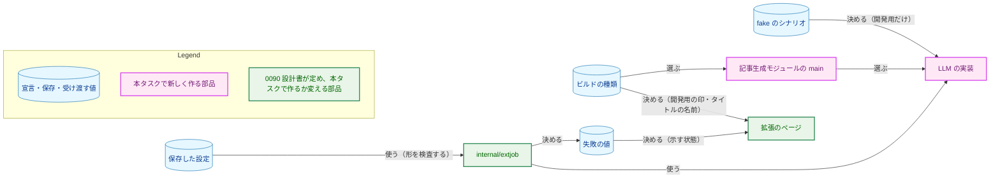
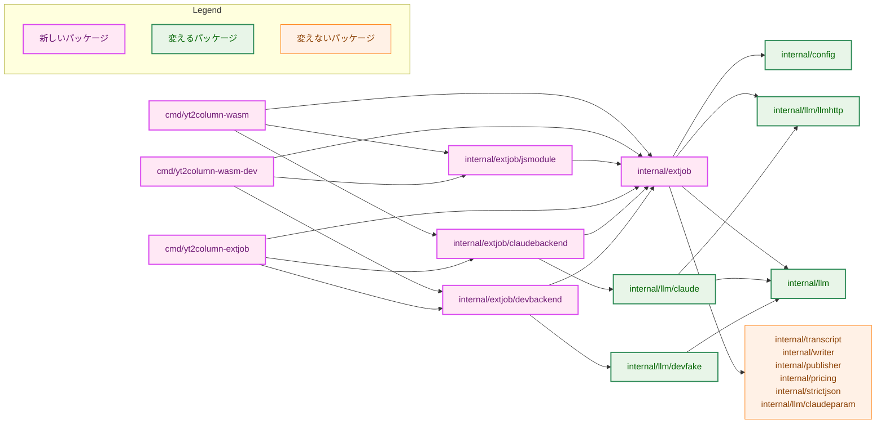
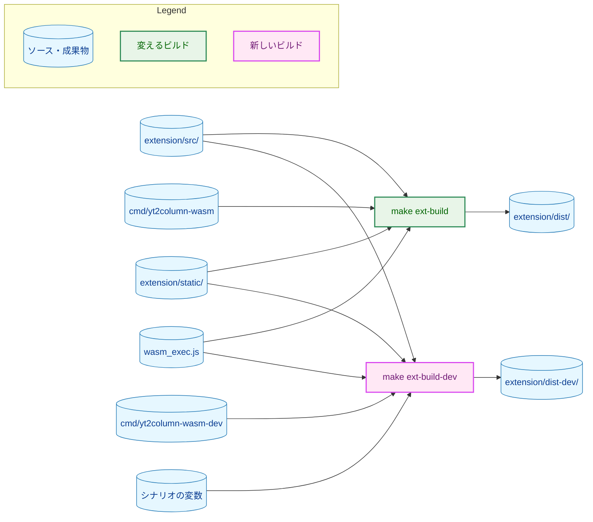
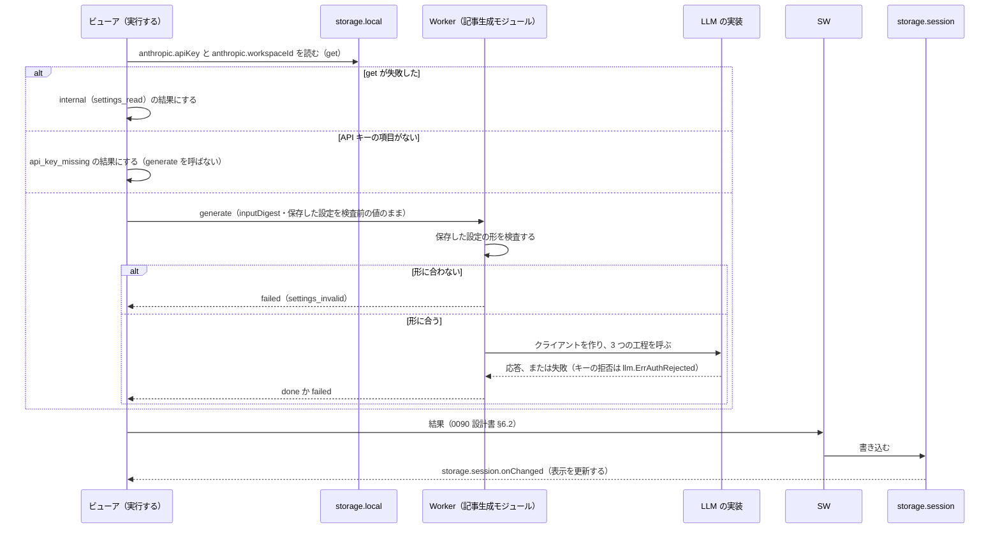
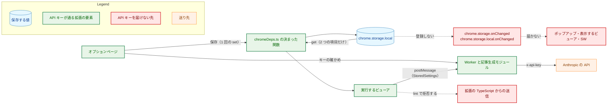
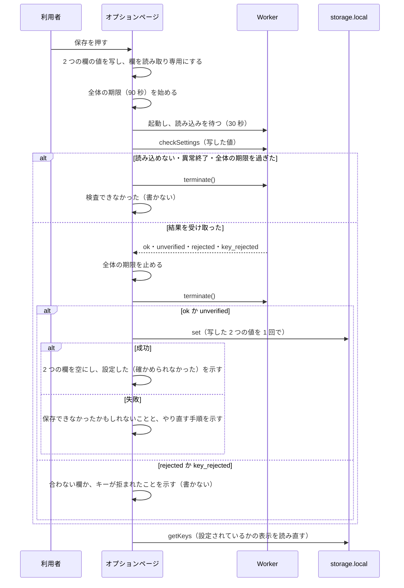
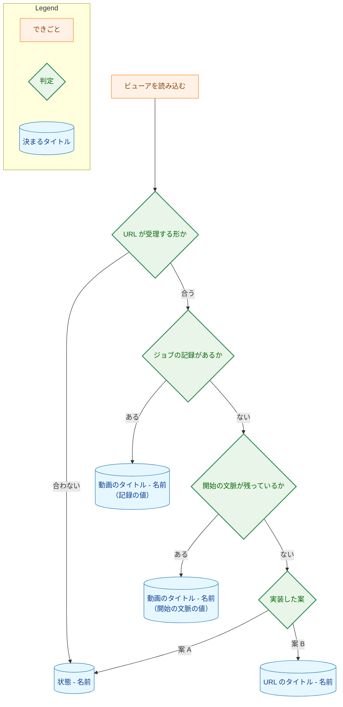
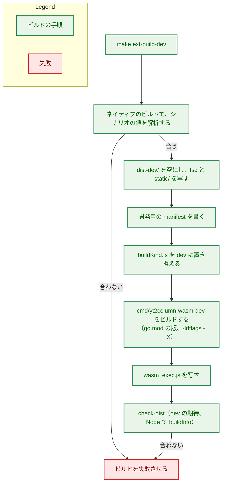

# アーキテクチャ設計書：拡張だけの経路への移行と、サーバとホストの撤去

## Document Status

| Item | Value |
|---|---|
| Status | `approved` |
| Created | 2026-11-15 |
| Review date | 2026-11-16 |
| Reviewer | isseis |
| Comments | - |

## 1. 設計の全体像 (Design Overview)

本書は、[01_requirements.md](01_requirements.md)（以下、要件書）が定める移行を設計する。移行の後は、ブラウザ拡張が記事生成モジュール（WASM）を自分のページで動かし、利用者の API キーで Claude API を直接呼ぶ。localhost サーバと Native Messaging のホストは撤去する。

構成の正本は、タスク 0090 の[設計書](../0090_extension_only_architecture/02_architecture.md)（以下、0090 設計書）である。記事生成モジュールの関数、ジョブの記録、SW の調停、ページの間のメッセージ、権限と CSP、利用者に示す状態の種類、撤去するものは、0090 設計書の節を参照し、本書に写さない。本書が決めるのは、次の 2 種類だけである（[申し送り](design_handoff.md) H-01）。

-   0090 設計書が決めていない手段：ファイルとパッケージの分け方、ビルドの組み立て、ビルドタグ、PR の区切りの前提になる依存の順、要件書で決めたポップアップのリンクとページのタイトルの置き場所。
-   0090 設計書の手段を変える箇所：要件書が変えた点（要件書 §1「0090 設計書から変える点」）と、本書が変える点。どちらも、0090 設計書の節と変える理由を付録 B に挙げる。

本書の用語は、要件書 §6 と 0090 設計書 §1 による。加えて、次の語を使う。

-   **LLM の実装:** 記事生成モジュールの `main` が `internal/extjob` に渡す、LLM のクライアントを作る関数と、API キーを確かめる関数の組（`extjob.Backend`、§3.3）。公開用の記事生成モジュールは Claude の実装（`internal/extjob/claudebackend`）を、開発用の記事生成モジュールは fake の実装（`internal/extjob/devbackend`）を渡す。
-   **ビルドの種類:** 公開用のビルド（`release`）か開発用のビルド（`dev`）か。`static/` に置く 1 つのモジュール（`buildKind.js`）で宣言する。公開用のビルドはそれを写し、開発用のビルドは `dev` の値に置き換える（§3.5）。
-   **保存した設定:** 実行するビューアが `chrome.storage.local` から読んだ、`anthropic.apiKey` と `anthropic.workspaceId` の 2 つの項目の値。検査する前の値である（§3.3）。
-   **キーの確かめ:** オプションページの保存のボタンが、保存の前に Models API を 1 回呼んで API キーを確かめること（0090 設計書 §3.6）。
-   **変更の知らせ:** `chrome.storage` の `onChanged` のイベント。変わった項目の値を載せる（要件書 AC-20 の語）。

### 1.1. 設計原則

-   **0090 設計書を正本とし、写さない。** 同じ内容を 2 つの設計書に置くと、どちらかだけが直されて食い違う。本書は、0090 設計書の節を挙げて参照し、変える箇所だけを書く。
-   **規則は Go の 1 か所に置く。保存した設定の検査も Go が行う。** 実行するビューアは、保存した設定を検査せずにそのまま記事生成モジュールへ渡し、形に合うかどうかは記事生成モジュールが決める（§3.3）。TypeScript が決めるのは、API キーの項目があるかどうか（`api_key_missing`）だけである。
-   **公開用と開発用の違いは、構成で分ける。** 違いは、記事生成モジュールの `main` と LLM の実装、manifest、ビルドの種類のモジュールの 3 つに限る。`internal/extjob` と拡張のページのコードは、公開用と開発用で同じものを使う。公開用は fake を、開発用は Claude のアダプタを、依存に持たない（§2.1）。fake を選ぶ分岐を公開する成果物に入れないためであり（[ADR-0045](../../dev/adr/0045-dev-fake-llm.md)）、開発用のビルドが Anthropic の API を呼ばないことを、配線の正しさでなく構成で保つためである。
-   **API キーに届く `chrome.storage` の呼び出しを、決まった関数に限る。** 拡張のコードは、`chrome.storage` を `browser/chromeDeps.ts` の決まった関数だけを通して使い、`StorageArea` そのものを渡さない。変更の知らせは `chrome.storage.session.onChanged` だけで受け取る（§5.4）。
-   **撤去の前の PR は、今の経路を壊さない。** 拡張がサーバとホストを使わなくなる切り替えの PR より前の PR は、Go の部品、拡張のビルド、まだ使われない拡張の部品を加えるだけにする。新旧の経路を併存させる仕組みは作らない（要件書 AC-32）。

### 1.2. 設計の際に決めたこと（2026-11-15）

-   **0090 設計書を正本として参照し、本書は差分だけを決める（申し送り H-01）。** 写した内容のどちらかだけが直されると、実装の正本が分からなくなるためである。要件書が 0090 設計書から変えた点と、本書が変える点は、付録 B に表にした。ADR: なし（文書の書き分けの決定で、本タスクの中で閉じる）。
-   **API がキーを拒んだことは、プロバイダに依存しない番兵（`errors.Is` で見分ける決まったエラーの値）`llm.ErrAuthRejected` で表す（§3.1、申し送り H-10）。** Claude アダプタの 401 のエラーと fake のキーの拒否は、どちらも `errors.Is(err, llm.ErrAuthRejected)` が真になる。`internal/extjob` は、この番兵で `api_key_rejected` を決め、`internal/llm/claude` を import しない。0090 設計書 §4.1 は、`*claude.HTTPStatusError` の状態コードで決めるとしていた。そのままでは、fake が同じ失敗を返すために `internal/llm/claude` を import することになり、fake の依存を `internal/llm` と標準ライブラリに限る規則（`internal/llm/devfake/scenario.go:1-6`、`internal/llm/devfake/deps_test.go`）に反する。採らなかった案は、LLM の実装に失敗を分類する関数を持たせる案である。分類の規則が Claude と fake の 2 か所に分かれ、食い違いうる。番兵を返すのは、今は Claude アダプタだけで、ほかのアダプタは返さない（§3.1）。ADR: [ADR-0019](../../dev/adr/0019-pipeline-component-interfaces.md) を更新した（共通の番兵に、キーの拒否を加え、返すアダプタを package_reference.md の行に書く）。
-   **ポップアップのオプションページへのリンクは、詳細の節の後に置く（§3.7、申し送り H-04）。** 主ボタンの操作と紛れず、フォーカスの順が「主ボタン → 詳細 → 設定」になるためである。API キーが設定されていないときのオプションページを開く操作は、状態の表示の中に置き、リンクの位置には置かない。採らなかった案は、ポップアップの上部に置く案である。見つけやすいが、フォーカスの順で主ボタンより前に来る。ADR: なし（ポップアップの表示の決定で、[ADR-0008](../../dev/adr/0008-launch-path.md) の起動の経路を変えない）。
-   **記録がないビューアのページのタイトルは、2 つの案を本書で決めておき、どちらで実装するかは、ページのタイトルを実装する PR より前の手動の確認で決める（§3.8.2、申し送り H-05）。** 上書きされないなら案 A（状態の分かる固定のタイトル）、上書きされるなら案 B（ビューアの URL に、動画のタイトルを 64 コードポイントまでに切った値をクエリ `t` で加える）で実装する。設計を止めずに書き進められ、どちらの結果でも設計を作り直さないためである。採らなかった案は、人が先に Chrome と Brave で確かめ、当たる案だけを書く案である。設計は短くなるが、確かめにはブラウザの再起動とセッションの復元が要り、設計の作業を止める。ADR: なし（案 B で実装するときは、その PR で [ADR-0010](../../dev/adr/0010-extension-stores-nothing.md) を改める。要件書 §1）。
-   **文字を伏せた API キーの欄を支援技術が読み上げるかは、オプションページを実装する PR で VoiceOver で確かめ、読み上げるときだけ欄の説明に注意を添える（§3.6、申し送り H-12）。** 読み上げないのに注意を添えると、利用者に誤ったことを伝えるためである。採らなかった案は、確かめずに注意を添える案である。ADR: なし（オプションページの表示の決定である）。
-   **拡張の送信で Anthropic の 401 を読めるかは、オプションページを実装する PR より前に、Chrome と Brave で手で確かめる（§7.2）。** 公開用のビルドは `host_permissions` を持たないので、送信はどれも CORS の対象になる。PoC が 401 を見たのは、`host_permissions` を付けて事前の確認がなかった試行だけである（[調査記録](../../research/wasm_pipeline_poc/README.md)「測定 3」の 3-b）。401 の応答が CORS の許可を持たなければ、Go は通信の失敗として受け取り、キーの確かめは `unverified` になって誤ったキーを保存し、記事の生成は `api_key_rejected` でなく `llm_failed` になる（要件書 AC-02・AC-12 を満たさない）。確かめは、公開用のビルドと同じヘッダの組（`anthropic-workspace-id` のありとなし）で、誤ったキーで `GET /v1/models` と `POST /v1/messages` を呼ぶもので、401 には料金がかからない。読めないと分かったときは、人と決め直し、ADR-0010 の保存のときの確かめを改める。採らなかった案は、設計の承認の前に試作で確かめる案である。ADR: なし（確かめの時期の決定で、本タスクの中で閉じる）。
-   **`internal/config` は、サーバとホストの設定の読み込みのファイルに `!js` のビルドタグを付けて、WASM でビルドできるようにし、撤去の PR でそのファイルごと除く（§3.2、申し送り H-02）。** 撤去の前の PR で記事生成モジュールをビルドするのに要るためである。撤去の PR の完了の条件に、`internal/config` に `!js` のビルドタグが残らないことを入れる。採らなかった案は、記事生成モジュール用の関数を `internal/privatefile` に依存しない別のパッケージに置く案である。CLI と同じ値の読み込みの関数（`loadLLM` など、`internal/config` の公開しない関数）を使えず、公開するか写すことになる。ADR: なし（撤去までの間だけの手段で、本タスクの中で閉じる）。
-   **今のサーバのテストの行を、サーバを撤去する前の PR で `internal/extjob` のテストに写し、両方が同じ行で通ることを確かめてから、撤去の PR でサーバのテストを削除する（§7.4、申し送り H-03）。** サーバを撤去した後は、比べる相手がないためである。ADR: なし（テストの進め方で、本タスクの中で閉じる）。
-   **実行するビューアは、保存した設定を検査せずにそのまま `generate` に渡し、記事生成モジュールが形を検査して、合わなければ `settings_invalid` にする（§3.3、申し送り H-08）。** 0090 設計書 §3.1.2 の `GenerateRequest` は API キーとワークスペース ID を文字列として受け取るので、ワークスペース ID の項目がないことと、文字列でない値が保存されていることを表せず、ビューアが型を確かめることになる。設定の規則を Go の 1 か所に置くため（要件書 §3.2）、受け渡しの形を変えた。API キーを `secret.Secret` にするのは、受け取った直後でなく、文字列であることを確かめた直後になる。ADR: [ADR-0049](../../dev/adr/0049-wasm-core-sharing.md) を更新した（`generate` は保存した設定を検査前の値で受け取り、記事生成モジュールが形を検査する）。[ADR-0031](../../dev/adr/0031-secret-closure.md) と ADR-0049 の `secret.Secret` にする時点も、文字列であることを確かめた直後に改めた。
-   **オプションページの検査の期限は、Worker の読み込みを 30 秒、キーの確かめの呼び出しを 30 秒、検査の全体を 90 秒とする（§3.6、申し送り H-09）。** Worker の読み込みの期限は、実行するビューアと同じである（0090 設計書 §3.4）。キーの確かめは本文を読まない軽い呼び出しで、保存のボタンを押した利用者が待つ時間として 30 秒を上限にする。全体の期限は、読み込みと呼び出しの期限の和（60 秒）に余裕を加えたもので、呼び出しの期限切れが先に「確かめられなかった」になる（要件書 AC-02）。ADR: なし（定数の値で、本タスクの中で閉じる）。
-   **拡張のページと SW は、変更の知らせを `chrome.storage.session.onChanged` だけで受け取り、`chrome.storage.onChanged` と `chrome.storage.local.onChanged` を使わない（§3.8.1・§5.4、申し送り H-11）。** `chrome.storage.onChanged` と `chrome.storage.local.onChanged` は、オプションページが保存した API キーの値を、ポップアップ、表示するビューア、SW に届けてしまうからである（要件書 AC-20）。0090 設計書 §1.2 と ADR は `chrome.storage.onChanged` で表示を更新するとしていた。採らなかった案は、`chrome.storage.onChanged` で受け取り、`local` の変更を無視する案である。無視しても値はページに届く。ADR: [ADR-0031](../../dev/adr/0031-secret-closure.md) に規則と理由を置き、[ADR-0027](../../dev/adr/0027-article-job-api.md)・[ADR-0008](../../dev/adr/0008-launch-path.md)・[ADR-0009](../../dev/adr/0009-viewer-opening.md)・[ADR-0028](../../dev/adr/0028-no-automatic-resend.md) を更新した。
-   **拡張のコードは、`chrome.storage` を `browser/chromeDeps.ts` の決まった関数だけを通して使い、lint で強いる（§5.4）。** 今の ESLint の規則は、`storage` と `session` の名前の参照と、`fetch` などの送信を、拡張のすべてのコードで拒否している（`extension/eslint.config.js`。拡張が設定を持たず送信しなかったときの規則である）。この規則を外すだけでは、拡張の TypeScript が Anthropic の API を直接呼び、Go の送信の守り（§5.3）を通らない道ができ、`StorageArea` を渡せば API キーを読む呼び出しがソースの検査をすり抜ける。採らなかった案は、`anthropic.apiKey` の名前を手がかりにするソースの検査だけにする案である。`get(null)` のような、名前を書かずに全部を読む呼び出しを見逃す。ADR: なし（ADR-0031 の「経路を限ってテストで確かめる」の手段である）。
-   **LLM の実装（`extjob.Backend`）は、記事生成モジュールの `main` が `internal/extjob` に渡す。Claude の実装は `internal/extjob/claudebackend`、fake の実装は `internal/extjob/devbackend` に置く（§3.3、申し送り H-10）。** `internal/extjob` は、渡された実装を呼ぶだけで、どちらの実装も import しない。開発用の記事生成モジュールの依存に `internal/llm/claude` が入らないことを、公開用に fake が入らないことと同じ `go list -deps` の検査で確かめる。開発用のビルドが Anthropic の API を呼ばないこと（要件書 AC-29）を、構成で保つためである。保存した設定の形の検査は、どちらの実装でも `internal/extjob` が同じように行う。ADR: なし（ADR-0045 の規則を当てるだけである）。
-   **ビルドの種類は、`static/buildKind.js` の 1 つのモジュールで宣言し、入口のページのスクリプトだけがそれを読む（§3.5）。** 開発用の印、ページのタイトルに添える名前は、この宣言で決める。manifest の `key` の有無や名前から推し量らない（CLAUDE.md「Declare, don't infer」）。公開用のビルドは `static/` の写しのまま（値は `release`）で、要件書 AC-25 の成果物の種類を増やさない。開発用のビルドは、このモジュールを `dev` の値に置き換え、manifest を公開用の manifest から作る。ADR: なし（[ADR-0026](../../dev/adr/0026-extension-platform.md) が定める開発用のビルドの規則の中の手段である）。
-   **成果物の検査は、WASM の出どころを、Node で記事生成モジュールを読み込んで `buildInfo` を呼んで確かめる（§3.5）。** 0090 設計書 §3.9 と ADR-0026 は `go version -m` で main のパッケージのパスを確かめるとしたが、`go version -m` は WASM のビルドの情報を読めない（go1.27.1 で `GOOS=js GOARCH=wasm` のビルドに `go version -m` を走らせると `unrecognized file format` で失敗した。2026-11-15 に確かめた）。`buildInfo` は、記事生成モジュールの中で Go のビルドの情報を読み、main のパッケージのパス、Go の版、開発用のビルドが埋め込んだシナリオを返す。採らなかった案は、拡張のスクリプトで WASM の中のビルドの情報の形を解析する案である。Go の内部の形に依存する。ADR: [ADR-0026](../../dev/adr/0026-extension-platform.md) を更新した。
-   **拡張のビルドは、記事生成モジュールを `go.mod` の `go` の行の版のツールチェーンでビルドする（§3.5）。** `go.mod` の `go 1.26.5` は最小の版で、手元の `go` は別の版でありうる（2026-11-15 の手元は go1.27.1、`GOTOOLCHAIN=auto`）。そのままでは、成果物の WASM と `wasm_exec.js` がビルドする機械で変わり、要件書 AC-25 の「`go.mod` が定める Go の版」に合わない。ビルドのスクリプトが `GOTOOLCHAIN` にその版を与え、成果物の検査が `buildInfo` の Go の版を確かめる。その版のツールチェーンがなければ、初めのビルドで `go` がダウンロードする（ネットワークを使う）。ADR: なし（AC-25 の手段で、ADR-0026 の決定を変えない）。
-   **fake のシナリオは、`make ext-build-dev` の 5 つの変数で受け取り、1 つの `-ldflags` の文字列に 5 つの `-X` を並べて開発用の記事生成モジュールに埋め込む（§3.4）。** 記事生成モジュールは、起動のときに埋め込んだ値を解析し、空の値と合わない値では関数を登録しない。WASM をビルドする前にネイティブのビルドで同じ値を解析し、ビルドの後に成果物の検査が `buildInfo` のシナリオを確かめる。リンカーは存在しない名前への `-X` を黙って無視し、`-ldflags` を 2 回渡すと後のものだけが効くので、合わない値でビルドした拡張が既定のシナリオで動くことを、ビルドの時点で止めるためである。ADR: なし（ADR-0045 の「シナリオはビルドの引数で選ぶ」の手段である）。
-   **開発用のコマンド `cmd/yt2column-extjob` は、LLM を `-llm=claude` か `-llm=fake` で必ず指定させ、既定の値を持たない（§3.4）。** 指定を忘れた実行が料金のかかる呼び出しにならないためである（CLAUDE.md「Tool Execution Safety」）。ADR: なし（開発用のコマンドの引数の決定である）。
-   **CI は、記事生成モジュールの依存を `go list -deps` で求め、そのディレクトリの下のファイル（サブディレクトリの中のファイル、埋め込むファイル、削除したファイルを含む）が変わったときに拡張の検査を走らせる（§3.10）。** 依存の一覧を手で書くと、依存が増えたときに漏れる。採らなかった案は、`internal/` のどのファイルの変更でも拡張の検査を走らせる案である。依存でない `internal/chief` などの変更でも走る。ADR: なし（CI の手段で、本タスクの中で閉じる）。

### 1.3. 概念モデル

本タスクで加わる概念と、その関係を示す。拡張だけの構成の全体の概念（ジョブ、ジョブの記録、実行）は 0090 設計書 §1.3 にある。矢印 A → B は、「A が B を決める、選ぶ、または使う」を表し、そのどれかをラベルで示す。



-   ビルドの種類は `release` か `dev` で、記事生成モジュールの `main` を選ぶ（公開用は `cmd/yt2column-wasm`、開発用は `cmd/yt2column-wasm-dev`）。拡張のページのコードは、どちらの種類でも同じで、宣言を読んで表示だけを変える。
-   fake のシナリオは、開発用のビルドの変数で選ぶ（§3.4）。
-   保存した設定の形の検査と、失敗の値の決定は、どちらの LLM の実装でも `internal/extjob` が同じように行う。開発用のビルドでも、`settings_invalid` は実際の検査で出る（要件書 AC-29）。

### 1.4. 実装の際に決めたこと（2026-11-16）

-   **2 つの記事生成モジュールが共有する `syscall/js` の登録を、`js` のビルドだけのパッケージ `internal/extjob/jsmodule` に置く（§2.1・§3.3・§3.4・§3.10・§3.12）。** 公開用と開発用の記事生成モジュールの `main` は、LLM の実装から作った `extjob.Module` を `jsmodule.Serve` に渡すだけを持つ。`jsmodule` は、4 つの関数を `globalThis` の 1 つの名前空間のオブジェクト（名前は `yt2column`）に登録し、引数の型の確かめ、Promise の作成、進み具合の関数の呼び出しを持つ。JSON の解析と組み立ては持たない。`make wasm-check` は `jsmodule` も `vet` する。理由: 登録の処理（約 50 行）は 2 つの `main` で同じで、それぞれに置くと片方だけを直す誤りが起きる（CLAUDE.md「DRY」）。採らなかった案は、登録の処理をそれぞれの `main` に置く案（本書の当初の形）である。人が 2026-11-16 に、PR-4 の実装の際に選んだ。ADR: [ADR-0049](../../dev/adr/0049-wasm-core-sharing.md) を更新した（`cmd/yt2column-wasm` が `syscall/js` での登録だけを持つとしていた決定を、登録を `jsmodule` に置き、2 つの `main` はそれを呼ぶだけを持つに改めた）。

### 1.5. 実装の際に決めたこと（2026-11-17）

-   **生成の開始のメッセージ `start` に、元の YouTube のタブの場所（`source`: タブの ID・ウィンドウの ID・位置）を加え、SW はビューアをそのタブの隣に開く（0090 設計書 §3.3.1 の `SwRequest` の `start` を変える）。** 今の実装はビューアを YouTube のタブの隣（`windowId`・`index + 1`・`openerTabId`）に開く。0090 設計書の `start` の型は場所を持たず、場所を指定せずに開くと、利用者から見えるビューアの位置が文書に決めのないまま変わる（要件書 AC-19）。Fable の部分レビューの指摘で見つかり、人が `start` に載せる案を選んだ。`source` は閉じたメンバの集合の一部で、3 つの値は 0 以上の整数でなければならない。理由: ビューアの位置は今の利用者から見える振る舞いで、変える決定を文書が挙げていないため。採らなかった案は、位置の指定をやめる案（利用者から見える変更になる）と、PR-8 に回す案（`start` の形を後で変える手間が出る）である。ADR: なし（メッセージの形の決定で、本タスクの中で閉じる）。

## 2. システム構成 (System Structure)

### 2.1. 全体の構成

拡張だけの構成の要素と受け渡しは、0090 設計書 §2.1 の図のとおりである。本節は、本タスクの後の Go のパッケージと `main` の依存を示す。矢印 A → B は、「A が B を import する」を表す。図は、§7.3 の依存の検査に関わる依存を示し、ほかの依存（`internal/config` への依存、`devfake.ParseScenario` を呼ぶ `main` から fake への依存など）は省いた。



-   **0090 設計書 §2.3 からの違い。** 0090 設計書の図では、公開用の記事生成モジュールが `internal/config` と `internal/llm/claude` を直接 import した。本書では、Claude のクライアントを作る処理とキーの確かめを `internal/extjob/claudebackend` に置く。公開用の記事生成モジュールと開発用のコマンドの両方が同じ実装を使うので、2 つの `main` に同じ組み立てを書かないためである（CLAUDE.md「DRY」）。`internal/extjob` が `internal/llm/llmhttp` を import するのは、保存した設定の検査で `llmhttp.CheckAPIKey` を呼ぶためである（§3.3）。
-   **依存の検査（§7.3）。** 公開する成果物（`cmd/yt2column` と `cmd/yt2column-wasm`）の依存に、`internal/llm/devfake` と `internal/extjob/devbackend` が入らない（ADR-0045）。開発用の記事生成モジュール（`cmd/yt2column-wasm-dev`）の依存に、`internal/llm/claude` と `internal/extjob/claudebackend` が入らない。開発用のコマンドは、両方を選べるので、両方に依存する。
-   図にない CLI（`cmd/yt2column`）は今のまま `internal/pipeline` と `internal/llm/provider` を使い、`internal/extjob` を使わない（要件書 AC-26）。
-   撤去するパッケージ（`cmd/yt2column-server`・`cmd/yt2column-nmhost`・`cmd/yt2column-devserver`・`internal/server`・`internal/articlecache`・`internal/serversock`・`internal/nmhost`）は、この図にない（§3.11）。

### 2.2. コンポーネント配置

0090 設計書 §2.2 の表に、本書が加えるか変える置き場所を示す。

| 置き場所 | 役割 | 0090 設計書との違い |
|---|---|---|
| `internal/extjob` | 0090 設計書 §2.3 のとおり。加えて、保存した設定の形の検査（`settings_invalid`）と、LLM の実装の受け取り | 保存した設定を検査前の値で受け取る。Claude のクライアントを作らない |
| `internal/extjob/claudebackend` | Claude の LLM の実装。本番の構成の Claude のクライアントと、キーの確かめ | 新しい。0090 設計書では `cmd/yt2column-wasm` が持つ |
| `internal/extjob/devbackend` | fake の LLM の実装。ビルドのときに選んだシナリオで、生成のクライアントとキーの確かめの結果を返す | 新しい |
| `internal/extjob/jsmodule` | 2 つの記事生成モジュールが共有する `syscall/js` の登録。`js` のビルドだけ（§1.4） | 新しい。0090 設計書では `cmd/yt2column-wasm` が持つ |
| `internal/llm` | 番兵 `ErrAuthRejected` を加える | 新しい番兵 |
| `internal/llm/claude` | 401 のエラーが `llm.ErrAuthRejected` に当たるようにする。キーの確かめの関数を加える | 分類の方法を変える |
| `internal/llm/llmhttp` | 本文を読まずに状態コードだけを返す送信を加える。`js` のビルドでリダイレクトに従わない指定を付ける | 送信の種類を足す |
| 拡張のビルドのスクリプト（`extension/scripts/`） | `go` を呼んで記事生成モジュールをビルドし、`wasm_exec.js` を写す。開発用のビルドでは、ビルドの種類のモジュールを `dev` の値に置き換え、開発用の manifest を作る | 0090 設計書は `make ext-build` が Go を呼ぶとだけ決めた |
| `extension/src/browser/chromeDeps.ts` | `chrome.storage` を使う決まった関数（§5.4） | 0090 設計書 §3.11 の依存の追加を、決まった関数に限る |
| オプションページ | 0090 設計書 §3.6 のとおり。保存も削除も 1 回の書き込み、検査の 3 つの期限、保存した値を読まないこと | §3.6 を一部変える |
| ポップアップ | 0090 設計書 §3.5 のとおり。加えて、いつもオプションページへのリンクを持つ | リンクを加える |
| ビューア | 0090 設計書 §3.4 のとおり。加えて、ページのタイトルの決め方、`settings_invalid` の状態、変更の知らせの受け取り方 | §3.4 を一部変える |

### 2.3. ビルドの構成

公開用と開発用のビルドが、何から何を作るかを示す。矢印 A → B は、「A から B を作るか、B に写す」を表す。



-   `wasm_exec.js` は、`go.mod` の版の Go のツールチェーンのものである（§3.5）。
-   どちらのビルドも、同じ `tsc` の出力と `static/` を使う。違いは、記事生成モジュールの `main`、manifest（開発用は `key` を持たない）、ビルドの種類のモジュール（公開用は `static/` の写しの `release`、開発用は置き換えた `dev`）の 3 つだけである（§3.5）。
-   どちらのビルドも、出力のディレクトリを空にしてから始め、最後に成果物の検査（`extension/scripts/check-dist.ts`）を、それぞれの種類の期待で走らせる。

### 2.4. データの流れ

生成の開始から記事の表示までの流れは、0090 設計書 §2.4 のとおりである。本書が変えるのは、実行するビューアが `generate` を呼ぶところと、表示の更新の受け取り方である。実線の矢印は呼び出しか送信を、破線の矢印は応答か知らせを表す。



## 3. コンポーネント設計 (Component Design)

### 3.1. LLM の失敗の分類と、キーの確かめ

`internal/llm` に、API がキーを拒んだことを表す番兵を加える。

```go
// ErrAuthRejected reports that the provider rejected the credentials.
// Callers classify with errors.Is, without importing an adapter. Only the
// adapters listed in package_reference.md return it.
var ErrAuthRejected = errors.New("the provider rejected the credentials")
```

-   **Claude アダプタ。** 状態 401 の `*HTTPStatusError`（`internal/llm/claude/errors.go:33`）は、`errors.Is(err, llm.ErrAuthRejected)` が真になる。`errors.AsType[*claude.HTTPStatusError]` で状態コードを取り出せることと、`ErrHTTPStatus` に当たることは変えない。CLI の振る舞いとエラーの文は変わらない（要件書 AC-26）。
-   **ほかのアダプタ。** DeepSeek と OpenAI のアダプタは、今は `llm.ErrAuthRejected` を返さない。拡張はこれらを使わず、CLI は 401 を分けて扱わないためである（CLAUDE.md「YAGNI」）。この番兵を使う呼び出し側（`internal/extjob`）は、返すアダプタとだけ組み合わせて使う。`LLMClient` の doc コメントの番兵の一覧と、package_reference.md の `internal/llm` の行に、この番兵と、返すアダプタを書く。プロバイダを足すとき（0090 設計書 §3.10）に、そのアダプタのキーの拒否が `llm.ErrAuthRejected` に一致するようにする。
-   **キーの確かめ。** `internal/llm/claude` に、Models API（`GET https://api.anthropic.com/v1/models?limit=1`）を 1 回呼ぶ関数を加える（0090 設計書 §3.6・§3.11）。

```go
// CheckKey calls the Models API once with the key and the optional workspace
// ID. It returns nil for 200, an error matching llm.ErrAuthRejected for 401,
// and another error for any other outcome. It never reads the response body.
func CheckKey(ctx context.Context, opts KeyCheckOptions) error

type KeyCheckOptions struct {
	APIKey      secret.Secret
	WorkspaceID claudeparam.WorkspaceID // zero value: not specified
	Timeout     time.Duration
}
```

-   **状態だけを返す送信。** 今の `llmhttp.Post`（`internal/llm/llmhttp/llmhttp.go:94`）は 200 の応答の本文を読む。キーの確かめは本文を読まないので、`internal/llm/llmhttp` に、同じ期限、リダイレクトの拒否、失敗の分類（`Errors` の `Transport` と、期限切れの `context.DeadlineExceeded`）を通し、状態コードを返して本文を読まない送信を加える。本文は読まずに閉じる（`Post` と同じく `Close` を呼ぶ）。閉じないと、`js` のビルドでは `fetch` の本文の流れが取り消されずに残る。

```go
// Status sends one request like Post and returns the response's status code
// without reading the body. Send failures and timeouts are reported as Post
// reports them; it never follows a redirect.
func Status(ctx context.Context, call Call) (int, error)
```

-   `internal/llm/llmhttp` の doc コメントと package_reference.md の行は、今は「1 回の POST」を述べている。`Status` を加える PR で、両方を改める。
-   **ブラウザから呼ぶための指定。** `js` のビルドだけで付ける指定のうち、`js.fetch:redirect: error` は `llmhttp` の送信（`Post` と `Status` の両方）が付ける。`anthropic-dangerous-direct-browser-access` のヘッダは、`internal/llm/claude` の `js` のビルドだけのファイルが付け、`Generate` と `CheckKey` のリクエストの組み立てが同じ関数を使う（0090 設計書 §5.3・§3.11）。

### 3.2. `internal/config` の記事生成モジュール用の読み込み

-   **`LoadExtension`。** 0090 設計書 §3.1.2 の形のまま加える。`lookup` は `ANTHROPIC_API_KEY` と `ANTHROPIC_WORKSPACE_ID` だけに答え、ワークスペース ID が指定なし（保存した値が空の文字列）のときは、その名前を未設定として答える（ADR-0003、要件書 §1）。
-   **`ExtensionLookup`。** その `lookup` は、`internal/config` の新しい関数が、検査を通った 2 つの文字列から作る。`internal/extjob` は保存した設定の値を渡すだけで、変数名を書かない。秘密情報の変数名がテスト以外の Go のコードで `internal/config` にだけ現れる規則（[ADR-0024](../../dev/adr/0024-env-access-in-config.md)）を保つためである。0090 設計書 §3.1.3 は、名前を引く関数を作る場所を決めていなかった。

```go
// ExtensionLookup returns the lookup LoadExtension takes for the extension's
// two stored values: it answers ANTHROPIC_API_KEY and, when workspaceID is not
// empty, ANTHROPIC_WORKSPACE_ID, and no other name.
func ExtensionLookup(apiKey, workspaceID string) LookupFunc
```

-   **`ReadExtensionSettings`。** 開発用のコマンドのために、名前を引く関数から `ANTHROPIC_API_KEY` と `ANTHROPIC_WORKSPACE_ID` の 2 つだけを読み、検査せずに、値とあるかどうかを返す関数を加える。開発用のコマンドが、拡張と同じ `StoredSettings` を作るためである（§3.4）。

```go
// ExtensionSettings are the two stored-settings values read through a lookup,
// unchecked, with whether each name was set.
type ExtensionSettings struct{ /* unexported; read through methods */ }

func ReadExtensionSettings(lookup LookupFunc) ExtensionSettings
```

-   **WASM でビルドできるようにする。** 今の `internal/config` は、`serverfile.go` が `//go:build unix` だけの `internal/privatefile` を import するので、`GOOS=js` でビルドできない（`internal/config/serverfile.go:13`。`3ee6fb2b` で `GOOS=js GOARCH=wasm go build ./internal/config` が失敗することを確かめた）。`config.go` の `LoadServer`（`internal/config/config.go:370`）・`LoadHost`・`LoadHostHome` と、その型 `ServerConfig`・`HostConfig` は、`serverfile.go`・`configpath.go`・`socketpath.go` の関数を呼ぶ。撤去の前の PR で、これらの宣言を `!js` のビルドタグを付けたファイルに移し、`serverfile.go`・`configpath.go`・`socketpath.go` にも同じタグを付ける。
-   **撤去の PR。** サーバとホストの撤去の PR は、タグを付けたファイルを、テストとともに削除する。完了の条件は、`internal/config` の Go のファイルに `!js` のビルドタグが残らないことと、`GOOS=js GOARCH=wasm go list -deps ./internal/config` が `internal/privatefile` を含まないことである。`internal/privatefile` 自体は `internal/chief` が使うので残す（要件書 AC-31）。

### 3.3. `internal/extjob`（0090 設計書 §3.1.2 からの変更）

0090 設計書 §3.1.2 の 4 つの関数と、`Prepare`・`Run`・`Result`・`Failure` は、そのまま作る。本節は、変える箇所だけを示す。

**JavaScript に公開する形の変更。**

```typescript
// Changed from 0090 §3.1.2: the settings come as the page read them.
type GenerateRequest = {
  inputDigest: string;
  settings: StoredSettings;
};
// The two chrome.storage.local items as read, unchecked. JsonValue is any JSON
// value (extension/src/core/strictJson.ts). anthropicApiKey is always present: the viewer decides
// api_key_missing itself when the item is absent. anthropicWorkspaceId is
// absent when its item is absent.
type StoredSettings = {
  anthropicApiKey: JsonValue;
  anthropicWorkspaceId?: JsonValue;
};

// Changed from 0090 §3.1.2: buildInfo also reports the main package and the
// LLM implementation, so check-dist can tell where the module came from.
type BuildInfo = {
  goVersion: string; vcsRevision: string; vcsModified: boolean; mainPath: string;
  llm: { kind: "claude" } | { kind: "fake"; scenario: FakeScenario };
};
// The five values the development build embedded, as parsed (§3.4).
type FakeScenario = {
  article: string; failure: string; failAt: string; delaySeconds: number; settingsCheck: string;
};
```

-   `GenerateRequest` と `StoredSettings` のメンバは閉じた集合で、知らないメンバと重複したメンバは拒否する（`internal/strictjson`）。この拒否は、ビューアが形を誤って組み立てたことを表すので、`internal`（`internalDetail` は `request_shape`）にする。
-   保存した設定の検査は、次のどれかに当たれば `settings_invalid` にする。`anthropicApiKey` が文字列でないか、`llmhttp.CheckAPIKey` の規則（空でない印字可能な ASCII）に合わない。`anthropicWorkspaceId` がないか、文字列でないか、空でなくて `claudeparam.ParseWorkspaceID` の規則に合わない。`anthropicWorkspaceId` の空の文字列は、ワークスペース ID の指定なしで、受理する（要件書 AC-02・AC-04）。オプションページは指定なしのときも空の文字列の項目を書くので（§3.6）、項目がないのはオプションページが書かない形で、指定なしとは扱わない（要件書 §3.2）。前後の空白を除くなどの補正はしない（要件書 §3.2）。検査は、文字列であることを確かめた後、`config.LoadExtension(config.ExtensionLookup(...))` と `llmhttp.CheckAPIKey` を通す。この 2 つは、`checkSettings` が使うのと同じ関数である（0090 設計書 §3.1.3）。
-   `settings_invalid` の結果は、LLM の API を呼ぶ前に返る。`steps` はすべて `pending` のままである。
-   API キーの値は、文字列であることを確かめた直後に `config.LoadExtension` が `secret.Secret` にし、`internal/extjob` は JSON の文字列も `StoredSettings` の値も保持しない（[ADR-0031](../../dev/adr/0031-secret-closure.md)）。結果と進み具合には入らない。

**Go の型の追加。**

```go
// Backend is what a module's main gives the job: how a run gets its LLM
// clients and how the settings check asks the API about a key. extjob checks
// the settings' shape itself before calling either, so a Backend only ever
// receives checked settings.
type Backend interface {
	// NewClients builds the generation and review clients of one run.
	NewClients(cfg config.LLMConfig) (Deps, error)
	// CheckKey returns nil when the API accepts the key, an error matching
	// llm.ErrAuthRejected when it rejects it, and another error otherwise.
	CheckKey(ctx context.Context, cfg config.LLMConfig) error
	// Info declares the implementation for buildInfo.
	Info() BackendInfo
}

// BackendInfo is the llm member of buildInfo: claude, or fake with its scenario.
type BackendInfo struct{ /* unexported; built only by the two constructors */ }

func ClaudeInfo() BackendInfo
func FakeInfo(s FakeScenario) BackendInfo // FakeScenario: the five parsed values

// Module holds one Worker's state: the Backend and the input Prepare kept.
// Its methods are the four JavaScript functions' JSON entry points.
type Module struct{ /* unexported */ }

func NewModule(b Backend) *Module
func (m *Module) CheckSettingsJSON(ctx context.Context, request string) string
func (m *Module) PrepareJSON(request string) string
func (m *Module) GenerateJSON(ctx context.Context, request string, onProgress func(event string)) string
func (m *Module) BuildInfoJSON() string // reads runtime/debug.ReadBuildInfo and b.Info()

const (
	FailureInternal Failure = iota
	// ... the 0090 §3.1.2 values, unchanged in order ...
	FailureAPIKeyRejected
	FailureSettingsInvalid // added: the stored settings did not pass the check
)
```

```go
// Package claudebackend is the release Backend.
package claudebackend

// New returns the Backend of the production profile's Claude clients and
// claude.CheckKey.
func New() extjob.Backend
```

-   **失敗の分類。** 0090 設計書 §2.3 の分類（今の `classifyWrite`。`internal/server/generation.go:146`）に、`errors.Is(err, llm.ErrAuthRejected)` を `api_key_rejected` にする規則を、`llm.ErrEmptyResponse` などと同じ並びに加える。401 の `HTTPStatusError` は `ErrHTTPStatus` にも当たるので、HTTP の状態で分ける規則を後で加えるときも、この規則をそれより前に置く。
-   **`checkSettings` の分類。** 形が合わなければ `rejected`（合わない欄）、`CheckKey` が `nil` なら `ok`、`llm.ErrAuthRejected` に当たれば `key_rejected`、ほかは `unverified` である（0090 設計書 §3.6）。キーの確かめの呼び出しの期限は 30 秒である（§1.2）。
-   **期限の定数。** 記事の生成の呼び出しごとの期限（15 分。0090 設計書 §2.3）は、Claude のクライアントの組み立ての値なので `claudebackend` に置く（下の `provider` との一致のテストで確かめる）。キーの確かめの呼び出しの期限（30 秒）は、`internal/extjob` が `CheckKey` に渡す `ctx` の期限として持つ。
-   **CLI の組み立てとの一致。** `claudebackend` の Claude のクライアントの組み立ては、`internal/llm/provider` の Claude の組み立て（`claude.Options` の値、検証・推敲のクライアントの選び方）と同じでなければならない。記事生成モジュールは `provider` を使えないので（0090 設計書 §2.3）、ネイティブのビルドのテストで、`claudebackend` の組み立てと期限が `provider` と同じことを確かめる。
-   **`cmd/yt2column-wasm`。** `extjob.NewModule(claudebackend.New())` を作り、`internal/extjob/jsmodule` の `Serve` に渡すだけを持つ。`Serve` は、`syscall/js` で 4 つの関数を `globalThis` の 1 つの名前空間のオブジェクトに登録する。登録の処理は、開発用の記事生成モジュールと共有する（§1.4）。

### 3.4. 開発用の部品

-   **`internal/llm/devfake` のシナリオに加える値。**
    -   失敗の種類（`Failure`）に `FailureAPIKeyRejected`（綴りは `api_key_rejected`）を加える。返すエラーは `llm.ErrAuthRejected` に当たる。
    -   シナリオに、キーの確かめの結果（`SettingsCheck`）を加える。値は `ok`・`key_rejected`・`unverified` の 3 つで、ゼロ値は `ok` である。キーの確かめを返す関数は、`ok` では `nil`、`key_rejected` では `llm.ErrAuthRejected` に当たるエラー、`unverified` では `ErrSimulatedAPIFailure` を包むエラーを返す。
    -   fake の依存は `internal/llm` と標準ライブラリのままである（ADR-0045）。
-   **シナリオの綴りと解析。** 今は開発用のサーバの引数の解析（`cmd/yt2column-devserver/args.go:130`）が、4 つの値の綴りを解析する。この解析を、次の形の関数として `internal/llm/devfake` に移し、開発用のサーバ（撤去までの間）、開発用の記事生成モジュール、開発用のコマンドが同じ関数を使う。空の値と合わない綴りは補正せずに拒否する。

```go
// ScenarioSpelling is a scenario as five text values: the article, the
// failure, the failing call, the delay in whole seconds, and the settings
// check result. Every value must be present; none has a default.
type ScenarioSpelling struct {
	Article, Failure, FailAt, DelaySeconds, SettingsCheck string
}

func ParseScenario(s ScenarioSpelling) (Scenario, error) // error wraps ErrInvalidScenario
```

-   **`internal/extjob/devbackend`（新しい）。** `devfake.Scenario` から `extjob.Backend` を作る。`NewClients` は、渡された設定を使わず、シナリオの fake のクライアントを返す。`CheckKey` は、シナリオのキーの確かめの結果を返す。どちらも、Anthropic の API を呼ばない。`Info` は fake とシナリオの値を返す。
-   **`cmd/yt2column-wasm-dev`（新しい）。** シナリオの 5 つの値を、それぞれ `main` のパッケージの 1 つの文字列の変数として持ち、1 つの `-ldflags` の文字列に並べた 5 つの `-X main.<変数>=<値>` で受け取る。起動のときに `ParseScenario` で解析し、合えば `extjob.NewModule(devbackend.New(scenario))` を `jsmodule.Serve` に渡して 4 つの関数を登録する（§1.4）。空の値と合わない値では関数を登録しない（ページは Worker の読み込みの失敗として扱う）。`syscall/js` を使う登録のファイルだけを `js` のビルドにし、ネイティブのビルドでは、同じ変数を解析して結果だけを返す `main` を持つ。
-   **`make ext-build-dev` の変数。** `FAKE_ARTICLE`・`FAKE_FAILURE`・`FAKE_FAIL_AT`・`FAKE_DELAY`・`FAKE_SETTINGS_CHECK` の 5 つとする。`Makefile` が既定の値（`standard`・`none`・`none`・`0`・`ok`）を持ち、ビルドのスクリプトにはいつも 5 つとも渡す。
-   **`cmd/yt2column-extjob`（新しい）。** 0090 設計書 §7.2 のとおり。次のとおりにする。
    -   LLM は `-llm=claude` か `-llm=fake` で必ず指定する。指定がないか、ほかの値なら、何もせずに終わる（§1.2）。
    -   `-llm=fake` では、シナリオを `-article`・`-failure`・`-fail-at`・`-delay`・`-settings-check` の 5 つの引数で受け取り、`ParseScenario` で解析する。
    -   `-llm=claude` では、`main` がプロセスの環境から名前を引く関数を作って `config.ReadExtensionSettings`（§3.2）に渡し、返った 2 つの値を `StoredSettings` にして（`ANTHROPIC_WORKSPACE_ID` が未設定のときは、`anthropicWorkspaceId` を空の文字列にする。拡張のオプションページがいつも項目を書くのと同じ形にするためである）、拡張と同じく `Module.GenerateJSON` に渡す。秘密情報の変数名は `internal/config` にだけ現れ、`main` は環境を `internal/config` に渡すためだけに参照する（[ADR-0024](../../dev/adr/0024-env-access-in-config.md)）。空のワークスペース ID は、拡張と同じく指定なしになる。
    -   入力のファイル（`PrepareRequest` の形）は `Module.PrepareJSON` に渡す。記事生成モジュールと同じ入口を通るので、`settings_invalid` を含む同じ検査を通る。
-   **撤去までの間の開発用のビルド。** 切り替えの PR より前の開発用のビルドは、`key` を持たず ID が違うので、ホストの manifest の `allowed_origins` に入らず、今のホストとサーバの経路でも動かない。切り替えの PR までは、開発用のビルドで画面を確かめない。

### 3.5. 拡張のビルド

-   **ビルドが `go` を呼ぶ。** 拡張のビルドのスクリプト（`extension/scripts/` に置く）が、`tsc` と `static/` の写しの後に、`GOOS=js GOARCH=wasm go build -trimpath` で記事生成モジュールを成果物の直下にビルドし、同じツールチェーンの `$(go env GOROOT)/lib/wasm/wasm_exec.js` を成果物の直下に写す（ADR-0026、0090 設計書 §3.1.4）。`npm run build` は、Go を呼ぶ手順まで含めて、検査の済んだ成果物を作る。`make ext-build` はそれを呼ぶ。
-   **ツールチェーンの版。** ビルドのスクリプトは、`go.mod` の `go` の行の版を読み、`go build` と `go env GOROOT` の両方に `GOTOOLCHAIN=go<版>` を与える（§1.2）。`go` の行がパッチの版を持たない（`go 1.26` など）ときはツールチェーンの名前にならないので、理由を示してビルドを止める。
-   **ビルドの種類のモジュール。** `extension/static/buildKind.js` に、ビルドの種類（`release`）だけを書き出す 1 つの ES モジュールを置き、`extension/src/buildKind.d.ts` に、その型だけを置く。公開用のビルドは、ほかの `static/` のファイルと同じく写すだけなので、成果物は要件書 AC-25 の 4 種類（`tsc` の出力、`static/` の写し、記事生成モジュール、`wasm_exec.js`）のままである。開発用のビルドは、写した後に、このファイルを `dev` の値に置き換える。`tsc` は `.d.ts` から `.js` を出さないので、種類によって `tsc` の出力は変わらない。このモジュールを import してよいのは、入口のページのスクリプト（`popup.ts`・`viewer.ts`・`options.ts`）だけである。入口は、読んだ値を `BuildKind` として、テストできる関数（表示を決める関数、§3.8.2 のタイトルを決める関数）に渡す。単体テストは入口を import しない。

```typescript
// The build's kind, declared by the module the build writes.
type BuildKind = "release" | "dev";
```

-   **開発用の manifest。** `make ext-build-dev` は、`static/manifest.json` から `key` を除き、名前を、開発用の印を付けた名前を持つ `_locales` の新しいメッセージに替えた manifest を書く。ほかのメンバは公開用と同じである。開発用のビルドの ID は公開用と別になり、`chrome.storage.local` も別になる（要件書 AC-17）。
-   **開発用の印と名前。** ポップアップとビューアは、ビルドの種類が `dev` のとき、文字の印（「開発用のビルド」）を示す。色だけで示さない（要件書 AC-18）。ビューアのページのタイトルに添える名前は、`release` では `yt2column`、`dev` では開発用の印の付いた名前である（§3.8.2）。オプションページは、加えて `buildInfo` の `llm`（fake とシナリオ）を、調査の手がかりとして示す。
-   **成果物の検査。** `check-dist.ts` は、ビルドの種類を引数で受け取り、種類ごとの期待で成果物を検査する。
    -   どちらの種類でも、成果物は、`tsc` の出力、`static/` の写し、記事生成モジュール、`wasm_exec.js` だけである。`src/` の `.d.ts` には `.js` を期待しない。開発用では、`buildKind.js` と manifest だけが `static/` と違ってよい。
    -   `release` の期待は `extension/dist/` にだけ、`dev` の期待は `extension/dist-dev/` にだけ当てる。ほかの組み合わせは検査の失敗にする。
    -   `buildKind.js` の値は、引数の種類と一致する。`buildInfo` の `vcsModified` は、手元の作業ツリーの状態で変わるので確かめない（Git の外でのビルドでは `vcsRevision` もないので、`buildInfo` は値がないことを表す）。
    -   manifest は、`release` では `static/manifest.json` の写しのまま（今の検査。`extension/scripts/check-dist.ts:1-4`）、`dev` では上の変換の結果と一致する。
    -   記事生成モジュールを Node で `wasm_exec.js` とともに読み込み、`buildInfo` を呼ぶ。`mainPath` は、モジュールのパスを含む main のパッケージのパスで、`release` では `github.com/isseis/yt2column/cmd/yt2column-wasm`、`dev` では `github.com/isseis/yt2column/cmd/yt2column-wasm-dev` である。期待の値は `go.mod` の `module` の行から作る。`goVersion` は `go.mod` の版と一致する。`llm` は、`release` では `claude`、`dev` では `fake` である。`dev` では、そのシナリオの 5 つの値が、ビルドに渡した値と一致する。
    -   `wasm_exec.js` は、`go.mod` の版のツールチェーンのものと中身が一致する。
-   **`.gitignore`。** `extension/dist-dev/` を加える。`.gitignore` の変更は、拡張の node のテストの無視の規則の検査を壊しうるので、`make ext-test` を走らせる（CLAUDE.md「Development Notes」）。
-   **拡張の説明の文。** `_locales` の `extDescription` は、今はローカルのサーバに送ると述べている（`extension/static/_locales/en/messages.json:5-7`）。切り替えの PR で、拡張だけの経路の説明に改める。

### 3.6. オプションページ

0090 設計書 §3.6 のとおりにする。ただし、次を変えるか加える。

-   **保存と削除。** 保存は、`ok` か `unverified` のとき、`chrome.storage.local.set` を 1 回呼び、`anthropic.apiKey` と `anthropic.workspaceId` の 2 つの項目を書く。ワークスペース ID の欄が空なら、空の文字列を書く（指定なし）。削除は、`chrome.storage.local.remove` を 1 回呼び、2 つの項目を消す（要件書 AC-02・AC-04、申し送り H-08）。0090 設計書 §3.6 の「空でないときだけ保存し、欄が空なら保存済みの値を消す」を変える。
-   **検査した値を書く。** 保存のボタンを押した時点の 2 つの欄の値を写し、その写しを `checkSettings` に渡し、同じ写しを書く。検査と書き込みの間、2 つの欄を読み取り専用にし、保存と削除のボタンを無効にする。検査していない値を、検査した値として書かないためである。
-   **保存した値を読まない。** オプションページは、API キーが設定されているかを、`chrome.storage.local.getKeys()` で項目の名前だけを得て示す。保存した値は読まない。API キーを読むのは実行するビューアだけにする（§5.4）。設定されているかの表示は、ページを開いたとき、保存か削除の後（結果によらず）、ページが前面に戻ったとき（`visibilitychange`）に読み直す。変更の知らせを使わないので、別のタブで変えたことは、前面に戻るまで反映しない。
-   **ビルドの情報。** ページを開いたときに、`buildInfo` のためだけに Worker を 1 つ起動し、読み込みの期限（30 秒）の中で `buildInfo` を呼んで止める。読み込めなければ、ビルドの情報を「読めない」と示す。保存のボタンは、そのたびに新しい Worker を起動する。
-   **検査の期限。** 保存のボタンを押すと、検査の全体の期限（90 秒）を始める。この期限がかかるのは、Worker の起動と読み込み（その中の読み込みの期限は 30 秒）と `checkSettings` までで、`checkSettings` の結果を受け取った時点で止め、書き込みには及ばない。期限の中に結果がなければ、Worker を止め、保存せず、検査できなかったことを示す。キーの確かめの呼び出しの期限（30 秒）は、記事生成モジュールが持つ（§3.3）。
-   **示す結果。** 次の閉じた集合で示す。どの結果も、`role="status"` の領域で、フォーカスを動かさずに知らせる（要件書 AC-18）。結果の値は §4.1 の `OptionsOutcome` である。

| 結果 | いつ | 書き込み | 欄 |
|---|---|---|---|
| 設定した | `ok` で書き込みが成功した | 2 つの項目を 1 回で書く | 2 つの欄を空にする |
| 設定したが確かめられなかった | `unverified` で書き込みが成功した | 同上 | 同上 |
| 欄が合わない | `rejected` | 書かない | そのまま残す |
| キーが拒まれた | `key_rejected` | 書かない | そのまま残す |
| 検査できなかった | Worker を読み込めない、異常終了した、全体の期限を過ぎた | 書かない | そのまま残す |
| 保存できなかったかもしれない | `set` が失敗した | 書けたかは分からない | そのまま残し、設定されているかの表示を読み直し、保存をやり直す手順を示す |
| 削除した | `remove` が成功した | 2 つの項目を 1 回で消す | ― |
| 削除できなかったかもしれない | `remove` が失敗した | 消せたかは分からない | 設定されているかの表示を読み直し、削除をやり直す手順を示す |

-   **入力の欄と支援技術。** 0090 設計書 §3.6 のとおり、API キーの欄は `type="text"` に `-webkit-text-security: disc` で文字を伏せる。オプションページを実装する PR で、VoiceOver で欄の名前と入力した文字の読み上げを確かめ、読み上げるときは、欄の説明（`aria-describedby`）に、入力した文字が読み上げられうることを添える（§1.2）。確かめた結果は、その PR の説明と実装計画書に記録する。
-   **表示の言語。** ほかの画面と同じく `resolveLocale` で決め、ページの `lang` を合わせる（ADR-0029、要件書 AC-18）。

### 3.7. ポップアップ

0090 設計書 §3.5 のとおりにする。加えて、次のとおりにする。

-   **オプションページへのリンク。** 詳細の節（`extension/static/popup.html:18` の `#details`）の後に、オプションページを開く操作を 1 つ置く。要件書 AC-06 の「リンク」は、この操作を指す。ネイティブの `<button>` で、押すと `chrome.runtime.openOptionsPage` を呼ぶ。開いているオプションページがあれば、ブラウザがそのタブを前面にするので、同じページが増えない。見えるラベルとアクセシブルな名前は同じ（「設定」）で、押せる領域は 44×44 CSS ピクセル以上である（要件書 AC-06・AC-18）。
-   **API キーが設定されていないとき。** 状態の表示（`#status` の近く）の、設定が要ることを示す文の直後に、もう 1 つオプションページを開く操作を置く。見えるラベルとアクセシブルな名前は同じ（「API キーを設定する」）である。上のリンクと同じ動きの操作を、状態に結びついた操作として、わざと重ねて置く。
-   **表示の更新。** ジョブの記録の変更は `chrome.storage.session.onChanged` で受け取る（§3.8.1）。

### 3.8. ビューア

0090 設計書 §3.4 のとおりにする。本節は、変える箇所と、決めていなかった箇所を示す。

#### 3.8.1. 変更の知らせと、保存した設定の読み戻し

-   **変更の知らせ。** 実行するビューアと表示するビューアは、自分の記録の変更を `chrome.storage.session.onChanged` で受け取る。`chrome.storage.onChanged` と `chrome.storage.local.onChanged` を使わない（§1.2）。0090 設計書 §3.4 の `storage.onChanged` を、すべてこれに読み替える。
-   **保存した設定の読み戻し。** 実行するビューアは、予約の後、`chromeDeps.ts` の決まった関数（§5.4）で 2 つの項目だけを読む。API キーの項目がない（読んだ結果のオブジェクトに `anthropic.apiKey` の名前がない。`getKeys()` と同じ判断で、値が空の文字列か `null` でも項目はある）ときは、`generate` を呼ばずに `api_key_missing` の結果にする。項目があれば、読んだ値を検査せずに `StoredSettings` にして `generate` に渡し、`StoredSettings` を作った後は値を持ち続けない（§3.3）。読む呼び出しが失敗したときは、`internal`（`internalDetail` は `settings_read`）の結果にする。
-   **設定が要る状態。** `api_key_missing` と `settings_invalid` の失敗は、0090 設計書 §3.8 の「API キーが設定されていない」の状態で示す。`settings_invalid` の文言は、保存した設定が使えないので設定し直すことを示す。どちらも料金に触れない（要件書 AC-06・AC-11）。オプションページを開く操作は、`chrome.runtime.openOptionsPage` を呼ぶネイティブの `<button>` である。

#### 3.8.2. ページのタイトル

ビューアは、`document.title` を次の規則で決める。動画のタイトルの部分は、ビューアの見出しに示す値と同じ値を、同じ出どころから取る（0090 設計書 §3.4「表示の値の出どころ」）。

| ビューア | タイトル |
|---|---|
| ジョブの記録があるビューア | `<動画のタイトル> - <名前>`。動画のタイトルがないときは見出しを使う |
| 開始の文脈が残っているビューア（入力を受け取れなかった、開始が拒否された） | 開始の文脈の動画のタイトルで、同じ形 |
| ジョブの記録も開始の文脈もないビューア（記事が失われた状態と、開始の文脈が消えた後の入力を受け取れなかった状態） | 下の案 A か案 B で決める |
| URL が受理する形に合わないビューア | 状態の分かる固定のタイトル（`<状態> - <名前>`） |

`<名前>` は、公開用のビルドでは `yt2column`、開発用のビルドでは開発用の印の付いた名前である（§3.5）。`viewer.html` の静的なタイトルは、ページのスクリプトが書き換えるまでの値で、空にしない。タイトルを決める関数は、状態、表示の値、ビルドの種類、表示の言語から文字列を返すだけの関数にし、`src/core/` に置く。

**記録も開始の文脈もないビューアの 2 つの案。** ページのタイトルを実装する PR より前に、記録がないビューアが固定のタイトルを出したときに、ブラウザの履歴の項目の動画のタイトルが書き換わるかを、Chrome と Brave で手で確かめ、どちらの案で実装するかを決める（要件書 §5、申し送り H-05）。確かめ方と、確かめに使う版は、実装計画書で決める。案はコードに 1 つだけ入り、実行のときに選ぶ分岐は作らない。

-   **上書きされない場合（案 A）。** 状態の分かる固定のタイトル（`<状態> - <名前>`）を出す。ビューアの URL の形は 0090 設計書 §5.2 のまま（`r`・`k`・`u`・`e`）である。
-   **上書きされる場合（案 B）。** ビューアの URL に、クエリ `t`（URL のタイトル）を加える。記録も開始の文脈もないビューアは、URL のタイトルを使い、`<URL のタイトル> - <名前>` を出す。案 B で実装するときは、人と決めたうえで、同じ PR で ADR-0010 を改め、要件書 §3.2 の「ビューアの URL」の行の扱いを PR の説明に書く（要件書 §1）。
    -   **値。** SW がビューアを開くときに、開始の文脈の動画のタイトル（ないときは見出し）から作り、`r` の URL に付ける。予約の後に `r` を `k` に書き換えるときも、同じ値を残す。
    -   **長さ。** 元の値が 64 コードポイント以下ならそのまま、超えるなら先頭の 63 コードポイントに `…`（U+2026）を加えた 64 コードポイントにする。サロゲートの組を分けない。動画のタイトルは YouTube では 100 文字までで、64 コードポイントあれば履歴とタブで動画を見分けられ、日本語でも URL の形に直して 1 KB 以下に収まるためである。
    -   **検査。** `t` は、1 から 64 コードポイントで、制御文字（C0・C1・U+007F）を含まない。`r` か `k` と一緒にだけ持ち、案 B のコードでは必ず持つ。合わなければ、0090 設計書 §5.2 のほかの URL の誤りと同じく、記事を表示せず何も送らない。補正しない。
    -   `t` は表示のためだけに使い、生成の入力にも、記録を探す鍵にもしない（0090 設計書 §3.4「URL の値は、表示と記録を探すためだけに使う」）。

#### 3.8.3. 読み込み直しの確認と表示

-   読み込み直しの確認（`beforeunload`）は、0090 設計書 §3.4 のとおり、実行の間だけ出す。
-   本タスクで加える状態の表示と操作（設定が要る状態のオプションページを開く操作、API が API キーを拒んだ状態の操作、開発用の印）は、今のビューアの節（`#video`・`#existing`・`#state`・`#article`・`#actions`）の構成を保ったまま、`#state` の中に置く（要件書 §1「画面の文言は」）。

#### 3.8.4. Worker の呼び出し

-   ページの側の Worker の呼び出し（`workerClient.ts`）は、0090 設計書 §3.3.1 の `WorkerCall` と `WorkerMessage` で、1 度に 1 つの呼び出しを送り、`callId` で応答を対応させる。実行するビューアとオプションページが同じものを使う。
-   **Go の実行の終了。** Go のプログラムが終わると（goroutine の回復しない panic、`js.FuncOf` の中の panic、ランタイムの致命的な失敗、`main` の終わり）、`wasm_exec.js` の `go.run()` の Promise は解決するが、登録した関数が返した Promise は決まらないまま残り、その後の呼び出しは同期的に例外を投げる。Worker の中の読み込みのスクリプト（`worker.ts`）は、次のとおりにする。
    -   `go.run()` の解決を見張り、応答を待っている `callId` に、0090 設計書 §3.3.1 の `WorkerMessage` に加える `{ callId; kind: "exit" }` を送る。
    -   関数の呼び出しを `try`/`catch` で囲み、例外か、Promise でない戻り値（`js.FuncOf` の中の panic）でも `exit` を送る。
    -   ページは、`exit` を `internal`（`internalDetail` は `runtime_exit`）にする。`generate` の Promise の拒否（`kind: "error"`）は、0090 設計書 §4.2 のとおり `internal`（`panic`）のままである。
    -   Go の終わりの後に、残った Go のタイマーから Worker の `error` イベントが遅れて起きうる。ページは、呼び出しごとに最初の失敗だけを使い、Worker を止め、その後の知らせを無視する。
    -   Go のプログラムが終わらない JavaScript の側の失敗（スタックの溢れなど）では `go.run()` が解決しないので、今までどおり Worker の `error` イベント（`worker_error`）か呼び出し全体の期限（50 分）で失敗にする。
    -   `wasm_exec.js` を読み込むために、その型の宣言（`.d.ts`）を `src/` に置く。

### 3.9. SW

0090 設計書 §3.3 のとおりにする。SW は、`chrome.storage` の変更の知らせを受け取らない。SW は記録の唯一の書き手で、記録の状態を知るのに知らせが要らないからである。`chrome.storage.local` から得るのは、`chromeDeps.ts` の `getKeys()` の関数で得る項目の名前だけである（0090 設計書 §3.6、§5.4）。

-   直列の処理、予約の判定、記録の書き込み、止まった実行の判定は、0090 設計書 §3.11 のとおり、今の `startCoordinator.ts` と `background.ts` を改めて作る。`chrome.*` に依存しない部分は、`chromeDeps.ts` の決まった関数を引数で受け取る関数にし、fake で単体テストする（申し送り H-06、§7.1）。

### 3.10. CI と lint

-   **拡張の検査を走らせる変更。**
    -   `check-changes` の手順に Go を用意し、`GOOS=js GOARCH=wasm go list -deps -f` で、公開用と開発用の記事生成モジュールが依存するこのモジュールのパッケージのディレクトリを求める。標準ライブラリのディレクトリは除き（`.Module.Main` で絞る）、リポジトリからの相対のパスにする。`-e` は付けない（付けると失敗が成功に見える）。
    -   `extension/scripts/has-extension-changes.sh` は、変わったファイルの一覧に加えて、その一覧を受け取り、依存のディレクトリの下のファイルが変わったときにも `true` を出す。ディレクトリは末尾に `/` を付けて比べ、`internal/llm` が `internal/llmx` に当たらないようにする。サブディレクトリの中のファイルも数える。埋め込むファイル（`prompts/*.tmpl`、`internal/llm/devfake/articles/*.md` など）はパッケージのディレクトリの下にしか置けないので、この規則で漏れない。削除したファイルも、変わったファイルの一覧にパスが残るので数える。依存のディレクトリの下にほかのパッケージ（`internal/llm` の下の `internal/llm/deepseek` など）があっても数え、検査を走らせ過ぎるほうへ倒す。スクリプトは、パスだけから決める今の作り（`extension/scripts/has-extension-changes.sh:20`）を保ち、`go` を呼ばない。`go.sum` を加える。
    -   依存を求める手順が失敗したときは、`true` として扱う。検査を走らせ過ぎるほうへ倒す。
    -   今の `check-changes` は、`.md` のファイルの変更をコードの変更に数えない（`.github/workflows/ci.yml:36`）。埋め込む `.md`（fake の記事）は WASM を変えるので、拡張の検査を走らせる判定は、この除外より前の、変わったファイルのすべての一覧で行う。
    -   埋め込む `.md` だけの変更で Go のテストの手順が走らないこと（`.github/workflows/ci.yml:36` の除外）は、今もある差で、本タスクでは直さない。
    -   `internal/server/response.go` を一覧から除くのは、それと `extension/test/serverReasons.test.ts` を撤去する PR である。それより前は、一覧に残す。
-   **拡張の検査の手順。** 拡張のビルドが Go を呼ぶので、`extension` の手順で、`ext-build` の前に Go を用意する（0090 設計書 §3.11）。
-   **`doc-guard`。** 対象から撤去したパッケージを除く。
-   **`.golangci.yml`。** 撤去したパッケージを指す規則を除く。
-   **`make wasm-check`。** 対象を、`cmd/yt2column-wasm` と `cmd/yt2column-wasm-dev`（それぞれの依存を含む）のビルドにする。`vet` は、`js` のビルドだけのファイルを持つパッケージ（`internal/llm/llmhttp`・`internal/llm/claude`・`internal/extjob/jsmodule`・2 つの記事生成モジュールの `main`）と、今の対象（`internal/writer`・`internal/transcript`）にする（0090 設計書 §3.1.4）。golangci-lint は今のままネイティブのビルドだけで走り、`js` のビルドだけのファイルを見ない。そのファイルは `vet` と `make wasm-check` のビルドだけで確かめ、この差は受け入れる。そのファイルは送信の指定と関数の登録だけを持つ小さなもので、lint の規則（`depguard` など）が守るものを持たないためである。

### 3.11. 撤去

-   **撤去するパッケージ。** 要件書 AC-31 のとおりである。撤去の後に残るどのパッケージからも import されないテストの補助（`internal/udstest` など）は、撤去の PR で `go list -deps -test` で確かめてから除く。`internal/loopbacktest` は、`internal/llm/claude` などのテストが使うので残る（要件書 §1）。
-   **撤去で直すテスト。** 0090 設計書 §3.11 の表に加えて、次を直す。
    -   `internal/llm/devfake/deps_test.go`：許さない依存の一覧が、撤去する `internal/server`・`internal/articlecache`・`internal/serversock`・`internal/nmhost` の型を参照している（`internal/llm/devfake/deps_test.go:10-16`）。撤去の PR で、これらを一覧から除く。`internal/privatefile` は残るので、一覧に残す。
    -   `internal/config` の `serverfile_test.go`・`configpath_test.go`・`socketpath_test.go` と、`test_helpers.go` のサーバの補助：タグを付けたファイルとともに削除する。
-   **`make build`。** `yt2column` だけを作る。`build-dev` と、それが参照する変数を除く（要件書 AC-01・AC-31）。

### 3.12. コンポーネントの責務（新しいファイルと変わるファイル）

0090 設計書 §3.11 の表の変更は、すべて行う。ただし、`internal/privatefile` は撤去しない（要件書 AC-31）。§3.11 の `internal/llm/claude` と `internal/llm/llmhttp` の行は §3.1 の `CheckKey` と `Status` で、`extension/src/browser/chromeDeps.ts` と `extension/test/entryPoints.test.ts` の行は §5.4 の決まった関数で、具体的に定める。次の表は、本書が加えるか、0090 設計書の表から変えるものである。ファイルの名前は、0090 設計書と同じく「または同等のもの」とし、実装計画書で決める。

| 区分 | 対象 | 責務または変更 |
|---|---|---|
| 変える | `internal/llm/llm.go` | 番兵 `ErrAuthRejected` を加え、`LLMClient` の doc コメントの番兵の一覧を改める（§3.1） |
| 変える | `internal/llm/claude/errors.go` | 401 の `HTTPStatusError` が `llm.ErrAuthRejected` に当たるようにする（§3.1） |
| 新しい | `internal/llm/claude/` のキーの確かめのファイル | `CheckKey`（§3.1） |
| 新しい | `internal/llm/claude/` と `internal/llm/llmhttp/` の `js` のビルドだけのファイル | ブラウザから呼ぶためのヘッダ、リダイレクトに従わない指定（§3.1、0090 設計書 §3.11） |
| 変える | `internal/llm/llmhttp/llmhttp.go` | `Status` を加え、パッケージの doc コメントを改める（§3.1） |
| 変える | `internal/config/config.go` と、`!js` のタグを付けるファイル | `LoadExtension`・`ExtensionLookup`・`ReadExtensionSettings` を加え、サーバとホストの読み込みを `!js` のファイルに移す。撤去の PR で、タグを付けたファイルを削除する（§3.2） |
| 新しい | `internal/extjob/` | 0090 設計書 §2.3 の処理に加えて、`Backend`・`Module`・保存した設定の検査（§3.3） |
| 新しい | `internal/extjob/claudebackend/` | Claude の LLM の実装（§3.3） |
| 新しい | `internal/extjob/devbackend/` | fake の LLM の実装（§3.4） |
| 変える | `internal/llm/devfake/` | `FailureAPIKeyRejected`、キーの確かめの結果、`ParseScenario` を加える（§3.4） |
| 変える | `cmd/yt2column-devserver/args.go` | 撤去までの間、`devfake.ParseScenario` を使う（§3.4） |
| 新しい | `cmd/yt2column-wasm/`・`cmd/yt2column-wasm-dev/`・`cmd/yt2column-extjob/` | 0090 設計書 §3.11 のとおり。開発用の 2 つは `devbackend` を使う（§3.3・§3.4） |
| 新しい | `internal/extjob/jsmodule/` | 2 つの記事生成モジュールが共有する `syscall/js` の登録（§1.4） |
| 変える | `internal/godepstest` の使い手 | 0090 設計書 §3.11 のとおり。加えて、§2.1 の依存の検査（§7.3） |
| 新しい | `extension/scripts/` のビルドのスクリプト | `go` を呼ぶ、ツールチェーンの版を与える、`wasm_exec.js` を写す、開発用のビルドで `buildKind.js` を置き換えて開発用の manifest を作る（§3.5） |
| 変える | `extension/scripts/check-dist.ts` | ビルドの種類ごとの期待で検査し、Node で `buildInfo` を呼ぶ（§3.5） |
| 新しい | `extension/static/buildKind.js`・`extension/src/buildKind.d.ts` | ビルドの種類のモジュール（値は `release`）と、その型（§3.5） |
| 変える | `extension/package.json`・`Makefile` | 開発用のビルドの手順と `ext-build-dev` を加え、`ext-build` が Go を呼ぶようにする（§3.5） |
| 変える | `extension/static/_locales/*/messages.json` | 開発用の名前のメッセージを加え、`extDescription` を改める（§3.5） |
| 変える | `.gitignore` | `extension/dist-dev/` を加える（§3.5） |
| 変える | `extension/src/browser/chromeDeps.ts` | `chrome.storage` を使う決まった関数（§5.4） |
| 変える | `extension/eslint.config.js` | §5.4 の規則に改める |
| 新しい | `extension/static/options.html`・`extension/src/options.ts`・`extension/src/core/optionsView.ts` | オプションページと、結果から表示を決める関数（§3.6） |
| 新しい | `extension/src/worker.ts`・`extension/src/workerClient.ts` | Worker の中の読み込みと Go の実行の終了の見張り、ページの側の Worker の呼び出し（§3.8.4、0090 設計書 §3.3.1・§3.4） |
| 新しい | `extension/src/core/wasmResult.ts` | Worker から受け取る JSON の文字列を `strictJson.ts` で解析し、閉じたメンバの集合を確かめる（申し送り H-07） |
| 新しい | `extension/src/core/jobRecord.ts` | ジョブの記録と開始の文脈の型と、読み戻すときの検査（0090 設計書 §3.11、申し送り H-07） |
| 新しい | `extension/src/core/viewerTitle.ts` | ページのタイトルを決める関数（§3.8.2） |
| 変える | `extension/static/popup.html`・`extension/src/core/popupView.ts` | オプションページへのリンクと、設定が要る状態の操作（§3.7） |
| 変える | `extension/static/viewer.html` | 静的なタイトル（§3.8.2） |
| 変える | `extension/src/core/viewerUrl.ts` | 0090 設計書 §3.11 のとおり。案 B では `t` を加える（§3.8.2） |
| 変える | `extension/src/core/i18n/*` | §3.6 の結果、`settings_invalid`、ページのタイトルの状態、開発用の印の文言（要件書 AC-14・AC-15） |
| 変える | `.github/workflows/ci.yml`・`extension/scripts/has-extension-changes.sh` | §3.10 |
| 変える | `.golangci.yml` | 撤去したパッケージを指す規則を除く（§3.10） |
| 撤去 | `cmd/yt2column-devserver/`・`internal/doctestutil` の開発用のサーバの節の位置の値 | 0090 設計書 §3.11 のとおり |

次の既存のテストは、本書の決定で直す。0090 設計書 §3.11 の表のテストも、同じ表のとおりに直す。

| テスト | 確かめていること | 本タスクでの扱い |
|---|---|---|
| `internal/llm/claude` の `HTTPStatusError` のテスト | 状態コードと `ErrHTTPStatus` | 401 で `llm.ErrAuthRejected` に当たり、ほかの状態で当たらないことを加える |
| `internal/llm/devfake/scenario_test.go`・`client_test.go` | シナリオの組み合わせと fake の応答 | `FailureAPIKeyRejected`、キーの確かめの結果、`ParseScenario` を加える |
| `internal/llm/devfake/deps_test.go` | fake がサーバだけが使うパッケージに依存しないこと | 撤去したパッケージを一覧から除く（§3.11） |
| `cmd/yt2column-devserver` の引数のテスト | 綴りからシナリオを作ること | 綴りの行を `ParseScenario` のテストに写し、開発用のサーバとともに撤去する（§3.4） |
| `extension/test/lintRules.test.ts` | `storage`・`session`・送信の名前を拒否する規則 | §5.4 の規則に直す |
| `extension/test/ciChanges.test.ts` | 拡張の検査を走らせる変更 | 依存のディレクトリの一覧を受け取る形に直し、`.tmpl` と、fake の記事の `.md` の変更と削除の行を加える（§3.10） |
| `extension/test/checkDist.test.ts` | 成果物の検査 | ビルドの種類ごとの期待と、出力のディレクトリとの組み合わせを加える（§3.5） |
| `extension/test/popupHtml.test.ts` | ポップアップの HTML の構造 | オプションページへのリンクを加える（§3.7） |

### 3.13. 文書とコマンドの定義の書き換え

0090 設計書 §3.14.2 の表の文書と、要件書 §1 が加えた文書とコマンドの定義を、要件書 AC-33 のとおりに書き換える。各文書は、それが述べるコードを変える PR で書き換える。本書が 0090 設計書 §3.14.2 の要点に加えるものは、次のとおりである。

| 文書 | 加える要点 |
|---|---|
| [development.md](../../dev/guides/development.md) | `make ext-build-dev` の 5 つの変数と綴り、開発用のビルドの見分け方（開発用の印、別の拡張の ID）、`cmd/yt2column-extjob` の使い方（`-llm` の指定が要ること）、`settings_invalid` を含む失敗の値の表、初めの拡張のビルドが `go.mod` の版のツールチェーンをダウンロードしうること |
| [package_reference.md](../../dev/conventions/package_reference.md) | `internal/extjob/claudebackend`・`internal/extjob/devbackend`・`cmd/yt2column-extjob` の行。`internal/llm` の行の `ErrAuthRejected` と返すアダプタ、`internal/llm/claude` の行の `CheckKey`、`internal/llm/llmhttp` の行の `Status`、`internal/llm/devfake` の行の追加の値と `ParseScenario`、`internal/config` の行の `LoadExtension`・`ExtensionLookup`・`ReadExtensionSettings`。`internal/privatefile` の行の規則のリンク先を、撤去で除く security.md §8.2 から、下の security.md の行で残す規則の箇所に改める |
| [project_overview.md](../../dev/project_overview.md) | ディレクトリの構成に、`internal/extjob`・`internal/extjob/claudebackend`・`internal/extjob/devbackend` を加える。`internal/privatefile` の説明を、サーバの設定ファイルのためのものから、`internal/chief` が使う、所有者だけが読めるファイルの検査付きの読み込みと作成に改める（§3.2、要件書 AC-31） |
| [CLAUDE.md](../../../CLAUDE.md) の「Architecture Overview」 | `internal/privatefile` の説明を、サーバの設定ファイルのためのものから、`internal/chief` が使うものに改める（§3.2、要件書 AC-31） |
| [docs/translation_glossary.md](../../translation_glossary.md) | 「主経路」「ビューアの URL」「記録」「ジョブの状態」を、拡張だけの経路の意味で定義し直す（要件書 §1）。「オプションページ」「開発用のビルド」「記事生成モジュール」の語を加える |
| [cli.md](../../dev/guides/cli.md) | localhost サーバとその設定ファイルの記述を除く（要件書 §1） |
| [fixprguard_guide.md](../../dev/guides/fixprguard_guide.md)・`.claude/commands/_lib/task-pr-handoff.md`・`.claude/commands/_lib/simple-process.md`・[CLAUDE.md](../../../CLAUDE.md) の「Development Notes」の `doc-guard` のコマンド | 文書のガードのコマンドから `./cmd/yt2column-server` を除く。サーバを撤去する PR で行う（要件書 §1） |
| [security.md](../../dev/security.md) | 変更の知らせを `chrome.storage.session.onChanged` だけで受け取ること、`chrome.storage` を決まった関数だけで使うこと（§5.4）、開発用のコマンドの入力のファイルをリポジトリに入れないこと（§7）。§8.2 のサーバの節を除くときに、`internal/privatefile` の検査の規則（検査した記述子から読むこと、所有者とモードの検査、作成の規則）は、`internal/chief` が使う規則として残す（§3.2、要件書 AC-31） |
| README・`README.en.md` | 要件書 AC-34 のとおり。移行の手順では、`~/.config/yt2column/config.env` を消すのを、拡張だけの経路で記事を 1 本作れた後にするよう勧める。そこまでは、今のサーバとホストに戻る手段が残るためである |

`README.md` を先に書き換え、`README.en.md` は `/mktrans` で同期する。

### 3.14. ADR の変更

-   **本書の PR で更新する ADR。**
    -   ADR-0031：拡張の API キーの経路に、変更の知らせを「入れない先」として加え、`chrome.storage.onChanged` と `chrome.storage.local.onChanged` を使わない規則と理由、採らなかった案を置く。API キーを `secret.Secret` に包む時点を、文字列であることを確かめた直後に改める（§1.2）。
    -   ADR-0027・ADR-0008・ADR-0009・ADR-0028：`chrome.storage.onChanged` で表示を更新するとしていた決定を、`chrome.storage.session.onChanged` に改め、規則を ADR-0031 に参照する。
    -   ADR-0019：どのプロバイダでも起こる失敗の番兵に、キーの拒否（`ErrAuthRejected`）を加え、返すアダプタを package_reference.md の行に書くことを置く（§1.2）。
    -   ADR-0026：成果物の WASM の出どころを、`go version -m` でなく、記事生成モジュールの `buildInfo` で確かめることに改める（§1.2）。
    -   ADR-0049：`generate` が保存した設定を検査前の値で受け取り、記事生成モジュールが形を検査することと、関数の形の変更の置き場所（本書 §3.3）を加え、API キーを `secret.Secret` にする時点を、文字列であることを確かめた直後に改める（§1.2）。
-   **実装の PR で除く食い違いの記述。** 要件書 AC-35 のとおり、各 PR は、食い違いを解消した ADR の、#773 にリンクする食い違いの記述を除く。対象の ADR は、issue #773 の本文の「食い違いの記述を置いた ADR」の節が挙げる。どの PR がどの ADR の食い違いを解消するかは、実装計画書で PR ごとに決める。
-   **案 B で実装するときに改める ADR。** ビューアの URL にタイトルを加えるときは、その PR で ADR-0010 の「ビューアの URL」の決定を改める（§3.8.2）。
-   **401 を読めないと分かったときに改める ADR。** §1.2 の確かめで、拡張の送信が 401 を読めないと分かったときは、人と決め直し、ADR-0010 の保存のときの確かめを改める。

## 4. エラーハンドリング設計 (Error Handling Design)

### 4.1. 値の集合（0090 設計書 §4.1 からの変更）

0090 設計書 §4.1 の値の集合に、次を加える。どれも閉じた集合で、知らない値を受理しない。

```typescript
// Added settings_invalid: the article generation module rejected the stored
// settings before calling the LLM API.
type WasmFailure =
  | "internal" | "transcript_too_long" | "llm_timeout" | "llm_empty"
  | "llm_truncated" | "llm_failed" | "article_invalid" | "article_too_large"
  | "api_key_rejected" | "settings_invalid";

// Unchanged: the WASM failures plus api_key_missing and run_timeout.
type RecordFailure = WasmFailure | "api_key_missing" | "run_timeout";

// Added request_shape (generate's request did not match its shape),
// settings_read (reading the two settings items failed in the running viewer),
// and runtime_exit (the Worker reported kind "exit": the Go program ended while a call was pending).
type InternalDetail =
  | "panic" | "worker_error" | "worker_load" | "result_shape"
  | "store_failed" | "input_mismatch" | "request_shape" | "settings_read"
  | "runtime_exit";

// What the options page shows after a save or a delete (§3.6).
type OptionsOutcome =
  | "saved" | "saved_unverified" | "field_rejected" | "key_rejected"
  | "check_unavailable" | "write_uncertain" | "deleted" | "delete_uncertain";
```

-   Go の側は、`internal/extjob` の `Failure` に `FailureSettingsInvalid` を加える（§3.3）。ゼロ値は今のまま `FailureInternal` である。
-   `api_key_rejected` は、`errors.Is(err, llm.ErrAuthRejected)` で決める（§3.1）。0090 設計書 §4.1 の「`errors.AsType` で取り出した状態コードで行う」を変える。403 を `llm_failed` のままにすることは変えない。
-   同じ失敗を表す名前の対応は、次のとおりである。fake の失敗の種類 `devfake.FailureAPIKeyRejected` と Claude アダプタの 401 は、どちらも番兵 `llm.ErrAuthRejected` に当たり、`internal/extjob` の `FailureAPIKeyRejected` になり、JSON の値 `api_key_rejected` になる。

### 4.2. 失敗の示し方

0090 設計書 §4.2 のとおりにする。失敗の値と、示す状態、料金の示し方の対応は次のとおりである。

| 失敗 | 示す状態（0090 設計書 §3.8） | 料金 |
|---|---|---|
| `api_key_missing` | API キーが設定されていない | 触れない |
| `settings_invalid` | API キーが設定されていない（文言は「保存した設定が使えないので設定し直す」） | 触れない |
| `api_key_rejected` | API が API キーを拒んだ | 不明 |
| ほかの `RecordFailure`（`internal`・`run_timeout` を含む） | 記事の生成が失敗した | 不明 |
| 止まった記録 | 記事の生成がページとともに止まった | 不明 |

-   料金に触れない 2 つは、LLM の API を呼ぶ前に失敗した実行である（[ADR-0022](../../dev/adr/0022-cost-estimate.md)、要件書 AC-11）。
-   示す文は、状態と失敗の値ごとの固定の文言だけである（要件書 AC-14）。オプションページの結果も、`OptionsOutcome` ごとの固定の文言だけを示し、Go のエラーの文やブラウザの例外の文を示さない。
-   要件書 AC-15 が定める文言の内容（結果不明、入力を受け取れなかった、完成したが保持できなかった）は、`i18n` の文言に書き、PR のレビューで読んで確かめる（要件書 §1「画面の文言は」）。

## 5. セキュリティ考慮事項 (Security Considerations)

本タスクのコードは、API キーを扱い、LLM の API へデータを送り、字幕と動画メタデータ（信頼できないテキスト）をプロンプトと表示する記事に入れるので、[security.md](../../dev/security.md) の条件つきのガイドの対象である（要件書 §4.2）。脅威モデル、受け入れるリスク、送信の守りは 0090 設計書 §5 のとおりで、本節は本書が加える点だけを示す。

### 5.1. 脅威モデル（0090 設計書 §5.1 への追加）

守る資産、信頼の境界、相手ごとの扱いは、0090 設計書 §5.1.1〜§5.1.3 のとおりである。本書は、API キーが届く先に、変更の知らせと開発用の部品を加えて確かめる。

API キーが届く経路を示す。矢印 A → B は、「A から B へ API キーの値が届く」を表す。破線の矢印は、構成が止める経路を表す。この図の色は、標準の配色を「API キーの経路の区分」に使い、変更の有無を表さない（Legend のとおり）。



-   **変更の知らせ。** `chrome.storage.onChanged` と `chrome.storage.local.onChanged` は、オプションページが書いた API キーの値を、登録したすべての拡張のページと SW に届ける。拡張のコードは、これらに登録しない（§1.2）。同じオリジンのページなので脅威モデル上の害はないが、要件書 AC-20 の経路の外に値が出るので、登録しない。
-   **TypeScript からの送信。** CSP の `connect-src` は `https://api.anthropic.com` を許すので、拡張の TypeScript が `fetch` で API を直接呼ぶと、Go の送信の守り（リダイレクトの拒否、本文の上限、呼び出しの期限、`secret.Secret`）を通らない。lint は `fetch` を、記事生成モジュールのファイルを読み込む `worker.ts` のほかで拒否する（§5.4）。
-   **開発用の LLM の実装。** 開発用の記事生成モジュールは、Claude のアダプタを依存に持たない（§2.1）。`devbackend` は、形の検査を通った設定を受け取るが、使わず、ネットワークへ送らない（§3.4）。開発用のビルドは別の拡張の ID を持つので、開発用のビルドで保存したダミーの値と公開用のビルドの API キーは、別の `chrome.storage.local` にある（要件書 AC-17）。
-   **受け入れるリスク。** 0090 設計書 §5.1.4 のとおりである。加えて、次を受け入れる。
    -   API キーを削除するか替えても、すでに始まった実行は、読んだ値で終わるまで（最長で呼び出し全体の期限の 50 分）API を呼び続ける。実行するビューアは、保存した設定を予約の後に 1 回だけ読み、変更の知らせを受け取らないためである。止めるには、そのビューアを閉じる。
    -   案 B（§3.8.2）で実装するときは、64 コードポイントまでの動画のタイトルが、ビューアの URL として履歴に残る。動画のタイトルは、動画のページを開いた時点で YouTube の履歴とページのタイトルにも残る値で、0090 設計書 §5.1.4 がページのタイトルについて受け入れたものと同じである。

### 5.2. 信頼できない入力の境界

要件書 §3.2 の表のとおりにする。本書が加える点は、次のとおりである。

| 境界 | 本書の扱い |
|---|---|
| `chrome.storage.local` から読み戻す設定 | 実行するビューアは型も形も確かめずに `StoredSettings` として渡し、記事生成モジュールが §3.3 の規則で検査する。合わなければ `settings_invalid`。補正しない |
| `generate` の引数の JSON | `GenerateRequest` と `StoredSettings` の閉じたメンバの集合に合わなければ `internal`（`request_shape`） |
| ビューアの URL（案 B） | `t` は §3.8.2 の規則。合わなければ記事を表示せず何も送らない |
| fake のシナリオ（ビルドの変数、開発用のコマンドの引数、埋め込んだ値） | `devfake.ParseScenario`。合わなければ、ビルドかコマンドが失敗するか、記事生成モジュールが関数を登録しない。補正しない |
| 開発用のコマンドが読む JSON のファイル | 要件書 §3.2 のとおり。保存した設定のメンバを持たない `PrepareRequest` の形で、API キーは環境変数から読む |

### 5.3. 送信の守り

0090 設計書 §5.3 のとおりである。キーの確かめの送信（§3.1）は、記事の生成と同じ送信の経路（リダイレクトの拒否、`js.fetch:redirect: error`、CSP の `connect-src`、期限）を通り、応答の本文を読まない。期限は 30 秒で、要件書 AC-21 の「15 分以下」に収まる。

### 5.4. `chrome.storage` と送信の決まった入口

0090 設計書 §7.3「API キーの経路」の lint かソースの検査を、次の規則で具体的に定める（`extension/test/secretsAbsent.test.ts` を置き換える。0090 設計書 §5.5）。

-   **`chrome.storage` の決まった関数。** `browser/chromeDeps.ts` だけが `chrome.storage` を参照し、次の関数だけを公開する。`StorageArea` も、`chrome.storage.local` のオブジェクトも、ほかのファイルへ渡さない。

| 関数（または同等のもの） | すること | 使ってよい入口 |
|---|---|---|
| `readAnthropicSettings` | `chrome.storage.local.get` を、`anthropic.apiKey` と `anthropic.workspaceId` の 2 つの名前を固定して 1 回呼ぶ | 実行するビューア |
| `writeAnthropicSettings`・`removeAnthropicSettings` | 2 つの項目を 1 回の `set` で書く、1 回の `remove` で消す | オプションページ |
| `localKeys` | `chrome.storage.local.getKeys()` で項目の名前だけを得る | SW、オプションページ |
| `setLocalAccessLevel` | `chrome.storage.local.setAccessLevel`（0090 設計書 §3.6） | SW、ポップアップ |
| ジョブの記録と開始の文脈の読み書き、`onSessionChanged` | `chrome.storage.session` の `get`・`set`・`remove`、`chrome.storage.session.onChanged` | 読み書きは SW、読むのと知らせを受け取るのはポップアップとビューア |

-   **lint の規則。** 今の ESLint の規則（`extension/eslint.config.js`）を、次のとおりに改める。今の規則と同じく、ドットの参照、計算した名前の参照、分割代入を拒否する形で書く（今の `memberNameSelectors`）。
    -   `storage` の名前の参照は、`browser/chromeDeps.ts` のほかで拒否する。
    -   `session` の名前を拒否する規則は、`chrome.session` だけに狭める。
    -   `fetch` は、Worker の中の読み込みのスクリプト（`worker.ts`）のほかで拒否し、`XMLHttpRequest`・`WebSocket`・`EventSource` は今のまま拒否する。
    -   上の表の関数を import してよいファイルを、表の「使ってよい入口」に限る。lint が見分けるのはファイルの単位なので、実行するビューアと表示するビューアのように同じファイルが担う役割は、ファイルの単位で許す。型だけの import は、ESLint の `no-restricted-imports` の `allowTypeImports` で許す。
    -   この規則は、うっかりの使用を止めるもので、別名を通した意図的な回避までは止めない（今の規則と同じ）。
    -   `sendNativeMessage` を許していた規則は、ホストを撤去する PR で除く。
-   **ソースの検査。** 拡張のソースが `onChanged` を参照するのは `chromeDeps.ts` の `chrome.storage.session.onChanged` だけであること。`chrome.storage.local.get` を呼ぶのは `readAnthropicSettings` だけで、その引数が固定の 2 つの名前であること（`get()`・`get(null)`・`get(undefined)` のような、全部を読む呼び出しがないこと）。ログの関数に API キーを渡さないこと（0090 設計書 §7.3 のまま）。`chrome.storage.sync` を参照しないこと。どれも `extension/test/lintRules.test.ts` と、置き換えたソースの検査のテストで確かめる。

### 5.5. 方針の例外

0090 設計書 §5.5 の例外のほかに、本書が加える方針の例外はない。`internal/config` の `!js` のビルドタグ（§3.2）は、撤去の PR までの間だけの手段で、撤去の PR の完了の条件で、`!js` のビルドタグが残らないことを確かめる。今の ESLint の規則を改めることは、0090 設計書 §5.5 の「拡張は何も保存しない」「ネットワークへリクエストを送らない」の例外に含まれ、今の規則を確かめているテストは `extension/test/lintRules.test.ts` である（§3.12）。

## 6. 処理フローの詳細 (Processing Flow Details)

### 6.1. オプションページの保存と削除

0090 設計書 §6.4 の流れに、値の写し、期限、書き込みの回数を加える。実線の矢印は呼び出しを、破線の矢印は応答を表す。



-   削除のボタンは、`remove` を 1 回呼び、結果によらず `getKeys` で表示を読み直す。削除した、または削除できなかったかもしれないことを示す。
-   ページを開いたときの `buildInfo` の Worker（§3.6）は、この流れの Worker と別に起動して止める。

### 6.2. 実行するビューアの設定の読み戻し

§2.4 の図のとおりである。0090 設計書 §6.2 の「storage.local から API キーとワークスペース ID を読む」と「API キーがない」の分かれ道を、§2.4 の図に置き換える。どの結果も、0090 設計書 §6.2 のとおり SW に送り、記録が結果を持つまで送り直す。

### 6.3. ページのタイトルを決める流れ

矢印 A → B は、「A の判定の後に B へ進む」を表す。



-   「実装した案」は、実行のときの判定ではない。コードには案 A か案 B のどちらかだけが入る（§3.8.2）。
-   記録の値は、記録が変わるたびに決め直す（完成した後は、記事生成モジュールが無効化した値を使う。0090 設計書 §3.4）。
-   どの道でも、タイトルは空にならない。動画のタイトルがないときは見出しを使い、見出しは今の収集の規則で空でない。

### 6.4. 開発用のビルドの作り方

矢印 A → B は、「A の後に B を行う」を表す。



-   公開用のビルド（`make ext-build`）は、S2 と S4 を行わず、`dist/` を空にして、S5 を行わず（`release` の値は `static/` の写しのまま）、S6 で `cmd/yt2column-wasm` をシナリオなしでビルドし、S8 を `release` の期待で行う。

## 7. テスト戦略 (Test Strategy)

0090 設計書 §7 のとおりにする。本節は、本書が加えるものと、要件書 §5 の確かめ方の割り当てを示す。

### 7.1. 単体テスト

-   **Go の `internal/llm`・`internal/llm/claude`・`internal/llm/llmhttp`。** 401 の `HTTPStatusError` が `llm.ErrAuthRejected` に当たり、ほかの状態（400・403・429・500 など）で当たらないこと。`CheckKey` が、200 で `nil`、401 で `llm.ErrAuthRejected`、ほかの状態・通信の失敗・期限切れで別のエラーを返すこと。`Status` が応答の本文を読まず、リダイレクトに従わないこと（`net/http/httptest` で確かめる）。
-   **Go の `internal/extjob`。** 0090 設計書 §7.1 の項目に加えて、次を確かめる。
    -   今のサーバのテスト（`internal/server` の `request_test.go`・`status_test.go`・`generation_test.go`）の行を写し、同じ入力と fake の LLM の出力に対して、表示用の Markdown、保存するファイルのバイト列、推定の料金、入力の受理、完了の時点の検査、失敗の分類が同じになること（要件書 AC-19、申し送り H-03）。失敗の値は、0090 設計書 §4.1 と本書の値の集合にする。
    -   保存した設定の検査：API キーの項目が文字列でない、印字可能な ASCII でない、ワークスペース ID の項目がない、文字列でない、形が合わないときに `settings_invalid` になり、LLM の実装を呼ばないこと。ワークスペース ID の空の文字列が指定なしになること。前後に空白のある値を補正しないこと。
    -   `GenerateRequest` の知らないメンバと重複したメンバが `request_shape` になること。
    -   `llm.ErrAuthRejected` を返す fake で `api_key_rejected` になること。
    -   `checkSettings` の 4 つの結果と、キーの確かめを呼ぶのが形の検査を通った後だけであること。
    -   結果と進み具合の JSON に API キーが入らないこと。
-   **Go の `claudebackend`。** クライアントの組み立てと期限が `internal/llm/provider` と同じであること（§3.3）。
-   **Go の `internal/llm/devfake`・`internal/extjob/devbackend`。** 追加した値の振る舞いと、`ParseScenario` が空の値と合わない値を拒否すること（開発用のサーバの引数のテストの行を写す）。`devbackend` が LLM の API を呼ばないこと。
-   **Go の `internal/config`。** `LoadExtension` について、0090 設計書 §7.1 のとおり。加えて、名前を引く関数がワークスペース ID の空の文字列を未設定として答えることは、`internal/extjob` のテストで確かめる。
-   **TypeScript。** 0090 設計書 §7.1 の項目に加えて、`chromeDeps.ts` の決まった関数と Worker の fake に失敗を注入して、次を確かめる（申し送り H-06）。開発用のビルドで出せない状態（要件書 AC-29）は、ここで確かめる。
    -   結果不明（60 秒たっても予約の結果がない）。
    -   入力を受け取る前に SW が止まった場合の、入力を受け取れなかった状態。
    -   完成したが保持できなかった状態（`chrome.storage.session` への書き込みの失敗）。
    -   開始が拒否された状態のうち内部の失敗（Worker の読み込みの失敗、`setAccessLevel` の失敗）。
    -   予約から `generate` の呼び出しまでの間に API キーが消された場合の `api_key_missing`。読んだ結果のオブジェクトに項目がないときだけ `api_key_missing` になり、空の文字列と `null` ではならないこと。
    -   読む呼び出しの失敗（`settings_read`）と、Go の実行の終了（`runtime_exit`）。
    -   オプションページ：検査できない場合（読み込めない、異常終了、全体の期限）、書き込みの失敗、削除の失敗、保存しなかったときに書き込みを呼ばないこと、`set` と `remove` をそれぞれ 1 回だけ呼ぶこと、検査の後に欄を変えても検査した写しを書くこと、書き込みの後に `getKeys` で表示を読み直すこと。
    -   ページのタイトルを決める関数の、§3.8.2 の表と実装する案の各行。空の文字列を返さないこと。
    -   Worker から受け取る JSON の文字列の、重複したメンバ・知らないメンバ・型の違いの拒否（`result_shape`）と、読み戻すジョブの記録と開始の文脈の検査（申し送り H-07）。
    -   §4.1 の値の集合と、development.md の失敗の値の表が一致すること（今の `jobCodes.test.ts` を直す）。
    -   §5.4 の lint の規則の各行（`lintRules.test.ts`）。

### 7.2. 結合のテストと手動の確認

要件書 §5「受け入れ基準の確かめ方」のとおりにする。本書が加えるものは、次のとおりである。

-   **オプションページを実装する PR より前の確認（§1.2）。** Chrome と Brave で、公開用のビルドと同じ送信の形（`host_permissions` なし）で、誤ったキーで `GET /v1/models` と `POST /v1/messages` を呼び、Go が状態 401 を受け取ること（通信の失敗でないこと）を確かめる。ヘッダは公開用のビルドが送るものと同じにし、`anthropic-workspace-id` を付けた場合と付けない場合の両方を確かめる。401 が読めれば、そのヘッダの組の事前の確認（CORS の preflight）も通っている。401 には料金がかからない。実 API の呼び出しなので、人の承認を得る。読めないときは、人と決め直す（§3.14）。
-   **ページのタイトルを実装する PR より前の確認（§3.8.2）。** 記録がないビューアが固定のタイトルを出したときに、履歴の項目の動画のタイトルが書き換わるかを、Chrome と Brave で確かめ、実装する案を決める。
-   **オプションページを実装する PR での確認（§3.6）。** VoiceOver で、API キーの欄の名前と、入力した文字の読み上げを確かめる。ログインして同期を有効にしたプロファイルで、パスワードの保存を勧められないことを確かめる（0090 設計書 §7.2）。
-   **開発用のビルドでの確認。** 要件書 AC-29 の各状態を、シナリオを替えてビルドし直して出す。`settings_invalid` は、開発者ツールで `chrome.storage.local` の値を書き換えて出す。ブラウザを再起動した後も注入した関数から `chrome.storage.local` を読めないことを確かめる（0090 設計書 §7.2）。
-   **本番の構成での確認。** 0090 設計書 §7.2 のとおり、Chrome と Brave で 1 本ずつ。あわせて、キーの確かめに料金がかからないことを Console の使用量で確かめる（要件書 §5）。実 API の呼び出しは、その都度、人の承認を得る。

### 7.3. セキュリティのテスト

0090 設計書 §7.3 のとおりにする。加えて、次を確かめる。

-   **依存の検査。** `cmd/yt2column` と、`GOOS=js GOARCH=wasm` を付けた `cmd/yt2column-wasm` の `go list -deps` に、`internal/llm/devfake` と `internal/extjob/devbackend` が出ないこと（ADR-0045）。`GOOS=js GOARCH=wasm` を付けた `cmd/yt2column-wasm-dev` の `go list -deps` に、`internal/llm/claude` と `internal/extjob/claudebackend` が出ないこと（§2.1）。
-   **API キーの経路。** §5.4 の lint の規則とソースの検査。
-   **成果物。** §3.5 の成果物の検査。公開用の成果物の `buildKind.js` が `release` で、`buildInfo` の `mainPath` が `github.com/isseis/yt2column/cmd/yt2column-wasm` で `llm` が `claude` であること。開発用の成果物の manifest が `key` を持たず、`buildInfo` のシナリオがビルドに渡した値であること。

### 7.4. テストの削除

サーバ、ホスト、開発用のサーバ、拡張のホストとの送信とポーリングのテストを削除するときは、CLAUDE.md「Testing Strategy」の手順で、削除だけのコミットの前後のカバレッジを比べる（`make coverage-compare` と `make ext-coverage-compare`）。`internal/server` のテストを削除するのは、その行を `internal/extjob` のテストに写した PR がマージされた後である（§1.2）。

## 8. 実装の優先順位 (Implementation Priorities)

PR の区切りは、実装計画書で決める。依存の順は次のとおりである。0090 設計書 §8 の順を、本書の決定で具体的に定めた。

1.  **Go の部品。** `llm.ErrAuthRejected` と Claude アダプタの分類、`llmhttp.Status` と `js` のビルドの指定、`CheckKey`、`internal/config` の `LoadExtension` と `!js` のタグ、`internal/extjob`（今のサーバのテストの行を写したテストを含む）、`claudebackend`、`devfake` の追加と `ParseScenario`（開発用のサーバもこれを使う）、`devbackend`、3 つの `main`、`make wasm-check` の対象、§7.3 の依存の検査。サーバは動いたままである。
2.  **拡張のビルド。** ビルドのスクリプトが Go を呼ぶこと、ツールチェーンの版、`buildKind.js`、`make ext-build-dev` と開発用の manifest、成果物の検査、CI（Go の用意、依存のディレクトリによる変更の検出）、`.gitignore`。拡張はまだホストを使い、開発用のビルドはまだ画面で使えない（§3.4）。
3.  **手動の確認。** 4 の切り替えより前に、401 を読めるかの確認（§7.2）と、ページのタイトルの確認（§3.8.2）を行い、結果を実装計画書に記録する。確かめるためのコードを `main` に入れるかは、実装計画書で決める。
4.  **切り替え。** manifest、`chromeDeps.ts` の決まった関数と lint の規則、オプションページ、SW の調停、実行するビューアと Worker、ジョブの記録を読む表示、ポップアップのリンク、ページのタイトル、拡張のホストとの送信とポーリングの撤去。この PR のマージの後は、サーバとホストを主経路として述べる文書を残さない（要件書 AC-33）。
5.  **撤去と文書。** サーバ、ホスト、開発用のサーバとそれだけが使うパッケージ、`internal/config` の `!js` のファイル、`make build` の 2 つのバイナリと `build-dev`、拡張の検査を走らせる一覧の `internal/server/response.go`、文書のガードのコマンド、残りの仕様の文書の書き換え。4 と同じ PR にするかは、実装計画書で決める。

各 PR は、解消した ADR の食い違いの記述を除く（要件書 AC-35）。最後の PR のマージの時点で、#773 にリンクする食い違いの記述を持つ有効な ADR は残らない。

## 9. 将来の拡張性 (Future Extensibility)

-   0090 設計書 §9 のとおりである。
-   **プロバイダの追加。** 0090 設計書 §3.10 の箇所に加えて、そのアダプタのキーの拒否が `llm.ErrAuthRejected` に一致するようにし、そのプロバイダの LLM の実装を `internal/extjob` の下に加える。`internal/extjob` の失敗の分類は変えない。
-   **シナリオの値の追加。** fake のシナリオに値を足すときは、`internal/llm/devfake` の綴りと `ParseScenario` を変える。新しい種類の値（6 つ目の変数）を足すときは、`ScenarioSpelling`、`make ext-build-dev` の変数、開発用のコマンドの引数も変える。
-   **案 B の後。** ビューアの URL にタイトルを加えた後に、Chrome が履歴の項目を書き換えなくなったと分かっても、URL の形を変えると開いているビューアの URL が読めなくなるので、すぐには戻さない。戻すときは ADR-0010 を改める。

## 付録 A. 申し送りの各項目の扱い

| ID | 扱い | 本書の箇所 |
|---|---|---|
| H-01 | 採った。0090 設計書を正本として参照し、差分だけを決める。0090 設計書から変える点を付録 B に表にした | §1・付録 B |
| H-02 | 採った。サーバとホストの読み込みを `!js` のファイルに移し、撤去の PR でファイルごと除く。完了の条件にタグが残らないことを入れる | §3.2 |
| H-03 | 採った。サーバを撤去する前の PR で、3 つのテストの行を `internal/extjob` のテストに写し、撤去の PR で削除する | §1.2・§7.1・§7.4 |
| H-04 | 採った。リンクを詳細の節の後に置き、`chrome.runtime.openOptionsPage` で開く。API キーがないときの操作は状態の表示の中に置く | §3.7 |
| H-05 | 採った。ページのタイトルを実装する PR より前に手で確かめる。上書きされたときの URL の `t` の名前、長さ（64 コードポイント）、検査の規則を決めた | §3.8.2・§7.2・§8 |
| H-06 | 採った。`chromeDeps.ts` の決まった関数・Port・Worker の fake に失敗を注入する単体テストで確かめる | §3.9・§7.1 |
| H-07 | 採った。Worker からの JSON の文字列は `strictJson.ts` で解析し、読み戻す記録と開始の文脈は検査の関数で確かめる | §3.12・§7.1 |
| H-08 | 採った。`WasmFailure`・`RecordFailure`・Go の `Failure` に `settings_invalid` を加え、`generate` は保存した設定を検査前の値で受け取る。名前を引く関数は空の文字列を未設定として答える。保存と削除はそれぞれ 1 回の書き込みにする | §3.3・§3.6・§4.1 |
| H-09 | 採った。Worker の読み込みを 30 秒、キーの確かめの呼び出しを 30 秒、検査の全体を 90 秒とした。全体の期限は書き込みに及ばない | §1.2・§3.6 |
| H-10 | 採った。キーの拒否は `llm.ErrAuthRejected` で表し、fake も同じ番兵を返す。LLM の実装は `main` が `internal/extjob` に渡し、Claude と fake の実装を別のパッケージに置く | §1.2・§3.1・§3.3・§3.4 |
| H-11 | 採った。変更の知らせは `chrome.storage.session.onChanged` だけで受け取り、`chrome.storage` を `chromeDeps.ts` の決まった関数に限り、lint とソースの検査で確かめる。ADR を更新した | §1.2・§3.8.1・§5.4・§3.14 |
| H-12 | 採った。オプションページを実装する PR で VoiceOver で確かめ、読み上げるときだけ欄の説明に注意を添える | §1.2・§3.6・§7.2 |

## 付録 B. 0090 設計書から変える点

要件書 §1「0090 設計書から変える点」の各行の扱いと、本書が加えて変える点である。「本書（追加）」の行は、0090 設計書が決めていなかったことを本書が定めた行で、0090 設計書の記述を書き換えないが、その記述の読み方に関わるので挙げる。

| 0090 設計書 | 0090 設計書の記述 | 変えたもの | 本書の扱い |
|---|---|---|---|
| §2.3・§3.11 | 撤去するパッケージに `internal/privatefile` を含む | 要件書 | 撤去しない。撤去の PR の完了の条件に、`internal/config` が依存しないことを入れる（§3.2） |
| §3.5 | API キーが設定されていないときだけ、オプションページを開く操作を示す | 要件書 | いつもリンクを置き、置き場所を詳細の節の後にした（§3.7） |
| §3.6 | ワークスペース ID は空でないときだけ保存し、欄が空なら保存済みの値を消す | 要件書 | 1 回の `set` で 2 つの項目を書き、削除は 1 回の `remove` にした（§3.6） |
| §3.9・§7.2 | fake のシナリオは記事の生成の結果だけ。開発用のビルドで §3.8 のすべての状態を確かめる | 要件書 | `FailureAPIKeyRejected` とキーの確かめの結果を加え、手で出せない状態は単体テストに割り当てた（§3.4・§7.1） |
| §3.13 | 履歴のタイトルが上書きされるなら、記録がないときはタイトルを書き換えない（空のままにするなど） | 要件書 | 空にしない。2 つの案を決め、確かめで選ぶ（§3.8.2） |
| §1.2・§3.4・§3.11・§5.2・§5.4 | ビューアの URL は `r`・`k`・`u`・`e` だけを持ち、動画のタイトルを URL に入れない | 要件書（条件つき） | 案 B で実装するときだけ、`t` を加え、その PR で ADR-0010 を改める（§3.8.2） |
| §3.14.1 | 出典の確かめ直しを、本タスクの要件定義の前に行う | 要件書 | 要件書の PR で済んだ（要件書 §5）。本書は扱わない |
| §3.14.2 | 書き換える仕様の文書の表 | 要件書 | 加えた文書と、本書が加える要点を §3.13 に挙げた |
| §3.8・§4.1・§5.2 | 読み戻した設定が形に合わないときは `internal` | 要件書 | `settings_invalid` を加え、記事生成モジュールが決める（§3.3・§4.1） |
| §1.2・§3.4・§3.5 | 表示の更新に `chrome.storage.onChanged` を使う | 本書 | `chrome.storage.session.onChanged` だけを使う（§3.8.1） |
| §3.1.2 | `GenerateRequest` は API キーとワークスペース ID を文字列で受け取る。`BuildInfo` は版とコミットだけ | 本書 | 保存した設定を検査前の値で受け取り、API キーを `secret.Secret` にするのは文字列であることを確かめた直後になる。`BuildInfo` に main のパッケージと LLM の実装を加える（§3.3） |
| §2.3 | 公開用の記事生成モジュールが `internal/config` と `internal/llm/claude` を直接 import し、Claude のクライアントを作る | 本書 | Claude のクライアントの組み立てを `internal/extjob/claudebackend` に置き、`main` は LLM の実装を渡すだけにする（§2.1・§3.3） |
| §3.9・§7.3 | 成果物の検査は、`go version -m` が示す main のパッケージのパスで WASM の出どころを確かめる | 本書 | `go version -m` は WASM を読めないので、Node で `buildInfo` を呼んで確かめる（§3.5） |
| §3.1.4 | `wasm_exec.js` は `go.mod` が定める版のものと一致することを検査する | 本書（追加） | ビルドが `GOTOOLCHAIN` で版を与え、成果物の検査が `buildInfo` の Go の版も確かめる（§3.5） |
| §3.1.3 | 名前を引く関数を作る場所を決めていない | 本書（追加） | `config.ExtensionLookup` が作り、秘密情報の変数名を `internal/config` の外に書かない（§3.2） |
| §4.1 | `api_key_rejected` を `errors.AsType` の状態コードで決める | 本書 | `llm.ErrAuthRejected` で決める（§3.1・§4.1） |
| §3.3.1・§4.1・§4.2 | `InternalDetail` の値の集合。`WorkerMessage` は `reply`・`progress`・`error`。Go の panic は `generate` の Promise の拒否になる | 本書 | `request_shape`・`settings_read`・`runtime_exit` を加える。`WorkerMessage` に `exit` を加え、Go のプログラムの終わりを `runtime_exit` にする（§3.8.4・§4.1） |
| §3.6・§5.3 | キーの確かめは記事の生成と同じ送信の守り（期限は 15 分）を通る | 要件書 AC-21・本書 | 期限を 30 秒にする（要件書 AC-21 が値を設計に委ねた。§1.2・§3.3） |
| §7.3 | API キーの経路を lint かソースの検査で確かめる | 本書（追加） | `chrome.storage` を `chromeDeps.ts` の決まった関数に限り、今の ESLint の規則を改める（§5.4） |

## 付録 C. 受け入れ基準と本書の箇所

| AC | 本書の箇所 |
|---|---|
| AC-01 | §3.11（`make build`）、§8、0090 設計書 §3.7.1（`nativeMessaging` を除く） |
| AC-02 | §3.3（`checkSettings` の分類）、§3.6、§6.1、§1.2（期限、401 の確かめ） |
| AC-03 | §3.6（保存した値を読まない、欄を空にする、文字を伏せる）、0090 設計書 §3.6 |
| AC-04 | §3.6（1 回の `set` と `remove`）、§3.3（空の文字列は指定なし） |
| AC-05 | 0090 設計書 §3.1.3（本番の構成に固定）、§3.3（`claudebackend`） |
| AC-06 | §3.7、§3.8.1、§4.2 |
| AC-07 | 0090 設計書 §3.3・§6.1・§6.3、§7.2 |
| AC-08 | 0090 設計書 §3.4・§6.3、§3.8.3、§7.2 |
| AC-09 | 0090 設計書 §3.2、§7.2 |
| AC-10 | 0090 設計書 §3.3 |
| AC-11 | §4.2 |
| AC-12 | §3.1・§4.1（`llm.ErrAuthRejected`）、§7.2（401 の確かめ）、0090 設計書 §3.3・§3.8 |
| AC-13 | 0090 設計書 §3.2.3 |
| AC-14 | §4.2、§3.12（文言） |
| AC-15 | §4.2（文言を PR のレビューで読む）、§7.1 |
| AC-16 | §3.8.2、§6.3、§7.2 |
| AC-17 | §3.5、§5.1 |
| AC-18 | §3.5（文字の印）、§3.6、§3.7、§3.8.3、§7.2 |
| AC-19 | §7.1（今のサーバのテストの行を写す）、付録 B（変える点の一覧） |
| AC-20 | §5.1、§5.4、§3.8.1 |
| AC-21 | §3.1、§5.3、0090 設計書 §5.3 |
| AC-22 | 0090 設計書 §3.7、§3.5（開発用の manifest は `key` を除く） |
| AC-23 | 0090 設計書 §3.6・§5.1.4、§5.4（`setLocalAccessLevel`）、§7.1 |
| AC-24 | 0090 設計書 §5.2「送り手の確かめ」 |
| AC-25 | §3.5（成果物の検査、ツールチェーンの版）、§7.3 |
| AC-26 | §2.1（CLI は `internal/extjob` を使わない）、§3.1（CLI のエラーの文を変えない） |
| AC-27 | §3.3、§3.10（`make wasm-check`） |
| AC-28 | §3.4（`cmd/yt2column-extjob`） |
| AC-29 | §3.4、§3.5、§7.1、§7.2 |
| AC-30 | §3.10 |
| AC-31 | §3.2、§3.11 |
| AC-32 | §1.1、0090 設計書 §3.6 |
| AC-33 | §3.13、§8 |
| AC-34 | §3.13 |
| AC-35 | §3.14、§8 |

## 変更履歴

- 2026-11-16 承認（isseis、#889）
- 2026-11-16 セッション中の再承認：2 つの記事生成モジュールが共有する `syscall/js` の登録を `internal/extjob/jsmodule` に置いた（isseis、#914）
- 2026-11-17 セッション中の再承認：生成の開始のメッセージ `start` に元の YouTube のタブの場所を加え、ビューアをその隣に開く（isseis、#957）
