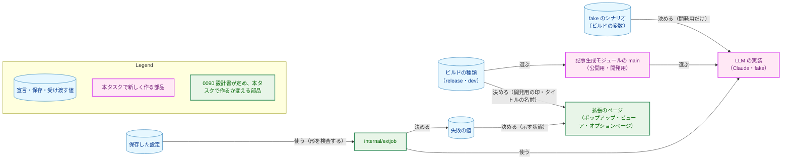
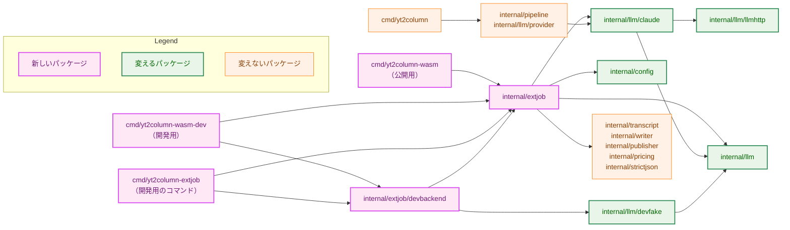
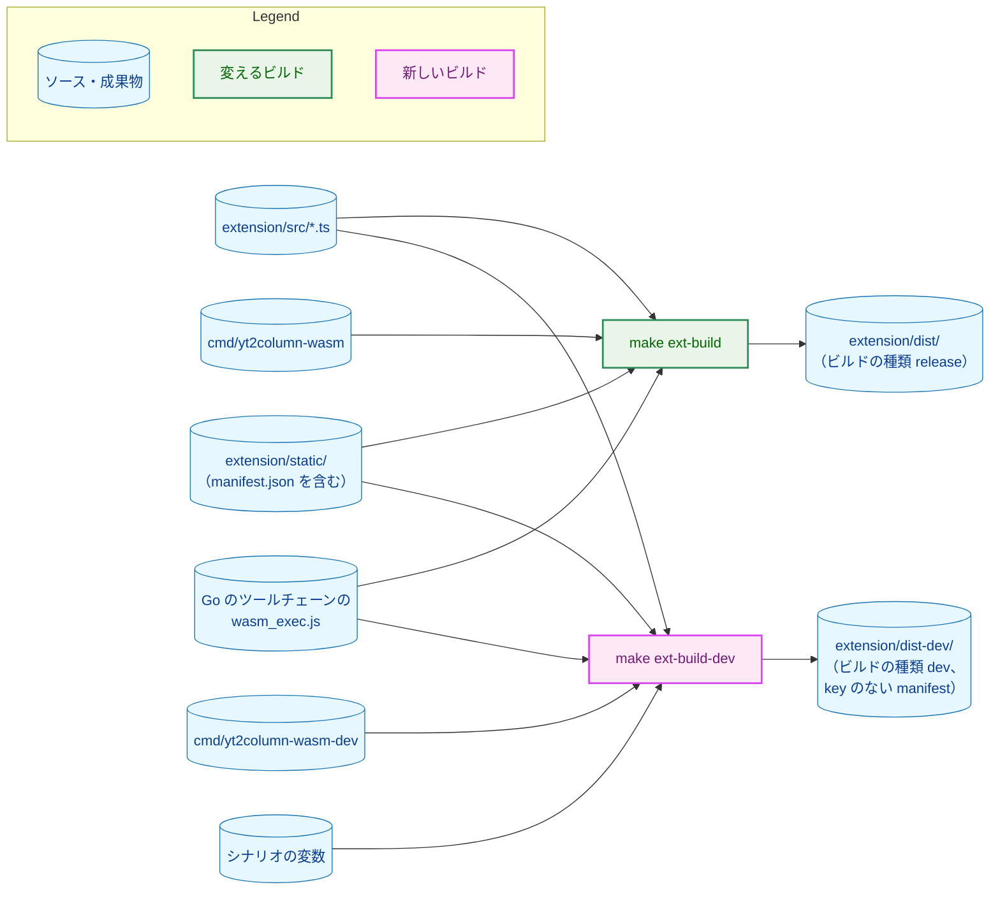
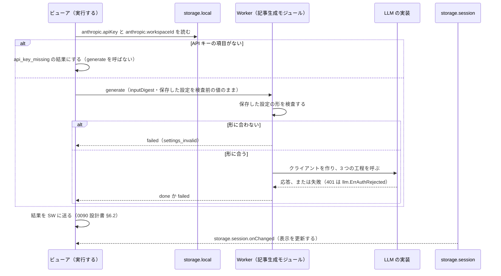
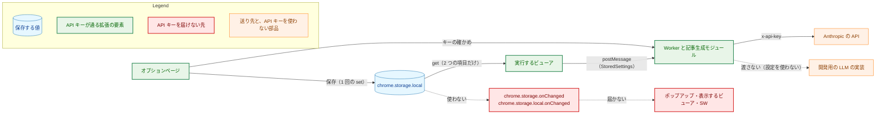
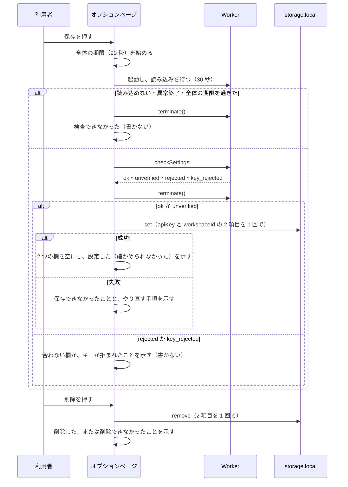
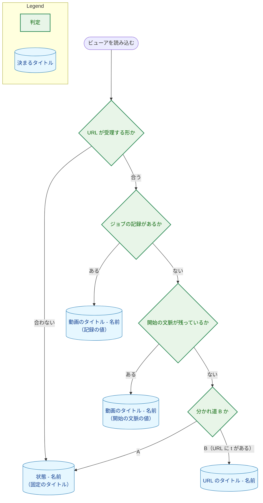
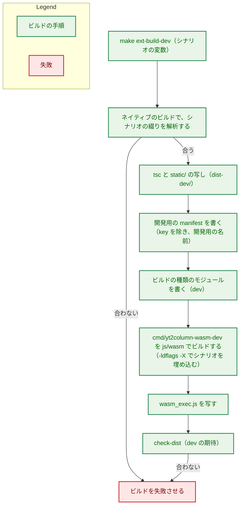

# アーキテクチャ設計書：拡張だけの経路への移行と、サーバとホストの撤去

## Document Status

| Item | Value |
|---|---|
| Status | `draft` |
| Created | 2026-11-15 |
| Review date | - |
| Reviewer | - |
| Comments | - |

## 1. 設計の全体像 (Design Overview)

本書は、[01_requirements.md](01_requirements.md)（以下、要件書）が定める移行を設計する。移行の後は、ブラウザ拡張が記事生成モジュール（WASM）を自分のページで動かし、利用者の API キーで Claude API を直接呼ぶ。localhost サーバと Native Messaging のホストは撤去する。

構成の正本は、タスク 0090 の[設計書](../0090_extension_only_architecture/02_architecture.md)（以下、0090 設計書）である。記事生成モジュールの関数、ジョブの記録、SW の調停、ページの間のメッセージ、権限と CSP、利用者に示す状態の種類、撤去するものは、0090 設計書の節を参照し、本書に写さない。本書が決めるのは、次の 2 種類だけである（[申し送り](design_handoff.md) H-01）。

-   0090 設計書が決めていない手段：ファイルとパッケージの分け方、ビルドの組み立て、ビルドタグ、PR の区切りの前提になる依存の順、要件書で決めたポップアップのリンクとページのタイトルの置き場所。
-   0090 設計書の手段を変える箇所：要件書が変えた点（要件書 §1「0090 設計書から変える点」）と、本書が変える点。どちらも、0090 設計書の節と変える理由を付録 B に挙げる。

本書の用語は、要件書 §6 と 0090 設計書 §1 による。加えて、次の語を使う。

-   **LLM の実装:** 記事生成モジュールの `main` が `internal/extjob` に渡す、LLM のクライアントを作る関数と、API キーを確かめる関数の組（`extjob.Backend`、§3.3）。公開用の記事生成モジュールは Claude の実装を、開発用の記事生成モジュールは fake の実装を渡す。
-   **ビルドの種類:** 公開用のビルド（`release`）か開発用のビルド（`dev`）か。拡張のビルドが成果物に書く 1 つのモジュールで宣言する（§3.5）。
-   **保存した設定:** 実行するビューアが `chrome.storage.local` から読んだ、`anthropic.apiKey` と `anthropic.workspaceId` の 2 つの項目の値。検査する前の値である（§3.3）。
-   **キーの確かめ:** オプションページの保存のボタンが、保存の前に Models API を 1 回呼んで API キーを確かめること（0090 設計書 §3.6）。

### 1.1. 設計原則

-   **0090 設計書を正本とし、写さない。** 同じ内容を 2 つの設計書に置くと、どちらかだけが直されて食い違う。本書は、0090 設計書の節を挙げて参照し、変える箇所だけを書く。
-   **規則は Go の 1 か所に置く。保存した設定の検査も Go が行う。** 実行するビューアは、保存した設定を検査せずにそのまま記事生成モジュールへ渡し、形に合うかどうかは記事生成モジュールが決める（§3.3）。TypeScript が決めるのは、API キーの項目があるかどうか（`api_key_missing`）だけである。
-   **公開用と開発用の違いは、`main` のパッケージと、ビルドの種類の宣言だけに置く。** 記事を作る処理（`internal/extjob`）と拡張のページのコードは、公開用と開発用で同じものを使う。fake を選ぶ分岐を公開する成果物に入れないためである（[ADR-0045](../../dev/adr/0045-dev-fake-llm.md)）。
-   **API キーの経路に、変更の知らせを含める。** `chrome.storage` の変更の知らせは、変わった値を載せる。ジョブの記録の変更は `chrome.storage.session.onChanged` だけで受け取る（§3.8）。
-   **撤去の前の PR は、今の経路を壊さない。** 拡張がサーバとホストを使わなくなる切り替えの PR より前の PR は、Go の部品、拡張のビルド、まだ使われない拡張の部品を加えるだけにする。新旧の経路を併存させる仕組みは作らない（要件書 AC-32）。

### 1.2. 設計の際に決めたこと（2026-11-15）

-   **0090 設計書を正本として参照し、本書は差分だけを決める（申し送り H-01）。** 写した内容のどちらかだけが直されると、実装の正本が分からなくなるためである。要件書が 0090 設計書から変えた点と、本書が変える点は、付録 B に表にした。ADR: なし（文書の書き分けの決定で、本タスクの中で閉じる）。
-   **API が API キーを拒んだこと（401）は、プロバイダに依存しない番兵 `llm.ErrAuthRejected` で表す（§3.1、申し送り H-10）。** Claude アダプタの 401 のエラーと fake の 401 は、どちらも `errors.Is(err, llm.ErrAuthRejected)` が真になる。`internal/extjob` は、この番兵で `api_key_rejected` を決め、`internal/llm/claude` を import せずに分類する。0090 設計書 §4.1 は、`*claude.HTTPStatusError` の状態コードで決めるとしていた。そのままでは、fake が同じ失敗を返すために `internal/llm/claude` を import することになり、fake の依存を `internal/llm` と標準ライブラリに限る規則（`internal/llm/devfake/scenario.go:1-6`、`internal/llm/devfake/deps_test.go`）に反する。採らなかった案は、公開用と開発用の記事生成モジュールの `main` が、失敗を分類する関数を `internal/extjob` に差し込む案である。差し込む口が 1 つ増え、分類の規則が 2 つの `main` に分かれる。ADR: なし（どのプロバイダでも起こる失敗の番兵を `internal/llm` に置く、[ADR-0019](../../dev/adr/0019-pipeline-component-interfaces.md) の規則を当てるだけである）。
-   **ポップアップのオプションページへのリンクは、詳細の節の後に置く（§3.7、申し送り H-04）。** 主ボタンの操作と紛れず、フォーカスの順が「主ボタン → 詳細 → 設定」になるためである。API キーが設定されていないときのオプションページを開く操作は、状態の表示の中に置き、リンクの位置には置かない。採らなかった案は、ポップアップの上部に置く案である。見つけやすいが、フォーカスの順で主ボタンより前に来る。ADR: なし（ポップアップの表示の決定で、[ADR-0008](../../dev/adr/0008-launch-path.md) の起動の経路を変えない）。
-   **記録がないビューアのページのタイトルは、2 つの分かれ道の両方を本書で決め、どちらにするかは、ページのタイトルを実装する PR より前の手動の確認で決める（§3.8.2、申し送り H-05）。** 上書きされないなら、記録も開始の文脈もないビューアは、状態の分かる固定のタイトルを出す。上書きされるなら、ビューアの URL に、動画のタイトルを 64 コードポイントまでに切った値をクエリ `t` で加え、そのビューアは URL のタイトルを使う。設計を止めずに書き進められ、どちらの結果でも設計を作り直さないためである。採らなかった案は、人が先に Chrome と Brave で確かめ、当たる分かれ道だけを書く案である。設計は短くなるが、確かめにはブラウザの再起動とセッションの復元が要り、設計の作業を止める。ADR: なし（URL にタイトルを加えることになったときは、その PR で [ADR-0010](../../dev/adr/0010-extension-stores-nothing.md) を改める。要件書 §1）。
-   **文字を伏せた API キーの欄を支援技術が読み上げるかは、オプションページを実装する PR で VoiceOver で確かめ、読み上げるときだけ欄の説明に注意を添える（§3.6、申し送り H-12）。** 読み上げないのに注意を添えると、利用者に誤ったことを伝えるためである。採らなかった案は、確かめずに注意を添える案である。ADR: なし（オプションページの表示の決定である）。
-   **`internal/config` は、サーバとホストの設定の読み込みのファイルに `!js` のビルドタグを付けて、WASM でビルドできるようにし、撤去の PR でそのファイルごと除く（§3.2、申し送り H-02）。** 撤去の前の PR で記事生成モジュールをビルドするのに要るためである。撤去の PR の完了の条件に、`internal/config` に `!js` のビルドタグが残らないことを入れる。採らなかった案は、記事生成モジュール用の関数を `internal/privatefile` に依存しない別のパッケージに置く案である。CLI と同じ値の読み込みの関数（`loadLLM` など、`internal/config` の公開しない関数）を使えず、公開するか写すことになる。ADR: なし（撤去までの間だけの手段で、本タスクの中で閉じる）。
-   **今のサーバのテストの行を、サーバを撤去する前の PR で `internal/extjob` のテストに写し、両方が同じ行で通ることを確かめてから、撤去の PR でサーバのテストを削除する（§7.4、申し送り H-03）。** サーバを撤去した後は、比べる相手がないためである。ADR: なし（テストの進め方で、本タスクの中で閉じる）。
-   **実行するビューアは、保存した設定を検査せずにそのまま `generate` に渡し、記事生成モジュールが形を検査して、合わなければ `settings_invalid` にする（§3.3、申し送り H-08）。** 0090 設計書 §3.1.2 の `GenerateRequest` は API キーとワークスペース ID を文字列として受け取るので、ワークスペース ID の項目がないことと、文字列でない値が保存されていることを表せず、ビューアが型を確かめることになる。設定の規則を Go の 1 か所に置くため（要件書 §3.2）、受け渡しの形を変えた。ADR: なし（[ADR-0003](../../dev/adr/0003-llm-config-contract.md) は要件の PR で更新済みで、本書はその規則を当てるだけである）。
-   **オプションページの検査の期限は、Worker の読み込みを 30 秒、キーの確かめの呼び出しを 30 秒、検査の全体を 90 秒とする（§3.6、申し送り H-09）。** Worker の読み込みの期限は、実行するビューアと同じである（0090 設計書 §3.4）。キーの確かめは本文を読まない軽い呼び出しで、保存のボタンを押した利用者が待つ時間として 30 秒を上限にする。全体の期限は、読み込みと呼び出しの期限の和（60 秒）に余裕を加えたもので、呼び出しの期限切れが先に「確かめられなかった」になる（要件書 AC-02）。ADR: なし（定数の値で、本タスクの中で閉じる）。
-   **拡張のページと SW は、`chrome.storage` の変更の知らせを `chrome.storage.session.onChanged` だけで受け取り、`chrome.storage.onChanged` と `chrome.storage.local.onChanged` を使わない。ソースの検査で拒否する（§3.8・§5.4、申し送り H-11）。** `chrome.storage.onChanged` と `chrome.storage.local.onChanged` は、オプションページが保存した API キーの値を、ポップアップ、表示するビューア、SW に届けるためである（要件書 AC-20）。0090 設計書 §1.2 と ADR は `chrome.storage.onChanged` で表示を更新するとしていた。採らなかった案は、`chrome.storage.onChanged` で受け取り、`local` の変更を無視する案である。無視しても値はページに届く。ADR: [ADR-0027](../../dev/adr/0027-article-job-api.md)・[ADR-0008](../../dev/adr/0008-launch-path.md)・[ADR-0009](../../dev/adr/0009-viewer-opening.md)・[ADR-0028](../../dev/adr/0028-no-automatic-resend.md)・[ADR-0031](../../dev/adr/0031-secret-closure.md) を更新した。
-   **LLM の実装（`extjob.Backend`）は、記事生成モジュールの `main` が `internal/extjob` に渡す（§3.3、申し送り H-10）。** 公開用は Claude の実装（`internal/extjob` が持つ）を、開発用は fake の実装（新しい `internal/extjob/devbackend`）を渡す。`internal/extjob` は、渡された実装を呼ぶだけで、fake を選ぶ分岐を持たない。保存した設定の形の検査は、どちらの実装でも `internal/extjob` が同じに行う。ADR: なし（公開する成果物に fake を入れない [ADR-0045](../../dev/adr/0045-dev-fake-llm.md) の規則を当てるだけである）。
-   **ビルドの種類は、拡張のビルドが成果物に書く 1 つのモジュールで宣言し、ページはそれを読む（§3.5）。** 開発用の印、ページのタイトルに添える名前は、この宣言で決める。manifest の `key` の有無や名前から推し量らない（CLAUDE.md「Declare, don't infer」）。開発用の manifest は、ビルドが公開用の manifest から作る。ADR: なし（[ADR-0026](../../dev/adr/0026-extension-platform.md) が定める開発用のビルドの規則の中の手段である）。
-   **fake のシナリオは、`make ext-build-dev` の変数で受け取り、`-ldflags -X` で開発用の記事生成モジュールに埋め込む。WASM をビルドする前に、ネイティブのビルドで値を検査し、合わなければビルドを失敗させる（§3.4）。** 合わない値でビルドした拡張が、読み込んでから内部の失敗を示すより、ビルドの時点で分かる方が早いためである。ADR: なし（ADR-0045 の「シナリオはビルドの引数で選ぶ」の手段である）。
-   **CI は、記事生成モジュールの依存を `go list -deps` で求め、その Go のファイルが変わったときに拡張の検査を走らせる（§3.10）。** 依存の一覧を手で書くと、依存が増えたときに漏れる。採らなかった案は、`internal/` のどの Go のファイルの変更でも拡張の検査を走らせる案である。依存でない `internal/chief` などの変更でも走る。ADR: なし（CI の手段で、本タスクの中で閉じる）。

### 1.3. 概念モデル

本タスクで加わる概念と、その関係を示す。拡張だけの構成の全体の概念（ジョブ、ジョブの記録、実行）は 0090 設計書 §1.3 にある。矢印 A → B は、「A が B を決める、選ぶ、または使う」を表し、そのどれかをラベルで示す。



-   ビルドの種類は、記事生成モジュールの `main` を選ぶ（公開用は `cmd/yt2column-wasm`、開発用は `cmd/yt2column-wasm-dev`）。拡張のページのコードは、どちらの種類でも同じで、宣言を読んで表示だけを変える。
-   保存した設定の形の検査と、失敗の値の決定は、どちらの LLM の実装でも `internal/extjob` が同じに行う。開発用のビルドでも、`settings_invalid` は実際の検査で出る（要件書 AC-29）。

## 2. システム構成 (System Structure)

### 2.1. 全体の構成

拡張だけの構成の要素と受け渡しは、0090 設計書 §2.1 の図のとおりである。本節は、本タスクの後の Go のパッケージと `main` の依存を示す。矢印 A → B は、「A が B を import する」を表す。



-   **0090 設計書 §2.3 からの違い。** 0090 設計書の図では、公開用の記事生成モジュールが `internal/config` と `internal/llm/claude` を直接 import した。本書では、Claude のクライアントを作る処理とキーの確かめを、`internal/extjob` の Claude の実装（§3.3）に置く。公開用の記事生成モジュールと開発用のコマンドの両方が同じ実装を使うので、2 つの `main` に同じ組み立てを書かないためである（CLAUDE.md「DRY」）。
-   **`internal/extjob/devbackend`（新しい）** は、fake の LLM の実装である。開発用の記事生成モジュールと開発用のコマンドだけが import する。公開する成果物（`cmd/yt2column` と `cmd/yt2column-wasm`）の依存に入らないことを、ADR-0045 の `go list -deps` の検査で確かめる（§7.3）。
-   図の CLI の依存は、変える箇所に関わるものだけを示した。CLI は `internal/extjob` を使わない（要件書 AC-26）。
-   撤去するパッケージ（`cmd/yt2column-server`・`cmd/yt2column-nmhost`・`cmd/yt2column-devserver`・`internal/server`・`internal/articlecache`・`internal/serversock`・`internal/nmhost`）は、この図にない（§3.11）。

### 2.2. コンポーネント配置

0090 設計書 §2.2 の表に、本書が加えるか変える置き場所を示す。

| 置き場所 | 役割 | 0090 設計書との違い |
|---|---|---|
| `internal/extjob` | 0090 設計書 §2.3 のとおり。加えて、保存した設定の形の検査（`settings_invalid`）、LLM の実装の受け取り、Claude の実装 | 保存した設定を検査前の値で受け取る。Claude のクライアントの組み立てを `main` から移す |
| `internal/extjob/devbackend` | fake の LLM の実装。ビルドのときに選んだシナリオで、生成のクライアントとキーの確かめの結果を返す | 新しい |
| `internal/llm` | 番兵 `ErrAuthRejected` を加える | 新しい番兵 |
| `internal/llm/claude` | 401 のエラーが `llm.ErrAuthRejected` に当たるようにする。キーの確かめの関数を加える | 分類の方法を変える |
| `internal/llm/llmhttp` | 本文を読まずに状態だけを返す送信を加える。`js` のビルドでリダイレクトに従わない指定を付ける | 送信の種類を足す |
| 拡張のビルドのスクリプト（`extension/scripts/`） | `go` を呼んで記事生成モジュールをビルドし、`wasm_exec.js` を写し、ビルドの種類のモジュールを書く。開発用のビルドでは、開発用の manifest を作る | 0090 設計書は `make ext-build` が Go を呼ぶとだけ決めた |
| オプションページ | 0090 設計書 §3.6 のとおり。保存も削除も 1 回の書き込み、検査の 3 つの期限、保存した値を読まないこと | §3.6 を一部変える |
| ポップアップ | 0090 設計書 §3.5 のとおり。加えて、いつもオプションページへのリンクを持つ | リンクを加える |
| ビューア | 0090 設計書 §3.4 のとおり。加えて、ページのタイトルの決め方、`settings_invalid` の状態、変更の知らせの受け取り方 | §3.4 を一部変える |

### 2.3. ビルドの構成

公開用と開発用のビルドが、何から何を作るかを示す。矢印 A → B は、「A から B を作るか、B に写す」を表す。



-   どちらのビルドも、同じ `tsc` の出力と `static/` を使う。違いは、記事生成モジュールの `main`、manifest、ビルドの種類のモジュールの 3 つだけである（§3.5）。
-   どちらのビルドも、最後に成果物の検査（`extension/scripts/check-dist.ts`）を、それぞれの種類の期待で走らせる。

### 2.4. データの流れ

生成の開始から記事の表示までの流れは、0090 設計書 §2.4 のとおりである。本書が変えるのは、実行するビューアが `generate` を呼ぶところと、表示の更新の受け取り方である。



## 3. コンポーネント設計 (Component Design)

### 3.1. LLM の失敗の分類と、キーの確かめ

`internal/llm` に、API がキーを拒んだことを表す番兵を加える。

```go
// ErrAuthRejected reports that the provider's API rejected the credentials
// (HTTP 401). Callers classify with errors.Is, without importing an adapter.
var ErrAuthRejected = errors.New("the API rejected the credentials")
```

-   **Claude アダプタ。** 状態 401 の `*HTTPStatusError`（`internal/llm/claude/errors.go:33`）は、`errors.Is(err, llm.ErrAuthRejected)` が真になる。`errors.AsType[*claude.HTTPStatusError]` で状態コードを取り出せることと、`ErrHTTPStatus` に当たることは変えない。CLI の振る舞いとエラーの文は変わらない（要件書 AC-26）。
-   **ほかのアダプタ。** DeepSeek と OpenAI のアダプタは、今は `llm.ErrAuthRejected` を返さない。拡張はこれらを使わず、CLI は 401 を分けて扱わないためである（CLAUDE.md「YAGNI」）。プロバイダを足すとき（0090 設計書 §3.10）に、そのアダプタで当てる。package_reference.md の `internal/llm` の行に、この番兵と、返すアダプタを書く。
-   **キーの確かめ。** `internal/llm/claude` に、Models API（`GET https://api.anthropic.com/v1/models?limit=1`）を 1 回呼ぶ関数を加える（0090 設計書 §3.6・§3.11）。

```go
// CheckKey calls the Models API once with the key and the optional workspace
// ID and returns nil for 200, an error matching llm.ErrAuthRejected for 401,
// and another error for any other outcome. It never reads the response body.
func CheckKey(ctx context.Context, opts KeyCheckOptions) error

type KeyCheckOptions struct {
	APIKey      secret.Secret
	WorkspaceID claudeparam.WorkspaceID // zero value: not specified
	Timeout     time.Duration
}
```

-   **送信。** 今の `llmhttp.Post`（`internal/llm/llmhttp/llmhttp.go:94`）は 200 の応答の本文を読む。キーの確かめは本文を読まないので、`internal/llm/llmhttp` に、同じ期限、リダイレクトの拒否、失敗の分類を通し、本文を読まずに状態コードだけを返す送信を加える。`js` のビルドだけで付ける指定（`js.fetch:redirect: error` と、`anthropic-dangerous-direct-browser-access` のヘッダ。0090 設計書 §5.3）は、`Post` と同じくこの送信にも付く。

### 3.2. `internal/config` の記事生成モジュール用の読み込み

-   **`LoadExtension`。** 0090 設計書 §3.1.2 の形のまま加える。`lookup` は `ANTHROPIC_API_KEY` と `ANTHROPIC_WORKSPACE_ID` だけに答え、ワークスペース ID が指定なし（保存した値が空の文字列）のときは、その名前を未設定として答える（ADR-0003、要件書 §1）。`lookup` を作るのは `internal/extjob` である（§3.3）。
-   **WASM でビルドできるようにする。** 今の `internal/config` は、`serverfile.go` が `//go:build unix` だけの `internal/privatefile` を import するので、`GOOS=js` でビルドできない（`internal/config/serverfile.go:13`。`3ee6fb2b` で `GOOS=js GOARCH=wasm go build ./internal/config` が失敗することを確かめた）。`config.go` の `LoadServer`（`internal/config/config.go:370`）・`LoadHost`・`LoadHostHome` と、その型 `ServerConfig`・`HostConfig` は、`serverfile.go`・`configpath.go`・`socketpath.go` の関数を呼ぶ。撤去の前の PR で、これらの宣言を `!js` のビルドタグを付けたファイルに移し、`serverfile.go`・`configpath.go`・`socketpath.go` にも同じタグを付ける。
-   **撤去の PR。** サーバとホストの撤去の PR は、タグを付けたファイルを、テストとともに削除する。完了の条件は、`internal/config` の Go のファイルに `!js` のビルドタグが残らないことと、`GOOS=js GOARCH=wasm go list -deps ./internal/config` が `internal/privatefile` を含まないことである。`internal/privatefile` 自体は `internal/chief` が使うので残す（要件書 AC-31）。

### 3.3. `internal/extjob`（0090 設計書 §3.1.2 からの変更）

0090 設計書 §3.1.2 の 4 つの関数と、`Prepare`・`Run`・`Result`・`Failure` は、そのまま作る。本節は、変える箇所だけを示す。

**JavaScript に公開する形の変更。** `GenerateRequest` は、保存した設定を検査前の値のまま受け取る。

```typescript
// Changed from 0090 §3.1.2: the settings come as the page read them.
type GenerateRequest = {
  inputDigest: string;
  settings: StoredSettings;
};
// The two chrome.storage.local items as read, unchecked. Each value is any
// JSON value. anthropicApiKey is always present: the viewer decides
// api_key_missing itself when the item is absent. anthropicWorkspaceId is
// absent when its item is absent.
type StoredSettings = {
  anthropicApiKey: JsonValue;
  anthropicWorkspaceId?: JsonValue;
};

// Changed from 0090 §3.1.2: buildInfo also declares the module's kind.
type BuildInfo = {
  goVersion: string; vcsRevision: string; vcsModified: boolean;
  backend: "claude" | "fake"; scenario?: string; // scenario: fake only
};
```

-   `GenerateRequest` と `StoredSettings` のメンバは閉じた集合で、知らないメンバと重複したメンバは拒否する（`internal/strictjson`）。この拒否は、ビューアが形を誤って組み立てたことを表すので、`internal`（`internalDetail` は `request_shape`）にする。
-   保存した設定の検査は、次のどれかに当たれば `settings_invalid` にする。`anthropicApiKey` が文字列でないか、`llmhttp.CheckAPIKey` の規則（空でない印字可能な ASCII）に合わない。`anthropicWorkspaceId` がないか、文字列でないか、空でなくて `claudeparam.ParseWorkspaceID` の規則に合わない。前後の空白を除くなどの補正はしない（要件書 §3.2）。検査は、`config.LoadExtension` と `llmhttp.CheckAPIKey` を通す。`checkSettings` が使うのと同じ関数である（0090 設計書 §3.1.3）。
-   `settings_invalid` の結果は、LLM の API を呼ぶ前に返る。`steps` はすべて `pending` のままである。
-   API キーの値は、検査の後すぐに `secret.Secret` にし、JSON の文字列も `StoredSettings` の値も保持しない（[ADR-0031](../../dev/adr/0031-secret-closure.md)）。結果と進み具合には入らない。

**Go の型の追加。**

```go
// Backend is what a module's main gives the job: how a run gets its LLM
// clients and how the settings check asks the API about a key. extjob checks
// the settings' shape itself before calling either, so a Backend only ever
// receives checked settings.
type Backend interface {
	// NewClients builds the generation and review clients of one run.
	NewClients(cfg config.LLMConfig) (Deps, error)
	// CheckKey returns nil when the API accepts the key, an error matching
	// llm.ErrAuthRejected when it rejects it, and another error otherwise.
	CheckKey(ctx context.Context, cfg config.LLMConfig) error
}

// ClaudeBackend is the release Backend: the production profile's Claude
// clients and claude.CheckKey.
func ClaudeBackend() Backend

// Module holds one Worker's state: the Backend and the input Prepare kept.
type Module struct{ /* unexported */ }

func NewModule(b Backend, info BuildInfo) *Module
func (m *Module) CheckSettings(ctx context.Context, request string) string
func (m *Module) Prepare(request string) string
func (m *Module) Generate(ctx context.Context, request string, onProgress func(event string)) string
func (m *Module) BuildInfo() string

const (
	FailureInternal Failure = iota
	// ... the 0090 §3.1.2 values, unchanged in order ...
	FailureAPIKeyRejected
	FailureSettingsInvalid // added: the stored settings did not pass the check
)
```

-   **失敗の分類。** 0090 設計書 §2.3 の分類（今の `classifyWrite`。`internal/server/generation.go:146`）に、`errors.Is(err, llm.ErrAuthRejected)` を `api_key_rejected` にする規則を、`llm.ErrEmptyResponse` などと同じ並びに加える。
-   **`checkSettings` の分類。** 形が合わなければ `rejected`（合わない欄）、`CheckKey` が `nil` なら `ok`、`llm.ErrAuthRejected` に当たれば `key_rejected`、ほかは `unverified` である（0090 設計書 §3.6）。キーの確かめの呼び出しの期限は 30 秒である（§1.2）。
-   **期限の定数。** 記事の生成の呼び出しごとの期限（15 分。0090 設計書 §2.3）と、キーの確かめの呼び出しの期限（30 秒）は、`internal/extjob` に置く。
-   **`cmd/yt2column-wasm`。** `NewModule(extjob.ClaudeBackend(), ...)` を作り、`syscall/js` で 4 つの関数を登録するだけを持つ（0090 設計書 §2.3）。

### 3.4. 開発用の部品

-   **`internal/llm/devfake` のシナリオに加える値。** 失敗の種類（`Failure`）に、`llm.ErrAuthRejected` を包む `FailureAuthRejected` を加える。シナリオに、キーの確かめの結果（`SettingsCheck`。`ok`・`key_rejected`・`unverified` の 3 つで、ゼロ値は `ok`）を加え、キーの確かめを返す関数を加える。`unverified` は、`ErrSimulatedAPIFailure` を包むエラーを返す。fake の依存は `internal/llm` と標準ライブラリのままである（ADR-0045）。
-   **シナリオの値の綴りと解析。** 今は開発用のサーバの引数の解析（`cmd/yt2column-devserver/args.go:130`）が持つ。開発用のサーバは撤去するので、綴りから `Scenario` を作る関数を `internal/llm/devfake` に移し、開発用の記事生成モジュールと開発用のコマンドが同じ関数を使う。合わない綴りは補正せずに拒否する。
-   **`internal/extjob/devbackend`（新しい）。** `devfake.Scenario` から `extjob.Backend` を作る。`NewClients` は、渡された設定を使わず、シナリオの fake のクライアントを返す。`CheckKey` は、シナリオのキーの確かめの結果を返す。どちらも、Anthropic の API を呼ばない。
-   **`cmd/yt2column-wasm-dev`（新しい）。** シナリオを `-ldflags -X` で受け取った文字列の変数として持ち、起動のときに解析して `devbackend` を作り、`cmd/yt2column-wasm` と同じ 4 つの関数を登録する。`syscall/js` を使う登録のファイルだけを `js` のビルドにし、シナリオの解析はネイティブでも動かせるようにする。`make ext-build-dev` は、WASM をビルドする前に、同じ変数でネイティブのビルドを動かして解析だけを行い、合わない値ならビルドを失敗させる。
-   **`cmd/yt2column-extjob`（新しい）。** 0090 設計書 §7.2 のとおり。LLM は、本番の構成（`extjob.ClaudeBackend`。API キーは CLI と同じく環境変数から読む。[ADR-0024](../../dev/adr/0024-env-access-in-config.md)）か、fake（`devbackend`。シナリオはコマンドの引数で、同じ綴りで受け取る）を選ぶ。入力のファイルが持つ保存した設定は使わない。

### 3.5. 拡張のビルド

-   **ビルドが `go` を呼ぶ。** 拡張のビルドのスクリプト（`extension/scripts/` に置く）が、`tsc` と `static/` の写しの後に、`GOOS=js GOARCH=wasm go build -trimpath` で記事生成モジュールを成果物の直下にビルドし、`go env GOROOT` の `lib/wasm/wasm_exec.js` を成果物の直下に写す（ADR-0026、0090 設計書 §3.1.4）。`npm run build` は、Go を呼ぶ手順まで含めて、検査の済んだ成果物を作る。`make ext-build` はそれを呼ぶ。
-   **ビルドの種類のモジュール。** ビルドのスクリプトは、成果物の直下に、ビルドの種類（`release` か `dev`）だけを書き出す 1 つの ES モジュールを書く。`src/` には、その型の宣言（`.d.ts`）だけを置き、ページはそのモジュールを import して種類を読む。`tsc` は `.d.ts` から `.js` を出さないので、種類によって `tsc` の出力は変わらない。
-   **開発用の manifest。** `make ext-build-dev` は、`static/manifest.json` から `key` を除き、名前を開発用の印の付いた名前のメッセージ（`_locales` の新しいメッセージ）に替えた manifest を書く。ほかのメンバは公開用と同じである。開発用のビルドの ID は公開用と別になり、`chrome.storage.local` も別になる（要件書 AC-17）。
-   **開発用の印と名前。** ポップアップとビューアは、ビルドの種類が `dev` のとき、文字の印（「開発用のビルド」）を示す。色だけで示さない（要件書 AC-18）。ビューアのページのタイトルに添える名前は、`release` では `yt2column`、`dev` では開発用の印の付いた名前である（§3.8.2）。
-   **成果物の検査。** `check-dist.ts` は、ビルドの種類を引数で受け取り、種類ごとの期待で成果物を検査する。どちらの種類でも、成果物は、`tsc` の出力、`static/` の写し、記事生成モジュール、`wasm_exec.js`、ビルドの種類のモジュールだけである。`wasm_exec.js` は、`go.mod` が定める版のツールチェーンのものと中身が一致する。WASM の main のパッケージのパス（`go version -m`）は、`release` では `cmd/yt2column-wasm`、`dev` では `cmd/yt2column-wasm-dev` である。manifest は、`release` では `static/manifest.json` の写しのまま（今の検査。`extension/scripts/check-dist.ts:1-4`）、`dev` では上の変換の結果と一致する。ビルドの種類のモジュールは、引数の種類と一致する。
-   **`.gitignore`。** `extension/dist-dev/` を加える。`.gitignore` の変更は、拡張の node のテストの無視の規則の検査を壊しうるので、`make ext-test` を走らせる（CLAUDE.md「Development Notes」）。
-   **拡張の説明の文。** `_locales` の `extDescription` は、今はローカルのサーバに送ると述べている（`extension/static/_locales/en/messages.json:5-7`）。切り替えの PR で、拡張だけの経路の説明に改める。

### 3.6. オプションページ

0090 設計書 §3.6 のとおりにする。ただし、次を変えるか加える。

-   **保存と削除。** 保存は、`ok` か `unverified` のとき、`chrome.storage.local.set` を 1 回呼び、`anthropic.apiKey` と `anthropic.workspaceId` の 2 つの項目を書く。ワークスペース ID の欄が空なら、空の文字列を書く（指定なし）。削除は、`chrome.storage.local.remove` を 1 回呼び、2 つの項目を消す（要件書 AC-02・AC-04、申し送り H-08）。0090 設計書 §3.6 の「空でないときだけ保存し、欄が空なら保存済みの値を消す」を変える。
-   **保存した値を読まない。** オプションページは、API キーが設定されているかを、`chrome.storage.local.getKeys()` で項目の名前だけを得て示す。保存した値は読まない。API キーを読むのは実行するビューアだけにする（§5.4）。
-   **検査の期限。** 保存のボタンを押してから、検査の全体の期限（90 秒）の間に結果がなければ、Worker を止め、保存せず、検査できなかったことを示す。Worker の読み込みと `buildInfo`・`checkSettings` の呼び出しの前に、読み込みの期限（30 秒）を持つ。キーの確かめの呼び出しの期限（30 秒）は、記事生成モジュールが持つ（§3.3）。
-   **示す結果。** 次の閉じた集合で示す。どの結果も、`role="status"` の領域で、フォーカスを動かさずに知らせる（要件書 AC-18）。結果の値は §4.1 の `OptionsOutcome` である。

| 結果 | いつ | 書き込み | 欄 |
|---|---|---|---|
| 設定した | `ok` で書き込みが成功した | 2 つの項目を 1 回で書く | 2 つの欄を空にする |
| 設定したが確かめられなかった | `unverified` で書き込みが成功した | 同上 | 同上 |
| 欄が合わない | `rejected` | 書かない | そのまま残す |
| キーが拒まれた | `key_rejected` | 書かない | そのまま残す |
| 検査できなかった | Worker を読み込めない、異常終了した、全体の期限を過ぎた | 書かない | そのまま残す |
| 保存できなかった | `set` が失敗した | 書けていない | そのまま残し、保存をやり直す手順を示す |
| 削除した | `remove` が成功した | 2 つの項目を 1 回で消す | ― |
| 削除できなかった | `remove` が失敗した | 消せていない | 削除をやり直す手順を示す |

-   **入力の欄と支援技術。** 0090 設計書 §3.6 のとおり、API キーの欄は `type="text"` に `-webkit-text-security: disc` で文字を伏せる。オプションページを実装する PR で、VoiceOver で欄の名前と入力した文字の読み上げを確かめ、読み上げるときは、欄の説明（`aria-describedby`）に、入力した文字が読み上げられうることを添える（§1.2）。確かめた結果は、その PR の説明と実装計画書に記録する。
-   **ビルドの情報。** `buildInfo` のコミットと Go の版に加えて、開発用のビルドでは、fake の LLM であることとシナリオを示す。
-   **表示の言語。** ほかの画面と同じく `resolveLocale` で決め、ページの `lang` を合わせる（ADR-0029、要件書 AC-18）。

### 3.7. ポップアップ

0090 設計書 §3.5 のとおりにする。加えて、次のとおりにする。

-   **オプションページへのリンク。** 詳細の節（`extension/static/popup.html:17` の `#details`）の後に、オプションページを開く操作を 1 つ置く。ネイティブの `<button>` で、押すと `chrome.runtime.openOptionsPage` を呼ぶ。開いているオプションページがあれば、ブラウザがそのタブを前面にするので、同じページが増えない。見えるラベルとアクセシブルな名前は同じ（「設定」）で、押せる領域は 44×44 CSS ピクセル以上である（要件書 AC-06・AC-18）。
-   **API キーが設定されていないとき。** 状態の表示（`#status` の近く）に、設定が要ることと、オプションページを開く操作を示す。上のリンクと同じ操作だが、状態に結びついた操作として、状態の文の直後に置く。
-   **表示の更新。** ジョブの記録の変更は `chrome.storage.session.onChanged` で受け取る（§3.8.1）。

### 3.8. ビューア

0090 設計書 §3.4 のとおりにする。本節は、変える箇所と、決めていなかった箇所を示す。

#### 3.8.1. 変更の知らせと、保存した設定の読み戻し

-   **変更の知らせ。** 実行するビューアと表示するビューアは、自分の記録の変更を `chrome.storage.session.onChanged` で受け取る。`chrome.storage.onChanged` と `chrome.storage.local.onChanged` を使わない（§1.2）。0090 設計書 §3.4 の `storage.onChanged` を、すべてこれに読み替える。
-   **保存した設定の読み戻し。** 実行するビューアは、予約の後、`chrome.storage.local.get` で 2 つの項目だけを読む。API キーの項目がなければ、`generate` を呼ばずに `api_key_missing` の結果にする。項目があれば、読んだ値を検査せずに `StoredSettings` にして `generate` に渡し、`StoredSettings` を作った後は値を持ち続けない（§3.3）。`get` の呼び出しが失敗したときは、`internal`（`internalDetail` は `settings_read`）の結果にする。
-   **設定が要る状態。** `api_key_missing` と `settings_invalid` の失敗は、0090 設計書 §3.8 の「API キーが設定されていない」の状態で示す。`settings_invalid` の文言は、保存した設定が使えないので設定し直すことを示す。どちらも料金に触れない（要件書 AC-06・AC-11）。オプションページを開く操作は、`chrome.runtime.openOptionsPage` を呼ぶネイティブの `<button>` である。

#### 3.8.2. ページのタイトル

ビューアは、`document.title` を次の規則で決める。動画のタイトルの部分は、ビューアの見出しに示す値と同じ値を、同じ出どころから取る（0090 設計書 §3.4「表示の値の出どころ」）。

| ビューア | タイトル |
|---|---|
| ジョブの記録があるビューア | `<動画のタイトル> - <名前>`。動画のタイトルがないときは見出しを使う |
| 開始の文脈が残っているビューア（入力を受け取れなかった、開始が拒否された） | 開始の文脈の動画のタイトルで、同じ形 |
| ジョブの記録も開始の文脈もないビューア（記事が失われた状態と、開始の文脈が消えた後の入力を受け取れなかった状態） | 下の分かれ道で決める |
| URL が受理する形に合わないビューア | 状態の分かる固定のタイトル（`<状態> - <名前>`） |

`<名前>` は、公開用のビルドでは `yt2column`、開発用のビルドでは開発用の印の付いた名前である（§3.5）。`viewer.html` の静的なタイトルは、ページのスクリプトが書き換えるまでの値で、空にしない。タイトルを決める関数は、状態、表示の値、ビルドの種類、表示の言語から文字列を返すだけの関数にし、`src/core/` に置く。

**記録も開始の文脈もないビューアの分かれ道。** ページのタイトルを実装する PR より前に、記録がないビューアが固定のタイトルを出したときに、ブラウザの履歴の項目の動画のタイトルが書き換わるかを、Chrome と Brave で手で確かめる（要件書 §5、申し送り H-05）。確かめ方と、確かめに使う版は、実装計画書で決める。

-   **上書きされない場合（分かれ道 A）。** 状態の分かる固定のタイトル（`<状態> - <名前>`）を出す。ビューアの URL の形は 0090 設計書 §5.2 のまま（`r`・`k`・`u`・`e`）である。
-   **上書きされる場合（分かれ道 B）。** ビューアの URL に、クエリ `t`（URL のタイトル）を加える。記録も開始の文脈もないビューアは、URL のタイトルを使い、`<URL のタイトル> - <名前>` を出す。この分かれ道にするときは、人と決めたうえで、同じ PR で ADR-0010 を改め、要件書 §3.2 の「ビューアの URL」の行の扱いを PR の説明に書く（要件書 §1）。
    -   **値。** SW がビューアを開くときに、開始の文脈の動画のタイトル（ないときは見出し）から作り、`r` の URL に付ける。予約の後に `r` を `k` に書き換えるときも、同じ値を残す。
    -   **長さ。** 元の値が 64 コードポイント以下ならそのまま、超えるなら先頭の 63 コードポイントに `…`（U+2026）を加えた 64 コードポイントにする。サロゲートの組を分けない。動画のタイトルは YouTube では 100 文字までで、64 コードポイントあれば履歴とタブで動画を見分けられ、日本語でも URL の形に直して 1 KB 以下に収まるためである。
    -   **検査。** `t` は、1 から 64 コードポイントで、制御文字（C0・C1・U+007F）を含まない。`r` か `k` と一緒にだけ持つ。分かれ道 B では、`t` を必ず持つ。合わなければ、0090 設計書 §5.2 のほかの URL の誤りと同じく、記事を表示せず何も送らない。補正しない。
    -   `t` は表示のためだけに使い、生成の入力にも、記録を探す鍵にもしない（0090 設計書 §3.4「URL の値は、表示と記録を探すためだけに使う」）。

#### 3.8.3. 読み込み直しの確認と表示

-   読み込み直しの確認（`beforeunload`）は、0090 設計書 §3.4 のとおり、実行の間だけ出す。
-   §3.8 の新しい状態の表示と操作（設定が要る状態のオプションページを開く操作、API が API キーを拒んだ状態の操作、開発用の印）は、今のビューアの節（`#video`・`#existing`・`#state`・`#article`・`#actions`）の構成を保ったまま、`#state` の中に置く（要件書 §1「画面の文言は」）。

### 3.9. SW

0090 設計書 §3.3 のとおりにする。SW は、`chrome.storage` の変更の知らせを受け取らない。記録の唯一の書き手で、記録の状態を知るのに知らせを要らないためである。`chrome.storage.local` から得るのは `getKeys()` の項目の名前だけである（0090 設計書 §3.6）。

-   ファイルの分け方は、0090 設計書 §3.11 のとおり、今の `startCoordinator.ts` と `background.ts` を改める。直列の処理、予約の判定、記録の書き込み、止まった実行の判定は、`chrome.*` に依存しない部分を `chrome.storage`・`chrome.tabs`・Port の依存を受け取る関数にし、fake で単体テストする（申し送り H-06、§7.1）。

### 3.10. CI と lint

-   **拡張の検査を走らせる変更。** `check-changes` の手順に Go を用意し、`GOOS=js GOARCH=wasm go list -deps` で、公開用と開発用の記事生成モジュールが依存するこのモジュールのパッケージのディレクトリを求める。`extension/scripts/has-extension-changes.sh` は、変わったファイルの一覧に加えて、そのディレクトリの一覧を受け取り、そのディレクトリの直下の Go のファイルが変わったときにも `true` を出す。スクリプトは、パスだけから決める今の作り（`extension/scripts/has-extension-changes.sh:20`）を保ち、`go` を呼ばない。`internal/server/response.go` は一覧から除く（0090 設計書 §3.11）。`go.sum` は依存の中身を変えうるので一覧に加える。
-   **拡張の検査の手順。** 拡張のビルドが Go を呼ぶので、`extension` の手順で、`ext-build` の前に Go を用意する（0090 設計書 §3.11）。
-   **`doc-guard`。** 対象から撤去したパッケージを除く。
-   **`.golangci.yml`。** 撤去したパッケージを指す規則を除く。`depguard` で、`internal/extjob/devbackend` と `internal/llm/devfake` を、開発用の `main`（`cmd/yt2column-wasm-dev`・`cmd/yt2column-extjob`）と `devbackend` 自身のほかから import させない規則を加えるかは、ADR-0045 の `go list -deps` の検査で足りるので、加えない（ADR-0045「採らなかった案」）。
-   **`make wasm-check`。** 対象を、`cmd/yt2column-wasm` と `cmd/yt2column-wasm-dev`（それぞれの依存を含む）のビルドにする。`vet` は、`js` のビルドだけのファイルを持つパッケージ（`internal/llm/llmhttp`・`internal/llm/claude`・2 つの記事生成モジュールの `main`）と、今の対象（`internal/writer`・`internal/transcript`）にする（0090 設計書 §3.1.4）。

### 3.11. 撤去

-   **撤去するパッケージ。** 要件書 AC-31 のとおりである。撤去の後に残るどのパッケージからも import されないテストの補助（`internal/udstest` など）は、撤去の PR で `go list -deps -test` で確かめてから除く。`internal/loopbacktest` は、`internal/llm/claude` などのテストが使うので残る（要件書 §1）。
-   **撤去で直すテスト。** 0090 設計書 §3.11 の表に加えて、次を直す。
    -   `internal/llm/devfake/deps_test.go`：許さない依存の一覧が、撤去する `internal/server`・`internal/articlecache`・`internal/serversock`・`internal/nmhost` の型を参照している（`internal/llm/devfake/deps_test.go:10-16`）。撤去の PR で、これらを一覧から除く。`internal/privatefile` は残るので、一覧に残す。
    -   `internal/config` の `serverfile_test.go`・`configpath_test.go`・`socketpath_test.go` と、`test_helpers.go` のサーバの補助：タグを付けたファイルとともに削除する。
-   **`make build`。** `yt2column` だけを作る。`build-dev` と、それが参照する変数を除く（要件書 AC-01・AC-31）。

### 3.12. コンポーネントの責務（新しいファイルと変わるファイル）

0090 設計書 §3.11 の表のすべてを行う。ただし、`internal/privatefile` は撤去しない（要件書 AC-31）。次の表は、本書が加えるか、0090 設計書の表から変えるものである。ファイルの名前は、0090 設計書と同じく「または同等のもの」とし、実装計画書で決める。

| 区分 | 対象 | 責務または変更 |
|---|---|---|
| 変える | `internal/llm/llm.go` | 番兵 `ErrAuthRejected` を加える（§3.1） |
| 変える | `internal/llm/claude/errors.go` | 401 の `HTTPStatusError` が `llm.ErrAuthRejected` に当たるようにする（§3.1） |
| 新しい | `internal/llm/claude/` のキーの確かめのファイル | `CheckKey`（§3.1） |
| 新しい | `internal/llm/claude/` と `internal/llm/llmhttp/` の `js` のビルドだけのファイル | ブラウザから呼ぶためのヘッダ、リダイレクトに従わない指定（0090 設計書 §3.11） |
| 変える | `internal/llm/llmhttp/llmhttp.go` | 本文を読まずに状態だけを返す送信を加える（§3.1） |
| 変える | `internal/config/config.go` と、`!js` のタグを付けるファイル | `LoadExtension` を加え、サーバとホストの読み込みを `!js` のファイルに移す。撤去の PR で、タグを付けたファイルを削除する（§3.2） |
| 新しい | `internal/extjob/` | 0090 設計書 §2.3 の処理に加えて、`Backend`・`ClaudeBackend`・`Module`・保存した設定の検査（§3.3） |
| 新しい | `internal/extjob/devbackend/` | fake の LLM の実装（§3.4） |
| 変える | `internal/llm/devfake/` | `FailureAuthRejected`、キーの確かめの結果、綴りからシナリオを作る関数を加える（§3.4） |
| 新しい | `cmd/yt2column-wasm/`・`cmd/yt2column-wasm-dev/`・`cmd/yt2column-extjob/` | 0090 設計書 §3.11 のとおり。開発用の 2 つは `devbackend` を使う（§3.4） |
| 変える | `internal/godepstest` の使い手 | 0090 設計書 §3.11 のとおり。許さない依存に `internal/extjob/devbackend` を加える（§7.3） |
| 新しい | `extension/scripts/` のビルドのスクリプト | `go` を呼ぶ、`wasm_exec.js` を写す、ビルドの種類のモジュールを書く、開発用の manifest を作る（§3.5） |
| 変える | `extension/scripts/check-dist.ts` | ビルドの種類ごとの期待で検査する（§3.5） |
| 新しい | `extension/types/` のビルドの種類の型の宣言 | ビルドの種類のモジュールの型（§3.5） |
| 変える | `extension/package.json`・`Makefile` | 開発用のビルドの手順と `ext-build-dev` を加え、`ext-build` が Go を呼ぶようにする（§3.5） |
| 変える | `extension/static/_locales/*/messages.json` | 開発用の名前のメッセージを加え、`extDescription` を改める（§3.5） |
| 変える | `.gitignore` | `extension/dist-dev/` を加える（§3.5） |
| 新しい | `extension/static/options.html`・`extension/src/options.ts`・`extension/src/core/optionsView.ts` | オプションページと、結果から表示を決める関数（§3.6） |
| 新しい | `extension/src/workerClient.ts` | ページの側の Worker の呼び出し：起動、`callId` の対応、期限、`terminate()`（0090 設計書 §3.3.1・§3.4） |
| 新しい | `extension/src/core/wasmResult.ts` | Worker から受け取る JSON の文字列を `strictJson.ts` で解析し、閉じたメンバの集合を確かめる（申し送り H-07） |
| 新しい | `extension/src/core/viewerTitle.ts` | ページのタイトルを決める関数（§3.8.2） |
| 変える | `extension/static/popup.html`・`extension/src/core/popupView.ts` | オプションページへのリンクと、設定が要る状態の操作（§3.7） |
| 変える | `extension/static/viewer.html` | 静的なタイトル（§3.8.2） |
| 変える | `extension/src/core/viewerUrl.ts` | 0090 設計書 §3.11 のとおり。分かれ道 B では `t` を加える（§3.8.2） |
| 変える | `extension/src/core/i18n/*` | §3.6 の結果、`settings_invalid`、ページのタイトルの状態、開発用の印の文言（要件書 AC-14） |
| 変える | `.github/workflows/ci.yml`・`extension/scripts/has-extension-changes.sh` | §3.10 |
| 変える | `.golangci.yml` | 撤去したパッケージを指す規則を除く（§3.10） |
| 撤去 | `cmd/yt2column-devserver/`・`internal/doctestutil` の開発用のサーバの節の位置の値 | 0090 設計書 §3.11 のとおり |

次の今のテストは、本書の決定で直す。0090 設計書 §3.11 の表のテストも、同じ表のとおりに直す。

| テスト | 確かめていること | 本タスクでの扱い |
|---|---|---|
| `internal/llm/claude` の `HTTPStatusError` のテスト | 状態コードと `ErrHTTPStatus` | 401 で `llm.ErrAuthRejected` に当たり、ほかの状態で当たらないことを加える |
| `internal/llm/devfake/scenario_test.go`・`client_test.go` | シナリオの組み合わせと fake の応答 | `FailureAuthRejected` とキーの確かめの結果を加える |
| `internal/llm/devfake/deps_test.go` | fake がサーバだけが使うパッケージに依存しないこと | 撤去したパッケージを一覧から除く（§3.11） |
| `cmd/yt2column-devserver` の引数のテスト | 綴りからシナリオを作ること | 撤去する。綴りの行は `internal/llm/devfake` の解析の関数のテストに写す（§3.4） |
| `extension/test/ciChanges.test.ts` | 拡張の検査を走らせる変更 | 依存のディレクトリの一覧を受け取る形に直す（§3.10） |
| `extension/test/checkDist.test.ts` | 成果物の検査 | ビルドの種類ごとの期待を加える（§3.5） |
| `extension/test/popupHtml.test.ts` | ポップアップの HTML の構造 | オプションページへのリンクを加える（§3.7） |

### 3.13. 文書とコマンドの定義の書き換え

0090 設計書 §3.14.2 の表の文書と、要件書 §1 が加えた文書とコマンドの定義を、要件書 AC-33 のとおりに書き換える。各文書は、それが述べるコードを変える PR で書き換える。本書が 0090 設計書 §3.14.2 の要点に加えるものは、次のとおりである。

| 文書 | 加える要点 |
|---|---|
| [development.md](../../dev/guides/development.md) | `make ext-build-dev` のシナリオの変数と綴り、開発用のビルドの見分け方（開発用の印、別の拡張の ID）、`cmd/yt2column-extjob` の使い方、`settings_invalid` を含む失敗の値の表 |
| [package_reference.md](../../dev/conventions/package_reference.md) | `internal/extjob/devbackend` と `cmd/yt2column-extjob` の行、`internal/llm` の行の `ErrAuthRejected`、`internal/llm/claude` の行の `CheckKey` |
| [docs/translation_glossary.md](../../translation_glossary.md) | 「主経路」「ビューアの URL」「記録」「ジョブの状態」を、拡張だけの経路の意味で定義し直す（要件書 §1）。「オプションページ」「開発用のビルド」「記事生成モジュール」の語を加える |
| [cli.md](../../dev/guides/cli.md) | localhost サーバとその設定ファイルの記述を除く（要件書 §1） |
| [fixprguard_guide.md](../../dev/guides/fixprguard_guide.md)・`.claude/commands/_lib/task-pr-handoff.md`・`.claude/commands/_lib/simple-process.md` | 文書のガードのコマンドから `./cmd/yt2column-server` を除く。サーバを撤去する PR で行う（要件書 §1） |
| [security.md](../../dev/security.md) | 変更の知らせを `chrome.storage.session.onChanged` だけで受け取ること（§5.4）、開発用のコマンドの入力のファイルをリポジトリに入れないこと（§7） |

README の移行の手順と、ZDR・Compliance API の組織の API キーで使えないことなどは、要件書 AC-34 のとおりである。`README.md` を先に書き換え、`README.en.md` は `/mktrans` で同期する。

### 3.14. ADR の変更

-   **本書の PR で更新する ADR。** 変更の知らせを `chrome.storage.session.onChanged` だけで受け取ることにしたので（§1.2）、`chrome.storage.onChanged` で表示を更新するとしていた ADR-0027・ADR-0008・ADR-0009・ADR-0028 の決定を改める。規則と理由は ADR-0027 に置き、ほかの 3 つは ADR-0027 を参照する。ADR-0031 の拡張の API キーの経路に、変更の知らせを「入れない先」として加える。
-   **実装の PR で除く食い違いの記述。** 要件書 AC-35 のとおり、各 PR は、食い違いを解消した ADR の、#773 にリンクする食い違いの記述を除く。対象の ADR は、issue #773 の本文の「食い違いの記述を置いた ADR」の節が挙げる。どの PR がどの ADR の食い違いを解消するかは、実装計画書で PR ごとに決める。
-   **分かれ道 B のときに改める ADR。** ビューアの URL にタイトルを加えるときは、その PR で ADR-0010 の「ビューアの URL」の決定を改める（§3.8.2）。

## 4. エラーハンドリング設計 (Error Handling Design)

### 4.1. 値の集合（0090 設計書 §4.1 からの変更）

0090 設計書 §4.1 の値の集合に、次を加える。どれも閉じた集合で、知らない値を受理しない。

```typescript
// Added settings_invalid: the article generation module rejected the stored
// settings before calling the LLM API.
type WasmFailure =
  | "internal" | "transcript_too_long" | "llm_timeout" | "llm_empty"
  | "llm_truncated" | "llm_failed" | "article_invalid" | "article_too_large"
  | "api_key_rejected" | "settings_invalid";

// Unchanged: the WASM failures plus api_key_missing and run_timeout.
type RecordFailure = WasmFailure | "api_key_missing" | "run_timeout";

// Added request_shape (generate's request did not match its shape) and
// settings_read (chrome.storage.local.get failed in the running viewer).
type InternalDetail =
  | "panic" | "worker_error" | "worker_load" | "result_shape"
  | "store_failed" | "input_mismatch" | "request_shape" | "settings_read";

// What the options page shows after a save or a delete (§3.6).
type OptionsOutcome =
  | "saved" | "saved_unverified" | "field_rejected" | "key_rejected"
  | "check_unavailable" | "write_failed" | "deleted" | "delete_failed";

// The build's kind, declared by the module the build writes (§3.5).
type BuildKind = "release" | "dev";
```

-   Go の側は、`internal/extjob` の `Failure` に `FailureSettingsInvalid` を加える（§3.3）。ゼロ値は今のまま `FailureInternal` である。
-   `api_key_rejected` は、`errors.Is(err, llm.ErrAuthRejected)` で決める（§3.1）。0090 設計書 §4.1 の「`errors.AsType` で取り出した状態コードで行う」を変える。403 を `llm_failed` のままにすることは変えない。

### 4.2. 失敗の示し方

0090 設計書 §4.2 のとおりにする。失敗の値と、示す状態、料金の示し方の対応は次のとおりである。

| 失敗 | 示す状態（0090 設計書 §3.8） | 料金 |
|---|---|---|
| `api_key_missing` | API キーが設定されていない | 触れない |
| `settings_invalid` | API キーが設定されていない（文言は「保存した設定が使えないので設定し直す」） | 触れない |
| `api_key_rejected` | API が API キーを拒んだ | 不明 |
| ほかの `RecordFailure`（`internal`・`run_timeout` を含む） | 記事の生成が失敗した | 不明 |
| 止まった記録 | 記事の生成がページとともに止まった | 不明 |

-   料金に触れない 2 つは、LLM の API を呼ぶ前に失敗した実行である（[ADR-0022](../../dev/adr/0022-cost-estimate.md)、要件書 AC-11）。
-   示す文は、状態と失敗の値ごとの固定の文言だけである（要件書 AC-14）。オプションページの結果も、`OptionsOutcome` ごとの固定の文言だけを示し、Go のエラーの文やブラウザの例外の文を示さない。

## 5. セキュリティ考慮事項 (Security Considerations)

本タスクのコードは、API キーを扱い、LLM の API へデータを送り、字幕と動画メタデータ（信頼できないテキスト）をプロンプトと表示する記事に入れるので、[security.md](../../dev/security.md) の条件つきのガイドの対象である（要件書 §4.2）。脅威モデル、受け入れるリスク、送信の守りは 0090 設計書 §5 のとおりで、本節は本書が加える点だけを示す。

### 5.1. 脅威モデル（0090 設計書 §5.1 への追加）

守る資産、信頼の境界、相手ごとの扱いは、0090 設計書 §5.1.1〜§5.1.3 のとおりである。本書は、API キーが届く先に、変更の知らせと開発用の部品を加えて確かめる。

API キーが届く経路を示す。矢印 A → B は、「A から B へ API キーの値が届く」を表す。破線の矢印は、構成が止める経路を表す。この図の色は、標準の配色を「API キーの経路の区分」に使い、変更の有無を表さない（Legend のとおり）。



-   **変更の知らせ。** `chrome.storage.onChanged` と `chrome.storage.local.onChanged` は、オプションページが書いた API キーの値を、登録したすべての拡張のページと SW に届ける。拡張のコードは、これらに登録しない（§1.2）。同じオリジンのページなので脅威モデルの上の害はないが、要件書 AC-20 の経路の外に値が出るためである。
-   **開発用の LLM の実装。** 開発用の記事生成モジュールは、保存した設定の形を検査するが、API キーを LLM の実装に渡しても使わず、ネットワークへ送らない（§3.4）。開発用のビルドは別の拡張の ID を持つので、開発用のビルドで保存したダミーの値と公開用のビルドの API キーは、別の `chrome.storage.local` にある（要件書 AC-17）。
-   **受け入れるリスク。** 0090 設計書 §5.1.4 のとおりである。分かれ道 B（§3.8.2）にするときは、64 コードポイントまでの動画のタイトルが、ビューアの URL として履歴に残る。動画のタイトルは、動画のページを開いた時点で YouTube の履歴とページのタイトルにも残る値で、0090 設計書 §5.1.4 がページのタイトルについて受け入れたものと同じである。

### 5.2. 信頼できない入力の境界

要件書 §3.2 の表のとおりにする。本書が加える点は、次のとおりである。

| 境界 | 本書の扱い |
|---|---|
| `chrome.storage.local` から読み戻す設定 | 実行するビューアは型も形も確かめずに `StoredSettings` として渡し、記事生成モジュールが §3.3 の規則で検査する。合わなければ `settings_invalid`。補正しない |
| `generate` の引数の JSON | `GenerateRequest` と `StoredSettings` の閉じたメンバの集合。合わなければ `internal`（`request_shape`） |
| ビューアの URL（分かれ道 B） | `t` は §3.8.2 の規則。合わなければ記事を表示せず何も送らない |
| fake のシナリオ（ビルドの変数、開発用のコマンドの引数） | `internal/llm/devfake` の綴りの解析。合わなければビルドかコマンドが失敗する。補正しない |
| 開発用のコマンドが読む JSON のファイル | 要件書 §3.2 のとおり。保存した設定のメンバを持たない `PrepareRequest` の形で、API キーは環境変数から読む |

### 5.3. 送信の守り

0090 設計書 §5.3 のとおりである。キーの確かめの送信（§3.1）は、記事の生成と同じ送信の経路（リダイレクトの拒否、`js.fetch:redirect: error`、CSP の `connect-src`、期限）を通り、応答の本文を読まない。期限は 30 秒で、要件書 AC-21 の「15 分以下」に収まる。

### 5.4. API キーの経路の検査

0090 設計書 §7.3「API キーの経路」の lint かソースの検査に、次を加える（`extension/test/secretsAbsent.test.ts` を置き換える。0090 設計書 §5.5）。

-   拡張のソース（`extension/src/`）が、`chrome.storage.onChanged` と `chrome.storage.local.onChanged` を参照しないこと。
-   `anthropic.apiKey` を `chrome.storage.local` から読むのが実行するビューアの決まったファイルだけで、書くのと消すのがオプションページの決まったファイルだけであること。オプションページが `chrome.storage.local.get` を呼ばないこと（§3.6）。
-   SW が `chrome.storage.local` から得るのが `getKeys()` だけであること。

### 5.5. 方針の例外

0090 設計書 §5.5 の例外のほかに、本書が加える方針の例外はない。`internal/config` の `!js` のビルドタグ（§3.2）は、撤去の PR までの間だけの手段で、撤去の PR の完了の条件でなくなることを確かめる。

## 6. 処理フローの詳細 (Processing Flow Details)

### 6.1. オプションページの保存と削除

0090 設計書 §6.4 の流れに、期限と書き込みの回数を加える。



-   検査と書き込みの間、保存と削除のボタンを無効にし、二重の押下を受け付けない。
-   書き込みの後、設定されているかの表示は `getKeys()` で読み直して更新する。保存した値は読まない（§3.6）。

### 6.2. 実行するビューアの設定の読み戻し

§2.4 の図のとおりである。0090 設計書 §6.2 の「storage.local から API キーとワークスペース ID を読む」と「API キーがない」の分かれ道を、§2.4 の図に置き換える。`get` の失敗（`settings_read`）は、`api_key_missing` と同じ位置で分かれ、`internal` の結果にする。どの結果も、0090 設計書 §6.2 のとおり SW に送り、記録が結果を持つまで送り直す。

### 6.3. ページのタイトルを決める流れ

矢印 A → B は、「A の判定の後に B へ進む」を表す。



-   記録の値は、記録が変わるたびに決め直す（完成した後は、記事生成モジュールが無効化した値を使う。0090 設計書 §3.4）。
-   どの道でも、タイトルは空にならない。動画のタイトルがないときは見出しを使い、見出しは今の収集の規則で空でない。

### 6.4. 開発用のビルドの作り方

矢印 A → B は、「A の後に B を行う」を表す。



-   公開用のビルド（`make ext-build`）は、S2 と S4 を行わず、S5 で `release` を書き、S6 で `cmd/yt2column-wasm` をシナリオなしでビルドする。

## 7. テスト戦略 (Test Strategy)

0090 設計書 §7 のとおりにする。本節は、本書が加えるものと、要件書 §5 の確かめ方の割り当てを示す。

### 7.1. 単体テスト

-   **Go の `internal/llm`・`internal/llm/claude`。** 401 の `HTTPStatusError` が `llm.ErrAuthRejected` に当たり、ほかの状態（400・403・429・500 など）で当たらないこと。`CheckKey` が、200 で `nil`、401 で `llm.ErrAuthRejected`、ほかの状態・通信の失敗・期限切れで別のエラーを返し、応答の本文を読まないこと（`net/http/httptest` で確かめる）。
-   **Go の `internal/extjob`。** 0090 設計書 §7.1 の項目に加えて、次を確かめる。
    -   今のサーバのテスト（`internal/server` の `request_test.go`・`status_test.go`・`generation_test.go`）の行を写し、同じ入力と fake の LLM の出力に対して、表示用の Markdown、保存するファイルのバイト列、推定の料金、入力の受理、完了の時点の検査、失敗の分類が同じになること（要件書 AC-19、申し送り H-03）。失敗の値は、0090 設計書 §4.1 と本書の値の集合にする。
    -   保存した設定の検査：API キーの項目が文字列でない、印字可能な ASCII でない、ワークスペース ID の項目がない、文字列でない、形が合わないときに `settings_invalid` になり、LLM の実装を呼ばないこと。ワークスペース ID の空の文字列が指定なしになること。前後に空白のある値を補正しないこと。
    -   `GenerateRequest` の知らないメンバと重複したメンバが `request_shape` になること。
    -   `llm.ErrAuthRejected` を返す fake で `api_key_rejected` になること。
    -   `checkSettings` の 4 つの結果と、キーの確かめを呼ぶのが形の検査を通った後だけであること。
    -   結果と進み具合の JSON に API キーが入らないこと。
-   **Go の `internal/llm/devfake`・`internal/extjob/devbackend`。** 追加した値の振る舞いと、綴りの解析が合わない値を拒否すること（開発用のサーバの引数のテストの行を写す）。`devbackend` が LLM の API を呼ばないこと。
-   **Go の `internal/config`。** `LoadExtension` について、0090 設計書 §7.1 のとおり。加えて、名前を引く関数がワークスペース ID の空の文字列を未設定として答えることは、`internal/extjob` のテストで確かめる。
-   **TypeScript。** 0090 設計書 §7.1 の項目に加えて、`chrome.storage`・`chrome.tabs`・Port・Worker の fake に失敗を注入して、次を確かめる（申し送り H-06）。開発用のビルドで出せない状態（要件書 AC-29）は、ここで確かめる。
    -   結果不明（60 秒たっても予約の結果がない）。
    -   入力を受け取る前に SW が止まった場合の、入力を受け取れなかった状態。
    -   完成したが保持できなかった状態（`chrome.storage.session` への書き込みの失敗）。
    -   開始が拒否された状態のうち内部の失敗（Worker の読み込みの失敗、`setAccessLevel` の失敗）。
    -   予約から `generate` の呼び出しまでの間に API キーが消された場合の `api_key_missing`。
    -   `chrome.storage.local.get` の失敗（`settings_read`）。
    -   オプションページの検査できない場合（読み込めない、異常終了、全体の期限）、書き込みの失敗、削除の失敗、保存しなかったときに書き込みを呼ばないこと、`set` と `remove` をそれぞれ 1 回だけ呼ぶこと。
    -   ページのタイトルを決める関数の、§3.8.2 の表と分かれ道の各行。空の文字列を返さないこと。
    -   Worker から受け取る JSON の文字列の、重複したメンバ・知らないメンバ・型の違いの拒否（`result_shape`）と、読み戻すジョブの記録と開始の文脈の検査（申し送り H-07）。
    -   §4.1 の値の集合と、development.md の失敗の値の表が一致すること（今の `jobCodes.test.ts` を直す）。

### 7.2. 結合のテストと手動の確認

要件書 §5「受け入れ基準の確かめ方」のとおりにする。本書が加えるものは、次のとおりである。

-   **ページのタイトルを実装する PR より前の確認（§3.8.2）。** 記録がないビューアが固定のタイトルを出したときに、履歴の項目の動画のタイトルが書き換わるかを、Chrome と Brave で確かめ、分かれ道を決める。
-   **オプションページを実装する PR での確認（§3.6）。** VoiceOver で、API キーの欄の名前と、入力した文字の読み上げを確かめる。ログインして同期を有効にしたプロファイルで、パスワードの保存を勧められないことを確かめる（0090 設計書 §7.2）。
-   **開発用のビルドでの確認。** 要件書 AC-29 の各状態を、シナリオを替えてビルドし直して出す。`settings_invalid` は、開発者ツールで `chrome.storage.local` の値を書き換えて出す。ブラウザを再起動した後も注入した関数から `chrome.storage.local` を読めないことを確かめる（0090 設計書 §7.2）。
-   **本番の構成での確認。** 0090 設計書 §7.2 のとおり、Chrome と Brave で 1 本ずつ。あわせて、キーの確かめに料金がかからないことを Console の使用量で確かめる（要件書 §5）。実 API の呼び出しは、その都度、人の承認を得る。

### 7.3. セキュリティのテスト

0090 設計書 §7.3 のとおりにする。加えて、次を確かめる。

-   **fake が公開する成果物に入らないこと。** `cmd/yt2column` と、`GOOS=js GOARCH=wasm` を付けた `cmd/yt2column-wasm` の `go list -deps` に、`internal/llm/devfake` と `internal/extjob/devbackend` が出ないこと（ADR-0045）。
-   **API キーの経路。** §5.4 のソースの検査。
-   **成果物。** 公開用の成果物のビルドの種類のモジュールが `release` で、WASM の main のパッケージが `cmd/yt2column-wasm` であること。開発用の成果物の manifest が `key` を持たないこと（§3.5）。

### 7.4. テストの削除

サーバ、ホスト、開発用のサーバ、拡張のホストとの送信とポーリングのテストを削除するときは、CLAUDE.md「Testing Strategy」の手順で、削除だけのコミットの前後のカバレッジを比べる（`make coverage-compare` と `make ext-coverage-compare`）。`internal/server` のテストを削除するのは、その行を `internal/extjob` のテストに写した PR がマージされた後である（§1.2）。

## 8. 実装の優先順位 (Implementation Priorities)

PR の区切りは、実装計画書で決める。依存の順は次のとおりである。0090 設計書 §8 の順を、本書の決定で具体にした。

1.  **Go の部品。** `llm.ErrAuthRejected` と Claude アダプタの分類、`llmhttp` の状態だけを返す送信と `js` のビルドの指定、`CheckKey`、`internal/config` の `LoadExtension` と `!js` のタグ、`internal/extjob`（今のサーバのテストの行を写したテストを含む）、`devfake` の追加と綴りの解析の移動、`devbackend`、3 つの `main`、`make wasm-check` の対象、ADR-0045 の依存の検査。サーバは動いたままである。
2.  **拡張のビルド。** ビルドのスクリプトが Go を呼ぶこと、ビルドの種類のモジュール、`make ext-build-dev` と開発用の manifest、成果物の検査、CI（Go の用意、依存のディレクトリによる変更の検出）、`.gitignore`。拡張はまだホストを使う。
3.  **ページのタイトルの確認。** 3 の切り替えより前に、§3.8.2 の手動の確認を行い、分かれ道を決める。確かめるためのコードを `main` に入れるかは、実装計画書で決める。
4.  **切り替え。** manifest、オプションページ、SW の調停、実行するビューアと Worker、ジョブの記録を読む表示、ポップアップのリンク、ページのタイトル、拡張のホストとの送信とポーリングの撤去。この PR のマージの後は、サーバとホストを主経路として述べる文書を残さない（要件書 AC-33）。
5.  **撤去と文書。** サーバ、ホスト、開発用のサーバとそれだけが使うパッケージ、`internal/config` の `!js` のファイル、`make build` の 2 つのバイナリと `build-dev`、文書のガードのコマンド、残りの仕様の文書の書き換え。4 と同じ PR にするかは、実装計画書で決める。

各 PR は、解消した ADR の食い違いの記述を除く（要件書 AC-35）。最後の PR のマージの時点で、#773 にリンクする食い違いの記述を持つ有効な ADR は残らない。

## 9. 将来の拡張性 (Future Extensibility)

-   0090 設計書 §9 のとおりである。
-   **プロバイダの追加。** 0090 設計書 §3.10 の箇所に加えて、そのアダプタの 401 を `llm.ErrAuthRejected` に当て、`extjob.Backend` の実装をそのプロバイダに広げる。`internal/extjob` の失敗の分類は変えない。
-   **シナリオの追加。** fake のシナリオの値を足すときは、`internal/llm/devfake` の綴りと解析だけを変える。開発用の記事生成モジュール、開発用のコマンド、`make ext-build-dev` は、同じ解析の関数を使うので変えない。
-   **分かれ道 B の後。** ビューアの URL にタイトルを加えた後に、Chrome が履歴の項目を書き換えなくなったと分かっても、URL の形を変えると開いているビューアの URL が読めなくなるので、すぐには戻さない。戻すときは ADR-0010 を改める。

## 付録 A. 申し送りの各項目の扱い

| ID | 扱い | 本書の箇所 |
|---|---|---|
| H-01 | 採った。0090 設計書を正本として参照し、差分だけを決める。0090 設計書から変える点を付録 B に表にした | §1・付録 B |
| H-02 | 採った。サーバとホストの読み込みを `!js` のファイルに移し、撤去の PR でファイルごと除く。完了の条件にタグが残らないことを入れる | §3.2 |
| H-03 | 採った。サーバを撤去する前の PR で、3 つのテストの行を `internal/extjob` のテストに写し、撤去の PR で削除する | §1.2・§7.1・§7.4 |
| H-04 | 採った。リンクを詳細の節の後に置き、`chrome.runtime.openOptionsPage` で開く。API キーがないときの操作は状態の表示の中に置く | §3.7 |
| H-05 | 採った。ページのタイトルを実装する PR より前に手で確かめる。上書きされたときの URL の `t` の名前、長さ（64 コードポイント）、検査の規則を決めた | §3.8.2・§7.2・§8 |
| H-06 | 採った。`chrome.storage`・`chrome.tabs`・Port・Worker の fake に失敗を注入する単体テストで確かめる | §3.9・§7.1 |
| H-07 | 採った。Worker からの JSON の文字列は `strictJson.ts` で解析し、読み戻す記録と開始の文脈は検査の関数で確かめる | §3.12・§7.1 |
| H-08 | 採った。`WasmFailure`・`RecordFailure`・Go の `Failure` に `settings_invalid` を加え、`generate` は保存した設定を検査前の値で受け取る。名前を引く関数は空の文字列を未設定として答える。保存と削除はそれぞれ 1 回の書き込みにする | §3.3・§3.6・§4.1 |
| H-09 | 採った。Worker の読み込みを 30 秒、キーの確かめの呼び出しを 30 秒、検査の全体を 90 秒とした | §1.2・§3.6 |
| H-10 | 採った。401 は `llm.ErrAuthRejected` で表し、fake も同じ番兵を返す。LLM の実装は `main` が `internal/extjob` に渡す | §1.2・§3.1・§3.3・§3.4 |
| H-11 | 採った。変更の知らせは `chrome.storage.session.onChanged` だけで受け取り、ほかの 2 つをソースの検査で拒否する。ADR を更新した | §1.2・§3.8.1・§5.4・§3.14 |
| H-12 | 採った。オプションページを実装する PR で VoiceOver で確かめ、読み上げるときだけ欄の説明に注意を添える | §1.2・§3.6・§7.2 |

## 付録 B. 0090 設計書から変える点

要件書 §1「0090 設計書から変える点」の各行の扱いと、本書が加えて変える点である。

| 0090 設計書 | 0090 設計書の記述 | 変えたもの | 本書の扱い |
|---|---|---|---|
| §2.3 | 撤去するパッケージに `internal/privatefile` を含む | 要件書 | 撤去しない。撤去の PR の完了の条件に、`internal/config` が依存しないことを入れる（§3.2） |
| §3.5 | API キーが設定されていないときだけ、オプションページを開く操作を示す | 要件書 | いつもリンクを置き、置き場所を詳細の節の後にした（§3.7） |
| §3.6 | ワークスペース ID は空でないときだけ保存し、欄が空なら保存済みの値を消す | 要件書 | 1 回の `set` で 2 つの項目を書き、削除は 1 回の `remove` にした（§3.6） |
| §3.9・§7.2 | fake のシナリオは記事の生成の結果だけ。開発用のビルドで §3.8 のすべての状態を確かめる | 要件書 | `FailureAuthRejected` とキーの確かめの結果を加え、手で出せない状態は単体テストに割り当てた（§3.4・§7.1） |
| §3.13 | 履歴のタイトルが上書きされるなら、記録がないときはタイトルを書き換えない（空のままにするなど） | 要件書 | 空にしない。2 つの分かれ道を決め、確かめで選ぶ（§3.8.2） |
| §3.14.1 | 出典の確かめ直しを、本タスクの要件定義の前に行う | 要件書 | 要件書の PR で済んだ（要件書 §5）。本書は扱わない |
| §3.14.2 | 書き換える仕様の文書の表 | 要件書 | 加えた文書と、本書が加える要点を §3.13 に挙げた |
| §4.1・§5.2 | 読み戻した設定が形に合わないときは `internal` | 要件書 | `settings_invalid` を加え、記事生成モジュールが決める（§3.3・§4.1） |
| §1.2・§3.4・§3.5 | 表示の更新に `chrome.storage.onChanged` を使う | 本書 | `chrome.storage.session.onChanged` だけを使う（§3.8.1） |
| §3.1.2 | `GenerateRequest` は API キーとワークスペース ID を文字列で受け取る。`BuildInfo` は版とコミットだけ | 本書 | 保存した設定を検査前の値で受け取る。`BuildInfo` に LLM の実装の種類とシナリオを加える（§3.3） |
| §2.3 | 公開用の記事生成モジュールが `internal/config` と `internal/llm/claude` を直接 import し、Claude のクライアントを作る | 本書 | Claude のクライアントの組み立てを `internal/extjob` の Claude の実装に置き、`main` は LLM の実装を渡すだけにする（§2.1・§3.3） |
| §4.1 | `api_key_rejected` を `errors.AsType` の状態コードで決める | 本書 | `llm.ErrAuthRejected` で決める（§3.1・§4.1） |
| §4.1 | `InternalDetail` の値の集合 | 本書 | `request_shape` と `settings_read` を加える（§4.1） |

## 付録 C. 受け入れ基準と本書の箇所

| AC | 本書の箇所 |
|---|---|
| AC-01 | §3.11（`make build`）、§8、0090 設計書 §3.7.1（`nativeMessaging` を除く） |
| AC-02 | §3.3（`checkSettings` の分類）、§3.6、§6.1、§1.2（期限） |
| AC-03 | §3.6（保存した値を読まない、欄を空にする、文字を伏せる）、0090 設計書 §3.6 |
| AC-04 | §3.6（1 回の `set` と `remove`）、§3.3（空の文字列は指定なし） |
| AC-05 | 0090 設計書 §3.1.3（本番の構成に固定）、§3.3（`ClaudeBackend`） |
| AC-06 | §3.7、§3.8.1、§4.2 |
| AC-07 | 0090 設計書 §3.3・§6.1・§6.3、§7.2 |
| AC-08 | 0090 設計書 §3.4・§6.3、§3.8.3、§7.2 |
| AC-09 | 0090 設計書 §3.2、§7.2 |
| AC-10 | 0090 設計書 §3.3 |
| AC-11 | §4.2 |
| AC-12 | §3.1・§4.1（`llm.ErrAuthRejected`）、0090 設計書 §3.3・§3.8 |
| AC-13 | 0090 設計書 §3.2.3 |
| AC-14 | §4.2、§3.12（文言） |
| AC-15 | 0090 設計書 §3.8、§3.12（文言）、§7.1 |
| AC-16 | §3.8.2、§6.3、§7.2 |
| AC-17 | §3.5、§5.1 |
| AC-18 | §3.5（文字の印）、§3.6、§3.7、§3.8.3、§7.2 |
| AC-19 | §7.1（今のサーバのテストの行を写す）、付録 B（変える点の一覧） |
| AC-20 | §5.1、§5.4、§3.8.1 |
| AC-21 | §3.1、§5.3、0090 設計書 §5.3 |
| AC-22 | 0090 設計書 §3.7、§3.5（開発用の manifest は `key` を除く） |
| AC-23 | 0090 設計書 §3.6・§5.1.4、§7.1 |
| AC-24 | 0090 設計書 §5.2「送り手の確かめ」 |
| AC-25 | §3.5（成果物の検査）、§7.3 |
| AC-26 | §2.1（CLI は `internal/extjob` を使わない）、§3.1（CLI のエラーの文を変えない） |
| AC-27 | §3.3、§3.10（`make wasm-check`） |
| AC-28 | §3.4（`cmd/yt2column-extjob`） |
| AC-29 | §3.4、§3.5、§7.1、§7.2 |
| AC-30 | §3.10 |
| AC-31 | §3.2、§3.11 |
| AC-32 | §1.1、0090 設計書 §3.6 |
| AC-33 | §3.13、§8 |
| AC-34 | §3.13 |
| AC-35 | §3.14、§8 |
