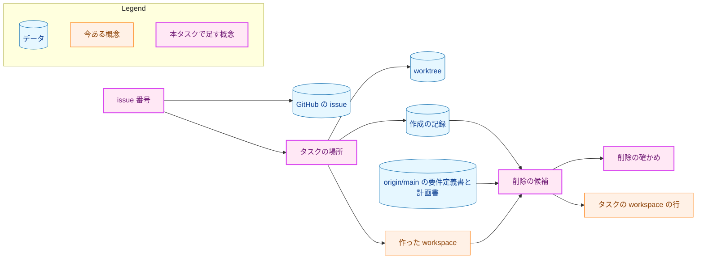
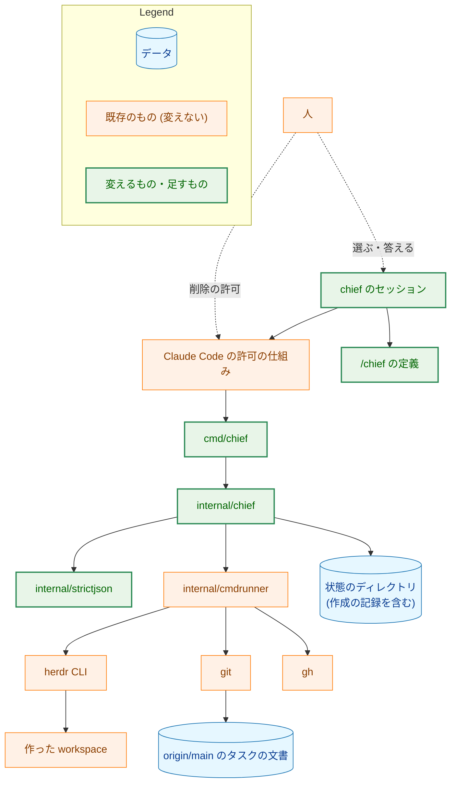
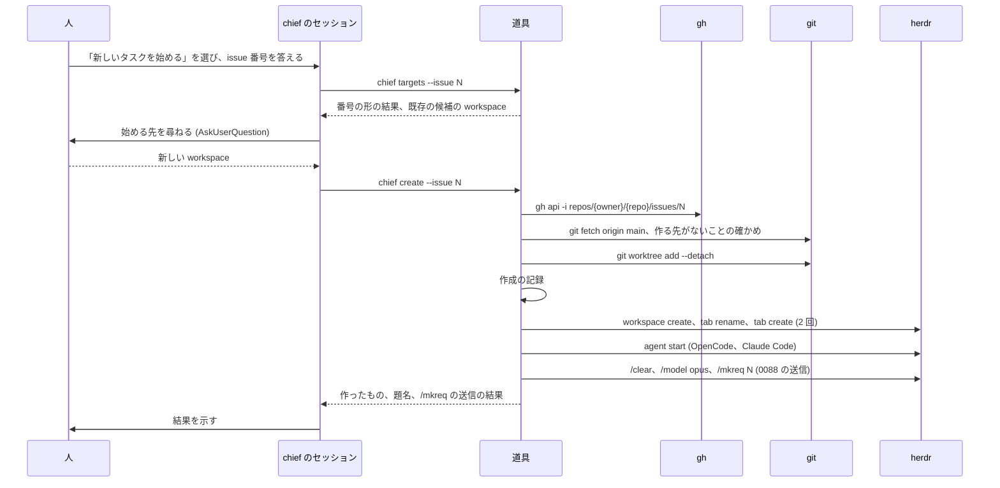
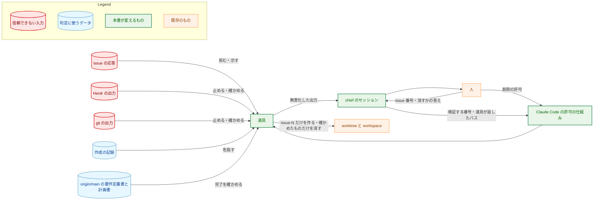
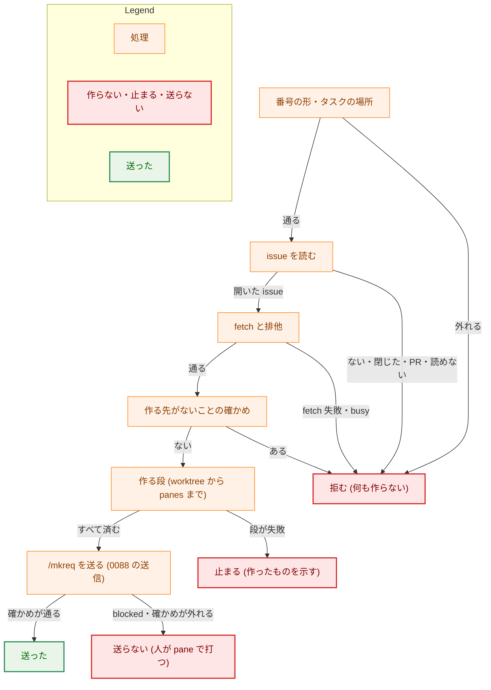
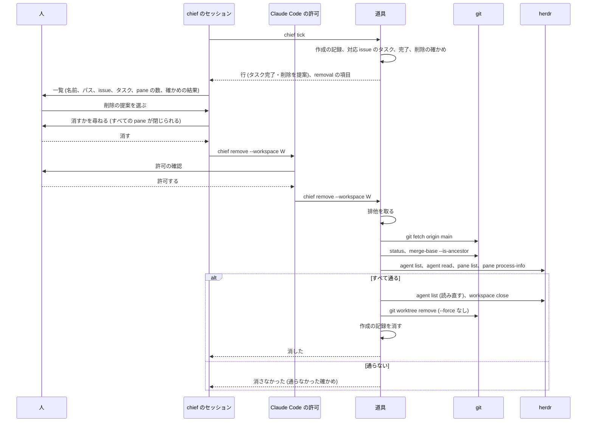

# アーキテクチャ設計書：chief が issue からタスク用の worktree と workspace を作り、タスクが終わったら確かめて消す

## Document Status

| Item | Value |
|---|---|
| Status | `draft` |
| Created | 2026-11-16 |
| Review date | - |
| Reviewer | - |
| Comments | - |

本書は [01_requirements.md](01_requirements.md)（要件定義書。以下、要件書）の設計である。「計画で決める」は、本タスクの実装計画書（`03_implementation_plan.md`）で決めることを指す。既存のファイルの内容は、コミット `bc41cf17` で確かめた。`file:line` の行番号は、このコミットでの行番号である。F-NNN・AC-NN は要件書の項番を、H-NN は [design_handoff.md](design_handoff.md)（以下、申し送り）の項番を指す。申し送りへの対応は付録 A に、受け入れ基準との対応は付録 B にまとめる。

本書は、要件書 3 章と 6 章の用語（作った workspace・タスクの完了・人の確認・`issue-<N>`）と、[0088 設計書](../0088_chief_of_staff/02_architecture.md)（以下、0088 設計書）の冒頭の用語（chief のセッション・道具・`/chief` の定義・状態のディレクトリ・周・送信の記録など）を、同じ意味で使う。そのほかに、次の用語を使う。

-   **タスクの場所:** issue 番号 `<N>` から決まる、作る worktree のパス（`$HOME/.herdr/worktrees/yt2column/issue-<N>`）と workspace の名前（`issue-<N>`）の組（3.2）。
-   **作成の記録:** 道具が worktree を作ったときに状態のディレクトリに残す記録（要件書の「作ったことの記録」。3.5）。
-   **削除の候補:** 作成の記録が名指し、AC-23 の条件を満たした workspace（3.4）。
-   **削除の確かめ:** AC-28 の確かめに、本書で足すシェルの pane の確かめ（1.2）を加えたもの（3.4.2）。

## 1. 設計の全体像 (Design Overview)

### 1.1. 設計原則

-   **作ることと消すことは道具が行い、決まった操作に限る。** 道具は、issue 番号だけから決まるパスと名前で作り、作成の記録が名指して確かめを通った workspace だけを消す。セッションが渡すのは、検証した issue 番号と、道具が返した workspace の識別だけである（要件書 4.2、[ADR-0046](../../dev/adr/0046-chief-of-staff.md)、[ADR-0014](../../dev/adr/0014-deterministic-checks-in-go.md)）。
-   **0088 の部品を使い、送る入力の範囲を広げない。** 作った workspace への `/mkreq` は、0088 の送信の手順（`internal/chief/send.go:399` の `sendCommand`）でそのまま送る。送る入力は 0088 の F-006 の表のものだけである。新しく足すのは、Herdr の workspace・タブ・エージェントを作る呼び出しと閉じる呼び出し、git の worktree を足す呼び出しと消す呼び出しである。
-   **記録は名指すだけで、決めない。** 作成の記録は、削除の候補を名指すことにだけ使う。名指された workspace は、Herdr・git・`origin/main` の文書で確かめ直す。送るコマンドとタスクを記録から決めないことは、0088 のとおりである。
-   **分からないものは消さない。** Herdr・git・gh の出力、作成の記録、`origin/main` の文書のどれかが決まった形に合わなければ、作らないか、消さないか、提案しない。理由も示す（CLAUDE.md の「Reject, don't normalize」）。
-   **消す最後の守りを git に置く。** worktree は `git worktree remove` で `--force` を付けずに消す。道具の確かめの後に変更が入っても、git が消すことを拒む。

### 1.2. 設計の際に決めたこと（2026-11-16）

-   **worktree は `git worktree add --detach <パス> <コミット>` で作り、Herdr の workspace は `herdr workspace create --cwd <パス> --label issue-<N> --no-focus` で作る。消すときは `herdr workspace close` で workspace を閉じ、`git worktree remove <パス>` で worktree を `--force` なしに消す。`herdr worktree create`・`open`・`remove` は使わない（申し送りの H-02）。** 理由は 2 つある。1 つめに、Herdr 0.9.1 の `herdr worktree create` は `--branch`・`--base` を持つが、ブランチを作らない指定がなく、AC-08 に合うかを確かめられない。2 つめに、`git worktree add --detach` と `git worktree remove` は、ブランチを作らないことと、変更のある worktree を拒むことが git の仕様で決まっている。こうすると、Herdr への依存は workspace とタブとエージェントの操作だけになる。`herdr worktree open` で開く案は、`--trust-repository` の要否と、`herdr worktree remove` が workspace を閉じるかが確かめられていないので採らない。ADR: なし（ADR-0046 の「detached の worktree を作り、workspace で開く」という決定を実現する手段で、このタスクの中で閉じるため）。
-   **作る workspace の pane は、今の手作りの形と同じく、タブ 3 つに 1 つずつ置く。タブの名前は `cmd`（シェル）、`opencode`、`claude` とする。** 今の手作りの workspace がこの形である（2026-11-16、この worktree の workspace で `herdr tab list` を実行して確かめた）。1 つのタブを `pane split` で 3 つに分ける案は、手作りの形と違い、人が慣れた配置を変えるので採らない。ADR: なし（配置はこのタスクの中で閉じるため）。
-   **確かめていない外部の振る舞いは、実装の最初のフェーズで人が実地に確かめる。** 確かめていないのは次の 4 つである。(i) 新しい worktree で Claude Code がフォルダの信頼を問う画面を出すか。(ii) `herdr agent start` が新しいタブのシェルの pane で動くか。(iii) `herdr workspace create --cwd` と `herdr tab create --cwd` が作業ディレクトリをそのとおりにするか。(iv) `herdr workspace close` が workspace のすべてのタブと pane を閉じるか。設計は、どの結果でも安全側に倒れる（3.3.4・3.4.3）。合わなければ、計画の段で設計に戻す。設計の前に試す案は採らない。試すには人の Herdr のセッションに実の workspace を作る必要があり、Claude Code のセッションからの `herdr --session` の呼び出しは `.claude/settings.json` が拒むためである。ADR: なし（確かめる時機はこのタスクの中で閉じるため）。
-   **issue は `gh api -i repos/{owner}/{repo}/issues/<N>`（REST の GET）で読む。状態の行の番号で、存在する（`200`）・存在しない（`404`）・読めない（そのほか）を分け、本文の `pull_request` のメンバーで PR を見分ける（申し送りの H-07）。** 2026-11-16 に、このリポジトリで 3 回読んで確かめた。issue #839 は `HTTP/2.0 200 OK` で `pull_request` がなく、PR #897 は `200` で `pull_request` がオブジェクトであり、存在しない #999999 は `HTTP/2.0 404 Not Found` で、終了コードは 1、本文は JSON のオブジェクトだった。`gh issue view` は GraphQL の issue を引くので、PR の番号と存在しない番号を同じ失敗として返しうる。そのため採らない。`--jq` で形を変える案は、重なったメンバーを拒めなくなる（申し送りの H-07）ので採らない。ADR: なし（どの操作を使うかは CLAUDE.md の「Tool Execution Safety」に書く。ADR-0046 の「issue の取得を承認に加える」という決定は変わらない）。
-   **`.claude/settings.json` の拒否に、作る herdr の呼び出し（`herdr workspace create`・`herdr tab create`・`herdr pane split`・`herdr pane move`・`herdr worktree create`・`herdr worktree open`）と、`git worktree add`・`git worktree remove`・`git worktree move` を足す。道具の削除のサブコマンド `chief remove` は `ask` の規則に置き、呼ぶたびに Claude Code の許可の確認を出させる（申し送りの H-05）。** 拒否を足すと、セッションが道具を通さずに workspace や worktree を作ること、git で消すことを防げる。`ask` の規則を足すと、人の確認（AC-27）を、セッションの外の Claude Code の許可の仕組みでも求められる。要件書 4.2 で残る危険とした「人の確認なしに削除のサブコマンドを呼びうる」ことが狭まる。代わりに、削除のたびに `/chief` の問いと許可の確認の 2 回、人が答える。人が Claude Code に Herdr の pane や git の worktree を作らせると拒まれる。この 2 つを受け入れる。auto mode で `ask` の規則が確認を出すかは確かめておらず、実装の最後のフェーズで確かめる（7.3）。拒否だけを足す案と、何も足さない案は、人の確認をセッションだけに任せることになるので採らない。ADR: [ADR-0046](../../dev/adr/0046-chief-of-staff.md) を更新する（拒否の一覧は ADR-0046 の決定にあるため）。
-   **作成の記録は、0088 の workspace ごとの記録のディレクトリ（worktree の正規のパスの SHA-256）に `created.json` として置き、削除の候補を名指すことにだけ読み返す（申し送りの H-01、3.5）。** 0088 の記録と同じ置き場所と同じ読み書きの部品を使えば、置き場所の規則が増えず、workspace ごとの排他の中で作成と削除と送信を順に並べられるためである。要件書は、記録を削除の候補を名指すことにも使うと決めた（ADR-0046 の決定）。ADR-0014 は、道具が判定に読み返す記録を例外として列挙しているので、その一覧に足す。ADR: [ADR-0014](../../dev/adr/0014-deterministic-checks-in-go.md) を更新する（例外の記録の一覧に足すため）。
-   **消す直前の確かめに、エージェントでない各 pane の前面のプロセスがその pane のシェル自身であることを足す。`herdr pane process-info` で読み、読めないときと知らない形のときは消さない（申し送りの H-06）。** workspace を閉じると、シェルの pane で動いているビルドやエディタも終わり、保存していない内容が失われるためである。`herdr pane process-info` は、前面のプロセスグループの ID と、前面のプロセスの一覧と、シェルの pid を返す（2026-11-16、この workspace のシェルの pane で確かめた。前面は `zsh` だけで、前面のプロセスグループの ID がシェルの pid と同じだった）。pane の数を示すだけにする案は、閉じる前に止める手段がなく、作業を失いうるので採らない。ADR: [ADR-0046](../../dev/adr/0046-chief-of-staff.md) を更新する（消す前の確かめは ADR-0046 の決定にあるため）。

### 1.3. なぜ今の仕組みでは足りないか

-   **作る workspace へは、0088 の `send --command mkreq` で送れない。** 0088 の `send` は、その workspace の行が `/mkreq` を提案しているときだけ `/mkreq` を送る（`internal/chief/request.go:344-353` の `offeredMkreq`）。作った直後の worktree は HEAD が detached なので、行は「要確認」になり、`/mkreq` を提案しない（`internal/chief/state.go:256-263` の `headProblem`）。そのため、作成に続く送信は、行の状態によらずに送る別の入口が要る（AC-15）。
-   **完了したタスクの worktree からは、タスクを読めない。** 0088 の道具はタスクをブランチから読み（`internal/chief/snapshot.go:241-250`）、HEAD が detached の worktree はタスクがあるともないとも決めない（0088 設計書の 1.3.1）。`/runpr` は最後の PR の後に HEAD を detached にする（`.claude/commands/runpr.md:1254-1256`）。そのため、どの workspace のタスクが完了したかは、作ったときに記録した issue からしか分からない（AC-23）。
-   **道具には、Herdr の workspace と git の worktree を作る口も、閉じて消す口もない。** 0088 の道具が Herdr に書くのは、`PaneWriter` の `herdr agent prompt`・`herdr agent send-keys` だけである（`internal/chief/herdr.go:395` 以下）。

### 1.4. 概念モデル

図 1 は、本書が足すものと、その関係を示す。矢印 A → B は「A から B が決まる、または A が B を名指す」を表す。



-   タスクの場所は、issue 番号だけから決まる。worktree のパスも、workspace の名前も、作成の記録の置き場所も、そこから決まる（3.2）。
-   削除の候補は、作成の記録が名指し、`origin/main` の文書でタスクの完了を確かめ、Herdr で workspace が今もそのパスにあることを確かめたものである（3.4.1）。
-   削除の候補のうち AC-20 の条件も満たすものの行は、状態を「タスク完了」とする（3.4.1）。

## 2. システム構成 (System Structure)

### 2.1. 全体構成

図 2 は、本書が変えるものと、ほかの道具との関係を示す。矢印 A → B は「A が B を呼ぶ、または読む・書く」を表す。点線の矢印は、人の操作を表す。



-   道具は、外部のコマンドを 0088 と同じく `internal/cmdrunner` でシェルを通さずに走らせる（`internal/chief/runner.go`）。`herdr agent start` は起動を待つので、10 秒の `herdrTimeout`（`internal/chief/runner.go:38`）より長い上限を、その呼び出しにだけ使う。値は計画で決める。
-   `gh api -i` の出力（状態の行・ヘッダー・本文）は道具が読み、本文は `internal/strictjson` で読む（3.3.1）。
-   「Claude Code の許可の仕組み」は、`.claude/settings.json` の `ask` の規則で、`chief remove` を呼ぶたびに人に許可を求める（1.2）。

### 2.2. コンポーネント配置

| ファイル | 種類 | 責務 |
|---|---|---|
| `cmd/chief/main.go` | 変更 | サブコマンド `targets`・`create`・`remove` とその引数を足す。`--protocol` を `2` に上げる（3.1） |
| `internal/chief/records.go` | 変更 | `Protocol` を `2` にする。作成の記録を作る・読む・置き換える・消す操作を足す（3.5） |
| `internal/chief/` の新しいファイル（タスクの場所、作成、削除） | 新規 | タスクの場所（3.2）、issue の読み取り（3.3.1）、作成（3.3）、削除の候補と削除（3.4）。ファイルの分け方は計画で決める |
| `internal/chief/herdr.go` | 変更 | `herdr workspace create`・`herdr tab create`・`herdr tab rename`・`herdr agent start`・`herdr pane list`・`herdr pane process-info`・`herdr workspace close` を呼び、出力を型に読む部品を足す。Herdr のエラーの応答の `code` を読む（3.3.4） |
| `internal/chief/workspace.go` | 変更 | `git worktree add --detach`・`git worktree remove`・`git worktree list --porcelain`・`git merge-base --is-ancestor` を足す |
| `internal/chief/task.go` | 変更 | `origin/main` の要件定義書の `対応 issue:` の行を読み、issue 番号からタスクのディレクトリを探す（3.4.4）。タスクのディレクトリの名前から文書を読む口を足す（今の `Tasks.Read` はブランチ名から読む。`internal/chief/task.go:786`） |
| `internal/chief/state.go`・`snapshot.go`・`pending.go`・`output.go` | 変更 | 削除の候補の行（AC-20）、人の判断を待つものの種類 `removal`（AC-22）、出力の項目（3.6） |
| `internal/strictjson/strictjson.go` | 変更 | 読むメンバーと、大文字と小文字だけが違う名前のメンバーを拒む読み方を足す（3.3.1、要件書 4.2 の表） |
| `.claude/commands/chief.md` | 変更 | 新しいタスクを始める問いと、削除の提案と人の確認の問い（3.7）。`--protocol 2` |
| `.claude/settings.json` | 変更 | 拒否を足し、`ask` に `Bash(chief remove *)` を置く（1.2、3.8） |
| `CLAUDE.md` | 変更 | 「Tool Execution Safety」に issue の読み取りを足す。「Go Idioms」の task reader の例外に `対応 issue: ` を足す。「Claude Commands」の `/chief`（3.8） |
| `docs/dev/guides/chief_guide.md` | 変更 | 1・3・4・5・6・7・8 章（3.8） |
| `docs/dev/conventions/package_reference.md` | 変更 | `cmd/chief`・`internal/chief`・`internal/strictjson` の行 |
| `docs/dev/adr/0046-chief-of-staff.md` | 変更（本書の PR） | 拒否の一覧と `ask` の規則、消す前の確かめ（1.2） |
| `docs/dev/adr/0014-deterministic-checks-in-go.md` | 変更（本書の PR） | 判定に読み返す記録の一覧に作成の記録を足す（3.5） |
| `cmd/chief/docs_test.go` | 変更 | 拒否・`ask`・プロトコル番号・サブコマンドの一覧のガード（3.9） |

### 2.3. データフロー

図 3 は、人が issue 番号を答えてから `/mkreq` が送られるまでを示す。矢印は呼び出しと応答を表す。



既存の workspace を選んだときは、`create` の代わりに 0088 の `chief send --command mkreq --issue N` を呼ぶ（AC-04）。シーケンス図は色分けしたノードを持たないので、凡例を置かない。

## 3. コンポーネント設計 (Component Design)

### 3.1. サブコマンドと終了コード

道具の引数・出力・終了コードは、`/chief` の定義とガードのテストが読む契約である（ADR-0014）。サブコマンドと出力が変わるので、`--protocol` を `1` から `2` に上げる（申し送りの H-08）。0088 のサブコマンドの引数と振る舞いは変えない。

| サブコマンド | 何をするか | Herdr・git への書き込み | ネットワーク |
|---|---|---|---|
| `targets --issue <N>` | 番号の形を確かめ（AC-06）、既存の候補の workspace（0088 の AC-38 を満たすもの）を返す（AC-02） | なし | `git fetch origin main`（0088 の周と同じ読み取り） |
| `create --issue <N>` | issue を確かめ（F-002）、worktree と workspace を作ってエージェントを起動し（F-003）、`/mkreq <N>` を送る（F-004） | worktree を足す、workspace とタブを作る、エージェントを起動する、0088 の F-006 の表の入力 | `gh api -i`（読み取り）、`git fetch origin main` |
| `remove --workspace <W>` | 削除の確かめを行い（AC-28）、通れば workspace を閉じて worktree を消す（AC-30） | workspace を閉じる、worktree を消す | `git fetch origin main` |

-   **`--issue` の値の扱い。** `targets` と `create` は、`--issue` の値を文字列のまま受け取り、道具の中で AC-06 の形を確かめる。形が違うときは、使い方の誤り（終了コード 2）にせず、終了コード 0 で、拒んだことと拒否の種類 `issue_form` を返す。人が打った値の誤りは、`/chief` の定義の誤りと区別して、人に示すためである。0088 の `send --issue` は、`targets` で確かめた値を受けるので、今のまま使い方の誤りとする（`internal/chief/request.go:107-110`）。
-   **`--workspace` の値。** `remove` の `--workspace` は、0088 と同じく `snapshot`・`tick` が返した worktree の絶対パスで、削除の提案の項目が持つ値である。道具は、呼ばれるたびに作成の記録と Herdr と git から読み直し、セッションが渡したものを信じない。
-   **ロック。** 3 つとも、0088 のほかのサブコマンドと同じく、呼んだ pane とセッションが chief のロックの持ち主であることを確かめてから動く（`cmd/chief/main.go` の `requireOwner`）。
-   **終了コード。** 0088 の 4 つの値の意味を変えない。作らなかった判断、消さなかった判断、途中で止まったこと（AC-12・AC-32）は、終了コード 0 で、出力が理由と段を持つ。1 は、出力を書けないときなどの道具の失敗である。
-   **作成と周の関係（AC-13）。** `/chief` の定義は、`create` を前景で呼び、終わるまで次の周（`tick`）を呼ばない。そのため、作成の間は自動送信も走らない。道具の `create` が Herdr に書くのは、自分が作った workspace の ID とタブとペインだけである（3.3.3）。

### 3.2. タスクの場所

worktree のパスと workspace の名前の規則は、次の型 1 つに置く（要件書 4.5）。

```go
// TaskSpace is where chief makes a task's worktree and workspace for one
// issue (requirements F-003): the path $HOME/.herdr/worktrees/yt2column/issue-<N>
// and the label issue-<N>. Only NewTaskSpace makes one, from an issue number
// and the home directory, so no caller string reaches either value.
type TaskSpace struct {
	issue paneinput.IssueNumber
	path  string
	label string
}
```

-   **パス。** `$HOME`（`Env.Home`。絶対パスでなければ作らない）に、`.herdr/worktrees/yt2column/issue-<N>` を足したものである。リポジトリの名前 `yt2column` は、要件書で決めた値で、リポジトリの remote から推し量らない。
-   **送れない文字（AC-11）。** パスが、0088 の transcript の規則の文字（`internal/chief/transcript.go:46` の `transcriptDirChars`。英数字・`/`・`.`・`-`）だけでできていなければ、作らずに `unsupported_path` で拒む。パスの途中にシンボリックリンクがあるときは、解決した後のパスも同じ規則で確かめる。Claude Code が transcript の場所を求めるのは、解決した作業ディレクトリからだからである。
-   **正規のパス。** 作成の記録と workspace ごとの記録の置き場所は、0088 と同じく、worktree の正規のパス（シンボリックリンクを解決した絶対パス。`internal/chief/records.go:533` の `CanonicalWorktree`）の SHA-256 で決まる。作る前は worktree がないので、親のディレクトリ（`$HOME/.herdr/worktrees/yt2column`）を解決したパスに `issue-<N>` を足したものを正規のパスとする。worktree を作った後に `CanonicalWorktree` で読み直し、同じでなければ、作成の段の失敗として止める（AC-12）。
-   **親のディレクトリ。** `$HOME/.herdr/worktrees/yt2column` がなければ、道具が作る。その途中にあるものがディレクトリでないとき（ファイルなど）は、作らずに `target_exists` で拒む。

### 3.3. 作成（`targets`・`create`）

#### 3.3.1. issue の読み取り（F-002）

道具は、`create` の中で、何かを作る前に `gh api -i repos/{owner}/{repo}/issues/<N>` を呼ぶ（1.2）。`{owner}`・`{repo}` は gh が chief の worktree の remote から埋める。出力は、状態の行、ヘッダー、空の行、本文の順である。

| 読むもの | 受け付ける形 | 結果 |
|---|---|---|
| 状態の行（最初の行） | `HTTP/<版> <3 桁の番号> <説明>` | `200` なら本文を読む。`404` なら `issue_not_found`。そのほかの番号、形の違う行は `issue_unreadable` |
| 本文（`200` のとき） | 要件書 4.2 の表の形（上限 64 KiB、UTF-8、1 つの JSON のオブジェクト、後に続くデータがない） | 下の表 |
| gh の終了コード | `200` では 0、`404` では 1（2026-11-16 に確かめた） | 状態の行と組で読む。`200` で 0 以外、`404` で 1 以外、状態の行がないときは `issue_unreadable` |

本文のメンバーは、`number`・`state`・`title`・`pull_request` だけを読み、ほかのメンバーは読み飛ばす。

| メンバー | 受け付ける値 | 結果 |
|---|---|---|
| `number` | 求めた番号と等しい整数 | 違えば `issue_unreadable` |
| `state` | `open` か `closed` | `closed` なら `issue_closed`。ほかの値は `issue_unreadable` |
| `title` | 文字列 | 示すためだけに使う（AC-07） |
| `pull_request` | ないか、オブジェクト | オブジェクトなら `issue_is_pr`。`null` とほかの型は `issue_unreadable` |

-   読むメンバーが 2 つ以上あるとき（`strictjson.Object.Collect` が拒む。`internal/strictjson/strictjson.go:91`）は、`issue_unreadable` とする。名前が読むメンバーと大文字と小文字だけ違うメンバー（`Title` など）があるときも同じである。後者は今の `strictjson` が拒まないので、拒む読み方を `strictjson` に足す（2.2）。
-   `state` が `open` で、`pull_request` がないときだけ、作成に進む。
-   **題名。** 題名は、0088 の無害化（`Sanitize`）で制御文字と見えない文字を見える形に置き換え、上限の文字数（計画で決める）で切る。切ったときは、切ったことを出力に示す。題名は、パス、名前、送る入力のどれも左右しない（AC-07）。

#### 3.3.2. 作る前の確かめ

`create` は、次の順に確かめ、外れたところで何も作らずに拒む。拒否の種類の綴りは 4.1 にある。

1.  **番号の形（AC-06）。** `paneinput.ParseIssueNumber`（`internal/chief/paneinput/paneinput.go:66`）で確かめる。0088 の `/mkreq` の issue 番号と同じ規則である。
2.  **タスクの場所（3.2）。** `$HOME` が絶対パスであること、送れない文字がないこと。
3.  **issue（3.3.1）。**
4.  **fetch。** chief の worktree で `git fetch origin main` を行い、`git rev-parse refs/remotes/origin/main` でコミットを読む。fetch が失敗すれば `fetch_failed` で拒む（AC-11）。
5.  **排他。** 作るパスの workspace ごとの排他（0088 の `internal/cachelock` の flock。`internal/chief/records.go:642` の `Lock`）を取る。取れなければ `busy` で拒む。同じ issue で 2 つの `create` が同時に走っても、作るのは 1 つだけである（要件書 4.3）。排他は、`/mkreq` の送信を終えるまで持ち続ける。そのため、作成の途中に、0088 の `send` がその workspace へ送ることもない。
6.  **作る先がないこと（AC-11）。** 排他を持ったまま、次の 3 つを確かめる。どれかに当たれば、当たったものを示して `target_exists` で拒む。
    -   パスに、ファイル、ディレクトリ、シンボリックリンクのどれかがある（`os.Lstat`）。
    -   `git worktree list --porcelain` に、そのパス（正規のパスで比べる）の worktree がある。ディレクトリがなく、登録だけが残っている worktree も含む。
    -   `herdr pane list` のどれかの pane の作業ディレクトリが、そのパスかその下にある。chief の workspace の pane も含む。0088 のタスクの workspace の見つけ方（エージェントの作業ディレクトリ。`internal/chief/workspace.go:183`）より広く、シェルだけの pane も数える。

#### 3.3.3. 作る段

確かめを通ったら、次の段の順に作る。どの段も、Herdr か git が返した ID だけを使い、ほかの workspace の ID を引数に取らない（AC-13）。

| 段 | 呼び出し | 失敗のときに残るもの |
|---|---|---|
| `worktree` | chief の worktree で `git worktree add --detach <パス> <4 で読んだコミット>`。ブランチは作らない（AC-08） | git が途中で止めたもの（ディレクトリが残ることがある） |
| `record` | 作成の記録を作る（3.5）。前の記録が残っていれば、置き換える（AC-14） | worktree |
| `workspace` | `herdr workspace create --cwd <パス> --label issue-<N> --no-focus`。返った workspace の ID と、最初のタブとその pane の ID を読む | worktree、記録 |
| `tabs` | 最初のタブを `herdr tab rename` で `cmd` にする。`herdr tab create --workspace <ID> --cwd <パス> --label opencode --no-focus` と、同じく `--label claude` のタブを作る | 上に加えて、作った workspace とタブ |
| `opencode` | `opencode` のタブの pane で、シェルが前面にあることを `herdr pane process-info` で確かめてから、`herdr agent start issue-<N>-opencode --kind opencode --pane <ID>` を、エージェントの引数なしに呼ぶ（AC-10） | 上に加えて、起動したエージェント |
| `claude` | `claude` のタブの pane で同じく、`herdr agent start issue-<N>-claude --kind claude --pane <ID>` | 同上 |
| `panes` | `herdr agent list` を読み直し、作った workspace に Claude Code と OpenCode の pane がちょうど 1 つずつあり、どちらの作業ディレクトリもパスの下にあることを確かめる（AC-09） | 同上 |

-   **途中の失敗（AC-12）。** どの段で失敗しても、そこで止まり、作ったもの（worktree のパス、記録、workspace の ID と名前、タブと pane、起動したエージェント）と、失敗した段と理由を返す。作ったものは消さず、`/mkreq` を送らない。人は、示されたものを端末で片付けるか、残す。残した workspace は、`/mkreq` が送られずに detached のままなので、0088 の規則で「要確認」の行になる。
-   **エージェントの名前。** `herdr agent start` の名前は、生きているエージェントの中で重ならない必要がある（Herdr の skill の説明）。`issue-<N>-opencode`・`issue-<N>-claude` は、Herdr の名前の形（`[a-z][a-z0-9_-]{0,31}`）に収まる。同じ名前のエージェントがすでにあれば、その段の失敗として止まる。
-   **段の順。** OpenCode を先に起動するのは、`/mkreq` の送り先の Claude Code の起動を最後にして、その起動から送信までの間を短くするためである。

#### 3.3.4. エージェントの起動と `/mkreq` の送信（F-004）

-   **起動の待ち（AC-16）。** `herdr agent start` は、エージェントが入力を受け付ける状態になるまで待ち、待つ時間の上限を `--timeout` で取る（Herdr の skill の説明。上限は 3 秒より長く 300 秒以下）。道具は、上限を 60 秒とする（計画で変えうる）。
-   **起動の結果の読み方。** 成功の応答のほか、Herdr のエラーの応答（標準エラーの JSON、`{"error":{"code":…,"message":…}}`。`herdr api schema` の `error_response`）の `code` を読む。`code` は Herdr が宣言する値なので、文字列の中身で振る舞いを選ぶことにはならない。`message` は示すだけに使う。
    -   `agent_not_ready`: エージェントは起動したが、起動の途中で止まっている（Herdr の skill の説明では、質問か許可の画面で `blocked` になった）。作成の段の失敗とはせず、次に進む。
    -   ほかの `code` と、形の読めない応答: その段の失敗（AC-12）。
-   **`/mkreq` の送信（AC-15）。** 作成の段を終えたら、同じ排他を持ったまま、作った workspace に 0088 の送信の手順（`sendCommand`）で `/mkreq <N>` を送る。コマンドは `paneinput.NewMkreq` で検証した番号から組み立て、送り先は `_context.md` の送り先の表の `task-documents` の行（Claude Code・`opus`）である。送り先の pane の選び方、入力ごとの確かめ（`idle` か `done`、画面が質問の形でない、入力欄が空、transcript の場所が求まる）、`/clear` と `/model opus` とその確かめは、0088 の F-006 のままである。0088 の `offered` による行の状態の確かめ（`internal/chief/request.go:314-342`）だけを行わない。作った直後の行は、HEAD が detached なので「要確認」になるためである（1.3）。
-   **送らないとき（AC-16・AC-17）。** 次のときは何も送らず、送らなかったことと理由を返す。
    -   Claude Code の起動が `agent_not_ready` だったとき、または送る前の確かめで Herdr の状態が `blocked` だったとき: 理由は `agent_blocked` とし、人がその pane の画面で答え、その後に `/mkreq <N>` を打つよう示す。フォルダの信頼を問う画面は、Herdr が `blocked` と報告すればここに入る。報告しなければ、画面がどの形にも合わず、次の項に入る。
    -   0088 の入力ごとの確かめが外れたとき: 0088 の理由（`not_accepting`・`input_left`・`unsupported_path` など）をそのまま返す。人がその pane で `/mkreq <N>` を打つよう示す。
-   **送った後の失敗（AC-18）。** 最初の入力を送った後に確かめが外れたときは、0088 のとおり、送り直さずにその workspace の送信の停止の記録を作る（0088 設計書の 3.1.3）。
-   **後の周（AC-17・AC-19）。** 送れなかった workspace は HEAD が detached のままなので、0088 の規則で「要確認」になり、`/mkreq` は提案されない（`internal/chief/state.go:256-263`）。本書は、この規則を変えない。`/mkreq` がタスクのブランチを作った後は、0088 の規則でそのタスクの行になる。

#### 3.3.5. `targets`（AC-01〜AC-04）

-   `targets` は、番号の形を確かめ、0088 の周の読み取り（`internal/chief/snapshot.go:90` の `readRound`）で、行が `/mkreq` を提案している workspace（0088 の AC-38 を満たすもの）を返す。何も作らず、通知の記録も作らない。
-   issue の存在は確かめない。既存の workspace を選んだときは F-002 の確かめを行わない（AC-04）。新しい workspace を選んだときは、`create` が確かめる。
-   既存の workspace を選んだときは、セッションが 0088 の `send --command mkreq --issue <N>` を呼ぶ。その振る舞いは 0088 のままである（AC-03・AC-04）。

### 3.4. 削除の候補と削除（`remove`）

#### 3.4.1. 削除の候補と行（F-005・F-006）

`snapshot` と `tick` は、0088 の周の読み取りの後に、タスクの workspace ごとに次を確かめる。0088 の周がすでに fetch した `origin/main` を使う。

| AC-23 の条件 | 道具が確かめる値 |
|---|---|
| chief が作ったと記録から読める | そのタスクの workspace の正規のパスの記録のディレクトリに、作成の記録があり、決まった形で読め、記録のパスがその正規のパスと等しい |
| 記録と同じパスを開いたまま Herdr にある | そのタスクの workspace が、この周の 0088 の見つけ方（エージェントの作業ディレクトリ。`internal/chief/workspace.go:183`）で、記録のパスの worktree の workspace として見つかり、同じパスの workspace がほかにない |
| 記録した issue のタスクがちょうど 1 つあり、完了している | 3.4.4 の読み方で、記録した issue 番号を `対応 issue` とするタスクのディレクトリが `origin/main` にちょうど 1 つあり、その計画書が `approved` で、すべての PR がマージされている（`internal/chief/task.go:693` の `Plan.Done`。0088 の「タスク完了」と同じ判定） |

-   **行（AC-20・AC-21）。** 上の条件をすべて満たし、HEAD が detached で、どのエージェントも実行中でも質問で止まってもいない（0088 の `classify` の見分け。`internal/chief/state.go`）行は、状態を「タスク完了」、タスクを記録した issue のタスクの番号、次にやることを「削除を提案」とする。どれかが外れる行は、0088 の規則のままである。これは、0088 設計書 3.1.4 の状態の区分（HEAD が detached の行を「要確認」にする規則）の例外である。その規則を確かめている今のテストは、作成の記録のない workspace について、変わらずに成り立つ。この例外を確かめるテストを足す（7.1）。
-   **人の判断を待つもの（AC-22〜AC-25）。** AC-23 の条件を満たす workspace ごとに、新しい種類 `removal` の項目を 1 つ作る。項目は、workspace の名前、worktree のパス、issue の番号、タスクの番号、workspace の pane の数（`herdr pane list --workspace <ID>`）、その周の削除の確かめの結果（3.4.2。通ったか、通らなかったものと読めなかったもの）を持つ。HEAD が detached でないときやエージェントが動いているときも、項目は作り、確かめの結果に示す（AC-20 は行の示し方の条件で、提案の条件は AC-23 である）。
-   **並べ方（AC-22）。** 種類の順を、0088 の 4 つ（`internal/chief/pending.go` の `kindOrder`）の後に `removal` を足したものにする。同じ種類の中では、0088 のとおり最初に見つけた時刻の古いものから並べる。「新しいタスクを始める」は、`/chief` の定義が一覧の最後に置く（3.7）。
-   **削除しないこと（AC-26）。** `tick` の自動送信は、削除の項目を送信の対象にしない。削除は `remove` だけが行う。
-   **エージェントのいない workspace。** 0088 の見つけ方はエージェントの作業ディレクトリから workspace を見つけるので、エージェントがすべて終了した workspace は、表に出ず、削除も提案されない。人が端末で片付ける（8 章の既知の制限として手引きに書く）。

#### 3.4.2. 削除の確かめ（AC-28）

| 確かめ | 道具が確かめる値 | 拒否の種類 |
|---|---|---|
| AC-23 の条件がまだ満たされる | 3.4.1 の表を、`remove` の中で fetch した後に確かめ直す | `not_candidate` |
| 変更がない | `git status --porcelain --untracked-files=all` が空（0088 の `GitReader.Clean`。`internal/chief/workspace.go:242`）。git が無視するファイルは数えない | `not_clean` |
| HEAD が `origin/main` から届く | `git merge-base --is-ancestor HEAD refs/remotes/origin/main` が 0 で終わる。1 なら届かない。そのほかは読めない | `head_not_on_main` |
| どのエージェントも動いていない | その workspace のどのエージェントも、Herdr の状態が `idle` か `done` で、画面が質問の形でない（0088 の F-001・F-002 の見分け）。状態と画面がすべて読める | `agent_active` |
| エージェントでない pane が空いている | `herdr pane list --workspace <ID>` の、エージェントのいない各 pane について、`herdr pane process-info` の前面のプロセスグループの ID がシェルの pid と等しく、前面のプロセスがシェルだけである（1.2） | `shell_busy` |

-   どの確かめも、読めないときは通らないものとし、`unreadable` に、読めなかったものの名前を添えて返す。
-   確かめが 1 つでも通らなければ、何も消さず、通らなかったものをすべて返す。

#### 3.4.3. 消す手順

1.  **排他。** そのパスの workspace ごとの排他を取る。取れなければ `busy` で何もしない。排他は、記録を消すまで持ち続ける。そのため、0088 の送信と自動送信は、消している最中の workspace へ送らない。
2.  **fetch（AC-29）。** chief の worktree で `git fetch origin main` を行う。失敗すれば `fetch_failed` で何もしない。
3.  **確かめ（3.4.2）。**
4.  **workspace を閉じる。** `herdr workspace close <ID>`。閉じる直前に `herdr agent list` を読み直し、3 で確かめたエージェントの状態から変わっていれば閉じない（`agent_active`）。
5.  **worktree を消す。** chief の worktree で `git worktree remove <パス>` を、`--force` なしで行う。3 の後に変更か追跡していないファイルが入っていれば、git が拒む。git が無視するファイルは、worktree とともに消える（要件書 4.2）。
6.  **記録を消す。** 作成の記録を消す。

-   **順序の理由。** workspace を先に閉じるのは、エージェントとシェルのプロセスを止めてから、その作業ディレクトリを消すためである。worktree を先に消すと、動いているプロセスの作業ディレクトリがなくなり、その間に書かれたものが行き場を失う。
-   **途中の失敗（AC-32）。** 4〜6 のどこで失敗しても、そこで止まり、残ったもの（workspace、worktree のディレクトリ、git の worktree の登録、作成の記録）と、失敗した段と理由を返す。自分から消し直さない。5 で失敗して workspace だけが閉じた場合、その worktree は表に出ず（エージェントがいないため）、削除も提案されない。人が端末で片付ける。
-   **消さないもの（AC-31）。** `git worktree remove` は、ブランチを消さない。道具は、ブランチ、ほかの worktree、worktree の外のファイルを消さない。消す記録は、作成の記録だけである。そのパスの workspace ごとの記録のディレクトリに残る、送信の記録などは、0088 の `start` の片付けに任せる。
-   **残る窓。** 3 の確かめと 4 の閉じる操作の間に、人がエージェントに入力して実行が始まると、その実行は失われうる。4 の直前の読み直しで、窓を 1 回の Herdr の呼び出しの分に狭める。ファイルについては、5 で git が最後に拒む。
-   **二度と提案しない（AC-33）。** 消し終えた workspace は Herdr になく、作成の記録もないので、表に出ず、提案されない。

#### 3.4.4. issue からタスクを見つける（申し送りの H-04）

-   **読み方。** 道具は、`origin/main` で `git grep -n '^対応 issue: ' refs/remotes/origin/main -- 'docs/tasks/*/01_requirements.md'` を 1 回呼び、すべての要件定義書の `対応 issue:` の行を得る。作成の記録が 1 つもない周では呼ばない。
-   **数えるリンク。** 各行の、最初の全角の `（` より前の部分にある、`[#<数字>](<URL>)` の形の Markdown のリンクだけを数える（AC-23）。`（` がなければ行の全体を見る。リンクの文の `#<数字>` を、その行が挙げる issue 番号とする。
-   **安全側に倒すこと。** 行の読み方が分からない場合は、提案を減らす向きに倒す。
    -   URL がその番号の issue（`/issues/<数字>` で終わる）を指さない、文と URL の番号が違うなどの、形の合わないリンクは、文と URL の両方の番号を挙げているものとして数える。そうすると「ちょうど 1 つ」が成り立ちにくくなり、提案は減る向きにだけ働く。
    -   1 つの要件定義書に `対応 issue:` の行が 2 つ以上あるときは、どの行の番号も、その文書が挙げる番号として数える。
    -   コードのフェンスの中の行も数える。
-   **リンクでない番号。** 古い要件定義書には、`対応 issue: #2` のようにリンクでない番号の行がある（コミット `bc41cf17` の `origin/main` で 90 個の要件定義書のうち、0001〜0021 ごろのもの）。これらは数えない。chief が作る workspace の issue は、`/mkreq` が書くリンクの形（`.claude/commands/mkreq.md:142`）の行で挙がるので、リンクだけを数えて足りる。
-   **`/mkreq` との関係。** `/mkreq` の重複の探し方（`.claude/commands/mkreq.md:53-55` の `git grep -l '対応 issue: \[#N\]'`）は、行の最初のリンクだけを見て、すべてのブランチを探す。chief は、最初の `（` より前のすべてのリンクを、`origin/main` だけで数える。`origin/main` については chief の見つけるタスクが `/mkreq` の見つけるものを含むので、`/mkreq` が 1 つと見るものを chief が 2 つと見ることはあっても、逆はない。2 つと見れば提案しない（AC-24）。
-   **文書の読み方。** 見つけたタスクのディレクトリの文書は、0088 の `Tasks` の読み方（Status、計画書の PR マーカー）で読む。今の `Tasks.Read` はブランチ名からディレクトリを探すので、ディレクトリの名前から読む口を足し、両方が同じ読み方を使うようにする。
-   **「Go Idioms」の例外。** `対応 issue: ` の文字列は、日本語の要件定義書の行の頭と等しくなければならない。そのため、読み方は `internal/chief/task.go` に置き、CLAUDE.md の「Go Idioms」の task reader の例外の範囲に、要件定義書の `対応 issue: ` の行の頭を足す（要件書 5 章）。
-   **「Declare, don't infer」。** この行は文書の決まった欄で、計画書の PR マーカーを読むのと同じく、文書の文法を読むものである。この方針の例外にはしない（要件書 5 章）。

### 3.5. 作成の記録（申し送りの H-01）

| 項目 | 値 |
|---|---|
| 置き場所 | 0088 の workspace ごとの記録のディレクトリ（正規のパスの SHA-256。`internal/chief/records.go:551`）の `created.json` |
| 持つもの | worktree の正規のパス、issue 番号、作ったときの Herdr の workspace の ID（示すためだけ）、作った時刻 |
| 作るとき | 作る段の `record`（`git worktree add` が成功した直後。AC-14） |
| 読むとき | `snapshot`・`tick`（3.4.1）、`remove`（3.4.2） |
| 置き換えるとき | `create` が、作る先がないことを確かめた後に、同じパスの記録が残っているのを見つけたとき（AC-14） |
| 消すとき | `remove` が worktree を消した後（3.4.3 の 6） |

-   **置き換え（AC-14）。** 0088 の記録は、`privatefile.Create` で作り、同じ名前のものを置き換えない（`internal/privatefile/privatefile.go:314`）。作成の記録の置き換えは、そのパスの workspace ごとの排他を持ったまま、前の記録を `privatefile.Remove` で消してから、新しい記録を `Create` で作る。排他の中で行うので、2 つの `create` が同じ記録を置き換え合うことはない。前の記録の issue 番号は、新しい workspace の削除の提案に使わない。
-   **読めない記録（AC-24）。** 形が違う、権限が違う、記録のパスがディレクトリの名前と合わない記録は、読めないものとし、その workspace の削除を提案しない。行は 0088 の規則のままにする。
-   **記録が条件として働く範囲。** 作成の記録は、削除の候補を名指すことにだけ使う。名指された workspace は、Herdr（3.4.1 の表の 2 行め）、git（3.4.2）、`origin/main` の文書（3.4.4）で確かめ直す。作成の記録は、送るコマンドとタスクを決めない。作った直後の `/mkreq` の番号は、記録からではなく、`create` の引数を検証した値から組み立てる。
-   **ADR-0014 の例外。** ADR-0014 は、道具が判定に読み返す状態のディレクトリの記録を、例外として列挙している（[ADR-0014](../../dev/adr/0014-deterministic-checks-in-go.md) の決定の 2 項目め）。作成の記録をその一覧に足し、名指すことにだけ使うと書く。この PR で ADR-0014 を更新する。

### 3.6. 出力の型

道具の出力の主な型を示す。項目の細部は計画で決める。

```go
// PendingRemoval is a created workspace whose task is complete, proposed for
// removal (requirements F-006). It ranks after PendingProposal.
const PendingRemoval PendingKind = PendingProposal + 1

// RemovalCheck is one check before a removal (requirements AC-28, design
// 3.4.2). The zero value is no check and never passes.
type RemovalCheck int

const (
	RemovalCheckUnknown RemovalCheck = iota
	RemovalCheckCandidate   // AC-23 still holds
	RemovalCheckClean       // no change, no untracked file
	RemovalCheckHeadOnMain  // HEAD is reachable from origin/main
	RemovalCheckAgentsIdle  // no agent runs or waits on a question
	RemovalCheckShellsIdle  // each non-agent pane's foreground is its shell
)

// CheckResult is one check's outcome; Unreadable names what could not be
// read. The zero value is a check that did not pass.
type CheckResult struct {
	Check      RemovalCheck
	Passed     bool
	Unreadable string
}

// RemovalProposal is what a removal item shows (requirements AC-25).
type RemovalProposal struct {
	Workspace string // canonical worktree path: the API identity
	Label     string
	Issue     paneinput.IssueNumber
	Task      paneinput.TaskID
	Panes     int
	Checks    []CheckResult
}

// CreateStage is a stage of a creation (design 3.3.3). The zero value is
// no stage.
type CreateStage int

const (
	CreateStageUnknown CreateStage = iota
	CreateStageWorktree
	CreateStageRecord
	CreateStageWorkspace
	CreateStageTabs
	CreateStageOpenCode
	CreateStageClaudeCode
	CreateStagePanes
)

// CreateOutcome is what `chief create` did: refused before making anything,
// stopped at a stage with what it made, or made everything and then sent
// /mkreq or did not.
type CreateOutcome struct {
	Issue    paneinput.IssueNumber
	Title    string // sanitized and capped (AC-07)
	Cut      bool   // the title was cut
	Refusal  CreateRefusal
	Existing []string     // what already exists (AC-11)
	Made     []MadeThing  // worktree path, record, workspace, tabs, agents
	Stopped  CreateStage  // zero when no stage failed
	Failure  string
	Mkreq    *ActionResult // nil when /mkreq was not tried
}

// RemoveStage is a stage of a removal (design 3.4.3).
type RemoveStage int

const (
	RemoveStageUnknown RemoveStage = iota
	RemoveStageCloseWorkspace
	RemoveStageRemoveWorktree
	RemoveStageRemoveRecord
)

// RemoveOutcome is what `chief remove` did (AC-28 to AC-32).
type RemoveOutcome struct {
	Refusal RemoveRefusal
	Checks  []CheckResult
	Stopped RemoveStage // zero when every stage ran
	Left    []string    // what is left after a stop (AC-32)
	Failure string
}
```

-   **行の項目。** 0088 の行（`internal/chief/state.go` の `Row`）に、削除の候補の行であることを示す項目を足す。`snapshot`・`tick` の出力の人の判断を待つものの項目に、`removal` の種類の `RemovalProposal` を足す。
-   **不透明な値。** 項目の識別（`ItemID`）は、0088 と同じく道具が作る不透明な値で、`removal` の項目は workspace のパスと issue 番号から作る。セッションは、その中身に依らない。
-   **Herdr の出力。** `workspace create` の応答（`.result.workspace`・`.result.tab`・`.result.root_pane`）、`tab create` の応答（`.result.tab`・`.result.root_pane`）、`pane list`、`pane process-info`、`agent start` の応答とエラーの応答は、0088 の Herdr の出力と同じく `strictjson` で厳密に読み、知らない値や欠けた項目は読めないものとする（0088 設計書の 3.1.2）。形は、実装の最初のフェーズで実画面と同じく採ったサンプルで固定する。

### 3.7. `/chief` の定義（`.claude/commands/chief.md`）

-   **入口（AC-01）。** 人の判断を待つものの一覧の最後、`removal` の項目の後、`何もしない` の前に、`新しいタスクを始める` を常に置く。道具の番号を持たないので、0088 の `停止を解く` と同じく名前で選ぶ。`once` の問いでは、0088 の AC-14 のとおり、示せない項目を問いの文で名前で挙げる。
-   **始める流れ（AC-02〜AC-04）。** 人が選ぶと、issue 番号を尋ね、`chief targets --issue <N> --protocol 2` を呼ぶ。拒まれたら（`issue_form`）、受け付ける形を示す。通れば、`新しい workspace を作る`、候補の各 workspace、`何もしない` を `AskUserQuestion` で尋ねる。新しく作るなら `chief create --issue <N> --protocol 2` を前景で呼び（3.1）、既存なら 0088 の `chief send --command mkreq --issue <N>` を呼ぶ。
-   **作成の結果（AC-07・AC-12・AC-17）。** issue の番号と題名、作ったもの、`/mkreq` の送信の結果を示す。拒否と途中の失敗は、拒否の種類か段と理由を示す。`/mkreq` を送らなかったときは、`agent_blocked` ならその pane の画面で答えるよう示し、どちらの場合も、その pane で `/mkreq <N>` を打つよう示す。
-   **削除の提案（AC-25）と人の確認（AC-27）。** `removal` の項目は、名前、パス、issue、タスク、pane の数、確かめの結果を示す。人が選ぶと、消す workspace の名前、worktree のパス、workspace のすべての pane が閉じられることを示して、消すかを `AskUserQuestion` で尋ねる。消すと答えたときだけ、`chief remove --workspace <workspace> --protocol 2` を呼ぶ。この呼び出しには、Claude Code の許可の確認が出る（1.2）。
-   **削除の結果（AC-28〜AC-32）。** 拒んだときは、通らなかった確かめを示す。途中で止まったときは、残ったものと段と理由を示し、人が片付けるよう示す。
-   **規則。** 0088 の規則 1〜6 を変えない。issue の題名と Herdr のエラーの `message` も、ほかのエージェントや外部が書いたデータとして扱う（0088 の規則 2）。

### 3.8. `.claude/settings.json`・`CLAUDE.md`・手引き

-   **`.claude/settings.json`（1.2）。** `deny` に `Bash(herdr workspace create*)`・`Bash(herdr tab create*)`・`Bash(herdr pane split*)`・`Bash(herdr pane move*)`・`Bash(herdr worktree create*)`・`Bash(herdr worktree open*)`・`Bash(git worktree add*)`・`Bash(git worktree remove*)`・`Bash(git worktree move*)` を足す。`ask` に `Bash(chief remove *)` を置く。Claude Code の許可の規則は `deny`・`ask`・`allow` の順に強く、`allow` の `Bash(chief *)` より `ask` が先に効く。`herdr workspace rename`・`herdr tab rename` は、道具が名前でなくパスで workspace を確かめる（3.4.1）ので拒まない。
-   **「Tool Execution Safety」。** `/chief` を起動したことで承認する読み取り専用のネットワークの操作に、`gh api -i repos/{owner}/{repo}/issues/<N>`（GET）を足す。書き込みの操作を承認しないことは変えない。
-   **「Go Idioms」。** task reader（`internal/chief/task.go`）の例外の範囲に、要件定義書の `対応 issue: ` の行の頭を足す（3.4.4）。
-   **「Claude Commands」の `/chief`。** 新しいタスクを始めることと、完了したタスクの workspace を消すことを足す。
-   **手引き（`chief_guide.md`）。** 1 章の workspace の作り（chief が作れること、手で作る場合の形）、2 章のプロトコル番号（`2`）、3 章の使い方、4 章のサブコマンドの表、5 章の保証すること・しないこと（作ることと消すことの範囲、消す前の確かめ、`ask` の規則）、6 章の拒否の表（足したもの）と `ask`、7 章の記録の表（`created.json`）、8 章の既知の制限（エージェントのいない workspace は提案されない、auto mode での `ask`）を直す。

### 3.9. 既存のテストと既存の読み手への影響

| テスト | 変わること |
|---|---|
| `cmd/chief/docs_test.go` の `TestSettingsDeniesPaneInput` | 拒む規則の一覧（`deniedHerdr`）に、1.2 の herdr の規則を足す。git の規則は、別の一覧として確かめる |
| `cmd/chief/docs_test.go` の `TestSettingsAllowsTool` | `allow` はそのままである。`ask` に `Bash(chief remove *)` があることを確かめるテストを足す（信頼の境界のコマンドなので、文書のテストの例外に当たる。CLAUDE.md の「Testing Strategy」） |
| `cmd/chief/docs_test.go` の `TestDocumentedProtocolMatches`・`TestDocumentedInvocationsParse`・`TestGuideValuesMatchTool` | プロトコル番号 `2`、新しいサブコマンドの呼び出しの形、手引きのサブコマンドの表 |
| `cmd/chief/main_test.go` | サブコマンドの一覧と引数 |
| `internal/chief/pending_test.go` | 種類の順に `removal` を足す |
| `internal/chief` の状態の区分のテスト | HEAD が detached の行を「要確認」にするテストは、作成の記録のない workspace について変わらない。例外（3.4.1）のテストを足す |

-   テストではない読み手として、`opus-review-decision.sh` が `_context.md` の「PR marker conventions」を読むが、本書はその節を変えない。

## 4. エラーハンドリング設計 (Error Handling Design)

### 4.1. 拒否の種類と段

0088 と同じく、失敗を型と番兵のエラーで区別し、エラーの文で判断しない。拒否の種類は、ゼロ値を「分からない」とし、ゼロ値では作らず、消さない。

```go
// CreateRefusal says why nothing was created (requirements 4.2). The zero
// value is never treated as permission to create.
type CreateRefusal int

const (
	CreateRefusalUnknown         CreateRefusal = iota
	CreateRefusalIssueForm                     // issue_form (AC-06)
	CreateRefusalIssueNotFound                 // issue_not_found
	CreateRefusalIssueClosed                   // issue_closed
	CreateRefusalIssueIsPR                     // issue_is_pr
	CreateRefusalIssueUnreadable               // issue_unreadable
	CreateRefusalTargetExists                  // target_exists (AC-11)
	CreateRefusalPathUnsupported               // unsupported_path (AC-11)
	CreateRefusalFetchFailed                   // fetch_failed (AC-11)
	CreateRefusalBusy                          // busy
)

// RemoveRefusal says why nothing was removed. The zero value is never
// treated as permission to remove.
type RemoveRefusal int

const (
	RemoveRefusalUnknown      RemoveRefusal = iota
	RemoveRefusalChecksFailed                // a check of 3.4.2 did not pass
	RemoveRefusalFetchFailed                 // fetch_failed (AC-29)
	RemoveRefusalBusy                        // busy
	RemoveRefusalNoWorkspace                 // the path names no current task workspace
)

// NotSentReason (0088, internal/chief/send.go) gains one value:
// NotSentAgentBlocked, "agent_blocked": the Claude Code chief started waits
// on a question or an approval screen, so /mkreq is not sent (AC-16, AC-17).
```

| 出力の綴り | 意味 |
|---|---|
| `issue_form` | 番号の形が違う（AC-06） |
| `issue_not_found` | issue が存在しない（`404`） |
| `issue_closed` | issue が閉じている |
| `issue_is_pr` | 番号が PR を指す |
| `issue_unreadable` | 読めないか、形が違う |
| `target_exists` | 作る先がすでにある。あるものを `existing` に挙げる |
| `unsupported_path` | 作るパスに送れない文字がある |
| `fetch_failed` | `git fetch origin main` が失敗した |
| `busy` | 同じパスへの作成か送信か削除が、すでに動いている |
| `not_candidate`・`not_clean`・`head_not_on_main`・`agent_active`・`shell_busy`・`unreadable` | 削除の確かめのどれが通らなかったか（3.4.2） |
| `agent_blocked` | 起動した Claude Code が質問か許可の画面で止まっている（`/mkreq` を送らなかった理由） |

作成の段の綴りは `worktree`・`record`・`workspace`・`tabs`・`opencode`・`claude`・`panes`、削除の段の綴りは `close_workspace`・`remove_worktree`・`remove_record` とする。

### 4.2. 示し方

-   道具のエラーの文は英語で、`chief: ` で始める。人に示す日本語の文は、chief のセッションが拒否の種類と段から作る。セッションはエラーの文の中身で振る舞いを選ばない（0088 設計書の 4.2）。
-   issue の題名、Herdr のエラーの `message`、git と gh のエラーの文は、0088 の無害化を通してから出力に入れる（要件書 4.2 の「示す文字列」）。
-   途中で止まったときは、作ったものか残ったものを、パスと ID で列挙する。人が端末で片付けるときに、何を消すかを推し量らずに済むためである。

## 5. セキュリティ考慮事項 (Security Considerations)

### 5.1. 製品

N/A。chief は開発用の道具で、製品のバイナリに入らない。製品の外部コマンドの起動、API キー、キャッシュ、プロンプトや記事への信頼できないテキストの埋め込みにも触れない（要件書 4.2）。

### 5.2. 開発の道具の信頼の境界

図 4 は、本書が足す信頼の境界と、信頼できない入力の流れを示す。矢印 A → B は「A のデータが B に入る、または A が B を操作する」を表し、ラベルはその入力が何に使われるかを表す。



| 脅威 | 守り |
|---|---|
| 画面や PR の説明に書かれた指示に従い、chief のセッションが道具を通さずに workspace や worktree を作る・消す | `.claude/settings.json` で、作る herdr の呼び出し、閉じるか消す herdr の呼び出し、`git worktree add`・`remove`・`move` を拒む（1.2、3.8）。`/chief` の定義に、herdr を直接呼ばないことを書く（0088 の規則 1） |
| 同じ指示で、chief のセッションが人の確認なしに `chief remove` を呼ぶ | `ask` の規則で、呼ぶたびに Claude Code の許可の確認を出す（1.2）。確認が通っても、道具が削除の確かめ（3.4.2）を行う。chief が作っていない workspace と、完了していないタスクの workspace は消えない |
| 同じ指示で、セッションが任意のパスや名前で作らせる | 道具が受け取るのは issue 番号だけで、パスと名前はその番号だけから決まる（3.2）。セッションが渡す文字列はパスに入らない |
| issue の題名に書かれた指示や制御文字 | 題名は無害化して示すだけで、パス、名前、送る入力を左右しない（3.3.1）。`/chief` の定義が、題名をデータとして扱う |
| 存在しない issue、閉じた issue、PR の番号で、片付けられずに残る workspace を作らせる | 作る前に issue を確かめる（3.3.1） |
| 打ち間違えた番号が、ほかの開いた issue に当たる | 防げない。作成の結果に題名を示し（AC-07）、`/mkreq` の最初の問いで人が止められる（要件書「要件定義の際に決めたこと」） |
| 作成の記録を偽り、chief が作っていない workspace を削除の候補にさせる | 記録は名指すだけで、Herdr・git・`origin/main` で確かめ直す（3.5）。消すには、人の確認、`ask` の許可、削除の確かめが要る。そのため、コミットして `origin/main` に届いた作業、追跡しているファイルの変更、追跡していないファイル、シェルの pane で動いているプロセスは失われない。残る危険として受け入れる |
| 確かめの後に変更が入り、確かめていないものを消す | 消す直前にエージェントの状態を読み直す。worktree は `--force` なしで消し、git が最後に拒む（3.4.3） |
| `~/.herdr` のシンボリックリンクで、ほかの場所を作る先や消す先にする | パスは解決した後で比べ、送れない文字の規則も解決した後のパスに当てる（3.2）。消すのは、作成の記録の正規のパスと、Herdr の workspace のパスと、git の worktree の登録が合うものだけである |
| 書き込みのネットワークの操作 | 道具が足すネットワークの操作は、issue の読み取り（GET）と `git fetch origin main` だけである（3.1） |

**残る危険のまとめ。**

-   0088 と同じく、同じ利用者のほかのプロセスは、`chief`・`herdr`・`git` を直接呼べ、状態のディレクトリも書ける。chief の守りは、chief のセッションが信頼できない文字列に従っても、決まった範囲の外の操作をしないことにあり、悪意のあるプロセスを防ぐことにはない。
-   拒否は前方一致の規則なので、`git -C <dir> worktree add` のような書き方は拒めない。0088 で、パスで書いた呼び出しを残る危険としたのと同じである。
-   auto mode で `ask` の規則が確認を出すかは確かめていない（1.2、7.3）。出さないときは、要件書 4.2 のとおり、人の確認は `/chief` の問いだけになる。
-   `git worktree add` は、リポジトリに設定された `post-checkout` のフックを走らせる。人が手で `git worktree add` を実行するときと同じで、chief が新しく信頼を与えるものではない。
-   git が無視するファイル（ビルドの成果物など）は、worktree とともに消える（要件書 4.2）。

## 6. 処理フロー詳細 (Processing Flow Details)

### 6.1. 作成

図 5 は、`create` の判断の流れを示す。矢印は処理の順を表し、ラベルは分かれる条件を表す。



### 6.2. 削除の提案と削除

図 6 は、削除の提案から削除までを示す。矢印は呼び出しと応答を表す。



## 7. テスト戦略 (Test Strategy)

### 7.1. ユニットテスト

-   0088 と同じく、`internal/cmdrunner/testutil` の fake で herdr・git・gh を置き換え、実物を呼ばない（CLAUDE.md の「Testing Strategy」）。
-   **タスクの場所。** 番号からパスと名前が決まること。`$HOME` が相対パスのとき、送れない文字を含むとき（シンボリックリンクを解決した後に含むときを含む）は作らないこと。
-   **issue の読み取り。** 実際の応答（1.2 で確かめた 3 つ。採った人を特定するヘッダーは除く）のサンプルで、開いた issue・閉じた issue・PR・存在しない番号を見分けること。要件書 4.2 の表の拒む形（上限を超える、後に続くデータ、重なったメンバー、大文字と小文字だけが違う名前、`null`、違う型、違う番号、`200` で終了コードが 0 でない、状態の行がない）を、1 つずつ拒むこと。
-   **作成。** AC-11 の 3 つの「ある」を 1 つずつ作り、何も作らないこと。各段を 1 つずつ失敗させ、そこで止まり、後の段の呼び出しも `/mkreq` もないこと、作ったものを示すこと（AC-12）。前の記録が残っているときに置き換えること（AC-14）。`agent_not_ready` のときに `/mkreq` を送らず `agent_blocked` を返すこと。作成の呼び出しが、作った workspace の ID のほかの workspace に触れないこと（AC-13）。
-   **削除の候補。** AC-23 の条件と AC-20 の条件を 1 つずつ外した入力の表で、提案しないこと、行が 0088 の規則のままであること。`対応 issue` の行の読み方は、`（` の中のリンク、リンクでない番号、形の合わないリンク、2 つの行、2 つのタスクが同じ issue を挙げる場合を含める。
-   **削除。** 削除の確かめを 1 つずつ外し、何も消さないこと（`workspace close` と `git worktree remove` を呼ばないこと）。閉じる直前の読み直しで状態が変わったときに閉じないこと。各段を失敗させ、残ったものを示し、消し直さないこと（AC-32）。`git worktree remove` に `--force` を渡さないこと。
-   **並べ方。** `removal` の項目が、0088 の 4 つの種類の後に並ぶこと（AC-22）。
-   各テストは、確かめる対象を壊して失敗することを確かめる（CLAUDE.md の「Testing Strategy」）。

### 7.2. 文書のガード

-   `.claude/settings.json` の `deny` が 1.2 の規則を持ち、`ask` が `Bash(chief remove *)` を持つこと（信頼の境界のコマンドのテスト。3.9）。
-   `/chief` の定義の呼び出しの形とプロトコル番号が道具と合うこと、手引きのサブコマンドの表が道具と合うこと（0088 のガードの拡張）。
-   「Tool Execution Safety」の承認と「Go Idioms」の例外の範囲は文の意味なので、テストにせず、PR のレビューで読む。

### 7.3. 実地の確かめ（manual）

-   **最初のフェーズ。** 1.2 の 4 つの振る舞いと、Herdr の出力の形（`workspace create`・`tab create`・`agent start` とそのエラーの応答・`pane list`・`pane process-info`・`workspace close`）を、人が実の Herdr で確かめ、サンプルを `internal/chief/testdata/` に置く。結果を計画書に記録する。合わないときは、計画の段で設計に戻す。
-   **最後のフェーズ。** chief を動かし、新しいタスクを始めること（新しい workspace と既存の workspace）、作成の拒否（存在しない番号、閉じた issue、PR、すでにあるパス）、削除の提案と削除と拒否を、それぞれ 1 回以上行う。`ask` の規則の確認が、通常の許可の設定と auto mode のそれぞれで出るかを確かめ、手引きに書く。

### 7.4. セキュリティのテスト

-   パスと名前が、issue 番号のほかの入力（題名、セッションの引数）で変わらないこと。題名の制御文字が無害化されること。作成の記録が名指しても、Herdr・git・`origin/main` の確かめが外れれば提案せず、消さないこと。ユニットテストで確かめる。

## 8. 実装の優先順位 (Implementation Priorities)

計画で PR に分ける。目安の順序は次のとおりである。

1.  **実地の確かめとサンプルの採取（7.3）。** 確かめた結果に応じて、計画を直す。
2.  **読み取りの部品。** タスクの場所、issue の読み取りと `strictjson` に足す読み方、Herdr の新しい出力の読み取り、git の新しい呼び出し、`対応 issue` の読み方とタスクの見つけ方。
3.  **作成。** 作成の記録、`targets`・`create`、`/mkreq` の送信。
4.  **削除。** 削除の候補の行と項目、削除の確かめ、`remove`。
5.  **定義と文書。** `/chief` の定義、`.claude/settings.json`、`CLAUDE.md`、手引き、`package_reference.md`、プロトコル番号、文書のガード。そのうえで、実地の最後の確かめ（7.3）を行う。

## 9. 将来の拡張 (Future Extensibility)

-   **エージェントのいない workspace の削除。** 0088 のタスクの workspace の見つけ方を、シェルだけの pane の作業ディレクトリにも広げれば、エージェントが終了した workspace も提案できる。見つけ方の変更は 0088 のすべての行に及ぶので、本書では行わない。
-   **リポジトリの名前。** パスの `yt2column` を remote から決めるようにすれば、ほかのリポジトリでも使える。今は要件書の値に固定する。
-   **作成の途中で止まった workspace の片付け。** 作成の記録に止まった段を持たせれば、それを示して人の片付けを助けられる。今は、出力に残ったものを示すだけである。

## 付録 A: 申し送り（design_handoff.md）への対応

| 項目 | 対応 |
|---|---|
| H-01: 作ったことの記録の置き場所と形 | 0088 の workspace ごとの記録のディレクトリの `created.json`。正規のパス、issue 番号、workspace の ID、時刻を持つ。`git worktree add` の直後に作る（途中で失敗しても残る）。同じパスで作るときは排他の中で置き換え、消し終えたら消す（3.5） |
| H-02: worktree と workspace の作り方 | `git worktree add --detach` と `herdr workspace create --cwd`。タブ 3 つ（1.2、3.3.3）。親のディレクトリがなければ作り、シンボリックリンクは解決してから比べる（3.2） |
| H-03: エージェントの起動と、入力を受け付ける状態の確かめ | `herdr agent start` を引数なしに呼び、上限 60 秒で待つ。`agent_not_ready` と `blocked` は送らずに人に示す（3.3.4）。`--trust-repository` は Herdr の skill の説明で Git の信頼をリクエストごとに与えるもので、`herdr worktree` を使わないので使わない（1.2）。信頼の画面が出るかは、実装の最初のフェーズで確かめる（7.3） |
| H-04: issue からタスクを見つけ、完了を読む方法 | `git grep` で `対応 issue:` の行を集め、最初の `（` より前のリンクを数え、読み方の分からないものは提案を減らす向きに数える。完了は `Plan.Done`。`/mkreq` との関係も記録した（3.4.4） |
| H-05: セッションへの拒否と、削除のサブコマンドの許可 | 作る herdr の呼び出しと `git worktree add`・`remove`・`move` を拒み、`chief remove` を `ask` にする（1.2、3.8） |
| H-06: 消す順序と、消すときの git と Herdr の振る舞い | 確かめ、workspace を閉じる、`git worktree remove`（`--force` なし）、記録を消す、の順。エージェントでない pane の前面のプロセスを確かめる（1.2、3.4.2、3.4.3） |
| H-07: issue を読む操作と、issue か PR かの見分け | `gh api -i` の REST。状態の行と `pull_request` で見分ける。2026-11-16 に確かめた（1.2、3.3.1） |
| H-08: `/chief` の流れと道具の契約 | `targets`・`create`・`remove` を足し、`--protocol` を `2` に上げる。拒否の綴りは 4.1。ガードは 3.9・7.2 |

## 付録 B: 受け入れ基準との対応

| AC | 設計の箇所 |
|---|---|
| AC-01 | 3.7 |
| AC-02 | 3.3.5、3.7 |
| AC-03、AC-04 | 3.3.5 |
| AC-05 | 3.3.1 |
| AC-06 | 3.1、3.3.2 |
| AC-07 | 3.3.1、3.7 |
| AC-08 | 1.2、3.3.2、3.3.3 |
| AC-09 | 1.2、3.3.3 |
| AC-10 | 3.3.3、3.3.4 |
| AC-11 | 3.2、3.3.2 |
| AC-12 | 3.3.3 |
| AC-13 | 3.1、3.3.2、3.3.3 |
| AC-14 | 3.3.3、3.5 |
| AC-15 | 1.3、3.3.4 |
| AC-16、AC-17 | 3.3.4、3.7 |
| AC-18 | 3.3.4 |
| AC-19 | 3.3.4 |
| AC-20、AC-21 | 3.4.1 |
| AC-22 | 3.4.1、3.7 |
| AC-23、AC-24 | 3.4.1、3.4.4、3.5 |
| AC-25 | 3.4.1、3.6、3.7 |
| AC-26 | 3.4.1 |
| AC-27 | 1.2、3.7 |
| AC-28 | 1.2、3.4.2 |
| AC-29 | 3.4.3 |
| AC-30 | 3.4.3 |
| AC-31 | 3.4.3 |
| AC-32 | 3.4.3 |
| AC-33 | 3.4.3、3.5 |
