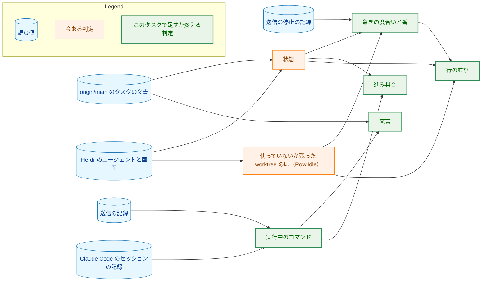
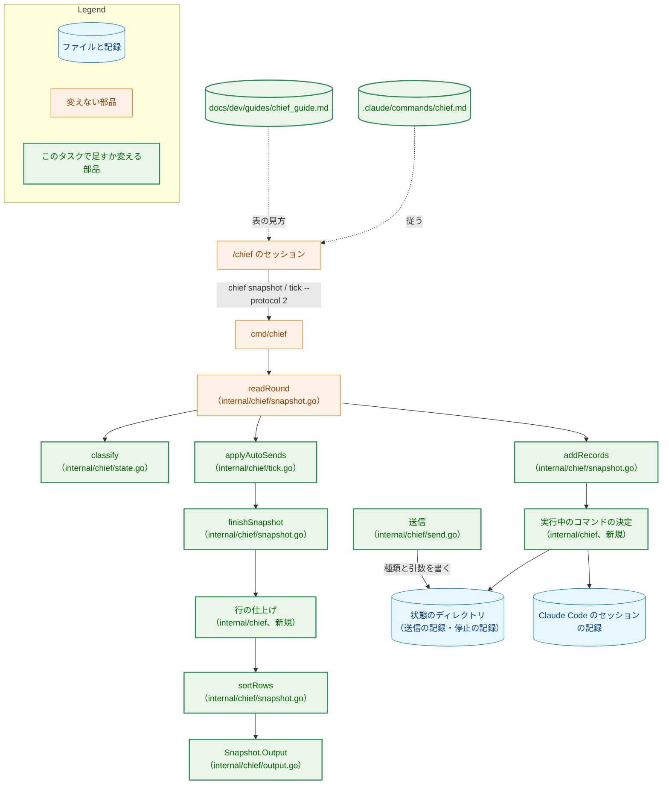
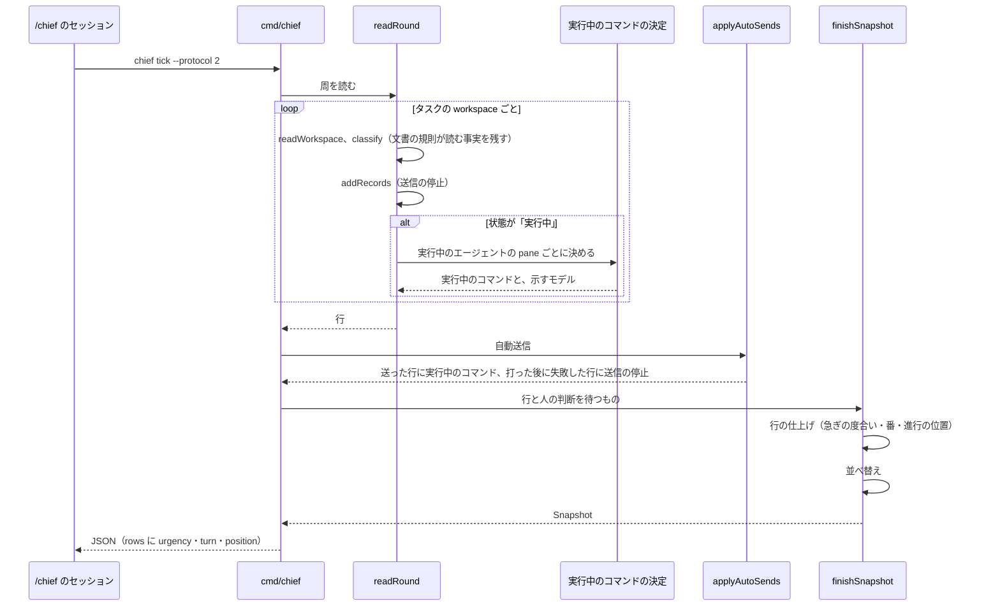
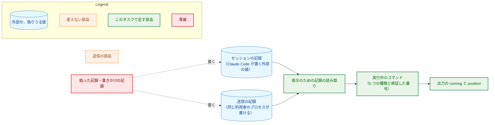
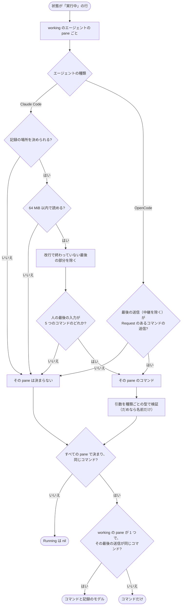
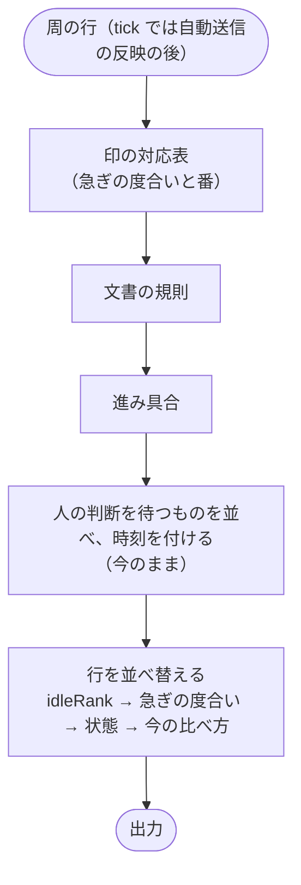

# アーキテクチャ設計書：chief の状況の表に、急ぎの度合いの印と、タスクの進行の位置とどちらの番かを示す

## Document Status

| Item | Value |
|---|---|
| Status | `draft` |
| Created | 2026-11-16 |
| Review date | - |
| Reviewer | - |
| Comments | - |

本書は [01_requirements.md](01_requirements.md)（要件定義書。以下、要件書）の設計である。「計画で決める」は、本タスクの実装計画書（`03_implementation_plan.md`）で決めることを指す。既存のファイルの内容は、コミット `bade98e3` で確かめた。`file:line` の行番号は、このコミットでの行番号である。F-NNN・AC-NN は要件書の項番を指す。0088 の項番は「0088 の AC-NN」と書く。

H-NN は [design_handoff.md](design_handoff.md)（以下、申し送り）の項番を指す。申し送りへの対応は付録 A に、受け入れ基準との対応は付録 B にまとめる。

本書は、要件書 3 章と 6 章の用語（状態・送信が止まった行・使っていないか残った worktree の行・削除の提案・急ぎの度合い・番・進行の位置・実行中のコマンド・セッションの記録）を、要件書と同じ意味で使う。0088 の設計書（[0088 設計書](../0088_chief_of_staff/02_architecture.md)）の用語（道具・`/chief` の定義・周・送信の記録・状態のディレクトリ・chief のセッション）も、同じ意味で使う。そのほかに、次の用語を使う。

-   **印の対応表:** 要件書 3.1 の対応表。行の条件から急ぎの度合いと番を決める（3.2）。
-   **文書の規則:** AC-07 の規則 1〜10。行の進行の位置の文書を決める（3.3）。
-   **行の仕上げ:** 1 つの周の中で、行の状態・送信の停止・実行中のコマンドが出そろった後に、急ぎの度合い・番・進行の位置を決めること（3.6）。道具の中で 1 か所だけにある。
-   **表示のための記録の読み取り:** 実行中のコマンドを決めるために、Claude Code のセッションの記録を読むこと（3.5）。0088 のリセットの確かめのための読み取り（`internal/chief/reset.go:51-73`）と区別する。

## 1. 設計の全体像 (Design Overview)

### 1.1. 設計原則

-   **判定は道具に置き、`/chief` の定義は示すだけにする。** 急ぎの度合い・番・進行の位置・実行中のコマンド・行の並びは、すべて道具の Go のコードが決め、テストを持つ（F-006、[ADR-0046](../../dev/adr/0046-chief-of-staff.md)・[ADR-0014](../../dev/adr/0014-deterministic-checks-in-go.md)）。`/chief` の定義は、道具が返した ASCII の値を日本語の表示に置き換え、道具の順のまま示す。
-   **表示のための読み取りは、送ることを左右しない。** 新しく読むセッションの記録と、送信の記録の新しい欄は、表に示す値にだけ使う。行の状態、送る判断、`problems` は、読めたかどうかで変わらない（要件書 4.2）。
-   **分からないものは推し量らない。** 文書が読めなければ「要確認」、実行中のコマンドが 1 つに決まらなければ「決まらない」とし、ほかの値を当てない（AC-08・AC-11・AC-12）。新しい型の 0 の値は、人を呼ぶ側か「要確認」にする（CLAUDE.md の「Declare, don't infer」）。
-   **受け付ける形を広げない。** セッションの記録は、0088 で受け付ける形の行だけを読む。示すのは、決まった 5 つのコマンドの名前と、検証した番号の引数だけである（AC-13）。
-   **決めるのは 1 か所にする。** 印の対応表と文書の規則は、それぞれ 1 つの関数に置く。行の並べ替えは、その関数の結果を使う（申し送りの H-01・H-04）。

### 1.2. 設計の際に決めたこと（2026-11-16）

-   **道具の出力の値は ASCII の列挙の名前にし、日本語の表示は `/chief` の定義が対応させる。出力を変えるので `--protocol` の番号を 1 から 2 に上げる。行の `merge_question` は出力から外す（申し送りの H-01）。** 値を ASCII にするのは、`state` などの今の出力の値とそろえ、文書のガードテストで値の集合を比べられるようにするためである。番号を上げると、古い定義と新しい道具のどちらの組み合わせも `protocol_mismatch` で止まり、印のない表を示さずに済む（`.claude/commands/chief.md:76-78`）。`merge_question` を外すのは、進み具合（「マージの確認待ち」）と問いごとの `merge` が同じことを示し、行の値を残すと、0088 の PR-7 で起きたように、セッションがその否定を文に直しうるためである（issue #890）。ADR: なし（出力の綴りと番号は、このタスクの中で閉じるため）。
-   **0092 の削除の提案の行（AC-05、AC-07 の規則 2）は、このタスクでは扱わず、0092 へ申し送る。印の対応表と文書の規則は、削除の提案の行を持たない形で作る（申し送りの H-05）。** 0092 は要件定義書だけが `main` にあり、設計書がまだない。今は削除の提案を作る部品がなく、このタスクで行の値を作っても、誰も値を入れない（CLAUDE.md の「Enforce invariants with the type」の、使われない拡張点を数える規則）。0092 の [design_handoff.md](../0092_chief_task_workspace/design_handoff.md) に H-09 を足し、0092 の設計と計画が、対応表と文書の規則に 1 行ずつ足し、AC-05 を確かめるようにする。要件書の AC-05 は「後に実装する方で確かめる」としており、これに合う。ADR: なし（実装の順はタスクの中で閉じるため）。
-   **表示のための記録の読み取りでは、改行で終わっていない最後の部分を、まだ書かれていない行として読む前に除く。改行で終わる行には、今の規則（`internal/chief/screen_transcript.go:160-189`）をそのまま当てる。リセットの確かめの読み取りは変えない（申し送りの H-06）。** 実行中の Claude Code は記録に書き足している途中でありうる。書きかけの最後の部分のために記録全体を読めないものとすると、周ごとに「作成中」と「実行中」が入れ替わる（要件書 4.3）。除くのは、まだ 1 行になっていない部分だけである。読む行は、1 つの JSON の値でない行、読むメンバーが重なる行、採取していない種類の行を、今までどおり 1 行でも含めば記録全体を読めないものとする。このため、受け付ける行の形は広がらない。除いた部分が人の入力の書きかけでも、その周に 1 つ前のコマンドを示すだけで、送信には影響しない。リセットの確かめを変えないのは、そちらはエージェントが動いていないときに読み、誤ると pane の文脈を消すためである。ADR: なし（受け付ける形と画面の読み取りの例外の範囲を変えず、表示の読み方の中で閉じるため）。
-   **HEAD が detached の worktree は、文書の規則では「タスクがない」行として扱う。`/mkreq` が実行中なら「要件定義書」、それ以外は「-」とする。** 0088 は、ブランチのない worktree について、タスクがあるともないとも決めない（[0088 設計書](../0088_chief_of_staff/02_architecture.md) の 3.1.4、`internal/chief/state.go:256-267`）。文書の列の「-」は「示せる文書がない」ことを示すだけで、タスクがないと言い切るものではない。detached の行の状態は 0088 のまま「要確認」で、使っていなければ `Row.Idle` として表の最後に並ぶ（`internal/chief/state.go:430-434`）。0092 が作る detached の worktree で `/mkreq` が走っている行は、「要件定義書」と示せる。規則 10 の「要確認」にする案は採らない。使っていない行の多くが、状態に加えて文書の列でも「要確認」になり、人がすぐ見るべき行と見分けにくくなるためである。ADR: なし（表示の細部のため）。
-   **OpenCode の pane の実行中のコマンドは、その pane への chief の最後の送信（答えの中継を除く）がコマンドの送信のときだけ、そのコマンドとする。最後の送信がリセット（`/new`）なら、決まらない。** リセットの後に OpenCode が動いているなら、人が打った何かを走らせている。リセットより前のコマンドを示すと、走っていないコマンドを示すことになる。答えの中継を除くのは、中継は走っているコマンドの質問に答えるだけで、別のコマンドを始めないためである（`internal/chief/records.go:824-839` の `LastSend` が今も中継を除く）。ADR: なし（AC-11 の読み方の細部のため）。
-   **送信の記録に、送ったコマンドの種類と引数を、宣言した欄として足す。実行中のコマンドは、この欄から決め、記録のコマンドの文字列を読み直さない。欄のない記録は、決まらないものとする。** コマンドの文字列から種類を読み取ると、呼び出し元が与えた文字列の中身で振る舞いを選ぶことになる（CLAUDE.md の「Declare, don't infer」）。欄のない、このタスクより前の記録は、次にコマンドを送るまで「決まらない」と示される。利用者は 1 人で、版の互換は要らない。ADR: なし（記録の欄の追加はこのタスクの中で閉じ、記録を表示にだけ使うことは ADR-0046 の決定に収まるため）。
-   **自動送信で送ったコマンドを打った後に確かめが失敗した行は、その周から送信が止まった行として扱う。** 送信は止める記録を作っている（`internal/chief/send.go:515`）が、今の `applyAutoSends`（`internal/chief/tick.go:79-104`）は、行の状態を「要確認」にするだけで、送信の停止を行に付けない。このままだと、その周だけ行が「🟡 あとで」になり、次の周から「🔴 すぐ」になる（AC-03）。ADR: なし（表示の細部のため）。
-   **表の印は、行の最初の列に置く。絵文字の幅による列のずれは、実地の確かめで見て、計画に確かめの手順を置く（申し送りの H-03）。** ずれが印より後ろの列だけに及ぶようにするためである。Claude Code の端末が絵文字を何文字分で描くかは、設計の時点で確かめていない。ずれても印と文字は読めるので、確かめの前に設計を決めてよいと判断した。ADR: なし（表示の細部のため）。

### 1.3. なぜ今の仕組みでは足りないか

今の道具は、行ごとに状態だけを返し（`internal/chief/output.go:27-41`）、どの行に人がすぐ答えるべきかを示さない。タスクの文書を `origin/main` から読んでいるが、どの文書の段にあるかは出力に含まない（`internal/chief/state.go:273-306`）。「実行中」の行のコマンドは送信の記録だけから示すので（`internal/chief/snapshot.go:199-214`）、人が自分で打ったコマンドは示せない。行の並べ方は状態の順だけで決まり（`internal/chief/snapshot.go:339-354`）、送信が止まった行は、その状態の位置に並ぶ。

`/chief` の定義の中で、状態から印を付ける案は、要件定義で採らなかった（要件書「要件定義の際に決めたこと」）。判定の一部がセッションに残るためである。このため、道具の判定と出力を広げる。

### 1.4. 概念モデル



矢印 A → B は、「B を決めるときに A を読む」ことを表す。文書は、`/mkreq` が実行中かどうかを見るときだけ、実行中のコマンドを読む（AC-07 の規則 3）。

## 2. システム構成 (System Structure)

### 2.1. 全体構成



実線の矢印 A → B は「A が B を呼ぶか読む」ことを、点線の矢印は「セッションが文書に従う」ことを表す。`applyAutoSends` は `tick` だけが呼び（`internal/chief/tick.go:70`）、`snapshot` は呼ばない（`internal/chief/snapshot.go:77-83`）。`chief.md` と `chief_guide.md` は、変える文書なので緑で塗る。

### 2.2. コンポーネント配置

| ファイル | 変更 | 責務 |
|---|---|---|
| `internal/chief/state.go` | 変更 | `Row` に、急ぎの度合い・番・進行の位置・示す実行中のコマンド・文書の規則が読む事実を足す。`classify` が、文書の規則が読む事実を `Row` に残す（3.3）。`Row.Running` の型を、示す実行中のコマンドに変える（3.1） |
| `internal/chief/position.go`（新規） | 新規 | 印の対応表（3.2）、文書の規則（3.3）、進み具合（3.4）、行の仕上げ（3.6）。どれも入出力を持たない関数で、`Row` だけを読む |
| `internal/chief/running.go`（新規） | 新規 | 実行中のコマンドの決定（3.5）。pane ごとに、Claude Code はセッションの記録から、OpenCode は送信の記録から決め、AC-12 の規則でまとめる。モデルを示すかも決める |
| `internal/chief/screen_transcript.go` | 変更 | 表示のための記録の読み取りの入口を足す。改行で終わっていない最後の部分を除いてから、今の `readLastHumanInput` を当てる（1.2）。`readLastHumanInput` そのものは変えない |
| `internal/chief/snapshot.go` | 変更 | `addRecords` の「実行中」の行の処理を、実行中のコマンドの決定に置き換える。`finishSnapshot` が、並べ替えの前に行の仕上げを呼ぶ。`sortRows` の並べ方に急ぎの度合いを足す（3.7） |
| `internal/chief/tick.go` | 変更 | `applyAutoSends` が、送った行に、送ったコマンドを実行中のコマンドとして付け（AC-10）、打った後に失敗した行に送信の停止を付ける（1.2） |
| `internal/chief/records.go` | 変更 | `SendRecord` に、送ったコマンドの種類と引数の欄を足す（3.5）。`Protocol` を 2 にする |
| `internal/chief/send.go` | 変更 | コマンドを送るとき、送信の記録に種類と引数を書く |
| `internal/chief/output.go` | 変更 | `RowOutput` に `urgency`・`turn`・`position` を足し、`merge_question` を外し、`running` の形を変える（3.8） |
| `.claude/commands/chief.md` | 変更 | 表の列と値の表示、「質問で停止」の行の「次」の列、表の下の一覧から質問の要点を外すこと、`--protocol 2`（3.9） |
| `docs/dev/guides/chief_guide.md` | 変更 | 表の見方（印・番・進行の位置・並び）を足し、`--protocol` の番号の記述を 2 にする（3.10） |
| `cmd/chief/docs_test.go` | 変更 | `/chief` の定義の値の対応表が、道具の値の集合と一致することを確かめるテストを足す（7 章） |
| `internal/chief/*_test.go` | 変更 | 3.11 の既存のテストを直し、新しいテストを足す |
| `internal/chief/testdata/transcript/` | 変更 | 改行で終わっていない最後の部分を持つ記録のサンプルを足す。採取した記録の末尾を切って作る（7 章） |
| `docs/tasks/0092_chief_task_workspace/design_handoff.md` | 変更 | H-09 を足す（1.2、3.12） |

`docs/dev/adr/0046-chief-of-staff.md` は、要件定義の PR（#909）で、このタスクの決定をすでに足している。本書の決定は、どれも ADR-0046 の決定の範囲に収まるので、ADR は変えない。

### 2.3. データフロー

`chief tick` の 1 周を示す。`chief snapshot` は、自動送信の段（`applyAutoSends`）を除いて同じである。



## 3. コンポーネント設計 (Component Design)

### 3.1. 型

```go
// Urgency is how soon the human should act on a row (F-001). The zero value
// is UrgencyNow, the reading that calls the human.
type Urgency int

const (
	UrgencyNow   Urgency = iota // output "now": 🔴 すぐ
	UrgencyLater                // output "later": 🟡 あとで
	UrgencyWait                 // output "wait": 🟢 待つ
)

// Turn is who moves next on a row (F-002). The zero value is TurnHuman.
type Turn int

const (
	TurnHuman Turn = iota // output "human": 人
	TurnAI                // output "ai": AI
	TurnNone              // output "none": なし
)

// PlaceDocument is the document part of a task's position (AC-07). The zero
// value is PlaceNeedsCheck, the reading that assumes least.
type PlaceDocument int

const (
	PlaceNeedsCheck   PlaceDocument = iota // output "needs_check": 要確認
	PlaceNoTask                            // output "no_task": -
	PlaceRequirements                      // output "requirements": 要件定義書
	PlaceArchitecture                      // output "architecture": 設計書
	PlacePlan                              // output "plan": 計画書
	PlacePlanPR                            // output "plan_pr": PR-N
	PlaceNone                              // output "none": なし
)

// Progress is the progress part of a task's position (AC-09). The zero value
// is ProgressNeedsCheck.
type Progress int

const (
	ProgressNeedsCheck        Progress = iota // output "needs_check": 要確認
	ProgressAwaitingCreation                  // output "awaiting_creation": 作成待ち
	ProgressCreating                          // output "creating": 作成中
	ProgressRunprRunning                      // output "runpr_running": /runpr 実行中
	ProgressRunning                           // output "running": 実行中
	ProgressMergeConfirmation                 // output "merge_confirmation": マージの確認待ち
	ProgressQuestion                          // output "question": 質問で停止
	ProgressAwaitingReview                    // output "awaiting_review": レビュー待ち
	ProgressTaskDone                          // output "task_done": タスク完了
)

// Position is a task's position: the document and the progress (F-003).
type Position struct {
	Document PlaceDocument
	// PlanPR is N of PR-N, set only when Document is PlacePlanPR.
	PlanPR   int
	Progress Progress
}

// RunningCommand is the command a running row's agents run (AC-11, AC-12).
// The zero value (Kind CommandUnknown) is a command that is not decided.
type RunningCommand struct {
	// Kind is one of the five task commands.
	Kind paneinput.CommandKind
	// Arg is the task, issue, or PR number in the form chief accepts for
	// Kind, "" when the command had none of that form (AC-13).
	Arg string
}

// RunningShown is what a running row shows (AC-14): the command, and the
// model of chief's send record only when AC-14's conditions hold ("" else).
type RunningShown struct {
	Command RunningCommand
	Model   string
}
```

`Row` には次を足す。`Running` は、今の `*SendRecord`（`internal/chief/state.go:131-133`）から `*RunningShown` に変える。`nil` は、実行中のコマンドが決まらないか、行が「実行中」でないことを表す。

```go
type Row struct {
	// ... the existing fields, with Running changed as below ...
	Running  *RunningShown
	Urgency  Urgency
	Turn     Turn
	Position Position
	// place is what the document rule reads (3.3), kept by classify.
	place placeFacts
}
```

`placeFacts` は、文書の規則が読む `origin/main` の事実（読めたか、タスクの有無と HEAD の種類、各文書の状態、計画書の PR の進み）を持つ、パッケージの外に出ない型である。中身は計画で決める。

`SendRecord`（`internal/chief/records.go:658-667`）に、次の 2 つの欄を足す。

```go
type SendRecord struct {
	// ... the existing fields ...
	// Request is the request name of the command sent (requestNames), set
	// only for a command input; "" on older records and other inputs.
	Request string `json:"request"`
	// Arg is the command's validated argument, "" when it has none.
	Arg string `json:"arg"`
}
```

### 3.2. 印の対応表

印の対応表は、`Row` から `(Urgency, Turn)` を返す 1 つの関数に置く。要件書 3.1 の表の上から順に、最初に当たる行のものを返す（AC-02）。

| 順 | 行の条件（`Row` の値） | 急ぎの度合い | 番 |
|---|---|---|---|
| 1 | `Stopped != nil`（送信が止まった行） | `UrgencyNow` | `TurnHuman` |
| 2 | `State == StateQuestion`（マージの確認を含む） | `UrgencyNow` | `TurnHuman` |
| 3 | `Idle`（使っていないか残った worktree の行） | `UrgencyWait` | `TurnNone` |
| 4 | `State` が `StateAwaitingReview`・`StateProposeNext`・`StateNeedsCheck` | `UrgencyLater` | `TurnHuman` |
| 5 | `State == StateRunning` | `UrgencyWait` | `TurnAI` |
| 6 | `State == StateTaskDone` | `UrgencyWait` | `TurnNone` |

-   要件書 3.1 の表の 3 行目（削除の提案がある「タスク完了」の行）は持たない。0092 が順 3 の前に足す（1.2、3.12）。
-   どの行にも当たらないのは、`State` が 6 つの状態のどれでもないときだけである。そのときは 0 の値（`UrgencyNow`・`TurnHuman`）を返す。`WorkspaceState` の値は 6 つで（`internal/chief/state.go:13-27`）、これは起こらない。テストで、6 つの状態と `Stopped`・`Idle` の組み合わせのすべてが順 1〜6 のどれかに当たることを確かめる（AC-02）。
-   `Idle` は、送信が止まった行と送信の停止を読めない行には付かない（`internal/chief/snapshot.go:174-188`）。質問で止まった行にも付かない（`internal/chief/state.go:426-443` で `Idle` を付けるのは、「次を提案」と、`decideNext` が次のコマンドを決めない「要確認」だけ）。このため、順 1・2 と順 3 は同じ行に当たらない。
-   AC-04 の「読めなかった理由から、別の度合いを推し量らない」は、`Unreadable` を読まないことで満たす。

### 3.3. 文書の規則

文書の規則は、`Row` の `place` と `Running` から `(PlaceDocument, PlanPR)` を返す 1 つの関数に置く。`classify` は、`decideNext`（`internal/chief/state.go:273-306`）と同じ `workspaceFacts` から、次の値を `place` に残す。

| AC-07 の規則 | 道具が確かめる値 | 文書 |
|---|---|---|
| 1 | `FetchFailed` が真か、`Unreadable` に `origin/main` のタスクの文書（`internal/chief/snapshot.go:259-264`）がある | `PlaceNeedsCheck` |
| 2 | （削除の提案。このタスクでは持たない。3.12） | - |
| 3 | タスクがない（HEAD が detached か、機能ブランチの命名に合わないブランチ）で、ブランチにあるか、実行中のコマンドが `/mkreq` | `PlaceRequirements` |
| 4 | タスクがない（HEAD が detached で、実行中のコマンドが `/mkreq` でない） | `PlaceNoTask` |
| 5 | タスクがあり、`origin/main` にタスクのディレクトリか要件定義書がない | `PlaceRequirements` |
| 6 | 計画書が `approved` で `Plan.Done()` が真 | `PlaceNone` |
| 7 | 計画書が `approved` | `PlacePlanPR`、`PlanPR` は `Merged` でない最初の PR の番号（PR マーカーのない計画書は 1） |
| 8 | 設計書が `approved` で、計画書がない | `PlacePlan` |
| 9 | 要件定義書が `approved`、進め方が `full` か記録なしで、設計書がない | `PlaceArchitecture` |
| 10 | 上のどれにも当たらない（HEAD を読めない、ブランチを読めない、`approved` でない文書がある、進め方の記録が読めない、簡易な進め方なのに設計書か計画書がない、など） | `PlaceNeedsCheck` |

-   **規則 3 の「ブランチにある」。** 機能ブランチの命名に合わないブランチにある worktree は、`decideNext` が必ず `/mkreq` を返す（`internal/chief/state.go:277-279`）。要件書の「次のコマンドが `/mkreq` である」は、この場合を指す。行の状態が「質問で停止」などで次のコマンドを示さないときも、同じ規則で「要件定義書」とする。
-   **規則 7 の N。** `Plan.PRs` は、計画書の PR マーカーの順に `Target`（マーカーの番号）と `Merged` を持つ（`internal/chief/task.go:483-504`）。`origin/main` の計画書では、PR を作って開いている間は「PR を作成した」も「PR がマージされた」も済んでいない。PR のブランチで済ませた印は、マージで `origin/main` に入るためである。このため、`Merged` でない最初の PR は、開いている PR があればその PR、なければ次の `/runplan` が作る PR になり、AC-07 の規則 7 の注に合う。`Target` が `single`（PR マーカーのない計画書）のときは 1 とする。`Target` が数として読めないときは、規則 10 の「要確認」とする。
-   **ブランチと HEAD。** ブランチを読めない行（`internal/chief/snapshot.go:241-245`）は、HEAD を読めないものとして規則 10 にする。detached は、1.2 の決定で、タスクがない行として規則 3・4 に当てる。
-   **状態は変えない（AC-08）。** 文書の規則は `Row.State` を読まず、変えない。状態が「要確認」の行でも、文書が読めていれば文書を示す。逆に、文書が「要確認」でも、状態は `classify` のままである。

### 3.4. 進み具合

進み具合は、`Row.State`・`Row.Running`・`Row.Questions` から、AC-09 の表のとおりに決める。

| 状態 | 条件 | 進み具合 |
|---|---|---|
| 次を提案 | - | `ProgressAwaitingCreation` |
| 実行中 | 実行中のコマンドが `/mkreq`・`/mkarch`・`/mkplan`・`/runplan` | `ProgressCreating` |
| 実行中 | 実行中のコマンドが `/runpr` | `ProgressRunprRunning` |
| 実行中 | 実行中のコマンドが決まらない（`Running == nil`） | `ProgressRunning` |
| 質問で停止 | すべての問いがマージの確認（`mergeOnlyRank` と同じ条件、`internal/chief/snapshot.go:308-313`） | `ProgressMergeConfirmation` |
| 質問で停止 | マージの確認でない問いが 1 つ以上ある | `ProgressQuestion` |
| レビュー待ち | - | `ProgressAwaitingReview` |
| タスク完了 | - | `ProgressTaskDone` |
| 要確認、その他 | - | `ProgressNeedsCheck` |

送信が止まった行も、進み具合はその行の状態から決める（要件書の「要件定義の際に決めたこと」の、送信が止まった行の項）。

### 3.5. 実行中のコマンド

状態が「実行中」の行についてだけ決める。ほかの状態の行では、`Running` は `nil` である。

**pane ごとの決め方（AC-11）。** Herdr で `working` のエージェントの pane ごとに、次のどちらかで決める。画面は読まない。

-   **Claude Code の pane。** 記録の場所は、リセットの確かめと同じ `transcriptPath`（`internal/chief/transcript.go:53-69`）で、pane の作業ディレクトリとセッションの識別から決める。読む量の上限は、今の `resetTranscriptLimit`（64 MiB、`internal/chief/transcript.go:30`）とし、超えた記録は読めないものとする（要件書 4.2）。読んだ内容から、改行で終わっていない最後の部分を除き（1.2）、`readLastHumanInput`（`internal/chief/screen_transcript.go:170-189`）を当てる。結果が `HumanInputCommand` で、名前が `mkreq`・`mkarch`・`mkplan`・`runplan`・`runpr` のどれかのとき、そのコマンドとする。それ以外（自由な文、ほかの名前のコマンド、人の入力がない、読めない、場所を決められない）は、決まらない。
-   **OpenCode の pane。** `LastSend`（`internal/chief/records.go:824-839`）で、その pane への最後の送信（答えの中継を除く）を読む。それがコマンドの送信（`Input` が `command`）で、`Request` が 5 つのコマンドのどれかを名指すとき、そのコマンドとする。リセット、欄のない古い記録、記録がないとき、記録を読めないときは、決まらない（1.2）。

**引数（AC-13）。** 引数は、コマンドの種類ごとに、0088 で受け付ける形の値として検証できるときだけ `Arg` に入れる。`/mkreq` は issue 番号（`paneinput.ParseIssueNumber`）、`/mkarch`・`/mkplan`・`/runplan` はタスクの番号（`paneinput.ParseTaskID`）、`/runpr` は PR の番号（`fixprguard` の PR 番号の型）である。検証できない引数と空の引数は、`Arg` を空にして、コマンドの名前だけを示す。セッションの記録と送信の記録の文字列は、そのまま出力に入れない。

**まとめ方（AC-12）。** 実行中のエージェントが 2 つ以上あるときは、すべての pane でコマンドが決まり、それらの種類と引数が同じときだけ、そのコマンドとする。それ以外は決まらない。

**モデル（AC-14）。** 実行中のエージェントがちょうど 1 つで、その pane への chief の最後の送信（上と同じ `LastSend`）がコマンドの送信で、その `Request` と `Arg` が実行中のコマンドと同じとき、その記録の `Model` を示す。それ以外はモデルを示さない（空）。Claude Code の pane で、chief が送ったコマンドを人がもう一度打ったときも、記録のモデルを示す。人がその間にモデルを切り替えていれば、示すモデルは古い。これは AC-14 のとおりで、受け入れる。

**失敗のとき（申し送りの H-02）。** 記録の場所を決められない、記録を読めない、記録の形が合わないのどれでも、その pane のコマンドは決まらない。`Row.State`・`Row.Unreadable`・`problems`・送る判断は変えない。リセットの確かめと違い、`unsupported_path` などの理由は出力に出さない。表示のための読み取りが失敗しても、人の対応は要らないためである。

**自動送信の周（AC-10、申し送りの H-04）。** `applyAutoSends` は、自動送信が送った行に、送ったコマンドの種類と引数を実行中のコマンドとして付け、送ったモデルを示す（今の `internal/chief/tick.go:94-95` の書き換えを置き換える）。その周の読み取りは送る前に行ったので、セッションの記録は、まだ送ったコマンドを持たないためである。打った後に確かめが失敗した行には、状態の書き換え（`internal/chief/tick.go:96-98`）に加えて、送信の停止を付ける（1.2）。

### 3.6. 行の仕上げ

`finishSnapshot`（`internal/chief/snapshot.go:148-160`）は、人の判断を待つものを並べる前に、すべての行について、3.2 の印の対応表、3.3 の文書の規則、3.4 の進み具合を 1 回ずつ当て、`Urgency`・`Turn`・`Position` を入れる。`snapshot` と `tick` はどちらも `finishSnapshot` を通るので、ここが行の値を決める唯一の場所になる。`tick` では、`applyAutoSends` が行の状態・実行中のコマンド・送信の停止を書き換えた後に呼ばれるので、同じ行が「作成待ち」と「実行中」を同時に示すことはない（申し送りの H-04）。

### 3.7. 並べ方

`sortRows`（`internal/chief/snapshot.go:339-354`）の比べる順を、次のとおりにする。

1.  `idleRank`（使っていないか残った worktree の行を最後に。今のまま）
2.  急ぎの度合い（`UrgencyNow` → `UrgencyLater` → `UrgencyWait`）。新しく足す
3.  状態の順 `stateOrder`（`internal/chief/state.go:58`、今のまま）
4.  `mergeOnlyRank`、最初に見つけた時刻、workspace のパス（今のまま）

使っていないか残った worktree の行は、印の対応表で必ず `UrgencyWait` になる（3.2 の順 3）。このため、1 と 2 を入れ替えても結果は同じだが、AC-15 の「ほかのすべての行の後」を直接表すため、`idleRank` を先に置く。同じ急ぎの度合いの中は、今の比べ方がそのまま決める（AC-16）。今の並びと違うのは、送信が止まった行が「すぐ」の位置へ移ることだけである。たとえば、送信が止まった「実行中」の行は、今は「要確認」の行の後だが、「質問で停止」の行のすぐ後に並ぶ。人の判断を待つものの並べ方（`sortPending`）は変えない（AC-17）。

### 3.8. 出力の形と `--protocol`

`RowOutput`（`internal/chief/output.go:27-41`）を、次のとおりにする（申し送りの H-01）。

```go
type RowOutput struct {
	// ... the existing fields, without MergeQuestion ...
	Urgency  string         `json:"urgency"`  // "now" | "later" | "wait"
	Turn     string         `json:"turn"`     // "human" | "ai" | "none"
	Position PositionOutput `json:"position"`
	Running  *RunningOutput `json:"running"`  // null when no command is decided
}

// PositionOutput is a row's position.
type PositionOutput struct {
	// Document is "needs_check", "no_task", "requirements", "architecture",
	// "plan", "plan_pr", or "none".
	Document string `json:"document"`
	// PlanPR is N of PR-N when Document is "plan_pr", 0 otherwise.
	PlanPR int `json:"plan_pr"`
	// Progress is "needs_check", "awaiting_creation", "creating",
	// "runpr_running", "running", "merge_confirmation", "question",
	// "awaiting_review", or "task_done".
	Progress string `json:"progress"`
}

// RunningOutput is the running command of a running row and, when AC-14's
// conditions hold, the model of chief's send record ("" otherwise).
type RunningOutput struct {
	// Command is the command line, such as "/runplan 0093", or the name
	// alone, such as "/runpr", when it had no argument of the accepted form.
	Command string `json:"command"`
	Model   string `json:"model"`
}
```

-   値の名前は、型ごとの `String` か名前の表から作る。どの型も、表にない値は `unknown` と出す。今の `state` の出し方（`internal/chief/state.go:31-45`）と同じである。
-   今の `RunningOutput` の `pane`・`agent`・`started` は外す。2 つ以上の pane のコマンドをまとめるので、1 つの pane を示せないためである。`/chief` の定義は、今も `running` のコマンドとモデルしか示さない（`.claude/commands/chief.md:132`）。
-   問いごとの `merge`（`QuestionOutput.Merge`）は残す。「質問で停止」の行の「次」の列で、マージの確認である問いに、そのことを添えるのに使う（AC-18）。
-   `Protocol`（`internal/chief/records.go:28`）を 2 にする。`chief.md` と `chief_guide.md` の番号は、今のガードテスト（`cmd/chief/docs_test.go:201-213`・`:399-443`）が道具の値と比べる。
-   `tick` の出力は `SnapshotOutput` を埋め込む（`internal/chief/output.go:422-425`）ので、同じ形になる（AC-20）。

### 3.9. `/chief` の定義（`.claude/commands/chief.md`）

-   すべての `--protocol 1` を `--protocol 2` にする。
-   「2. One round」の表を、次の列の Markdown の表にする。印の列を最初に置く（申し送りの H-03）。
    | 列 | 中身 |
    |---|---|
    | 急ぎ | `urgency` を `now` 🔴 すぐ、`later` 🟡 あとで、`wait` 🟢 待つ と示す |
    | 名前 | `label` |
    | タスク | `task`、空なら なし |
    | 状態 | 今の対応（`.claude/commands/chief.md:125-128`） |
    | 番 | `turn` を `human` 人、`ai` AI、`none` なし と示す |
    | 文書 | `position.document` を、`needs_check` 要確認、`no_task` -、`requirements` 要件定義書、`architecture` 設計書、`plan` 計画書、`plan_pr` PR-`plan_pr`、`none` なし と示す |
    | 進み具合 | `position.progress` を、`needs_check` 要確認、`awaiting_creation` 作成待ち、`creating` 作成中、`runpr_running` `/runpr` 実行中、`running` 実行中、`merge_confirmation` マージの確認待ち、`question` 質問で停止、`awaiting_review` レビュー待ち、`task_done` タスク完了 と示す |
    | 次 | 下の項目 |
-   値の対応は、定義の中の 1 つの表に置く。表にない値は、書かれたままの値に「（定義にない値）」を添えて示し、自分で意味を推し量らない。`--protocol` の照合があるので、ふつうは起こらない。
-   「次」の列のうち、「質問で停止」の行は、`questions` の問いごとに、質問の要点と pane を書き、`merge` が真の問いには「マージの確認」と添える。マージの確認でないことを、文にして書かない（AC-18）。「実行中」の行は、`running` が `null` でなければ、そのコマンドと、`model` が空でなければモデルを書く。`running` が `null` なら、何も書かない（AC-14）。ほかの状態の行は、今のまま。
-   表の下から、「質問で停止」の行ごとの質問の要点と pane の一覧を外す。まだ答えのない問いと `problems` は残す（AC-19）。
-   「行は道具の順のまま示し、並べ替えない。急ぎの度合い・番・進行の位置は道具の値をそのまま示し、状態などから自分で決めない」と書く（AC-21）。表の示し方は、引数のない場合と `once` の場合で同じ「2. One round」を使うので、両方に効く（AC-22）。

### 3.10. chief 利用ガイド（`docs/dev/guides/chief_guide.md`）

「3. 使い方」に、表の見方を足す。印の 3 つの意味と、対応表（要件書 3.1）の要点、番の 3 つの意味、進行の位置の文書と進み具合の読み方、行の並び（すぐ → あとで → 待つ、使っていないか残った worktree の行は最後）を書く。「実行中」の行のコマンドが、Claude Code の pane ではセッションの記録の人の最後のコマンドから、OpenCode の pane では chief の送信の記録から決まり、決まらなければ示されないことも書く。「8. 既知の制限」に、OpenCode の pane で人が打ったコマンドは示されないこと（ADR-0046 の「結果」）を足す。`--protocol` の番号の記述を 2 にする。

### 3.11. 既存のテストと 0088 の決まりへの影響

このタスクは、0088 の次の決まりを変える。変えることは要件書 5 章で決まっている。

| 0088 の決まり | 置かれている場所 | 変える内容 | 古い振る舞いを確かめているテスト |
|---|---|---|---|
| AC-02: 「実行中」の行のコマンドとモデルを送信の記録だけから示す | 0088 設計書 3.1.4、`internal/chief/snapshot.go:199-214` | 3.5 の規則に変える | `TestRunningRowShowsTheLastSend`（`internal/chief/snapshot_test.go:537`）、`relay_test.go:471-473`、`autosend_test.go:227`。どれも `Row.Running.Command` を送信の記録の文字列として比べている。新しい型で書き直す |
| AC-02: 「質問で停止」の行がマージの確認かどうかを持つ | 0088 設計書 3.1.4、`internal/chief/output.go:35` | 出力の `merge_question` を外す。`Row.MergeQuestion` は並べ方と人の判断を待つもののために残す | `snapshot_test.go` の `MergeQuestion` を比べる箇所。`Row` の値を比べている箇所は残り、出力の値を比べている箇所があれば直す |
| AC-03: 行を状態の順に並べる | 0088 設計書 3.1.4、`internal/chief/snapshot.go:339-354` | 急ぎの度合いを先に比べる | `TestTakeSnapshotOrder`（`snapshot_test.go:336`）と `TestRowOrderRules`（`snapshot_test.go:467`）は、送信が止まった行を含まないので、期待する順は変わらない。送信が止まった行の位置は新しいテストで確かめる |
| AC-05: 「質問で停止」の行の質問の要点と pane を表の下に示す | `.claude/commands/chief.md:140` | 「次」の列に移す | なし（文書の文で、PR のレビューで読む） |

`--protocol` の番号を確かめる `TestDocumentedProtocolMatches` と `TestGuideValuesMatchTool` は、定数を読むので、テストは変えず、文書の番号を直す。

### 3.12. 0092 への申し送り

0092 の `design_handoff.md` に H-09 を足す（2.2）。内容は、削除の提案がある行を `Row.Idle` に当てないこと、印の対応表の順 3 の前に「あとで」・人の行を足すこと、文書の規則の規則 2 を足すこと、AC-05・AC-07 の規則 2・AC-15 を 0092 の計画書で確かめることである。

## 4. エラーハンドリング設計 (Error Handling Design)

新しいエラーの型と、拒否の理由は足さない。表示のための読み取りの失敗は、すべて値で表し、周を失敗させない。

| 起きること | 結果 | 変えないもの |
|---|---|---|
| `git fetch origin main` の失敗、タスクの文書を読めない | 文書は `PlaceNeedsCheck` | 行の状態（今のまま「要確認」になる場合を含めて 0088 のとおり） |
| HEAD・ブランチを読めない | 文書は `PlaceNeedsCheck` | 同上 |
| 計画書の PR マーカーの番号が数として読めない | 文書は `PlaceNeedsCheck` | 同上 |
| Claude Code の記録の場所を決められない、読めない、64 MiB を超える、形が合わない行がある | その pane の実行中のコマンドは決まらない | 行の状態、`unreadable`、`problems`、送る判断 |
| 送信の記録を読めない | その pane の実行中のコマンドは決まらない。送信の停止の記録を読めないときの扱い（`internal/chief/snapshot.go:170-174`、`problems` に出る）は今のまま | 同上 |
| 道具の値が `/chief` の定義の対応表にない | 定義は、値を書かれたまま示し、定義にない値であることを添える | セッションは意味を推し量らない |

`problems` の文は今のまま英語である。新しい文は足さない。

## 5. セキュリティ考慮事項 (Security Considerations)

### 5.1. 製品

N/A。製品（ブラウザ拡張と CLI）は変えない。条件付きのガイド（`docs/dev/security.md`）の適用条件に当たらない（要件書 4.2）。

### 5.2. 開発の道具の信頼の境界

送る入力の範囲と、送る判断の条件は変えない。急ぎの度合い・番・進行の位置・実行中のコマンドは、`Row` の表示の値にだけ入り、送信の部品（`send.go`・`autosend.go`・`relay.go`・`reset.go`）はこれらを読まない。



実線の矢印 A → B は「B が A を読む」ことを、点線の矢印は脅威が値を書くことを表す。送信の部品へ向かう矢印はない。表示の値が送ることに働かないことを示すため、送信の部品を図に置く。

| 脅威 | 守り |
|---|---|
| 偽ったか壊れたセッションの記録で、表に任意の文字列を出させる | 出力に入るのは、決まった 5 つの種類の名前と、型で検証した番号だけである（AC-13）。記録の文字列は出力に入らない |
| 偽った記録で、走っていないコマンドを表に示させる | 表示だけに影響し、送る判断は変わらない。人の判断の材料として誤りうることは、ADR-0046 の「結果」の、記録を同じ利用者のプロセスが書けるという残る危険と同じ範囲にある |
| 書きかけの最後の部分を飛ばすことで、人の入力でありうる行を飛ばす | 除くのは改行で終わっていない最後の部分だけである。改行で終わる行は、今の規則で、1 行でも形が合わなければ記録全体を読めないものとする。リセットの確かめは除かない（1.2） |
| 大きな記録で周を遅らせる | 読む量の上限は今の 64 MiB のままで、超えた記録は読めないものとする。読むのは「実行中」の行の、`working` の Claude Code の pane だけである |
| FIFO などで読み取りを止める | 今の `openTranscript`（`internal/chief/transcript.go:101-121`）をそのまま使い、通常のファイルでなければ読めないものとする |

CLAUDE.md の「Declare, don't infer」の chief の画面の読み取りの例外の範囲（人の最後のコマンド）は広げない。行が人の入力であるかは、Claude Code が宣言する値で見分ける今の規則のままである。送信の記録からは、宣言した欄（`Request`・`Arg`）だけを読み、コマンドの文字列を読み直さない（1.2）。

## 6. 処理フローの詳細 (Processing Flow Details)

### 6.1. 実行中のコマンドの決定



### 6.2. 行の仕上げと並べ替え



## 7. テスト戦略 (Test Strategy)

### 7.1. 単体テスト

-   **印の対応表（AC-01〜AC-04）。** 6 つの状態と、`Stopped` の有無、`Idle` の有無の組み合わせのすべてについて、急ぎの度合いと番を表で確かめる。どの組み合わせも順 1〜6 のどれかに当たることを確かめる（AC-02）。`Idle` は実際には一部の状態にしか付かないが、対応表の関数は `Row` を受け取るので、すべての組み合わせを渡せる。
-   **文書の規則（AC-07・AC-08）。** 規則 1・3〜10 のそれぞれについて、その規則だけに当たる `workspaceFacts` を作り、文書を確かめる。規則 7 は、PR マーカーのある計画書の 3 つの段（最初の PR の前、PR を作った後でマージの前、途中の PR）と、PR マーカーのない計画書を、`internal/chief/testdata/plans/` の今のサンプルで確かめる。状態が「要確認」の行で文書が読めることと、文書が「要確認」の行で状態が変わらないことを確かめる（AC-08）。
-   **進み具合（AC-09）。** 表の各行を確かめる。
-   **実行中のコマンド（AC-11〜AC-14）。** Claude Code の pane は、`internal/chief/testdata/transcript/` の今のサンプル（人のコマンド、自由な文、途中の入力）と、改行で終わっていない最後の部分を持つ新しいサンプルで確かめる。新しいサンプルは、採取した記録の最後の行の途中で切って作る。改行で終わっていない最後の部分を除かないと読めないものになることを、先に確かめる（CLAUDE.md の「A layered path needs inputs only one layer can handle」）。OpenCode の pane は、コマンドの送信、リセット、中継、欄のない古い記録で確かめる。2 つの pane が同じコマンド、違うコマンド、片方が決まらない場合（AC-12）、検証できない引数（AC-13）、モデルを示す条件（AC-14）を確かめる。記録を読めないときに、行の状態・`unreadable`・`problems` が変わらないことを確かめる（申し送りの H-02）。
-   **リセットの確かめが変わらないこと。** 改行で終わっていない最後の部分を持つサンプルを、リセットの確かめが今までどおり読めないものとすることを確かめる。
-   **自動送信の周（AC-10）。** `tick` で自動送信を送った行が、送ったコマンドを実行中のコマンドとし、進み具合が「作成中」になることを確かめる。打った後に失敗した行が、その周から「🔴 すぐ」になることを確かめる。
-   **並べ方（AC-15〜AC-17）。** 送信が止まった「実行中」の行と「レビュー待ち」の行が、「すぐ」の位置へ移ることを確かめる。使っていないか残った worktree の行が最後に並ぶことと、人の判断を待つものの順が変わらないことは、今の `TestRowOrderRules` が確かめ続ける。
-   **出力（AC-20）。** `snapshot` と `tick` の JSON が、行ごとに `urgency`・`turn`・`position` を持ち、`merge_question` を持たないことを確かめる。

テストは、確かめる部品を壊して落ちることを確かめてからコミットする（CLAUDE.md の「Every test must be able to fail for its stated reason」）。

### 7.2. 文書のガードテスト

`cmd/chief/docs_test.go` に、`/chief` の定義の値の対応表（3.9）が、道具が出しうる `urgency`・`turn`・`position.document`・`position.progress` の値の集合をちょうど持つことを確かめるテストを足す。値と構造を比べるテストで、文の意味は比べない（CLAUDE.md の「Document tests check values, structure, and executable examples」）。`--protocol` の番号は、今のテストが確かめる。

### 7.3. 手で確かめること

-   `/chief` の定義の文（AC-18・AC-19・AC-21・AC-22）は、PR のレビューで読む。
-   実地の確かめ: Herdr の上で `/chief` と `/chief once` を走らせ、印の列のずれ（申し送りの H-03）、各列の値、「質問で停止」の行の「次」の列、送信が止まった行の位置を見る。Claude Code の pane で人が打ったコマンドが「作成中」と示されることも見る。

## 8. 実装の優先順位 (Implementation Priorities)

1.  型と、入出力を持たない判定（印の対応表、文書の規則、進み具合）。`classify` が文書の規則の事実を残すまで。
2.  実行中のコマンドの決定（表示のための記録の読み取り、送信の記録の新しい欄、まとめ方とモデル）。
3.  行の仕上げ、並べ替え、自動送信の周の反映、出力と `--protocol`。
4.  `/chief` の定義、chief 利用ガイド、文書のガードテスト、0092 の申し送りの確認。
5.  実地の確かめ。

PR の切り方は計画で決める。1〜3 は道具の振る舞いで、`--protocol` を上げる PR と `/chief` の定義を変える PR は同じ PR にする。番号を上げた道具と古い定義が `main` に並ぶと、`make install-chief` の後に `/chief` が `protocol_mismatch` で止まるためである。

## 9. 将来の拡張 (Future Extensibility)

-   0092 の削除の提案は、印の対応表と文書の規則に 1 行ずつ足すだけで入る（3.12）。
-   OpenCode がセッションの記録を持つようになれば、OpenCode の pane も、送信の記録の代わりに人の最後の入力から決められる。そのときは、実際の記録のサンプルを採ってから読み取りを足す。
-   印の対応表を変えるには、対応表の関数と、`/chief` の定義の表示の対応表を直す。値の集合が変わるときは、文書のガードテストが食い違いを見つける。

## 付録 A: 申し送りへの対応

| 項目 | 対応 |
|---|---|
| H-01 | 値は ASCII の列挙の名前、日本語の表示は `/chief` の定義の 1 つの表、`--protocol` を 2 に上げる。対応表は 1 つの関数に置き、並べ替えはその結果を使う。定義が知らない値は、書かれたまま示す（1.2、3.2、3.8、3.9） |
| H-02 | 候補どおり。記録を見つけられないときは「決まらない」とし、行の状態、`problems`、送る判断を変えない（3.5、4 章） |
| H-03 | 印を最初の列に置き、ずれは実地の確かめで見る（1.2、3.9、7.3） |
| H-04 | 候補どおり。`finishSnapshot` の中で、自動送信の反映の後に 1 か所で決め、その後に並べ替える（3.5、3.6） |
| H-05 | 0092 へ申し送る。このタスクの対応表と文書の規則は、削除の提案の行を持たない。0092 の `design_handoff.md` に H-09 を足す（1.2、3.12） |
| H-06 | 表示のための記録の読み取りだけ、改行で終わっていない最後の部分を除く。改行で終わる行の規則とリセットの確かめは変えない（1.2、3.5、5.2） |

## 付録 B: 受け入れ基準との対応

| AC | 設計 | 確かめ方 |
|---|---|---|
| AC-01 | 3.1（`Urgency`）、3.9（印の表示） | 単体テスト、文書のガードテスト、実地の確かめ |
| AC-02 | 3.2 | 単体テスト（すべての組み合わせ） |
| AC-03 | 3.2 の順 1 | 単体テスト |
| AC-04 | 3.2 の順 4 | 単体テスト |
| AC-05 | 0092 へ申し送る（1.2、3.12） | 0092 の計画書で確かめる |
| AC-06 | 3.1（`Turn`）、3.2 | 単体テスト |
| AC-07 | 3.3（規則 2 は 0092） | 単体テスト |
| AC-08 | 3.3 の「状態は変えない」 | 単体テスト |
| AC-09 | 3.4 | 単体テスト |
| AC-10 | 3.5 の「自動送信の周」、3.6 | 単体テスト（`tick`） |
| AC-11 | 3.5 の「pane ごとの決め方」 | 単体テスト（サンプル） |
| AC-12 | 3.5 の「まとめ方」 | 単体テスト |
| AC-13 | 3.5 の「引数」、5.2 | 単体テスト |
| AC-14 | 3.5 の「モデル」、3.9 | 単体テスト、PR のレビュー |
| AC-15 | 3.7 | 単体テスト（削除の提案の行は 0092） |
| AC-16 | 3.7 | 単体テスト、今の `TestRowOrderRules` |
| AC-17 | 3.7 | 今の `TestRowOrderRules`・`TestTakeSnapshotOrder` |
| AC-18 | 3.9 | PR のレビュー、実地の確かめ |
| AC-19 | 3.9 | PR のレビュー |
| AC-20 | 3.8 | 単体テスト（出力） |
| AC-21 | 3.9 | PR のレビュー、文書のガードテスト（値の集合） |
| AC-22 | 3.9 | PR のレビュー、実地の確かめ |
