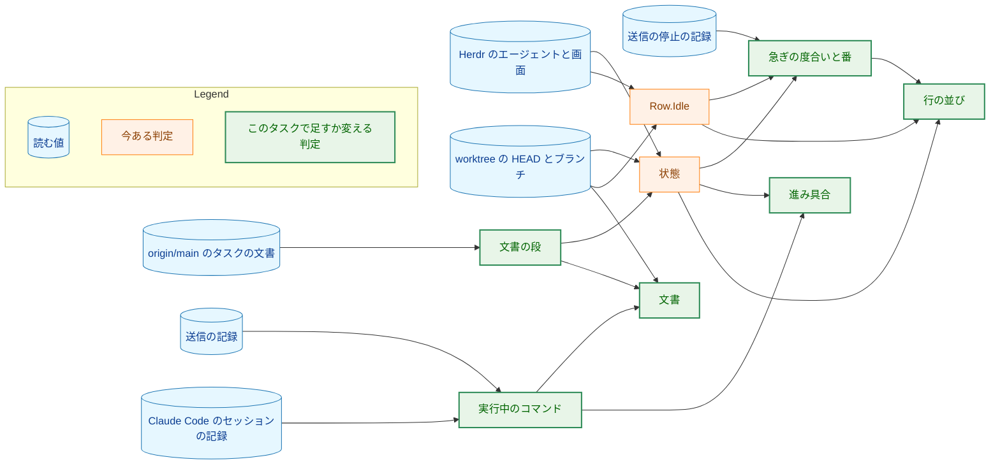
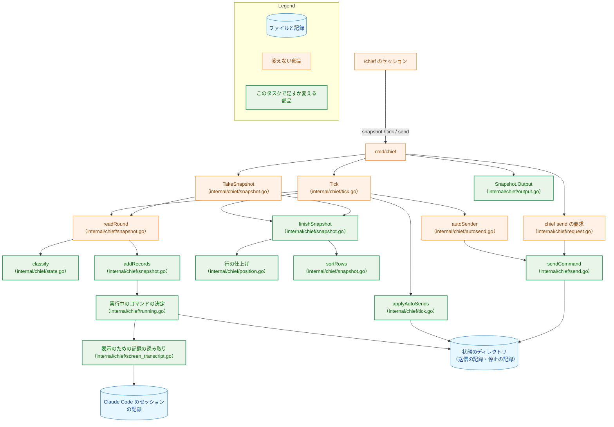
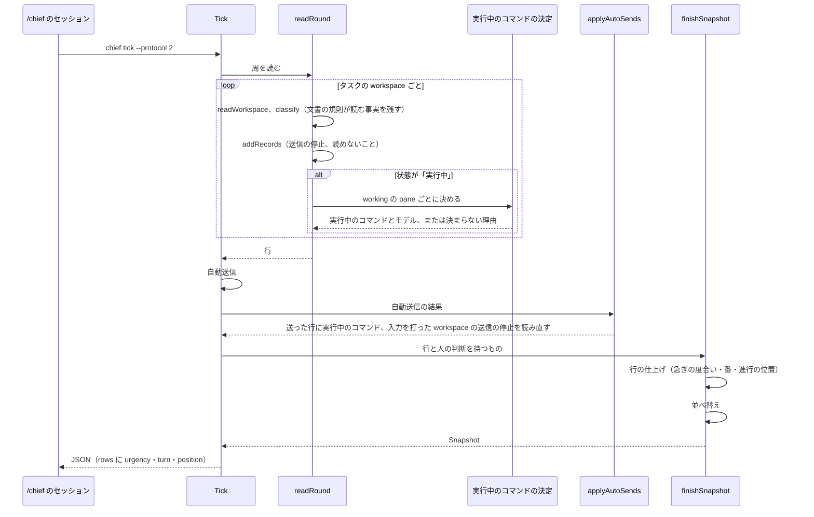
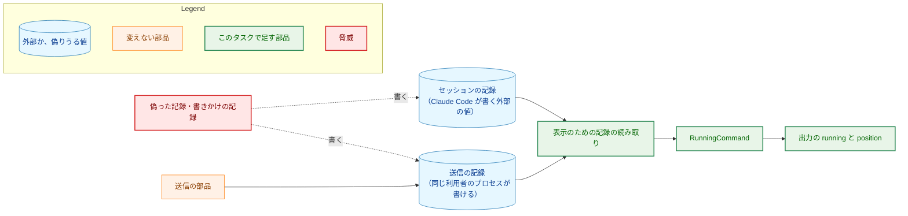
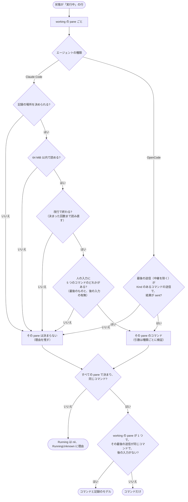
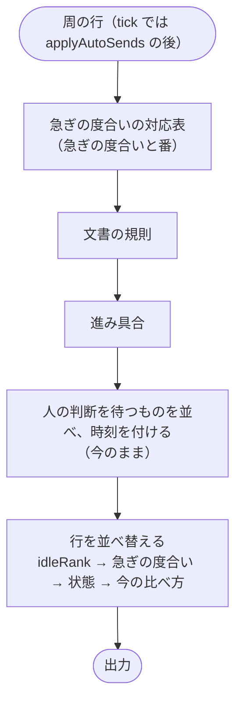

# アーキテクチャ設計書：chief の状況の表に、急ぎの度合いの印と、タスクの進行の位置とどちらの番かを示す

## Document Status

| Item | Value |
|---|---|
| Status | `approved` |
| Created | 2026-11-16 |
| Review date | 2026-11-17 |
| Reviewer | isseis |
| Comments | - |

本書は [01_requirements.md](01_requirements.md)（要件定義書。以下、要件書）の設計である。以下、アーキテクチャ設計書を設計書、実装計画書を計画書と略す。「計画で決める」は、本タスクの実装計画書（`03_implementation_plan.md`）で決めることを指す。既存のファイルの内容は、コミット `bade98e3` で確かめた。`file:line` の行番号は、このコミットでの行番号である。F-NNN・AC-NN は要件書の項番を指す。0088 の項番は「0088 の AC-NN」と書く。

H-NN は [design_handoff.md](design_handoff.md)（以下、申し送り）の項番を指す。申し送りへの対応は付録 A に、受け入れ基準との対応は付録 B にまとめる。

本書は、要件書 3 章と 6 章の用語（状態・送信が止まった行・使っていないか残った worktree の行・削除の提案・急ぎの度合い・番・進行の位置・実行中のコマンド・セッションの記録）を、要件書と同じ意味で使う。0088 の設計書（[0088 設計書](../0088_chief_of_staff/02_architecture.md)）の用語（道具・`/chief` の定義・周・送信の記録・状態のディレクトリ・chief のセッション）も、同じ意味で使う。そのほかに、次の用語を使う。

-   **急ぎの度合いの対応表:** 要件書 3.1 の対応表。行の条件から急ぎの度合いと番を決める（3.2）。
-   **文書の段:** `origin/main` のタスクの文書の状態の組から決まる、タスクの文書の進み（3.3）。次のコマンドの規則と文書の規則は、同じ 1 つの関数が返す段を読む。
-   **文書の規則:** AC-07 の規則 1〜10。行の進行の位置の文書を決める（3.3）。
-   **行の仕上げ:** 1 つの周の中で、行の状態・送信の停止・実行中のコマンドが出そろった後に、急ぎの度合い・番・進行の位置を決めること（3.6）。道具の中で 1 か所だけにある。
-   **進み具合:** 進行の位置のうち、行の状態と実行中のコマンドから決まる部分（AC-09）。「作成待ち」「作成中」などの値をとる（3.4）。
-   **表示のための記録の読み取り:** 実行中のコマンドを決めるために、Claude Code のセッションの記録を読むこと（3.5）。0088 のリセットの確かめのための読み取り（`internal/chief/reset.go:51-73`）と区別する。

## 1. 設計の全体像 (Design Overview)

### 1.1. 設計原則

-   **判定は道具に置き、`/chief` の定義は示すだけにする。** 急ぎの度合い・番・進行の位置・実行中のコマンド・行の並びは、すべて道具の Go のコードが決め、テストを持つ（F-006、[ADR-0046](../../dev/adr/0046-chief-of-staff.md)・[ADR-0014](../../dev/adr/0014-deterministic-checks-in-go.md)）。`/chief` の定義は、道具が返した ASCII の値を日本語の表示に置き換え、道具の順のまま示す。
-   **表示のための読み取りは、送ることを左右しない。** 新しく読むセッションの記録と、送信の記録の新しい欄は、表に示す値にだけ使う。行の状態、送る判断、`problems` は、読めたかどうかで変わらない（要件書 4.2）。
-   **分からないものは推し量らない。** 文書が読めなければ「要確認」、実行中のコマンドが 1 つに決まらなければ「決まらない」とし、ほかの値を当てない（AC-08・AC-11・AC-12）。送信の停止を読めない行は、止まった行と同じく人を呼ぶ。新しい型の 0 の値は、人を呼ぶ側か「要確認」にする（CLAUDE.md の「Declare, don't infer」）。
-   **受け付ける形を広げない。** セッションの記録は、0088 で受け付ける形の行に、1.2 の「実装の際に決めたこと」の `auto-continuation` の行を加えたものだけを読む。記録の文字列を型に変えるのは、画面の読み取りの部品（`screen` で始まるファイル）だけである。示すのは、決まった 5 つのコマンドの種類と、型で検証した番号の引数だけである（AC-13）。
-   **決めるのは 1 か所にする。** 急ぎの度合いの対応表と文書の規則は、それぞれ 1 つの関数に置く。文書の段は、次のコマンドの規則と文書の規則が共有する。行の並べ替えは、急ぎの度合いの関数の結果を使う（申し送りの H-01・H-04）。

### 1.2. 設計の際に決めたこと（2026-11-16）

-   **道具の出力の値は ASCII の列挙の名前にし、日本語の表示は `/chief` の定義が対応させる。出力を変えるので `--protocol` の番号を 1 から 2 に上げる。行の `merge_question` は出力から外す（申し送りの H-01）。** 値を ASCII にするのは、`state` などの今の出力の値とそろえ、文書のガードテストで値の集合を比べられるようにするためである。番号を上げると、古い定義と新しい道具の組み合わせも、新しい定義と古い道具の組み合わせも `protocol_mismatch` で止まり、印のない表を示さずに済む（`.claude/commands/chief.md:76-78`）。`merge_question` を外すのは、進み具合（「マージの確認待ち」）と質問ごとの `merge` が同じことを示すためである。行の値を残すと、0088 の PR-7 で起きたように、セッションが「マージの確認ではない」という否定を文にして表に書きうる（issue #890）。ADR: なし（出力の綴りと番号は、このタスクの中で閉じるため）。
-   **0092 の削除の提案の行（AC-05、AC-07 の規則 2）は、0092 の実装がまだ `main` になければ、このタスクでは扱わず、0092 へ申し送る。このタスクの計画書は、急ぎの度合いの対応表を実装する PR の前に、0092 の削除の提案が `main` にあるかを確かめる手順を持ち、あればこのタスクで扱う（申し送りの H-05）。** 0092 は、この設計の時点で要件定義書だけが `main` にあり、設計書がない。削除の提案を作る部品がないうちにこのタスクで行の値を作っても、誰も値を入れない（CLAUDE.md の「Enforce invariants with the type」にある、使われない拡張点の使い道を数える規則）。2 つのタスクは並行して進むので、どちらが先に入るかを固定せず、両方の順に備える。0092 の [design_handoff.md](../0092_chief_task_workspace/design_handoff.md) に H-09 を足し、0093 が先に入ったときに 0092 が足すものを申し送る。要件書の AC-05 は「後に実装する方で確かめる」としており、これに合う。ADR: なし（実装の順はタスクの中で閉じるため）。
-   **表示のための記録の読み取りで、記録の最後が改行で終わっていないときは、短い間隔で決まった回数だけ読み直す。それでも改行で終わらなければ、その pane の実行中のコマンドは決まらないものとし、書きかけの部分を除いて 1 つ前のコマンドを示すことはしない。改行で終わる記録には、今の規則（`internal/chief/screen_transcript.go:160-189`）をそのまま当てる（申し送りの H-06）。** chief の待ち受けでは、エージェントの状態が変わったとき（人がコマンドを打って `working` になったとき）に次の周が始まる。その時点で、Claude Code は人の行を書いている途中でありうる。書きかけの部分を除いて読むと、1 つ前のコマンドを確かな値として示してしまう。エージェントが `working` のままなら、次の周が始まるのは最長で 10 分後になる（`internal/chief/wait.go:25-26`）。読み直すのは、`/model` の後に記録を読み直す今の仕組み（`internal/chief/transcript.go:33-39`）と同じ考え方である。読み直す回数と間隔は計画で決める。受け付ける行の形は広げない。リセットの確かめの読み取りも変えない。ADR: なし（受け付ける形と画面の読み取りの例外の範囲を変えず、表示の読み方の中で閉じるため）。
-   **HEAD が detached の worktree の文書は、`/mkreq` が実行中のときだけ「要件定義書」とし、それ以外は規則 10 の「要確認」とする。** 0088 は、detached の workspace を「タスクがないものとはしない」と決めている（[0088 設計書](../0088_chief_of_staff/02_architecture.md) の 1.3.1、`internal/chief/state.go:194-197`）。`/runpr` は、タスクの最後の PR をマージした後にも、次のブランチを作る前に止まった後にも HEAD を detached にし、道具はこの 2 つの場合を見分けられないためである。このタスクもこれに従う。`/mkreq` が実行中のときだけ「要件定義書」とするのは、AC-07 の規則 3 に当たるからである。0092 が作る detached の worktree で `/mkreq` が走っている行が、これに当たる。使っていない detached の行は、状態も文書も「要確認」のまま、「🟢 待つ」として表の最後に並ぶ。ADR: なし（表示の細部で、0088 の決定を変えないため）。
-   **AC-07 の規則 3 の「次のコマンドが `/mkreq` である」は、状態が「次を提案」で次のコマンドが `/mkreq` である行に当てる。機能ブランチの命名に合わないブランチにある行で、ほかの状態のものは、`/mkreq` が実行中でなければ規則 4 の「-」とする。** 次のコマンドを決めるのは「次を提案」・「要確認」・「タスク完了」の行だけで（`internal/chief/state.go:414-447`）、「質問で停止」・「実行中」・「レビュー待ち」の行は次のコマンドを持たない。命名に合わないブランチの worktree は、`/mkreq` のためのものとは限らない。単独の変更の `fix/…` ブランチなどもタスクの workspace として表に並ぶ（`internal/chief/workspace.go:183-223`）。そこで、レビュー待ちの PR を持つ行などに「要件定義書」と示さないようにする。ADR: なし（AC-07 の読み方の細部のため）。
-   **送信の記録から実行中のコマンドとモデルを決めるのは、その送信の終わりの記録があり、結果が `sent` のときだけとする。** 送信の記録の開始は、最初の入力を打つ前に作られる（`internal/chief/records.go:658-667`）。開始の記録だけでは、何も打たなかった送信、途中で失敗した送信、送っている最中の送信と見分けられない。ADR: なし（表示の読み方の細部のため）。
-   **OpenCode の pane の実行中のコマンドは、その pane への chief の最後の送信（答えの中継を除く）がコマンドの送信のときだけ、そのコマンドとする。最後の送信がリセット（`/new`）なら、決まらない。** リセットの後に OpenCode が動いているなら、人が打った何かを走らせている。リセットより前のコマンドを示すと、走っていないコマンドを示すことになる。答えの中継を除くのは、中継は走っているコマンドの質問に答えるだけで、別のコマンドを始めないためである（`internal/chief/records.go:824-839` の `LastSend` が今も中継を除く）。ADR: なし（AC-11 の読み方の細部のため）。
-   **送信の記録に、送ったコマンドの種類と引数を、宣言した欄として足す。種類は `paneinput.CommandKind` の名前（`mkreq`・`mkarch`・`mkplan`・`runplan`・`runpr`）とし、引き継ぎの `/runplan` も `runplan` と書く。実行中のコマンドは、この欄から決め、記録のコマンドの文字列を読み直さない。欄のない記録は、決まらないものとする。** コマンドの文字列から種類を読み取ると、文字列の中身で振る舞いを選ぶことになる（CLAUDE.md の「Declare, don't infer」）。`--command` の値（`runplan-takeover` を含む、`internal/chief/request.go:55-75`）でなくコマンドの種類にするのは、Claude Code の pane で読む人の入力と同じ種類の値で比べるためである。欄のない、このタスクより前の記録は、次にコマンドを送るまで「決まらない」と示される。利用者は 1 人で、版の互換は要らない。ADR: なし（記録の欄の追加はこのタスクの中で閉じ、記録を表示にだけ使うことは ADR-0046 の決定に収まるため）。
-   **自動送信の周では、自動送信がどれかの入力を打った workspace の送信の停止を、送った後に状態のディレクトリから読み直す。読めなければ、送信の停止を読めない行とする。** 送った後に確かめが失敗すると、送信は停止の記録を作る（`internal/chief/send.go:515`）。しかし、今の `applyAutoSends`（`internal/chief/tick.go:79-104`）は、行の状態を書き換えるだけで、送信の停止を行に付けない。このままだと、その周だけ行が「すぐ」でない印になり、次の周から「🔴 すぐ」になる（AC-03）。結果の種類（`sent_then_failed` など）から停止を推し量らず、記録を読み直すのは、コマンドに続くリセットの失敗や、停止の記録を書けなかった場合も、記録のとおりに示すためである。ADR: なし（表示の細部のため）。
-   **出力に、表に示さない診断の値として、使っていないか残った worktree の行であること（`idle`）と、実行中のコマンドが決まらなかった理由（`running_unknown`）を足す。** 誤った印や示されない実行中のコマンドを、出力だけから説明できるようにするためである。`/chief` の定義はこれらを表に示さず、chief 利用ガイドが調べ方として説明する。ADR: なし（出力の診断の値は、このタスクの中で閉じるため）。
-   **表の印は、行の最初の列に置く。絵文字の幅による列のずれは、実地の確かめで見て、計画に確かめの手順を置く（申し送りの H-03）。** ずれが印より後ろの列だけに及ぶようにするためである。Claude Code の端末が絵文字を何文字分で描くかは、設計の時点で確かめていない。ずれても印と文字は読めるので、確かめの前に設計を決めてよいと判断した。ADR: なし（表示の細部のため）。

### 1.2.1. 実装の際に決めたこと（2026-11-17）

-   **セッションの記録の origin の `kind` に `auto-continuation` を足し、人でない kind として受け付ける。** 計画のステップ 1-1 で、実行中のセッションの記録を元の記録で確かめたところ、この計算機の 612 ファイルのうち 12 ファイル（Claude Code 2.1.306〜2.1.326、`/runplan`・`/mkplan`・`/mkarch` などのセッションを含む）に、`kind` が `auto-continuation` の行があった。claude.ai の使用量の上限が解けた後に Claude Code が自動で足す続行の入力で、`isMeta` が真、`promptSource` が `system`、`turnOrigin` が `auto_continuation` である。今の `readLastHumanInput`（`internal/chief/screen_transcript.go`）は、採取した種類（`human`・`peer`・`task-notification`）以外の `kind` の行で記録全体を読めないものにするため、そのセッションの実行中のコマンドは決まらず、表に示されなくなる（`running_unknown` が `unreadable`）。`auto-continuation` は、`peer`・`task-notification` と同じく、人が打たない入力を Claude Code が宣言する値である。人の入力かどうかを、宣言された `origin` の `kind` だけで決める規則（CLAUDE.md の「Declare, don't infer」の chief の画面の読み取りの例外）は変えず、人でない kind の一覧に 1 つ足す。ほかの `kind` を読めないものとする規則と、リセットの確かめの結果は変わらない。実行中のセッションの記録のサンプルに、この行を含める。人が選んだ（2026-11-17）。ADR: なし（例外の範囲と規則を変えず、採取した kind の一覧に 1 つ足すだけで、このタスクの中で閉じるため）。

-   **状況の表を 6 つの列にし、印を「🔴 今」「🟡 後」「🟢 待」にし、実行中のコマンドを人が最後に打ったタスクのコマンドに「（後に指示あり）」を添えて示し、決まらない理由を示す。** PR-3 の実地の確かめで、8 つの列の表が pane の幅に収まらず縦に並び、また後から自由な文で指示を足したセッションで、何を実行しているかが示されなかった。決定と理由は要件書の「実装の際に決めたこと（2026-11-17）」にある。設計への影響は次のとおりである。人が選んだ（2026-11-17）。ADR: [ADR-0046](../../dev/adr/0046-chief-of-staff.md) を更新する。
    -   `readRunningCommand` は、人の入力を順に読み（`scanHumanInputs`、`readLastHumanInput` と同じ規則）、5 つのタスクのコマンドの最後のものと、その後に人の入力があったか（`later`）を返す。後の入力の中身は読まない。
    -   `RunningShown` に `Later` を足し、出力の `running` に `later_input` を足す。どれかの pane で後の入力があれば真とする。後の入力があるときは、モデルを示さない。
    -   `running_unknown` は、`/chief` の定義が「内容」の列に示す値になる（1.2 の、表に示さない診断の値という扱いを変える）。`OutputValueNames` の対象を、表に示す `urgency`・`position.document`・`position.progress`・`running_unknown` にし、`state` と `turn` を外す。
    -   出力の形が変わるが、`Protocol` は、この PR ですでに上げた値（計画書の決定 1 のとおり、`origin/main` の値に 1 を足した値）のままとし、この変更のためにもう 1 つは上げない。この PR の中の変更で、`origin/main` の道具はこの出力の形をまだ知らないためである。

### 1.3. なぜ今の仕組みでは足りないか

今の道具は、行ごとに状態だけを返し（`internal/chief/output.go:27-41`）、どの行に人がすぐ答えるべきかを示さない。タスクの文書を `origin/main` から読んでいるが、どの文書の段にあるかは出力に含まない（`internal/chief/state.go:273-306`）。「実行中」の行のコマンドは送信の記録だけから示すので（`internal/chief/snapshot.go:199-214`）、人が自分で打ったコマンドは示せない。行の並べ方は状態の順だけで決まり（`internal/chief/snapshot.go:339-354`）、送信が止まった行は、その状態の位置に並ぶ。

`/chief` の定義の中で、状態から印を付ける案は、要件定義で採らなかった（要件書「要件定義の際に決めたこと」）。判定の一部がセッションに残るためである。このため、道具の判定と出力を広げる。

### 1.4. 概念モデル



矢印 A → B は、「B を決めるときに A を読む」ことを表す。文書の段は、今の次のコマンドの規則（`decideNext`）の中にある文書の判定を取り出したもので、状態（次を提案・タスク完了・要確認）と文書の両方が読む。`Row.Idle` は、使っていないか残った worktree の行であることを示す今の値である（`internal/chief/state.go:139-145`）。

## 2. システム構成 (System Structure)

### 2.1. 全体構成



矢印 A → B は「A が B を呼ぶか読み書きする」ことを表す。`TakeSnapshot` は `applyAutoSends` を呼ばない（`internal/chief/snapshot.go:79-85`）。`Tick` は、`readRound`、自動送信、`applyAutoSends`、`finishSnapshot` をこの順に呼ぶ（`internal/chief/tick.go:27-72`）。`/chief` の定義と chief 利用ガイドの変更は、2.2 の表に挙げる。

### 2.2. コンポーネント配置

| ファイル | 変更 | 責務 |
|---|---|---|
| `internal/chief/state.go` | 変更 | `Row` に、急ぎの度合い・番・進行の位置・示す実行中のコマンド・文書の規則が読む事実・送信の停止を読めないことを足す。`Row.MergeQuestion` を外す（3.1）。`decideNext` は、文書の判定を文書の段から読む（3.3） |
| `internal/chief/position.go`（新規） | 新規 | 文書の段（3.3）、急ぎの度合いの対応表（3.2）、文書の規則（3.3）、進み具合（3.4）、行の仕上げ（3.6）。どれも入出力を持たない関数である |
| `internal/chief/running.go`（新規） | 新規 | 実行中のコマンドの決定（3.5）。pane ごとに、Claude Code はセッションの記録から、OpenCode は送信の記録から決め、AC-12 の規則でまとめる。モデルを示すかと、決まらなかった理由も決める |
| `internal/chief/screen_transcript.go` | 変更 | 表示のための記録の読み取りの入口を足す。改行で終わる記録の人の入力を `readLastHumanInput` と同じ規則で順に読み（`scanHumanInputs`）、人が最後に打ったタスクのコマンドを、検証した実行中のコマンドの型で、後の入力の有無とともに返す（3.5、1.2.1）。`readLastHumanInput` の振る舞いは変えない |
| `internal/chief/transcript.go` | 変更 | 改行で終わるまで決まった回数だけ読み直す読み取りを足す（1.2） |
| `internal/chief/snapshot.go` | 変更 | `addRecords` が、送信の停止を読めないことを行に残し、「実行中」の行の処理を実行中のコマンドの決定に置き換える。`finishSnapshot` が、並べ替えの前に行の仕上げを呼ぶ。`sortRows` の並べ方に急ぎの度合いを足す（3.7）。`mergeOnlyRank` は、進み具合と共有する「すべての質問がマージの確認」の判定を使う |
| `internal/chief/tick.go` | 変更 | `applyAutoSends` が、送った行に送ったコマンドを実行中のコマンドとして付け（AC-10）、入力を打った workspace の送信の停止を読み直す（1.2） |
| `internal/chief/records.go` | 変更 | `SendRecord` に、送ったコマンドの種類と引数の欄を足す。送信の終わりの記録の結果を読む関数を足す（3.5）。`Protocol` を 2 にする |
| `internal/chief/send.go` | 変更 | コマンドを送るとき、送信の記録に種類と引数を書く |
| `internal/chief/paneinput/paneinput.go` | 変更 | `Command` の種類と引数を読む関数と、`CommandKind` の名前の表を足す（3.1） |
| `internal/chief/output.go` | 変更 | `RowOutput` に `urgency`・`turn`・`position`・`idle`・`running_unknown` を足し、`merge_question` を外し、`running` と `stopped` の形を変える（3.8）。出力の値の名前の集合を返す関数を公開する（7.2） |
| `.claude/commands/chief.md` | 変更 | 表の列と値の表示、「質問で停止」の行の「内容」の列、表の下の一覧から質問の要点を外すこと、`--protocol 2`（3.9） |
| `docs/dev/guides/chief_guide.md` | 変更 | 表の見方、調べ方、入れ替えの手順、既知の制限を足し、`--protocol` の番号の記述を 2 にする（3.10） |
| `cmd/chief/docs_test.go` | 変更 | `/chief` の定義の値の対応表が、道具の値の集合と一致することを確かめるテストを足す（7.2） |
| `internal/chief/*_test.go` | 変更 | 3.11 の既存のテストを直し、新しいテストを足す |
| `internal/chief/testdata/transcript/` | 変更 | 改行で終わっていない記録のサンプルと、実行中のセッションの記録のサンプルを足す（7.1） |
| `docs/tasks/0092_chief_task_workspace/design_handoff.md` | 変更 | H-09 を足す（1.2、3.12） |

`docs/dev/adr/0046-chief-of-staff.md` は、要件定義の PR（#909）で、このタスクの決定をすでに足している。本書の決定は、どれも ADR-0046 の決定の範囲に収まるので、ADR は変えない。

### 2.3. データフロー

`chief tick` の 1 周を示す。`chief snapshot` は、自動送信と `applyAutoSends` の段を除いて同じである。



## 3. コンポーネント設計 (Component Design)

### 3.1. 型

```go
// Urgency is how soon the human should act on a row (F-001). The zero value
// is UrgencyNow, the reading that calls the human.
type Urgency int

const (
	UrgencyNow Urgency = iota
	UrgencyLater
	UrgencyWait
)

// Turn is who moves next on a row (F-002). The zero value is TurnHuman.
type Turn int

const (
	TurnHuman Turn = iota
	TurnAI
	TurnNone
)

// PositionDocument is the document part of a task's position (AC-07). The
// zero value is PositionDocNeedsCheck, the reading that assumes least.
type PositionDocument int

const (
	PositionDocNeedsCheck PositionDocument = iota
	PositionDocNoTask
	PositionDocRequirements
	PositionDocArchitecture
	PositionDocPlan
	PositionDocPlanPR
	PositionDocNone
)

// Progress is the progress part of a task's position (AC-09). The zero value
// is ProgressNeedsCheck.
type Progress int

const (
	ProgressNeedsCheck Progress = iota
	ProgressAwaitingCreation
	ProgressCreating
	ProgressRunprRunning
	ProgressRunning
	ProgressMergeConfirmation
	ProgressQuestion
	ProgressAwaitingReview
	ProgressTaskDone
)

// Position is a task's position: the document and the progress (F-003).
type Position struct {
	Document PositionDocument
	// PlanPR is N of PR-N, set only when Document is PositionDocPlanPR.
	PlanPR   int
	Progress Progress
}

// RunningCommand is a command a running row's agents run (AC-11, AC-13):
// one of the five task commands, with its argument only when the argument
// is a number of the form chief accepts for the kind. Outside the package,
// only its constructor makes one, from a kind and an argument it validates.
type RunningCommand struct {
	kind paneinput.CommandKind
	arg  string
}

// RunningUnknown is why no running command is decided for a running row.
// The zero value is RunningUnknownNone: a command is decided.
type RunningUnknown int

const (
	RunningUnknownNone RunningUnknown = iota
	RunningUnknownNoSession       // Herdr reports no session for a Claude Code pane
	RunningUnknownUnsupportedPath // the transcript's place cannot be decided
	RunningUnknownUnreadable      // the transcript or a send record cannot be read
	RunningUnknownOverCap         // the transcript exceeds the read cap
	RunningUnknownPartialLine     // the transcript still ends without a newline
	RunningUnknownNotTaskCommand  // the last human input is not one of the five
	RunningUnknownNoSentCommand   // no finished, sent command record for the pane
	RunningUnknownPanesDisagree   // working panes run different commands
)

// RunningShown is what a running row shows (AC-14): the command, and the
// model of chief's send record only when AC-14's conditions hold ("" else).
type RunningShown struct {
	Command RunningCommand
	Model   string
}
```

-   「決まらない」は、`Row.Running == nil` だけで表す。`RunningCommand` は、構築関数を通ったものだけが存在し、種類は 5 つのどれかである。
-   `Row` には次を足す。`Running` は、今の `*SendRecord`（`internal/chief/state.go:131-133`）から `*RunningShown` に変える。`Row.MergeQuestion`（`internal/chief/state.go:128`）は外す。読むのは `mergeOnlyRank`（`internal/chief/snapshot.go:308-313`）だけで、`Questions` から求められるためである。

```go
type Row struct {
	// ... the existing fields, with Running changed and MergeQuestion removed ...
	Running        *RunningShown
	RunningUnknown RunningUnknown
	// StopUnreadable is true when the workspace's stop record could not be
	// read; the row is treated like a stopped one (3.2).
	StopUnreadable bool
	Urgency        Urgency
	Turn           Turn
	Position       Position
	// position is what the document rule reads (3.3), kept by classify.
	position positionFacts
}

// positionFacts is what the document rule reads about a workspace.
type positionFacts struct {
	fetchFailed bool
	// docsUnreadable is true when origin/main's task documents could not be
	// read (Tasks.Read failed).
	docsUnreadable bool
	head           headState
	// hasTask is true when the branch follows the feature branch convention.
	hasTask bool
	// stage is the document stage of origin/main's documents (3.3), read
	// only when hasTask and the documents were read.
	stage docStage
	// planDone is true when every PR of an approved plan is merged.
	planDone bool
	// planPR is N of the first plan PR not merged, for stagePlanApproved.
	planPR int
}
```

-   `SendRecord`（`internal/chief/records.go:658-667`）に、次の 2 つの欄を足す。

```go
type SendRecord struct {
	// ... the existing fields ...
	// Kind is the paneinput.CommandKind name of the command sent ("mkreq",
	// "mkarch", "mkplan", "runplan", "runpr"), set only for a command
	// input; "" on older records and other inputs.
	Kind string `json:"kind"`
	// Arg is the command's validated argument.
	Arg string `json:"arg"`
}
```

-   `paneinput.Command` に、種類と、検証した引数の文字列を読む関数を足す。`CommandKind` の名前の表も `paneinput` に置き、送信の記録の書き込みと実行中のコマンドの構築が同じ表を使う。

### 3.2. 急ぎの度合いの対応表

急ぎの度合いの対応表は、`Row` から `(Urgency, Turn)` を返す 1 つの関数に置く。要件書 3.1 の表の上から順に、最初に当たる行のものを返す（AC-02）。

| 順 | 行の条件（`Row` の値） | 急ぎの度合い | 番 |
|---|---|---|---|
| 1 | `Stopped != nil` か `StopUnreadable`（送信が止まった行） | `UrgencyNow` | `TurnHuman` |
| 2 | `State == StateQuestion`（マージの確認を含む） | `UrgencyNow` | `TurnHuman` |
| 3 | `Idle`（使っていないか残った worktree の行） | `UrgencyWait` | `TurnNone` |
| 4 | `State` が `StateAwaitingReview`・`StateProposeNext`・`StateNeedsCheck` | `UrgencyLater` | `TurnHuman` |
| 5 | `State == StateRunning` | `UrgencyWait` | `TurnAI` |
| 6 | `State == StateTaskDone` | `UrgencyWait` | `TurnNone` |

-   **送信の停止を読めない行（順 1）。** 送信の部品は、停止の記録を読めない workspace を止まったものとして扱い、何も送らない（`internal/chief/records.go:734-735`、`internal/chief/autosend.go:340-346`）。表でも人を呼ぶのは、自動送信が黙って止まっているのに「待つ」と示さないためである。
-   要件書 3.1 の表の 3 行目（削除の提案がある「タスク完了」の行）は、0092 の実装が `main` になければ持たない。0092 の実装が先に入っていれば、順 3 の前に足す（1.2、3.12）。
-   どの行にも当たらないのは、`State` が 6 つの状態のどれでもないときだけである。そのときは 0 の値（`UrgencyNow`・`TurnHuman`）を返す。`WorkspaceState` の値は 6 つである（`internal/chief/state.go:13-27`）。テストで、6 つの状態と、送信の停止（なし・あり・読めない）と、`Idle` の有無の組み合わせのすべてが順 1〜6 のどれかに当たることを確かめる（AC-02）。
-   今の `addRecords` は、送信が止まった行と送信の停止を読めない行の `Idle` を外す（`internal/chief/snapshot.go:170-188`）。`Idle` を付けるのは、`classify` が「次を提案」の行と、次のコマンドが決まらない「要確認」の行に付けるときだけである（`internal/chief/state.go:426-443`）。このため、順 1・2 と順 3 は同じ行に当たらない。
-   AC-04 の「読めなかった理由から、別の度合いを推し量らない」は、`Unreadable` を読まないことで満たす。

### 3.3. 文書の段と文書の規則

**文書の段。** `origin/main` のタスクの文書（`TaskDocs`、`internal/chief/task.go:759-767`）から、次の段のどれか 1 つを返す関数を置く。今の `decideNext`（`internal/chief/state.go:273-306`）の `switch` が持つ文書の判定を取り出したもので、`decideNext` もこの段から次のコマンドを決めるように変える。2 つの規則が同じ文書の判定を別々に持たないようにするためである。

| 文書の段 | 条件（`decideNext` の今の順） |
|---|---|
| `stageNoRequirements` | タスクのディレクトリか要件定義書がない |
| `stagePlanApproved` | 計画書が `approved` |
| `stagePlanNotApproved` | 計画書が `approved` でない |
| `stageArchApproved` | 設計書が `approved`（計画書はない） |
| `stageArchNotApproved` | 設計書が `approved` でない |
| `stageReqApprovedFull` | 要件定義書が `approved`、進め方が `full` か記録なし |
| `stageProcessUnreadable` | 要件定義書が `approved`、進め方の記録が読めない |
| `stageOther` | 上のどれにも当たらない（要件定義書が `approved` でない、簡易な進め方なのに設計書か計画書がない、など） |

`decideNext` の振る舞いは変えない。段ごとに、今と同じ次のコマンドか理由を返す。今の次のコマンドのテスト（`TestNextCommandRules`、`internal/chief/snapshot_test.go:200`）が、取り出した後も同じ結果であることを確かめる。

**文書の規則。** 文書の規則は、`Row` の `position`・`Running`・`State`・`Next` から `(PositionDocument, PlanPR)` を返す 1 つの関数に置く。上から順に、最初に当たるものとする。

| AC-07 の規則 | 道具が確かめる値 | 文書 |
|---|---|---|
| 1 | `fetchFailed` か `docsUnreadable` が真 | `PositionDocNeedsCheck` |
| 2 | （削除の提案。0092 の実装が `main` になければ持たない。3.12） | - |
| 3 | `hasTask` が偽で、実行中のコマンドが `/mkreq`。または、HEAD がブランチで `hasTask` が偽、状態が「次を提案」で次のコマンドが `/mkreq` | `PositionDocRequirements` |
| 4 | HEAD がブランチで `hasTask` が偽 | `PositionDocNoTask` |
| 5 | `stage` が `stageNoRequirements` | `PositionDocRequirements` |
| 6 | `stage` が `stagePlanApproved` で、`planDone` が真 | `PositionDocNone` |
| 7 | `stage` が `stagePlanApproved` | `PositionDocPlanPR`、`PlanPR` は `planPR` |
| 8 | `stage` が `stageArchApproved` | `PositionDocPlan` |
| 9 | `stage` が `stageReqApprovedFull` | `PositionDocArchitecture` |
| 10 | 上のどれにも当たらない（HEAD を読めない、HEAD が detached で `/mkreq` が実行中でない、`approved` でない文書がある、進め方の記録が読めない、など） | `PositionDocNeedsCheck` |

-   **型の値で読む。** 規則 1 は、`Row.Unreadable` の文字列ではなく、`classify` が `positionFacts` に残す真偽値で確かめる（CLAUDE.md の「Declare, don't infer」）。`positionFacts` を `Row` に残すのは、規則 3 だけが、`classify` の後に決まる実行中のコマンドを読むためである。
-   **規則 3・4 と HEAD。** HEAD が detached の行は、1.2 の決定で、`/mkreq` が実行中のときだけ規則 3 に当たり、それ以外は規則 10 になる。ブランチを読めない行（`internal/chief/snapshot.go:241-245`）は、HEAD を読めないものとして規則 10 にする。機能ブランチの命名に合わないブランチにある行は、1.2 の決定で、状態が「次を提案」で次のコマンドが `/mkreq` のときか、`/mkreq` が実行中のときだけ規則 3 に当たり、それ以外は規則 4 の「-」になる。
-   **規則 7 の N。** `Plan.PRs` は、計画書の PR マーカーの順に `Target`（マーカーの番号）と `Merged` を持つ（`internal/chief/task.go:483-504`）。`origin/main` の計画書では、PR を作って開いている間は「PR を作成した」も「PR がマージされた」も済んでいない。PR のブランチで済ませた印は、マージで `origin/main` に入るためである。このため、`Merged` でない最初の PR は、開いている PR があればその PR、なければ次の `/runplan` が作る PR になり、AC-07 の規則 7 の注に合う。PR マーカーの番号は `[1-9][0-9]*` の形のものだけを受け付ける（`internal/chief/task.go:327`）ので、数として読める。PR マーカーのない計画書（`Target` が `single`）は 1 とする。
-   **状態は変えない（AC-08）。** 文書の規則は `Row.State` を変えない。状態が「要確認」の行でも、文書が読めていれば文書を示す。逆に、文書が「要確認」でも、状態は `classify` のままである。

### 3.4. 進み具合

進み具合は、`Row.State`・`Row.Running`・`Row.Questions` から、AC-09 の表のとおりに決める。

| 状態 | 条件 | 進み具合 |
|---|---|---|
| 次を提案 | - | `ProgressAwaitingCreation` |
| 実行中 | 実行中のコマンドが `/mkreq`・`/mkarch`・`/mkplan`・`/runplan` | `ProgressCreating` |
| 実行中 | 実行中のコマンドが `/runpr` | `ProgressRunprRunning` |
| 実行中 | 実行中のコマンドが決まらない（`Running == nil`） | `ProgressRunning` |
| 質問で停止 | すべての質問がマージの確認 | `ProgressMergeConfirmation` |
| 質問で停止 | マージの確認でない質問が 1 つ以上ある | `ProgressQuestion` |
| レビュー待ち | - | `ProgressAwaitingReview` |
| タスク完了 | - | `ProgressTaskDone` |
| 要確認 | - | `ProgressNeedsCheck` |

「すべての質問がマージの確認」は、`mergeOnlyRank`（`internal/chief/snapshot.go:308-313`）と同じ判定を 1 つの関数に取り出し、両方が使う。今の判定と同じく、質問が 1 つもない行には当たらない。送信が止まった行も、進み具合はその行の状態から決める（要件書の「要件定義の際に決めたこと」の、送信が止まった行の項）。

### 3.5. 実行中のコマンド

状態が「実行中」の行についてだけ決める。ほかの状態の行では、`Running` は `nil` で、`RunningUnknown` は `RunningUnknownNone` である。

**pane ごとの決め方（AC-11）。** Herdr で `working` のエージェントの pane ごとに、次のどちらかで決める。画面は読まない。

-   **Claude Code の pane。** 次のとおりに決める。
    -   記録の場所は、リセットの確かめと同じ `transcriptPath`（`internal/chief/transcript.go:53-69`）で、pane の作業ディレクトリとセッションの識別から決める。
    -   読む量の上限は、今の 64 MiB（`resetTranscriptLimit`、`internal/chief/transcript.go:30`）とし、超えた記録は読めないものとする（要件書 4.2）。
    -   記録の最後が改行で終わるまで、決まった回数だけ読み直す（1.2）。改行で終わる記録の人の入力を、`readLastHumanInput` と同じ規則で順に読む（`scanHumanInputs`）。`HumanInputCommand` で、名前が `mkreq`・`mkarch`・`mkplan`・`runplan`・`runpr` のどれかである最後の入力を、そのコマンドとする。その後に人の入力があれば、`later` を真にする（1.2.1）。後の入力の中身は読まない。
    -   名前から種類への変換と引数の検証は `screen_transcript.go` の新しい入口が行い、`running.go` には `RunningCommand` の型で返す。これは、CLAUDE.md の「Declare, don't infer」にある chief の画面の読み取りの例外の範囲に収まる。
    -   そのようなコマンドがない（人の入力がない、自由な文とほかの名前のコマンドだけ）、読めない、場所を決められない、書きかけのままのときは、決まらない。
-   **OpenCode の pane。** `LastSend`（`internal/chief/records.go:824-839`）で、その pane への最後の送信（答えの中継を除く）を読む。次のすべてを満たすとき、そのコマンドとする。
    -   それがコマンドの送信（`Input` が `command`）である。
    -   `Kind` が 5 つのコマンドのどれかを名指す。
    -   その送信の終わりの記録があり、結果が `sent` である。

    リセット、欄のない古い記録、終わりの記録がない送信、結果が `sent` でない送信、記録がないとき、記録を読めないときは、決まらない（1.2）。

**引数（AC-13）。** 引数は、コマンドの種類ごとに、0088 で受け付ける形の値として検証できるときだけ `RunningCommand` に入れる。

| コマンド | 検証する型 |
|---|---|
| `/mkreq` | issue 番号（`paneinput.ParseIssueNumber`） |
| `/mkarch`・`/mkplan`・`/runplan` | タスクの番号（`paneinput.ParseTaskID`） |
| `/runpr` | PR の番号（`fixprguard` の PR 番号の型） |

-   検証できない引数と空の引数は、引数なしとして、コマンドの名前だけを示す。`/mkreq 890 0093` のように 2 つ目の引数があるものも、検証できない引数に当たる。
-   `/runpr` は、PR の番号のほかにブランチやタスクも引数にとる。数の引数は PR の番号として検証して示す。PR の番号は先頭が 0 の数を受け付けないので、人が先頭が 0 の 4 桁のタスクの番号を打った場合は、引数を落として `/runpr` とだけ示される。これは表示だけのことなので受け入れる。
-   セッションの記録と送信の記録の文字列は、コマンドとしてはそのまま出力に入れない。

**まとめ方（AC-12）。** 実行中のエージェントが 2 つ以上あるときは、すべての pane でコマンドが決まり、それらの種類と引数が同じときだけ、そのコマンドとする。それ以外は決まらない。検証できない引数を落とした pane が 1 つでもあるときも、決まらないとする。落とした引数どうしが違っても、比べられないためである。

**モデル（AC-14）。** 次のすべてを満たすとき、その pane への chief の最後の送信の記録の `Model` を示す。それ以外はモデルを示さない（空）。
-   実行中のエージェントがちょうど 1 つである。
-   その pane への chief の最後の送信が、上と同じ条件を満たす（結果が `sent` のコマンドの送信）。
-   その送信の `Kind` と `Arg` が、実行中のコマンドと同じである。
-   その pane で、実行中のコマンドの後に人の入力がない（`later` が偽）。

Claude Code の pane で、chief が送ったコマンドを人がもう一度打ったときも、記録のモデルを示す。人がその間にモデルを切り替えていれば、示すモデルは古い。これは AC-14 のとおりで、受け入れる。

**決まらなかった理由（1.2）。** 決まらないときは、`RunningUnknown` に理由を 1 つ入れる。記録の行の形が合わない（`HumanInputUnreadable`）ときと、送信の記録を読めないときは、`RunningUnknownUnreadable` とする。2 つ以上の pane が別々の理由で決まらないときは、先に見た pane の理由を入れる。pane の順は Herdr の一覧の順で、今の `addRecords` と同じである（`internal/chief/snapshot.go:202`）。

**失敗のとき（申し送りの H-02）。** 記録の場所を決められない、記録を読めない、記録の形が合わないのどれでも、その pane のコマンドは決まらない。`Row.State`・`Row.Unreadable`・`problems`・送る判断は変えない。理由は `running_unknown` にだけ出す。

**自動送信の周（AC-10、申し送りの H-04）。** `applyAutoSends` は、自動送信がコマンドを送った行に、次のものを付ける。今の `internal/chief/tick.go:94-95` の書き換えを置き換える。
-   実行中のコマンド: 自動送信の提案のコマンド（`AutoSendResult.Proposal.Command`、`internal/chief/autosend.go:238-246`）から作る。提案がないか、提案にコマンドがなければ、`Running` は `nil` のままにする。送った結果の文字列（`ActionResult.Command`）からは決めない（1.2 の、宣言した値から決める方針）。セッションの記録からも決めない。その周の読み取りは送る前に行ったので、記録にはまだ送ったコマンドがないためである。
-   モデル: 送ったモデルを示す。自動送信は、workspace のどのエージェントも `working` でないときだけ送る（`internal/chief/autosend.go:376-392`）。このため、送った後に `working` なのは送った pane だけとみなせ、AC-14 の「実行中のエージェントが 1 つ」に当たる。

自動送信がどれかの入力を打った workspace は、送信の停止を読み直す（1.2）。

**残る制限。** 次の 3 つは、表示だけの誤りとして受け入れ、chief 利用ガイドの既知の制限に書く。
-   人がコマンドを打った直後で、Claude Code がまだその行を 1 バイトも書いていない周は、1 つ前のコマンドを示す。読み直しでは見分けられない。
-   周の初めに読んだ Herdr のセッションの識別が、`/clear` の直後でまだ古いと、古いセッションの記録のコマンドを示しうる。
-   人が引数なしで打ったコマンド（`/runpr` など）の記録は `<command-args>` の要素を持たず、今の人の入力の読み取り（`customCommandRecord`）は「そのほかの人の入力」と読む。その前にタスクのコマンドがあれば、それを「（後に指示あり）」を添えて示し、なければ決まらない（1.2.1）。元の記録では、5 つのコマンドの人の入力 599 件のうち 53 件（48 ファイル）がこの形だった。人が選んだ（2026-11-17）。

### 3.6. 行の仕上げ

`finishSnapshot`（`internal/chief/snapshot.go:148-160`）は、人の判断を待つものを並べる前に、すべての行に 3 つの規則を 1 回ずつ当て、`Urgency`・`Turn`・`Position` を入れる。3 つの規則は、3.2 の急ぎの度合いの対応表、3.3 の文書の規則、3.4 の進み具合である。`snapshot` と `tick` はどちらも `finishSnapshot` を通るので、ここが行の値を決める唯一の場所になる。`tick` では、`applyAutoSends` が行の状態・実行中のコマンド・送信の停止を書き換えた後に呼ばれるので、同じ行が「作成待ち」と「実行中」を同時に示すことはない（申し送りの H-04）。

### 3.7. 並べ方

`sortRows`（`internal/chief/snapshot.go:339-354`）の比べる順を、次のとおりにする。

1.  `idleRank`（使っていないか残った worktree の行を最後に。今のまま）
2.  急ぎの度合い（`UrgencyNow` → `UrgencyLater` → `UrgencyWait`）。新しく足す
3.  状態の順 `stateOrder`（`internal/chief/state.go:58`、今のまま）
4.  `mergeOnlyRank`、最初に見つけた時刻、workspace のパス（今のまま）

-   使っていないか残った worktree の行は、急ぎの度合いの対応表で必ず `UrgencyWait` になる（3.2 の順 3）。このため、1 と 2 を入れ替えても結果は同じだが、AC-15 の「ほかのすべての行の後」を直接表すため、`idleRank` を先に置く。
-   同じ急ぎの度合いの中は、今の比べ方がそのまま決める（AC-16）。今の並びと違うのは、送信が止まった行（停止を読めない行を含む）が「すぐ」の位置へ移ることだけである。
-   「すぐ」の中では、ほかの行と同じく状態の順に並ぶ。たとえば、送信が止まった「実行中」の行は、今は「要確認」の行の後に並ぶが、「質問で停止」の行の後、「レビュー待ち」の行の前に並ぶ。
-   人の判断を待つものの並べ方（`sortPending`）は変えない（AC-17）。

### 3.8. 出力の形と `--protocol`

`RowOutput`（`internal/chief/output.go:27-41`）を、次のとおりにする（申し送りの H-01）。

```go
type RowOutput struct {
	// ... the existing fields, without MergeQuestion ...
	Urgency  string         `json:"urgency"`
	Turn     string         `json:"turn"`
	Position PositionOutput `json:"position"`
	// Running is null when no command is decided.
	Running *RunningOutput `json:"running"`
	// RunningUnknown is why a running row shows no command, "" otherwise.
	// /chief shows it in the content column in place of the command
	// (1.2.1).
	RunningUnknown string `json:"running_unknown"`
	// Idle is true for a row left over or not yet used. It is for
	// diagnosis; /chief does not show it in the table.
	Idle bool `json:"idle"`
	// Stopped is the stop as today, with Unreadable set when the stop
	// record could not be read.
	Stopped *StopOutput `json:"stopped"`
}

// PositionOutput is a row's position.
type PositionOutput struct {
	Document string `json:"document"`
	// PlanPR is N of PR-N when Document is "plan_pr", 0 otherwise.
	PlanPR   int    `json:"plan_pr"`
	Progress string `json:"progress"`
}

// RunningOutput is the running command of a running row and, when AC-14's
// conditions hold, the model of chief's send record ("" otherwise).
type RunningOutput struct {
	// Command is the command line, such as "/runplan 0093", or the name
	// alone, such as "/runpr", when it had no argument of the accepted form.
	Command string `json:"command"`
	// LaterInput is true when the human typed something after the command
	// (1.2.1).
	LaterInput bool   `json:"later_input"`
	Model      string `json:"model"`
}

// StopOutput gains one member: true when the stop record could not be read,
// with Reason, Screen, and At empty.
type StopOutput struct {
	// ... the existing fields ...
	Unreadable bool `json:"unreadable"`
}
```

値の名前は次のとおりである。

| 項目 | 値 |
|---|---|
| `urgency` | `now`・`later`・`wait` |
| `turn` | `human`・`ai`・`none` |
| `position.document` | `needs_check`・`no_task`・`requirements`・`architecture`・`plan`・`plan_pr`・`none` |
| `position.progress` | `needs_check`・`awaiting_creation`・`creating`・`runpr_running`・`running`・`merge_confirmation`・`question`・`awaiting_review`・`task_done` |
| `running_unknown` | `""`・`no_session`・`unsupported_path`・`unreadable`・`over_cap`・`partial_line`・`not_task_command`・`no_sent_command`・`panes_disagree` |

-   各型の範囲の外の値は `unknown`（`unknownName`）と出す。今の `questionKindName`（`internal/chief/output.go:109-122`）と同じである。
-   今の `RunningOutput` の `pane`・`agent`・`started` は外す。2 つ以上の pane のコマンドをまとめるので、1 つの pane を示せないためである。`/chief` の定義は、今も `running` のコマンドとモデルしか示さない（`.claude/commands/chief.md:132`）。`model` は記録の文字列なので、今と同じく `Sanitize` を通す（`internal/chief/output.go:198`）。
-   送信の停止を読めない行は、`stopped` を `unreadable: true` で出す。`/chief` の定義は、送信が止まっていることと、停止の記録を読めないことを示す。
-   質問ごとの `merge`（`QuestionOutput.Merge`）は残す。「質問で停止」の行の「内容」の列で、マージの確認である質問に、そのことを添えるのに使う（AC-18）。
-   `Protocol`（`internal/chief/records.go:28`）を 2 にする。`chief.md` と `chief_guide.md` の番号は、今のガードテスト（`cmd/chief/docs_test.go:201-213`・`:399-443`）が道具の値と比べる。
-   `tick` の出力は `SnapshotOutput` を埋め込む（`internal/chief/output.go:422-425`）ので、同じ形になる（AC-20）。

### 3.9. `/chief` の定義（`.claude/commands/chief.md`）

-   すべての `--protocol 1` を `--protocol 2` にする。
-   「2. One round」の表を、次の列の Markdown の表にする。印の列を最初に置く（申し送りの H-03）。画面の半分の幅の pane に収まるよう、列を絞る（1.2.1）。

    | 列 | 中身 |
    |---|---|
    | 急 | `urgency` |
    | 名前 | `label` |
    | タスク | `task`、空なら「-」 |
    | 文書 | `position.document`（`plan_pr` は PR-`plan_pr`） |
    | 状態 | `position.progress` |
    | 内容 | 下の項目 |

-   値から日本語の表示への対応は、定義の中の 1 つの表に置く。表示は次のとおりである。
    -   `urgency`: `now` 🔴 今、`later` 🟡 後、`wait` 🟢 待
    -   `position.document`: `needs_check` 要確認、`no_task` -、`requirements` 要件定義書、`architecture` 設計書、`plan` 計画書、`plan_pr` PR-N、`none` なし
    -   `position.progress`: `needs_check` 要確認、`awaiting_creation` 次を提案、`creating` 作成中、`runpr_running` `/runpr` 実行中、`running` 実行中、`merge_confirmation` マージの確認待ち、`question` 質問で停止、`awaiting_review` レビュー待ち、`task_done` タスク完了
    -   `running_unknown`: `no_session` セッション不明、`unsupported_path` 記録の場所が不明、`unreadable` 記録を読めない、`over_cap` 記録が大きすぎる、`partial_line` 記録の書き込み中、`not_task_command` 読めるタスクのコマンドなし、`no_sent_command` 送ったコマンドの記録なし（OpenCode）、`panes_disagree` pane ごとに異なる
-   `state`・`turn`・`idle` は示さない。「状態」の列の進み具合が、`state` と `turn` の示すことを含むためである。
-   表にない値は、書かれたままの値に「（定義にない値）」を添えて示し、自分で意味を推し量らない。`--protocol` の照合があるので、ふつうは起こらない。
-   「内容」の列は、`state` ごとに 1 つを示す。PR の題名・質問の要点・要確認の理由（`unreadable`）・送れない提案の理由（`problem`）は、20 文字ほどで切って「…」を付ける。コマンドとモデルと定義の決まった言葉は短いので切らない。1 つのセルが長いだけで、表が pane の幅を超えて縦の表示に切り替わるためである（3 回目の実地の確かめで PR の題名、PR を作った後の実地の確かめで要確認の理由。人が選んだ、2026-11-17・2026-11-18）。
    -   「質問で停止」の行は、`questions` の質問ごとに、質問の要点と pane を書き、`merge` が真の質問には「マージの確認」と添える。マージの確認でないことを、文にして書かない（AC-18）。
    -   「実行中」の行は、`running` が `null` でなければ、そのコマンドを書き、`later_input` が真なら「（後に指示あり）」を、`model` が空でなければモデルを添える。`running` が `null` なら、`running_unknown` を対応表のとおりに書く（AC-14）。
    -   「レビュー待ち」は PR の番号と題名、「次を提案」は次のコマンドとモデル（送れないならその理由）、「要確認」は読めなかったもの、「タスク完了」は何も書かない。
-   引き継ぎと送信の停止は、1 行に収まらないので、表の下に workspace の名前を添えて書く。`stopped` の `unreadable` が真のときは、送信が止まっていることと、停止の記録を読めないことを書く。
-   表の下から、「質問で停止」の行ごとの質問の要点と pane の一覧を外す。まだ答えのない問いと `problems` は残す（AC-19）。
-   「行は道具の順のまま示し、並べ替えない。急ぎの度合い・進行の位置は道具の値をそのまま示し、状態などから自分で決めない」と書く（AC-21）。表の示し方は、引数のない場合と `once` の場合で同じ「2. One round」を使うので、両方に効く（AC-22）。

### 3.10. chief 利用ガイド（`docs/dev/guides/chief_guide.md`）

-   「3. 使い方」に、表の見方を足す。書くのは次のことである。
    -   印の 3 つの意味と、急ぎの度合いの対応表（要件書 3.1）の要点
    -   番は出力にあるが表に示さないこと（1.2.1）
    -   進行の位置の文書と進み具合の読み方
    -   行の並び（すぐ → あとで → 待つ、使っていないか残った worktree の行は最後）
    -   「実行中」の行のコマンドは、Claude Code の pane ではセッションの記録で人が最後に打ったタスクのコマンドから（後に入力があれば「（後に指示あり）」を添えて）、OpenCode の pane では chief の送信の記録から決まり、決まらなければその理由（`running_unknown`）が示されること
    -   調べ方: 使っていないか残った worktree の行は、`chief snapshot` の出力の `idle` で見分けられること
-   「8. 既知の制限」に、次のことを足す。
    -   OpenCode の pane で人が打ったコマンドは示されない（ADR-0046 の「結果」）。
    -   3.5 の「残る制限」の 3 つ。
    -   `chief start` が古い送信の記録を消す（`internal/chief/records.go:875-897`）と、長く走る OpenCode のコマンドは、chief を起動し直した後に示されなくなる。
-   「2. インストール」に、次のことを書く。
    -   この変更の入れ替えの手順: chief の workspace の `chief.md` を新しい版にし、`make install-chief` を実行し、`/chief` を起動し直す。古い定義のまま走っている `/chief` は、`protocol_mismatch` で止まる。
    -   古い版に戻すとき: 新しい道具が作った送信の記録（`kind`・`arg` の欄を持つ）は、古い道具では読めない（`internal/chief/records.go:158-172` は、知らない欄を持つ記録を読まない）。送信の記録を消すか、25 分たってから `chief start` で片付ける。
-   `--protocol` の番号の記述を 2 にする。

### 3.11. 既存のテストと 0088 の決まりへの影響

このタスクは、0088 の次の決まりを変える。変えることは要件書 5 章で決まっている。

| 0088 の決まり | 置かれている場所 | 変える内容 | 古い振る舞いを確かめているテスト |
|---|---|---|---|
| AC-02: 「実行中」の行のコマンドとモデルを送信の記録だけから示す | 0088 設計書 3.1.4、`internal/chief/snapshot.go:199-214` | 3.5 の規則に変える | 下の 3 つ。どれも `Row.Running.Command` を送信の記録の文字列として比べている |
| AC-02: 「質問で停止」の行がマージの確認かどうかを持つ | 0088 設計書 3.1.4、`internal/chief/output.go:35` | 出力の `merge_question` と `Row.MergeQuestion` を外す | `snapshot_test.go` で `MergeQuestion` を比べる箇所。`Questions` の `Merge` か進み具合で比べるように直す |
| AC-03: 行を状態の順に並べる | 0088 設計書 3.1.4、`internal/chief/snapshot.go:339-354` | 急ぎの度合いを先に比べる | `TestTakeSnapshotOrder`（`snapshot_test.go:336`）と `TestRowOrderRules`（`snapshot_test.go:467`）。送信が止まった行を含まないので、期待する順は変わらない。送信が止まった行の位置は新しいテストで確かめる |
| AC-05: 「質問で停止」の行の質問の要点と pane を表の下に示す | `.claude/commands/chief.md:140` | 「次」の列に移す | なし（文書の文で、PR のレビューで読む） |

AC-02 の実行中のコマンドのテストは、次のとおり直す。
-   `TestRunningRowShowsTheLastSend`（`internal/chief/snapshot_test.go:537`）と `relay_test.go:471-473` は、Claude Code の pane の行について、型だけでなく意味も変わる。Claude Code の pane のコマンドは、送信の記録でなくセッションの記録から決まるためである。偽の `CLAUDE_CONFIG_DIR` の下に記録のサンプルを置くか、記録がなく決まらないことを確かめるテストに書き直す。
-   `autosend_test.go:227` は、自動送信の周の規則（3.5）で同じコマンドを示し続ける。新しい型で比べるように直す。

`--protocol` の番号を確かめる `TestDocumentedProtocolMatches` と `TestGuideValuesMatchTool` は、定数を読むので、テストは変えず、文書の番号を直す。0088 の、detached の workspace をタスクがないものとしない決定（0088 設計書の 1.3.1）は変えない（1.2）。

### 3.12. 0092 への申し送り

0092 の `design_handoff.md` に H-09 を足す（2.2）。どちらが先に `main` に入るかに応じて、次のとおりにする。

-   **このタスクが先に入るとき（設計の時点の見込み）。** 0092 が、次の 4 つを 0092 の計画書に入れる。
    -   削除の提案がある行を `Row.Idle` に当てない。
    -   急ぎの度合いの対応表の順 3 の前に、「あとで」・人の行を足す。
    -   文書の規則の規則 2 を足す。
    -   AC-05・AC-07 の規則 2・AC-15 を確かめる。
-   **0092 が先に入るとき。** このタスクの計画書の、急ぎの度合いの対応表を実装する PR の前の手順で、0092 の削除の提案が `main` にあることを見つける。そのときは、上の最初の 3 つをこのタスクで足し、AC-05 を確かめる（1.2）。
-   **2 つの PR が並行して開いているとき。** どちらの PR も、作る前の確かめでは相手がまだ `main` にない。このため、このタスクの計画書は、急ぎの度合いの対応表を実装する PR のマージの直前にも、0092 の削除の提案が `main` にあるかを確かめ直す手順を持つ。あれば、マージの前に上の 3 つを足す。

## 4. エラーハンドリング設計 (Error Handling Design)

新しいエラーの型と、拒否の理由は足さない。表示のための読み取りの失敗は、すべて値で表し、周を失敗させない。

| 起きること | 結果 | 変えないもの |
|---|---|---|
| `git fetch origin main` の失敗、タスクの文書を読めない | 文書は `PositionDocNeedsCheck` | 行の状態（0088 のとおり） |
| HEAD・ブランチを読めない、HEAD が detached（`/mkreq` が実行中でない） | 文書は `PositionDocNeedsCheck` | 同上 |
| 送信の停止の記録を読めない | 行は「すぐ」・人。`stopped.unreadable` が真。`problems` に出るのは今のまま（`internal/chief/snapshot.go:170-174`） | 送る判断（今も止まったものとして扱う） |
| 自動送信の後に、送信の停止を読み直せない | 同上 | 同上 |
| Claude Code の記録の場所を決められない、読めない、64 MiB を超える、形が合わない行がある、読み直しても改行で終わらない | その pane の実行中のコマンドは決まらない。`running_unknown` に理由 | 行の状態、`unreadable`、`problems`、送る判断 |
| 送信の記録を読めない、終わりの記録がない、結果が `sent` でない、欄がない | その pane の実行中のコマンドは決まらない。`running_unknown` に理由 | 同上 |
| 道具の値が `/chief` の定義の対応表にない | 定義は、値を書かれたまま示し、定義にない値であることを添える | セッションは意味を推し量らない |

`problems` の文は今のまま英語である。新しい文は足さない。

## 5. セキュリティ考慮事項 (Security Considerations)

### 5.1. 製品

N/A。製品（ブラウザ拡張と CLI）は変えない。条件付きのガイド（`docs/dev/security.md`）の適用条件に当たらない（要件書 4.2）。

### 5.2. 開発の道具の信頼の境界

送る入力の範囲と、送る判断の条件は変えない。急ぎの度合い・番・進行の位置・実行中のコマンドは、`Row` の表示の値にだけ入り、送信の部品（`send.go`・`autosend.go`・`relay.go`・`reset.go`）はこれらを読まない。送信の部品が新しく書くのは、送信の記録の `Kind`・`Arg` の欄だけである。



実線の矢印 A → B は「A の値が B に流れる」ことを、点線の矢印は脅威が値を書くことを表す。送信の部品は送信の記録を書くだけで、表示の値から送信の部品へ流れる矢印はない。

| 脅威 | 守り |
|---|---|
| 偽ったか壊れたセッションの記録で、表に任意の文字列を出させる | コマンドの種類と引数は、構築関数が検証した値だけが `RunningCommand` に入る（AC-13）。記録の文字列は、コマンドとしては出力に入らない。モデルだけは送信の記録の文字列で、今と同じく `Sanitize` を通して出す |
| 偽った記録で、走っていないコマンドを表に示させる | 表示だけに影響し、送る判断は変わらない。人の判断の材料としては誤りうる。これは ADR-0046 の「結果」に書かれた残る危険（記録を同じ利用者のプロセスが書けること）と同じ範囲に収まる |
| 書きかけの記録で、古いコマンドを確かなものとして示させる | 改行で終わらない記録は、読み直しても終わらなければ「決まらない」とし、書きかけの部分を飛ばして読まない（1.2） |
| 大きな記録で周を遅らせる | 読む量の上限は今の 64 MiB のままで、超えた記録は読めないものとする。読むのは「実行中」の行の、`working` の Claude Code の pane だけである。1 周の時間は計画で測る（7.3） |
| FIFO などで読み取りを止める | 今の `openTranscript`（`internal/chief/transcript.go:101-121`）をそのまま使い、通常のファイルでなければ読めないものとする |

CLAUDE.md の「Declare, don't infer」の chief の画面の読み取りの例外の範囲（人の最後のコマンド）には、人が最後に打ったタスクのコマンドと、その後に人の入力があったかを足す（1.2.1）。受け付ける行の形は広げない。行が人の入力であるかは、Claude Code が宣言する値で見分ける今の規則のままである。人の入力の名前と引数を型に変えるのは `screen_transcript.go` で、ほかのファイルは返された型だけで振る舞いを選ぶ。送信の記録からは、宣言した欄（`Kind`・`Arg`）と終わりの記録の結果だけを読み、コマンドの文字列を読み直さない（1.2）。

## 6. 処理フローの詳細 (Processing Flow Details)

### 6.1. 実行中のコマンドの決定



矢印は処理の順を表す。分岐の矢印のラベルは、その条件の答えである。

### 6.2. 行の仕上げと並べ替え



矢印は処理の順を表す。

## 7. テスト戦略 (Test Strategy)

### 7.1. 単体テスト

-   **急ぎの度合いの対応表（AC-01〜AC-04）。** 6 つの状態と、送信の停止（なし・あり・読めない）と、`Idle` の有無の組み合わせのすべてについて、急ぎの度合いと番を表で確かめる。どの組み合わせも順 1〜6 のどれかに当たることを確かめる（AC-02）。`Idle` は実際には一部の状態にしか付かないが、対応表の関数は `Row` を受け取るので、すべての組み合わせを渡せる。
-   **文書の段と文書の規則（AC-07・AC-08）。**
    -   文書の段は、今の `TestNextCommandRules` が、取り出した後も次のコマンドが変わらないことを確かめる。
    -   文書の規則は、規則 1・3〜10 のそれぞれについて、その規則だけに当たる事実を作り、文書を確かめる。
    -   規則 3・4・10 には、機能ブランチの命名に合わないブランチの「次を提案」の行と「レビュー待ち」の行、detached の行（`/mkreq` の実行中とそれ以外）を含める。
    -   規則 7 は、`internal/chief/testdata/plans/` の今のサンプルで確かめる。PR マーカーのある計画書の 3 つの段（最初の PR の前、PR を作った後でマージの前、途中の PR）と、PR マーカーのない計画書である。
    -   状態が「要確認」の行で文書が読めることと、文書が「要確認」の行で状態が変わらないことを確かめる（AC-08）。
-   **進み具合（AC-09）。** 表の各行を確かめる。
-   **実行中のコマンド（AC-11〜AC-14）。** Claude Code の pane は、次のサンプルで確かめる。
    -   `internal/chief/testdata/transcript/` の今のサンプル（人のコマンド、自由な文、途中の入力）
    -   改行で終わっていない記録の新しいサンプル。採取した記録の最後の行の途中で切って作る。読み直しの後も終わらなければ、1 つ前のコマンドを示さず「決まらない」になることを確かめる。読み直しの間に改行で終わる場合も確かめる。
    -   実行中のセッションの記録の新しいサンプル。計画の最初に、`/runplan` などが走っている途中の記録と、chief が答えを中継した後の記録を採り、期待する結果を記録する。すべての行が改行で終わるという前提も、このサンプルで確かめる。

    OpenCode の pane は、次の記録で確かめる。
    -   コマンドの送信（結果が `sent`）
    -   リセット
    -   中継
    -   欄のない古い記録
    -   終わりの記録がない送信
    -   結果が `sent` でない送信

    ほかに、次の場面を確かめる。
    -   2 つの pane が同じコマンド、違うコマンド、片方が決まらない場合（AC-12）
    -   検証できない引数（AC-13）
    -   モデルを示す条件（AC-14）
    -   決まらない理由ごとの `running_unknown`
    -   記録を読めないときに、行の状態・`unreadable`・`problems` が変わらないこと（申し送りの H-02）
-   **リセットの確かめが変わらないこと。** 改行で終わっていない記録のサンプルを、リセットの確かめが今までどおり読めないものとすることを確かめる。
-   **自動送信の周（AC-10）。** `tick` で自動送信を送った行が、送ったコマンドを実行中のコマンドとし、進み具合が「作成中」になることを確かめる。打った後に失敗した行と、コマンドの後のリセットが失敗した行が、その周から「すぐ」になることを確かめる。
-   **並べ方（AC-15〜AC-17）。** 次の行が「すぐ」の位置へ移ることを確かめる。
    -   送信が止まった「実行中」の行
    -   送信の停止を読めない行
    -   送信が止まった「レビュー待ち」の行

    使っていないか残った worktree の行が最後に並ぶことと、人の判断を待つものの順が変わらないことは、今の `TestRowOrderRules` が確かめ続ける。
-   **出力（AC-20）。** `snapshot` と `tick` の JSON が、行ごとに `urgency`・`turn`・`position`・`idle`・`running_unknown` を持ち、`merge_question` を持たないことを確かめる。

テストは、確かめる部品を壊して落ちることを確かめてからコミットする（CLAUDE.md の「Every test must be able to fail for its stated reason」）。

### 7.2. 結合テストと文書のガードテスト

-   **結合テスト。** 今の `internal/chief` の結合のテストに、上の場面を足す。偽の Herdr・git・状態のディレクトリで `TakeSnapshot` と `Tick` を走らせるもので、`internal/chief/world_test.go` が組み立てる。新しい結合のテストの仕組みは作らない。
-   **文書のガードテスト。** `cmd/chief/docs_test.go` にテストを足す。`/chief` の定義の値の対応表（3.9）が、道具が出しうる、表に示す `urgency`・`position.document`・`position.progress`・`running_unknown` の値の集合をちょうど持つことを確かめる（1.2.1）。
    -   `cmd/chief` から読めるよう、`internal/chief` は値の名前の集合を返す関数を公開する。
    -   値と構造を比べるテストで、文の意味は比べない（CLAUDE.md の「Document tests check values, structure, and executable examples」）。
    -   `--protocol` の番号は、今のテストが確かめる。

### 7.3. セキュリティのテストと手で確かめること

-   **セキュリティのテスト。** 次の値から、出力の `running.command` にその文字列が入らないことを確かめる。
    -   引数に検証できない文字列（制御文字を含む文字列、数でない文字列）を持つ人の入力
    -   偽った送信の記録の `Arg`

    表示の値を変えても送信の部品の結果が変わらないことは、今の送信のテストが確かめ続ける。
-   **周の時間。** 計画の中で、`working` の Claude Code の pane が数個あり、記録が数十 MB ある状態で、1 周の時間を測り、記録する（CLAUDE.md の「Profile before optimizing」）。
-   **PR のレビュー。** `/chief` の定義の文（AC-18・AC-19・AC-21・AC-22）は、PR のレビューで読む。
-   **実地の確かめ。** Herdr の上で `/chief` と `/chief once` を走らせ、次を見る。
    -   印の列のずれ（申し送りの H-03）
    -   各列の値
    -   「質問で停止」の行の「内容」の列
    -   送信が止まった行の位置
    -   Claude Code の pane で人が打ったコマンドが「作成中」と示されること

## 8. 実装の優先順位 (Implementation Priorities)

1.  型と、入出力を持たない判定（文書の段の取り出し、急ぎの度合いの対応表、文書の規則、進み具合）。`classify` が文書の規則の事実を残すまで。その前に、0092 の削除の提案が `main` にあるかを確かめる（3.12）。
2.  実行中のコマンドの決定（表示のための記録の読み取り、送信の記録の新しい欄、まとめ方とモデル、決まらない理由）。
3.  行の仕上げ、並べ替え、自動送信の周の反映、出力と `--protocol`。
4.  `/chief` の定義、chief 利用ガイド、文書のガードテスト。
5.  実地の確かめ。

PR の切り方は計画で決める。ただし、出力の JSON の形を変える PR は、必ず `--protocol` の番号を上げる変更と `/chief` の定義の変更を同じ PR に持つ。
-   `Row.Running` の型を変えると `running` の出力の形も変わるので、2 の一部も 3・4 と同じ PR に入る。
-   番号を上げずに形を変えると、古い定義が新しい形を読み違える。
-   番号を上げた道具と古い定義が `main` に並ぶと、`make install-chief` の後に `/chief` が `protocol_mismatch` で止まる。

## 9. 将来の拡張 (Future Extensibility)

-   0092 の削除の提案は、急ぎの度合いの対応表と文書の規則に 1 行ずつ足すだけで入る（3.12）。
-   OpenCode がセッションの記録を持つようになれば、OpenCode の pane も、送信の記録の代わりに人の最後の入力から決められる。そのときは、実際の記録のサンプルを採ってから読み取りを足す。
-   急ぎの度合いの対応表を変えるには、対応表の関数と、`/chief` の定義の表示の対応表を直す。値の集合が変わるときは、文書のガードテストが食い違いを見つける。

## 付録 A: 申し送りへの対応

| 項目 | 対応 |
|---|---|
| H-01 | 値は ASCII の列挙の名前、日本語の表示は `/chief` の定義の 1 つの表、`--protocol` を 2 に上げる。急ぎの度合いの対応表は 1 つの関数に置き、並べ替えはその結果を使う。定義が知らない値は、書かれたまま示す（1.2、3.2、3.8、3.9） |
| H-02 | 候補どおり。記録を見つけられないときは「決まらない」とし、行の状態、`problems`、送る判断を変えない。理由は診断の値 `running_unknown` に出す（3.5、4 章） |
| H-03 | 印を最初の列に置き、ずれは実地の確かめで見る（1.2、3.9、7.3） |
| H-04 | 候補どおり。`finishSnapshot` の中で、`applyAutoSends` の後に 1 か所で決め、その後に並べ替える。自動送信の周は、送ったコマンドを実行中のコマンドとし、送信の停止を読み直す（3.5、3.6） |
| H-05 | 両方の順に備える。0092 が `main` になければ 0092 へ申し送り（0092 の H-09）、あればこのタスクで扱う。計画書は、急ぎの度合いの対応表の PR の前に確かめる（1.2、3.12） |
| H-06 | 改行で終わるまで決まった回数だけ読み直し、終わらなければ「決まらない」とする。書きかけの部分を除いて読むことはしない。改行で終わる行の規則とリセットの確かめは変えない（1.2、3.5、5.2） |

## 付録 B: 受け入れ基準との対応

| AC | 設計 | 確かめ方 |
|---|---|---|
| AC-01 | 3.1（`Urgency`）、3.9（印の表示） | 単体テスト、文書のガードテスト、実地の確かめ |
| AC-02 | 3.2 | 単体テスト（すべての組み合わせ） |
| AC-03 | 3.2 の順 1 | 単体テスト |
| AC-04 | 3.2 の順 4 | 単体テスト |
| AC-05 | 3.12 | 後に実装する方の計画書で確かめる |
| AC-06 | 3.1（`Turn`）、3.2 | 単体テスト |
| AC-07 | 3.3（規則 2 は 3.12） | 単体テスト |
| AC-08 | 3.3 の「状態は変えない」 | 単体テスト |
| AC-09 | 3.4 | 単体テスト |
| AC-10 | 3.5 の「自動送信の周」、3.6 | 単体テスト（`tick`） |
| AC-11 | 3.5 の「pane ごとの決め方」 | 単体テスト（サンプル） |
| AC-12 | 3.5 の「まとめ方」 | 単体テスト |
| AC-13 | 3.5 の「引数」、5.2 | 単体テスト、セキュリティのテスト |
| AC-14 | 3.5 の「モデル」、3.9 | 単体テスト、PR のレビュー |
| AC-15 | 3.7 | 単体テスト（削除の提案の行は 3.12） |
| AC-16 | 3.7 | 単体テスト、今の `TestRowOrderRules` |
| AC-17 | 3.7 | 今の `TestRowOrderRules`・`TestTakeSnapshotOrder` |
| AC-18 | 3.9 | PR のレビュー、実地の確かめ |
| AC-19 | 3.9 | PR のレビュー |
| AC-20 | 3.8 | 単体テスト（出力） |
| AC-21 | 3.9 | PR のレビュー、文書のガードテスト（値の集合） |
| AC-22 | 3.9 | PR のレビュー、実地の確かめ |

## 変更履歴

- 2026-11-17 承認（isseis、#916）
- 2026-11-17 セッション中の再承認：セッションの記録の origin の `kind` に `auto-continuation` を人でない kind として足す（isseis、#944）
- 2026-11-17 セッション中の再承認：人が引数なしで打ったコマンドを、実行中のコマンドとして示されない既知の制限とする（isseis、#944）
- 2026-11-17 セッション中の再承認：状況の表を 6 つの列にし、印を「🔴 今」「🟡 後」「🟢 待」にし、実行中のコマンドを人が最後に打ったタスクのコマンドに「（後に指示あり）」を添えて示し、決まらない理由を示すことにした（isseis、#975）
- 2026-11-18 セッション中の再承認：内容の列の文の値（PR の題名、質問の要点、要確認の理由、送れない提案の理由）を、20 文字ほどで切って示すことにした（isseis、#975）
