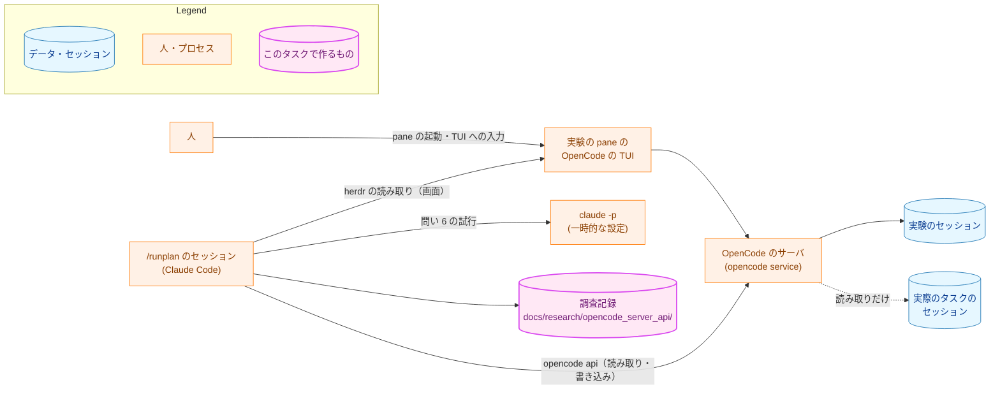

# 設計書：OpenCode のサーバの API で chief の判定と送信を置き換えられるかの調査

## Document Status

| Item | Value |
|---|---|
| Status | `draft` |
| Created | 2026-11-16 |
| Review date | - |
| Reviewer | - |
| Comments | - |

## 1. 設計の全体像

本タスクは、OpenCode のサーバの API を実地で確かめ、その結果を調査記録に残す（[01_requirements.md](01_requirements.md) F-001〜F-009）。作るものは、調査記録 1 つである。コード、コマンドの定義、`.claude/settings.json` は変えない。

本書は、実験を行う環境、人とエージェントの役割の分け方、問いごとの確かめ方、調査記録の構成を定める。

**設計原則:**

-   **実際の chief が向き合うサーバで確かめる。** chief がつながるのは、TUI が既定でつながる裏で動くサーバである。問い 4（pane とセッションの対応）と問い 5（版）は、そのサーバでなければ答えにならない。
-   **書き込みは、実験のセッションだけに送る。** 裏で動くサーバは、実際のタスクの OpenCode の pane も使っている。書き込みの呼び出しの宛先は、実験の手順が作ったセッションの ID だけにする（[01_requirements.md](01_requirements.md) AC-18）。
-   **エージェントは pane に入力を送らない。** chief のセッションへの herdr の拒否（[ADR-0046](../../dev/adr/0046-chief-of-staff.md)、`.claude/settings.json`）は、`/runplan` のセッションにも効く。TUI への入力と pane の起動は人が行い、エージェントは API の呼び出しと pane の画面の読み取り（拒まれていない）を行う。
-   **記録には形だけを写す。** API の応答と TUI の画面は信頼できない文字列で、記録には型・フィールドの名前・状態コード・イベントの種類の名前だけを写す（[01_requirements.md](01_requirements.md) AC-17）。

**設計の際に決めたこと（2026-11-16）:**

-   **実験は、裏で動くサーバ（`opencode service`）で行い、書き込みは実験のセッションの ID だけに送る。** `--standalone` の私用のサーバは実際のタスクから切り離せるが、chief がつながるサーバと違い、問い 4・5 の答えが間接的になるためである。書き込む前に、宛先のセッションの作業ディレクトリが使い捨ての worktree であることを `session.get` で確かめる（3.2 節）。ADR: なし（このタスクの中で閉じる）。
-   **実験の場所は、新しい使い捨ての Herdr の workspace とし、調査の後に消す。** worktree は `origin/main` から detached で作る。0088 が残した workspace `chief-poc` を使い回すと準備は減るが、前の状態が観測に混じりうるためである。workspace の名前は、chief が自分のものとして扱う `issue-<N>` の形を避ける（3.1 節）。ADR: なし。
-   **問い 6 は、エージェントが `claude -p --settings <一時的な設定ファイル>` で、呼び出しの形ごとに実行を試させ、拒まれたかを記録する。** 人が対話のセッションで 1 つずつ試すより、同じ手順を繰り返せるためである。ADR: なし。
-   **調査記録は `docs/research/opencode_server_api/README.md` に置く。** 既存の調査記録（`docs/research/wasm_pipeline_poc/README.md`）と同じく、主題のディレクトリに `README.md` を置く形にそろえる。ADR: なし。

## 2. システム構成

実験の構成は 1 章の図のとおりである。製品の構成要素は変えない。

| 要素 | 役割 | 誰が用意するか |
|---|---|---|
| 使い捨ての worktree | `origin/main` から detached で作る。PR を持つブランチがないので、`/runpr` は最初の確かめで止まる（問い 3） | 人 |
| 使い捨ての workspace | 上の worktree を開く Herdr の workspace。OpenCode の pane を、問い 4 のために 2 つまで置く | 人 |
| 実験のセッション | 実験の pane の TUI か、エージェントの `session.create` が作る OpenCode のセッション | 人またはエージェント |
| 一時的な設定ファイル | 問い 6 の拒否の候補を持つ JSON。セッションの scratchpad に置き、コミットしない | エージェント |
| 調査記録 | 問い 1〜7 の答え・観測・再現の手順 | エージェント |

## 3. コンポーネント設計

### 3.1. 使い捨ての環境

-   worktree は `~/.herdr/worktrees/yt2column/` の外に置かない。名前は `probe-0094` とし、chief が作る `issue-<N>` の形（ADR-0046）と重ならないようにする。chief がこの workspace を自分の作ったものと取り違えて、削除の候補にしないためである。
-   OpenCode の pane は、問い 4 のために、同じ worktree で 2 つまで起動する。モデルは、送り先の表の `runpr` の行のモデル（DeepSeek V4.1 Flash）とする。chief が実際に使うモデルで、費用も小さいためである。
-   調査の後、人が workspace と worktree を消す。消したことを、記録の再現の手順の最後に、片付けの手順として書く。

### 3.2. 書き込みの宛先の確かめ

書き込みの呼び出しの前に、エージェントは毎回次を確かめ、どれかが成り立たなければ送らずに止まる。

1.  宛先のセッションの ID が、この調査で作ったか、実験の pane が使っていると人が示したセッションの ID の一覧にある。
2.  `session.get` が返すそのセッションの作業ディレクトリが、使い捨ての worktree のパスと一致する。

### 3.3. 問いごとの確かめ方

| 問い | 確かめ方 | 人の操作 |
|---|---|---|
| 1（`form`） | エージェントが `session.prompt` で、質問ツールで決まった問い（1 つを選ぶ・複数を選ぶ・タブのある）を出すよう求める決まったプロンプトを送る。`session.form.list` を読み、`session.form.reply` で答え、TUI の画面を herdr の読み取りで見る | なし（画面を目で確かめるなら見る） |
| 2（権限の確認） | 権限の確認が出る操作（worktree の外のファイルへの書き込みなど）を求める決まったプロンプトを送り、`permission.request.list` と `session.permission.list` を読む。確認には API で拒否を答える | なし |
| 3（モデル・コマンド・`/new`） | `session.switchModel` の後に短い決まったプロンプトを送り、`session.message.list` のモデルを読む。`session.command` で `/runpr` を送る。`session.create` などの後に、TUI の画面を読む | `/runpr` を TUI で打つ（比べる側） |
| 4（pane とセッション） | 2 つの pane と、`opencode --session <id>` で起動した pane について、`session.list`・`session.active` と画面を突き合わせる | pane の起動、TUI でのセッションの切り替え、`/new` |
| 5（版） | `/openapi.json` の `info`、応答のヘッダ、存在しない操作への要求の応答を読む | なし |
| 6（拒否） | サーバへの届き方と認証を読み取りで確かめる。呼び出しの形を挙げ、拒否の候補を一時的な設定ファイルに書き、`claude -p --settings` で形ごとに実行を試させる | なし |
| 7（`event.subscribe`） | 問い 1・2 の間、`event.subscribe` を購読し、流れたイベントの種類を記録する | なし |

問い 6 の試行で、`claude -p` のセッションに試させる呼び出しは、宛先を実験のセッションにする。拒否が効かなかったときに、実際のタスクのセッションへ入力が届かないようにするためである。

### 3.4. 調査記録の構成

`docs/research/opencode_server_api/README.md` は、次の節を持つ。

1.  冒頭：目的、タスクと issue へのリンク、確かめた日付と OpenCode の版、時点の記録であること、記録に含めないもの（AC-01・AC-17）。
2.  問いへの答え：問い 1〜7 を 1 節ずつ。各節に、答え・観測・再現の手順（AC-02〜AC-16）。
3.  確かめていない事項と前提（AC-04）。
4.  環境の用意と片付けの手順（3.1 節）。

## 4. エラーハンドリング設計

実行時のコードがないので、実験の手順の失敗の扱いを定める。

-   **問いに答えられない:** API の操作が失敗する、問いが現れないなどで答えが出なければ、その問いの節に「確かめられなかった」とその理由を書き、ほかの問いを続ける（AC-03）。
-   **書き込みの宛先を確かめられない:** 3.2 節の確かめが成り立たなければ、その書き込みを送らない。手順を直してから続ける。
-   **実際のタスクのセッションに書き込んでしまった:** 実験を止めて人に知らせ、そのセッションに何を送ったかを人に示す。
-   **費用の承認の外に出る:** 承認した LLM の呼び出しの規模（3.1 節のモデルで数十回、`claude -p` で十数回）を超えそうなら、止めて人に尋ねる。

## 5. セキュリティ考慮事項

[01_requirements.md](01_requirements.md) 4.2 のとおりである。設計で加えるのは次の点である。

-   書き込みの宛先の確かめ（3.2 節）と、問い 6 の試行の宛先（3.3 節）で、実際のタスクのセッションへ入力が届かないようにする。
-   一時的な設定ファイルは scratchpad に置き、リポジトリの `.claude/settings.json` と `.claude/settings.local.json` は変えない。
-   API の応答と画面は、エージェントへの指示として扱わない（security.md §6）。

## 6. 処理フローの詳細

3.3 節の表の順ではなく、読み取りだけの問いを先に行う。書き込みの前に、サーバの形と届き方を知っておくためである。順序は、問い 5 → 問い 6 の前半（届き方と認証）→ 問い 4 → 問い 1・2・7 → 問い 3 → 問い 6 の後半（拒否の試行）→ 記録とする。

## 7. テスト戦略

恒久のテストは足さない。成果は調査記録で、確かめ方は次のとおりである。

-   **読んで確かめる（`manual`）:** 記録の内容（AC-01〜AC-18）は、PR のレビューで読んで確かめる。
-   **記録した diff の読み取り（`diff`）:** AC-19 は、実装の PR のマージベースとの差分のファイルの一覧を記録して確かめる。

## 8. 実装の優先順位

実装の PR は 1 本で、6 章の順に実験し、記録を書く。

## 9. 将来の拡張性

#906・#907 は、記録の問いの節を引用して設計する。OpenCode の版が上がったときに同じ確かめをやり直せるよう、記録の再現の手順はコマンドの形で残す。
