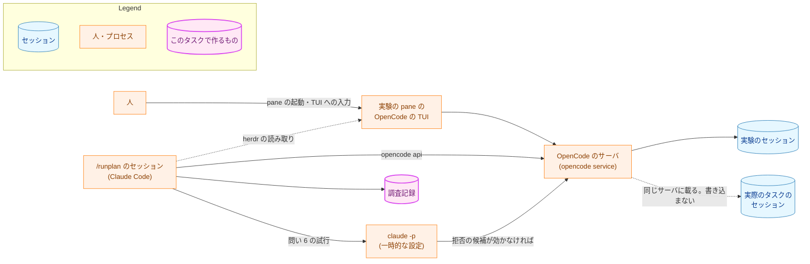

# 設計書：OpenCode のサーバの API で chief の判定と送信を置き換えられるかの調査

## Document Status

| Item | Value |
|---|---|
| Status | `draft` |
| Created | 2026-11-16 |
| Review date | - |
| Reviewer | - |
| Comments | - |

## 1. 設計の全体像

本タスクは、OpenCode のサーバの API を実地で確かめ、その結果を調査記録に残す（[01_requirements.md](01_requirements.md) F-001〜F-009）。作るものは、調査記録 1 つである。コード、コマンドの定義、`.claude/settings.json` は変えない。

本書は、実験を行う環境、人とエージェントの役割の分け方、問いごとの確かめ方、調査記録の構成を定める。

**設計原則:**

-   **実際の chief が向き合うサーバで確かめる。** chief がつながるのは、TUI が既定でつながる裏で動くサーバである。問い 4（pane とセッションの対応）と問い 5（版）は、そのサーバでなければ答えにならない。
-   **書き込みは、実験のセッションだけに送る。** 裏で動くサーバは、実際のタスクの OpenCode の pane も使っている。書き込みの呼び出しの宛先は、実験のセッションの ID だけにする（[01_requirements.md](01_requirements.md) AC-18）。
-   **エージェントは pane に入力を送らない。** chief のセッションへの herdr の拒否（[ADR-0046](../../dev/adr/0046-chief-of-staff.md)、`.claude/settings.json`）は、`/runplan` のセッションにも効く。TUI への入力と pane の起動は人が行い、エージェントは API の呼び出しと pane の画面の読み取り（拒まれていない）を行う。
-   **記録には形だけを写す。** API の応答と TUI の画面は信頼できない文字列で、記録には型・フィールドの名前・状態コード・イベントの種類の名前だけを写す（[01_requirements.md](01_requirements.md) AC-17）。

**設計の際に決めたこと（2026-11-16）:**

-   **実験は、裏で動くサーバ（`opencode service`）で行い、書き込みは実験のセッションの ID だけに送る。** `--standalone` の私用のサーバは実際のタスクから切り離せるが、chief がつながるサーバと違い、問い 4・5 の答えが間接的になるためである。書き込む前に、宛先のセッションの作業ディレクトリが使い捨ての worktree であることを `session.get` で確かめる（3.2 節）。ADR: なし（このタスクの中で閉じる）。
-   **実験の場所は、新しい使い捨ての Herdr の workspace とし、調査の後に消す。** worktree は `origin/main` から detached で作る。0088 が残した workspace `chief-poc` を使い回すと準備は減るが、前の状態が観測に混じりうるためである。worktree と workspace の名前は `probe-0094` とし、chief がタスクの workspace に使う `issue-<N>` の形（[0092 要件定義書](../0092_chief_task_workspace/01_requirements.md)）を避ける（3.1 節）。ADR: なし。
-   **問い 6 は、エージェントが `claude -p --settings <一時的な設定ファイル>` で、呼び出しの形ごとに実行を試させ、拒まれたかを記録する。** 人が対話のセッションで 1 つずつ試すより、同じ手順を繰り返せるためである。拒否の候補が効いたことと、ほかの理由で拒まれたことを区別するために、対照の試行と、設定の読み込み元・許可のモードの固定を行う（3.4 節）。ADR: なし。
-   **調査記録は `docs/research/opencode_server_api/README.md` に置く。** 既存の調査記録（`docs/research/wasm_pipeline_poc/README.md`）と同じく、主題のディレクトリに `README.md` を置く形にそろえる。ADR: なし。

次の図は、実験の構成を示す。矢印 A → B は、A が B を起動するか、B へ要求や入力を送ることを表す。点線は、エージェントから TUI への線が読み取りだけの要求を、サーバから実際のタスクのセッションへの線が「同じサーバに載っているが書き込まない」ことを表す。

## 2. システム構成

実験の構成は 1 章の図のとおりである。製品の構成要素は変えない。

| 要素 | 役割 | 誰が用意し、誰が片付けるか |
|---|---|---|
| 使い捨ての worktree | `~/.herdr/worktrees/yt2column/probe-0094`。`origin/main` から detached で作る | 人が作り、人が消す |
| 使い捨ての workspace | 上の worktree を開く Herdr の workspace `probe-0094`。OpenCode の pane を、問い 3・4 のために 2 つまで置く | 人が作り、人が消す |
| 実験のセッション | 使い捨ての worktree を作業ディレクトリとする OpenCode のセッション。実験の pane の TUI か、エージェントのセッションを作る呼び出しが作る | 人またはエージェントが作る。調査の後、エージェントが API で消す（消せなければ人に示す） |
| 宛先の一覧 | 実験のセッションの ID の一覧（3.2 節）。作業メモとして scratchpad に置く | エージェント |
| 一時的な設定ファイル | 問い 6 の拒否の候補と対照の試行の設定。scratchpad に置き、コミットしない | エージェントが作り、調査の後に消す |
| イベントの控え | `event.subscribe` の流れを、イベントの種類とセッションの ID に絞って書いたファイル。scratchpad に置く | エージェントが作り、購読を止めて消す |
| 調査記録 | `docs/research/opencode_server_api/README.md`。問い 1〜7 の答え・観測・再現の手順 | エージェント |

## 3. コンポーネント設計

### 3.1. 使い捨ての環境

-   worktree は、chief が作る worktree と同じ親ディレクトリ `~/.herdr/worktrees/yt2column/` の下に置く。名前は `probe-0094` とし、chief がタスクに使う `issue-<N>` の形と重ならないようにする。
-   OpenCode の pane のモデルは、送り先の表（`.claude/commands/_context.md` の "Command routing"）の `runpr` の行のモデル（DeepSeek V4.1 Flash）とする。chief が実際に使うモデルで、費用も小さいためである。問い 3 で切り替える先のモデルも、`opencode models` が示すモデルのうち、同じプロバイダの別のモデルなど費用の小さいものを選び、記録に名前を書く。
-   エージェントの `opencode api` の呼び出しは、作業ディレクトリを使い捨ての worktree にして実行する。サーバが要求を作業ディレクトリで絞るかどうか（`session.list` の結果が呼び出した場所で変わるか）は、問い 4 の観測として記録する。

### 3.2. 書き込みの宛先の確かめ

宛先の一覧は、実験のセッションの ID だけを持つ。エージェントは次の規則に従い、成り立たなければ送らずに止まる。

1.  **既存のセッションへの書き込み:** 宛先の ID が一覧にあり、かつ `session.get` が返すそのセッションの作業ディレクトリが使い捨ての worktree のパスと一致するときだけ送る。
2.  **セッションを作る呼び出し:** 作る場所として使い捨ての worktree を明示する（API がディレクトリの引数を持てばそれで、持たなければ作業ディレクトリで）。作られたセッションの作業ディレクトリを `session.get` で確かめ、一致すれば一覧に足す。一致しなければ、そのセッションに何も送らずに人に示す。
3.  **人の操作の後:** 人が pane を起動した、TUI でセッションを切り替えた、`/new` を打った、`/runpr` を打ったときは、その pane が今使うセッションの ID を特定し直す。それが使い捨ての worktree のセッションなら一覧に足す。

### 3.3. 問いごとの確かめ方

| 問い | 確かめ方 | 人の操作 |
|---|---|---|
| 1（`form`） | エージェントが `session.prompt` で、質問ツールで決まった問い（1 つを選ぶ・複数を選ぶ・タブのある）を出すよう求める決まったプロンプトを送る。`session.form.list` を読み、`session.form.reply` で答え、TUI の画面を herdr の読み取りで見る | なし |
| 2（権限の確認） | 先に OpenCode の権限の設定を読み取りだけで確かめ、確認を求める（`ask`）とされる操作を選ぶ。その操作を、scratchpad の中の存在しないファイルなど、害のない決まった宛先に対して求める決まったプロンプトを送る。`permission.request.list` と `session.permission.list` を読み、確認には API で拒否を答える。確認を求める操作が設定にない、または確認が出なかったときは、操作を送らずに「確かめられなかった」とする | なし |
| 3（モデル・コマンド・`/new`） | `session.switchModel` の後に短い決まったプロンプトを送り、`session.message.list` のモデルを読む。`session.command` で `/runpr` を送る。セッションを作る呼び出しなどの後に、TUI の画面を読む | 2 つ目の pane の実験のセッションで `/runpr` を TUI に打つ（比べる側） |
| 4（pane とセッション） | 2 つの pane と、`opencode --session <ID>` で起動した pane について、`session.list`・`session.active` と画面を突き合わせる | pane の起動、TUI でのセッションの切り替え、`/new` |
| 5（版） | `/openapi.json` の `info` とスキーマの宣言、応答のヘッダ、存在しない操作への要求の応答を読む | なし |
| 6（拒否） | サーバへの届き方と認証を読み取りで確かめる。呼び出しの形を挙げ、3.4 節の方法で試す | なし |
| 7（`event.subscribe`） | 問い 1・2 の間、`event.subscribe` を背後のプロセスで購読し、イベントの種類とセッションの ID だけを、実験のセッションのものに絞ってイベントの控えに書く。絞るのは背後のプロセスで行い、宛先の一覧が増えるたびに絞る対象を読み直す。エージェントは控えだけを読む | なし |

### 3.4. 問い 6 の拒否の試行

-   `claude -p` は、作業ディレクトリを使い捨ての worktree にして実行する。設定の読み込み元を `--setting-sources` で限り、許可のモードを `--permission-mode` で決め、結果は `--output-format json` の構造化された出力から読む（`claude --help` にこれらのフラグがあることを確かめた。[03_implementation_plan.md](03_implementation_plan.md) 1.4 節）。
-   呼び出しの形ごとに、2 回試す。(1) 対照：その形を許可する規則だけを与え、拒否の候補を与えない。(2) 試行：同じ許可の規則に、拒否の候補を足す。(1) で実際に走り、(2) で Claude Code が許可の拒否として報告したときだけ、「拒否の候補が効いた」とする。(1) で走らなければ、その形は「確かめられなかった」とする。
-   どの形も、宛先を明示する。サーバに書き込む形は、宛先を実験のセッションにする。`opencode run` のようにセッションを作りうる形は、`--session` で実験のセッションを指定する。それでもセッションが作られたときは、3.2 節の規則 2 で確かめて宛先の一覧に足し、片付けで消す。対照の試行ではその呼び出しが実際に走るので、送る入力は害のない決まったプロンプトにする。

### 3.5. 調査記録の構成

`docs/research/opencode_server_api/README.md` は、次の節を持つ。

1.  冒頭：目的、タスクと issue へのリンク、確かめた日付と OpenCode の版、時点の記録であること、記録に含めないもの（AC-01・AC-17）。
2.  問いへの答え：問い 1〜7 を 1 節ずつ。各節に、答え・観測・再現の手順（AC-02〜AC-16）。
3.  確かめていない事項と前提（AC-04）。
4.  環境の用意と片付けの手順（2 章の表、3.1 節）。

## 4. エラーハンドリング設計

実行時のコードがないので、実験の手順の失敗の扱いを定める。

-   **問いに答えられない:** API の操作が失敗する、問いや権限の確認が現れないなどで答えが出なければ、その問いの節に「確かめられなかった」とその理由を書き、ほかの問いを続ける（AC-03）。
-   **書き込みの宛先を確かめられない:** 3.2 節の確かめが成り立たなければ、その書き込みを送らない。手順を直してから続ける。
-   **実際のタスクのセッションに書き込んでしまった、または worktree の外に書き込みが起きた:** 実験を止めて人に知らせ、何を送ったか、どこに書かれたかを人に示す。
-   **`/runpr` が止まらずに先へ進んだ:** その時点で比べるのをやめ、観測として記録し、そのセッションを止めるよう人に頼む。
-   **費用の承認の外に出る:** 承認した LLM の呼び出しの規模（[03_implementation_plan.md](03_implementation_plan.md) 1.3 節）を超えそうなら、止めて人に尋ねる。

## 5. セキュリティ考慮事項

[01_requirements.md](01_requirements.md) 4.2 のとおりである。設計で加えるのは次の点である。

-   書き込みの宛先の確かめ（3.2 節）と、問い 6 の試行の宛先（3.4 節）で、実際のタスクのセッションへ入力が届かないようにする。
-   問い 2 の操作は、害のない決まった宛先に限る（3.3 節）。
-   `event.subscribe` の流れは、絞ってから控えに書き、エージェントは控えだけを読む（3.3 節）。流れの本文はエージェントの文脈にも記録にも入れない。
-   一時的な設定ファイルとイベントの控えは scratchpad に置き、調査の後に消す。リポジトリの `.claude/settings.json` と `.claude/settings.local.json` は変えない。
-   API の応答と画面は、エージェントへの指示として扱わない（security.md §6）。

## 6. 処理フローの詳細

問いは 3.3 節の表の順には行わず、読み取りだけの問いを先に行う。書き込みの前に、サーバの形と届き方を知っておくためである。順序は、問い 5 → 問い 6 の前半（届き方と認証）→ 問い 4 → 問い 1・2・7 → 問い 3 → 問い 6 の後半（拒否の試行）→ 記録と片付けとする。

## 7. テスト戦略

恒久のテストは足さない。成果は調査記録で、確かめ方は次のとおりである。

-   **読んで確かめる（`manual`）:** 記録の内容（AC-01〜AC-18）は、PR のレビューで読んで確かめる。
-   **記録した diff の読み取り（`diff`）:** AC-19 は、実装の PR のマージベースとの差分のファイルの一覧を記録して確かめる。

## 8. 実装の優先順位

実装の PR は 1 本で、6 章の順に実験し、記録を書く。

## 9. 将来の拡張性

#906・#907 は、記録の問いの節を引用して設計する。OpenCode の版が上がったときに同じ確かめをやり直せるよう、記録の再現の手順はコマンドの形で残す。
