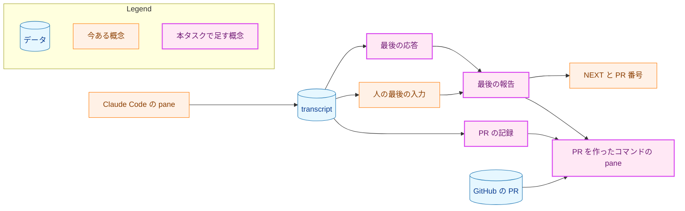
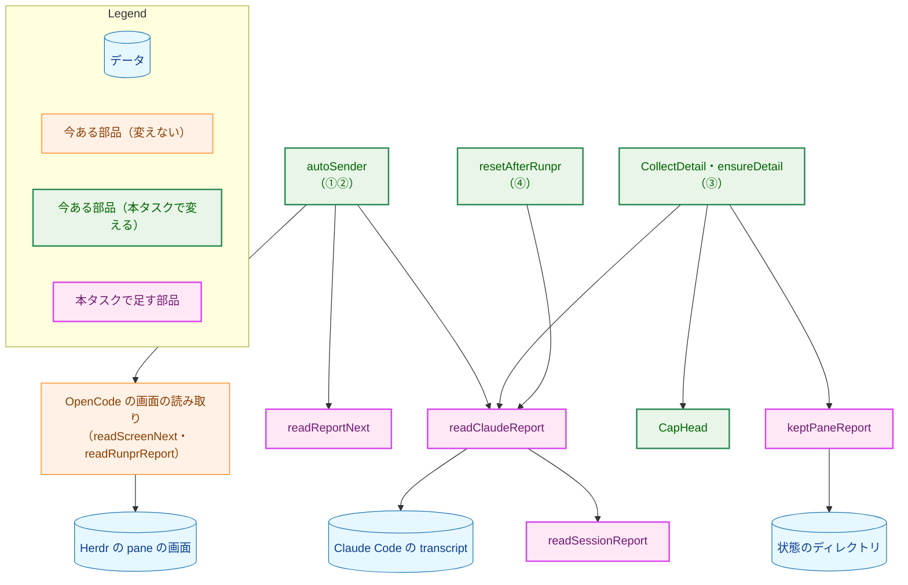
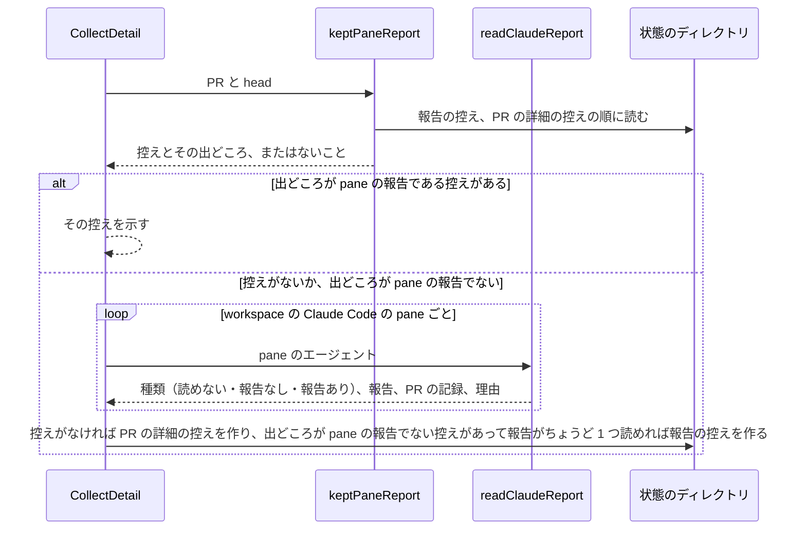
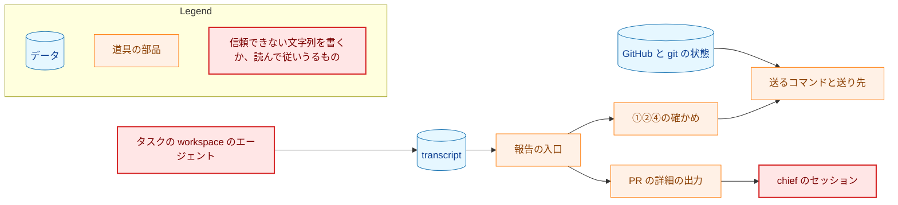
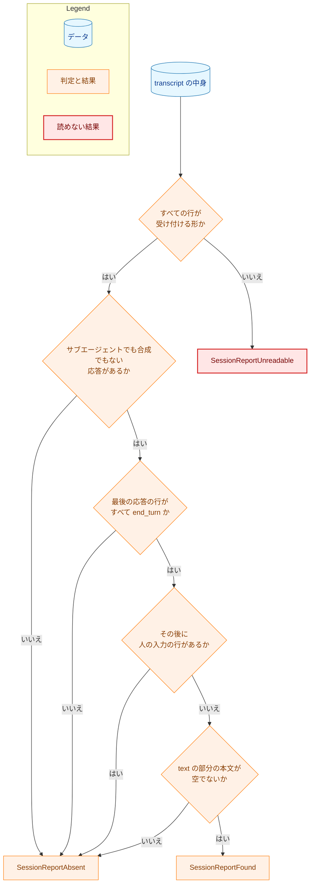
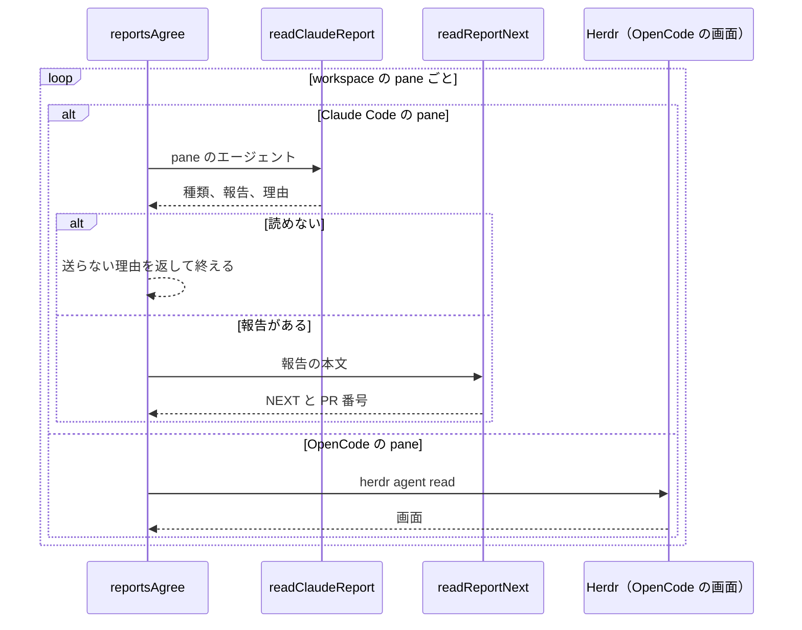
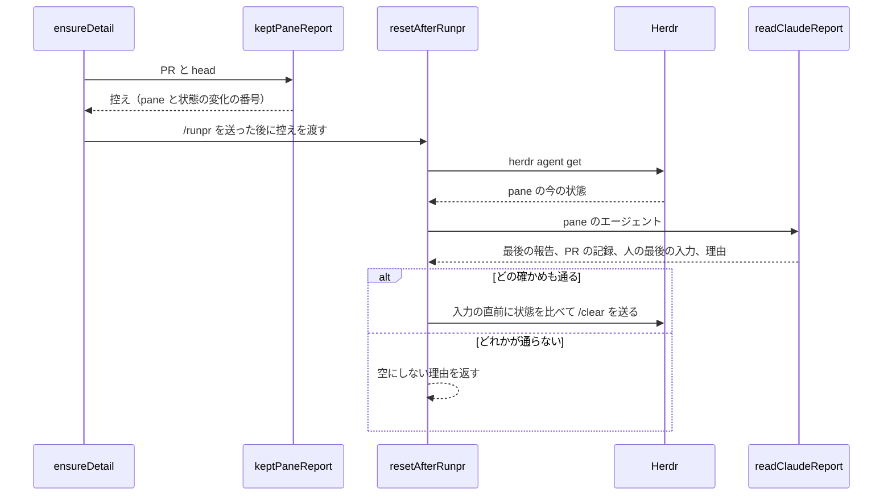

# アーキテクチャ設計書：chief が Claude Code の pane の最後の報告を、画面ではなく transcript から読む

## Document Status

| Item | Value |
|---|---|
| Status | `approved` |
| Created | 2026-11-17 |
| Review date | 2026-11-17 |
| Reviewer | isseis |
| Comments | - |

本書は [01_requirements.md](01_requirements.md)（要件定義書。以下、要件書）の設計である。「計画で決める」は、本タスクの実装計画書（`03_implementation_plan.md`）で決めることを指す。既存のファイルの内容は、コミット `41683512` で確かめた。`file:line` の行番号は、このコミットでの行番号である。F-NNN・AC-NN は要件書の項番を、H-NN は [design_handoff.md](design_handoff.md)（以下、申し送り）の項番を指す。申し送りへの対応は付録 A に、受け入れ基準との対応は付録 B にまとめる。

本書は、要件書 6 章の用語（transcript・最後の報告・終わった応答・PR の記録）と、要件書 1 章の記号 ①〜④（①: NEXT の照合、②: ブランチのない状態での自動送信と `/runpr` の pane のリセット、③: PR の詳細、④: PR を作った pane のリセット）を、同じ意味で使う。[0088 設計書](../0088_chief_of_staff/02_architecture.md)（以下、0088 設計書）の用語（道具・状態のディレクトリ・周・送信の記録など）も、同じ意味で使う。そのほかに、次の用語を使う。

-   **応答:** transcript の `type` が `assistant` の行のうち、`message.id` が同じ行のまとまり。1 つの応答は、本文の部分ごとに複数の行に分かれて書かれる（1.2）。
-   **合成の応答:** Claude Code が API のエラーなどを知らせるために自ら書く応答。`message.model` が `<synthetic>` である（1.2）。
-   **報告の読み取り部品:** transcript の中身から最後の報告・PR の記録・人の最後の入力を読む部品（3.1）。
-   **報告の入口:** Claude Code の pane について、transcript の場所を決めて読み、報告の読み取り部品で読んだ結果を 1 つの値で返す部品（3.3）。①〜④は、Claude Code の pane の報告をこの入口だけから読む。
-   **NEXT を名指す行:** 報告の行のうち、Markdown の記号を除いた行頭が `NEXT` とコロンである行（3.2）。
-   **PR の詳細の控え:** 0088 の、PR と head のコミットごとに 1 回だけ作る記録（`detail-<PR 番号>-<head>.json`、`internal/chief/detail.go:282-297`）。その出どころ（`Source`）は、pane の報告（`report`）、PR の説明（`description`）、どちらもない（`none`）のどれかである。
-   **報告の控え:** 出どころが pane の報告でない PR の詳細の控えしかない head について、後で人が PR の詳細を見たときに報告が見つかれば 1 回だけ作る、本書で足す記録（3.6）。

## 1. 設計の全体像 (Design Overview)

### 1.1. 設計原則

-   **情報源だけを替え、確かめの組み立ては変えない。** ①〜④の確かめの位置、条件の並び、送る入力、送り先の選び方は 0088 のままにする。Claude Code の pane で画面を読んでいた所を、報告の入口に替える（F-002）。
-   **行は宣言された項目で選び、本文の中身を調べるのは NEXT と PR 番号だけにする。** 応答の終わり、サブエージェントの応答、合成の応答、人の入力、PR の記録は、transcript の項目の値で見分ける。報告の本文から読むのは、①②の NEXT と②の PR 番号だけである（CLAUDE.md の「Declare, don't infer」と chief の例外、要件書 5 章）。
-   **読めないときは画面に戻らず、安全側に倒す。** transcript を読めないときは、送らないか、空にしないか、PR の説明を示す（F-003）。
-   **読めるか、報告がないか、報告があるかを、1 か所で決める。** その判定は報告の入口が行い、①〜④は入口が返す種類と理由だけで振る舞いを選ぶ。本文と行の形を読む部品は、名前が `screen` で始まるファイルに置く（要件書 4.5）。ファイルの場所とファイルの読み方は、今の `transcriptPath`・`readTranscript`（`internal/chief/transcript.go:53-70`、`internal/chief/transcript.go:82-98`）を使う。
-   **OpenCode の pane は変えない。** OpenCode の pane の報告は、今の画面の読み取り（`readScreenNext`・`readRunprReport` の OpenCode の分）で読む（AC-13）。

### 1.2. 設計の際に決めたこと（2026-11-17）

以下の確かめは、2026-11-17 に、この利用者の手元の transcript で行った。yt2column の worktree の作業ディレクトリの transcript 592 本（サブエージェントの transcript を除く）を、読み取りだけで調べた。書いた Claude Code の版は 2.1.300〜2.1.326 で、応答の行のおよそ 7 分の 1 が 2.1.325 である。下に挙げる形は、この範囲で変わらなかった。サンプルとしてリポジトリに置くものは、実装で採る（7.1）。

-   **最後の報告は、transcript の最後の応答の本文とする。最後の応答とは、サブエージェントの応答でも合成の応答でもない応答のうち、最後のものである。ただし、その応答のすべての行の `message.stop_reason` が `end_turn` で、その後に人の入力の行がないときに限る。本文は、その応答の行の `message.content` のうち、`type` が `text` の部分の文字列を、書かれた順に空行を挟んでつないだものとする（申し送りの H-01、AC-01〜AC-04）。** 確かめた結果は次のとおりである。
    -   1 つの `message.id` の行は、`stop_reason` がすべて同じだった（`end_turn` 5,380 件、`tool_use` 41,911 件、`null` 21 件、`stop_sequence` 22 件、`max_tokens` 1 件）。
    -   `end_turn` の応答のうち 5,365 件では、次の `assistant` か `system` の行が、`subtype` が `turn_duration` の `system` の行だった。
    -   合成の応答の 22 件は、どれも `message.model` が `<synthetic>`、`isApiErrorMessage` が true、`stop_reason` が `stop_sequence` だった。それ以外の応答で `message.model` が `<synthetic>` のものはなかった。
    -   recap は `system` の行（`subtype` が `away_summary`）で、compact の要約は `user` の行（`isCompactSummary` が true、origin なし）だった。どちらも応答の行ではない。
    -   `isSidechain` が true の行はなかった（サブエージェントの行は別のファイルにある）。それでも AC-03 のために、この項目で見分ける。
    -   応答の行は、どれも `isSidechain`・`message.id`・`message.stop_reason`・配列の `message.content` を持っていた。

    合成の応答は「新しい応答の始まり」とせずに読み飛ばす。そうすると、報告の後に合成の応答しかないときはその報告が残り、終わっていない応答の後に合成の応答があるときは報告がない（AC-04）。ADR: なし（行の選び方はこのタスクの中で閉じ、ADR-0046 の「transcript の最後に終わった応答から読む」という決定を実現する手段であるため）。
-   **task-notification や peer の入力に応えた応答も、終わっていれば最後の報告とする。** 人のコマンドの実行は、バックグラウンドのサブエージェントの知らせ（task-notification）に応えた応答で終わることが多い。`end_turn` の応答の直前の入力は、人が 2,551 件、キューに積まれた task-notification が 1,908 件、task-notification が 449 件、peer が 344 件だった。人の入力に応えた応答だけを報告とすると、`/mkarch` などの最後の報告の多くが読めなくなる。要件書 AC-04 が報告でないとするのは、Claude Code が自ら書いた記録である。task-notification に応えた応答はモデルが書いたものなので、AC-04 には当たらない。ただし、報告の後に遅れて届いた知らせに一言で応えると、その一言が最後の報告になる。これを既知の制限として受け入れ、chief 利用ガイドに書く（3.10）。ADR: なし（AC-04 の範囲の読み方で、このタスクの中で閉じるため）。
-   **使う行に使う項目がないときと、その型が違うときは、transcript 全体を読めないものとする。一方、Claude Code が値や種類の名前を変えたとき（`end_turn` の名前が変わる、`text` の部分の種類の名前が変わる、`assistant` の行の種類の名前が変わる）は、要件書 4.2 のとおり、終わっていない応答、本文に含めない部分、使わない行の種類として扱う。その結果は「報告がない」になり、①は止まらずに通る。これを残る危険として受け入れ、ADR-0046 の「結果」を、この振る舞いに合わせて直す。** 要件書 4.2 は、知らない `stop_reason` を「終わっていない」とし、知らない種類の部分と行を読み飛ばすと定めている。版が上がるたびに報告が読めなくならないためである。そのため、名前の変化は「読めない」にならない。項目がないときを読み飛ばすと、それより前の終わった応答が最後の報告になりうる。項目がないときを「報告がない」とすると、①が通る。どちらも、読めないとするより緩い。版が上がったことは、Claude Code の版ごとにサンプルを採り直すことで拾う（chief 利用ガイドの「1. 前提条件」）。名前の変化を拾うために、`assistant` の行が 1 つもない transcript などを読めないとする案は採らない。`/clear` の直後のセッションでも、同じ形になるためである。ADR: [ADR-0046](../../dev/adr/0046-chief-of-staff.md) を更新する（「結果」の、形が変わると自動送信とリセットが止まるという記述が、名前の変化には当たらないため）。
-   **PR の記録（`type` が `pr-link` の行）は、「そのセッションが関わった PR」の記録として扱う。③では、要件書のとおり、この記録がその PR の番号と URL を名指す pane を候補にする（申し送りの H-06、AC-05・AC-09）。** 確かめた結果は次のとおりである。
    -   PR を作ったコマンドの実行（`gh pr create` の結果に PR の URL がある実行）は 391 件あった。そのうち 390 件では、作った後にその PR の記録が書かれた。残る 1 件では書かれなかった。そのほかに、作る前にだけ書かれたものが 4 件あった。
    -   一方、`pr-link` の行を持つセッション 426 本のうち 53 本は、`gh pr create` を走らせていなかった。それらのセッションで、その PR の記録が最初に書かれる直前の操作は、`gh pr checkout`（`/runpr`・`/fixpr`）、PR のあるブランチへの `git push`、`gh pr view` などだった。
    -   同じ PR の記録は、セッションの中で何度も書かれていた。
    -   `prRepository` はすべて `isseis/yt2column` で、`prUrl` はすべて `https://github.com/isseis/yt2column/pull/<番号>` の形だった。

    要件書が「要件に戻る」とした条件（PR を作ったコマンドの実行で書かれない）には当たらないので、要件のまま進める。その結果、③は、その PR に関わった Claude Code の pane（たとえば、PR を作った pane で人が `/fixpr` を走らせた後）の最後の報告を、PR を作ったコマンドの報告として示しうる。④は、人の最後の入力が PR を作ったコマンドであることの確かめ（`internal/chief/reset.go:51-74`）が、今のまま守る。③でも人の最後の入力を確かめるように要件に戻る案は採らない。③は示すだけの用途で、PR に関わった報告を示しても実害がないためである。ADR: [ADR-0046](../../dev/adr/0046-chief-of-staff.md) を更新する（決定が条件付きにしていた確かめの結果と、その帰結を書くため）。
-   **PR の記録は、番号と URL の両方が、GitHub から読んだ PR（`gh pr list` の `number` と `url`）と等しいときに、その PR を名指すとする。`prRepository` は、型（文字列）だけを確かめ、値は比べない。** URL がリポジトリを含むので、URL を比べれば、ほかのリポジトリの同じ番号の PR と取り違えない。`prRepository` の値を比べるには、比べる相手のリポジトリ名を URL から切り出すことになり、文字列から推し量ることになる。ADR: なし（照合の細部で、このタスクの中で閉じるため）。
-   **NEXT を名指す行は、行の前後の空白と、行頭の Markdown の記号（リストの印 `-`・`*`・`+` と番号 `1.`、引用の `>`、強調とコードの `*`・`_`・`` ` ``）を除いた残りが、`NEXT` に続いて、Markdown の記号を間に挟んでもよいコロン（`:` か `：`）で始まる行とする。今の文法（`internal/chief/screen_report.go:53-63`）に合う行は値を読み、合わずに NEXT を名指す行は値を読めない NEXT の行とする（AC-07）。** 過去の Claude Code の `/runpr` の報告には、`2. NEXT: \`/runplan 0088\`` や `**NEXT:** \`/runplan 0038\`（…）` の形があった。一方、`/runpr` に関わる文書を作るタスクの報告には、「NEXT が開く PR」のように文の中で NEXT に触れる行が多かった（`end_turn` の応答の本文で 116 行）。行頭の名指しだけを数えれば、前者を読めない NEXT として止め、後者では止まらない。`Next:` や `NEXT —` のように大文字・小文字やコロンが違う行は、NEXT を名指す行とせず、NEXT がないものとして通る。`/runpr` の報告の形は `runpr.md` が `NEXT: ` で決めており、その外の書き方まで広げると文の中の言及で止まりやすくなるためである。ADR: なし（AC-07 の「名指す」の読み方で、このタスクの中で閉じるため）。
-   **Claude Code の今の `/runpr` の報告のサンプルは、実装の最初のフェーズで採る。その NEXT の行が今の文法で読めなければ、要件に戻って文法を決め直す（申し送りの H-01）。** `/runpr` は今、送り先の表で OpenCode に送られる。このため、2026-11-12 に `/runpr` の報告の形が今の形になってから後の Claude Code の `/runpr` の報告は、手元の transcript にない（上の例は、どれもそれより前の形だった）。文法で読めなくても、①は送らず、②は送らないか空にしないので、設計はどちらの結果でも安全側に倒れる。設計の承認の前に、人が Claude Code の pane で `/runpr` を走らせて採る案は採らない。実の `/runpr` の実行が 1 回要るうえ、実装の最初のフェーズで採っても設計は変わらないためである。ADR: なし（確かめる時機はこのタスクの中で閉じるため）。
-   **人の入力でない origin の種類に `auto-continuation` を足し、その行のサンプルを足す。** 今の人の入力の読み取り（`internal/chief/screen_transcript.go:170-189`）は、サンプルにない種類の origin を見ると、transcript 全体を読めないものとする。手元の transcript には、origin の種類が `auto-continuation` の `user` の行が 6 件あった。claude.ai の利用の上限が戻ったときに、Claude Code が自ら書いて作業を続けさせる行で、`isMeta` が true、`promptSource` が `system` だった。今のままだと、この行のあるセッションでは、セッションが続く間ずっと、①が workspace の自動送信を止め、④が空にしない。人の入力の見分け方（origin の種類が `human` の行だけを人のものとする）は変えない。サンプルで確かめた種類を受け付けるという今の規則の境界のまま、確かめた種類を 1 つ足す。ADR: なし（受け付ける形をサンプルで足すことは、ADR-0046 の決定の中で行うため）。
-   **transcript の読み取りの規則を 0096（Claude Code の質問の判定。以前の番号は 0094）と 1 つにそろえることは、このタスクではしない。** 0096 の要件書は、この案を #905 で考えるとしている。0096 は設計がまだなく、その受け付ける形（たとえば `isSidechain` を読まない拡張の項目とする）は、本書の形（3.1）と違う。2 つの読み取りが同じ行に違う形を求めても、どちらも合わなければ安全側に倒れる。そのため、一方が読めて他方が読めない transcript があっても、送ってはいけないものを送ることはない。後から設計する 0096 が本書の部品を使うかどうかを決める。ADR: なし（部品の分け方で、このタスクの中で閉じるため）。
-   **報告のために transcript を読む量の上限は、リセットと同じ 64 MiB とする。今の `resetTranscriptLimit`（`internal/chief/transcript.go:30`）は報告の読み取りにも使うので、名前を `sessionTranscriptLimit` に変える。④では、1 回読んだ中身から、人の最後の入力と最後の報告と PR の記録を読む（申し送りの H-02）。** 手元の transcript の大きさは、1 MB を超えるもの 447 本の中央値が 3.4 MB、上位 10% の境が 5.9 MB、最大が 25 MB だった。最大のものを今の `readTranscript` と `readLastHumanInput` で読むと、読み込みに約 20 ms、行の読み取りに約 98 ms かかった（このテストは一時的に足し、すぐに消した）。報告の読み取り部品は応答の本文の配列も読むので、これより遅い。そのため、実装で同じ transcript を測り、1 つの transcript を 1 秒以内に読めることを確かめる（8 章の 2）。①は、マージした PR を持ち越す間（最長 10 分、`carryWindow`）の周ごとに、workspace の Claude Code の pane（ふつうは 1 つ）を 1 回読み、送るときは排他の中でもう 1 回読む。末尾から読む仕組みは足さない（CLAUDE.md の「Performance」）。末尾から読む案は採らない。最後の人の入力が先頭にありうるので成り立たず、全体の形の確かめ（要件書 4.2）も満たせないためである。ADR: なし（上限の値はこのタスクの中で閉じるため）。
-   **Herdr が報告した状態と transcript の書き込みの間の遅れには、報告の控えを足して備える。出どころが pane の報告でない PR の詳細の控えしかない head では、人が PR の詳細（`chief detail`）を見たときに pane を読み直し、報告がちょうど 1 つの pane で見つかれば、報告の控えを 1 回だけ作る。報告の控えは、PR の詳細の控えより先に使う。`/runpr` を送る直前の詳細の確かめ（`ensureDetail`）では、報告の控えを作らない（申し送りの H-07）。** 確かめた結果、`end_turn` の応答の行は、transcript の中で、ターンの終わりの `turn_duration` の行より前に書かれていた。ただし、Herdr が入力を待つ状態を報告する時点と、ファイルに書かれる時点の前後は確かめられなかった。
    -   今の PR の詳細の控えは、上書きせずに 1 回だけ作る（`internal/chief/detail.go:413-438`、ADR-0046 の「同名のものがすでにあれば作らず、上書きしない」）。報告の控えを別の名前にすれば、どちらの記録も上書きせずに、遅れた報告を後から拾える。
    -   報告の控えは、④で「控えたときから pane が動いていない」ことを確かめる基準になる。`ensureDetail` は `/runpr` を送る直前に走るので、そこで作ると、④の確かめは送る直前から後の数秒しか見ない。その数秒より前に、人がその pane で問いに答えたり、知らせに応えた会話を続けたりしていても、見逃して空にしてしまう。人が PR の詳細を見たときに作れば、今の PR の詳細の控えと同じく、人が見たときからの変化を確かめられる。
    -   PR の詳細の控えのままにする案は採らない。その head の間ずっと③が PR の説明を示し、④が空にしないためである。`/model` の後のように短い間を置いて読み直す案（`internal/chief/transcript.go:33-39`）も採らない。報告がもともとない pane でも、PR の詳細を読むたびに待つことになるためである。

    ADR: [ADR-0046](../../dev/adr/0046-chief-of-staff.md) を更新する（記録の決定が、リセットの候補を狭める記録として PR の詳細の控えだけを挙げているため）。
-   **PR の詳細に示す報告の量の上限は、PR の説明と同じく先頭の 64 KiB とし、行数では切らない。そのため、今の `CapDescription` の名前を `CapHead` に変えて、PR の説明と報告の両方に使う（申し送りの H-04）。** 今の `CapScreen`（`internal/chief/sanitize.go:27-50`）は、画面の末尾の 200 行と 64 KiB を残す、画面のための上限である。transcript の報告は折り返しがなく、要約に要る、PR が変える内容と結果は、報告の先頭に書かれる。報告と PR の説明で上限を変える理由はないので、関数を分けない。制御文字と見えない文字の置き換えは、今のとおり出力で `Sanitize` が行う（`internal/chief/output.go:410`）。ADR: なし（上限の値はこのタスクの中で閉じるため）。
-   **このタスクで使われなくなる、Claude Code の画面から報告を読む部品と、そのテストとテストの補助関数を消す。画面のサンプルは、入力欄の判定のテストが使うので残し、サンプルの一覧の行を移す（申し送りの H-05、3.9）。** 製品のコードから呼ばれない部品を、テストのためだけに残さないためである（CLAUDE.md の「YAGNI」）。`make deadcode` はテストも根に数えるので、テストが呼ぶ部品は報告しない。そのため、消し漏れは計画で呼ぶ所を探して確かめる。テストを消すコミットは分け、`make coverage-compare` の結果を残す（CLAUDE.md の「Testing Strategy」）。画面の読み取りをまとめて消すことは #908 に残す。ADR: なし（部品の整理はこのタスクの中で閉じるため）。
-   **Herdr がセッションを報告しない Claude Code の pane は、要件書のとおり「transcript を読めない」とする（申し送りの H-03）。** 2026-11-17 に `herdr agent list`（読み取り）で確かめた。そのとき動いていた Claude Code の pane 7 つは、`/clear` の後とみられる pane（端末の題が `Claude Code`）を含めて、どれもセッションを報告していて、その transcript のファイルもあった。セッションの報告がない状態が多いという根拠はなかったので、AC-12 を変えるかを人に尋ねる必要はない。ADR: なし（要件を変えないため）。

### 1.3. なぜ今の仕組みでは足りないか

-   **画面からは、画面より長い報告を読めない。** Herdr の `herdr agent read` は pane の高さの分の行しか返さない。そのため、`claudeLastMessage`（`internal/chief/screen_report.go:165-213`）は、報告の始まりの印（`⏺ `）が画面の外に出ると、報告として読まない。これは要件書 1 章の背景のとおりである。
-   **今の transcript の読み取りは、応答も PR の記録も読まない。** `readModelSwitch`（`internal/chief/screen_transcript.go:46-63`）と `readLastHumanInput`（`internal/chief/screen_transcript.go:170-189`）は、`user` と `attachment` の行しか見ない。報告を読むには、`assistant` の行と `pr-link` の行を読む部品を足す必要がある。
-   **今の NEXT の読み取りは、名指しの形の外れを拾わない。** `readRunprNext`（`internal/chief/screen_report.go:64-86`）は、文法に合う行だけを NEXT の行とし、合わない行を読み飛ばす。画面では Claude Code が Markdown を描き直すので、それで足りた。transcript は Markdown のままなので、`**NEXT:**` の行を読み飛ばすと、違う NEXT を「NEXT がない」として通してしまう。AC-07 のとおり、NEXT を名指す行を見分ける読み取りが要る（3.2）。

### 1.4. 概念モデル

図 1 は、本書が足すものと、その関係を示す。矢印 A → B は「A から B が決まる」を表す。



-   pane の transcript は、Herdr が報告するセッションと作業ディレクトリから決まる（`internal/chief/transcript.go:53-70`）。
-   最後の報告は、最後の応答と、その後の人の入力の有無から決まる（3.1）。
-   NEXT と PR 番号は、今の `RunprReport`（`internal/chief/screen_report.go:292-301`）の値で、Claude Code の pane では最後の報告の本文から決まる（3.2）。
-   PR を作ったコマンドの pane は、PR の記録、GitHub の PR、最後の報告の有無から決まる（AC-09、3.6）。

## 2. システム構成 (System Structure)

### 2.1. 全体構成

図 2 は、①〜④が報告を読む経路を示す。矢印 A → B は「A が B を呼ぶか、読む」を表す。本タスクで足すか変える部品を `newpkg` と `enhanced` の色で示す。



-   ①②は、pane のエージェントの種類で読み方を分ける。Claude Code の pane は報告の入口から、OpenCode の pane は今までどおり画面から読む（3.4・3.5）。OpenCode の①は画面のすべての NEXT の行を、②は画面の最後のメッセージを読むので、エージェントの種類による分かれ目は呼ぶ側に残る。
-   ③④は、Claude Code の pane の報告だけを読む。今の③も、OpenCode の pane からは報告を読まない（`internal/chief/screen_report.go:140-143`）。
-   `readSessionReport` は、今の人の入力の読み取り（`humanInputOf`）を使って、人の最後の入力も返す（3.1）。

### 2.2. コンポーネント配置

| ファイル | 新規/変更 | 責務 |
|---|---|---|
| `internal/chief/screen_transcript_report.go` | 新規 | 報告の読み取り部品。`readSessionReport`（最後の報告・PR の記録・人の最後の入力）と `readReportNext`（報告の NEXT と PR 番号）を置く（3.1・3.2）。名前が `screen` で始まるので、CLAUDE.md の chief の例外の範囲に入る（要件書 4.5） |
| `internal/chief/screen_transcript.go` | 変更 | `otherOrigins` に `auto-continuation` を足す（1.2）。`readLastHumanInput` を消す。唯一の呼び出し元（`internal/chief/reset.go:63`）が `readSessionReport` の `LastHuman` に替わるためである（3.9） |
| `internal/chief/transcript.go` | 変更 | 報告の入口 `readClaudeReport` を足す（3.3）。`resetTranscriptLimit` の名前を `sessionTranscriptLimit` に変える。|
| `internal/chief/screen_report.go` | 変更 | `readCommandReport`・`claudeLastMessage`・`namesURL` と Claude Code の画面の印を消し、`readRunprReport` を OpenCode だけを読む部品にする（3.9）。`RunprReport.PRs` の説明を、画面と transcript の両方に合うように直す |
| `internal/chief/autosend.go` | 変更 | `reportsAgree`（①）、`detachedReport`（ブランチのない状態での②）、`resetRunpr`（自動送信の後の②）が、Claude Code の pane では報告の入口を使う（3.4・3.5）。自動送信の結果に、Claude Code の pane ごとの①の結果を残す（4.2） |
| `internal/chief/detail.go` | 変更 | `readReport` が報告の入口で Claude Code の pane の報告を読む。`keptReport` が報告の控えを作る。`ReportFromScreen` の名前を `ReportFromPane` にする（記録の値 `report` は変えない）。PR の詳細に、PR の説明を示した理由を足す（3.6・4.2） |
| `internal/chief/request.go` | 変更 | `ensureDetail` が、控えを `keptPaneReport` で読む（3.6） |
| `internal/chief/reset.go` | 変更 | `resetAfterRunpr` の画面の確かめを、報告の入口の確かめに替える。`lastInputMadePR` が自分で transcript を読むのをやめ、入口の結果を受け取る。控えの出どころの比べ（`ReportFromScreen`）を `ReportFromPane` に替える（3.7） |
| `internal/chief/records.go` | 変更 | 報告の控えの名前の形（`report-<PR 番号>-<head>.json`）と、PR の詳細の控えと報告の控えを決まった順に読む `keptPaneReport` を足す。古い記録を消す処理が報告の控えも消し、workspace を消したときに記録を消す処理（0092）との関係は 3.6 のとおり |
| `internal/chief/sanitize.go` | 変更 | `CapDescription` の名前を `CapHead` に変える（3.8）。`CapScreen` を消す（3.9） |
| `.claude/commands/chief.md`・`internal/chief/records.go`（`Protocol`） | 変更 | PR の詳細で PR の説明を示した理由と、自動送信の結果の Claude Code の pane ごとの①の結果を、人に示す項目に足す。出力の項目が増えるので、`Protocol` を 1 つ上げ、定義の `--protocol` の値を合わせる（4.2） |
| `internal/chief/output.go` | 変更 | PR の詳細の出力に、PR の説明を示した理由を足す。自動送信の結果に、Claude Code の pane ごとの①の結果を足す（4.2） |
| `internal/chief/testdata/transcript/` | 変更 | 報告・PR の記録・合成の応答・`auto-continuation` などのサンプルを足す（7.1） |
| `internal/chief/testdata/README.md` | 変更 | 足したサンプルの採り方、削った行、置き換えた値を書く |
| `CLAUDE.md` | 変更 | 「Declare, don't infer」の chief の例外の段落の範囲と境界の文（AC-17、3.10） |
| `docs/dev/guides/chief_guide.md` | 変更 | 「1. 前提条件」「7. 状態のディレクトリ」「8. 既知の制限」（AC-15、3.10） |
| `docs/dev/adr/0046-chief-of-staff.md` | 変更 | PR の記録の確かめの結果、報告の控え、形の変化の残る危険（1.2）。AC-16 の決定・採らなかった案・結果・経緯のうち要件定義の PR より前に決めた分は、そこで書かれている |

### 2.3. データフロー

図 3 は、③で人が PR の詳細を見たときの流れを示す。矢印は呼び出しとその戻りを表す。シーケンス図は色分けしたノードを持たないので、凡例を置かない（図 6・図 7 も同じ）。



## 3. コンポーネント設計 (Component Design)

### 3.1. 報告の読み取り部品（F-001）

`readSessionReport` は、transcript の中身を受け取り、最後の報告、PR の記録、人の最後の入力を返す。

```go
// SessionReportKind is what a Claude Code transcript says about the pane's
// last report. The zero value is SessionReportUnreadable: the transcript does
// not have the accepted shape, so whether there is a report cannot be told.
type SessionReportKind int

const (
	// SessionReportUnreadable is a transcript outside the accepted shape.
	SessionReportUnreadable SessionReportKind = iota
	// SessionReportAbsent is a transcript with no last report (AC-02).
	SessionReportAbsent
	// SessionReportFound is a transcript whose last finished response has a
	// body.
	SessionReportFound
)

// SessionReport is the last report of a Claude Code session, the PRs its
// pr-link lines name, and the last line the human typed. Text is set only
// for SessionReportFound; nothing but Kind is set for
// SessionReportUnreadable.
type SessionReport struct {
	Kind      SessionReportKind
	Text      string
	LastHuman HumanInput
	links     []prLink
}

// Names reports whether a pr-link line of the session names the PR with
// this number and URL, both compared whole.
func (r SessionReport) Names(number int, url string) bool

// readSessionReport reads the last report, the pr-link lines, and the last
// human input of a transcript, one JSON object per line.
func readSessionReport(transcript []byte) SessionReport
```

PR の記録の並びと数は呼ぶ側に見せず、`Names` だけで答える（CLAUDE.md の「Keep internals unobservable」）。`LastHuman` は、今の `readLastHumanInput` が同じ中身に返すのと同じ値で、同じ行の読み方（`humanInputOf`）を使う。`readLastHumanInput` は、呼ぶ所がなくなるので消す（3.9）。

**受け付ける形。** 要件書 4.2 の受け付ける形を、次の行と項目で実現する。表にない行の種類と、使う行の中の表にない項目は読み飛ばす（要件書 4.2 の「拡張を許す部分」）。

| 行 | 見分け方 | 使う項目と、受け付ける値 |
|---|---|---|
| すべての行 | 空でない行 | 1 つの JSON のオブジェクトで、`type` が空でない文字列 |
| 応答の行 | `type` が `assistant` | `isSidechain`（真偽値）、`message`（オブジェクト）。`message` の中の `id`（空でない文字列）、`model`（文字列）、`stop_reason`（文字列か `null`）、`content`（配列。各要素はオブジェクトで、`type` は文字列。`type` が `text` の要素の `text` は文字列） |
| 人の入力の行 | 今の `humanInputOf` の規則（`internal/chief/screen_transcript.go:239-283`） | 今の規則のとおり。人の入力でない origin の種類に `auto-continuation` を足す（1.2） |
| PR の記録の行 | `type` が `pr-link` | `prNumber`（正の整数）、`prUrl`（空でない文字列）、`prRepository`（文字列） |

-   読み方は、今の transcript の読み取りと同じく `strictjson` で行う（`internal/chief/screen_transcript.go:46-63`）。重なった項目、不正な UTF-8、対にならないサロゲートは、`strictjson` が拒む。
-   応答の行と PR の記録の行で、表の使う項目が 1 つでもないか、値の型が違えば、`SessionReportUnreadable` を返す（要件書 4.2 の「拒むもの」、1.2）。項目がない行を読み飛ばすと、それより前の応答が最後の報告になりうるためである。
-   人の入力の行として受け付けられない行（サンプルにない origin の種類など）があれば、今の `readLastHumanInput` と同じく `SessionReportUnreadable` を返す。
-   書きかけの最後の行は、1 つの JSON のオブジェクトでないので、`SessionReportUnreadable` になる（要件書 4.3）。

**最後の報告の決め方。** 次の規則で決める（1.2）。

1.  `isSidechain` が true の応答と、合成の応答（`message.model` が `<synthetic>`）は読み飛ばす（AC-03・AC-04）。
2.  残った応答のうち、transcript の中で最後の行を持つ応答を、最後の応答とする。その `message.id` を持つすべての行が、その応答の行である。
3.  最後の応答がないか、その行のどれかの `stop_reason` が `end_turn` でなければ、報告はない（AC-02 の「終わった応答がない」「終わらずに止まっている」）。`null`・`tool_use`・`max_tokens`・`stop_sequence`・知らない値は、どれも終わっていない。
4.  最後の応答の最後の行より後に、人の入力の行があれば、報告はない（AC-02 の「人の入力」）。新しい応答が始まったときは、2 でその応答が最後の応答になるので、この規則で扱える。
5.  本文は、最後の応答の行の `content` のうち、`type` が `text` の要素の `text` を、書かれた順に空行を挟んでつなぎ、前後の空白を除いたものである。思考（`thinking`）、ツールの呼び出し（`tool_use`）、知らない種類の要素は含めない。本文が空なら、報告はない（AC-02 の「本文がない」）。

recap（`system` の行）、compact の要約と人の入力でない `user` の行、ツールの結果、`attachment` の行（キューに積まれた人の入力を除く）は、応答でも人の入力でもないので、最後の報告を変えない（AC-04）。

**PR の記録。** transcript の中のすべての `pr-link` の行を集める。最後の報告の有無とは関係なく集める。

### 3.2. NEXT と PR 番号（AC-07・AC-08）

`readReportNext` は、Claude Code の pane の最後の報告の本文から、①②で使う NEXT と PR 番号を読む。返す型は、今の `RunprReport`（`internal/chief/screen_report.go:292-301`）である。

```go
// readReportNext reads the NEXT and the PR numbers of a Claude Code pane's
// last report, read from its transcript.
func readReportNext(text string) RunprReport
```

-   **NEXT の行。** 報告の各行の前後の空白を除いた残りが、今の `nextLine` に合えば、今の `readNextValue` で値を読む。合わずに NEXT を名指す行（1.2 の定義）であれば、値を読めない NEXT の行とする。互いに違う値の行があれば、今の `readRunprNext` と同じく、一致しないもの（`NextUnmatched`）とする。NEXT を名指す行がなければ `NextAbsent` とする（AC-07）。
-   **PR 番号。** 報告の各行から、今の `prReference` で `#N` と `/pull/N` を読む。transcript の報告には端末の折り返しがないので、画面のように行をつなぎ直しては読まない（AC-08）。
-   この型の値は照合にだけ使い、送るコマンドとタスクを決めない（AC-11）。今の `RunprReport` の約束（`internal/chief/screen_report.go:292-294`）のとおりである。
-   今の `readRunprNext` は、OpenCode の画面の読み取りで今までどおり使う。OpenCode の画面には、NEXT を名指す行の規則を足さない（AC-13）。

### 3.3. 報告の入口

`readClaudeReport` は、Claude Code の pane について、読めるか、報告がないか、報告があるかを 1 か所で決める。pane の Herdr のセッションと作業ディレクトリから transcript の場所を決め（今の `transcriptPath`）、今の `readTranscript` で `sessionTranscriptLimit` の中で読み、`readSessionReport` で読む。

```go
// ClaudeReport is what chief read about a Claude Code pane's last report.
// Report.Kind is SessionReportUnreadable when the transcript's place cannot
// be decided, the file cannot be read, or its content is outside the
// accepted shape; Reason is then the reason value a reset shows
// (no_transcript or unsupported_path). Reason is no_report for
// SessionReportAbsent and unset for SessionReportFound. Detail says why the
// report is unreadable or absent, with the transcript's path when it is
// known.
type ClaudeReport struct {
	Report SessionReport
	Reason NotSentReason
	Detail string
}

// readClaudeReport reads the last report of a Claude Code pane from its
// session's transcript.
func readClaudeReport(env Env, a Agent) ClaudeReport
```

| 状態 | 種類 | `Reason`・`Detail` |
|---|---|---|
| Herdr がセッションを報告していない | 読めない（AC-12） | `no_transcript` |
| 作業ディレクトリが決められない文字を含む | 読めない | `unsupported_path` と、人ができること（今の `transcriptFailure`、`internal/chief/transcript.go:75-81`） |
| 設定のディレクトリを決められない | 読めない（AC-12） | `no_transcript` |
| セッションのファイルがない | 報告なし（AC-02） | ファイルのパスと、その作業ディレクトリの transcript のディレクトリ（`projects/<名前>`）があるかどうか |
| 通常のファイルでない、開けない、読めない、上限を超える | 読めない（AC-12） | `no_transcript` |
| 中身が受け付ける形に合わない | 読めない（AC-12） | `no_transcript` |
| 読めた | `readSessionReport` の結果 | 報告がないときはその理由 |

-   ファイルがないことは、開いたときの誤りが `fs.ErrNotExist` であることで見分ける。transcript のディレクトリごとないときも、要件書 AC-02 のとおり報告がないものとする。ただし `Detail` でそのことを示す。chief と Claude Code の設定のディレクトリが違うなどの誤った構成で、どの pane も報告がないと読まれていることを、人が出力から見分けられるようにするためである。
-   `readClaudeReport` は、エージェントの種類が Claude Code の pane についてだけ呼ぶ。①〜④は、Claude Code の pane の報告を、この入口の結果の種類と理由だけで扱う。
-   今の `/model` の後の確かめ（`internal/chief/send.go:595`）は、上限が違い、読み直しの間を置くので、この入口を使わない。場所の決め方と読み方は、同じ `transcriptPath`・`readTranscript` を使う。

### 3.4. ①: NEXT の照合（AC-07・AC-14）

`reportsAgree`（`internal/chief/autosend.go:441-461`）は、workspace の pane ごとに、エージェントの種類で読み方を分ける。

-   **Claude Code の pane:** 報告の入口で最後の報告を読み、`readReportNext` で NEXT を読む。最後の報告がないか、NEXT を名指す行がなければ、不一致にしない。NEXT の判定（次のコマンドがない、違う、読めない）は、今の分岐をそのまま使う。
-   **OpenCode の pane とそのほかの pane:** 今のとおり画面を読む（AC-13）。
-   **読めないとき:** その workspace に送らない。送らない理由は、今の `reportWhy` の文で示し、pane と入口の `Detail` を含める（AC-14）。

### 3.5. ②: ブランチのない状態での自動送信と `/runpr` の pane のリセット（AC-08・AC-14）

`/runpr` の送り先の表のエージェントが Claude Code のとき、次の 2 か所で、その pane の最後の報告を報告の入口から読む。報告がマージした PR の番号と次のコマンドを名指すことを求める条件は変えない。

-   **ブランチのない状態での自動送信（`detachedReport`、`internal/chief/autosend.go:464-487`）。** 読めなければ、送らない理由（`detachedWhy` の文）に、読めないことと入口の `Detail` を示す。報告がなければ、今の「`/runpr` の pane に報告がない」に入口の `Detail` を添える。
-   **自動送信の後の `/runpr` の pane のリセット（`resetRunpr`、`internal/chief/autosend.go:728-777`）。** 読めなければ空にせず、理由の値は入口の `Reason` にする。報告がないか、報告が PR とコマンドを名指さなければ、今の `no_report` にする。

送り先が OpenCode のときは、今のとおり画面を読む（AC-13）。

### 3.6. ③: PR の詳細（AC-09・AC-14・要件書 4.3）

**報告の読み方。** `readReport`（`internal/chief/detail.go:444-465`）は、workspace の pane のうちエージェントの種類が Claude Code のものについて、報告の入口を呼ぶ。最後の報告があり、`Names` がその PR（`OpenPR` の番号と URL）について真の pane を候補にする。候補がちょうど 1 つなら、その報告を `CapHead` で切って示す（3.8）。そうでなければ PR の説明を示す。読めない pane は、報告がないものとして扱う（AC-14 の③）。画面は読まない。

**pane の状態の番号を読む順。** 控えに残す pane の状態の変化の番号（`StateChangeSeq`）は、transcript を読む前に Herdr から読んだものとする。今の `readReport` は、`ws.Agents` を読んでから pane を読んでいる。transcript を読んだ後に読み直した番号を古い報告に結びつけると、④の「控えたときから pane が動いていない」確かめが成り立たないためである。

**報告の控え。** 要件書 4.3 の遅れに備えて、PR の詳細の控えに加えて、報告の控えを置く（1.2）。

| 記録 | 名前 | 作るとき | 読む順 |
|---|---|---|---|
| 報告の控え | `report-<PR 番号>-<head>.json` | 出どころが pane の報告でない PR の詳細の控えしかない head で、人が PR の詳細を見たときに、報告がちょうど 1 つの pane で読めたとき | 1 |
| PR の詳細の控え | `detail-<PR 番号>-<head>.json`（今のまま） | その head で最初に詳細を集めたとき（今のまま） | 2 |

-   どちらも、同名のものがすでにあれば作らず、上書きしない（ADR-0046）。
-   報告の控えは、PR の詳細の控えと同じ型（`detailRecord`）で、`Source` は `report` である。`Skippable` には、作ったときの「レビュー省略可」の判定を入れるが、その値は読まない。状況の表の「レビュー省略可」の印は、今のとおり PR の詳細の控えから読む（`internal/chief/snapshot.go:189-197`）。
-   2 つの記録の名前と読む順は、`WorkspaceRecords` の `keptPaneReport` だけが持つ。報告の控えを読むときは、PR 番号と head が名前と一致し、`Source` が `report` であることを確かめ、違えば記録の誤りとする。

```go
// keptPaneReport returns the record kept for pr at head, the report record
// before the detail record; ok is false when neither is kept.
func (r WorkspaceRecords) keptPaneReport(pr int, head string) (detailRecord, bool, error)
```

-   `CollectDetail` の `keptReport`（`internal/chief/detail.go:419-439`）は、`keptPaneReport` で控えを読む。出どころが pane の報告である控えがあれば、それを使う。控えがなければ、今のとおり集めて PR の詳細の控えを作る。出どころが pane の報告でない控えしかなければ、pane を読み直し、報告がちょうど 1 つ読めれば報告の控えを作り、読めなければ今の控えを使う。
-   `ensureDetail`（`internal/chief/request.go:371-381`）は、`keptPaneReport` で控えを読み、あればそれを返す。なければ、今のとおり詳細を集める。出どころが pane の報告でない控えしかなくても、pane を読み直さず、報告の控えを作らない（1.2）。
-   報告の控えは、PR の詳細の控えと同じ期限（`detailMaxAge`、`internal/chief/records.go:592-594`）で消す。今の古い記録を消す処理（`internal/chief/records.go:880-928` の `cleanup`。PR の詳細の控えを消すのは 910-927 行）は PR の詳細の控えの名前の形しか見ないので、報告の控えの名前の形（`^report-([1-9][0-9]*)-([0-9a-f]{40})\.json$`）も足す。workspace を消したときに、その workspace の記録をすべて消す処理（0092）は、まだコードにない。0092 が先に入れば、その処理が報告の控えも消すように直す。後に入れば、0092 の実装が報告の控えを含める。
-   示した報告がどちらから来たか（0088 要件定義書の AC-19）は、今の `ReportSource` の値（`report`・`description`）で示す。`ReportFromScreen` は `ReportFromPane` に名前を変えるが、記録と出力の値 `report` は変えない（要件書 4.4）。このタスクの前に画面から作った控えも、そのまま読める。
-   PR の説明を示したときは、その理由（Claude Code の pane がない、各 pane が読めない・報告がない・PR の記録が名指さない、候補が 2 つ以上）を PR の詳細の出力に添える（4.2）。

### 3.7. ④: PR を作った pane のリセット（AC-10・AC-14）

`resetAfterRunpr`（`internal/chief/reset.go:94-143`）の確かめの並びは変えない。控えは、今のとおり `/runpr` を送る前に `ensureDetail` が読んだもの（`internal/chief/request.go:246`・`251`）を受け取る。`ensureDetail` は `keptPaneReport` で読む（3.6）。画面を読む確かめ（`internal/chief/reset.go:131-137`）と、`lastInputMadePR` の中で transcript を読む所（`internal/chief/reset.go:55-62`）を、次の確かめに替える。

1.  候補の pane のエージェントが Claude Code でなければ、空にしない（`no_report`）。今の `lastInputMadePR` と同じ扱いである。
2.  報告の入口を 1 回だけ呼ぶ。呼ぶのは、`herdr agent get` で pane の状態を読み、控えの番号と比べた後である（今の順、`internal/chief/reset.go:118-130`）。読めなければ空にせず、理由の値は入口の `Reason` にする。
3.  最後の報告がないか、`Names` がその PR について偽なら、空にしない（`no_report`、AC-10 の 2 つ目の条件）。理由の説明には入口の `Detail` を添える。
4.  入口の結果の `LastHuman` で、今の `lastInputMadePR` の確かめを行う（AC-10 の 1 つ目の条件の 3 つ目）。`lastInputMadePR` は、自分でファイルを読まず、人の最後の入力を受け取る。

控えがその pane から報告を読んだものであることと、控えたときから pane の状態が変わっていないことの確かめは、今のままである。このタスクの前に画面から作った控えにも、同じ条件で確かめる（要件書 4.4）。

今は、transcript のファイルがないとき、`lastInputMadePR` は `no_transcript` を返す（`internal/chief/reset.go:59-61`）。本書では、要件書 AC-02 のとおり報告がないものとし、`no_report` を返す。今この値を確かめるテストはないので、テストを足す（7.1）。

空にする直前の確かめは、今のとおり、pane の状態の番号を入力の直前に比べる（`internal/chief/send.go:306-355` の `checkPane`）。transcript を読んだ後に pane が動けば、空にしない。

### 3.8. 示す本文の上限と無害化（要件書 4.2）

```go
// CapHead keeps the first headMaxBytes bytes of text written by another
// agent or service, such as a PR description or a pane's last report read
// from its transcript, dropping the tail side. The cut never splits a UTF-8
// sequence.
func CapHead(text string) Capped
```

今の `CapDescription`（`internal/chief/sanitize.go:53-63`）の名前と説明を変えたもので、値（64 KiB）と切り方は変えない。切ったことは、今の `Truncated` で示す。制御文字と見えない文字は、今のとおり出力で `Sanitize` が置き換える。

### 3.9. 使われなくなる部品とサンプル（申し送りの H-05）

| 部品・サンプル | 扱い | 理由 |
|---|---|---|
| `readCommandReport`（`internal/chief/screen_report.go:131-153`）・`claudeLastMessage`（同 165-213） | 消す | ③④が transcript を読むので、呼ぶ所がなくなる |
| `namesURL`（`internal/chief/screen_report.go:350-363`） | 消す | `readCommandReport` だけが呼ぶ |
| `claudeMessageMark`・`claudeDoneMark`・`claudeIndent`・`claudeRecapMark` | 消す | `claudeLastMessage` だけが使う。計画で、ほかに使う所がないことを確かめる |
| `CapScreen`（`internal/chief/sanitize.go:27-50`）と `TestCapScreen`（`internal/chief/sanitize_test.go:35`） | 消す | 製品のコードの唯一の呼び出し元（`internal/chief/detail.go:453`）が `CapHead` に替わる（3.6・3.8）。`screenMaxLines`・`screenMaxBytes` は `screen_ansi.go` が使うので残す |
| `squeeze` | 残す | `readRunprReport` の OpenCode の分が使う（`internal/chief/screen_report.go:324`） |
| `readRunprReport` の Claude Code の分 | 消す | ②が transcript を読むので、OpenCode の分だけが残る |
| `readScreenNext` | 残す | ①が OpenCode の pane で使う |
| `readLastHumanInput` | 消す | 唯一の呼び出し元（`internal/chief/reset.go:63`）が `readSessionReport` の `LastHuman` に替わる。`TestReadLastHumanInput` の各行を `readSessionReport` のテストに移してから消す |
| `TestReadCommandReport`・`TestReadCommandReportUnderRecap`・`TestReadCommandReportUnderTitledBox`、`TestReadRunprReport` の Claude Code の行（`internal/chief/screen_test.go:882-885`・`913-915`） | 消すか、OpenCode のサンプルに替える | 消す部品のテストである。915 行の「chief が知らないエージェント」の行は、OpenCode のサンプルで残す |
| テストの補助関数 `reportScreen`・`reportMention`・`isSampleReport`（`internal/chief/screen_test.go:785-805`） | 呼ぶ所が残らなければ消す | 消すテストと、書き換える `network_test.go`・`detail_test.go`・`reset_test.go` のテストが使う |
| `samples_test.go` の `command report` の行の 2 つのサンプル | `input line` の行に移す | `TestScreenSamplesCoverEveryRow`（`internal/chief/samples_test.go:130-166`）は、すべての画面のサンプルがどれかの行にあることを求める。2 つのサンプルは、入力欄の判定のテスト（`internal/chief/screen_test.go:88-90`）が使い続ける |
| `claude-command-report.ansi`・`claude-command-report-recap.ansi` | 残す | 同上 |

テストとテストの補助関数を消すコミットは分け、`make coverage-compare` の結果をコミットメッセージと PR の説明に残す。

### 3.10. 文書の更新（F-004）

-   **CLAUDE.md（AC-17）。** 「Declare, don't infer」の chief の例外の段落のうち、範囲の文の「the last report on a pane (the last message of either agent) and the PR numbers it names, the report of the command that created a PR」を書き換える。OpenCode の pane の最後の報告は画面から、Claude Code の pane の最後の報告は transcript の最後に終わった応答から読むことを書く。transcript から読むものに、最後に終わった応答の本文を足す。PR の記録は transcript が宣言する値なので、範囲に入れない。境界の文に、報告の形も `internal/chief/testdata/transcript/` のサンプルから読んだ形に合わなければ、報告がないか読めないものとすることを足す。diff は、この段落の範囲と境界の文に限る。
-   **chief 利用ガイド（AC-15）。**
    -   「1. 前提条件」のエージェントの行に、Claude Code の transcript の形を、サンプルを採った版（実装で採る版。1.2 の確かめは 2.1.300〜2.1.326）で確かめたことを足す。
    -   「8. 既知の制限」の「長い報告は画面から読めない」を、Claude Code の pane の報告を transcript から読むことと、読めないときの振る舞い（AC-14）の記述に置き換える。あわせて、次の 3 つを書く。PR の詳細が、その PR に関わっただけの pane の報告や、報告の後の知らせへの一言の応えを示しうること。Claude Code が値や種類の名前を変えると、報告がないものとして NEXT の照合が通りうること（1.2）。報告が遅れて書かれたときは、人が PR の詳細を見直すまで、PR を作った pane は空にされないこと。
    -   「worktree のパスの文字」に、その workspace の自動送信も止まることを足す。
    -   「7. 状態のディレクトリ」の workspace ごとの記録と片付けの記述に、報告の控え（`report-*.json`）を足す（3.6）。
-   **ADR-0046（AC-16）。** AC-16 の決定・採らなかった案・結果・経緯は、要件定義の PR で書かれている。本書は、次の 4 つを足す。PR の記録の確かめの結果とその帰結（決定・結果・経緯）、報告の控え（記録の決定と経緯）、名前の変化が報告がないものとして通ること（結果・採らなかった案・経緯）、リセットの決定に、Claude Code の pane の確かめを transcript から読むこと（入力を送る直前の確かめは画面で行う）の言い直し。あわせて、1.2 の ADR を更新する決定で採らなかった案を「採らなかった案」に足す。

### 3.11. 既存のテストと既存の読み手への影響

| テスト（ファイル） | 変わる振る舞い | 扱い |
|---|---|---|
| `TestAutoSendReportMismatch`・`TestAutoSendDetached`・`TestResetAfterAutoSend`・`TestResetChecksAgain`（`internal/chief/autosend_test.go`） | Claude Code の pane の報告を、画面ではなく transcript から読む | Claude Code の pane の報告を transcript で与えるように直す。OpenCode の pane の行は変えない |
| `TestResetAfterRunpr`・`TestResetChecks`・`TestDetailSavedBeforeReset`・`TestResetFailureAfterClear`・`TestNoResetAfterAnUnrecordedRunpr`（`internal/chief/reset_test.go`） | ④の画面の確かめが transcript の確かめになる | 画面の報告の代わりに、transcript の報告と PR の記録を与えるように直す。「text typed after the command」「text typed while the command worked」の行（`internal/chief/reset_test.go:70-71`）は、人の入力の後に応答がないので、3.1 の規則で報告がなくなり、理由が `other_input` から `no_report` に変わる。`other_input` を確かめ続けるために、入力の後に終わった応答を置く行を足す |
| `TestDetailReportSource`・`TestDetailAfterReset`（`internal/chief/detail_test.go`） | ③が transcript から読み、報告の控えを作る | transcript で与えるように直し、報告の控えのテストを足す |
| `TestDetailAndSendRunOnlyReadsInTheRightPlaces`（`internal/chief/network_test.go:64`） | ③④が Herdr の画面を読まなくなる | 画面の報告（`reportScreen`）の代わりに transcript を与え、読む場所の一覧を直す |
| `TestReadLastHumanInput`（`internal/chief/screen_test.go:809`） | `readLastHumanInput` を消す | 各行を `readSessionReport` のテストに移し、`auto-continuation` の行を足す（3.9） |
| `TestReadRunprReport`（`internal/chief/screen_test.go:861`）・`TestScreenSamplesCoverEveryRow`（`internal/chief/samples_test.go:130`） | Claude Code の分がなくなる、サンプルの行が移る | 3.9 のとおり |
| `TestCapDescription`（`internal/chief/sanitize_test.go:89`） | `CapDescription` が `CapHead` になる | 名前を直す |
| 3.9 の消すテスト | 部品がなくなる | 消すコミットを分け、`make coverage-compare` の結果を残す |

`ensureDetail` を直接呼ぶテストはない（`ensureDetail` は `TestDetailSavedBeforeReset` などから間接に通る）。

0088 設計書の 3.1.3 と 3.4.1 は、報告を画面から読むと書いている。完了したタスクの文書は書き換えない（要件書 2.3）。今の振る舞いは、本書と ADR-0046 と CLAUDE.md が示す。

## 4. エラーハンドリング設計 (Error Handling Design)

### 4.1. 失敗の種類

新しい sentinel error は足さない。transcript を読めないことは、今の `errTranscript` と `errUnsupportedPath`（`internal/chief/transcript.go:15-22`）で表す。`readSessionReport` は error を返さず、`SessionReportUnreadable` を返す。今の `readModelSwitch`・`readLastHumanInput` と同じ形である。報告の入口は、error の代わりに、種類と理由の値と説明を返す（3.3）。

| 状況 | ① | ブランチのない状態での② | 自動送信の後の② | ③ | ④ |
|---|---|---|---|---|---|
| セッションの報告がない、設定のディレクトリがない、ファイルを読めない、上限を超える、形に合わない | 送らない | 送らない | 空にしない（`no_transcript`） | その pane は報告なし | 空にしない（`no_transcript`） |
| 作業ディレクトリの文字 | 送らない（人ができることを示す） | 送らない（同） | 空にしない（`unsupported_path`） | その pane は報告なし | 空にしない（`unsupported_path`） |
| ファイルがない | 不一致にしない | 送らない（報告なし） | 空にしない（`no_report`） | その pane は報告なし | 空にしない（`no_report`） |
| 最後の報告がない | 不一致にしない | 送らない（報告なし） | 空にしない（`no_report`） | その pane は報告なし | 空にしない（`no_report`） |
| 報告に NEXT を名指す行がない | 不一致にしない | 送らない | 空にしない（`no_report`） | 関係しない | 関係しない |
| NEXT が読めない、違う、ない、食い違う | 送らない | 送らない | 空にしない（`no_report`） | 関係しない | 関係しない |
| PR の記録がその PR を名指さない | 関係しない | 関係しない | 関係しない | その pane は候補でない | 空にしない（`no_report`） |


### 4.2. 示し方

-   ①とブランチのない状態での②の送らない理由は、今のとおり、自動送信の結果の満たさなかった条件の文として示す（0088 設計書の 3.7）。文には pane と入口の `Detail` を含める。作業ディレクトリの文字が理由のときは、人ができることを添える。
-   ①を通って送ったときも、自動送信の結果に、Claude Code の pane ごとの照合の結果（照合した、報告がない（理由とパス）、NEXT を名指す行がない）を残す。①が何も照合せずに通ったことを、後から出力で見分けられるようにするためである。
-   リセットの空にしない理由は、今の値（`no_transcript`・`unsupported_path`・`no_report`）とその説明の文で示す。説明の文には入口の `Detail` を含める。新しい値は足さない。
-   PR の詳細は、PR の説明を示したときに、その理由を示す（3.6）。
-   上の 2 つの足す項目（①の pane ごとの結果、PR の説明を示した理由）は、`/chief` の定義で人に示す項目に足す。出力の約束が変わるので、道具の `Protocol`（`internal/chief/records.go:25-28`）を 1 つ上げ、定義の値も合わせる。今の `TestDocumentedProtocolMatches` が、2 つが等しいことを確かめる。
-   示す文は、今のとおり出力で `Sanitize` を通す。

## 5. セキュリティ考慮事項 (Security Considerations)

### 5.1. 製品

N/A。要件書 4.2 のとおり、条件付きのガイドの契機に当たらない。製品のコードは変えない。

### 5.2. 開発の道具の信頼の境界

transcript は、エージェントが書いた信頼できない文字列を含む（要件書 4.2）。図 4 は、その文字列が chief のどこへ流れるかを示す。矢印 A → B は「A の値が B に渡る」を表す。



| 脅威 | 守り |
|---|---|
| 報告の本文に送るコマンドやタスクを書いて、chief に送らせる | 送るコマンドとタスクは、GitHub と git と `origin/main` の文書から決める。報告は、①②で送ることを止めるか、④で空にする条件を狭めることにだけ使う（AC-11。図 4 の確かめから送るものへの矢印は、止めることだけを表す） |
| 報告の本文に指示を書いて、chief のセッションに従わせる | 0088 のとおり、`/chief` の定義が、中の指示に従わないと定める。本文は `Sanitize` を通し、`CapHead` で量を限る（要件書 4.2） |
| 偽の PR の記録や人の入力の行を書いて、④で人が使っている pane を空にさせる | transcript は、同じ利用者のプロセスなら書ける。偽るには、PR の記録、人の最後の入力、Herdr の状態の変化の番号の 3 つを合わせる必要がある。同じ利用者のプロセスからの守りは保証しない（0088 設計書 5.2 の残る危険、chief 利用ガイドの「5.2 保証しないこと」）。この残る危険は変わらない |
| 壊れた行、重なった項目、項目のない行、巨大な transcript で、誤った報告を読ませるか、chief を止める | `strictjson` で拒み、使う項目がない行も拒み、形に合わなければ読めないものとして安全側に倒す。読む量は 64 MiB で限る（1.2、3.1） |
| 合成の応答や recap を報告に見せかける | 応答の終わりと合成の応答を、項目の値（`stop_reason`・`message.model`）で見分ける（3.1） |
| Claude Code の版が上がり、値や種類の名前が変わる | 報告がないものとして①が通りうる。残る危険として受け入れ、版ごとにサンプルを採り直す（1.2）。①を通って送った自動送信の結果に、照合しなかったことが残る（4.2） |

## 6. 処理フロー詳細 (Processing Flow Details)

### 6.1. 最後の報告の決め方

図 5 は、3.1 の規則で最後の報告を決める流れを示す。矢印は判定の順を表す。



### 6.2. ①: 自動送信の前の照合

図 6 は、①が pane ごとに報告を読む流れを示す。矢印は呼び出しとその戻りを表す。



### 6.3. ④: PR を作った pane のリセット

図 7 は、`/runpr` を送った後に、PR を作った pane を空にする前の確かめを示す。矢印は呼び出しとその戻りを表す。



## 7. テスト戦略 (Test Strategy)

### 7.1. ユニットテスト

-   **報告の読み取り部品。** 実際の transcript から採ったサンプルで、`readSessionReport` を確かめる。サンプルは `internal/chief/testdata/transcript/` に置き、採った人を特定できる値を、今の README の表のとおりに置き換える（要件書 4.2 の「サンプルの取り扱い」）。テストに要らない行を削るときは、削ったことを README に書く。採るものは次のとおりである（計画で細かく決める）。
    -   PR を作ったコマンドの実行の終わり（`/mkarch` など）。最後の報告と PR の記録がある。
    -   Claude Code の今の形の `/runpr` の報告（実装の最初のフェーズで採る、1.2）。
    -   合成の応答、recap、compact の要約、task-notification に応えた応答、`auto-continuation` の行を含むもの。手元の transcript から採る。
-   **形の拒み方。** サンプルの行を書き換えた入力で、要件書 4.2 の「拒むもの」（重なった項目、型の違い、正でない PR 番号、不正な UTF-8）と、使う項目のない応答の行と PR の記録の行が、`SessionReportUnreadable` になることを確かめる。書きかけの最後の行も確かめる。拡張を許す部分（知らない種類の行、知らない項目）が読み飛ばされることも確かめる。
-   **AC-02〜AC-04 の各場合。** 報告の後の人の入力、終わっていない最後の応答、本文のない応答、サブエージェントの行、合成の応答だけが後に続く報告を、それぞれ確かめる。
-   **AC-06。** 画面に報告があり transcript にない pane は報告がなく、transcript に報告があり画面にない pane は報告があることを、①〜④のそれぞれで確かめる。
-   **NEXT。** `readReportNext` で、今の文法の行、強調・コード・引用・番号のリストで名指す行、文の中で触れるだけの行、食い違う行を確かめる（AC-07）。
-   **報告の入口と①〜④。** 今の fake（`newSendWorld` の `ClaudeConfigDir` と `writeTranscript`、`internal/chief/sim_test.go:50-51`・`107-127`）で transcript のファイルを置く。Claude Code の pane と OpenCode の pane の組み合わせで、4.1 の表の各行を確かめる。セッションのファイルがないときと、transcript のディレクトリごとないときで、説明が違うことも確かめる。OpenCode の pane の結果が変わらないこと（AC-13）は、今のテストを OpenCode の行で残して確かめる。④でファイルがないときに `no_report` になることのテストを足す（3.7）。
-   **書き込みの遅れと競り合い。**
    -   書きかけの最後の行で①が送らず、次の周に持ち越されること。
    -   PR の詳細の控えが PR の説明から作られた後に報告が書かれたとき、`chief detail` が報告の控えを 1 回だけ作り、④がそれを使うこと。
    -   `ensureDetail` が報告の控えを作らないこと。
    -   報告の控えも PR の詳細の控えも上書きされないこと。
    -   名前の PR 番号・head と合わない報告の控えと、`Source` が `report` でない報告の控えを、記録の誤りとすること。
    -   pane の状態を読んでから transcript を読むまでの間に状態が変わったとき、④が空にしないこと。
-   **読む時間。** 25 MB の transcript を `readSessionReport` で読む時間を測り、1 秒以内であることを確かめる（1.2）。
-   各テストは、確かめる部品を壊して失敗することを確かめてからコミットする（CLAUDE.md の「Testing Strategy」）。

### 7.2. 文書のガード

CLAUDE.md・chief 利用ガイド・ADR-0046 の変更は文の変更で、PR のレビューで読む（CLAUDE.md の「Testing Strategy」の文書のテストの規則）。AC-17 の「CLAUDE.md の diff はこの段落の範囲と境界の文に限る」は、`diff` の確かめで行う（`requirements_process.md` の「`diff` verification」）。ADR の形は、今の `TestADRRecords` が確かめる。

### 7.3. 結合テストと手での確かめ

-   実装の最後に、実の Herdr と Claude Code で、`/mkarch` などの長い報告が PR の詳細に示され、`/runpr` の後に PR を作った pane が空にされることを、人が確かめる（AC-01・AC-09・AC-10、`manual`）。
-   消した部品の名前で製品のコードを探し、呼ぶ所が残っていないことを確かめる。`make deadcode` はテストが呼ぶ部品を報告しないので、これだけには頼らない。

### 7.4. セキュリティのテスト

-   5.2 の表の守りのうち、報告の本文が送るコマンドを決めないことは、次の 2 つのテストで確かめる。報告の NEXT と chief の決めた次のコマンドが違うときに送らないこと（①）。報告が一致しても、送るコマンドは文書から決まること。
-   巨大な transcript は、上限を 1 バイト超える入力で読めないことを確かめる。

## 8. 実装の優先順位 (Implementation Priorities)

1.  **サンプルを採る。** Claude Code の今の `/runpr` の報告のサンプルを採り、NEXT の行が今の文法で読めるかを確かめる。読めなければ、要件に戻る（1.2）。ほかのサンプルも、このフェーズで採る。
2.  **報告の読み取り部品と入口。** `readSessionReport`・`readReportNext`・`readClaudeReport`・`keptPaneReport`・`CapHead` を足し、`auto-continuation` の origin を足して、サンプルで確かめる。読む時間を測る。
3.  **①②を transcript に替える。**
4.  **③④を transcript に替え、報告の控えを足す。**
5.  **使われなくなる部品とテストを消す。** テストを消すコミットは分ける（3.9）。
6.  **文書を更新する。** CLAUDE.md、chief 利用ガイド（3.10）。

PR の分け方は計画で決める。

## 9. 将来の拡張 (Future Extensibility)

-   **Claude Code の質問の判定（[#904](https://github.com/isseis/yt2column/issues/904)、0096）。** 0096 も transcript の `assistant` の行を読む。2 つの読み取りの規則をそろえるかどうかは、0096 の設計で決める（1.2）。
-   **見送ったリセットを人の選択肢にすること（[#922](https://github.com/isseis/yt2column/pull/922)、0097）。** 確かめに要るものを読めずに pane を空にしなかったとき、空にすることを人の判断を待つものとして示すことは、0097 が扱う。本書は、空にしない理由の値を足さない。
-   **OpenCode の pane の報告（[#906](https://github.com/isseis/yt2column/issues/906)）。** OpenCode の報告を画面以外から読むようになれば、OpenCode の pane の報告を返す入口を足す。OpenCode の PR を作った pane は、④で今のとおり空にしない。その判定は、OpenCode のサーバの API が最後のメッセージと人の入力を宣言するか（[#903](https://github.com/isseis/yt2column/issues/903) の確かめ）にかかり、#906・[#907](https://github.com/isseis/yt2column/issues/907) で扱う。そのとき、①②の呼ぶ側に残るエージェントの種類による分かれ目（2.1）を、1 つの入口にまとめるかを決める。
-   **画面の読み取りの整理（[#908](https://github.com/isseis/yt2column/issues/908)）。** 本書で消さない画面の読み取り（入力欄の判定、OpenCode の報告）は #908 で扱う。

## 付録 A: 申し送り（design_handoff.md）への対応

| 項目 | 対応 |
|---|---|
| H-01 | 手元の transcript で、応答の終わり、まとまり、合成の応答、recap・compact の行、サブエージェントの見分け方を確かめ、最後の報告の規則を決めた（1.2、3.1）。NEXT の書き方は、NEXT を名指す行の定義を決めた（1.2、3.2）。Claude Code の今の `/runpr` の報告のサンプルは、実装の最初のフェーズで採る（1.2、8 章） |
| H-02 | 上限は 64 MiB とし、最大 25 MB の transcript で今の読み取りの時間を測った。報告の読み取り部品の時間は実装で測る。④は 1 回の読み込みから人の入力と報告と PR の記録を読む。末尾から読む方法は採らない（1.2、3.7） |
| H-03 | `herdr agent list` で、Claude Code の pane がどれもセッションを報告していることを確かめた。AC-12 は変えない（1.2） |
| H-04 | `CapDescription` を `CapHead` にして報告にも使い、先頭の 64 KiB を示す。無害化は今の `Sanitize` を使う（1.2、3.8） |
| H-05 | Claude Code の画面から報告を読む部品と、そのテストと補助関数を消す。入力欄の判定が使うサンプルは残し、サンプルの一覧の行を移す（1.2、3.9） |
| H-06 | PR の記録は、PR を作った実行で作った後に書かれるが、PR に関わっただけのセッションにも書かれることを確かめた。要件のまま進め、ADR-0046 を更新した。`prRepository` は型だけを確かめる（1.2） |
| H-07 | 遅れの有無は Herdr の側を確かめられなかったので、報告の控えを足し、人が PR の詳細を見たときに報告を拾う（1.2、3.6） |

## 付録 B: 受け入れ基準との対応

| AC | 本書の箇所 |
|---|---|
| AC-01 | 3.1、3.3 |
| AC-02 | 3.1、3.3、4.1 |
| AC-03 | 3.1 |
| AC-04 | 1.2、3.1 |
| AC-05 | 3.1、3.6、3.7 |
| AC-06 | 1.1、3.4〜3.7、7.1 |
| AC-07 | 1.2、3.2、3.4 |
| AC-08 | 3.2、3.5 |
| AC-09 | 1.2、3.6 |
| AC-10 | 3.7 |
| AC-11 | 3.2、5.2 |
| AC-12 | 3.3、4.1 |
| AC-13 | 1.1、3.2、3.4、3.5 |
| AC-14 | 3.3〜3.7、4.1、4.2 |
| AC-15 | 3.10 |
| AC-16 | 1.2、3.10 |
| AC-17 | 3.10、7.2 |

## 変更履歴

- 2026-11-17 承認（isseis、#920）
