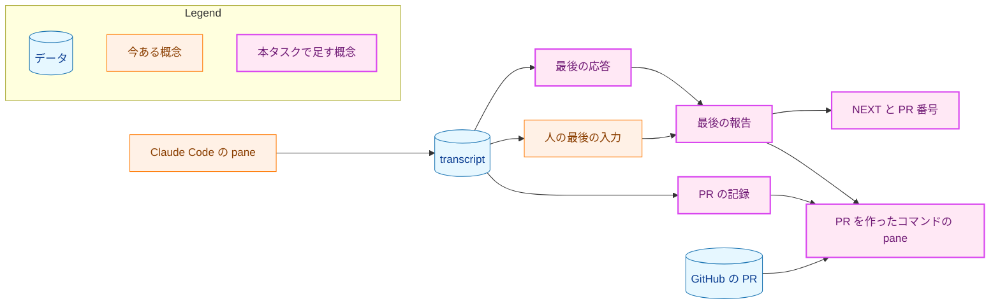
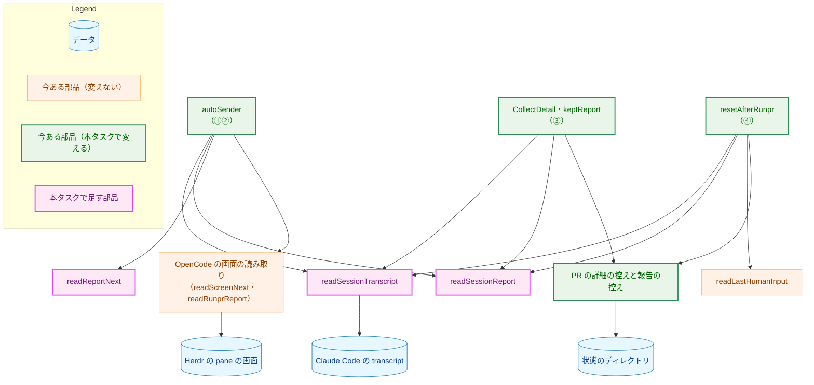
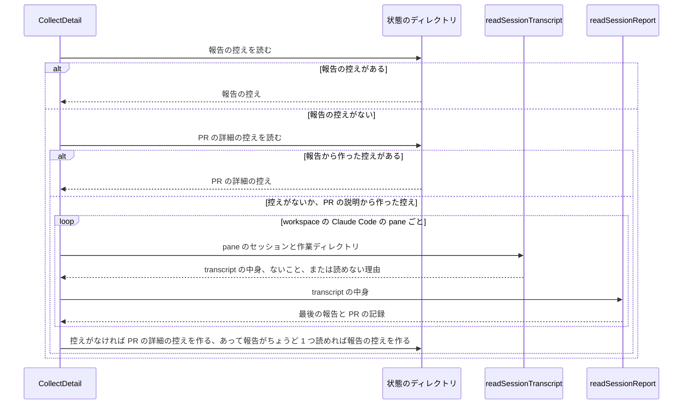
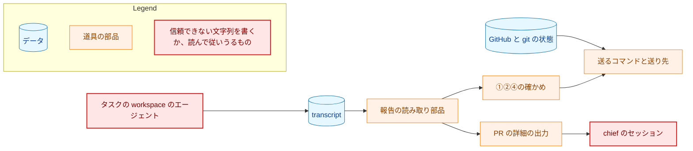
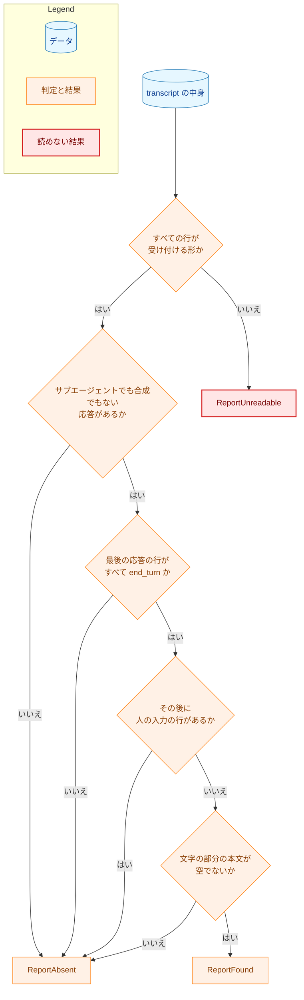
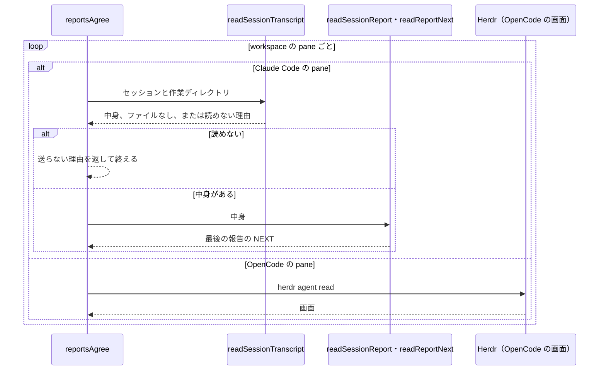
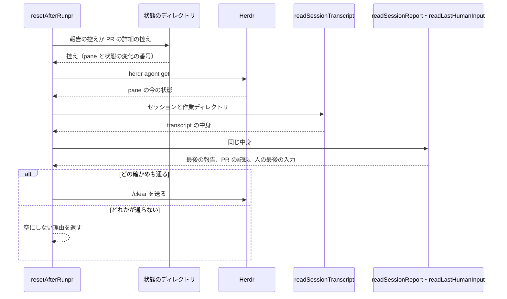

# アーキテクチャ設計書：chief が Claude Code の pane の最後の報告を、画面ではなく transcript から読む

## Document Status

| Item | Value |
|---|---|
| Status | `draft` |
| Created | 2026-11-17 |
| Review date | - |
| Reviewer | - |
| Comments | - |

本書は [01_requirements.md](01_requirements.md)（要件定義書。以下、要件書）の設計である。「計画で決める」は、本タスクの実装計画書（`03_implementation_plan.md`）で決めることを指す。既存のファイルの内容は、コミット `41683512` で確かめた。`file:line` の行番号は、このコミットでの行番号である。F-NNN・AC-NN は要件書の項番を、H-NN は [design_handoff.md](design_handoff.md)（以下、申し送り）の項番を指す。申し送りへの対応は付録 A に、受け入れ基準との対応は付録 B にまとめる。

本書は、要件書 6 章の用語（transcript・最後の報告・終わった応答・PR の記録）と、要件書 1 章の記号 ①〜④（①: NEXT の照合、②: ブランチのない状態での自動送信と `/runpr` の pane のリセット、③: PR の詳細、④: PR を作った pane のリセット）を、同じ意味で使う。[0088 設計書](../0088_chief_of_staff/02_architecture.md)（以下、0088 設計書）の用語（道具・状態のディレクトリ・周・送信の記録など）も、同じ意味で使う。そのほかに、次の用語を使う。

-   **応答:** transcript の `type` が `assistant` の行のうち、`message.id` が同じ行のまとまり。1 つの応答は、本文の部分ごとに複数の行に分かれて書かれる（1.2）。
-   **合成の応答:** Claude Code が API のエラーなどを知らせるために自ら書く応答。`message.model` が `<synthetic>` である（1.2）。
-   **報告の読み取り部品:** transcript から最後の報告と PR の記録を読む、本書で足す部品（3.1）。
-   **NEXT を名指す行:** 報告の行のうち、Markdown の記号を除いた行頭が `NEXT` とコロンである行（3.2）。
-   **PR の詳細の控え:** 0088 の、PR と head のコミットごとに 1 回だけ作る記録（`detail-<PR 番号>-<head>.json`、`internal/chief/detail.go:282-297`）。
-   **報告の控え:** PR の詳細の控えが PR の説明から作られた後に、報告が見つかったときに 1 回だけ作る、本書で足す記録（3.6）。

## 1. 設計の全体像 (Design Overview)

### 1.1. 設計原則

-   **情報源だけを替え、確かめの組み立ては変えない。** ①〜④の確かめの位置、条件の並び、送る入力、送り先の選び方は 0088 のままにする。Claude Code の pane で画面を読んでいた所を、transcript を読む部品に替える（F-002）。
-   **行は宣言された項目で選び、本文の中身を調べるのは NEXT と PR 番号だけにする。** 応答の終わり、サブエージェントの応答、合成の応答、人の入力、PR の記録は、transcript の項目の値で見分ける。報告の本文から読むのは、①②の NEXT と②の PR 番号だけである（CLAUDE.md の「Declare, don't infer」と chief の例外、要件書 5 章）。
-   **読めないときは画面に戻らず、安全側に倒す。** transcript を読めないときは、送らないか、空にしないか、PR の説明を示す（F-003）。
-   **transcript を読む部品は 1 か所に置く。** 本文と行の形を読む部品は、名前が `screen` で始まるファイルに置き、ほかの部品は返す型だけで振る舞いを選ぶ（要件書 4.5）。ファイルの場所とファイルの読み方は、今の `transcriptPath`・`readTranscript`（`internal/chief/transcript.go:53-70`、`internal/chief/transcript.go:82-98`）を使う。
-   **OpenCode の pane は変えない。** OpenCode の pane の報告は、今の画面の読み取り（`readScreenNext`・`readRunprReport` の OpenCode の分）で読む（AC-13）。

### 1.2. 設計の際に決めたこと（2026-11-17）

以下の確かめは、2026-11-17 に、この利用者の手元の Claude Code 2.1.325 の transcript で行った。yt2column の worktree の作業ディレクトリの transcript 592 本（サブエージェントの transcript を除く）を読み取りだけで調べた。サンプルとしてリポジトリに置くものは、実装で採る（7.1）。

-   **最後の報告は、transcript の最後の応答の本文とする。最後の応答とは、サブエージェントの応答でも合成の応答でもない最後の応答である。その応答のすべての行の `message.stop_reason` が `end_turn` で、その後に人の入力の行がないときに限る。本文は、その応答の行の `message.content` のうち、`type` が `text` の部分の文字列を、書かれた順に空行を挟んでつないだものとする（申し送りの H-01、AC-01〜AC-04）。** 確かめた結果は次のとおりである。1 つの `message.id` の行は、`stop_reason` がすべて同じだった（`end_turn` 5,380 件、`tool_use` 41,911 件、`null` 21 件、`stop_sequence` 22 件、`max_tokens` 1 件）。`end_turn` の応答のうち 5,365 件では、次の `assistant` か `system` の行が `system` の行（`subtype` が `turn_duration`）だった。合成の応答の 22 件は、すべて `message.model` が `<synthetic>` で、`isApiErrorMessage` が true で、`stop_reason` が `stop_sequence` だった。それ以外の応答の `message.model` は、どれも `<synthetic>` でなかった。recap は `type` が `system` の行（`subtype` が `away_summary`）で、compact の要約は `type` が `user` の行（`isCompactSummary` が true、origin なし）だった。どちらも応答の行ではない。`isSidechain` が true の行は、この transcript にはなかった（サブエージェントの行は別のファイルにある）。それでも AC-03 のために、この項目で見分ける。このため、合成の応答は「新しい応答の始まり」とせずに読み飛ばす。そうすると、報告の後に合成の応答しかないときはその報告が残り、終わっていない応答の後の合成の応答では報告がない（AC-04）。ADR: なし（行の選び方はこのタスクの中で閉じ、ADR-0046 の「transcript の最後に終わった応答から読む」という決定を実現する手段であるため）。
-   **task-notification や peer の入力に応えた応答も、終わっていれば最後の報告とする。** 人のコマンドの実行は、バックグラウンドのサブエージェントの知らせ（task-notification）に応えた応答で終わることが多い。`end_turn` の応答の直前の入力は、人が 2,551 件、キューに積まれた task-notification が 1,908 件、task-notification が 449 件、peer が 344 件だった。人の入力に応えた応答だけを報告とすると、`/mkarch` などの最後の報告の多くが読めなくなる。要件書 AC-04 が報告でないとするのは、Claude Code が自ら書いた記録である。task-notification に応えた応答はモデルが書いた応答なので、AC-04 には当たらない。ADR: なし（AC-04 の範囲の読み方で、このタスクの中で閉じるため）。
-   **PR の記録（`type` が `pr-link` の行）は、「そのセッションが関わった PR」の記録として扱う。③では、要件書のとおり、この記録がその PR の番号と URL を名指す pane を候補にする（申し送りの H-06、AC-05・AC-09）。** 確かめた結果は次のとおりである。PR を作ったコマンドの実行（`gh pr create` の結果に PR の URL がある実行）391 件のうち、390 件では、作った後にその PR の記録が書かれた。残る 1 件では書かれなかった。そのほかに、作る前にだけ書かれたものが 4 件あった。一方、`pr-link` の行を持つセッション 426 本のうち 53 本は、`gh pr create` を走らせていなかった。そのセッションの最初の記録の直前の操作は、`gh pr checkout`（`/runpr`・`/fixpr`）、PR のあるブランチへの `git push`、`gh pr view` などだった。同じ PR の記録は、セッションの中で何度も繰り返し書かれていた。`prRepository` は、すべて `isseis/yt2column` だった。要件書が要件に戻るとした条件（PR を作ったコマンドの実行で書かれない）には当たらないので、要件のまま進める。その結果、③は、その PR に関わった Claude Code の pane（たとえば、PR を作った pane で人が `/fixpr` を走らせた後）の最後の報告を、PR を作ったコマンドの報告として示しうる。④は、人の最後の入力が PR を作ったコマンドであることの確かめ（`internal/chief/reset.go:51-74`）が今のまま守る。③で人の最後の入力も確かめるように要件に戻る案は、③が示すだけの用途で、PR に関わった報告を示すことに実害がないため採らない。ADR: [ADR-0046](../../dev/adr/0046-chief-of-staff.md) を更新する（決定が条件付きにしていた確かめの結果と、その帰結を書くため）。
-   **PR の記録は、番号と URL の両方が、GitHub から読んだ PR（`gh pr list` の `number` と `url`）と等しいときに、その PR を名指すとする。`prRepository` は、型（文字列）だけを確かめ、値は比べない。** URL がリポジトリを含むので、URL を比べれば、ほかのリポジトリの同じ番号の PR を取り違えない。`prRepository` の値を比べるには、比べる相手のリポジトリ名を URL から切り出すことになり、文字列から推し量ることになる。ADR: なし（照合の細部で、このタスクの中で閉じるため）。
-   **NEXT を名指す行は、行の前後の空白と、行頭の Markdown の記号（リストの印 `-`・`*`・`+` と番号 `1.`、引用の `>`、強調とコードの `*`・`_`・`` ` ``）を除いた残りが、`NEXT` に続いて、記号を挟んでよいコロン（`:` か `：`）で始まる行とする。今の文法（`internal/chief/screen_report.go:53-63`）に合う行は値を読み、合わずに NEXT を名指す行は値を読めない NEXT の行とする（AC-07）。** 確かめた結果、過去の Claude Code の `/runpr` の報告には、`2. NEXT: \`/runplan 0088\`` や `**NEXT:** \`/runplan 0038\`（…）` の形があった。一方、`/runpr` に関わる文書を作るタスクの報告では、「NEXT が開く PR」のように文の中で NEXT に触れる行が多かった（`end_turn` の応答の本文で 116 行）。行頭の名指しだけを数えれば、前者を読めない NEXT として止め、後者で止まることはない。ADR: なし（AC-07 の「名指す」の読み方で、このタスクの中で閉じるため）。
-   **Claude Code の今の `/runpr` の報告のサンプルは、実装の最初のフェーズで採る。その NEXT の行が今の文法で読めなければ、要件に戻って文法を決め直す（申し送りの H-01）。** `/runpr` は今、送り先の表で OpenCode に送られる。このため、2026-11-12 に `/runpr` の報告の形が今の形になってから後の、Claude Code の `/runpr` の報告は手元の transcript にない（上の 4 件は、どれもそれより前の形だった）。文法で読めなくても、①は送らず、②は送らないか空にしないので、設計はどちらの結果でも安全側に倒れる。設計の承認の前に人が Claude Code の pane で `/runpr` を走らせて採る案は、実の `/runpr` の実行が 1 回要り、実装の最初のフェーズで採っても設計が変わらないため採らない。ADR: なし（確かめる時機はこのタスクの中で閉じるため）。
-   **人の入力でない origin の種類に `auto-continuation` を足し、その行のサンプルを足す。** 今の人の入力の読み取り（`internal/chief/screen_transcript.go:170-189`）は、サンプルにない種類の origin を見ると、transcript 全体を読めないものとする。手元の transcript には、origin の種類が `auto-continuation` の `user` の行が 6 件あった。claude.ai の利用の上限が戻ったときに、Claude Code が自ら書いて作業を続けさせる行で、`isMeta` が true、`promptSource` が `system` だった。今のままだと、この行のあるセッションでは、セッションが続く間ずっと、①が workspace の自動送信を止め、④が空にしない。人の入力の見分け方（origin の種類が `human` の行だけを人のものとする）は変えない。サンプルで確かめた種類を受け付けるという今の規則の境界のまま、確かめた種類を 1 つ足す。ADR: なし（受け付ける形をサンプルで足すことは、ADR-0046 の決定の中で行うため）。
-   **報告のために transcript を読む量の上限は、リセットと同じ 64 MiB（`resetTranscriptLimit`、`internal/chief/transcript.go:30`）とする。④では、1 回読んだ内容から、人の最後の入力と最後の報告と PR の記録を読む（申し送りの H-02）。** 手元の transcript の大きさは、1 MB を超えるもの 447 本の中央値が 3.4 MB、上位 10% の境が 5.9 MB、最大が 25 MB だった。最大のものを、今の `readTranscript` と `readLastHumanInput` で読むと、読み込みに約 20 ms、行の読み取りに約 98 ms かかった（このテストは一時的に足し、すぐに消した）。①で workspace の Claude Code の pane（ふつうは 1 つ）ごとに読んでも、1 回の周に 1 秒を超えない。これは、GitHub と Herdr の呼び出しに比べて小さい。そのため、末尾から読む仕組みは足さない（CLAUDE.md の「Performance」）。末尾から読む案は、最後の人の入力が先頭にありうることと、全体の形の確かめ（要件書 4.2）を満たせないので採らない。ADR: なし（上限の値はこのタスクの中で閉じるため）。
-   **Herdr が報告した状態と transcript の書き込みの間の遅れには、報告の控えを足して備える。PR の詳細の控えが PR の説明から作られた後に、後の読み取りで報告が見つかれば、報告の控えを 1 回だけ作り、それを PR の説明より先に使う（申し送りの H-07）。** 確かめた結果、`end_turn` の応答の行は、transcript の中で、ターンの終わりの `turn_duration` の行より前に書かれていた。ただし、Herdr が入力を待つ状態を報告する時点と、ファイルに書かれる時点の前後は確かめられなかった。今の PR の詳細の控えは、上書きせずに 1 回だけ作る（`internal/chief/detail.go:413-438`、ADR-0046 の「同名のものがすでにあれば作らず、上書きしない」）。報告の控えを別の名前にすれば、どちらの記録も上書きせずに、遅れた報告を後から拾える。PR の説明の控えのままにする案は、その head の間ずっと③が PR の説明を示し、④が空にしないので採らない。`/model` の後のように短い間を置いて読み直す案（`internal/chief/transcript.go:33-39`）は、報告がもともとない pane でも PR の詳細を読むたびに待つことになるので採らない。ADR: なし（記録を上書きしないという ADR-0046 の決定のまま、記録の種類を 1 つ足すだけであるため）。
-   **PR の詳細に示す報告の量の上限は、PR の説明と同じく先頭の 64 KiB とし、行数では切らない（申し送りの H-04）。** 今の `CapScreen`（`internal/chief/sanitize.go:27-50`）は、画面の末尾の 200 行と 64 KiB を残す、画面のための上限である。transcript の報告は折り返しがなく、要約に要る PR の変える内容と結果は報告の先頭に書かれる。そのため、`CapDescription`（`internal/chief/sanitize.go:53-63`）と同じ切り方の上限を報告用に設ける。制御文字と見えない文字の置き換えは、今の `Sanitize` を出力で使う（`internal/chief/output.go:410`）。ADR: なし（上限の値はこのタスクの中で閉じるため）。
-   **このタスクで使われなくなる、Claude Code の画面から報告を読む部品とそのテストを消す（申し送りの H-05）。サンプルの画面は、入力欄の判定のテストが使うので残す。** 消す部品は、`readCommandReport`・`claudeLastMessage` と、`readRunprReport` の Claude Code の分である（3.9）。残すと、`make deadcode` が失敗する。テストを消すコミットは分け、`make coverage-compare` の結果を残す（CLAUDE.md の「Testing Strategy」）。画面の読み取りをまとめて消すことは、#908 に残す。ADR: なし（部品の整理はこのタスクの中で閉じるため）。
-   **Herdr がセッションを報告しない Claude Code の pane は、要件書のとおり「transcript を読めない」とする（申し送りの H-03）。** 2026-11-17 に `herdr agent list`（読み取り）で確かめた。そのとき動いていた Claude Code の pane 7 つは、`/clear` の後とみられる pane（端末の題が `Claude Code`）を含めて、どれもセッションを報告していて、その transcript のファイルもあった。セッションの報告がない状態が多いという根拠はなかったので、AC-12 を変えるかを人に尋ねる必要はない。ADR: なし（要件を変えないため）。

### 1.3. なぜ今の仕組みでは足りないか

-   **画面からは、画面より長い報告を読めない。** Herdr の `herdr agent read` は pane の高さの分の行しか返さない。そのため、`claudeLastMessage`（`internal/chief/screen_report.go:165-207`）は、報告の始まりの印（`⏺ `）が画面の外に出ると、報告として読まない。これは要件書 1 章の背景のとおりである。
-   **今の transcript の読み取りは、応答も PR の記録も読まない。** `readModelSwitch`（`internal/chief/screen_transcript.go:46-63`）と `readLastHumanInput`（`internal/chief/screen_transcript.go:170-189`）は、`user` と `attachment` の行しか見ない。報告を読むには、`assistant` の行と `pr-link` の行を読む部品を足す必要がある。
-   **今の NEXT の読み取りは、名指しの形の外れを拾わない。** `readRunprNext`（`internal/chief/screen_report.go:64-86`）は、文法に合う行だけを NEXT の行とし、合わない行を読み飛ばす。画面では Claude Code が Markdown を描き直すので、それで足りた。transcript は Markdown のままなので、`**NEXT:**` の行を読み飛ばすと、違う NEXT を「NEXT がない」として通してしまう。AC-07 のとおり、NEXT を名指す行を見分ける読み取りが要る（3.2）。

### 1.4. 概念モデル

図 1 は、本書が足すものと、その関係を示す。矢印 A → B は「A から B が決まる」を表す。



-   pane の transcript は、Herdr が報告するセッションと作業ディレクトリから決まる（`internal/chief/transcript.go:53-70`）。
-   最後の報告は、最後の応答と、その後の人の入力の有無から決まる（3.1）。
-   NEXT と PR 番号は、最後の報告の本文から決まる（3.2）。
-   PR を作ったコマンドの pane は、PR の記録、GitHub の PR、最後の報告の有無から決まる（AC-09、3.6）。

## 2. システム構成 (System Structure)

### 2.1. 全体構成

図 2 は、①〜④が報告を読む経路を示す。矢印 A → B は「A が B を呼ぶか、読む」を表す。本タスクで足すか変える部品を `newpkg` と `enhanced` の色で示す。



-   ①②は、pane のエージェントの種類で読み方を分ける。Claude Code の pane は transcript から、OpenCode の pane は今までどおり画面から読む（3.3）。
-   ③④は、Claude Code の pane の transcript だけを読む。今の③も、OpenCode の pane からは報告を読まない（`internal/chief/screen_report.go:140-143`）。
-   `readLastHumanInput` は今の部品で、④が 1 回読んだ transcript を、`readSessionReport` と分け合う。

### 2.2. コンポーネント配置

| ファイル | 新規/変更 | 責務 |
|---|---|---|
| `internal/chief/screen_transcript_report.go` | 新規 | 報告の読み取り部品。`readSessionReport`（最後の報告と PR の記録）と `readReportNext`（報告の NEXT と PR 番号）を置く（3.1・3.2）。名前が `screen` で始まるので、CLAUDE.md の chief の例外の範囲に入る（要件書 4.5） |
| `internal/chief/screen_transcript.go` | 変更 | `otherOrigins` に `auto-continuation` を足す（1.2）。人の入力の見分け方は変えない |
| `internal/chief/transcript.go` | 変更 | `readSessionTranscript` を足す。pane のセッションと作業ディレクトリから transcript を決め、上限の中で読む。ファイルがないことを、読めないことと分けて返す（3.3）。`lastInputMadePR` が使う読み込みもこれに替える |
| `internal/chief/screen_report.go` | 変更 | `readCommandReport` と `claudeLastMessage` を消し、`readRunprReport` を OpenCode だけを読む部品にする（3.9）。`readNextValue`・`nextLine`・`prReference` は `readReportNext` が使う |
| `internal/chief/autosend.go` | 変更 | `reportsAgree`（①）、`detachedReport`（ブランチのない状態での②）、`resetRunpr`（自動送信の後の②）が、Claude Code の pane では transcript の報告を使う（3.4・3.5） |
| `internal/chief/detail.go` | 変更 | `readReport` が Claude Code の pane の transcript から報告を読む。`keptReport` が報告の控えを作って使う。`ReportFromScreen` の名前を `ReportFromPane` にする（記録の値 `report` は変えない）（3.6） |
| `internal/chief/request.go` | 変更 | `ensureDetail` が、PR の説明から作った PR の詳細の控えしかないときに、詳細を集め直す（3.6） |
| `internal/chief/reset.go` | 変更 | `resetAfterRunpr` の画面の確かめを、transcript の確かめに替える。`lastInputMadePR` は、読み込んだ transcript を受け取る（3.7） |
| `internal/chief/records.go` | 変更 | 報告の控えの名前の形（`report-<PR 番号>-<head>.json`）を足し、PR の詳細の控えと同じ期限で消す（3.6） |
| `internal/chief/sanitize.go` | 変更 | 報告の上限 `CapReport` を足す（3.8） |
| `internal/chief/testdata/transcript/` | 変更 | 報告・PR の記録・合成の応答・`auto-continuation` のサンプルを足す（7.1） |
| `internal/chief/testdata/README.md` | 変更 | 足したサンプルの採り方と置き換えた値を書く |
| `CLAUDE.md` | 変更 | 「Declare, don't infer」の chief の例外の段落の範囲と境界の文（AC-17、3.10） |
| `docs/dev/guides/chief_guide.md` | 変更 | 「1. 前提条件」と「8. 既知の制限」（AC-15、3.10） |
| `docs/dev/adr/0046-chief-of-staff.md` | 変更 | PR の記録の確かめの結果と、その帰結（1.2）。AC-16 の決定・採らなかった案・結果・経緯は要件定義の PR で書かれている |

### 2.3. データフロー

図 3 は、③で PR の詳細を集めるときの流れを示す。矢印は呼び出しとその戻りを表す。シーケンス図は色分けしたノードを持たないので、凡例を置かない（図 6・図 7 も同じ）。



## 3. コンポーネント設計 (Component Design)

### 3.1. 報告の読み取り部品（F-001）

`readSessionReport` は、transcript の中身を受け取り、最後の報告と PR の記録を返す。

```go
// ReportKind is what a Claude Code transcript says about the pane's last
// report. The zero value is ReportUnreadable: the transcript does not have
// the accepted shape, so whether there is a report cannot be told.
type ReportKind int

const (
	// ReportUnreadable is a transcript outside the accepted shape.
	ReportUnreadable ReportKind = iota
	// ReportAbsent is a transcript with no last report (AC-02).
	ReportAbsent
	// ReportFound is a transcript whose last finished response has a body.
	ReportFound
)

// PRLink is one pr-link line: a PR the session took part in, by its number
// and URL as Claude Code declares them.
type PRLink struct {
	Number int
	URL    string
}

// SessionReport is the last report of a Claude Code session and the PRs its
// transcript records. Text is set only for ReportFound; Links is empty for
// ReportUnreadable.
type SessionReport struct {
	Kind  ReportKind
	Text  string
	Links []PRLink
}

// readSessionReport reads the last report and the pr-link lines of a
// transcript, one JSON object per line.
func readSessionReport(transcript []byte) SessionReport
```

`SessionReport` は、PR の記録がその PR を名指すかを答える方法（番号と URL がどちらも等しい記録があるか）を持つ。

**受け付ける形。** 要件書 4.2 の受け付ける形を、次の行と項目で実現する。表にない行の種類と、使う行の中の表にない項目は読み飛ばす（要件書 4.2 の「拡張を許す部分」）。

| 行 | 見分け方 | 使う項目と、受け付ける値 |
|---|---|---|
| すべての行 | 空でない行 | 1 つの JSON のオブジェクトで、`type` が空でない文字列 |
| 応答の行 | `type` が `assistant` | `isSidechain`（真偽値）、`message`（オブジェクト）。`message` の中の `id`（空でない文字列）、`model`（文字列）、`stop_reason`（文字列か `null`）、`content`（配列。各要素はオブジェクトで、`type` は文字列。`type` が `text` の要素の `text` は文字列） |
| 人の入力の行 | 今の `humanInputOf` の規則（`internal/chief/screen_transcript.go:239-283`） | 今の規則のとおり。人の入力でない origin の種類に `auto-continuation` を足す（1.2） |
| PR の記録の行 | `type` が `pr-link` | `prNumber`（正の整数）、`prUrl`（空でない文字列）、`prRepository`（文字列） |

-   読み方は `strictjson` で行う（`internal/chief/screen_transcript.go:46-63` と同じ）。重なった項目、不正な UTF-8、対にならないサロゲートは、`strictjson` が拒む。使う項目の重なりや型の違いが 1 つでもあれば、`ReportUnreadable` を返す（要件書 4.2 の「拒むもの」）。
-   人の入力の行として受け付けられない行（サンプルにない origin の種類など）があれば、今の `readLastHumanInput` と同じく `ReportUnreadable` を返す。報告の読み取りと人の入力の読み取りで、受け付ける形を揃えるためである。

**最後の報告の決め方。** 次の規則で決める（1.2）。

1.  `isSidechain` が true の応答と、合成の応答（`message.model` が `<synthetic>`）は読み飛ばす（AC-03・AC-04）。
2.  残った応答のうち、transcript の中で最後の行を持つ応答を、最後の応答とする。その `message.id` を持つすべての行が、その応答の行である。
3.  最後の応答がないか、その行のどれかの `stop_reason` が `end_turn` でなければ、報告はない（AC-02 の「終わった応答がない」「終わらずに止まっている」）。`null`・`tool_use`・`max_tokens`・`stop_sequence`・知らない値は、どれも終わっていない。
4.  最後の応答の最後の行より後に、人の入力の行があれば、報告はない（AC-02 の「人の入力」）。新しい応答の始まりは、2 で最後の応答が新しい応答になることで扱われる。
5.  本文は、最後の応答の行の `content` のうち、`type` が `text` の要素の `text` を、書かれた順に空行を挟んでつなぎ、前後の空白を除いたものである。思考（`thinking`）、ツールの呼び出し（`tool_use`）、知らない種類の要素は含めない。本文が空なら、報告はない（AC-02 の「本文がない」）。

recap（`system` の行）、compact の要約と人の入力でない `user` の行、ツールの結果、`attachment` の行（キューに積まれた人の入力を除く）は、応答でも人の入力でもないので、最後の報告を変えない（AC-04）。

**PR の記録。** transcript の中のすべての `pr-link` の行を、書かれた順に `Links` に集める。最後の報告の有無とは関係なく集めるが、`ReportUnreadable` のときは空にする。

### 3.2. NEXT と PR 番号（AC-07・AC-08）

`readReportNext` は、Claude Code の pane の最後の報告の本文から、①②で使う NEXT と PR 番号を読む。返す型は、今の `RunprReport`（`internal/chief/screen_report.go:292-301`）である。

```go
// readReportNext reads the NEXT and the PR numbers of a Claude Code pane's
// last report, read from its transcript.
func readReportNext(text string) RunprReport
```

-   **NEXT の行。** 報告の各行の前後の空白を除いた残りが、今の `nextLine` に合えば、今の `readNextValue` で値を読む。合わずに NEXT を名指す行（1.2 の定義）であれば、値を読めない NEXT の行とする。互いに違う値の行があれば、今の `readRunprNext` と同じく、一致しないもの（`NextUnmatched`）とする。NEXT を名指す行がなければ `NextAbsent` とする（AC-07）。
-   **PR 番号。** 報告の各行から、今の `prReference` で `#N` と `/pull/N` を読む。transcript の報告には端末の折り返しがないので、画面のように行をつなぎ直して読む（`squeeze`）ことはしない（AC-08）。
-   この型の値は照合にだけ使い、送るコマンドとタスクを決めない（AC-11）。今の `RunprReport` の約束（`internal/chief/screen_report.go:292-294`）のとおりである。
-   今の `readRunprNext` は、OpenCode の画面の読み取りで今までどおり使う。OpenCode の画面には NEXT を名指す行の規則を足さない（AC-13）。

### 3.3. pane の transcript を読む入口

`readSessionTranscript` は、pane の Herdr のセッションと作業ディレクトリから transcript の場所を決め（今の `transcriptPath`）、今の `readTranscript` で上限の中で読む。

```go
// readSessionTranscript reads the transcript of a Claude Code pane's session,
// at most resetTranscriptLimit bytes. present is false when the session's
// transcript file does not exist; err wraps errTranscript when the place
// cannot be decided or the file cannot be read.
func readSessionTranscript(env Env, a Agent) (data []byte, present bool, err error)
```

| 状態 | 返す値 | 扱い |
|---|---|---|
| Herdr がセッションを報告していない | `errTranscript` | 読めない（AC-12） |
| 作業ディレクトリが決められない文字を含む | `errTranscript` と `errUnsupportedPath` | 読めない。人ができることも示す（AC-14） |
| 設定のディレクトリを決められない | `errTranscript` | 読めない（AC-12） |
| ファイルがない | `present` が false | 報告がない（AC-02） |
| 通常のファイルでない、開けない、読めない、上限を超える | `errTranscript` | 読めない（AC-12） |
| 読めた | 中身 | `readSessionReport` で読む。`ReportUnreadable` なら読めない（AC-12） |

ファイルがないことは、`os.OpenFile` の誤りが `fs.ErrNotExist` であることで見分ける。`readSessionTranscript` を呼ぶのは、エージェントの種類が Claude Code の pane についてだけである。

### 3.4. ①: NEXT の照合（AC-07・AC-14）

`reportsAgree`（`internal/chief/autosend.go:441-461`）は、workspace の pane ごとに、エージェントの種類で読み方を分ける。

-   **Claude Code の pane:** `readSessionTranscript` と `readSessionReport` で最後の報告を読み、`readReportNext` で NEXT を読む。最後の報告がない（ファイルがないときを含む）か、NEXT を名指す行がなければ、不一致にしない。NEXT の判定（次のコマンドがない、違う、読めない）は、今の分岐をそのまま使う。
-   **OpenCode の pane とそのほかの pane:** 今のとおり画面を読む（AC-13）。
-   **transcript を読めないとき:** その workspace に送らない。送らない理由は、今の `reportWhy` の文で、「pane の Claude Code の transcript を読めないこと」と、その pane、読めない理由を示す。作業ディレクトリの文字が理由のときは、今の `transcriptFailure` の示し方（`internal/chief/transcript.go:75-81`）の文を添える（AC-14）。

### 3.5. ②: ブランチのない状態での自動送信と `/runpr` の pane のリセット（AC-08・AC-14）

`/runpr` の送り先の表のエージェントが Claude Code のとき、次の 2 か所で、その pane の最後の報告を transcript から読む。報告がマージした PR の番号と次のコマンドを名指すことを求める条件は変えない。

-   **ブランチのない状態での自動送信（`detachedReport`、`internal/chief/autosend.go:464-487`）。** transcript を読めなければ、送らない理由（`detachedWhy` の文）に、transcript を読めないことと読めない理由を示す。報告がなければ、今の「`/runpr` の pane に報告がない」を示す。
-   **自動送信の後の `/runpr` の pane のリセット（`resetRunpr`、`internal/chief/autosend.go:728-777`）。** transcript を読めなければ、空にしない。理由の値は `no_transcript` か `unsupported_path`（今の `transcriptFailure`）にする。報告がないか、報告が PR とコマンドを名指さなければ、今の `no_report` にする。

送り先が OpenCode のときは、今のとおり画面を読む（AC-13）。

### 3.6. ③: PR の詳細（AC-09・AC-14・要件書 4.3）

**報告の読み方。** `readReport`（`internal/chief/detail.go:444-465`）は、workspace の pane のうちエージェントの種類が Claude Code のものについて、`readSessionTranscript` と `readSessionReport` を呼ぶ。最後の報告があり、PR の記録がその PR（`OpenPR` の番号と URL）を名指す pane を候補にする。候補がちょうど 1 つなら、その報告を `CapReport` で切って示す（3.8）。そうでなければ PR の説明を示す。transcript を読めない pane は、報告がないものとして扱う（AC-14 の③）。画面は読まない。

**報告の控え。** 要件書 4.3 の遅れに備えて、PR の詳細の控えに加え、報告の控えを置く（1.2）。

| 記録 | 名前 | 作るとき | 使う順 |
|---|---|---|---|
| 報告の控え | `report-<PR 番号>-<head>.json` | PR の詳細の控えが PR の説明から作られているか、報告も説明もないときに、後の読み取りで報告がちょうど 1 つの pane で読めたとき | 1 |
| PR の詳細の控え | `detail-<PR 番号>-<head>.json`（今のまま） | その head で最初に詳細を集めたとき（今のまま） | 2 |

-   どちらも、同名のものがすでにあれば作らず、上書きしない（ADR-0046）。報告の控えも、PR の詳細の控えと同じ型（`detailRecord`）で、`Source` は `report` である。
-   `keptReport`（`internal/chief/detail.go:419-439`）は、報告の控えがあればそれを使い、なければ PR の詳細の控えを読む。PR の詳細の控えの `Source` が `report` なら、それを使う。PR の詳細の控えがないときは、今のとおり集めて作る。`description` か `none` なら、pane を読み直し、報告がちょうど 1 つ読めれば報告の控えを作り、読めなければ PR の詳細の控えを使う。
-   `ensureDetail`（`internal/chief/request.go:371-381`）は、報告の控えか、`Source` が `report` の PR の詳細の控えがあれば、それを返す。なければ詳細を集め直す。こうして、④が報告の控えを使えるようにする。
-   状況の表の「レビュー省略可」の印は、今のとおり PR の詳細の控えから読む（`internal/chief/snapshot.go:189-197`）。報告の控えは、この印に使わない。
-   報告の控えは、PR の詳細の控えと同じ期限（`detailMaxAge`、`internal/chief/records.go:592-594`）で消す。workspace を消したときに、その workspace の記録をすべて消すこと（0092）にも含まれる。
-   示した報告がどちらから来たか（AC-19）は、今の `ReportSource` の値（`report`・`description`）で示す。`ReportFromScreen` は `ReportFromPane` に名前を変えるが、記録と出力の値 `report` は変えない（要件書 4.4。このタスクの前に画面から作った控えも、そのまま読める）。

### 3.7. ④: PR を作った pane のリセット（AC-10・AC-14）

`resetAfterRunpr`（`internal/chief/reset.go:94-143`）の確かめの並びは変えない。画面を読む確かめ（`internal/chief/reset.go:131-137`）だけを、次の確かめに替える。

1.  候補の pane のエージェントが Claude Code でなければ、空にしない（`no_report`）。今の `lastInputMadePR` と同じ扱いである。
2.  `readSessionTranscript` で 1 回だけ読む。読めなければ空にしない（`no_transcript` か `unsupported_path`）。ファイルがなければ空にしない（`no_report`）。
3.  読んだ中身を `readSessionReport` で読む。`ReportUnreadable` なら空にしない（`no_transcript`）。最後の報告がないか、PR の記録がその PR を名指さなければ、空にしない（`no_report`、AC-10 の 2 つ目の条件）。
4.  同じ中身を `readLastHumanInput` で読み、今の `lastInputMadePR` の確かめを行う（AC-10 の 1 つ目の条件の 3 つめ）。`lastInputMadePR` は、自分でファイルを読まず、読んだ中身を受け取る。

PR の詳細の控えか報告の控えが、その pane から報告を読んだものであること、控えたときから pane の状態が変わっていないことの確かめは、今のままである。このタスクの前に画面から作った控えにも、同じ条件で確かめる（要件書 4.4）。

### 3.8. 示す本文の上限と無害化（要件書 4.2）

```go
// CapReport keeps the first reportMaxBytes bytes of a pane's last report
// read from its transcript, dropping the tail side. The cut never splits a
// UTF-8 sequence.
func CapReport(report string) Capped
```

上限の値 `reportMaxBytes` は 64 KiB とし、切り方は `CapDescription` と同じにする。同じ切り方を 2 つの関数で書かないように、先頭を残す切り方を 1 つの内部の関数にまとめ、`CapDescription` と `CapReport` から呼ぶ（計画で決める）。切ったことは、今の `Truncated` で示す。制御文字と見えない文字は、今のとおり出力で `Sanitize` が置き換える。

### 3.9. 使われなくなる部品とサンプル（申し送りの H-05）

| 部品・サンプル | 扱い | 理由 |
|---|---|---|
| `readCommandReport`・`claudeLastMessage`・`squeeze`（`internal/chief/screen_report.go:131-207`） | 消す | ③④が transcript を読むので、呼ぶ所がなくなる |
| `claudeMessageMark`・`claudeDoneMark`・`claudeIndent`・`claudeRecapMark` | 消す | `claudeLastMessage` だけが使う。計画で、ほかに使う所がないことを確かめる |
| `readRunprReport` の Claude Code の分 | 消す | ②が transcript を読むので、OpenCode の分だけが残る |
| `readScreenNext` | 残す | ①が OpenCode の pane で使う |
| `TestReadCommandReport`・`TestReadCommandReportUnderRecap`・`TestReadCommandReportUnderTitledBox`、`TestReadRunprReport` の Claude Code の行（`internal/chief/screen_test.go`） | 消す | 消す部品のテストである |
| `samples_test.go` の `command report` の行 | 消す | サンプルの一覧の、消す部品の行である |
| `claude-command-report.ansi`・`claude-command-report-recap.ansi` | 残す | 入力欄の判定のテスト（`internal/chief/screen_test.go:88-90`）が使う |

### 3.10. 文書の更新（F-004）

-   **CLAUDE.md（AC-17）。** 「Declare, don't infer」の chief の例外の段落のうち、範囲の文の「the last report on a pane (the last message of either agent) and the PR numbers it names, the report of the command that created a PR」を書き換える。OpenCode の pane の最後の報告は画面から、Claude Code の pane の最後の報告は transcript の最後に終わった応答から読むことを書く。transcript から読むものに、最後に終わった応答の本文を足す。PR の記録は transcript が宣言する値なので、範囲に入れない。境界の文に、報告の形も `internal/chief/testdata/transcript/` のサンプルから読んだ形に合わなければ、報告がないか読めないものとすることを足す。diff はこの段落の範囲と境界の文に限る。
-   **chief 利用ガイド（AC-15）。** 「1. 前提条件」のエージェントの行に、Claude Code 2.1.325 の transcript の形を確かめたことを足す。「8. 既知の制限」の「長い報告は画面から読めない」を、Claude Code の pane の報告を transcript から読むことと、読めないときの振る舞い（AC-14）の記述に置き換える。「worktree のパスの文字」に、その workspace の自動送信も止まることを足す。
-   **ADR-0046（AC-16）。** AC-16 の決定・採らなかった案・結果・経緯は、要件定義の PR で書かれている。本書は、PR の記録の確かめの結果と、その帰結（③がその PR に関わった pane の報告を示しうること）を、決定・結果・経緯に足す（1.2）。

### 3.11. 既存のテストと既存の読み手への影響

| テスト（ファイル） | 変わる振る舞い | 扱い |
|---|---|---|
| `TestAutoSendReportMismatch`・`TestAutoSendDetached`・`TestResetAfterAutoSend`・`TestResetChecksAgain`（`internal/chief/autosend_test.go`） | Claude Code の pane の報告を、画面ではなく transcript から読む | Claude Code の pane の報告を transcript の fake で与えるように直す。OpenCode の pane の行は変えない |
| `TestResetAfterRunpr`・`TestResetChecks`・`TestDetailSavedBeforeReset`・`TestResetFailureAfterClear`（`internal/chief/reset_test.go`） | ④の画面の確かめが transcript の確かめになる | 画面の報告の代わりに、transcript の報告と PR の記録を与えるように直す |
| `TestDetailReportSource`・`TestDetailAfterReset`（`internal/chief/detail_test.go`） | ③が transcript から読み、報告の控えを作る | transcript で与えるように直し、報告の控えのテストを足す |
| `TestReadLastHumanInput`（`internal/chief/screen_test.go:809`） | `auto-continuation` の origin を受け付ける | サンプルの行を足す |
| 3.9 の消すテスト | 部品がなくなる | 消すコミットを分け、`make coverage-compare` の結果を残す |

0088 設計書の 3.1.3 と 3.4.1 は、報告を画面から読むと書いている。完了したタスクの文書は書き換えない（要件書 2.3）。今の振る舞いは、本書と ADR-0046 と CLAUDE.md が示す。

## 4. エラーハンドリング設計 (Error Handling Design)

### 4.1. 失敗の種類

新しい sentinel error は足さない。transcript を読めないことは、今の `errTranscript` と `errUnsupportedPath`（`internal/chief/transcript.go:15-22`）で表す。`readSessionReport` は error を返さず、`ReportUnreadable` を返す。今の `readModelSwitch`・`readLastHumanInput` と同じ形である。

| 状況 | ① | ブランチのない状態での② | 自動送信の後の② | ③ | ④ |
|---|---|---|---|---|---|
| セッションの報告がない、設定のディレクトリがない、ファイルを読めない、上限を超える、形に合わない | 送らない | 送らない | 空にしない（`no_transcript`） | その pane は報告なし | 空にしない（`no_transcript`） |
| 作業ディレクトリの文字 | 送らない（人ができることを示す） | 送らない（同） | 空にしない（`unsupported_path`） | その pane は報告なし | 空にしない（`unsupported_path`） |
| ファイルがない | 不一致にしない | 送らない（報告なし） | 空にしない（`no_report`） | その pane は報告なし | 空にしない（`no_report`） |
| 最後の報告がない | 不一致にしない | 送らない（報告なし） | 空にしない（`no_report`） | その pane は報告なし | 空にしない（`no_report`） |
| 報告に NEXT を名指す行がない | 不一致にしない | 送らない | 空にしない（`no_report`） | 関係しない | 関係しない |
| NEXT が読めない、違う、ない、食い違う | 送らない | 送らない | 空にしない（`no_report`） | 関係しない | 関係しない |
| PR の記録がその PR を名指さない | 関係しない | 関係しない | 関係しない | その pane は候補でない | 空にしない（`no_report`） |

### 4.2. 示し方

-   ①とブランチのない状態での②の送らない理由は、今のとおり、自動送信の結果の満たさなかった条件の文として示す（0088 設計書の 3.7）。文には pane と読めない理由を含め、作業ディレクトリの文字が理由のときは、`transcriptFailure` の文を添える。
-   リセットの空にしない理由は、今の値（`no_transcript`・`unsupported_path`・`no_report`）とその説明の文で示す。新しい値は足さない。
-   示す文は、今のとおり出力で `Sanitize` を通す。

## 5. セキュリティ考慮事項 (Security Considerations)

### 5.1. 製品

N/A。要件書 4.2 のとおり、条件付きのガイドの契機に当たらない。製品のコードは変えない。

### 5.2. 開発の道具の信頼の境界

transcript は、エージェントが書いた信頼できない文字列を含む（要件書 4.2）。図 4 は、その文字列が chief のどこへ流れるかを示す。矢印 A → B は「A の値が B に渡る」を表す。



| 脅威 | 守り |
|---|---|
| 報告の本文に、送るコマンドやタスクを書いて、chief に送らせる | 送るコマンドとタスクは、GitHub と git と `origin/main` の文書から決める。報告は、①②で送ることを止めるか、④で空にする条件を狭めることにだけ使う（AC-11、`CHECK → SEND` は止めるだけ） |
| 報告の本文に指示を書いて、chief のセッションに従わせる | 0088 のとおり、`/chief` の定義が中の指示に従わないと定める。本文は `Sanitize` を通し、`CapReport` で量を限る（要件書 4.2） |
| 偽の PR の記録や人の入力の行を書いて、④で人が使っている pane を空にさせる | transcript は、同じ利用者のプロセスなら書ける。偽るには、PR の記録、人の最後の入力、Herdr の状態の変化の番号の 3 つを合わせる必要がある。同じ利用者のプロセスからの守りは保証しない（0088 設計書 5.2 の残る危険、chief 利用ガイドの「5.2 保証しないこと」）。この残る危険は変わらない |
| 壊れた行、重なった項目、巨大な transcript で、誤った報告を読ませるか、chief を止める | `strictjson` で拒み、形に合わなければ読めないものとして安全側に倒す。読む量は 64 MiB で限る（1.2、3.1） |
| 合成の応答や recap を報告に見せかける | 応答の終わりと合成の応答を、項目の値（`stop_reason`・`message.model`）で見分ける（3.1） |

## 6. 処理フロー詳細 (Processing Flow Details)

### 6.1. 最後の報告の決め方

図 5 は、3.1 の規則で最後の報告を決める流れを示す。矢印は判定の順を表す。



### 6.2. ①: 自動送信の前の照合

図 6 は、①が pane ごとに報告を読む流れを示す。矢印は呼び出しとその戻りを表す。



### 6.3. ④: PR を作った pane のリセット

図 7 は、`/runpr` を送った後に、PR を作った pane を空にする前の確かめを示す。矢印は呼び出しとその戻りを表す。



## 7. テスト戦略 (Test Strategy)

### 7.1. ユニットテスト

-   **報告の読み取り部品。** 実際の transcript から採ったサンプルで、`readSessionReport` を確かめる。サンプルは `internal/chief/testdata/transcript/` に置き、採った人を特定できる値を今の README の表のとおりに置き換える（要件書 4.2 の「サンプルの取り扱い」）。テストに要らない行を削るときは、削ったことを README に書く。採るものは次のとおりである（計画で細かく決める）。
    -   PR を作ったコマンドの実行の終わり（`/mkarch` など）。最後の報告と、PR の記録がある。
    -   Claude Code の今の形の `/runpr` の報告（実装の最初のフェーズで採る、1.2）。
    -   合成の応答、recap、compact の要約、task-notification に応えた応答、`auto-continuation` の行を含むもの。手元の transcript から採る。
-   **形の拒み方。** サンプルの行を書き換えた入力で、要件書 4.2 の「拒むもの」（重なった項目、型の違い、正でない PR 番号、不正な UTF-8）が `ReportUnreadable` になることを確かめる。拡張を許す部分（知らない種類の行、知らない項目）が読み飛ばされることも確かめる。
-   **AC-02〜AC-04 の各場合。** 報告の後の人の入力、終わっていない最後の応答、本文のない応答、サブエージェントの行、合成の応答だけが後に続く報告を、それぞれ確かめる。
-   **NEXT。** `readReportNext` で、今の文法の行、強調・コード・引用・番号のリストで名指す行、文の中で触れるだけの行、食い違う行を確かめる（AC-07）。
-   **①〜④。** 今の Herdr と状態のディレクトリの fake に、transcript のファイルを置く一時ディレクトリ（`CLAUDE_CONFIG_DIR`）を加える。Claude Code の pane と OpenCode の pane の組み合わせで、4.1 の表の各行を確かめる。OpenCode の pane の結果が変わらないこと（AC-13）は、今のテストを OpenCode の行で残して確かめる。
-   **報告の控え。** PR の説明の控えの後に報告が読めたとき、報告の控えが 1 回だけ作られて使われること、報告の控えも PR の詳細の控えも上書きされないことを確かめる。
-   各テストは、確かめる部品を壊して失敗することを確かめてからコミットする（CLAUDE.md の「Testing Strategy」）。

### 7.2. 文書のガード

CLAUDE.md・chief 利用ガイド・ADR-0046 の変更は文の変更で、PR のレビューで読む（CLAUDE.md の「Testing Strategy」の文書のテストの規則）。AC-17 の「CLAUDE.md の diff はこの段落の範囲と境界の文に限る」は、`diff` の確かめで行う（`requirements_process.md` の「`diff` verification」）。ADR の形は、今の `TestADRRecords` が確かめる。

### 7.3. 結合テストと手での確かめ

-   実装の最後に、実の Herdr と Claude Code で、`/mkarch` などの長い報告が PR の詳細に示され、`/runpr` の後に PR を作った pane が空にされることを、人が確かめる（AC-01・AC-09・AC-10、`manual`）。
-   `make deadcode` が通ることで、使われなくなる部品が残っていないことを確かめる。

### 7.4. セキュリティのテスト

-   5.2 の表の守りのうち、報告の本文が送るコマンドを決めないことは、報告の NEXT と chief の決めた次のコマンドが違うときに送らないテスト（①）と、報告が一致しても送るコマンドは文書から決まるテストで確かめる。
-   巨大な transcript は、上限を 1 バイト超える入力で読めないことを確かめる。

## 8. 実装の優先順位 (Implementation Priorities)

1.  **サンプルを採る。** Claude Code の今の `/runpr` の報告のサンプルを採り、NEXT の行が今の文法で読めるかを確かめる。読めなければ、要件に戻る（1.2）。ほかのサンプルも、このフェーズで採る。
2.  **報告の読み取り部品。** `readSessionReport`・`readReportNext`・`readSessionTranscript`・`CapReport`、`auto-continuation` の origin を足し、サンプルで確かめる。
3.  **①②を transcript に替える。**
4.  **③④を transcript に替え、報告の控えを足す。**
5.  **使われなくなる部品とテストを消す。** テストを消すコミットは分ける（3.9）。
6.  **文書を更新する。** CLAUDE.md、chief 利用ガイド（3.10）。

PR の分け方は計画で決める。

## 9. 将来の拡張 (Future Extensibility)

-   **Claude Code の質問の判定（[#904](https://github.com/isseis/yt2column/issues/904)、0094）。** 0094 も、transcript の `assistant` の行を読む。本書の行の形の読み方（3.1 の表）と `readSessionTranscript` は、0094 の設計でも使える。どちらが先に入っても、もう一方が使えるように、行の読み方は `screen_transcript_report.go` の中で、応答の行を読む関数と報告を決める関数に分けておく（計画で決める）。
-   **OpenCode の pane の報告（[#906](https://github.com/isseis/yt2column/issues/906)）。** OpenCode の報告を画面以外から読むようになれば、3.3 の入口に OpenCode の分を足す。①〜④の側は、エージェントの種類で読み方を選ぶ所だけを変えればよい。
-   **画面の読み取りの整理（[#908](https://github.com/isseis/yt2column/issues/908)）。** 本書で消さない画面の読み取り（入力欄の判定、OpenCode の報告）は #908 で扱う。

## 付録 A: 申し送り（design_handoff.md）への対応

| 項目 | 対応 |
|---|---|
| H-01 | 手元の transcript で、応答の終わり、まとまり、合成の応答、recap・compact の行、サブエージェントの見分け方を確かめ、最後の報告の規則を決めた（1.2、3.1）。NEXT の書き方は、NEXT を名指す行の定義を決め（1.2、3.2）、Claude Code の今の `/runpr` の報告のサンプルは実装の最初のフェーズで採る（1.2、8 章） |
| H-02 | 上限は 64 MiB とし、最大 25 MB の transcript で読む時間を測った。④は 1 回の読み込みから人の入力と報告と PR の記録を読む。末尾から読む方法は採らない（1.2、3.7） |
| H-03 | `herdr agent list` で、Claude Code の pane がどれもセッションを報告していることを確かめた。AC-12 は変えない（1.2） |
| H-04 | 報告の上限 `CapReport`（先頭の 64 KiB）を設け、無害化は今の `Sanitize` を使う（1.2、3.8） |
| H-05 | Claude Code の画面から報告を読む部品とそのテストを消し、入力欄の判定が使うサンプルは残す（1.2、3.9） |
| H-06 | PR の記録は、PR を作った実行で作った後に書かれるが、PR に関わっただけのセッションにも書かれることを確かめた。要件のまま進め、ADR-0046 を更新した。`prRepository` は型だけを確かめる（1.2） |
| H-07 | 遅れの有無は Herdr の側を確かめられなかったので、報告の控えを足し、後の読み取りで報告を拾う（1.2、3.6） |

## 付録 B: 受け入れ基準との対応

| AC | 本書の箇所 |
|---|---|
| AC-01 | 3.1、3.3 |
| AC-02 | 3.1、3.3、4.1 |
| AC-03 | 3.1 |
| AC-04 | 1.2、3.1 |
| AC-05 | 3.1、3.6、3.7 |
| AC-06 | 1.1、3.4〜3.7 |
| AC-07 | 1.2、3.2、3.4 |
| AC-08 | 3.2、3.5 |
| AC-09 | 1.2、3.6 |
| AC-10 | 3.7 |
| AC-11 | 3.2、5.2 |
| AC-12 | 3.3、4.1 |
| AC-13 | 1.1、3.2、3.4、3.5 |
| AC-14 | 3.4〜3.7、4.1、4.2 |
| AC-15 | 3.10 |
| AC-16 | 1.2、3.10 |
| AC-17 | 3.10、7.2 |
