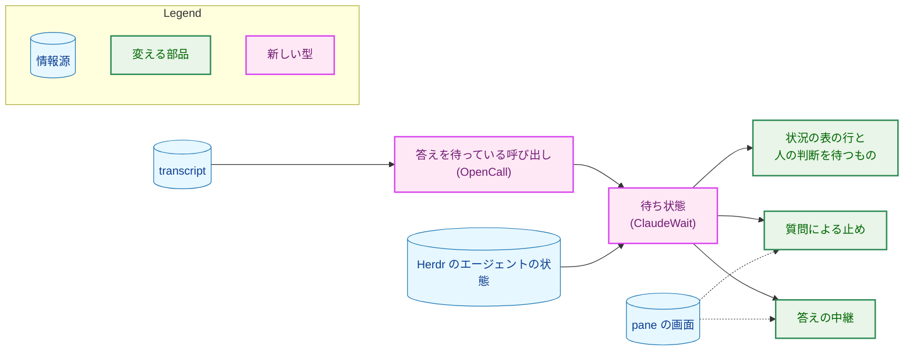
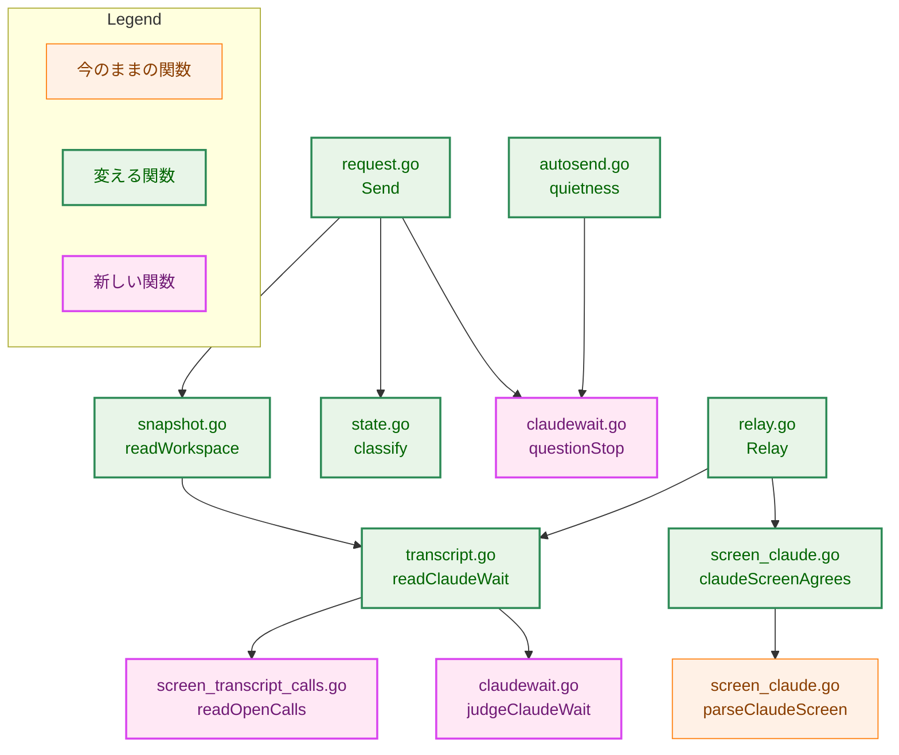
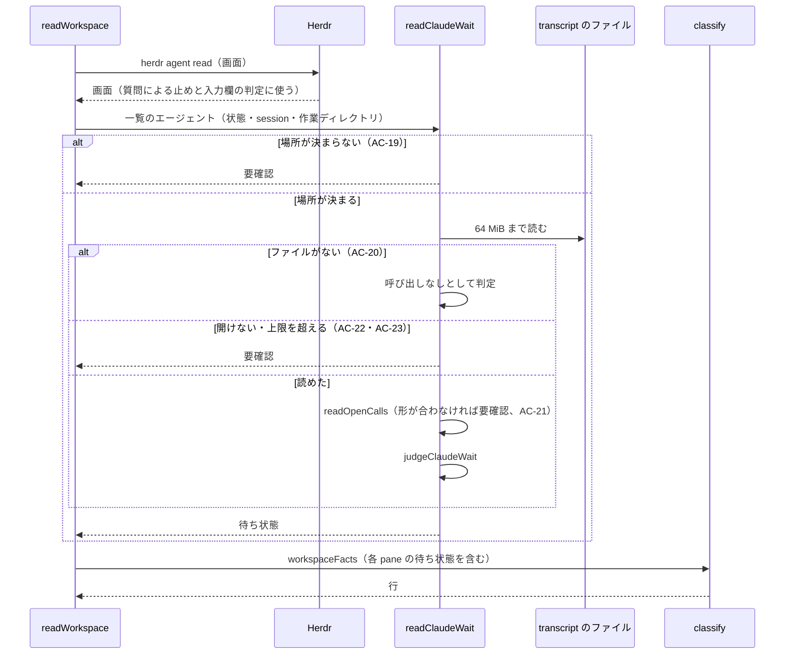
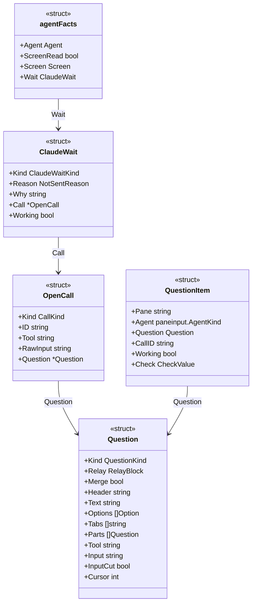
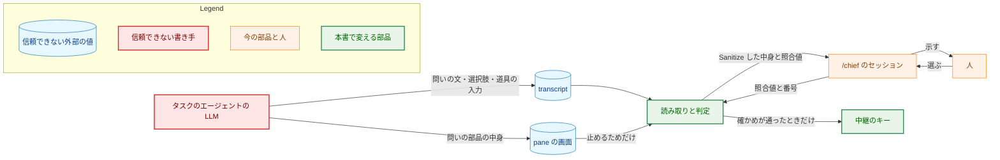
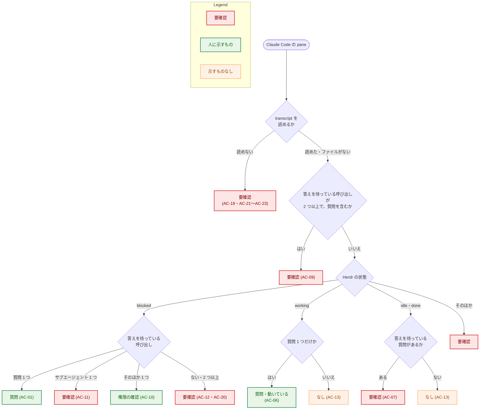
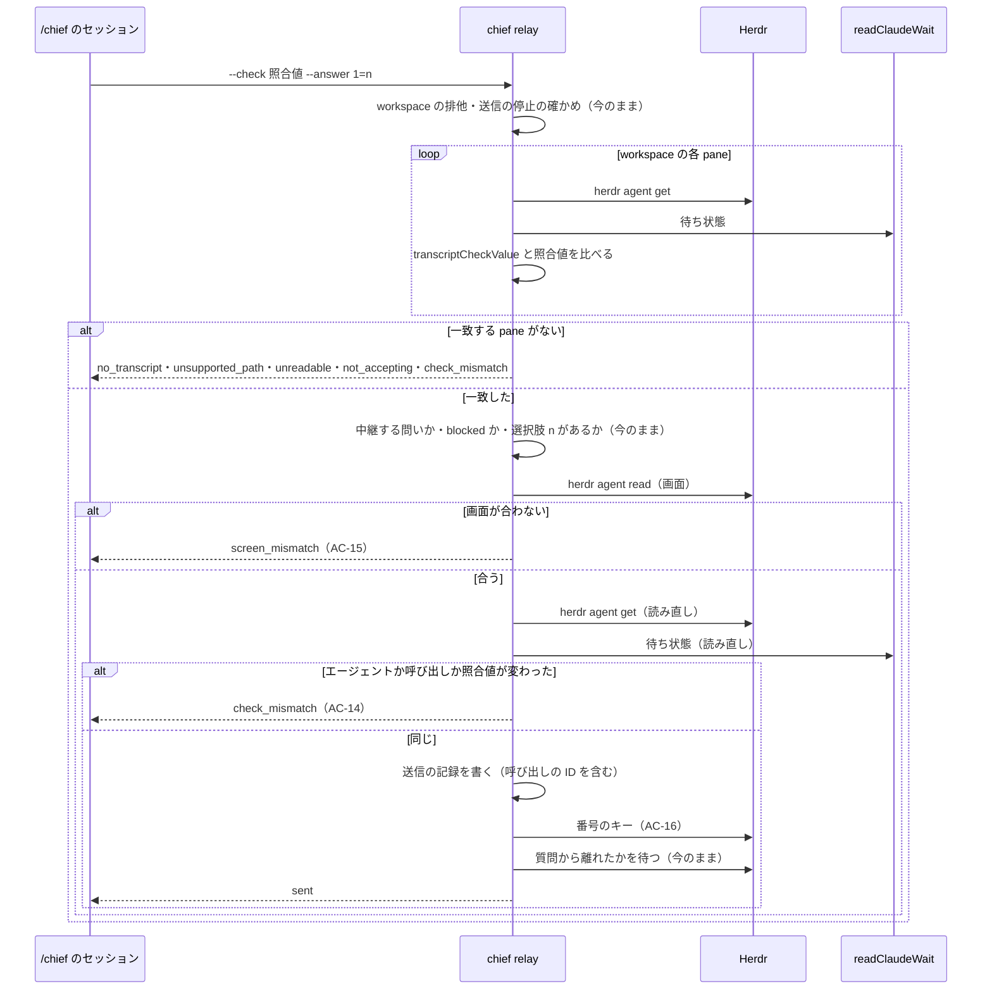

# アーキテクチャ設計書：chief が Claude Code の質問を transcript から判定し、答えの中継の照合も transcript で行う

## Document Status

| Item | Value |
|---|---|
| Status | `approved` |
| Created | 2026-11-17 |
| Review date | 2026-11-17 |
| Reviewer | isseis |
| Comments | - |

本書は [01_requirements.md](01_requirements.md)（要件定義書。以下、要件書）の設計である。「計画で決める」は、本タスクの実装計画書（`03_implementation_plan.md`）で決めることを指す。既存のファイルの内容は、コミット `97ca1fc7` で確かめた。`file:line` の行番号は、このコミットでの行番号である。F-NNN・AC-NN は要件書の項番を、H-NN は [design_handoff.md](design_handoff.md)（以下、申し送り）の項番を指す。申し送りへの対応は付録 A に、受け入れ基準との対応は付録 B にまとめる。

本書は、要件書 3 章と 6 章の用語（呼び出し・答え・答えを待っている呼び出し・質問の呼び出し・サブエージェントの呼び出し・権限の確認・中継・照合値・transcript）と、[0088 設計書](../0088_chief_of_staff/02_architecture.md)（以下、0088 設計書）の冒頭の用語（道具・`/chief` の定義・周・状況の表・送信の記録など）を、同じ意味で使う。そのほかに、次の用語を使う。

-   **待ち状態:** Claude Code の pane 1 つについて、transcript の答えを待っている呼び出しと Herdr の状態から決めた、その pane が何を待っているかの判定（3.3）。「要確認」「なし」「質問」「権限の確認」の 4 つのどれかである。
-   **中継の前の画面の確かめ:** 答えを中継する直前に、pane の画面に transcript の問いと同じ 1 つを選ぶ問いが出ていることを確かめること（3.5.3、AC-15）。
-   **質問による止め:** コマンドの送信・自動送信・workspace の削除の前に、workspace のどれかのエージェントが質問か権限の確認で止まっている（かもしれない）ときに送らないこと（3.6、AC-24・AC-25）。

## 1. 設計の全体像 (Design Overview)

### 1.1. 設計原則

-   **Claude Code の pane の質問は、transcript と Herdr の状態だけで決める。** 状況の表と、人の判断を待つものの一覧は、待ち状態から決める。Claude Code の pane の画面は、状況の表の判定に使わない（AC-26）。
-   **画面は送るのを止めるためだけに使う。** 中継の前の画面の確かめ（AC-15）、質問による止めのうち画面が質問を示すときの止め、送り先の画面が入力欄の形であることの確かめ（AC-25）は、通らなければ送らないだけで、送る理由にはならない。
-   **判定は 3 つの層に分ける。** transcript の中身を調べる読み取り（`screen` で始まる名前のファイル）、読み取りが返した型と Herdr の状態だけで決める判定、その判定を使う表と送信の 3 つである。呼び出しの種類（質問・サブエージェント・そのほか）も、読み取りが型の値として宣言する。中身を調べるのは読み取りの層だけで、CLAUDE.md の「Declare, don't infer」の例外の範囲をそのファイルに閉じる。
-   **読めなければ推し量らない。** transcript を読めないとき、受け付ける形に合わないとき、transcript と Herdr の状態が食い違うときは、「要確認」にするか送らない。一部を読んだ結果は使わない（要件書 4.2、4.3）。
-   **同じ判定は 1 か所で作る。** transcript の場所を決めて読み、待ち状態を決めるまでを 1 つの関数にし、状況の表・中継・送る前の確かめのすべてがそれを使う（3.3）。表と中継で判定がずれないようにするためである。
-   **今ある部品を使う。** transcript の場所と開き方（`internal/chief/transcript.go`）、厳密な JSON の読み取り（`internal/strictjson`）、1 つを選ぶ問いの画面の読み取り（`parseClaudeScreen`、`internal/chief/screen_claude.go:69`）、`/runpr` のマージの確認の文の形（`mergeQuestionText`、`internal/chief/screen.go:113`）、制御文字の置き換え（`Sanitize`、`internal/chief/sanitize.go:75`）を使い、二重に持たない（要件書 4.5）。

### 1.2. 設計の際に決めたこと（2026-11-17）

-   **transcript は、状況の表を作るたびに、その都度すべてを読む。前回の位置から続きを読む仕組みは作らない（申し送りの H-01、要件書 4.1）。** 予備の測定をした（2026-11-17、Apple M3 Pro）。手元の 25 MB の transcript をメモリの中で 64 MiB まで繰り返し、各行を `strictjson.ParseObject` で読み、`assistant`・`user` の行の `message.content` の要素のメンバーを取り出した。3 回で 0.31〜0.42 秒だった。この測定は、ファイルの読み込みと、呼び出しの ID の重複の確かめを含まない（繰り返したので ID が重複する）。そこで、実装の後に、ID の重複しない 64 MiB のファイルを `readClaudeWait`（3.3）で読む形で、時間とメモリの最大使用量を測り直し、1 秒の予算に収まることを確かめる（7.2）。CLAUDE.md の「Performance」は、仕組みを足す前に実際の時間を測ることを求める。続きから読む仕組みは、ファイルの差し替えや切り詰めの見分けという正しさの義務を足すので、測り直しで予算を超えたときに限って考える。ADR: なし（このタスクの中で閉じる読み方の細部のため）。
-   **使わなくなる Claude Code の画面の読み取り（複数を選ぶ問い、タブのある問いとその確認のページ、権限の確認）は、このタスクでは消さず、#908 に残す（申し送りの H-07）。** 消しても送るものは増えない。送る前の確かめ（`internal/chief/send.go:331-337`、`internal/chief/autosend.go:384-387`）は、知らない形の画面でも止まるからである。ただし、そのときに示す理由は「質問を示している」から「どの形にも合わない」に変わる。また、テストの削除を単独のコミットにしてカバレッジを比べる手間が、このタスクの差分に加わる。人が #908 に残すことを選んだ。ADR: なし（このタスクの中で閉じる範囲の分け方のため）。
-   **照合値には、今と同じく Herdr の `state_change_seq` を入れる（申し送りの H-02）。** 人に示した後に Herdr の状態が変わっていれば、中継は送らない。今の照合値はこの値を含み（`internal/chief/relay.go:41`）、0088 の実地の確かめで、質問の間に値が変わらず中継が通ることを確かめている。値を外して呼び出しの ID と中身だけにする案は、守りを緩める理由がないので採らない。人もこの案を選んだ。ADR: なし（照合値は中身を読めない内部の値で、その作り方はこのタスクの中で閉じるため）。
-   **答えを待っている間の transcript と画面と Herdr の状態のサンプルは、実装の最初の段で採る（申し送りの H-05、7.1）。** 確かめるのは次の 3 点である。権限の確認の間に Herdr が `blocked` と報告するか。答えを待っている間に transcript にどの行が書かれるか。中継の前の画面の確かめが前提にする画面の形が実物と合うか。どれも、人が採取用の pane（`chief-poc`）で状態を作る必要がある。権限の確認の前提が成り立たなくても、AC-13 のとおり権限の確認が示されないだけで、送るものは増えない。設計もどちらの結果でも変わらない。前提が成り立たないと分かれば、要件書を `draft` に戻して決め直す（要件書 1 章の背景）。人もこの案を選んだ。ADR: なし（確かめの時期はこのタスクの中で閉じるため）。
-   **サブエージェントの見分け（申し送りの H-04）は、要件書のとおり道具の名前 `Agent` で行う。サブエージェントの行は親の transcript に書かれないことを確かめたので、要件書は直さない。** 手元の Claude Code のディレクトリで確かめた（2026-11-17）。サブエージェントの行は、親のセッションの下の `subagents/agent-*.jsonl`（2,134 ファイル）に書かれていた。直近 3 日の親の transcript 88 ファイルには、`isSidechain` が `true` の行が 1 行もなかった。同じ 88 ファイルの呼び出しの道具の名前は、`Agent` のほかに `Bash`・`Read`・`AskUserQuestion` などで、サブエージェントを起動する別の名前の道具は見当たらなかった。Claude Code が道具の名前を変えると（たとえば以前の版の `Task`）、その呼び出しは権限の確認として示される。中継はしないので、送るものは増えない（5.2）。ADR: なし（要件書のとおりのため）。
-   **答えを待っている間に書かれる行の種類と、質問の呼び出しの入力の形は、答えた後の transcript から確かめた（申し送りの H-05、H-06）。** 直近 3 日の 88 ファイルで、質問の呼び出しとその答えの間にあった行の `type` は、`api-request`・`api-request-blob`・`session-owner`・`atis-latch`・`mode`・`last-prompt`・`ai-title` だけだった。どれも、要件書 4.2 の「広げてよいと宣言する部分」に当たり、読まずに受け付ける。質問の呼び出しの入力 113 件は、どれも `questions` の各要素に `header`・`multiSelect`（真偽値）・`options`・`question` を持ち、`options` の各要素に `label` と `description` を持っていた。いずれも要件書 4.2 の受け付ける形に合っていた。ADR: なし（確かめた事実の記録のため）。
-   **中継できる問いとして示すのは、問いの選択肢が 1〜7 のときに限る。8 と 9 のときは中身を示し、中継しない（AC-05）。** Claude Code の問いの部品は、transcript の選択肢の後ろに、自由に書く答えとチャットへ移る答えを `n+1`・`n+2` の番号で描く。今の画面の読み取りは、番号が 9 を超える選択肢のある画面を、どの形にも合わないものとする（`finishQuestion`、`internal/chief/screen.go:166-171`）。そのため、選択肢が 8 か 9 の問いは、中継の前の画面の確かめを必ず通らない。中継できる問いとして示しても、必ず `screen_mismatch` で送らないことになるので、示さない。AC-05 は「9 つ以下のときだけ示す」という必要条件なので、7 つ以下に限ってもこれに反しない。画面の読み取りを広げて 10 と 11 の番号を受け付ける案は、確かめた画面の形を広げるので採らない。なお、`AskUserQuestion` の道具の定義は選択肢を 2〜4 つに限っているので、8 以上の選択肢は普通は現れない。ADR: なし（このタスクの中で閉じる値のため）。
-   **出力の約束の番号（`Protocol`、`internal/chief/records.go:25-28`）を 1 つ上げる。** 上げる先は、本書の出力を変える PR がマージされるときの `main` の番号に 1 を足したものである。今は 1 だが、0092 の計画（決定 3、PR-7）も 2 に上げるので、後に入る方が同じ 2 のままにすると、先に入った版の `/chief` の定義を新しい道具が受け付けてしまう。計画では、その PR を作る前と、マージの直前の 2 回、`main` の `internal/chief/records.go` の `Protocol` を確かめる。マージの直前に `main` の番号が変わっていれば、道具の番号と `/chief` の定義の `--protocol` を新しい番号に直してからマージする（`TestDocumentedProtocolMatches` は同じ PR の中の一致しか確かめない）。本書で「2」と書くところは、この番号を指す。本書は、Claude Code の権限の確認の中身を `tool`・`input` の欄に移し、問いが 2 つ以上の呼び出しを新しい種類 `several_questions` にする（3.4.3）。古い `/chief` の定義が新しい道具の出力を読むと、これらを中身のない質問として示してしまう。番号は、古い版の定義と新しい版の道具を組み合わせたときに、読み違えずに拒むためにある（同じ行の説明）。`/chief` の定義の `--protocol` を同じ PR で同じ番号にする。`cmd/chief/docs_test.go` の `TestDocumentedProtocolMatches` が、文書の番号と道具の番号がそろっていることを確かめる。ADR: なし（このタスクの中で閉じる値のため）。

### 1.3. なぜ今の仕組みでは足りないか

今は、Claude Code の pane の質問を、`parseClaudeScreen`（`internal/chief/screen_claude.go:69`）が Claude Code 2.1.322 の画面のサンプルの形で読む。画面の形は Claude Code の版で変わるので、版が上がると、その pane はサンプルを採り直すまで「要確認」になり、答えも中継できない（要件書 1 章の背景）。画面の読み取りを直し続ける案では、この問題は版ごとに繰り返す。transcript には、同じ問いと選択肢が版に依らない構造で書かれているので、情報源を移す（要件書の「issue #904 で決めたこと」）。

これは、0088 設計書 3.4（画面の読み取り）と 3.6（答えの中継）の方針を、Claude Code の pane について変える。その方針は「質問と選択肢は画面から読み、中継の照合値も画面から作る」である。変える理由は要件書の「要件定義の際に決めたこと（2026-11-16）」にあり、決定は [ADR-0046](../../dev/adr/0046-chief-of-staff.md) に記録済みである。今の振る舞いを確かめている既存のテストは、3.9 に挙げる。OpenCode の pane の方針は変えない。

### 1.4. 概念モデル



実線の矢印 A → B は、B が A から作られることを表す。点線の矢印 A → B は、A が B の送信を止める向きにだけ働くことを表す。Claude Code の pane の画面から待ち状態への矢印はない。

## 2. システム構成 (System Structure)

### 2.1. 全体構成



矢印 A → B は、A が B を呼ぶことを表す。どの関数も `internal/chief` の中にある。自動送信は、今と同じく `readWorkspace` を読み直してから `quietness` を呼ぶ（`internal/chief/autosend.go:660`・`:331`）。

### 2.2. コンポーネント配置

| ファイル | 種類 | 責務 |
|---|---|---|
| `internal/chief/screen_transcript_calls.go` | 新規 | transcript の各行を要件書 4.2 の受け付ける形で読み、答えを待っている呼び出しの一覧を返す（`readOpenCalls`）。呼び出しの種類を宣言し、質問の呼び出しの入力を問いと選択肢に読み、`/runpr` のマージの確認を見分ける（3.2）。transcript の中身を調べるので、名前を `screen` で始め、CLAUDE.md の例外の範囲に入れる |
| `internal/chief/claudewait.go` | 新規 | 答えを待っている呼び出しの一覧と Herdr の状態から待ち状態を決める（`judgeClaudeWait`、3.3）。権限の確認の示す中身を作る（3.3）。質問による止めの判定（`questionStop`、3.6）。どれも読み取りの層が返した型だけで決め、文字列の中身は調べない |
| `internal/chief/transcript.go` | 変更 | transcript の場所を決めて読み、待ち状態を決める `readClaudeWait`（3.3）。上限を超えたときの誤りを、型で見分けられる誤り（`errTranscriptLimit`）にする（3.2.3） |
| `internal/chief/screen.go` | 変更 | `Question` に、transcript から読んだ問いのための欄を足す。`QuestionKind` と `RelayBlock` に値を足す（3.4.1） |
| `internal/chief/screen_claude.go` | 変更 | 中継の前の画面の確かめ `claudeScreenAgrees` を足す（3.5.3）。今の読み取りは変えない |
| `internal/chief/state.go` | 変更 | `agentFacts` に待ち状態を足す。`classify` は Claude Code の pane を待ち状態で分け、画面を見ない（3.4.2）。`QuestionItem` に呼び出しの ID とエージェントが動いていることを足す |
| `internal/chief/snapshot.go` | 変更 | `readWorkspace` が Claude Code の pane ごとに `readClaudeWait` を呼ぶ（3.4.2）。画面は今と同じく読む（質問による止めと入力欄の判定が使う） |
| `internal/chief/autosend.go` | 変更 | `quietness` が `questionStop` を使う（3.6） |
| `internal/chief/request.go` | 変更 | `Send` が、行を決めた後に `questionStop` で確かめる。`offered` が送らない理由に、行が「要確認」のときの理由を添える（3.6、AC-24） |
| `internal/chief/relay.go` | 変更 | Claude Code の pane では、照合値を transcript の呼び出しから作り、送る直前に画面・Herdr・transcript を確かめる（3.5）。照合値を作る部分を、画面の照合値と共通の関数にする。OpenCode の pane は今のまま |
| `internal/chief/send.go` | 変更 | 送らない理由に `screen_mismatch` を足す（4.1） |
| `internal/chief/records.go` | 変更 | 中継の送信の記録に、キーを送った呼び出しの ID を足す（3.5.3）。`Protocol` を 2 にする（1.2） |
| `internal/chief/output.go` | 変更 | `QuestionOutput` に見出し、問いの部分、道具の名前と入力、エージェントが動いていることを足す（3.4.3） |
| `internal/chief/pending.go` | 変更 | Claude Code の質問の項目の同一性を、呼び出しの ID から作る（3.4.3） |
| `internal/chief/doc.go` | 変更 | `screen` で始まるファイルが、pane の画面に加えて transcript の中身も調べる唯一の場所であることを書く |
| `internal/chief/testdata/transcript/`・`testdata/screens/`・`testdata/README.md` | 変更 | 7.1 のサンプルを足す |
| `internal/chief/*_test.go` | 変更 | 3.9 と 7 章 |
| `.claude/commands/chief.md` | 変更 | step 4 の質問の示し方と、中継の結果の示し方を、足した出力の欄と理由に合わせる。`--protocol` を 2 にする（3.4.3） |
| `CLAUDE.md` | 変更 | 「Declare, don't infer」と「Go Idioms」の chief の画面の読み取りの例外（3.8、AC-27） |
| `docs/dev/guides/chief_guide.md` | 変更 | 1 章の表、5.1 の中継の照合、8 章の中継しない質問・transcript の場所・ひとりでは消えない「要確認」（3.8、AC-28） |
| `docs/dev/conventions/package_reference.md` | 変更 | `internal/chief` の行の、画面の読み取りが返す型に `OpenCall` を足す |

`internal/chief/paneinput`、`cmd/chief`、`internal/strictjson` は変えない。OpenCode の pane の読み取り（`screen_opencode.go`）、報告の読み取り（`screen_report.go`、#905 の範囲）、モデルの切り替えと人の最後の入力の読み取り（`screen_transcript.go`）、リセット（`reset.go`）、待ち受け（`wait.go`）も変えない。

### 2.3. データフロー

状況の表を作る 1 周で、Claude Code の pane 1 つについて、次のように流れる。



矢印は呼び出しと応答を表す。Herdr の状態は、周の初めに `herdr agent list`（`internal/chief/herdr.go:121-123`、`internal/chief/snapshot.go:98`）から作る `TaskWorkspace` のエージェントの一覧のものを使う（今と同じ）。そのため、状態と transcript は、少しずれた時刻に読まれる。ずれは送らない側か「要確認」の側に倒れ（5.2）、次の周で直る。答えの中継の流れは 6.2 にある。

## 3. コンポーネント設計 (Component Design)

### 3.1. 型の全体



矢印 A → B は、A が B を欄に持つことを表す。`Question` の `Header`・`Parts`・`Tool`・`Input`・`InputCut`、`QuestionItem` の `CallID`・`Working`、`agentFacts` の `Wait` が足す欄で、ほかは今の欄である（`internal/chief/screen.go:69-87`、`internal/chief/state.go:103-111`・`:149-154`）。

### 3.2. transcript の読み取り（`screen_transcript_calls.go`）

#### 3.2.1. 型

```go
// CallKind is the kind of a call, declared by the transcript reader from the
// tool's name. The zero value is CallUnknown, which no reader returns; a call
// of it makes the pane need a check.
type CallKind int

const (
	// CallUnknown is no kind.
	CallUnknown CallKind = iota
	// CallQuestion is an AskUserQuestion call.
	CallQuestion
	// CallSubagent is an Agent call, which runs a subagent.
	CallSubagent
	// CallOther is a call of any other tool.
	CallOther
)

// OpenCall is one call of a Claude Code transcript that has no answer yet:
// a tool_use element of an "assistant" line with no tool_result of a later
// "user" line for its ID.
type OpenCall struct {
	Kind CallKind
	// ID is the call's tool_use ID.
	ID string
	// Tool is the tool's name as the line wrote it; it is shown, never
	// compared outside the reader.
	Tool string
	// RawInput is the call's input as the line wrote it, as raw JSON text,
	// whole.
	RawInput string
	// Question is the question of a CallQuestion call, nil for other kinds.
	Question *Question
}

// readOpenCalls reads a transcript and returns its calls that wait for an
// answer, in the order of their lines.
func readOpenCalls(transcript []byte) ([]OpenCall, error)

// errTranscriptForm reports a line of a transcript that is not of the
// accepted form; it is wrapped in errTranscript.
var errTranscriptForm = errors.New("a line of the transcript is not of the accepted form")
```

`readOpenCalls` の契約は次のとおりである。

-   要件書 4.2 の表の受け付ける形・使う部分・使う部分の形・広げてよい部分・拒む入力のとおりに読む。拒む入力は、`errTranscriptForm` を `errTranscript` に含めて返し、一部を読んだ結果は返さない。誤りには、合わなかった行の番号を添え、行の中身は添えない。
-   行は LF で区切る。最後の LF より後のバイト（改行で終わっていない最後の行）は書きかけとして読まない（AC-21）。空白だけの行は読まない。
-   各行は `strictjson.ParseObject` で読む。UTF-8 として正しくないバイト、対になっていないサロゲート、1 行に 2 つ以上の値は、そこで拒まれる。使う部分のメンバーの重複は `Collect` で拒まれる（`internal/strictjson/strictjson.go:73`・`:91`）。
-   `type` が `assistant` と `user` の行だけを読む。そのほかの行（`api-request-blob` など）は、`type` が空でない文字列であることだけを確かめて読み飛ばす（申し送りの H-06）。
-   `assistant` の行では、`message.content` の配列の、`type` が `tool_use` の要素を呼び出しとする。`user` の行では、`message.content` が配列のときに、`type` が `tool_result` の要素を答えとする。文字列のときは答えはない。答えの `is_error` は読まない。人が Esc で拒んだ答えも、ほかの答えと同じく答えとして数える（AC-02）。
-   同じ ID の呼び出しが `assistant` の行どうしで 2 つあれば拒む。同じ呼び出しへの答えが `user` の行どうしで 2 つあれば拒む。答えが、同じ ID の呼び出しより前の行にあれば拒む。対応する呼び出しのない答えは受け付ける。
-   呼び出しの種類は、道具の名前で宣言する。`AskUserQuestion` は `CallQuestion`、`Agent` は `CallSubagent`、そのほかは `CallOther` である。道具の名前を比べるのはこの関数だけで、ほかのファイルは `Kind` だけで分ける。
-   質問の呼び出しの入力は、答えがあるかに関わらず、要件書 4.2 の「使う部分の形」で読む。合わなければ拒む。答えを待っている質問の呼び出しの問いは、3.2.2 の `Question` にする。
-   `RawInput` は、その要素の `input` のメンバーの値の、行に書かれたとおりの JSON の文字列である（`strictjson.Value.Raw`）。切らない。

#### 3.2.2. 質問の呼び出しから作る `Question`

質問の呼び出しの入力から、示すための `Question` を次のように作る。どの値も transcript のとおりで、制御文字は示すときに置き換える（`Sanitize`、AC-01）。

| 呼び出しの問い | `Kind` | `Relay` | 中身 |
|---|---|---|---|
| 問いが 1 つ、`multiSelect` が `false`、選択肢が 1〜7 | `QuestionSingle` | `RelayAllowed` | `Header`・`Text`・`Options` |
| 問いが 1 つ、`multiSelect` が `false`、選択肢が 8 以上 | `QuestionSingle` | `RelayBlockTooMany`（新規、1.2） | 同上 |
| 問いが 1 つ、`multiSelect` が `true` | `QuestionMulti` | `RelayBlockMulti` | 同上 |
| 問いが 2 つ以上 | `QuestionSeveral`（新規） | `RelayBlockSeveral`（新規） | `Parts` に、各問いを上の 3 行のどれかで作った `Question`。`Header`・`Text`・`Options` は空 |

-   **選択肢の番号。** transcript の選択肢に、順に 1 から番号を付ける。その後ろに、Claude Code の問いの部品が描く 2 つの選択肢を、`Relayable` を偽にして足す。`n` を transcript の選択肢の数として、`n+1` が自由に書く答え、`n+2` がチャットへ移る答えである。名前には、画面の読み取りが使う決まった文字列を使う。1 つを選ぶ問いの自由に書く答えは `claudeFreeText`、複数を選ぶ問いの自由に書く答えは `claudeMultiBox` と `claudeFreeTextMulti` をつないだもの（今の画面の読み取りと同じ、`internal/chief/screen_claude.go:340-342`）、チャットは `claudeChat` である（`internal/chief/screen_claude.go:15-18`・`:29`）。`Parts` の各問いも、その問いの種類に応じて同じように足す。人がその pane で答えるとき、pane に出る番号と同じ番号で選べるようにするためである（AC-01）。
-   **マージの確認。** 問いが 1 つで `QuestionSingle` かつ `RelayAllowed` の問いだけを、`mergeQuestionText`（`internal/chief/screen.go:113`）で見分け、合えば `Merge` を真にする（AC-08）。今の画面の読み取り（`finishQuestion`、`internal/chief/screen.go:166-183`）と同じ規則である。文字列はこのファイルに増やさない。
-   **`Cursor`** は 0 のままにする。transcript には選択の位置がない。

#### 3.2.3. 読む量の上限と、ファイルがないとき

-   読む量の上限は 64 MiB である（AC-22）。今の `resetTranscriptLimit`（`internal/chief/transcript.go:30`）と同じ値なので、その定数を待ち状態の読み取りにも使う。名前は計画で決める。上限を超えたときは、`errTranscriptLimit`（新規）を `errTranscript` に含めて返す。今は理由を文字列で返しているので（`internal/chief/transcript.go:95`）、型で見分けられるようにする。リセットの読み取りの振る舞いは変わらない。
-   transcript のファイルがないことは、今の `openTranscript` が `os.OpenFile` の誤りを `%w` で含めて返している（`internal/chief/transcript.go:106`）ので、`errors.Is(err, fs.ErrNotExist)` で見分けられる。そのときは、答えを待っている呼び出しがないものとする（AC-20）。場所が決まらないとき（`transcriptPath` の誤り、AC-19）と、ファイルを開けない・通常のファイルでないとき（AC-23）は、今の誤りのまま、読めないものとする。

### 3.3. 待ち状態の判定（`claudewait.go`・`transcript.go`）

```go
// ClaudeWaitKind is what a Claude Code pane waits on. The zero value is
// ClaudeWaitNeedsCheck, the reading that assumes least: nothing is relayed
// or sent to the workspace and its row needs a check.
type ClaudeWaitKind int

const (
	// ClaudeWaitNeedsCheck is a pane whose wait cannot be told; Why says why.
	ClaudeWaitNeedsCheck ClaudeWaitKind = iota
	// ClaudeWaitNone is a pane that waits on no question or permission prompt.
	ClaudeWaitNone
	// ClaudeWaitQuestion is a pane with one question call waiting.
	ClaudeWaitQuestion
	// ClaudeWaitPermission is a pane blocked with one call of another tool
	// waiting.
	ClaudeWaitPermission
)

// ClaudeWait is the wait of one Claude Code pane.
type ClaudeWait struct {
	Kind ClaudeWaitKind
	// Reason is the reason a relay shows when the transcript cannot be
	// placed or read (transcriptFailure's no_transcript or
	// unsupported_path, 3.5.2), for ClaudeWaitNeedsCheck from a read error;
	// unset otherwise.
	Reason NotSentReason
	// Why says in English what could not be told and what the human can do,
	// for ClaudeWaitNeedsCheck. It names the pane and never quotes the
	// transcript or the screen.
	Why string
	// Call is the call waited on, for ClaudeWaitQuestion and
	// ClaudeWaitPermission.
	Call *OpenCall
	// Working is true for a question whose agent Herdr reports working.
	Working bool
}

// readClaudeWait finds and reads the transcript of agent a, a Claude Code
// agent, and decides its wait. It is the only place that turns a
// transcript into a wait; the snapshot, the relay, and the checks before a
// send all use it.
func readClaudeWait(env Env, a Agent) ClaudeWait

// judgeClaudeWait decides the wait of agent a from Herdr's status of it and
// the calls its transcript leaves waiting, or the error that kept the
// transcript from being read.
func judgeClaudeWait(a Agent, calls []OpenCall, readErr error) ClaudeWait

// permissionQuestion builds the Question shown for a permission prompt:
// the tool's name, and its input cut to permissionInputLimit characters.
func permissionQuestion(call OpenCall) Question

// permissionInputLimit is the most characters (runes) of a permission
// prompt's input shown.
const permissionInputLimit = 2000
```

`readClaudeWait` は、`transcriptPath`・`readTranscript`（3.2.3 の上限）・ファイルがないときの扱い（3.2.3）・`readOpenCalls`・`judgeClaudeWait` を、この順に 1 つにまとめる。状況の表（3.4.2）、中継（3.5）、送る前の確かめ（3.6）は、どれもこの関数だけを使う。

`judgeClaudeWait` は、`Kind` だけで呼び出しを分け、次の表の最初に当たる行で決める。表の「質問」は `CallQuestion`、「サブエージェント」は `CallSubagent`、「そのほか」は `CallOther` の呼び出しである。

| 条件 | 待ち状態 | AC |
|---|---|---|
| transcript を読めない（`readErr` が誤り） | 要確認（読めない理由） | AC-19・AC-21・AC-22・AC-23 |
| 答えを待っている呼び出しに `CallUnknown` がある | 要確認（読み取りの誤り） | - |
| 答えを待っている呼び出しが 2 つ以上あり、その中に質問がある | 要確認（質問とほかの呼び出しが同時に待っている） | AC-09 |
| 状態が `blocked`、呼び出しが質問 1 つだけ | 質問 | AC-01 |
| 状態が `blocked`、呼び出しがサブエージェント 1 つだけ | 要確認（サブエージェントが質問か権限の確認で待っているかもしれない） | AC-11 |
| 状態が `blocked`、呼び出しがそのほか 1 つだけ | 権限の確認 | AC-10 |
| 状態が `blocked`、呼び出しがない（ファイルがないときを含む）か、2 つ以上 | 要確認（何を待っているか分からない） | AC-12・AC-20 |
| 状態が `working`、呼び出しが質問 1 つだけ | 質問（`Working` が真） | AC-06 |
| 状態が `working` | なし | AC-13 |
| 状態が `idle` か `done` で、答えを待っている質問がある | 要確認（transcript と Herdr の状態が食い違う） | AC-07 |
| 状態が `idle` か `done` | なし | AC-13 |
| 状態がそのほか（`AgentStatusUnknown` や、後で増えた値） | 要確認（Herdr の状態が分からない） | - |

-   状態での分け方は、`blocked`・`working`・`idle`・`done` をそれぞれ明示して分け、そのほかは「要確認」にする（CLAUDE.md の「Declare, don't infer」の、`default` を安全な側にする規則）。Herdr の出力を読むものは `AgentStatusUnknown` を返さない（`internal/chief/herdr.go:21-23`・`:273-276`）が、ゼロ値の `Agent` が渡されたときや、後で状態が増えたときに「なし」へ倒れないようにする。
-   `Why` には、pane の ID と、人ができることを書く。transcript の中身と画面の中身は書かない。「要確認」のうち、セッションが続く限りひとりでは消えないもの（答えのないまま残った呼び出し、行の形の違い、上限を超えた transcript）では、その pane で `/clear` して新しいセッションを始めれば消えることを添える（4.2）。

### 3.4. 状況の表と人の判断を待つもの

#### 3.4.1. `Question` に足す値

```go
// Appended to the QuestionKind constants, after QuestionPermission.

	// QuestionSeveral is a question call with two or more questions, read
	// from a transcript; Parts holds them.
	QuestionSeveral

// Appended to the RelayBlock constants, after RelayBlockPermission.

	// RelayBlockSeveral blocks a call with two or more questions.
	RelayBlockSeveral
	// RelayBlockTooMany blocks a single-select question with more options
	// than a relay can check on the screen.
	RelayBlockTooMany
```

上は今の定数の並び（`internal/chief/screen.go:28-57`）の末尾に足す値の抜き書きである。`Question` に足す欄（3.1 の図）は、OpenCode の画面からは作られず、空のままである。`Question` の説明は「画面から読んだ問い」から「画面か transcript から読んだ問い」に改める。`Question.Input` は、権限の確認の示す入力で、`permissionQuestion` が `permissionInputLimit` で切ったものである。切らない入力は `OpenCall.RawInput` にある。

#### 3.4.2. `readWorkspace` と `classify`

-   `readWorkspace`（`internal/chief/snapshot.go:230`）は、Claude Code の pane ごとに、今の画面の読み取りに加えて `readClaudeWait` を呼び、`agentFacts.Wait` に入れる。`Wait` はポインタでない `ClaudeWait` で、ゼロ値は `ClaudeWaitNeedsCheck` である。そのため、Claude Code の pane で読み忘れた `Wait` は、型によって「要確認」になる。OpenCode の pane の `Wait` はゼロ値のままで、読み手はエージェントの種類で先に分け、OpenCode の pane では `Wait` を読まない。transcript の場所を決めるのに `Env` が要るので、引数に足す。呼び出し元の 3 か所（`internal/chief/snapshot.go:132`、`internal/chief/request.go:221`、`internal/chief/autosend.go:660`）は、どれも `Deps` を持っている。
-   `classify`（`internal/chief/state.go:382`）は、Claude Code の pane を待ち状態だけで分け、画面の読み取りの成否と形を見ない（AC-26）。

| 待ち状態 | `classify` の扱い |
|---|---|
| 要確認 | `Unreadable` に `Why` を足す。行は「要確認」になる |
| 質問 | `QuestionItem` を足す。`Question` は 3.2.2 のもの、`CallID` は呼び出しの ID、`Working` は待ち状態のもの、`Check` は 3.5.1 の照合値（`Working` が偽で、`RelayAllowed` のときだけ）。`Merge` が真なら `Row.MergeQuestion` を真にする |
| 権限の確認 | `QuestionItem` を足す。`Question` は `permissionQuestion` で作る（`Kind` は `QuestionPermission`、`Relay` は `RelayBlockPermission`）。`CallID` は質問と同じく呼び出しの ID。`Check` は空 |
| なし | 何も足さない。実行中かどうかは、今と同じく Herdr の状態で決まる（`internal/chief/state.go:418`） |

-   OpenCode の pane は今のままである。
-   行の質問が `working` のエージェントのものだけのときも、その行は「質問で停止」にする（AC-06 の「質問として示す」）。これは今と同じである。今も、画面が質問の形なら状態に関わらず `QuestionItem` を足し（`internal/chief/state.go:392-397`）、`working` の確かめ（`:398-400`）はその後にある。`relay_test.go:153-155` も、`blocked` でないエージェントの質問が行を質問にすることを確かめている。

#### 3.4.3. 出力と `/chief` の定義

`QuestionOutput`（`internal/chief/output.go:59`）に欄を足し、種類ごとの欄の使い方を次のように決める。

```go
// QuestionPartOutput is one question of a call with several questions.
type QuestionPartOutput struct {
	Header  string         `json:"header"`
	Kind    string         `json:"kind"`
	Text    string         `json:"text"`
	Options []OptionOutput `json:"options"`
}

// Added to QuestionOutput:
	Header   string               `json:"header"`
	Parts    []QuestionPartOutput `json:"parts"`
	Tool     string               `json:"tool"`
	Input    string               `json:"input"`
	InputCut bool                 `json:"input_cut"`
	Working  bool                 `json:"working"`
```

| `kind` | 使う欄 | 空の欄 |
|---|---|---|
| `single_select`・`multi_select`（Claude Code） | `header`・`text`・`options` | `parts`・`tabs`・`tool`・`input` |
| `several_questions`（Claude Code、新規） | `parts`（各問いの `kind` は `single_select` か `multi_select`） | `header`・`text`・`options`・`tabs`・`tool`・`input` |
| `permission`（Claude Code） | `tool`・`input`・`input_cut` | `header`・`text`・`options`・`parts`・`tabs` |
| OpenCode の各種類 | 今のまま（`text`・`options`・`tabs`） | `header`・`parts`・`tool`・`input` |

-   `working` は、Claude Code の質問でエージェントが動いているときだけ真である（AC-06）。`relayable` と `check` の意味は今と同じである。
-   どの文字列も、今と同じく `Sanitize` を通す。空の配列は `null` でなく `[]` にする（今の約束、`internal/chief/output.go:172-173`）。
-   `questionID`（`internal/chief/pending.go:84`）は、Claude Code の項目について、問いの文ではなく、workspace・pane・呼び出しの ID から作る。引数は workspace と `QuestionItem` にする。同じ呼び出しが示され続ける間は同じ項目になり、同じ文で問い直した別の呼び出しは別の項目になる。OpenCode の項目は今のまま。本書の変更を入れた直後の最初の周では、Claude Code の質問の項目の同一性が変わるので、項目は新しいものとして通知され、番号が振り直される。
-   `.claude/commands/chief.md` を次のように直す。step 4 の「A question」の項（`.claude/commands/chief.md:211-231`）では、`header` があれば示す。`several_questions` は `parts` のすべての問いと選択肢を示す（AC-03）。`permission` は `tool` と `input` を示し、`input_cut` が真なら切ったことを示す（AC-10）。`working` が真なら、エージェントが動いていることを添える（AC-06）。「`tabs` が空でなければ、画面にはほかの問いがある」という今の文は、OpenCode の質問だけに当たると書き直す。中継の結果の示し方には、`check_mismatch` と同じ形で `screen_mismatch`（画面が transcript の問いと合わなかったので送らなかった。pane で答える）を足す。すべての `--protocol 1` を `--protocol 2` にする（1.2）。

### 3.5. 答えの中継（`relay.go`）

#### 3.5.1. 照合値

```go
// transcriptCheckVersion is the first part of the check value of a
// question read from a Claude Code transcript.
const transcriptCheckVersion = "chief-check-transcript-1"

// transcriptCheckValue returns the check value of call, a question call
// waiting in agent a's transcript.
func transcriptCheckValue(a Agent, call OpenCall) CheckValue

// relayCheck returns the check value a snapshot shows for item q of agent
// a's pane, or "" for a question chief does not relay now.
func relayCheck(a Agent, q QuestionItem) CheckValue
```

-   値の形は今の `checkValue`（`internal/chief/relay.go:35-56`）と同じく、部分ごとに長さを付けて並べた文字列の SHA-256 の 16 進である。並べてハッシュにする部分は、2 つの照合値で共通の関数にする。中身を読めない値にすることも今と同じである（CLAUDE.md の「Keep internals unobservable」）。先頭の版の文字列が違うので、画面から作った照合値と等しくならない。
-   部分：版、エージェントの種類、pane、`agent_session`、`state_change_seq`、呼び出しの ID、`Question` の `Kind`・`Header`・`Text`、transcript の選択肢の数 `n`、番号 1〜`n` の各選択肢の `Label` と `Description`（申し送りの H-02）。
-   選択の位置は入れない。transcript にないためである。中継のキーは、選択の位置に関わらず番号で選ぶ（`internal/chief/screen.go:82-85` の今の説明のとおり）。
-   `relayCheck` は、Claude Code の項目では、`Working` が偽で、`Relay` が `RelayAllowed` で、エージェントが `blocked` のときだけ `transcriptCheckValue` を返す。OpenCode の項目では今のままである。

#### 3.5.2. 中継先を見つける

`findRelayTarget`（`internal/chief/relay.go:149`）は、workspace の pane を順に読み、照合値が一致する pane を探す。OpenCode の pane は今のまま `paneQuestion` で画面を読む。Claude Code の pane は次の順に読む。

1.  `herdr agent get` でエージェントを読む。一覧のときと同じエージェントでなければ（`sameAgent`）その pane は飛ばす。
2.  手順 1 のエージェントで `readClaudeWait` を呼ぶ。
3.  待ち状態が質問なら、手順 1 のエージェントと呼び出しから照合値を作り、リクエストの値と比べる。

戻り値は、見つけた pane（エージェント、`Question`、呼び出しの ID）と、見つからなかったときの理由の型にする。今の `(relayTarget, found, readFailed bool)`（`internal/chief/relay.go:149`）では下の理由を運べないためである。型の形は計画で決める。

どの pane も一致しないときは、次の順に理由を決める。どの理由の `detail` も、当たった pane の ID を含む。

| 当たるもの | 理由 | AC |
|---|---|---|
| ある Claude Code の pane の transcript を読めない | `transcriptFailure` の理由（`no_transcript` か `unsupported_path`、`internal/chief/transcript.go:75-80`）。`detail` は待ち状態の `Why` | AC-23 |
| ある pane を読めない（Herdr の誤り） | `unreadable`（今のまま） | - |
| ある Claude Code の pane の待ち状態が、`Working` が真の質問 | `not_accepting`（エージェントが質問で止まっていない） | AC-06 |
| そのほか | `check_mismatch`（今のまま） | AC-14・AC-17 |

#### 3.5.3. 送る直前の確かめ

一致した Claude Code の pane には、今の `relay` の確かめ（`internal/chief/relay.go:210-243`：中継する問いか、Herdr が `blocked` と報告しているか、選択肢があり中継するものか）をそのまま当てる。そのうえでキーを送る直前に、次の 3 つをこの順に確かめる。今の「画面とエージェントを読み直して照合値を比べる」確かめ（`internal/chief/relay.go:247`）は、Claude Code の pane では、この 3 つに置き換わる。

1.  **画面。** `herdr agent read` で画面を読み、`claudeScreenAgrees` で、一致したときの `Question` と比べる。合わないとき、画面を読めないとき（Herdr の誤り）は、`screen_mismatch`（新規、4.1）で送らない（AC-15）。行は「要確認」にしない。
2.  **Herdr。** `herdr agent get` でエージェントを読み直す。一致したときの読み取りと、状態を含めてすべての欄が等しいときだけ進む。そうでなければ `check_mismatch` で送らない（AC-14）。
3.  **transcript。** 手順 2 のエージェントで `readClaudeWait` を呼ぶ。同じ呼び出しが同じ照合値で答えを待っているときだけ進む。そうでなければ `check_mismatch` で送らない（AC-14）。

この順は、今の `paneQuestion`（`internal/chief/relay.go:119-124`）の契約と同じ考え方である。画面を先に読むので、画面を読んだ後に人が問いに答え、同じ文の問いが新たに出たときは、その後に読む Herdr の `state_change_seq` と transcript の呼び出しの ID が変わり、送らない。手順 3 の後からキーを送るまでの間に問いに答えが入り、同じ文で問い直される隙は残る。この隙は今の画面の照合にもあり、キーの後に質問から離れたかを待つ確かめ（今のまま）で結果を示す。

もう 1 つ残る隙がある。手順 2 と 3 が守るのは、親の transcript に答えを待つ呼び出しとして書かれる問いだけである。サブエージェントの行は親の transcript に書かれない（1.2 の H-04 の結果）。そのため、バックグラウンドのサブエージェント、フック、MCP の問いなど、親の transcript にない問いの部品が、待っている質問の上か直後に出ると、手順 3 の後のキーはその部品に入る。権限の確認では、番号の 1〜3 がどれも許可で、数字 1 つで決まる（`internal/chief/testdata/screens/claude-permission.ansi`、`internal/chief/paneinput.go:444-447`）。このような重なりが起こりうるかは、まだ確かめていない。7.1 のサンプルで確かめ、5.2 に結果を書く。起こりうると分かれば、手順 3 の後に画面をもう一度読む確かめを足す。

```go
// claudeScreenAgrees reports whether a Claude Code screen shows q, a
// single-select question read from the transcript, ready for an option key;
// why says what differed, without quoting the screen, when it does not.
func claudeScreenAgrees(raw string, q Question) (ok bool, why string)
```

`claudeScreenAgrees` の契約は次のとおりである（申し送りの H-03）。

-   画面を今の `parseClaudeScreen` で読み、`QuestionSingle` かつ `RelayAllowed` で、タブのない問いのときだけ比べる。それ以外の形は合わない。複数を選ぶ問い、タブのある問い、権限の確認、入力欄、知らない形がこれに当たる。
-   問いの文：画面の文と transcript の文から、空白と改行をすべて除いて比べる。画面は文を pane の幅で折り返し、日本語は空白のない位置でも折り返すので、空白をそろえるだけでは等しくならない。今のマージの確認の見分け（`mergeQuestionSqueezed`、`internal/chief/screen.go:117`）と同じ考え方である。ただし、文が折り返したマージの確認は、今の読み取りがどの形にも合わないものとする（`internal/chief/screen.go:172-174`）ので、合わない。
-   選択肢：画面の選択肢の数が、transcript の選択肢の数 `n` に 2 を足した数であること。番号 1〜`n` の `label` が、transcript の同じ番号の `label` と、空白と改行を除いて等しいこと。番号 `n+1` が自由に書く答え、番号 `n+2` がチャットへ移る答えであること。説明（`description`）は比べない。画面は説明を折り返して描き、AC-15 も求めていないためである。ただし、今の読み取りは選択肢の行だけを名前とし、その下の字下げした行を説明とする（`internal/chief/screen_claude.go:321-337`）。名前が折り返し、続きの行が説明として読まれるなら、名前は等しくならず `screen_mismatch` で送らない（安全な側）。7.1 のサンプルでそうなると分かれば、名前と説明をつないで空白と改行を除いたものを両側で比べる。
-   選択の位置：番号 1〜`n` のどれかにあること。自由に書く答え（`n+1`）とチャット（`n+2`）にあれば合わない（AC-15）。
-   **自由に書く答えに打った文字。** 今の読み取りは、自由に書く答えの名前が `Type something.` でない画面を 1 つを選ぶ問いとして読まない（`internal/chief/screen_claude.go:328`・`:344`）。文字を打つとその行の名前が打った文字に変わるなら、そのような画面は合わない側に倒れる。文字を打つとその行の名前が打った文字に変わるのか、選択を番号 1〜`n` に戻した後も打った文字が残るのかは、まだ確かめていない。7.1 のサンプルで確かめる。打った文字が選択を戻した後も残り、画面で見分けられないと分かれば、数字のキーが文字として入るかを確かめる。入るなら、AC-15 の「自由に書く答えに文字が打たれているときは送らない」を画面だけでは守れないので、要件書を `draft` に戻して決め直す。
-   この関数は画面の中身を調べるので、`screen_claude.go` に置き、CLAUDE.md の例外の範囲に入れる。

確かめの後は、今と同じく、送信の記録を書き、キーを送り、エージェントが質問から離れるのを待つ（`internal/chief/relay.go:250-281`）。送信の記録（`SendRecord`、`internal/chief/records.go:658-667`）には、キーを送った呼び出しの ID を足す。後から、どのキーがどの呼び出しへのものだったかを transcript と突き合わせられるようにするためである。中継のほかの守り（AC-18）は変えない。

### 3.6. 送る前の確かめ（AC-24・AC-25）

質問による止めを、1 つの関数にする。

```go
// questionStop returns why no input may go to a workspace because an agent
// may be stopped on a question, or "" when none may be: a Claude Code pane
// whose wait is not ClaudeWaitNone (or is unread), any agent Herdr reports
// blocked, or any pane whose screen shows a question.
func questionStop(f workspaceFacts) string
```

-   `questionStop` は、AC-24 の (a)〜(d) と、AC-25 の「画面が質問を示しているとき」を確かめる。(a) と (c) と (d) は Claude Code の pane の待ち状態が「なし」でないことで、(b) は Herdr の `blocked` で確かめる。画面は、読めて、その形が質問のときに止める。Herdr が画面を返さなかった（読めなかった）ときも止める。読めない画面では AC-25 を確かめられないからである。今も、画面を読めない pane があると行は「要確認」になり、`offered` が送らない（`internal/chief/state.go:390-391`）。3.4.2 で `classify` は Claude Code の pane の画面の成否を見なくなるので、この止めを `questionStop` に移す。行は「要確認」にしない。知らない形であることでは止めない（AC-26 の考え方。入力欄の形の確かめは下の `quietness` と `checkPane` にある）。
-   **コマンドの送信（`chief send`）。** 今は、workspace の排他を取った後に `readWorkspace` と `classify` で行を決め、その行が提案していないコマンドは送らない（`internal/chief/request.go:221-226`、`offered`）。3.4.2 で `classify` が待ち状態を使うので、多くの場合はここで止まる。さらに、行を決めた後に `questionStop` を確かめ、理由があれば送らない。行が「質問で停止」にならない Claude Code の pane の画面に質問が出ているとき（transcript がまだ答えを書いていないときなど）も止めるためである。`offered` が送らないときに今示すのは行の状態だけである（`internal/chief/request.go:317`）。そこで、行が「要確認」のときは `Unreadable` の理由も添える（AC-24 の「理由を示す」）。
-   **自動送信。** 今は、排他を取った後に `readWorkspace` を読み直し（`internal/chief/autosend.go:660`）、`quietness`（`internal/chief/autosend.go:376`）で確かめる。`quietness` は最初に `questionStop` を呼び、理由があればそれを返す。そのほかの今の確かめ（`working`、画面が入力欄の形でない、`idle`・`done` でない）はそのまま残す（AC-25）。
-   **workspace の削除。** 削除はまだ実装されていない。[0092 設計書](../0092_chief_task_workspace/02_architecture.md) の 3.4.2 の `agent_active` の確かめは、「0088 の F-001・F-002 の見分け」でエージェントが動いていないことを確かめる。この確かめには、質問による止めの確かめを `questionStop` で加える（AC-24）。0092 の承認済みの設計書と計画書は画面の見分けだけを書いていて、`questionStop` を知らない。そこで、どちらの順に入っても、本書のタスクがこの加えを受け持つ。`questionStop` を足す本書の PR を作る前に `main` を確かめ、次のどちらかを同じ PR で行う。マージの直前にも `main` を確かめ、その間に削除のコードが入っていれば、前者に直してからマージする。
    -   削除のコードが `main` にあれば、`agent_active` の確かめに `questionStop` を足し、AC-24 の (a)〜(d) で消さないことのテストを足す。
    -   なければ、0092 の設計書の `agent_active` の行と、それを実装する計画書のステップに、`questionStop` を呼ぶことを書き足す。承認済みの文書の直し方は要件定義の手引きの「Editing an approved document」に従う。
-   **送り先の pane の確かめ。** 送り先の pane の画面が入力欄の形で、入力欄が空であることを求める今の確かめ（`checkPane`、`internal/chief/send.go:331-342`）は変えない（AC-25）。
-   **リセット。** `/runpr` の後のリセット（0088 の F-009、`internal/chief/reset.go`）は AC-24 の対象ではないので変えない。リセットする pane は、今の `checkPane` で入力欄の形を確かめてから送る。

### 3.7. 待ち受け

`chief wait`（`internal/chief/wait.go`）は、Herdr のエージェントの一覧の変化で戻る。Claude Code が質問を出すと、Herdr の状態が `working` から `blocked` に変わるので、transcript を見なくても待ち受けは戻る。Herdr が `working` と報告したまま質問が transcript に書かれたとき（AC-06）は、待ち受けは戻らない。その質問は、ほかの変化か待ち受けの時間切れ（既定で 10 分、`internal/chief/wait.go:26`）の後の周で示される。AC-06 の質問は中継しないので、示すのが遅れても送るものは変わらない。待ち受けは変えない。

### 3.8. 文書の更新（F-006）

-   **CLAUDE.md の「Declare, don't infer」の chief の例外（`CLAUDE.md:488`）。** 範囲の文を、次の振る舞いに合わせる（AC-27）。Claude Code の pane について、エージェントが質問か権限の確認を待っているか、問いの形と文と選択肢、呼び出しの種類（サブエージェントの見分けを含む）は、transcript の答えを待っている呼び出しから読む。`/runpr` のマージの確認は transcript の問いの文で見分ける。中継の前に、画面の 1 つを選ぶ問いが transcript の問いと同じかを確かめる。画面からの判断は送るのを止めるためにだけ使う。「screen readers」が transcript を読むことは、今の文がすでに含む（モデルの切り替えと人の最後の入力）。新しい読み取りも `screen` で始まるファイルに置くので、ファイルの範囲は変えない。`internal/chief/doc.go` の同じ説明も合わせる。
-   **CLAUDE.md の「Go Idioms」の chief の例外（`CLAUDE.md:810`）。** マージの確認の文の正規表現は `screen.go` に 1 つだけ置き、transcript の読み取りもそれを使う（3.2.2）。そのため、置く場所は変わらない。例外の文の「pane の画面に描く決まった文字と同じでなければならない文字列」に、「transcript の問いの文と同じでなければならない文字列」を加える（AC-27）。
-   **chief 利用ガイド（AC-28）。**
    -   1 章の表のエージェントの行に、Claude Code の質問を transcript で判定することと、確かめた Claude Code の版を書く。
    -   5.1 の「人が選ぶまで送らない」の中継の説明を、3.5 の確かめ（transcript の同じ呼び出しと、画面の 1 つを選ぶ問い）に書き直す。
    -   8 章の「中継しない質問」に、Claude Code では複数の問いをすべて示すこと、選択肢が 8 以上の問い、サブエージェントの待ちを足す。
    -   8 章の「transcript の場所の規則が変わったとき」に、場所が決まらない pane は状況の表で「要確認」になることを足す。
    -   8 章に、ひとりでは消えない「要確認」（3.3）と、その pane で `/clear` すれば消えることを足す。
    -   8 章に、`screen_mismatch` が続くときは、Claude Code の版が上がって画面の形が変わったかもしれず、画面のサンプルの採り直しが要ることを足す。
-   **ADR-0046。** 要件書の PR で、本書の決定を含めて更新済みである。本書の「設計の際に決めたこと」には ADR に当たるものがないので、変えない。

### 3.9. 既存のテストと既存の読み手への影響

本書の振る舞いの変更で、次の既存のテストは直す必要がある。多くは、Claude Code の pane の質問を画面のサンプルだけで作っていて、transcript がない。直した後は、transcript のサンプルで同じ状態を作る。

| テスト | 今確かめていること | 本書の後 |
|---|---|---|
| `TestTakeSnapshotStates`（`internal/chief/snapshot_test.go:51`）の `question`・`merge question`・`blocked on an unknown shape`・`detached HEAD with a question` | 画面の質問で「質問で停止」、知らない形の画面で「要確認」 | transcript の答えを待っている呼び出しで決まる。`blocked on an unknown shape` は、答えを待っている呼び出しのない `blocked` の「要確認」（AC-12）になる |
| `TestTakeSnapshotOrder`・`TestRowOrderRules`（`internal/chief/snapshot_test.go:336`・`:467`） | 質問の画面の workspace の並び | 同じ状態を transcript で作る |
| `TestWaitKeepsWaitingOnBlocked`（`internal/chief/wait_test.go:161`） | `blocked` のままなら待ち続ける | 待ち受けは変えないが、周の中で読む transcript を足す |
| `TestCheckValueChanges`・`TestNoCheckValueForUnrelayable`・`TestRelaySendsChosenOption`・`TestRelayRereadsTheScreenBeforeTheKey`・`TestRelayCheckValueMismatch`・`TestRelayRereadsBeforeTheKey`・`TestRelayRefusesTabbedQuestion`・`TestRelayNeedsAnAgentOnTheQuestion`・`TestRelayTakesTheSnapshotsValue`（`internal/chief/relay_test.go:63`〜`:423`）の Claude Code の場合 | 画面から作る照合値と、送る直前の画面の読み直し | Claude Code の場合は transcript の照合値と 3.5.3 の確かめになる。OpenCode の場合は今のまま |
| `TestPendingQuestionIdentity`（`internal/chief/pending_test.go:63`） | 項目の同一性を問いの文から作る | Claude Code の項目は呼び出しの ID から作る（3.4.3） |
| `TestSendChecksBeforeFirstInput`（`internal/chief/send_test.go:146`） | 画面と Herdr の状態で送らない | 待ち状態と `questionStop` でも送らないことを足す |
| （なし）自動送信 | `internal/chief/autosend_test.go` には `blocked` の pane も質問の画面もなく、`quietness` の `blocked`・質問の分かれ（`internal/chief/autosend.go:384`）を通るテストはない | `questionStop` で自動送信しないテストは新しく書く |

-   テストの世界（`internal/chief/world_test.go:63` の `fakeWorkspace`、`internal/chief/sim_test.go:107-128` の transcript の書き込み）に、Claude Code の pane の transcript を足す。
-   画面のサンプルの一覧の確かめ（`TestScreenSamplesCoverEveryRow`、`internal/chief/samples_test.go:132`）は、7.1 で足す画面のサンプルを一覧に加える。H-07 で画面の読み取りを残すので、今のサンプルは消さない。
-   `/chief` の定義（`.claude/commands/chief.md`）は、出力の読み手である。3.4.3 のとおり、同じ PR で直す。`--protocol` の番号は `cmd/chief/docs_test.go` が確かめる（1.2）。

## 4. エラーハンドリング設計 (Error Handling Design)

### 4.1. 誤りと理由の型

```go
// errTranscriptLimit reports a transcript larger than the read cap; it is
// wrapped in errTranscript.
var errTranscriptLimit = errors.New("the transcript exceeds the read cap")

// errTranscriptForm is defined in 3.2.1.

// Appended to the NotSentReason constants, after NotSentConditions.

	// NotSentScreenMismatch is a relay whose pane screen does not show the
	// transcript's question as a single-select question ready for a key;
	// spelled "screen_mismatch".
	NotSentScreenMismatch
```

-   どちらの誤りも `errTranscript` に含めて返すので、今の `errors.Is(err, errTranscript)` の確かめは変わらない。テストは `errors.Is` で見分ける（CLAUDE.md の「Testing Strategy」）。
-   `NotSentScreenMismatch` の綴りは `screen_mismatch` とする。`NotSentReason` の並び（`internal/chief/send.go:85-148`）の末尾に足す。

### 4.2. 示し方

行の `Unreadable` と、送らない結果の `detail` は、今と同じく英語の文である。`/chief` のセッションがそのまま示す。どの文も pane の ID を含み、transcript と画面の中身は含まない。

| 場面 | 示す文の形 |
|---|---|
| transcript の場所が決まらない（AC-19） | `transcriptFailure` の文。作業ディレクトリの文字が理由なら、人ができることを含む（`internal/chief/transcript.go:75-80`） |
| ファイルがない（AC-20）のに `blocked` | AC-12 の文に、ファイルがないことと、chief が探した transcript のパスを添える。chief とエージェントの `CLAUDE_CONFIG_DIR`・`HOME` が違うときに見分けるためである |
| 上限を超える（AC-22） | `the transcript of pane <P> exceeds the 64 MiB read cap; run /clear in the pane to start a new session` |
| 受け付ける形に合わない行（AC-21） | `line <N> of the transcript of pane <P> is not of the accepted form; ...`（行の番号だけで、中身は添えない） |
| サブエージェント（AC-11） | `pane <P> waits on a subagent, which may be stopped on a question or a permission prompt; check the pane` |
| 何を待っているか分からない（AC-12） | `pane <P> is blocked, but its transcript shows no single call waiting for an answer; check the pane` |
| 状態の食い違い（AC-07） | `pane <P> has a question waiting in its transcript, but Herdr reports it <status>; check the pane; if no question is open there, run /clear in the pane` |
| 質問とほかの呼び出し（AC-09） | `pane <P> has a question and other calls waiting in its transcript; check the pane` |
| 画面が合わない（AC-15） | `screen_mismatch` と、`claudeScreenAgrees` の `why`（問いの文、選択肢の数、どの番号の選択肢、選択の位置のどれが違ったか） |

文の細部は計画と実装で決める。

## 5. セキュリティ考慮事項 (Security Considerations)

### 5.1. 製品

N/A。変えるのは開発用の道具 `chief` だけで、製品の外部コマンドの起動、API キー、キャッシュ、LLM API への送信、プロンプトや記事への信頼できないテキストの埋め込みには触れない（要件書 4.2）。

### 5.2. 開発の道具の信頼の境界



矢印 A → B は、A の値か操作が B に届くことを表す。

| 脅威 | 守り |
|---|---|
| 問いの文や選択肢、道具の入力に、セッションへの指示や制御文字を入れる | 示す文字列はすべて `Sanitize` を通す（AC-01・AC-10）。`/chief` の定義は、pane の文字列をデータとして扱う（`.claude/commands/chief.md` の規則 2）。権限の確認の入力は 2,000 文字で切る。`Why` と `why` は transcript と画面の中身を含まない |
| 人が選んでいない入力を送らせる | 送る入力は、人が選んだ選択肢の番号から決まるキー入力だけで、選択肢の文は送らない（AC-16）。照合値はリクエストの値と比べるだけで、セッションは作れない |
| 問いを答えさせて同じ文で問い直し、示していない呼び出しへキーを送らせる | 送る直前に、画面、Herdr（状態を含めて等しい）、transcript（同じ呼び出しの ID）の順に読み直す（3.5.3）。手順 3 の後からキーを送るまでの隙は残り、今の画面の照合と同じ。親の transcript にない問いの部品（サブエージェント、フック、MCP）が重なる隙は未確認で、7.1 で確かめる（3.5.3） |
| transcript の行に別の行を紛れ込ませる | JSON の文字列の中の改行はエスケープされるので、問いや入力の中身で行は増えない。行の形が合わなければ transcript 全体を読めないものとする（要件書 4.2 の拒む入力） |
| 問いの意味を変えるメンバーを足し、1 つを選ぶ問いに見せかける | 要件書 4.2 の残る危険のとおり。中継の前の画面の確かめ（3.5.3）が、1 つを選ぶ問いの形でない画面への送信を止める |
| 選択肢の名前を `Type something.` などにして画面の確かめを惑わす | 画面の確かめは、番号の位置で自由に書く答えとチャットを確かめる。名前の同じ選択肢が途中にあると、今の画面の読み取りが 1 つを選ぶ問いとして読まず、合わない側に倒れる（`internal/chief/screen_claude.go:328`・`:344`） |
| 質問とマージの確認を取り違えさせる | マージの確認の見分けは、問いの文の形だけを今と同じ規則で使う（AC-08）。見分けた結果は、項目の種類を変えるだけで、送るものは増えない |
| サブエージェントや並んだ呼び出しを権限の確認に見せかける | 呼び出しが 1 つでないとき、サブエージェントのとき、transcript と Herdr が食い違うときは「要確認」にする（AC-09・AC-11・AC-12）。Claude Code が道具の名前を変えると、サブエージェントが権限の確認として示されうる。権限の確認は中継しないので、見分けを誤っても送るものは増えない |
| Herdr の状態と transcript を読む時刻のずれ | 状況の表では、周の初めの状態と後で読んだ transcript を組み合わせる（2.3）。ずれは、一時的な「要確認」、示すだけの権限の確認、`check_mismatch` のどれかになり、送る側には倒れない。中継は送る直前に読み直す |
| ひとりでは消えない「要確認」で、workspace への送信が止まり続ける | 答えのないまま残った呼び出し、行の形の違い、上限を超えた transcript は、セッションが終わるまで残る。送らない側の失敗で、`Why` と利用ガイドが、その pane で `/clear` すれば消えることを示す（3.3、3.8）。`/rewind`・`--resume`・`/compact` がこれらを起こすかは、7.1 で確かめる |
| 同じ利用者のほかのプロセスが transcript を書き換える | 0088 設計書 5.2 の残る危険のとおり、守りの範囲の外である。その場合も、中継は画面の確かめと Herdr の `blocked` が通らなければ送らない |
| 大きな transcript で待ち受けや中継を遅らせる | 読む量は 64 MiB で切る（AC-22）。時間は 1.2 と 7.2 のとおり測って確かめる。中継は workspace の排他を持ったまま、その workspace の pane を読む。Claude Code の pane が 1 つなら、1 つの transcript を 2 回読む（3.5.2・3.5.3） |

## 6. 処理フロー詳細 (Processing Flow Details)

### 6.1. 待ち状態の判定



矢印は判定の順を表す。`CallUnknown` の呼び出しがあるときの「要確認」（3.3 の表の 2 行目）は、読み取りの誤りとして「読めない」に含めて描いた。どの分かれ道も、当たらないものは推し量らず「要確認」か「なし」になり、送る側には倒れない。

### 6.2. 答えの中継（Claude Code の pane）



矢印は呼び出しと応答を表す。`--answer` の形の確かめ（`ParseRelayRequest`、`internal/chief/relay.go:95`）と、キーを送った後の扱い（AC-18）は今のまま。

## 7. テスト戦略 (Test Strategy)

### 7.1. サンプル（申し送りの H-03・H-05）

実装の最初の段で、人が採取用の pane（`chief-poc`）で状態を作る。エージェントは読み取りだけを使う（`herdr agent get`・`herdr agent read`、transcript のファイルの写し。`internal/chief/testdata/README.md` の「採り方」）。採るものは次のとおりである。

-   **答えを待っている間の transcript と、そのときの `herdr agent get` の状態。** 1 つを選ぶ問い、複数を選ぶ問い、問いが 2 つの呼び出し、権限の確認、サブエージェントの待ちのそれぞれについて採る。権限の確認の間に Herdr が `blocked` と報告することを、ここで確かめる。成り立たなければ、要件書を `draft` に戻す（1.2）。
-   **1 つを選ぶ問いの、同じ呼び出しの transcript と画面の組。** 中継の前の画面の確かめ（3.5.3）を、実物の折り返しで確かめるためである。問いの文が pane の幅で折り返すもの、選択肢の名前が折り返すものを含める。名前の続きの行が説明として読まれるかを、ここで確かめる（3.5.3）。
-   **親の transcript にない問いの部品。** 答えを待っている質問の上か直後に、バックグラウンドのサブエージェントの権限の確認、フック、MCP の問いが出るかを確かめる。出るときの画面と transcript を採り、3.5.3 の確かめを足すかを決める。
-   **transcript のファイルがないときの Herdr の状態。** ファイルがないことと同時に起こる状態を採る。`working`・`done` でもファイルがないことが起こるなら、場所の決め方の誤りを「なし」で隠していないかを確かめる（3.2.3）。
-   **選択の位置と打った文字の画面。** 選択が自由に書く答えにある画面、チャットにある画面、自由に書く答えに文字を打った画面、文字を打った後に選択を番号 1 に戻した画面を採る。打った文字が画面のどこに描かれるかで、3.5.3 の契約を確かめる。
-   **セッションの操作の後の transcript。** `/compact`、`--resume`、`/rewind` の後に、答えのない呼び出し、同じ ID の呼び出し、答えより後の呼び出しが残るかを確かめる。残るときは、その操作の後は「要確認」がひとりでは消えないものとして、利用ガイドに書く（3.8）。
-   採った値は、`testdata/README.md` の「置き換えたもの」のとおりに置き換える（[security.md](../../dev/security.md) §7）。

### 7.2. ユニットテスト

-   **読み取り（3.2）。** 7.1 のサンプルと、そこから 1 か所を変えた入力で確かめる。要件書 4.2 の拒む入力の各行、書きかけの最後の行（AC-21）、`api-request-blob` の行にある同じ呼び出しの ID（H-06）、対応する呼び出しのない答え、`is_error` の答え（AC-02）、上限を超えるファイル（AC-22）、ファイルがないとき（AC-20）を含める。誤りは `errors.Is` で見分ける。
-   **判定（3.3）。** `judgeClaudeWait` を、3.3 の表の各行について、表で前の行に当たらない入力で確かめる（CLAUDE.md の「A layered path needs inputs only one layer can handle」）。
-   **中継の前の画面の確かめ（3.5.3）。** 7.1 の実物の画面のサンプルだけで確かめる。選択の位置が自由に書く答えかチャットにある画面、文字を打った画面、問いの文が違う画面、選択肢の数が違う画面、日本語の折り返しの画面を含める。
-   **表と出力（3.4）。** テストの世界に transcript を置き、AC-01〜AC-13、AC-19〜AC-23、AC-26 の各状態の行と出力を確かめる。画面が知らない形でも、Claude Code の pane の行が「要確認」にならないこと（AC-26）も確かめる。
-   **中継（3.5）。** テストの世界で、AC-14〜AC-18 と AC-23・AC-06 の理由を確かめる。照合値が一致した後、送る直前に、画面を読んだ後で問いに答えが入り、同じ文で問い直される場合、transcript で答えが書かれる場合、Herdr の状態が変わる場合、画面が自由に書く答えに移る場合に、何も送らないことを含める。送信の記録に呼び出しの ID があることも確かめる。
-   **送る前の確かめ（3.6）。** コマンドの送信と自動送信が、AC-24 の (a)〜(d) のどれでも送らないことを確かめる。transcript に答えを待っている呼び出しがなく、送り先でない Claude Code の pane の画面が質問を示すときに、コマンドの送信が送らないこと（AC-25）も確かめる。
-   **時間（1.2）。** ID の重複しない 64 MiB の transcript を `readClaudeWait` で読み、時間とメモリの最大使用量を測って記録する。1 秒の予算を超えれば、読み方を決め直す。テストとして常に走らせるかは計画で決める。
-   CLAUDE.md の「Every test must be able to fail for its stated reason」のとおり、各テストは確かめる部分を壊して落ちることを確かめる。

### 7.3. 結合テストと文書のガード

`internal/chief` の今のガードのテスト（送り先の表、PR のマーカー）は変わらない。`cmd/chief/docs_test.go` の `--protocol` の確かめは、新しい番号で通るようにする。CLAUDE.md・利用ガイド・`/chief` の定義の文の変更は、文書のテストで確かめず、PR のレビューで読む（CLAUDE.md の「Document tests check values, structure, and executable examples, never prose」）。

### 7.4. 実地の確かめ（manual）

実装の最後に、採取用の workspace で、Claude Code の 1 つを選ぶ問いを `/chief` で示し、中継できることを確かめる。複数の問い、権限の確認、サブエージェントの待ちが中継されずに示されることも確かめる。

### 7.5. セキュリティのテスト

5.2 の表の守りのうち、テストで確かめられるものを 7.2 に含める。制御文字を含む問いの文と道具の入力が置き換えて示されること、2,000 文字を超える入力が切られること、`Type something.` を名前に持つ選択肢の画面が合わないこと、行の形の違いで transcript 全体が読めなくなること、`Why` と `why` に transcript の中身が出ないことである。

## 8. 実装の優先順位 (Implementation Priorities)

1.  **サンプル（7.1）。** 権限の確認の前提と、打った文字の画面を最初に確かめる。権限の確認の前提が成り立たなければ、ここで止まる。
2.  **読み取りと判定（3.2・3.3）。** 型と、ほかに依らないユニットテスト。時間の測り直し（7.2）。
3.  **表と出力（3.4）と、送る前の確かめ（3.6）。** テストの世界に transcript を足し、3.9 の既存のテストを直す。
4.  **中継（3.5）。** 照合値、送る直前の確かめ、画面の確かめ、新しい理由、送信の記録。
5.  **文書（3.8）と `/chief` の定義（3.4.3）。**
6.  **実地の確かめ（7.4）。**

PR の区切りと各段のステップは計画で決める。

## 9. 将来の拡張 (Future Extensibility)

-   **#908（画面の読み取りの整理）。** 本書の後、Claude Code の画面の読み取りのうち、複数を選ぶ問い、タブのある問いとその確認のページ、権限の確認は、送る前の確かめの理由の文にだけ使われる。消す範囲は #908 で決める（1.2）。
-   **0095（#905、報告の読み取り）。** [0095 要件定義書](../0095_chief_transcript_report/01_requirements.md) も transcript の行の読み取りを足し、書きかけの行を読めないものとする（0095 要件定義書 4.2）。本書は書きかけの行を読まない（AC-21）。規則が違うので、行の区切り方は各タスクの読み取りが別に持つ。1 つにそろえるかは、#905 で考える（要件書の「要件定義の際に決めたこと」）。そろえるときは、本書の行の区切りを `readOpenCalls` の中に閉じてあるので、そこから取り出せる。
-   **OpenCode（#906・#907）。** OpenCode の質問を画面以外で読めるようになれば、`QuestionItem` の `CallID` と照合値の作り方を同じ形で使える。
-   **選択肢が 8 以上の中継。** 画面の読み取りが 10 以上の番号を受け付け、2 桁のキーを送る方法ができれば、`RelayBlockTooMany` を外せる。送る入力の範囲を変えるので、ADR-0046 の変更になる。

## 付録 A: 申し送り（design_handoff.md）への対応

| 項目 | 対応 |
|---|---|
| H-01 | 毎回すべてを読む。予備の測定で 64 MiB に 0.31〜0.42 秒だった。実装の後に、本物の読み取りで時間とメモリの最大使用量を測り直す（1.2、3.2.3、7.2） |
| H-02 | 照合値は、呼び出しの ID、問いと選択肢の中身、pane、`agent_session`、`state_change_seq` から作る。中身を読めない値にする（1.2、3.5.1） |
| H-03 | 今の 1 つを選ぶ問いの読み取りで画面を読み、空白と改行を除いて問いの文と選択肢の `label` を比べる。自由に書く答えとチャットを番号の位置で確かめ、選択の位置がそこにあれば合わないとする。打った文字の画面は 7.1 で採って契約を確かめ、画面で見分けられなければ、数字のキーが文字として入るかを確かめて決め直す（3.5.3、7.1） |
| H-04 | サブエージェントの行は親の transcript に書かれないことを確かめた。道具の名前 `Agent` で、読み取りが `CallSubagent` と宣言する（1.2、3.2.1） |
| H-05 | 答えた後の transcript で、間に書かれる行の種類と質問の入力の形を確かめた（1.2）。答えを待っている間の transcript と、権限の確認の間の Herdr の状態は、実装の最初の段で採る（7.1） |
| H-06 | `assistant` と `user` の行だけを読み、ほかの行は読まない。テストのサンプルに含める（3.2.1、7.2） |
| H-07 | 消さずに #908 に残す（1.2、9 章） |

## 付録 B: 受け入れ基準との対応

| AC | 本書 |
|---|---|
| AC-01 | 3.2.2、3.3、3.4.2、3.4.3 |
| AC-02 | 3.2.1（`is_error` を読まない）、3.3 |
| AC-03 | 3.2.2（`QuestionSeveral`）、3.4.3 |
| AC-04 | 3.2.2（`QuestionMulti`） |
| AC-05 | 1.2、3.2.2（`RelayBlockTooMany`）、3.5.1 |
| AC-06 | 3.3、3.4.2、3.4.3、3.5.2 |
| AC-07 | 3.3、4.2 |
| AC-08 | 3.2.2 |
| AC-09 | 3.3、4.2 |
| AC-10 | 3.3、3.4.2、3.4.3 |
| AC-11 | 3.2.1（`CallSubagent`）、3.3、4.2 |
| AC-12 | 3.3、4.2 |
| AC-13 | 3.3 |
| AC-14 | 3.5.2、3.5.3 |
| AC-15 | 3.5.3、4.1 |
| AC-16 | 3.5.3、5.2 |
| AC-17 | 3.5.1、3.5.2 |
| AC-18 | 3.5.3 |
| AC-19 | 3.2.3、3.3、4.2 |
| AC-20 | 3.2.3、3.3、4.2 |
| AC-21 | 3.2.1、4.2 |
| AC-22 | 3.2.3、4.2 |
| AC-23 | 3.2.3、3.3、3.5.2 |
| AC-24 | 3.6 |
| AC-25 | 3.6 |
| AC-26 | 3.4.2、3.6 |
| AC-27 | 3.8 |
| AC-28 | 3.8 |

## 変更履歴

- 2026-11-17 承認（isseis、#921）
