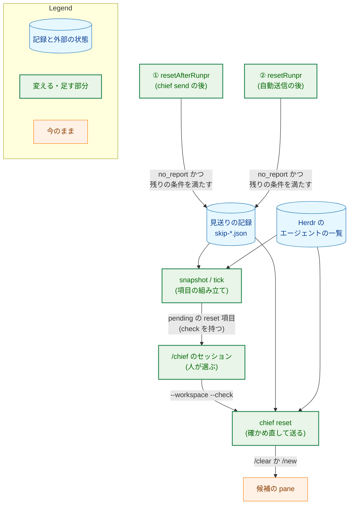
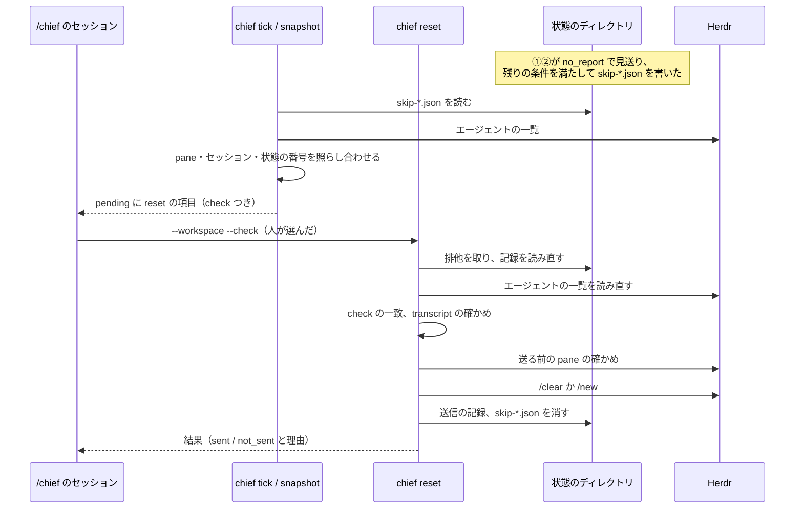

# 設計書：chief が報告を読めずに見送ったリセットを、人の選択肢として示す

## Document Status

| Item | Value |
|---|---|
| Status | `draft` |
| Created | 2026-11-17 |
| Review date | - |
| Reviewer | - |
| Comments | - |

## 1. 設計の全体像

本書は [01_requirements.md](01_requirements.md)（以下、要件定義書）の F-001〜F-004 を実現する設計である。対象は chief（`internal/chief`・`cmd/chief`）と、`/chief` の定義、chief 利用ガイドである。

### 1.1. 設計原則

-   **リセットの今の判定を変えない。** ①（`resetAfterRunpr`、`internal/chief/reset.go:94-143`）と②（`resetRunpr`、`internal/chief/autosend.go:728-777`）は、送るかどうかも、返す結果（`Outcome`・`Reason`）も今のままにする（AC-13）。足すのは、`no_report` を返す箇所で、残りの条件を評価して見送りの記録を書く処理だけである。
-   **記録は候補を名指すだけで、送ることを決めない。** 見送りの記録は、人に示す項目の候補を名指す。示すときも送るときも、Herdr のエージェントの一覧と transcript で確かめ直す（ADR-0046 の記録の扱い）。
-   **人の選択は確かめの値で縛る。** `chief relay` の `--check` と同じく、項目が示したときの pane・セッション・状態から確かめの値を作る。道具はその値に合う項目にだけ送る。
-   **送信は今の送信の道筋を通す。** 排他、終わりのない送信の片付け、送信の停止、送信の記録、送る前の pane の確かめは、`holdWorkspace`（`internal/chief/request.go:263-299`）と `sendContext.run`（`internal/chief/send.go`）をそのまま使う。

### 1.2. 設計の際に決めたこと（2026-11-17）

-   **見送ったリセットは、workspace ごとの記録のディレクトリに、見送りの記録として残す。** 各 round はその記録を Herdr のエージェントの一覧と照らし合わせて、項目にする（3.1・3.2）。①は `chief send` の別のプロセスで、②は `tick` の中で起きる。そのため、後の round で示すには、プロセスの外に残す記録が要る。記録を残さずに、その送信の結果にだけ示す案は採らない。この案では、人が選べるのはその場だけになり、待ち受けの番号つきの一覧にも載らない。ADR: [ADR-0046](../../dev/adr/0046-chief-of-staff.md) を更新する（記録の使い道に、人に示すリセットの候補を名指すことを足す。要件定義書の AC-14 の更新に含まれる）。
-   **人の選択は、新しいサブコマンド `chief reset --workspace <worktree> --check <check> --protocol 1` で道具に渡す（3.3）。** `chief send` の要求は、タスクのコマンドの型（`paneinput.Command`）を送り先の表で送るもので、リセットとは性質が違う。`relay` と同じく確かめの値で縛る形が合う。`chief send --command reset` に足す案は採らない。ADR: なし（送る入力の範囲は `/clear`・`/new` のまま変わらず、道具の口の形はこのタスクの中で閉じるため）。
-   **出力の protocol は `1` のままにし、同じ PR で `/chief` の定義を直す。** 利用者は 1 人で、道具と定義は同じ `main` から入れるためである（要件定義書の 4.4）。ADR: なし（同上）。

## 2. システム構成

### 2.1. コンポーネント配置

| コンポーネント | ファイル | 変更 |
|---|---|---|
| 見送りの記録 | `internal/chief/records.go`（または新しいファイル） | 足す: 記録の型、書く・一覧する・消す操作 |
| ①の見送り | `internal/chief/reset.go` | 変える: `no_report` の後に残りの条件を評価し、満たせば記録を書く |
| ②の見送り | `internal/chief/autosend.go` | 変える: 同上 |
| 項目の組み立て | `internal/chief/snapshot.go`・`internal/chief/pending.go` | 変える: 記録から `reset` の項目を作り、並べる |
| 出力 | `internal/chief/output.go` | 変える: 項目の `reset` の欄、`chief reset` の結果 |
| リセットの送信 | `internal/chief/` の新しいファイル（例: `resetoffer.go`） | 足す: `chief reset` の本体 |
| サブコマンド | `cmd/chief/main.go` | 変える: `reset` の引数の解析と呼び出し |
| `/chief` の定義 | `.claude/commands/chief.md` | 変える: 項目の示し方、選んだときの呼び出し、理由の説明 |
| 利用ガイド | `docs/dev/guides/chief_guide.md` | 変える: サブコマンドの表、状態のディレクトリの表、既知の制限 |

### 2.2. データの流れ



## 3. コンポーネント設計

### 3.1. 見送りの記録

workspace ごとの記録のディレクトリ（`Store.Records` が返すもの）に、次の JSON を作る。作ったら上書きしない（`Store.create`）。名前は `skip-<pane・セッション・状態の番号・入力の SHA-256 の 16 進>.json` とする。同じ pane・セッション・状態・入力の見送りは同じ名前になるので、2 つ目は作られず、項目も 1 つになる（AC-06）。

```go
// skipRecord is a reset chief skipped only because the report could not be
// confirmed, kept so a later round can offer it to the human.
type skipRecord struct {
	Pane    string    `json:"pane"`    // Herdr pane ID
	Session string    `json:"session"` // the agent session the pane had
	Seq     int64     `json:"seq"`     // state_change_seq when skipped
	Agent   string    `json:"agent"`   // "claude_code" or "opencode"
	Scene   string    `json:"scene"`   // "after_runpr" (①) or "after_autosend" (②)
	Command string    `json:"command"` // the command that ran in the pane, as typed
	At      time.Time `json:"at"`
}
```

-   読むときは `Store.read` を使う。知らない欄、続きのデータ、大きさの上限（`recordLimit`）を超える記録は読めないものとして扱う。`Agent`・`Scene` が決まった値でない記録、`Pane` が pane ID の形でない記録も、同じく読めないものとする（AC-07）。読めない記録は項目にせず、round の `problems` にパスとともに示す。記録は消さない。
-   型の中では、`Agent` は `paneinput.AgentKind`、`Scene` は列挙型にして、`switch` の `default` で読めないものにする（CLAUDE.md の「Declare, don't infer」）。
-   送る入力（`/clear`・`/new`）は記録に持たない。`Agent` から `resetPrompt`（`internal/chief/reset.go:76-85`）で決める。

### 3.2. 記録を書く条件（①②）

`no_report` を返す箇所で、その結果は変えずに、要件定義書の AC-02 の残りの条件を評価する。すべて満たせば記録を書く。

| 場面 | `no_report` を返す箇所 | 書く前に評価する残りの条件 | 記録の `Seq` |
|---|---|---|---|
| ① | PR の詳細の控えがない（`reset.go:118-120`） | Herdr で読み直した pane が同じエージェントであること。Claude Code では `lastInputMadePR` が通ること | 読み直した `StateChangeSeq` |
| ① | 画面に報告がない（`reset.go:135-137`） | Claude Code では `lastInputMadePR` が通ること（控えからの状態の変化は、この前に確かめ済み） | 同上 |
| ① | OpenCode の pane で、人の入力の記録がない（`reset.go:52-54` が返す `NotSentNoReport`） | なし（ほかの条件はこの前に確かめ済み） | 同上 |
| ② | 最後のメッセージが `/runpr` の報告でない（`autosend.go:769-771`） | 排他の下で読んだ `candidate.StateChangeSeq` と、今読んだ状態の番号が等しいこと | `candidate.StateChangeSeq` |

-   候補がただ 1 つの pane であること、直前に送った pane と別であることは、どの箇所でも `no_report` より前に確かめ済みである。
-   `lastInputMadePR` が `NotSentOtherInput`・`NotSentNoTranscript`・`NotSentPathUnsupported` を返したときは、記録を書かない。
-   記録を書けなかったときも、結果の `Outcome`・`Reason` は変えない。`Detail` の末尾に、記録を書けなかったことを添える（要件定義書の 4.3）。
-   ①は `chief send` の排他の下で、②は自動送信の排他の下で書く。

### 3.3. 項目の組み立て

`readRound` が workspace ごとに記録を読む箇所（`addRecords` の近く）で、`skip-*.json` をすべて読み、それぞれを今の round のエージェントの一覧と照らし合わせる。次のすべてが成り立つ記録だけを、`PendingReset` の項目にする（AC-05）。

-   workspace の送信が止められていない（`stop.json` がない）。
-   `Agent` の種類の pane が workspace にちょうど 1 つあり（`targetPane`）、それが `Pane` である。
-   その pane のセッションが `Session`、状態の番号が `Seq` と等しい。

成り立たない記録は、その round で消す（`privatefile.Remove`）。状態の番号とセッションは元に戻らないうえ、記録も消えるので、項目が `pending` に戻ることはない（AC-05）。round が workspace を読めなかったとき（Herdr の一覧にない、記録のディレクトリを読めない）は、消さない。

```go
// ResetItem is a skipped reset offered to the human.
type ResetItem struct {
	Pane    string
	Agent   paneinput.AgentKind
	Input   string     // "/clear" or "/new"
	Command string     // the command that ran in the pane
	Check   CheckValue // what chief reset --check takes
}
```

-   `PendingKind` に `PendingReset`（出力の名前は `reset`）を足す。`kindRank` では `PendingProposal` と同じ順位にし、0088 要件定義書の AC-13 の「そのほかの提案」に並べる（AC-04）。
-   項目の ID は `itemID("reset", workspace, pane, session, seq)` とする。通知と番号は、`stampPending` がほかの項目と同じく付ける。
-   確かめの値は、`checkVersion` と同じ考え方で、`chief-reset-check-1`・workspace・pane・セッション・状態の番号・エージェント・場面・コマンドの SHA-256 の 16 進とする。形は `checkValueForm` と同じにする。値は不透明で、セッションは作りも読みもしない（CLAUDE.md の「Keep internals unobservable」）。
-   出力の `PendingOutput` に `reset` の欄（`pane`・`agent`・`input`・`command`・`check`）を足す。`command` は `Sanitize` を通す。

### 3.4. `chief reset`

```go
// ResetRequest is a validated `chief reset`: the workspace and the check
// value of the reset item the human chose.
type ResetRequest struct {
	workspace string
	check     CheckValue
}

func ParseResetRequest(workspace, check string) (ResetRequest, error)
func Reset(ctx context.Context, deps Deps, req ResetRequest) (SendOutcome, error)
```

`Reset` は次の順で動く。

1.  `locate` で workspace を見つけ、`holdWorkspace` で排他を取る。ここで、ほかの送信の最中（`busy`）、終わりのない送信、送信の停止（`stopped`）を確かめ、エージェントの一覧を読み直す。
2.  記録を読み直し、3.3 の条件を満たし、確かめの値が `--check` と等しい項目を探す。ない場合は `NotSentCheckMismatch` とし、何も打たない（AC-09）。
3.  Claude Code の pane では、transcript で人が最後に入力した行を確かめる。①は `lastInputMadePR` と同じく、名前と引数を比べる。②は名前が `runpr` であることだけを比べる（`/runpr` は PR 番号・ブランチ・タスクのどれでも引数に取り、人が打った形を決められないため）。通らなければ、その理由（`other_input`・`no_transcript`・`path_unsupported`）とする。
4.  `sendContext.run` で、`resetPrompt` の 1 ステップを、`paneCheck{session: Session, seq: &Seq}` を付けて送る。`checkPane` が、同じエージェント、セッション、状態の番号、入力を待っていること、質問でないこと、入力欄が空であることを確かめる（AC-08）。送信の記録（入力の種類 `reset`）は、ほかの送信と同じく書く（AC-10）。
5.  送れたとき（`OutcomeSent`）は、記録を消す。消せなかったときも、pane の状態の番号が変わるので、次の round の 3.3 で消える（AC-11）。

`chief reset` は `send`・`relay` と同じく、`start` の後に、chief のロックを持つセッションからだけ呼べる（`requireOwner`）。

### 3.5. `/chief` の定義と利用ガイド

-   `chief.md` の「3. The choices」に `reset` の項目の示し方を足す（AC-03）。「4. Acting on the answer」に、選んだら確かめの問いを挟まずに `chief reset --workspace <workspace> --check <check> --protocol 1` を呼び、結果を step 2 と同じく示すことを足す（AC-08・AC-10）。理由の表に `check_mismatch` のリセットでの意味を足す。
-   `chief_guide.md` のサブコマンドの表に `reset` を足す。状態のディレクトリの表の workspace ごとの記録に `skip-*.json` を足す。既知の制限「長い報告は画面から読めない」に、見送ったリセットが選択肢として示されることを書く（AC-16）。
-   ADR-0046 は要件定義書の PR で更新した（AC-14）。設計の決定（3.1 の記録）は、その更新の範囲に入る。

## 4. エラーハンドリング設計

| 場面 | 振る舞い |
|---|---|
| 記録を書けない（①②） | 結果は今のまま。`Detail` に添える。項目にならない |
| 記録を読めない（round） | 項目にしない。`problems` にパスと理由を示す。消さない |
| 記録の一覧を読めない（round） | その workspace の記録の読み取りの失敗として、今の `addRecords` の失敗と同じく `problems` に示す |
| 合わない記録を消せない（round） | `problems` に示す。項目にはしない |
| `--check` が形に合わない | 使い方の誤り（終了コード `2`） |
| 確かめの値に合う項目がない | `not_sent`・`check_mismatch` |
| transcript の確かめが通らない | `not_sent`・その理由 |
| 送る前の pane の確かめが通らない | `not_sent`・`checkPane` の理由（`pane_changed`・`not_accepting`・`input_left`・`unreadable`） |
| 打った後に確かめが失敗した | `sent_then_failed`。今の送信と同じく、workspace への送信を止める |

## 5. セキュリティ考慮事項

`docs/dev/security.md` の条件付きの手引きの引き金には当たらない（要件定義書の 4.2）。開発用の道具の信頼の境界として、次を考える。

-   **偽られた記録。** 状態のディレクトリは同じ利用者のプロセスが書ける。偽られた記録が名指せるのは、今の round で 3.3 の条件を満たす pane だけである。つまり、workspace のその種類のただ 1 つの pane で、今のセッションと状態の番号が記録と等しいものに限られる。そのうえ、送るには人の選択と 3.4 の確かめ直しが要る。送られるのは `/clear`・`/new` だけである。これを残る危険として受け入れる。
-   **記録の中の文字列。** `Command` は `/chief` のセッションに示すだけで、送る入力にも判定にも使わない。示す前に `Sanitize` を通す。transcript の確かめで比べる相手は、記録の `Command` ではない。①は `prMaker` が `origin/main` の文書から決めたコマンドと、②は `runpr` という名前と比べる。
-   **確かめの値。** 不透明な値で、`chief reset` は値の中身を読まず、今の項目から作り直した値と比べるだけである。

## 6. 処理フローの詳細



## 7. テスト戦略

単体テストは `internal/chief` の今の偽物（Herdr・コマンドの実行・状態のディレクトリ。`world_test.go`・`sim_test.go` など）で書く。Herdr・エージェント・GitHub には触れない。

-   **記録を書く条件（AC-01・AC-02）:** 3.2 の表の各箇所で、残りの条件を 1 つずつ崩したときに記録が書かれないこと。崩さないときに書かれること。OpenCode の pane が PR を作った①で書かれること。
-   **今の結果を保つ（AC-13）:** 3.2 の各箇所で、リセットの結果の `Outcome`・`Reason` が変わらないこと。今のリセットのテストは変えずに通ること。
-   **項目の組み立て（AC-03〜AC-07）:** 3.3 の条件を 1 つずつ崩したときに項目が出ず、記録が消えること。読めない記録が `problems` に出て、項目にならないこと。同じ見送りが 2 回あっても項目が 1 つであること。並び順と番号。
-   **`chief reset`（AC-08〜AC-12）:** 確かめの値の不一致、transcript の確かめ、`checkPane` の各理由で何も打たないこと。送れたときに送信の記録があり、記録が消え、次の round に項目が出ないこと。`snapshot`・`tick` が項目のリセットを送らないこと。
-   **文書のガード:** 今の `cmd/chief/docs_test.go` が、`chief.md` が各サブコマンドを呼んでいることと、利用ガイドのサブコマンドの表が道具のサブコマンドと一致することを確かめる。`reset` を足すと、これらが `chief.md` と利用ガイドの更新を求める。

## 8. 実装の優先順位

1 つのフェーズで実装する。記録の型と読み書き → ①②で記録を書く → 項目の組み立てと出力 → `chief reset` → `cmd/chief` → `/chief` の定義と利用ガイド、の順に進める。

## 9. 将来の拡張性

#905・#906・#907 が報告を transcript や OpenCode の API から読むようになると、`no_report` で見送る場面は減る。それでも、報告を確かめられない見送りの受け皿として、この仕組みは変えずに残る。3.2 の表の箇所は、その変更に合わせて付け替える。
