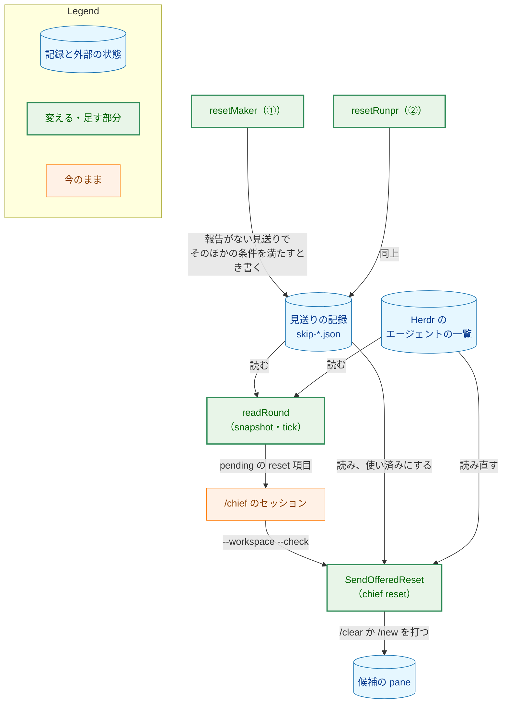
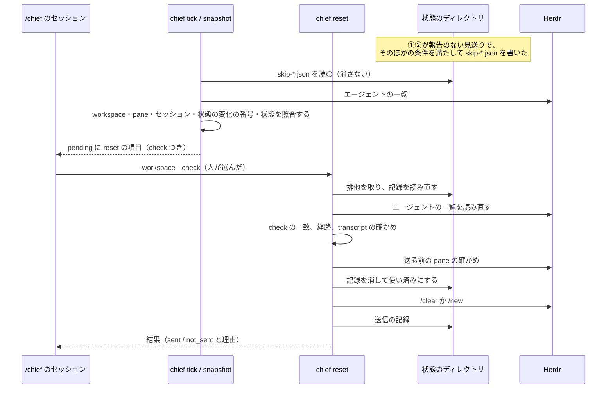

# 設計書：chief が報告を読めずに見送ったリセットを、人の選択肢として示す

## Document Status

| Item | Value |
|---|---|
| Status | `approved` |
| Created | 2026-11-17 |
| Review date | 2026-11-17 |
| Reviewer | isseis |
| Comments | - |

## 1. 設計の全体像

本書は [01_requirements.md](01_requirements.md)（以下、要件定義書）の F-001〜F-004 を実現する設計である。対象は chief（`internal/chief`・`cmd/chief`）と、`/chief` の定義、chief 利用ガイドである。既存のコードについての記述は、コミット `97ca1fc7`（`origin/main`）で確かめた。

### 1.1. 設計原則

-   **リセットの今の判定を変えない。** ①（`resetAfterRunpr`、`internal/chief/reset.go:94-143`）と②（`resetRunpr`、`internal/chief/autosend.go:728-777`）は、送るかどうかも、返す `Outcome`・`Reason` も今のままにする（AC-13）。判定の関数は、見送りの結果に加えて「項目にできる見送りか」を型で返すだけにする。記録を書くのは、排他を持つ呼び出し側である。
-   **「報告がない」と「報告が別のもの」を型で分ける。** `no_report` を返す箇所の内訳を、見送りの種類（3.2）として返す。項目にできるのは「報告がない」種類だけで、`switch` の `default` は項目にしない（CLAUDE.md の「Declare, don't infer」）。
-   **round は読み取りだけにする。** `snapshot` と `tick` の round は見送りの記録を読んで絞り込むだけで、作りも消しもしない。`readRound` の「It creates no record」（`internal/chief/snapshot.go:86-89`）は保たれる。記録を消すのは、workspace の排他の下の 3 つ（`chief reset` の使い済み、コマンドかリセットを打てた後、`start` の片付け）だけである。
-   **記録は候補を名指すだけで、送ることを決めない。** 示すときも送るときも、Herdr のエージェントの一覧と transcript で確かめ直す（ADR-0046 の記録の扱い）。
-   **人の選択は確かめの値で縛る。** `chief relay` の `--check` と同じく、項目が示したときの内容から確かめの値を作る。道具は、その値に合う項目にだけ送る。
-   **送信は今の送信の道筋を通す。** 排他、終わり方の分からない送信の片付け、送信の停止、送信の記録、送る前の pane の確かめは、`holdWorkspace`（`internal/chief/request.go:263-299`）と `sendContext.run`（`internal/chief/send.go:441-`）をそのまま使う。

### 1.2. 設計の際に決めたこと（2026-11-17）

-   **見送ったリセットは、workspace ごとの記録のディレクトリに、見送りの記録として残す。** 各 round はその記録を Herdr のエージェントの一覧と照合して、項目にする（3.1・3.3）。①は `chief send` の別のプロセスで、②は `tick` の中で起きる。そのため、後の round で示すには、プロセスの外に残す記録が要る。記録を残さずに、その送信の結果にだけ示す案は採らない。この案では、人が選べるのはその場だけになり、`/chief` が待ち受けの間に示す番号つきの一覧にも載らない。ADR: [ADR-0046](../../dev/adr/0046-chief-of-staff.md) を更新する（記録の使い道に、人に示すリセットの候補を名指すことを足す。要件定義書の AC-14 の更新に含まれる）。
-   **人の選択は、新しいサブコマンド `chief reset --workspace <worktree> --check <check> --protocol 2` で道具に渡す（3.4）。** `chief send` の要求は、タスクのコマンドの型（`paneinput.Command`）を送り先の表で送るもので、リセットとは性質が違う。`relay` と同じく確かめの値で縛る形が合う。`chief send --command reset` に足す案は採らない。ADR: なし（送る入力の範囲は `/clear`・`/new` のまま変わらず、道具の口の形はこのタスクの中で閉じるため）。
-   **round は見送りの記録を消さない。`chief reset` が、最初の入力を打つ前に、workspace の排他の下で記録を消して使い済みにする。消せなければ何も打たない（3.4）。ほかに記録を消すのは、chief がその pane へほかの入力を送れたとき（同じ排他の下）と、`start` の片付けで見送りから 14 日たった記録を消すときだけである（3.1）。** round で消すと、`snapshot` が読み取りだけだという約束が崩れる。そのうえ、バックグラウンドの `chief send` が書いたばかりの記録を、古いエージェントの一覧と比べて消しかねない。tick が排他の下で消す案も採らない。仕組みが増えるためである。ただし、条件を外れた記録をいつまでも残すと、OpenCode の pane（セッションを報告せず、`/new` でも状態の変化の番号が変わらない）では、後で同じ値になったときに古い見送りが示される。そこで、すでに排他を持つ送信の後と `start` の片付けで消す。ADR: なし（記録の扱いの細部で、このタスクの中で閉じるため）。
-   **①の記録には、見送ったときに `prMaker` が決めた PR を作ったコマンドを残し、`chief reset` は transcript の人の最後の入力をそれと比べる。** `prMaker`（`internal/chief/reset.go:20-44`）は PR が開いている間だけ正しい。`/runpr` が PR をマージした後に計算し直すと、次のコマンドを返してしまい、確かめが必ず `other_input` で失敗する。記録のコマンドを偽れば transcript の確かめを通りうるが、これは偽られた記録の危険（要件定義書の 4.2）に含めて受け入れる。ADR: なし（同上）。
-   **人が選んだリセットの送信は、ほかの送信と同じ送信の記録に残し、自動送信の「その後の送信」の判定からも外さない。** 外すには、`SentSince`（`internal/chief/records.go:843-850`）が送信の記録を読むように変える必要がある。数えたままにした場合、マージを見た後にリセットを選ぶと、次のコマンドが提案として示されるだけで、安全側に倒れる（要件定義書の AC-13）。ADR: ADR-0046 を更新する（「結果」の節に書く）。
-   **出力の protocol は `1` のままにし、同じ PR で `/chief` の定義を直す。** 要件定義書の 4.4 のとおりである。ADR: なし。

## 2. システム構成

### 2.1. コンポーネント配置

| コンポーネント | ファイル | 変更 |
|---|---|---|
| 見送りの記録 | `internal/chief/skiprecord.go`（新規） | 足す: 記録の型、書く・一覧する・使い済みにする操作 |
| 見送りの種類と記録の書き込み（①） | `internal/chief/reset.go`、`internal/chief/request.go` | 変える: `resetAfterRunpr` が見送りの種類を返す。`resetMaker` が記録を書き、`Detail` に添える |
| 見送りの種類と記録の書き込み（②） | `internal/chief/autosend.go` | 変える: `resetRunpr` が見送りの種類を返し、記録を書き、`Detail` に添える |
| 項目の組み立て | `internal/chief/state.go`（`Row` の欄）、`internal/chief/snapshot.go`、`internal/chief/pending.go` | 変える: round が記録から項目を作り、`buildPending` が並べる |
| 確かめの値 | `internal/chief/relay.go` | 変える: 値を作る部分を共有の関数に切り出し、`CheckValue` の説明を広げる |
| 送らない理由と送った後の記録 | `internal/chief/send.go` | 変える: `NotSentCheckMismatch` の説明を、リセットの項目にも広げる。最初の入力を打てた pane の見送りの記録を消す |
| 古い記録の片付け | `internal/chief/records.go` | 変える: `HeldWorkspace.cleanup` が、14 日を過ぎた見送りの記録を消す |
| OpenCode の最後のメッセージ | `internal/chief/screen_report.go` | 変える: メッセージの始まりが画面にあるかも返す |
| 出力 | `internal/chief/output.go` | 変える: 項目の `reset` の欄 |
| リセットの送信 | `internal/chief/resetoffer.go`（新規） | 足す: `chief reset` の本体 |
| サブコマンド | `cmd/chief/main.go` | 変える: `reset` の定数、引数、`parseRequests`、`dispatch`、使い方の文言、パッケージの説明 |
| `/chief` の定義 | `.claude/commands/chief.md` | 変える: 項目の示し方、選んだときの呼び出し、理由の説明 |
| 利用ガイド | `docs/dev/guides/chief_guide.md` | 変える: サブコマンドの表、状態のディレクトリの表、既知の制限、保証すること |
| テスト | `internal/chief/skiprecord_test.go`・`resetoffer_test.go`（新規）、`reset_test.go`・`autosend_test.go`・`snapshot_test.go`・`pending_test.go`、`cmd/chief/main_test.go` | 足す・変える（7 章） |

今のリセットを確かめるテスト（`internal/chief/reset_test.go` の `TestResetAfterRunpr`・`TestResetChecks` と、`internal/chief/autosend_test.go` の `TestResetAfterAutoSend`・`TestResetChecksAgain` など）は、`Outcome`・`Reason` の期待値を変えない。見送りの記録の有無を確かめる行や列は足してよい。

### 2.2. データの流れ

図の矢印 A → B は、「A が B を書く・呼ぶ・B に打つ」ことを表す。記録を読む向きは、記録から読む側への矢印で表す。



## 3. コンポーネント設計

### 3.1. 見送りの記録

workspace ごとの記録のディレクトリ（`Store.Records` が返すもの）に、次の JSON を作る。作ったら上書きしない（`Store.create`）。名前は `skip-<pane・セッション・状態の変化の番号の SHA-256 の 16 進>.json` とする。項目の同一性は、この 3 つ（pane・セッション・状態の変化の番号）である。pane・セッション・状態の変化の番号がすべて同じ見送りが 2 回あれば、2 つ目の記録は作られず（`privatefile.ErrExist`）、項目も 1 つになる（AC-06）。2 つ目は「すでに記録した」として扱い、書けなかったことにはしない。

```go
// skipRecordFile is the JSON form of a skip record.
type skipRecordFile struct {
	Workspace string `json:"workspace"` // Herdr workspace ID
	Pane      string `json:"pane"`      // Herdr pane ID
	Session   string `json:"session"`   // agent session; empty for OpenCode
	Seq       int64  `json:"seq"`       // state_change_seq when skipped
	Agent     string `json:"agent"`     // "claude_code" or "opencode"
	Scene     string `json:"scene"`     // "after_runpr" (①) or "after_autosend" (②)
	Command   string `json:"command"`   // "mkreq", "mkarch", "mkplan", "runplan", or "runpr"
	Argument  string `json:"argument"`  // task ID or PR number; empty only for mkreq
	Route     string `json:"route"`     // the routing table row of the command
	Saved     string `json:"saved"`     // RFC 3339 time the record was written
}

// skipRecord is a validated skip record. Only readSkipRecord and
// newSkipRecord make one.
type skipRecord struct {
	workspace string
	pane      PaneID
	session   string
	seq       int64
	agent     paneinput.AgentKind
	scene     skipScene
	command   ranCommand
	saved     time.Time
}

// ranCommand is the command that ran in the pane, as the transcript check
// compares it: its name, its argument (empty for /mkreq, whose issue no
// document names, meaning any non-empty argument), and its route.
type ranCommand struct {
	kind     paneinput.CommandKind
	argument string
	route    paneinput.RouteKey
}

// skipScene is where a reset was skipped. The zero value is no scene and is
// never read from a record.
type skipScene int

const (
	sceneUnknown skipScene = iota
	sceneAfterRunpr
	sceneAfterAutoSend
)
```

-   読むときは、大きさの上限（`recordLimit`）まで `privatefile.Read` で読み、`internal/strictjson` で 1 つのオブジェクトとして解く。`Store.read` は使わない。`encoding/json` は重なった欄を後のもので上書きし、欄の名前の大文字と小文字を区別せずに受け付けるためである。知らない欄、重なった欄、続きのデータを含む記録は読めない。次のいずれかに当たる記録も読めないものとする（要件定義書の 3.2）。`Pane` が `ParsePaneID` を通らない。`Agent`・`Scene`・`Command`・`Route` が決まった値でない。`Saved` が RFC 3339 の時刻でない。`Route` が `Command` の取りうる経路でない（`runplan` は `runplan` の 4 つの経路のどれか、ほかはそのコマンドの経路）。`Argument` が、`mkarch`・`mkplan`・`runplan` ではタスクの番号（`paneinput.ParseTaskID`）、`runpr` では PR の番号の形でない、または `mkreq` で空でない。②で `Command` が `runpr` でない。Claude Code で `Session` が空。
-   書くときも、同じ確かめを通した値（`newSkipRecord`）だけを書く。通らないときは書かず、`Detail` に「項目にしない」と添える。
-   読めない記録は項目にせず、round の `problems` にパスと理由を示す。round は消さない。利用ガイドに、手で消してよいことを書く。
-   送る入力（`/clear`・`/new`）は記録に持たない。`agent` から `resetPrompt`（`internal/chief/reset.go:76-85`）で決める。
-   `Saved` は記録を消す時機にだけ使う。項目の待っている時間は、通知の記録（`stampPending`）が決める（AC-04）。
-   記録を消すのは次の 3 つだけである。`chief reset` の使い済み（3.4）。`sendContext.run` がある pane へ最初の入力を打てたとき（コマンドの送信とリセット。`relay` は `sendContext.run` を通らないので含まない。workspace の排他の下）、その pane の記録をすべて消す。消せなくても送信の結果は変えない（要件定義書の AC-13）。`HeldWorkspace.cleanup`（`internal/chief/records.go:883-`）が、`Saved` から `detailMaxAge`（14 日、`records.go:592-594`）を過ぎた記録と、読めない記録のうち 14 日を過ぎたもの（ファイルの更新時刻で判断する）を消す。

### 3.2. 見送りの種類と記録を書く条件（①②）

`resetAfterRunpr` と `resetRunpr` は、`ActionResult` に加えて、見送りの種類を返す。

```go
// skipKind is why a reset was skipped with NotSentNoReport. The zero value
// is not offered.
type skipKind int

const (
	skipNotOffered    skipKind = iota // any other skip, or a reset that was sent
	skipReportAbsent                  // no report was found or could be read
)
```

| 場面 | `no_report` を返す箇所と条件 | 見送りの種類 | 「報告がない」ときに評価するそのほかの条件 |
|---|---|---|---|
| ① | `reset.go:118-120` で、`rec != nil` かつ `rec.Source` が `ReportFromDescription`（報告を示す pane がないか、2 つ以上あった。`internal/chief/detail.go:440-465`） | 候補が Claude Code なら `skipReportAbsent`、OpenCode なら `skipNotOffered` | Herdr で読み直した pane が同じエージェントで、入力を待っている。`lastInputMadePR` が通る |
| ① | `reset.go:118-120` で、`rec == nil`（PR の詳細を集められなかったか、控えを書けなかった。`internal/chief/request.go:371-380`） | `skipNotOffered` | — |
| ① | `reset.go:118-120` で、`rec.Source` が `ReportFromScreen` で `rec.Pane` が候補でない | `skipNotOffered` | — |
| ① | 控えた後に状態は変わっていないが、Claude Code の pane の transcript に最後の報告がない（タスク 0095 から、①は報告を画面でなく transcript から読む。`readClaudeReport` が `SessionReportAbsent` を返す） | 候補が Claude Code なら `skipReportAbsent`、OpenCode なら `skipNotOffered` | 入力を待っている。`lastInputMadePR` が通る |
| ① | `reset.go:52-54`（OpenCode の pane の `lastInputMadePR`） | `skipNotOffered` | — |
| ② | `runprPaneReport` が `no_report` で報告を読めない（Claude Code の pane では transcript に最後の報告がなく、OpenCode の pane では `readRunprReport` が `!ok`）か、OpenCode の pane で最後のメッセージの始まりが画面の外に出ていて、見えている部分が PR を名指さない（NEXT は違わない） | `skipReportAbsent` | 今読んだ状態の変化の番号が、排他の下で読んだ `candidate.StateChangeSeq` と等しい。入力を待っている。Claude Code では、transcript の人の最後の入力の名前が `runpr` である |
| ② | 最後のメッセージの全体が読め、マージした PR を名指さない。または、NEXT が送ったコマンドと違う（始まりが画面の外でも） | `skipNotOffered` | — |

-   OpenCode の最後のメッセージを読む `openCodeLastMessage`（`internal/chief/screen_report.go:264-289`）は、上へたどって入力欄の枠の行に当たらずに画面の先頭まで来ても、見えている残りを返す。この変更では、メッセージの始まりが画面にあるか（枠の行で区切られているか）も返すようにし、`RunprReport` に持たせる。`readRunprReport` の `ok` の意味と、ほかの呼び出し元の振る舞いは変えない。Claude Code の最後のメッセージは `⏺ ` の印が要るので、始まりが画面の外に出ると `!ok` になる（`screen_report.go:170-213`）。
-   ②の `no_report` の `Detail` は、報告として読めない・始まりが画面の外・PR を名指さない・NEXT が違う、のどれかを見分けられる文言にする（要件定義書の AC-07）。

-   候補がただ 1 つの pane であること、直前に送った pane と別であることは、どの箇所でも `no_report` より前に確かめ済みである（`reset.go:107-117`、`autosend.go:749-759`）。
-   そのほかの条件のどれかが通らないか、その読み取りに失敗したときは、記録を書かない。そのときも、結果の `Outcome`・`Reason` は `not_sent`・`no_report` のままにする。
-   記録のコマンドは、①では見送ったときに `prMaker` が返したもの（名前・引数・経路。`/mkreq` は引数なし）、②では `runpr` とマージした PR の番号である。
-   呼び出し側は、①は `resetMaker`（`chief send` の排他の下）で、②は `autoSender.send`（自動送信の排他の下）で、`skipReportAbsent` のときに記録を書く。結果の `Detail` の末尾に、次のどれかを添える（AC-07）: 項目にした、項目にしない（外れた条件）、記録を書けなかった。
-   タスク 0095 などが報告の読み取りを変えるときも、`skipReportAbsent` を返すのは「報告がない」と判定した箇所だけで、transcript を読めないなどの「読めない」箇所では返さない（要件定義書の 4.5）。

### 3.3. 項目の組み立て

`readRound` が workspace ごとに記録を読む箇所（`addRecords`）で、`skip-*.json` をすべて読み、それぞれを今の round のエージェントの一覧と照合する。次のすべてが成り立つ記録だけを、`Row.Resets` に入れる（AC-05）。

-   行が「要確認」でなく、workspace の送信が止められていない。
-   記録の `Workspace` が、その行の Herdr の workspace の ID である。
-   `agent` の種類の pane が workspace にちょうど 1 つあり（`targetPane`）、それが記録の pane である。
-   その pane のセッションと状態の変化の番号が、記録と等しい。
-   その pane のエージェントが入力を待っている（`AgentIdle` か `AgentDone`）。
-   記録の `Route` が round の送り先の表で引け、その経路のエージェントが記録のエージェントと等しい。

`buildPending` は、`Row.State` によらず（「要確認」の行を除く）、`Row.Resets` の各項目を `PendingReset` の項目にする。①の典型の場面では、`/runpr` が別の pane で動いているので、行は「実行中」である。

```go
// ResetItem is a skipped reset offered to the human.
type ResetItem struct {
	Pane    PaneID
	Agent   paneinput.AgentKind
	Scene   skipScene
	Command ranCommand        // the command that ran in the pane
	Check   CheckValue        // what chief reset --check takes
}
```

-   `PendingItem` に `Reset *ResetItem` の欄を足し、`PendingKind` に `PendingReset`（出力の名前は `reset`）を足す。`kindRank` は `PendingReset` に `PendingProposal` と同じ順位を返す（AC-04）。`kindOrder` の末尾に足すと別の順位になるので、そうはしない。
-   項目の ID は `itemID("reset", workspace, pane, session, seq)` とする。通知と番号は、`stampPending` がほかの項目と同じく付ける。
-   確かめの値は、`relay.go` の `checkValue` から切り出した共有の関数で作る。版の文字列を `chief-reset-check-1` とし、workspace の worktree・Herdr の workspace の ID・pane・セッション・状態の変化の番号・エージェント・場面・コマンドの文字列（`ranCommand` の名前と引数。引数のない `/mkreq` は `/mkreq`）を入れる。`ranCommand` は表示と比べることにだけ使う型で、`paneinput.Command` ではない。`paneinput` の作る関数は変えない（引数のない `/mkreq` は `NewMkreq` で作れないため）。同一性の 3 つに場面とコマンドを加えるのは、人に示したコマンドと送るときに比べるコマンドが同じであることも縛るためである。値は不透明で、`/chief` のセッションは作りも読みもしない（CLAUDE.md の「Keep internals unobservable」）。
-   記録から項目を作る関数（条件の確かめと確かめの値）は 1 つにし、round と `chief reset` の両方が使う。
-   出力の `PendingOutput` に `reset` の欄（`pane`・`agent`・`input`・`scene`・`command`・`check`）を足す。

### 3.4. `chief reset`

```go
// OfferedResetRequest is a validated `chief reset`: the workspace and the
// check value of the reset item the human chose.
type OfferedResetRequest struct {
	workspace string
	check     CheckValue
}

func ParseOfferedResetRequest(workspace, check string) (OfferedResetRequest, error)
func SendOfferedReset(ctx context.Context, deps Deps, owner Owner, req OfferedResetRequest) (SendOutcome, error)
```

`SendOfferedReset` は次の順で動く。

1.  `locate` で workspace を見つけ、送り先の表を `origin/main` から読む（`ReadRouting`）。`holdWorkspace` で排他を取る。ここで、ほかの送信の最中（`busy`）、終わり方の分からない送信、送信の停止（`stopped`）を確かめ、エージェントの一覧を読み直す。
2.  `Send` と同じく workspace を読んで行を分類し、記録を読み直して、3.3 の関数で今の項目を作り、確かめの値が `--check` と等しいものを探す。ない場合は `check_mismatch` とし、何も打たない（AC-09）。
3.  `sendContext.run` に渡す経路を、記録の `Route` で送り先の表から引く。経路が引けて、そのエージェントが記録のエージェントと等しいことは、3.3 の共有の関数が項目を作る条件にも含めるので、一覧に示した項目がここで断られることはない（送り先の表が、示した後に変わった場合を除く。そのときは `check_mismatch` になる）。
4.  Claude Code の pane では、transcript で人が最後に入力した行を確かめる（`readLastHumanInput` を使う）。①は記録のコマンドと名前と引数を比べ（`lastInputMadePR` と同じ比べ方で、`/mkreq` は引数があることだけを確かめる）、②は名前が `runpr` であることだけを比べる。②の名前だけの比べ方は、人が `/runpr` を PR 番号・ブランチ・タスクのどれでも呼べるためである。通らなければ、その理由（`other_input`・`no_transcript`・`path_unsupported`）とする。OpenCode の pane では確かめない（`lastInputMadePR` は OpenCode に `no_report` を返すので呼ばない）。
5.  `NewPaneWriter` で書き手を作り、`sendContext.run` で `resetPrompt` の 1 ステップを、`paneCheck{session, seq}` を付けて送る。`checkPane`（`internal/chief/send.go:306-`）が、同じエージェント、セッション、状態の変化の番号、入力を待っていること、質問でないこと、入力欄が空であることを確かめる（AC-08）。
6.  `checkPane` が通った後、最初の入力の前に呼ばれる `beforeBegin`（`internal/chief/send.go:448-452`）で、chief のロックの持ち主を確かめ直し、記録を消して使い済みにする（`privatefile.Remove`）。消せなければ `unreadable` とし、何も打たない（AC-11）。その後、送信の記録（入力の種類 `reset`）を書いて打つ。これはほかの送信と同じである（AC-10）。

記録を使い済みにするのは、ほかの確かめがすべて済んだ後、打つ直前にする。こうすると、何も打たなかった（`not_sent`）ときは記録が残り、項目も残る。また、打った後に記録を消せずに項目が戻って 2 回送られる、ということも起きない（OpenCode では `/new` の後も状態の変化の番号が変わらないため、記録がなければ見分けられない）。

`chief reset` は `send`・`relay` と同じく、`start` の後に、chief のロックを持つ `/chief` のセッションからだけ呼べる（`requireOwner`）。

### 3.5. `/chief` の定義と利用ガイド

-   `chief.md` の「3. The choices」に `reset` の項目の示し方を足す（要件定義書の AC-03 の添え書きを含む）。「4. Acting on the answer」に、選んだら確かめの問いを挟まずに `chief reset --workspace <workspace> --check <check> --protocol 2` を呼び、結果を step 2 と同じく示すことを足す（AC-08・AC-10）。理由の表に、リセットでの `check_mismatch` の意味を足す。
-   `chief_guide.md` について。サブコマンドの表に `reset` を足す。状態のディレクトリの表の workspace ごとの記録に `skip-*.json` を足し、読めない記録は手で消してよいことを書く。既知の制限「長い報告は画面から読めない」に、見送ったリセットが選択肢として示されることを書く。入れ直した後に `/chief` を起動し直すことを書く（AC-16）。
-   ADR-0046 は、要件定義書と設計の決定に合わせて、この PR で更新した（AC-14）。

## 4. エラーハンドリング設計

| 場面 | 振る舞い |
|---|---|
| 記録を書けない（①②） | `Outcome`・`Reason` は今のまま。`Detail` に添える。項目にならない |
| 同じ記録がすでにある（①②） | すでに記録したものとして扱い、`Detail` には項目にしたと添える |
| 記録を読めない（round） | 項目にしない。`problems` にパスと理由を示す。消さない |
| 記録の一覧を読めない（round） | 今の `addRecords` の失敗と同じく、`problems` に示す |
| `--check` が形に合わない | 使い方の誤り（終了コード `2`） |
| 確かめの値に合う項目がない | `not_sent`・`check_mismatch`。記録は残る |
| 送り先の表を読めない | `not_sent`・`unreadable`。記録は残る |
| 経路が引けないか、エージェントが合わない | 項目が作られないので `not_sent`・`check_mismatch`。記録は残る |
| `beforeBegin` で chief の持ち主の確かめ直しが通らない | `not_sent`・`conditions`（自動送信と同じ）。記録は残る |
| transcript の確かめが通らない | `not_sent`・その理由。記録は残る |
| 送る前の pane の確かめが通らない | `not_sent`・`checkPane` の理由（`pane_changed`・`not_accepting`・`input_left`・`unreadable`）。記録は残る |
| 記録を使い済みにできない | `not_sent`・`unreadable`。何も打たない |
| 使い済みにした後に送信の記録を書けない | `not_sent`・`unreadable`。何も打たない。記録は使い済みで、項目は戻らない |
| 打った後に確かめが失敗した | `sent_then_failed`。今の送信と同じく、workspace への送信を止める |

## 5. セキュリティ考慮事項

`docs/dev/security.md` の条件付きの手引きの引き金には当たらない（要件定義書の 4.2）。開発用の道具の信頼の境界として、次を考える。

-   **偽られた記録。** 状態のディレクトリは同じ利用者のプロセスが書ける。偽られた記録が名指せるのは、今の round で 3.3 の条件を満たす pane だけである。つまり、その Herdr の workspace のその種類のただ 1 つの pane で、今のセッションと状態の変化の番号が記録と等しく、入力を待っているものに限られる。Claude Code の pane では、記録のコマンドを人の最後の入力と同じに偽れば、transcript の確かめも通りうる。それでも、送るには人の選択と 3.4 の確かめ直しが要り、送られるのは `/clear`・`/new` だけである。これを残る危険として受け入れる。
-   **記録の中の値。** 記録のコマンドは、決まった名前と、タスクの番号か PR の番号の形の引数だけを受け付けるので、任意の文字列は人に示されない。
-   **OpenCode の pane の②。** 報告の後に人が同じ pane で会話を続けたかを、機械では確かめられない。項目でそのことを示す（要件定義書の AC-03）。
-   **pane ID の使い回しと OpenCode の古い記録。** 記録は Herdr の workspace の ID・pane・セッション・状態の変化の番号に縛られる。OpenCode の pane はセッションを報告せず（`internal/chief/herdr.go:78-80`）、`/new` でも状態の変化の番号が変わらないので、見分けるのは pane と状態の変化の番号だけである。Herdr が pane ID を使い回すかは確かめていない（Herdr の再起動の後に、ほかの pane の `HERDR_PANE_ID` を受け継いだプロセスの例がある。`internal/chief/records.go:192-196`）。記録はその pane への次の送信の後と 14 日の後に消えるので、古い項目が示されうるのはその間だけである。使い回されて、同じ workspace の同じ種類のただ 1 つの pane が、記録と同じ状態の変化の番号を持つ場合だけ、古い項目が示されうる。それでも送るには人の選択が要るので、残る危険として受け入れる。
-   **確かめの値。** 不透明な値で、`chief reset` は値の中身を読まず、今の項目から作り直した値と比べるだけである。

## 6. 処理フローの詳細

矢印は呼び出しと応答を表す。



## 7. テスト戦略

単体テストは `internal/chief` の今の偽物（Herdr・コマンドの実行・状態のディレクトリ。`world_test.go`・`sim_test.go` など）で書く。Herdr・エージェント・GitHub には触れない。

-   **見送りの記録:** 作る・読む・読めない記録（3.1 の各場合）・同じ名前の 2 回目。pane へ最初の入力を打てたときにその pane の記録が消えること。`start` の片付けで 14 日を過ぎた記録が消え、過ぎていない記録が残ること。
-   **見送りの種類と記録を書く条件（AC-01・AC-02・AC-07）:** 3.2 の表の各行で、見送りの種類が表のとおりであること。`skipReportAbsent` の行で、そのほかの条件を 1 つずつ崩すか、その読み取りを失敗させると、記録が書かれないこと。記録の書き込みを失敗させたとき（`Store.beforeCreate`）に、`Detail` に添えられること。OpenCode の②で、始まりが画面の外に出た報告（今のサンプルの先頭を切って作る）が `skipReportAbsent` になり、全体が見える別の PR の報告が `skipNotOffered` になること。②の `Detail` が条件ごとに違うこと。
-   **今の判定を保つ（AC-13）:** 3.2 の各行で、`Outcome`・`Reason`・打った入力が今と同じであること。今のリセットのテストが、`Outcome`・`Reason` の期待値を変えずに通ること。
-   **項目の組み立て（AC-03〜AC-06）:** 3.3 の条件を 1 つずつ崩すと項目が出ないこと。round が記録を消さないこと。条件を満たさない間は項目が出ないこと。「実行中」の行でも項目が出ること。`start` で chief を起動し直しても項目が出ること。並び順と番号。
-   **`chief reset`（AC-08〜AC-12）:** round が示した確かめの値で送れること（往復）。pane・セッション・状態の変化の番号のそれぞれが変わると `check_mismatch` になること。経路、transcript の確かめ（①は記録のコマンド、②は名前）、使い済みにできないとき、`checkPane` の各理由で何も打たないこと。送れたときに、送信の記録があり、記録が消え、次の round に項目が出ないこと。`beforeBegin` での chief の持ち主の確かめ直しが通らないときに、記録が残って何も打たないこと。使い済みにした後に送信の記録を書けないとき（`Store.beforeCreate`）に、`not_sent` で項目が戻らないこと。マージを見た後に人がリセットを選ぶと、次の自動送信が提案に変わること（要件定義書の AC-13）。`snapshot`・`tick` が項目のリセットを送らないこと。
-   **`cmd/chief`:** `reset` の使い方の誤り（`--check` がない、形に合わない、`--workspace` が相対パス）、workspace がないとき、`start` の前とロックを持たないときの拒否。
-   **文書のガード:** 今の `cmd/chief/docs_test.go` が、`chief.md` が各サブコマンドを呼んでいること（`TestDocumentedInvocationsParse`。`parseRequests` に `reset` を足すと、引数の形も確かめる）と、利用ガイドのサブコマンドの表が道具のサブコマンドと一致すること（`TestGuideValuesMatchTool`）を確かめる。

## 8. 実装の優先順位

1 つのフェーズで実装する。見送りの記録の型と読み書き → ①②の見送りの種類と記録の書き込み → 項目の組み立てと出力 → `chief reset` → `cmd/chief` → `/chief` の定義と利用ガイド、の順に進める。

## 9. 将来の拡張性

#905・#906・#907 が報告を transcript や OpenCode の API から読むようになると、「報告がない」見送りは減る。それでも、報告がない見送りの受け皿として、この仕組みは変えずに残る。

タスク 0095 の実装は、3.2 の表の①の箇所（`reset.go:118-120`・`reset.go:135-137`）を書き換える。後にマージされる方の PR は、`origin/main` を取り込み、3.2 の規則（「報告がない」箇所だけが `skipReportAbsent` を返す）を保ったまま、表の箇所を付け替える。

## 変更履歴

- 2026-11-17 承認（isseis、#922）
