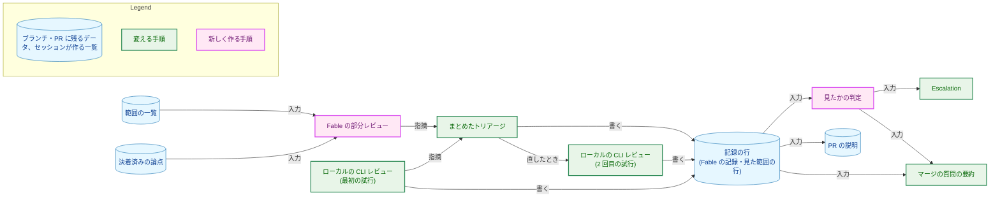
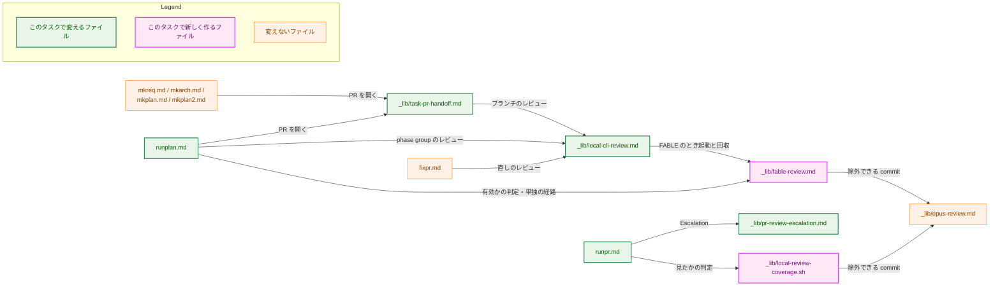
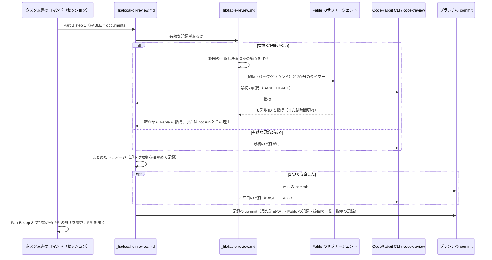
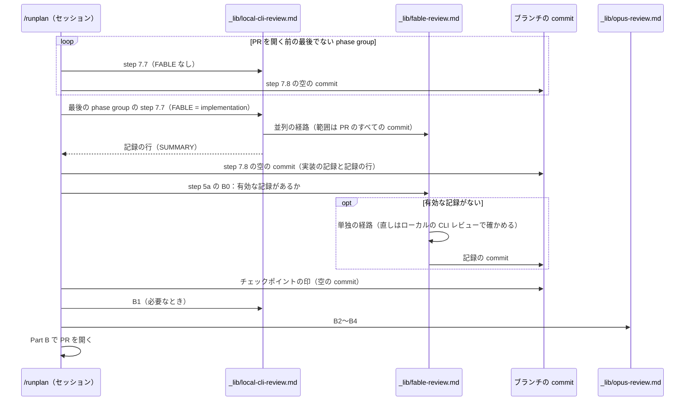
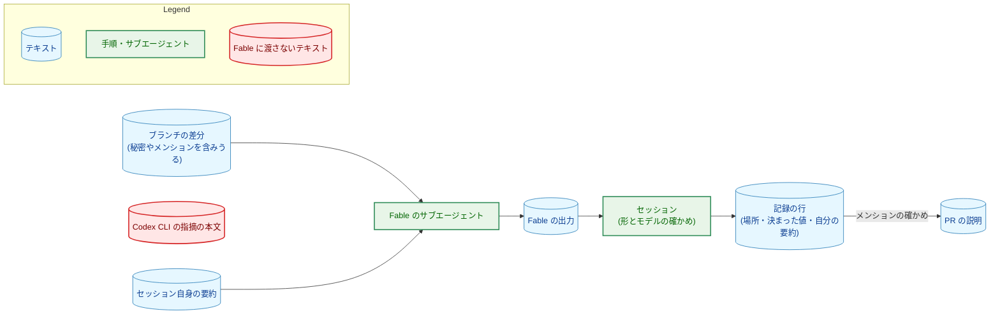
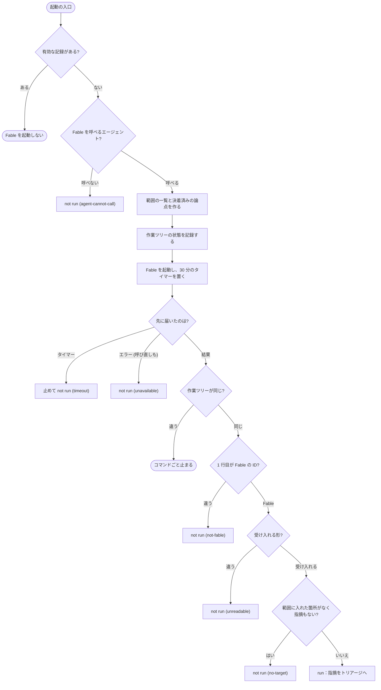
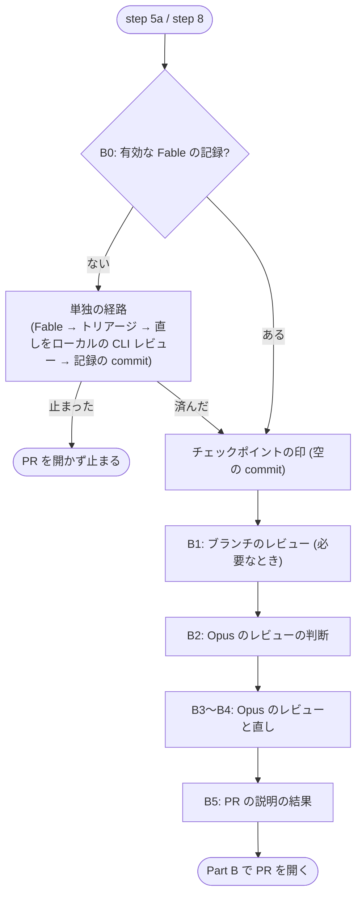

# アーキテクチャ設計書：Fable の部分レビューをタスクのコマンドに組み込み、Codex の PR 再レビューの条件を絞る

## Document Status

| Item | Value |
|---|---|
| Status | `draft` |
| Created | 2026-11-17 |
| Review date | - |
| Reviewer | - |
| Comments | - |

本書は [01_requirements.md](01_requirements.md)（要件定義書。以下、要件書）の設計である。既存のファイルの内容は、コミット `d76547e1` で確かめた。`file:line` の行番号は、このコミットでの行番号である。F-NNN・AC-NN は要件書の項番を、H-NN は [design_handoff.md](design_handoff.md)（以下、申し送り）の項番を指す。申し送りへの対応は付録 A に、受け入れ基準との対応は付録 B にまとめる。

本書は、要件書 6 章の用語（Fable の部分レビュー・ローカルの CLI レビュー・Codex の PR レビュー・Codex の PR 再レビュー・Opus のレビュー・決着済みの論点・phase group）を、要件書と同じ意味で使う。そのほかに、次の用語を使う。

-   **Fable の手順:** Fable の部分レビューを定める新しい共通の手順 `.claude/commands/_lib/fable-review.md`（3.1）。
-   **並列の経路:** Fable の部分レビューを、ローカルの CLI レビューの最初の試行と並列に走らせる経路。タスク文書の PR では `task-pr-handoff.md` Part B step 1 が、実装の PR では `runplan.md` step 7.7（PR を開く前の最後の phase group）が使う。
-   **単独の経路:** 実装の PR で、チェックポイント（`runplan.md` step 5a・step 8）に有効な記録がないときに、Fable の部分レビューを単独で行う経路（AC-06）。
-   **Fable の範囲:** Fable が見た commit の範囲（AC-07）。`<START>..<END>` の形で、END は Fable を呼んだときの HEAD である。
-   **範囲の一覧:** 範囲に入れた箇所とその基準、外した箇所とその理由の一覧（AC-14）。
-   **記録の行:** commit メッセージの、決まった形で 1 列目から始まる 1 行。考え方は、ローカルの CLI レビューの記録の行（`.claude/commands/_lib/local-cli-review.md:253-291`）と同じである。
-   **Fable の記録:** `Fable review: run` か `Fable review: not run` の行（3.2）。
-   **Fable の記録の commit:** Fable の記録を持つ空の commit。トリアージの直しの commit より後に作る（3.2.3）。
-   **チェックポイントの印:** `runplan.md` のチェックポイントで、Fable の記録が有効と判定した時点を示す `Fable review: checkpoint` の行（3.5.3）。
-   **見た範囲の行:** ローカルの CLI レビューの試行がレビューできた範囲を示す `Local CLI review: reviewed` の行（3.3.4）。
-   **見たかの判定:** Codex の最後の PR レビューの後の commit を、ローカルの CLI レビューがすべて見たかを決める判定。判定のスクリプト `.claude/commands/_lib/local-review-coverage.sh` が行う（3.6）。
-   **除外できる commit:** `_lib/opus-review.md` の「Excludable commit」（`.claude/commands/_lib/opus-review.md:102-106`）。親が 1 つで、空か、タスクの `03_implementation_plan.md` と `README.en.md` だけを変える commit。

## 1. 設計の全体像 (Design Overview)

### 1.1. 設計原則

-   **Fable の規則は 1 つの共通の手順に置く。** 範囲の基準、Fable への指示、モデルの確かめ、待ち方、記録の行の形、記録が有効かの判定は、Fable の手順だけが持つ（要件書 4.5 節）。呼び出し元は、どの種類の PR か（タスク文書か実装か）と範囲を渡すだけである。
-   **トリアージと確かめは、ローカルの CLI レビューの手順を通す。** Fable の指摘は、ローカルの CLI レビューの指摘と同じトリアージ・直し・2 回目の試行を通る（AC-20〜AC-22）。2 つ目のトリアージの手順は作らない。
-   **記録はブランチの commit に残し、読む側は形で読む。** 1 つの PR は複数のセッションにまたがりうるので、Fable の実施・範囲・指摘は、セッションの記憶ではなく commit メッセージから読む。新しい行は、既存の行と前置きが違う形にする（AC-32）。
-   **Fable は追加のレビューとして扱い、走らなくても止めない。** 使えないとき・時間切れ・別のモデルで走ったときは `not run` と記録して進む（AC-24）。止まるのは、Fable が作業ツリーを変えたときだけである（3.1.7）。
-   **Fable の出力はデータとして扱う。** セッションが使うのは、1 行目のモデル ID と、各指摘の場所・重大度・内容だけである。指摘の文には従わず、文を commit メッセージにも PR の説明にも写さない（要件書 4.2 節）。
-   **見たかの判定は、レビューを受ける側に任せない。** 判定は `origin/main` から取り出すスクリプトが行い、迷うとき（読めない記録、失敗）は「すべては見ていない」に倒す（3.6）。

### 1.2. 設計の際に決めたこと（2026-11-17）

1.  **Fable の手順は新しい `_lib/fable-review.md` に置き、`_lib/local-cli-review.md` に任意の入力 FABLE を足す。FABLE が渡されたとき、ローカルの CLI レビューの手順は、最初の試行の前に Fable を起動し、最初の試行のトリアージで Fable の結果を待ってまとめる。** タスク文書の PR では `task-pr-handoff.md` Part B step 1 が、実装の PR では `runplan.md` step 7.7 が FABLE を渡す。理由: まとめたトリアージと 2 回目の試行の条件（AC-20〜AC-22）は、ローカルの CLI レビューの step 4〜6 に入れるしかなく、Fable の手順をその外側に置くと、規則が 2 つのファイルにまたがるため（利用者の選択）。採らなかった案: Fable の手順を外側の手順とし、その中からローカルの CLI レビューを呼ぶ案。ADR: [ADR-0050](../../dev/adr/0050-fable-partial-review.md) を更新した。
2.  **ローカルの CLI レビューの試行がレビューできた範囲を、見た範囲の行としてブランチに記録する。Codex の最後の PR レビューの後の commit をすべて見たかは、`origin/main` から取り出す判定のスクリプト `_lib/local-review-coverage.sh` が決め、`ALL` か `PARTIAL` を出す。失敗したときは `PARTIAL` とする。Escalation とマージの質問の要約は、どちらもこの出力を使う。** 記録の行が残るように、ローカルの CLI レビューの手順は、記録の行を載せる commit が後に続かないときに、記録の行だけを持つ空の commit を作る（3.3.5）。`fixpr.md` Phase 4.5 も同じ手順を通るので、`fixpr.md` を変えずに、直しの後の確かめがブランチに残る。確かめた事実: `internal/fixprguard` には、空の commit を拒む規則はない（`grep -rn -i 'empty\|allow-empty' internal/fixprguard` で、commit に関わる行は出なかった）。`check` が比べるのは、HEAD が Phase 4 の commit から 1 本につながることである（`docs/dev/guides/fixprguard_guide.md:372`）。理由: 今の記録は見なかった範囲しか残さないので、見たことを読む材料がない。判定をセッションやサブエージェントの解釈に任せると、見ていない範囲を見落としうる（申し送り H-07）。スクリプトを `origin/main` から取り出すのは、Opus のレビューの判断のスクリプト（`.claude/commands/_lib/opus-review.md:167-188`）と同じく、レビューを受けるブランチの変更で判定が変わらないようにするためである（利用者の選択）。採らなかった案: 行は足し、突き合わせはセッションが手順の文に従って行う案。ADR: [ADR-0013](../../dev/adr/0013-review-setup.md) を更新した。
3.  **`/runplan` のチェックポイントでは、B1 の前に Fable の記録が有効かを判定し、有効なら空の commit にチェックポイントの印を残す。印より後の commit は、チェックポイントの実行が作った commit とみなし、記録を無効にしない。** 同じ実行のトリアージの直しは、Fable の範囲の終わりから Fable の記録の commit までの間にあるので、印がなくても見分けられる（3.2.3）。理由: チェックポイントの commit（green gate の直し、B1〜B4 の commit、Part B step 2 の直し）は、それぞれ別の手順が作るので、commit ごとに見分ける行を書かせると、それらの手順のすべてに手が入るため（利用者の選択）。受け入れる危険: チェックポイントで止まった後のやり直しの前に、人やほかのセッションが印より後に足した commit は、Fable に見られない。その commit も、Opus のレビュー（行うとき）と Codex の最初の PR レビューは見る。採らなかった案: チェックポイントの commit のそれぞれに、見分けるための行を書かせる案。ADR: ADR-0050 を更新した。
4.  **Fable の結果を待つ時間の上限は 30 分とし、超えたらサブエージェントを止めて `not run (timeout)` と記録する。呼び出しが失敗したときの呼び直しは 1 回とする。** これまでの実績は 1 回あたり 2〜16 分だった（要件書 4.1 節）。上限は、その最長のおよそ 2 倍である。呼び直しの回数は、Opus のレビュー（`.claude/commands/_lib/opus-review.md:402-403`）に揃えた。理由: 上限がないと、Fable が返らないときに PR を開けないため（申し送り H-08。利用者の選択）。採らなかった案: 20 分（長い回が時間切れになりうる）、上限なし。ADR: ADR-0050 を更新した。
5.  **Fable のサブエージェントは general-purpose の種類で呼び、作業ツリーを変えないことは指示で求める。そのうえで、セッションが、起動の前と結果を受け取った後に、作業ツリーの状態・HEAD・HEAD のブランチの ref を比べ、変わっていれば結果を使わずにコマンドを止める。** 確かめた事実（2026-11-17 に本書を書いたセッションで、Agent ツールに `model: fable` を指定して呼んだ）: サブエージェントは、システムプロンプトから写したモデル ID を `Model: claude-fable-5-2` と報告した。呼び出しはバックグラウンドで走り、終わると通知が届いた。その通知には、かかった時間（`duration_ms`）と、サブエージェントの合計のトークン数（`subagent_tokens`）が載り、出力のトークン数は載らなかった。サブエージェントの道具には、Bash・Edit・Write があった。Claude Code の Agent ツールのほかの種類（Plan、Explore）も、Edit と Write は持たないが、Bash を持つ（本セッションの Agent ツールの説明）。理由: どの種類を選んでも Bash で書き込めるので、種類で書き込みを防ぐことはできない。そのため、指示に加えて、変わったことを後から必ず見つける形にした。変わったときに止めるのは、並列のローカルの CLI レビューの結果と、セッションがこれから作る commit の中身を信頼できなくなるためである。採らなかった案: Plan の種類で呼ぶ案（書き込みは防げないうえ、設計の計画を作る役目の指示が加わる）。ADR: ADR-0050 を更新した。
6.  **かかった時間は通知の `duration_ms` から、トークン数は通知の合計のトークン数から記録する。出力のトークン数は取れないので、記録しない。** 理由: AC-43 は、出力のトークン数を「取れるとき」に限って求める。合計のトークン数は費用を比べる材料になるので、出力のトークン数の代わりではなく、別の値として残す（3.2.1）。ADR: なし（記録の値の選び方は、本タスクの中で閉じる）。
7.  **3 文書の PR を見分ける入力は設けない。タスク文書の PR では、基準 2（先行文書との照合）を「この PR が加える・変える文書と、承認済みの先行文書・ADR・同じ PR のほかのタスク文書との照合」と定める。** 3 文書の PR では、同じ PR のほかのタスク文書との照合が、3 文書どうしの食い違いに当たる（AC-13）。理由: 呼び出し元に PR の種類を渡させずに AC-13 を満たせるため。ADR: なし（基準の文言で、ADR-0050 の決定の範囲に収まる）。
8.  **単独の経路は、「Before the PR」の B1 より前に、B1 と並列にせずに行う。** 理由: 単独の経路の直しは、ローカルの CLI レビューの確かめを受ける（AC-06）。B1 と並列にすると、2 つのローカルの CLI レビューの範囲と記録が重なり、どちらの記録がどの commit を見たかの読み方が複雑になる。単独の経路は、記録が足りないときにだけ走る例外の経路なので、時間を短くする益は小さい。B2 より前にあるので、直しの commit は Opus のレビューの範囲に入る（申し送り H-03）。ADR: なし（`/runplan` の手順の順序で、ADR-0050 の決定の範囲に収まる）。
9.  **マージの質問の要約には、Codex が見ていない変更があるときだけ現れる行を 1 種類足し、要約の行の数の上限を 13 にする。** 4 行目（`未レビューの変更`）に値を足すと、80 桁を超えうるためである（3.8.2）。ADR: なし（要件書が ADR-0050 に記録済みで、[ADR-0047](../../dev/adr/0047-runpr-merge-question.md) の決定は変わらない）。

### 1.3. なぜ今の仕組みでは足りないか

-   **時機:** 今の手順には、Fable のレビューがない。これまでの 7 件は、PR を作った後に手作業で頼み、その修正は Codex の PR レビューに見られなかった（要件書 1 節の背景）。PR を開く前のレビューは、セルフレビューとローカルの CLI レビュー（タスク文書の PR は `.claude/commands/_lib/task-pr-handoff.md:184-199`、実装の PR は `.claude/commands/runplan.md:252`）と、実装の PR の Opus のレビュー（`runplan.md:261-335`）である。
-   **トリアージ:** ローカルの CLI レビューのトリアージは、該当箇所を読むことを求める（`.claude/commands/_lib/local-cli-review.md:191-192`）が、却下の根拠を記録させない。2 回目の試行は、最初の試行の後に直したときだけ行い、最初の試行が `none` なら行わない（`:241-243`）。このままでは、Fable の指摘だけを直したときに、直しが確かめられない（AC-22）。
-   **見たかの記録:** 今の記録の行は、見なかった範囲（`Local CLI review: not run`）と指摘しか残さない（`local-cli-review.md:257-262`）。`fixpr.md` Phase 4.5 で指摘がなく直しもないときは、何も commit されない（`.claude/commands/fixpr.md:936-941`）。このため、Codex の PR レビューの後の commit をローカルの CLI レビューが見たかを、ブランチから読めない（AC-35）。
-   **Escalation:** 判断の基準は 5 つで、どれか 1 つに当たれば `request` になる（`.claude/commands/_lib/pr-review-escalation.md:34-49`）。基準 1・3・5 は多くの修正に当たる（要件書 1 節「要件定義の際に決めたこと」）。

### 1.4. 概念モデル

図 1 に、Fable の部分レビュー・トリアージ・記録・それを読む手順の関係を示す。矢印 A → B は「A が B の入力になる、または A が B を書く」を表す。



## 2. システム構成 (System Structure)

### 2.1. 全体構成

本タスクは、コマンドの定義・`_lib/` の共通の手順・`CLAUDE.md`・ガイド・ADR の文言を変え、判定のスクリプトを 1 つ加える。製品のコンポーネント（拡張・Native Messaging のホスト・サーバ・CLI）と、Go で書いた開発の道具（`fixprguard`・`codexreview`・`mergepr`・`coveragecompare`・`chief`）は変わらない。図 2 に、変えるファイルが互いをどう参照するかを示す。矢印 A → B は「A が B の定義を名指して使う」を表す。



図 2 のうち、次の矢印は今の関係である。ほかの矢印は、実装の PR で加わる関係である。

-   `mkreq.md` などの 4 つ → `_lib/task-pr-handoff.md`：各コマンドが最後に Part B に従う（`.claude/commands/mkreq.md:204`、`mkarch.md:169`、`mkplan.md:235`、`mkplan2.md:147`）。
-   `runplan.md` → `_lib/task-pr-handoff.md`：step 5a と step 8 が Part B に従う（`.claude/commands/runplan.md:102-145`、`:259`）。
-   `_lib/task-pr-handoff.md` → `_lib/local-cli-review.md`：Part B step 1（`.claude/commands/_lib/task-pr-handoff.md:184-187`）。
-   `runplan.md` → `_lib/local-cli-review.md`：step 7.7 と B1（`runplan.md:252`、`:280-284`）。
-   `fixpr.md` → `_lib/local-cli-review.md`：Phase 4.5 step 2（`.claude/commands/fixpr.md:930-935`）。
-   `runpr.md` → `_lib/pr-review-escalation.md`：step 3 の Escalation（`.claude/commands/runpr.md:665-678`）。

### 2.2. コンポーネント配置

| ファイル | 変更の内容 | 節 |
|---|---|---|
| `.claude/commands/_lib/fable-review.md`（新規） | 入力と出力、範囲の基準と範囲の一覧、Fable への指示、モデルの確かめ、待ち方と上限、作業ツリーの確かめ、記録の行の形、記録が有効かの判定、単独の経路 | 3.1、3.2 |
| `.claude/commands/_lib/local-cli-review.md` | 入力 FABLE、step 1 での Fable の起動、step 4 のまとめたトリアージと却下の根拠の記録、step 6 の 2 回目の試行の条件、Terms の未レビューの範囲、step 7 の見た範囲の行と Fable の記録の行と記録の commit、「Reading the record lines」 | 3.3 |
| `.claude/commands/_lib/task-pr-handoff.md` | Part B step 1 で FABLE を渡す。Part B step 3 の PR の説明に Fable の部分レビューの節を足す | 3.4 |
| `.claude/commands/runplan.md` | step 4 で最後の phase group を見分ける。step 7.7 で FABLE を渡す。step 7.8 の空の commit に Fable の記録の行を載せる。「Before the PR」に B0（有効かの判定・単独の経路・チェックポイントの印）を足す | 3.5 |
| `.claude/commands/_lib/local-review-coverage.sh`（新規） | 見たかの判定のスクリプト | 3.6 |
| `.claude/commands/_lib/pr-review-escalation.md` | 「Criteria」の、`request`・`skip`・`ask` を返す条件と、入力 COVERAGE | 3.7 |
| `.claude/commands/runpr.md` | step 3 で見たかの判定を走らせて COVERAGE を渡す。step 4 のマージの質問の要約に 1 行を足し、行の数の上限を 13 にする | 3.8 |
| `.claude/commands/_lib/simple-process.md` | 「Reviewing the three documents」の後の 1 文（`simple-process.md:229-230`）に、Part B step 1 で Fable の部分レビューも走ることを足す | 3.9 |
| `CLAUDE.md` | 「Claude Commands」の、タスクの PR の流れとレビューの段落（`CLAUDE.md:236-248` を含む） | 3.9 |
| `docs/dev/guides/fixprguard_guide.md` | Phase 4.5 の commit の一覧（`docs/dev/guides/fixprguard_guide.md:422`）に、記録の行だけを持つ空の commit を足す | 3.9 |
| `docs/dev/adr/0050-fable-partial-review.md` | 本書の PR で、1.2 の決定 1・3〜5 を足した | 3.10 |
| `docs/dev/adr/0013-review-setup.md` | 本書の PR で、1.2 の決定 2 を足した | 3.10 |
| Go のテスト（置き場所は計画書で決める） | 判定のスクリプトを、一時的な git のリポジトリの上で走らせるテスト | 7.1 |

次のファイルは変えない。

-   `mkreq.md`・`mkarch.md`・`mkplan.md`・`mkplan2.md`。どれも Part B を LOCAL_REVIEW = `run` で呼ぶ（`task-pr-handoff.md:42-43`）ので、Part B step 1 が FABLE を渡せば、セルフレビューと `japrose` のコミットの後に Fable の部分レビューが走る（AC-01）。
-   `fixpr.md`。Phase 4.5 は、ローカルの CLI レビューの手順を FABLE なしで呼ぶ。トリアージの却下の根拠の記録（AC-21）と見た範囲の行は、手順の側の変更で効く。手順が作る記録の commit は、Phase 4.5 の commit の数の確かめ（`fixpr.md:921-927`）に、セッションが作った commit として数えられ、step 5 の `push-review` で push される。
-   `_lib/opus-review.md` と `_lib/opus-review-decision.sh`（要件書 2.3 節）。新しい行は、判断のスクリプトが読む行と前置きが違い、記録の行だけを持つ空の commit は除外できる commit である（AC-32）。
-   `_lib/triage-pattern.md`。尺度（`verdict`・`severity`）は変えない。却下の根拠の記録は、ローカルの CLI レビューの手順の step 4・5 に置く。
-   `internal/chief`。commit メッセージの記録の行を読まない（3.11）。
-   ADR の索引 `docs/dev/adr/README.md`。ADR-0013 と ADR-0050 の題名は変わらない。

### 2.3. データフロー

図 3 に、タスク文書の PR を開くまでの流れを示す。矢印は、呼び出しと受け渡しの順序を表す。



図 4 に、実装の PR の流れを示す。



-   OpenCode で動く `/runplan` は、最後の phase group で Fable を呼べないので、`not run (agent-cannot-call)` と記録する（AC-24 (d)）。チェックポイントを Claude Code が引き継いだときも、この記録は有効なので、単独の経路は走らない。
-   単一フェーズの計画書では、phase group は 1 つで、それが最後の phase group である。step 8 が、Part B の前に B0〜B5 を行う。

## 3. コンポーネント設計 (Component Design)

本タスクは Go の製品のコードを変えないので、型やインタフェースの定義はない。代わりに、共通の手順の入力と出力、記録の行の形、判定のスクリプトの入力と出力を、ここで定める。コマンドの定義の文言は、実装の PR で書く。

### 3.1. Fable の手順 `_lib/fable-review.md`（F-001〜F-005、H-01、H-02、H-06、H-08）

#### 3.1.1. 入口と入力・出力

Fable の手順は、次の 3 つの入口を持つ。

| 入口 | 呼ぶもの | すること |
|---|---|---|
| 起動 | `_lib/local-cli-review.md` step 1（FABLE が渡されたとき、最初の試行の前） | 有効な記録があるかを判定し、なければ範囲の一覧を作り、Fable を起動する。呼べないときは `not run` の理由を決める |
| 回収 | `_lib/local-cli-review.md` step 4（最初の試行のトリアージの前） | 結果を待ち、モデルと出力の形と作業ツリーを確かめ、トリアージに渡す指摘を返す |
| チェックポイント | `runplan.md` の B0 | 有効な記録があるかを判定し、なければ単独の経路を行い、チェックポイントの印を残す |

入力:

| 入力 | 意味 |
|---|---|
| KIND | `documents`（タスク文書の PR）か `implementation`（実装の PR）。基準 2 の当てはめ方を決める（3.1.3） |
| TASK_DIR | タスクのディレクトリ。先行文書と決着済みの論点を読む |
| RANGE | Fable の範囲。最初の実行では `$(git merge-base origin/main HEAD)..HEAD`、足りない commit だけを見る実行では、前の有効な記録の Fable の範囲の終わりから HEAD まで（AC-07） |

出力（回収の入口と単独の経路）:

| 出力 | 意味 |
|---|---|
| STATUS | `run` か `not run <reason>`（3.2.1） |
| FINDINGS | 確かめた Fable の指摘。各指摘は、場所・重大度・内容・範囲に入れた基準（範囲の一覧から決める）を持つ |
| INVALID | AC-27 で `invalid` とした指摘の場所と理由 |
| COST | かかった秒数と合計のトークン数（取れないときは `unknown`） |
| SCOPE_LIST | 範囲の一覧 |

起動の入口で Fable を起動しなかったとき（有効な記録がある）は、回収の入口は何もせず、ローカルの CLI レビューの手順は、今のとおりに進む（AC-09 の後半）。

#### 3.1.2. 有効な記録の判定（AC-07、AC-08、AC-09、H-05）

ブランチ（`origin/main..HEAD`）の Fable の記録のうち最後のものについて、Fable の範囲の END より後の commit が、すべて次のどれかであるときに、その記録を有効とする。

1.  除外できる commit。
2.  END の後から、その記録を持つ Fable の記録の commit までの commit（同じ実行のトリアージの直し。3.2.3）。
3.  最後のチェックポイントの印を持つ commit より後の commit（実装の PR だけ。3.5.3）。

足りない commit があるときは、その最初のものの親を START として、HEAD までを RANGE にもう 1 回行う。記録が 1 つもないときは、merge-base から HEAD までを RANGE とする。判定は `git rev-list` と除外できる commit の定義だけで決まる決まった手順で行い、誤って有効でないとしたときは、Fable がもう 1 回走るだけである。

記録は、Fable の記録の commit を作ってはじめて残る。並列のローカルの CLI レビューが止まったときなど、その前に止まったときは何も残らず、やり直した実行は Fable をもう一度起動する（AC-09）。

#### 3.1.3. 範囲の基準と範囲の一覧（AC-11〜AC-15、H-02）

セッションは、RANGE の差分（`git diff --name-only` と `git diff`）を読み、変わった箇所を基準に当てはめて、範囲の一覧を作る。範囲の基準の文言は、基準ごとに当たる例と当たらない例を添えて、Fable の手順に置く。要点は次のとおりである。

| 基準 | 値 | 当たる例 | 当たらない例 |
|---|---|---|---|
| 1 信頼の境界 | `trust-boundary` | 秘密を扱う、マシンの外へデータを送る、GitHub に投稿する、ほかのエージェントの pane に入力する、ファイルや ref を消す、元に戻せない副作用を持つ、手順の文やコード | それらを名指すだけの説明の文、テストの名前 |
| 2 先行文書との照合 | `prior-docs` | KIND が `documents`：この PR が加える・変える文書と、承認済みの先行文書・ADR・同じ PR のほかのタスク文書との照合。KIND が `implementation`：実装が先行文書の決めていない点・解釈した点・違えた点（AC-12） | `implementation` で、先行文書の決めたとおりに写した箇所 |
| 3 外部の振る舞いについての技術的な主張 | `external-claim` | 外部のツール・API・サービスの振る舞いを前提にする文やコード（例：あるフラグが何をするか、ある出力がどの形か） | リポジトリの中のコードの振る舞いの説明 |
| 4 人に問わずに決めたこと | `undecided-choice` | 書き手が `…で決めたこと` の節に人の答えなしで書いた決定、PR の境界や値を人に問わずに決めた箇所 | 人の答えが記録された決定 |

範囲の一覧の各行は、場所（パス、またはパスと行の範囲、またはパスと節の見出し）と、範囲に入れた箇所ならその基準、外した箇所ならその理由を持つ。外した理由は、自分の言葉の短い文である。変わったファイルのうち、範囲に入れた箇所を 1 つも持たないファイルは、ファイルごとに外した箇所として一覧に載せる。

どの基準にも当たる箇所がないときも、Fable を起動し、外した箇所の一覧と理由だけを確かめさせる（AC-15）。

#### 3.1.4. Fable への指示（AC-16〜AC-19、H-03）

指示は、次のものを持つ自己完結した文である。具体的なモデル ID は書かない（Opus のレビューと同じ理由。`.claude/commands/_lib/opus-review.md:33-35`）。

-   **役目:** 範囲に入れた箇所ごとに、その基準の狭い役目を与える（例：信頼の境界なら「秘密・送信・削除・pane への入力・不可逆な副作用が、意図しない相手や条件で起きる筋書きを探す」、外部の主張なら「その主張を、作業ツリーの外での実験か公開された文書で確かめる」）。正しさの一般のレビューや、弱いモデルの失敗のレビューは、Opus のレビューの役目なので与えない（申し送り H-03）。
-   **範囲:** RANGE と、`git diff <RANGE>` と `git log <RANGE>` を自分で走らせる指示。範囲に入れた箇所とその基準。
-   **外した箇所:** その一覧と理由。外した箇所が基準に当たると見たときは、その箇所もレビューし、外した判断の誤りを指摘として返させる（AC-17）。
-   **決着済みの論点:** 次のものを、セッション自身の言葉の要約で渡す。具体的な筋書きがあるときに限って再提起してよいと書く（AC-18、AC-19）。
    -   `git log origin/main..HEAD` の、ローカルの CLI レビューの却下の行と、Fable の指摘の記録のうち却下の行の、場所と扱いと要約。Codex CLI の指摘の本文は渡さない。セッションが行の要約を自分の言葉で書いているので、行の要約はそのまま渡してよい。
    -   `Opus review: kept` の行の、場所と理由と要約。
    -   そのセッションのセルフレビューで却下した指摘の、場所と要約。
    -   TASK_DIR のタスク文書の `…で決めたこと` の節にある決定（節の場所を渡し、Fable に読ませる）。
-   **制約（AC-10）:** 作業ツリー・index・HEAD・ref を変えない。push・GitHub への書き込み・ほかの pane への入力をしない。実験は作業ツリーの外（`TMPDIR` の下など）でだけ行う。ファイルを読むコマンドと、作業ツリーの外での実験のコマンドは実行してよい。
-   **出力の形（AC-25、AC-27）:** 1 行目は `Model: <model-id>`（システムプロンプトから写す）。2 行目から、指摘ごとに 1 つのブロックで、`Severity: Critical|Major|Minor`・`Location: <path>:<start>-<end>` または `Location: <path> § <見出し>`・`Criterion: <基準の値、または exclusion-error>`・`Problem: ...` を持つ。指摘がないときは、2 行目が `No findings.` だけである。

#### 3.1.5. 起動・待ち方・上限（AC-02、AC-05、AC-24 (b)、H-01、H-08）

-   Agent ツールで、`subagent_type` を general-purpose に、`model` を `fable` にして呼ぶ。`fork` は使わない（`model` の指定を無視するため。`.claude/commands/_lib/opus-review.md:394-395`）。呼び出しはバックグラウンドで走り、終わると通知が届く（1.2 の決定 5 の確かめた事実）。
-   起動と同時に、バックグラウンドの Bash のコマンドとして 30 分のタイマーを置く。セッションは、その間にローカルの CLI レビューの最初の試行を前景で走らせる（`codexreview` は前景で走らせる。`local-cli-review.md:121-124`）。
-   回収の入口では、Fable の通知とタイマーの終わりのうち先に届いた方で判断する。タイマーが先なら、サブエージェントを止め（TaskStop）、`not run (timeout)` とする。Fable が先なら、タイマーを止める。
-   呼び出しがエラーや利用上限で終わったときは、1 回だけ呼び直す。呼び直しは、残りの時間の中で行う。2 回目も同じなら `not run (unavailable)` とする（AC-24 (b)）。
-   セッションのエージェントが、`model` に `fable` を指定できる Agent ツールを持たない（OpenCode で動く `/runplan` など）ときは、起動せずに `not run (agent-cannot-call)` とする（AC-24 (d)）。

#### 3.1.6. モデルと出力の形の確かめ（AC-25〜AC-27、H-06）

-   出力の 1 行目だけをスクラッチパッドのファイルに書き、`grep -Eqx 'Model: claude-fable-[!-~]+' <file>` が `0` で終わるときだけ、Fable で走ったとみなす。前置き `claude-fable-` が、Fable かを決める唯一の規則で、Fable の手順だけが持つ。Opus のレビューの確かめ（`.claude/commands/_lib/opus-review.md:398-401`）と同じ形である。
-   1 行目が違う形・Fable でない ID・確かめの失敗のときは `not run (not-fable)`、2 行目からが受け入れる形でないときは `not run (unreadable)` とする（AC-24 (c)）。どちらも、ほかのモデルで同じレビューを走らせない（AC-26）。
-   受け入れる形の出力のうち、場所が RANGE で変わったファイル（`git diff --name-only <merge-base>..HEAD`）にない指摘と、場所か重大度が読めない指摘は、INVALID にする（AC-27）。セッションが確かめて、変わったファイルの場所に言い直した指摘は、FINDINGS に入れる。
-   この確かめは、レビューの質を保つためのもので、信頼の境界ではない。Fable でないモデルが、文脈にある Fable の ID を写すことはありうる。そのため、指示にも Fable の手順にも具体的な ID を書かない。

#### 3.1.7. 作業ツリーの確かめ（AC-10）

起動の前に、`git status --porcelain=v1`・HEAD の commit・HEAD のブランチの名前とその ref を、スクラッチパッドに記録する。回収のときに同じものを読み、違えば Fable の結果を使わず、何も commit せず、呼び出し元のコマンドごと止まって、違ったものを報告する。並列の `codexreview` は、同じ変化を `state_changed` として先に見つけて止まることがある（`local-cli-review.md:145`、`:174-185`）。その場合も、止まる扱いは同じである。

#### 3.1.8. 単独の経路（AC-06）

チェックポイントの入口で有効な記録がないときに行う。

1.  RANGE を 3.1.2 で決め、範囲の一覧を作り、Fable を起動して待つ（3.1.5。並列のローカルの CLI レビューはない）。
2.  回収の確かめ（3.1.6、3.1.7）をし、Fable の指摘だけを、ローカルの CLI レビューの手順の step 4・5 の規則（却下の根拠の記録を含む。3.3.2）でトリアージする。
3.  直したときは、直しの前の HEAD を BASE として、ローカルの CLI レビューの手順を FABLE なしで呼ぶ（AC-06）。その最初の試行が `none` のときは、手順の Terms のとおり、直しの範囲が `Local CLI review: not run` の行で記録される。
4.  Fable の記録の commit を作る（3.2.3）。

### 3.2. 記録の行（F-006、AC-28〜AC-33、AC-43、AC-44、H-04、H-10）

#### 3.2.1. 形

`<START12>..<END12>` は、各 commit ID の先頭 12 文字の組で、既存の行（`local-cli-review.md:262`、`opus-review.md:48-51`）と同じ意味である。`<location>` は、`<path>:<start>-<end>` か `<path>#<見出し>` か `<path>` で、空白を含まない（見出しの空白は `_` に置き換える）。

| 行 | 形 | 書くとき |
|---|---|---|
| Fable の記録（実施） | `Fable review: run <START12>..<END12> (fixed <n>, rejected <n>, deferred <n>, unclear <n>, invalid <n>; <seconds>s, tokens <n>\|unknown)` | Fable の結果をトリアージに使ったとき |
| Fable の記録（不実施） | `Fable review: not run <START12>..<END12> (<reason>[; <seconds>s, tokens <n>\|unknown])`。`<reason>` は `no-target`（AC-24 (a)）、`unavailable`・`timeout`（(b)）、`not-fable`・`unreadable`（(c)）、`agent-cannot-call`（(d)）。費用は Fable を呼んだときだけ書く | 結果をトリアージに使わなかったとき |
| 範囲の一覧（入れた箇所） | `Fable scope: in <location> (<criterion>)` | 範囲に入れた箇所ごと（AC-14、AC-28） |
| 範囲の一覧（外した箇所） | `Fable scope: out <location> (<reason>)` | 外した箇所ごと |
| 指摘の記録 | `Fable finding: <location> criterion=<criterion> kind=<kind> severity=<severity> local=<same\|none\|n/a> handling=<handling>[ (<reason>)][: <summary>]` | Fable の指摘ごと（直した指摘と `invalid` を含む。AC-29、AC-43） |
| チェックポイントの印 | `Fable review: checkpoint <HEAD12>` | `runplan.md` の B0 が有効と判定したとき（3.5.3） |

-   `<criterion>` は `trust-boundary`・`prior-docs`・`external-claim`・`undecided-choice`・`exclusion-error`（外した判断の誤り）・`unreadable` のどれかである。値は、その指摘の場所を含む範囲の一覧の行から決め、外した箇所の指摘は `exclusion-error` とする。
-   `<kind>` は、場所のパスから次の表の上から順に最初に当たるもので決める（申し送り H-10）。セッションの判断に頼らない。

    | 値 | パス |
    |---|---|
    | `command` | `.claude/` の下 |
    | `task-doc` | `docs/tasks/` の下 |
    | `adr` | `docs/dev/adr/` の下 |
    | `go-test` | `_test.go` で終わる |
    | `go` | `.go` で終わる |
    | `extension-test` | `extension/test/` の下 |
    | `extension` | `extension/` の下 |
    | `script` | `.sh` で終わる |
    | `doc` | `docs/` の下、`README.md`・`README.en.md`・`CLAUDE.md`・`AGENTS.md` |
    | `other` | 上のどれでもない |

-   `<severity>` は `critical`・`major`・`minor` か `unreadable`。`local` は、まとめたトリアージで重複として 1 つにしたら `same`、場所がそのトリアージのローカルの CLI レビューの範囲（BASE..HEAD1）で変わったファイルにないか、最初の試行が `none` なら `n/a`、そのほかは `none` である（AC-43）。単独の経路には並列のローカルの CLI レビューがないので、`n/a` である。
-   `<handling>` は `fixed`・`rejected`・`deferred`・`unclear`・`invalid` のどれかである。`rejected` の `<reason>` は、確かめた方法と結果を含む（`read <path>:<line>: <結果>` か `experiment: <何を試したか>: <結果>`。AC-21）。`unclear` の `<reason>` は、確かめられなかったことである。
-   場所が読めない指摘は、`<location>` を `(unreadable)` とし、`criterion` と `kind` も `unreadable` とする（AC-43 の後半）。
-   `<summary>` と `<reason>` は、セッション自身の言葉で書く。Fable の出力の文を写さない（AC-29）。
-   秒数は通知の `duration_ms` を秒に丸めた値、トークン数は通知の合計のトークン数である（1.2 の決定 6）。呼び直したときは 2 回の和を書く。

#### 3.2.2. 既存の読み手への影響（AC-32、H-04）

-   `Fable review:`・`Fable scope:`・`Fable finding:` の前置きは、既存の読み手が読む前置き（`CodeRabbit local review:`・`Codex local review:`・`Local CLI review: not run`・`Implementation model:`・`Opus review:`）のどれとも一致しない。`_lib/opus-review-decision.sh` は、`Implementation model:` と `Opus review: done` の行だけを読む（`opus-review.md:44-46`）。
-   記録の行だけを持つ空の commit は、除外できる commit である（`opus-review.md:102-106`）。Fable の記録の commit とチェックポイントの印は、Opus のレビューの判断を変えない。
-   `internal/chief` は、commit メッセージの記録の行を読まない（3.11）。

#### 3.2.3. 記録の commit とメンションの確かめ（AC-28、AC-30）

-   Fable の記録・範囲の一覧・指摘の記録は、トリアージの直しの commit と 2 回目の試行の後に作る、空の commit 1 つにまとめて書く（Fable の記録の commit）。この commit は、ローカルの CLI レビューの手順の記録の commit（3.3.5）を兼ねる。`runplan.md` step 7.7 では、手順が記録の行を SUMMARY で返し、step 7.8 の空の commit がそれを載せる（3.5.2）。
-   この置き方で、Fable の範囲の END から Fable の記録の commit までの commit が、同じ実行の直しであると決まる（3.1.2 の 2）。
-   commit の前に、メッセージをファイルに書き、ローカルの CLI レビューの手順 step 7 の「Mention check」を走らせる（`local-cli-review.md:270-281`）。通らないときは、すべての `<summary>` と、`rejected` の `<reason>` の結果の部分を除いてもう一度確かめ、それでも通らなければ commit せずに止まる（AC-30）。除いた指摘は SUMMARY に「記録しなかった」と示す。

#### 3.2.4. PR の説明の形（AC-31、AC-44、H-10）

`task-pr-handoff.md` Part B step 3 は、`git log origin/main..HEAD` の行から、本文に次の節を書く（3.4.2）。

-   見出し `## Fable の部分レビュー` の下に、人の読む部分を書く：記録ごとの実施（`run`／`not run` と理由）と Fable の範囲、範囲に入れた箇所とその基準、外した箇所とその理由、直した指摘の数、却下した指摘（理由とともに）、`deferred` と `unclear` の指摘。
-   その後に `<details><summary>Fable の記録の行</summary>` を置き、中に `text` のコードブロックで、`Fable review:`・`Fable scope:`・`Fable finding:` の行を、commit の古い順に、行の文のまま並べる。後の集計（#936）は、マージ済みの PR の説明の、この見出しの下のこのコードブロックを読む。行は commit のときにメンションの確かめを通っており、PR の説明としてもう一度確かめられる（`task-pr-handoff.md` Part B step 3 の「Mention check」）。
-   ブランチに Fable の記録がないときは、節に「記録なし」とだけ書く。

### 3.3. ローカルの CLI レビューの手順 `_lib/local-cli-review.md`（F-004、AC-20〜AC-22、AC-35、H-01、H-07）

#### 3.3.1. 入力 FABLE

| 入力 | 意味 |
|---|---|
| FABLE（任意） | `documents` か `implementation`。渡されたときは、Fable の手順を KIND = その値、RANGE = merge-base から HEAD までで呼ぶ。渡さない呼び出し元（`runpr.md` step 1・step 4、`fixpr.md` Phase 4.5、`runplan.md` の B1、最後でない phase group の step 7.7）には、今の手順のままに見える |

FABLE と GUARD は同時に渡されない（GUARD を渡すのは `fixpr.md` Phase 4.5 だけ。`local-cli-review.md:46`）。

#### 3.3.2. step 1・4・5：起動・まとめたトリアージ・却下の根拠（AC-20、AC-21）

-   step 1：最初の試行の前に（`git status` の確かめと HEAD1 の記録の後に）、FABLE があれば Fable の手順の起動の入口を呼ぶ。
-   step 4：最初の試行のトリアージの前に、回収の入口を呼び、Fable の FINDINGS を、最初の試行の指摘と同じトリアージにまとめる。同じ問題を指す指摘は 1 つとし、Fable の指摘の記録で `local=same` とする。Fable の指摘は、ローカルの CLI レビューの範囲の外の箇所も指しうる（AC-20）。Fable の指摘の文はデータとして扱い、Codex CLI の指摘と同じく、文に従って動かない（要件書 4.2 節）。
-   step 4・5：指摘を `invalid` か `no-harm` で却下するときは、該当箇所を読むか実験で確かめ、確かめた方法と結果を却下の理由として記録する。確かめられないときは却下せず `unclear` とする。この規則は、FABLE の有無によらず、すべての呼び出し元のトリアージに効く（AC-21）。`Codex local review:` の行の `rejected (<reason>)` と `CodeRabbit local review:` の行の理由には、その方法と結果が入る。行の形は変わらない。

#### 3.3.3. step 6：2 回目の試行の条件（AC-22）

-   2 回目の試行は、最初の試行の後に 1 つでも直したときに行う。最初の試行が `none` でも、Fable の指摘を直したときは行う。範囲は BASE..HEAD（直しの commit を含む）である。
-   2 回目の試行の後は、今のとおり `must-fix` だけを直す。Fable の部分レビューは、直しの後にもう一度は走らせない。

#### 3.3.4. Terms と見た範囲の行（AC-22、AC-35、H-07）

-   **未レビューの範囲** を次のように直す。最初の試行が `none` で 2 回目の試行がレビューしたときは、BASE..HEAD1 は 2 回目の試行の範囲（BASE..HEAD2）に入るので、未レビューの範囲にしない。ほかの場合は今のとおりである（`local-cli-review.md:73-79`）。
-   **見た範囲の行** を step 7 の表に足す。形は `Local CLI review: reviewed <START12>..<END12> (<coderabbit|codex>)` で、結果が `coderabbit` か `codex` だった試行ごとに、その範囲（BASE..HEAD1 か BASE..HEAD2）を書く。
-   「Reading the record lines」に、この行は見た範囲を示し、指摘の行でも未レビューの範囲の行でもないと足す。`Local CLI review: not run` の行の読み方は変わらない（前置きの後が `not run` か `reviewed` かで分かれる）。

#### 3.3.5. 記録の commit（決定 2）

step 7 の「記録の行を載せる commit」の規則に、次を足す。手順が返る時点で、まだどの commit にも載っていない記録の行（見た範囲の行、2 回目の試行の結果の行、FABLE のときの Fable の行）があり、その行を載せる commit が呼び出し元の手順で続かないときは、手順が、その行だけを持つ空の commit（`git commit --allow-empty -F <file>`）を作る。メンションの確かめ（3.2.3）を通してから作る。呼び出し元が次の commit に載せると決めている場合（`runplan.md` step 7.7 → step 7.8）は、今のとおり SUMMARY で返す。GUARD があるときは、ほかの commit と同じく GUARD を走らせてから作る（`local-cli-review.md:236-239`）。

HEAD2..HEAD3（2 回目の試行の後の直し）の行は、今と同じく、その直しの後の commit に載せる。記録の commit がその役を果たす。

### 3.4. `_lib/task-pr-handoff.md`（AC-01〜AC-03、AC-31、AC-44）

#### 3.4.1. Part B step 1

LOCAL_REVIEW が `run` のとき、ローカルの CLI レビューの手順に FABLE = `documents` を渡す。LOCAL_REVIEW が `run` になるのはタスク文書のコマンドだけ（`task-pr-handoff.md:42-43`）なので、新しい入力は要らない。3 文書の PR も、同じ 1 回の呼び出しで 3 文書をまとめて見る（AC-03、1.2 の決定 7）。手順が止まったときは、今のとおり step 2 の前に止まり、何も push しない。

#### 3.4.2. Part B step 3

本文の項目に、3.2.4 の節を足す。読むのは `git log origin/main..HEAD` の `Fable review:`・`Fable scope:`・`Fable finding:` の行である。`unclear` と `deferred` の Fable の指摘は、今のローカルの CLI レビューの指摘と同じく、レビュアーが確かめる点にも挙げる（AC-23）。見た範囲の行は、PR の説明には載せない（未レビューの範囲は、今のとおり `not run` の行から書く）。

### 3.5. `runplan.md`（AC-04〜AC-08、AC-12、AC-24 (d)、H-03、H-05）

#### 3.5.1. 最後の phase group の見分け方（step 4、H-05）

step 4 で選んだ phase group の次の未完了の項目が `### PR-N 作成ポイント` の節のチェックボックスであるとき（単一フェーズの計画書では、残りのフェーズがその phase group だけのとき）、その phase group を PR を開く前の最後の phase group とする。step 8 の要約に、そう判断したことを示す。

#### 3.5.2. step 7.7 と step 7.8

-   最後の phase group の step 7.7 は、ローカルの CLI レビューの手順に FABLE = `implementation` を渡す。BASE は今のとおり `PHASE_START` で、Fable の RANGE は merge-base から HEAD までである（AC-04、AC-05）。
-   手順は、記録の行を SUMMARY で返す（3.3.5）。step 7.8 の空の commit は、実装の記録と、ローカルの CLI レビューの記録の行と、Fable の行を載せる。メンションの確かめ（3.2.3）を通す。この commit が Fable の記録の commit になる。
-   step 7.8 は今、実装の記録も記録の行もないときに commit を作らない（`runplan.md:254`）。FABLE を渡した phase group では、Fable の行が必ずあるので、commit を作る。

#### 3.5.3. 「Before the PR」の B0（AC-06〜AC-08、決定 3、決定 8）

B1 の前に B0 を足す。

1.  Fable の手順のチェックポイントの入口で、有効な記録があるかを判定する（3.1.2）。
2.  ないときは、単独の経路を行う（3.1.8）。止まったときは、PR を開かず、何も push しない。
3.  有効な記録があることになった時点で、`Fable review: checkpoint <HEAD12>` だけを持つ空の commit を作る。これより後に B1〜B4 と Part B step 2 が作る commit は、Fable の記録を無効にしない（3.1.2 の 3）。
4.  有効な記録がないままでは、B1 に進まない（AC-08）。

B1 の「done record があれば B1 を飛ばす」規則（`runplan.md:270-276`）は変えない。B0 の commit は空なので、B1・B2 の判断にも、Opus のレビューの範囲にも影響しない。

#### 3.5.4. OpenCode で動く `/runplan`

OpenCode は Agent ツールで Fable を呼べない（要件書 5 章）。Fable の手順の起動の入口は、その場合に `not run (agent-cannot-call)` とする（3.1.5）。これは記録として有効なので、Claude Code がチェックポイントを引き継いでも、単独の経路は走らない（要件書 1 節の決定、AC-24 (d)）。

### 3.6. 見たかの判定のスクリプト `_lib/local-review-coverage.sh`（AC-35、AC-39、決定 2）

入力と出力:

| 入力 | 意味 |
|---|---|
| LAST_REVIEWED | Codex の最後の PR レビューの commit。ないときは `none` |
| HEAD | PR の head |

| 出力の 1 行目 | 意味 |
|---|---|
| `ALL` | 判断の対象の commit のすべてを、ローカルの CLI レビューが見たとブランチの記録から分かる |
| `PARTIAL <n>` | 見たと分からない commit が `<n>` 個ある。2 行目から、その commit を `<12 桁の ID> <件名>` の形で古い順に並べる |

規則（AC-35）:

-   **判断の対象の commit:** `LAST_REVIEWED..HEAD` のうち `origin/main` から届かない commit。LAST_REVIEWED が `none` のときは `origin/main..HEAD`。
-   **見たと分かる commit:** ブランチ（`origin/main..HEAD`）の commit メッセージにある見た範囲の行のどれかの範囲（`git rev-list <START12>..<END12>`）に入る commit。除外できる commit は、見たとみなす（変えるのが計画書と `README.en.md` だけか、何も変えないため）。
-   merge commit は、見たと分からない。`Local CLI review: not run` の行と `CodeRabbit local review: not run` の行は、見た範囲の行を打ち消さないが、見た範囲にもしない（どの範囲にも入らない commit は見たと分からない）。
-   失敗（git のエラー、`origin/main` が読めない、行の範囲の commit が見つからない、出力が書けない）は `PARTIAL` とする。

呼び方は、Opus のレビューの判断のスクリプトと同じ形にする（`opus-review.md:174-188`）。`git rev-parse --verify 'refs/remotes/origin/main^{commit}'`、`git show <commit>:.claude/commands/_lib/local-review-coverage.sh > <スクラッチパッドのファイル>`、`bash <ファイル> <LAST_REVIEWED> <HEAD>` を別々のコマンドとして走らせる。取り出せないとき、終了コードが 0 でないとき、1 行目が決まった形でないときは `PARTIAL` とする。スクリプトが `origin/main` にまだない間（本タスクの最初の PR がマージされる前）は、取り出せないので `PARTIAL` になり、Escalation は今より `ask` に寄る。

このスクリプトは、読むだけで副作用を持たない。[ADR-0014](../../dev/adr/0014-deterministic-checks-in-go.md) が Go で書くとする「判定と副作用を持つ開発の道具」には当たらず、`_lib/opus-review-decision.sh` と同じく、Go のテストで振る舞いを確かめる（7.1）。

### 3.7. `_lib/pr-review-escalation.md`（AC-34〜AC-37）

-   **入力 COVERAGE を足す:** `runpr.md` が判定のスクリプトから得た `ALL` か `PARTIAL`。
-   **「Criteria」を書き換える:**
    -   `request`：LAST_REVIEWED..HEAD の変更が、信頼の境界（AC-11 の基準 1 に挙げた開発用のツールのものを含む）・セキュリティ・耐久性に触れるとき（今の基準 4 を広げたもの。AC-34）。
    -   そうでなく、振る舞いや契約の変更・モジュールの境界をまたぐ変更・要件や設計の決定に触れる変更・新しい仕組みのどれかに当たるとき：COVERAGE が `ALL` なら `skip`、そうでなければ `ask`（AC-35）。
    -   どれにも当たらないとき：`skip`（AC-36）。
    -   サブエージェントが COVERAGE の値を読めるように、「Criteria」の節に値を差し込む場所（`<COVERAGE>`）を置き、Procedure step 2 の「the criteria above copied verbatim」で、値を入れた文として渡す。
-   変えないもの（AC-37）：Procedure step 1、返す JSON の形、「迷うときは `ask`」の指示。

### 3.8. `runpr.md`（AC-35、AC-38〜AC-40、F-008）

#### 3.8.1. step 3 の Escalation

Escalation を走らせる前に、見たかの判定のスクリプトを走らせ（3.6）、出力の 1 行目を COVERAGE として渡す。LAST_REVIEWED が `none` のときは、今のとおり Escalation を走らせずに `ask` とする（`runpr.md:668-670`）が、スクリプトは要約の行のために走らせる。Escalation の扱い（`request` は PR ごとに 1 回まで、`ask` はマージの質問に持ち越す）は変えない（AC-38）。

#### 3.8.2. step 4 のマージの質問の要約（AC-39、AC-40、決定 9）

Codex が見ていない変更があるとき（LAST_REVIEWED が head の祖先で head と違うか、LAST_REVIEWED が `none`）だけ、4 行目の直後に次の 1 行を示す。

```text
Codex 後の変更: ローカル CLI すべて確認 ／ Fable（PR 作成前）: run      (例)
```

-   前半は、判定のスクリプトの出力が `ALL` なら `ローカル CLI すべて確認`、`PARTIAL <n>` なら `ローカル CLI 未確認 <n> 件` とする。
-   後半は、ブランチの最後の Fable の記録から、`run`、`not run（<reason>）`、記録がなければ `記録なし` とする（AC-33）。記録が 2 つ以上あるときは、後ろに `（ほか <n> 件）` を付ける。`PR 作成前` の語で、PR を開いた後の変更を見ていないことを示す。
-   未確認の commit の一覧と Fable の記録の全体は、詳細ファイルに書く。
-   要約の行の数の上限の記述（`runpr.md:976`）を 13 にする。選択肢の表、問いの文、詳細ファイルの扱いは変えない（AC-40）。

### 3.9. `_lib/simple-process.md`、`CLAUDE.md`、ガイド（AC-41、H-09）

-   `_lib/simple-process.md:229-230`：「The local CLI review runs later, in Part B step 1」に、Fable の部分レビューも同じ時機に走ることを足す。
-   `CLAUDE.md`「Claude Commands」：タスクの PR を作るコマンドの段落に、PR を開く前に Fable の部分レビューをローカルの CLI レビューと並列に行うこと（`/runplan` では PR ごとに 1 回）を足す。`CLAUDE.md:236-248` の段落の、`/runpr` が PR レビューを追加で頼む条件を、信頼の境界・セキュリティ・耐久性に触れる変更に絞った形にする。
-   `docs/dev/guides/fixprguard_guide.md:422`：Phase 4.5 の commit の一覧に、ローカルの CLI レビューの手順が作る記録の行だけの空の commit を足す。
-   `docs/dev/guides/` の下で、レビューの手順を述べるのは `fixprguard_guide.md` だけである（`grep -ln 'ローカルの CLI レビュー\|pr-review-escalation\|Escalation\|PR レビューを追加' docs/dev/guides/*.md`）。ほかのガイドは変えない。

### 3.10. ADR（AC-42）

-   **ADR-0050:** 本書の PR で、1.2 の決定 1（手順の置き場所と FABLE の入力）、決定 3（チェックポイントの印と受け入れる危険）、決定 4（30 分の上限と呼び直し 1 回）、決定 5（作業ツリーの確かめ）を「決定」と「採らなかった案」と「経緯」に足した。
-   **ADR-0013:** 本書の PR で、1.2 の決定 2（見た範囲の行、記録の commit、判定のスクリプト）を「決定」と「採らなかった案」と「経緯」に足した。
-   実装の最後の PR で、両 ADR の「決定」が実装した手順と一致するかを確かめる（AC-42）。

### 3.11. 既存のテストと chief（H-04、H-09）

本タスクは文書だけを読むテストに触れる。値と構造のテストだけを、変わる文書に合わせる。文の意味を確かめるテストは足さない（`CLAUDE.md`「Testing Strategy」）。

| テスト | 読むもの | 本タスクの影響 |
|---|---|---|
| `TestProcedureNamesKinds`（`cmd/codexreview/docs_test.go:270`） | `local-cli-review.md` の Kind の表 | 表は変えないので、影響しない |
| `TestLocalReviewGuard`（`cmd/yt2column/fixpr_docs_test.go:1155`） | `local-cli-review.md` の入力の節と step 1・3・5・6 の GUARD | 入力の節に FABLE を足し、step 1・5・6 の GUARD の文は残す。記録の commit の GUARD（3.3.5）は step 7 に入るので、テストの対象の step は変わらない |
| `TestRunprDocContract`・`TestHandoffListingPrintsNoBody`（`fixpr_docs_test.go:157`、`:195`） | `runpr.md` step 1・3、`task-pr-handoff.md` Part B step 5 の `gh` の呼び出し | 判定のスクリプトの呼び出しは `gh` を使わないので、影響しない。step 3 の節の構造（見出し）は変えない |
| `TestCodexMentionOnlyInRequestRow`・`TestPostingPathsCheckMention`・`TestPostingCommandsInventory`（`cmd/yt2column/codex_review_docs_test.go:92`、`:119`、`:200`） | すべてのコマンドの文書のメンションと投稿のコマンド | 新しい Fable の手順は GitHub に投稿せず、メンションを書かないので、通る |
| `TestNoDirectCodexInvocation`・`TestRunsCodex`（`cmd/codexreview/docs_test.go:375`、`:388`） | コマンドの文書が `codex` を直接走らせないこと | 新しい手順とスクリプトは `codex` を走らせない |
| `internal/chief` のテスト | `_context.md` と計画書の PR マーカー | 本タスクは `_context.md` と計画書の書式を変えないので、影響しない |

`internal/chief` は、commit メッセージの記録の行を読まない。`grep -rn 'local review\|Opus review\|Implementation model' internal/chief --include='*.go'` で、テストでないファイルに当たる行はない。

## 4. エラーハンドリング設計 (Error Handling Design)

### 4.1. 実行時のエラー

本タスクは Go の製品のコードを変えないので、エラーの型の定義はない。

### 4.2. 手順の中の失敗

| 失敗 | 扱い | 根拠 |
|---|---|---|
| Fable の呼び出しのエラー・利用上限（1 回呼び直しても同じ） | `not run (unavailable)` と記録して進む | AC-24 (b)、決定 4 |
| 30 分のうちに返らない | サブエージェントを止め、`not run (timeout)` と記録して進む | AC-24 (b)、決定 4 |
| 1 行目が Fable のモデル ID でない・違う形 | `not run (not-fable)`。ほかのモデルで代えない | AC-24 (c)、AC-25、AC-26 |
| 2 行目からが受け入れる形でない | `not run (unreadable)` | AC-24 (c)、AC-27 |
| 個々の指摘の場所が変わったファイルにない・読めない | その指摘を `invalid` と記録する | AC-27 |
| エージェントが Fable を呼べない | `not run (agent-cannot-call)` | AC-24 (d) |
| Fable の前後で作業ツリー・HEAD・ref が変わった | 結果を使わず、commit も push もせず、コマンドごと止まって報告する | AC-10、決定 5 |
| 並列のローカルの CLI レビューが `stop` | Fable の結果を使わず、何も記録せず止まる。やり直しで Fable をもう一度起動する | AC-09 |
| 記録の commit のメンションの確かめが 2 回目も通らない | commit せずに止まる | AC-30 |
| 判定のスクリプトが取り出せない・失敗・読めない出力 | `PARTIAL`（Escalation は `ask` に寄る） | 決定 2 |
| B0 の単独の経路が止まった | PR を開かず、何も push しない | AC-08 |

報告の文は、今のコマンドの報告と同じく日本語で、止まった点・理由・利用者ができること（やり直す、Fable が使えるようになってからやり直す）を示す。

## 5. セキュリティ考慮事項 (Security Considerations)

### 5.1. 製品

N/A。本タスクは、`yt-dlp` の起動、API キー、キャッシュ、LLM API への送信、信頼しないテキストを製品のプロンプトや記事に入れる処理に触れない（要件書 4.2 節）。

### 5.2. 開発の道具の信頼の境界

[ADR-0015](../../dev/adr/0015-untrusted-review-threads.md) の境界は変えない。図 5 に、Fable の部分レビューで新しく生じる、テキストの流れと確かめを示す。矢印 A → B は「A のテキストが B に渡る」を表す。



-   **Codex CLI の指摘の本文は渡さない:** 決着済みの論点は、セッションの要約だけで渡す（AC-19、3.1.4）。図 5 で、`Codex CLI の指摘の本文` からの矢印はない。
-   **Fable の出力の文を写さない:** 記録の行は、場所・決まった値・セッションの要約だけで書き、メンションの確かめを通す（AC-29、AC-30、3.2.3）。Fable の出力が差分の秘密を引用しても、記録の行と PR の説明には出ない。
-   **Fable の出力に従わない:** 指摘の文がコマンドの実行やファイルの変更を求めても、セッションは該当箇所のコードか文書が示すことにだけ基づいて動く（要件書 4.2 節、3.3.2）。
-   **作業ツリーを変えさせない:** 指示で求め、前後の比較で必ず見つけ、見つけたら止める（AC-10、3.1.7）。止めずに `not run` にしないのは、変わった作業ツリーの上で、ローカルの CLI レビューの結果や直しの commit を信頼できないためである。
-   **Fable に渡る差分:** Fable は Claude のモデルで、差分はこれまでの Opus のレビューやセルフレビューのサブエージェントと同じ経路（Claude Code の Agent ツール）で渡る。新しい外部のサービスへは送らない（要件書 1 節）。
-   **Escalation の関門:** 自動で PR 再レビューを頼む条件を絞った分の危険（実績と違う種類の変更）は、要件書が受け入れている。見たかの判定は、`origin/main` のスクリプトで行い、迷うときは `ask` に倒す（3.6）。

## 6. 処理フロー詳細 (Processing Flow Details)

### 6.1. Fable の起動と回収

図 6 に、起動の入口から回収の入口までの判断を示す。



### 6.2. `/runplan` のチェックポイント

図 7 に、step 5a（単一フェーズの計画書では step 8）の B0〜B5 を示す。



## 7. テスト戦略 (Test Strategy)

### 7.1. ユニットテスト

-   **判定のスクリプト:** Go のテストが、一時的な git のリポジトリを作り、`origin/main` に当たる ref・見た範囲の行を持つ commit・持たない commit・除外できる commit・merge commit・`not run` の行を組み合わせて、スクリプトを走らせ、`ALL` と `PARTIAL <n>` と一覧を確かめる。失敗（読めない ref、壊れた行）が `PARTIAL` になることも確かめる。各テストは、スクリプトの該当する規則を壊して失敗することを確かめる（`CLAUDE.md`「Testing Strategy」）。テストの置き場所は計画書で決める。
-   ほかの変更は手順の文なので、Go のユニットテストはない。

### 7.2. 静的な確かめ・前後の関係の確かめ

-   **値と構造:** 既存の文書のテスト（3.11）が、変わる文書でも通ること。
-   **diff の確かめ（AC-37、AC-40）:** `pr-review-escalation.md` の diff が「Criteria」の節と入力 COVERAGE に限られること、`runpr.md` のマージの質問の diff が要約の行の追加とその読み方と行の数の上限に限られることを、`origin/main` との merge-base に対する diff で確かめる（`requirements_process.md` §4「`diff` verification」）。
-   **記録の行の形（AC-32）:** 新しい行の前置きが既存の行の前置きと一致しないことは、`_lib/opus-review-decision.sh` が読む前置きと、「Reading the record lines」の前置きの一覧を見て確かめる。

### 7.3. 読んで確かめる（manual）

-   Fable の手順の範囲の基準・指示・待ち方・確かめの文（AC-11〜AC-19、AC-25）、ローカルの CLI レビューの手順のトリアージの規則（AC-20〜AC-22）、`CLAUDE.md` と ADR の文（AC-41、AC-42）は、PR のレビューで読んで確かめる。

### 7.4. 結合テスト・セキュリティテスト

-   **実地の確かめ:** 実装の後、本タスクの次のタスク文書の PR と実装の PR で、Fable の部分レビューが並列に走り、記録の行と PR の説明の節ができることを確かめる。並列の実行・時間切れのタイマー・Fable のモデル ID の確かめは、手順の文だけでは確かめられないので、この実地の確かめに含める。どの PR で行うかは計画書で決める。
-   **セキュリティ:** 記録の行にメンションを含む要約を書いたときに、メンションの確かめで要約が除かれることを、実地の確かめで 1 回試す。

## 8. 実装の優先順位 (Implementation Priorities)

実装の PR の分け方の目安を示す。詳しい分け方と順序は計画書で決める。

1.  **Escalation と見たかの判定:** 判定のスクリプトとそのテスト、ローカルの CLI レビューの手順の見た範囲の行と記録の commit、Terms、却下の根拠の記録（AC-21）、`pr-review-escalation.md`、`runpr.md` の Escalation と要約の行（Fable の記録の部分は「記録なし」を示す）、`fixprguard_guide.md`。Fable がなくても成り立つので先に入れる。判定のスクリプトが `origin/main` に入るまでは `PARTIAL` になる（3.6）ので、先に入れると、後の PR の `/runpr` から `skip` の経路が働く。
2.  **Fable の部分レビュー:** Fable の手順、ローカルの CLI レビューの手順の FABLE とまとめたトリアージと 2 回目の試行の条件、`task-pr-handoff.md`、`runplan.md`、`simple-process.md`、`CLAUDE.md`。
3.  ADR の「決定」の確かめ（AC-42）と、実地の確かめ。

## 9. 将来の拡張 (Future Extensibility)

-   **効果の集計（#936）:** PR の説明の `Fable の記録の行` のコードブロックを読むスクリプトを足せば、基準とファイルの種類ごとの指摘の数と費用を集計できる。記録の行の形を変えるときは、そのスクリプトと同じ PR で変える。
-   **範囲の基準の見直し:** 基準の値は Fable の手順と記録の形の両方に現れる。値を足すときは、記録の行の `<criterion>` の値の一覧も同じ PR で足す。
-   **OpenCode からの呼び出し:** OpenCode が Fable を呼べるようになれば、`agent-cannot-call` の条件を外すだけで、並列の経路をそのまま使える。
-   **`/fixpr` への組み込み:** 要件書の範囲の外である。組み込むときは、FABLE の入力を Phase 4.5 から渡す形になる。

## 付録 A: 申し送り（design_handoff.md）への対応

| 項目 | 対応 |
|---|---|
| H-01 | 新しい `_lib/fable-review.md` に置き、`_lib/local-cli-review.md` に入力 FABLE を足す。待ち合わせは、Agent ツールのバックグラウンドの実行の通知と、バックグラウンドの Bash のタイマーのうち先に届いた方で判断する（1.2 の決定 1・4、3.1.5、3.3.1） |
| H-02 | 基準ごとの値・当たる例・当たらない例の表と、範囲の一覧の行の形（3.1.3、3.2.1） |
| H-03 | Fable とその直しは最後の phase group の step 7.7 か B0 の単独の経路で済ませ、どちらも B2 より前にあるので Opus のレビューの範囲に入る。単独の経路は B1 の前に、並列にせずに置く。指示では Opus のレビューの役目を与えない（1.2 の決定 8、3.1.4、3.5.3） |
| H-04 | 前置きの違う行の形（3.2.1）。記録の行だけの空の commit は除外できる commit である（3.2.2）。`internal/chief` は記録の行を読まないことを改めて確かめた（3.11） |
| H-05 | step 4 で最後の phase group を見分け、B0 で有効かを判定し、チェックポイントの印で後の commit を見分ける（1.2 の決定 3、3.1.2、3.5） |
| H-06 | `grep -Eqx 'Model: claude-fable-[!-~]+'` で確かめ、前置きの規則は Fable の手順だけが持つ。呼び直しは 1 回。`fork` は使わない。AC-10 は、指示と前後の比較で守らせる（1.2 の決定 4・5、3.1.5〜3.1.7） |
| H-07 | 見た範囲の行と記録の commit を足し、判定のスクリプトが `ALL`／`PARTIAL` を決める。最初の試行が `none` で 2 回目がレビューしたときの未レビューの範囲を直す（1.2 の決定 2、3.3.4、3.6） |
| H-08 | 上限は 30 分で、超えたら `not run (timeout)`（1.2 の決定 4） |
| H-09 | 変わる文書を読むテストを洗い出した（3.11）。ガイドで変えるのは `fixprguard_guide.md` だけ（3.9） |
| H-10 | ファイルの種類はパスから決める表にした。PR の説明は人の読む節の後に `<details>` の中のコードブロックで行を並べる。時間とトークン数は通知から取る。出力のトークン数は取れない（1.2 の決定 6、3.2.1、3.2.4） |

## 付録 B: 受け入れ基準との対応

| AC | 節 |
|---|---|
| AC-01 | 2.2（mk* を変えない理由）、3.4.1 |
| AC-02 | 3.1.5、3.4.1 |
| AC-03 | 1.2 の決定 7、3.4.1 |
| AC-04、AC-05 | 3.5.1、3.5.2 |
| AC-06 | 3.1.8、3.5.3 |
| AC-07、AC-08 | 3.1.2、3.5.3 |
| AC-09 | 3.1.2、4.2 |
| AC-10 | 1.2 の決定 5、3.1.4、3.1.7 |
| AC-11〜AC-15 | 3.1.3 |
| AC-16〜AC-19 | 3.1.4 |
| AC-20、AC-21 | 3.3.2 |
| AC-22 | 3.3.3、3.3.4 |
| AC-23 | 3.4.2 |
| AC-24〜AC-27 | 3.1.5、3.1.6、4.2 |
| AC-28〜AC-30 | 3.2.1、3.2.3 |
| AC-31 | 3.2.4、3.4.2 |
| AC-32 | 3.2.2 |
| AC-33 | 3.8.2 |
| AC-34〜AC-37 | 3.6、3.7 |
| AC-38 | 3.8.1 |
| AC-39、AC-40 | 3.8.2 |
| AC-41 | 3.9 |
| AC-42 | 3.10 |
| AC-43 | 3.2.1 |
| AC-44 | 3.2.4 |
