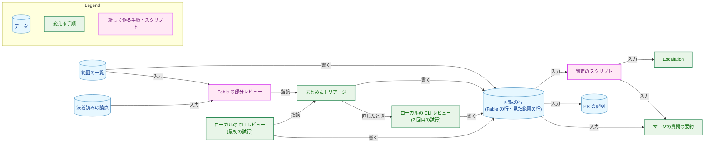
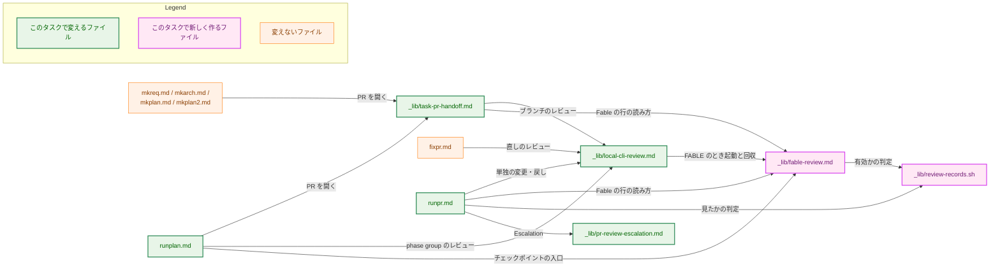
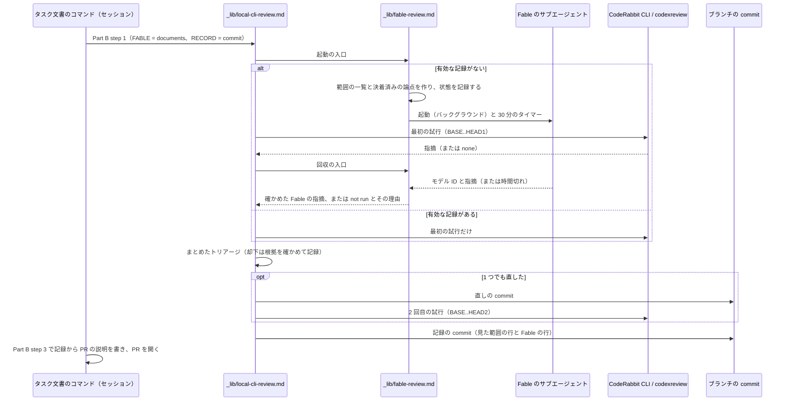
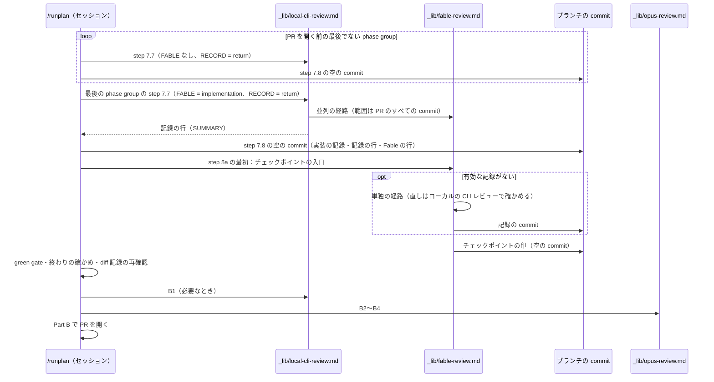
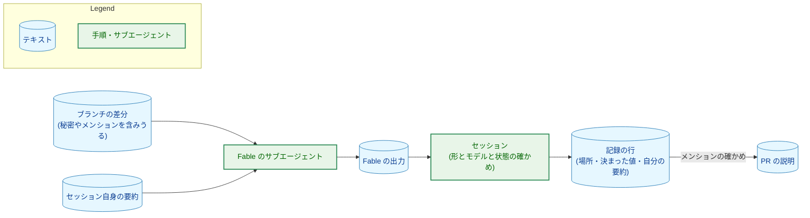
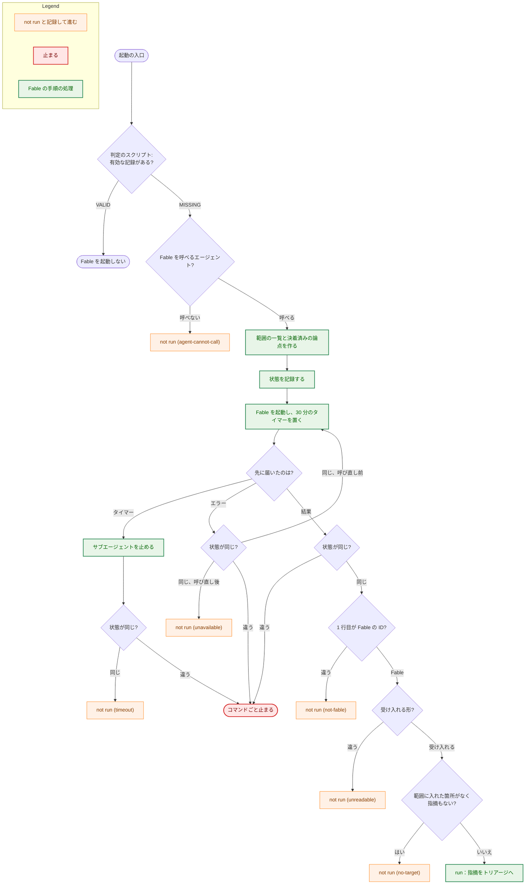
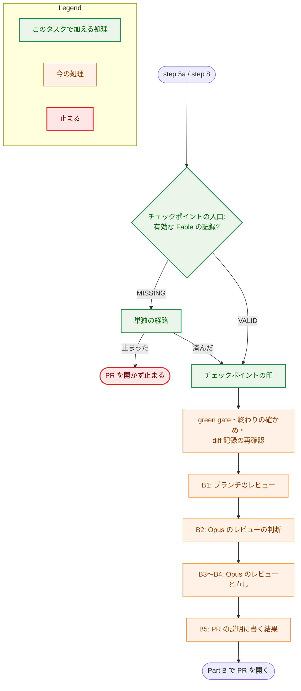

# アーキテクチャ設計書：Fable の部分レビューをタスクのコマンドに組み込み、Codex の PR 再レビューの条件を絞る

## Document Status

| Item | Value |
|---|---|
| Status | `approved` |
| Created | 2026-11-17 |
| Review date | 2026-11-17 |
| Reviewer | isseis |
| Comments | - |

本書は [01_requirements.md](01_requirements.md)（要件定義書。以下、要件書）の設計である。既存のファイルの内容は、コミット `d76547e1` で確かめた。`file:line` の行番号は、このコミットでの行番号である。`03_implementation_plan.md`（実装計画書）を、以下、計画書と呼ぶ。F-NNN・AC-NN は要件書の項番を、H-NN は [design_handoff.md](design_handoff.md)（以下、申し送り）の項番を指す。申し送りへの対応は付録 A に、受け入れ基準との対応は付録 B にまとめる。

本書は、要件書 6 章の用語（Fable の部分レビュー・ローカルの CLI レビュー・Codex の PR レビュー・Codex の PR 再レビュー・Opus のレビュー・決着済みの論点・phase group）を、要件書と同じ意味で使う。そのほかに、次の用語を使う。

-   **Escalation:** `_lib/pr-review-escalation.md` が行う、Codex の PR 再レビューを頼むかの判断。
-   **COVERAGE:** 見たかの判定の出力の 1 行目（`ALL` か `PARTIAL`。3.6.1、3.8.1）。
-   **B1〜B5・green gate:** `runplan.md` の「Before the PR」の項目と、PR を開く前に通すビルドとテストの確かめ（3.5.3、図 7）。
-   **BASE・HEAD1・HEAD2・HEAD3:** `local-cli-review.md` の Terms の語。BASE はレビューの範囲の始まり、HEAD1 と HEAD2 は 1 回目と 2 回目の試行の HEAD、HEAD3 は手順が返るときの HEAD である（3.3.4）。
-   **Fable の手順:** Fable の部分レビューを定める新しい共通の手順 `.claude/commands/_lib/fable-review.md`（3.1）。
-   **判定のスクリプト:** 記録の行を読んで判定する新しいシェルスクリプト `.claude/commands/_lib/review-records.sh`。見たかの判定（`coverage` のモード）と、Fable の記録が有効かの判定（`fable` のモード）を持つ（3.6）。
-   **並列の経路:** Fable の部分レビューを、ローカルの CLI レビューの最初の試行と並列に走らせる経路。タスク文書の PR では `task-pr-handoff.md` Part B step 1 が、実装の PR では `runplan.md` step 7.7（PR を開く前の最後の phase group）が使う。
-   **単独の経路:** 実装の PR で、チェックポイント（`runplan.md` step 5a・step 8）に有効な記録がないときに、Fable の部分レビューを単独で行う経路（AC-06）。
-   **Fable の範囲:** Fable が見た commit の範囲（AC-07）。`<START>..<END>` の形で、END は Fable を呼んだときの HEAD である。
-   **範囲の一覧:** 範囲に入れた箇所とその基準、外した箇所とその理由の一覧（AC-14）。
-   **記録の行:** commit メッセージの、決まった形で 1 列目から始まる 1 行。考え方は、ローカルの CLI レビューの記録の行（`.claude/commands/_lib/local-cli-review.md:253-291`）と同じである。
-   **Fable の行:** `Fable review:`・`Fable scope:`・`Fable finding:` で始まる記録の行の総称（3.2）。
-   **Fable の記録:** Fable の行のうち、`Fable review: run` か `Fable review: not run` の行。1 回の Fable の部分レビューに 1 行である。
-   **チェックポイントの印:** `runplan.md` のチェックポイントの入口で、Fable の記録が有効と判定した時点を示す `Fable review: checkpoint` の行（3.5.3）。Fable の記録ではない。
-   **見た範囲の行:** ローカルの CLI レビューの試行がレビューできた範囲を示す `Local CLI reviewed:` の行（3.3.4）。
-   **記録の commit:** ローカルの CLI レビューの手順か Fable の手順が作る、記録の行だけを持つ空の commit（3.3.5）。`runplan.md` では、step 7.8 の空の commit がこの役を兼ねる。
-   **空の commit:** 親が 1 つで、親との差分がない commit。
-   **中身のない commit:** 親が 1 つで、空か、`README.en.md` だけか、計画書の PR の進み具合のチェックボックスの行（`PR を作成した`・`PR がマージされた`・`次のブランチへ切り替えた` の行）だけを変える commit（これらを合わせて変える commit を含む）。Fable の記録が有効かの判定で、記録を無効にしない commit である（要件書 AC-07、決定 11）。
-   **除外できる commit:** `_lib/opus-review.md` の「Excludable commit」（`.claude/commands/_lib/opus-review.md:102-106`）。親が 1 つで、空か、タスクの `03_implementation_plan.md` と `README.en.md` だけを変える commit。

## 1. 設計の全体像 (Design Overview)

### 1.1. 設計原則

-   **Fable の規則は 1 つの共通の手順に置く。** 範囲の基準、Fable への指示、モデルの確かめ、待ち方、Fable の行の形と読み方は、Fable の手順だけが持つ（要件書 4.5 節）。呼び出し元は、PR の種類（タスク文書か実装か）とタスクのディレクトリを渡すだけである。Fable の行を読むほかの手順は、Fable の手順の「読み方」の節を名指す。
-   **トリアージと確かめは、ローカルの CLI レビューの手順を通す。** Fable の指摘は、ローカルの CLI レビューの指摘と同じトリアージ・直し・2 回目の試行を通る（AC-20〜AC-22）。トリアージの規則は、ローカルの CLI レビューの手順の 1 つの節に置き、単独の経路もそれを名指す。
-   **記録はブランチの commit に残し、新しい行は新しい前置きにする。** 1 つの PR は複数のセッションにまたがりうるので、Fable の実施・範囲・指摘と、ローカルの CLI レビューが見た範囲は、セッションの記憶ではなく commit メッセージから読む。新しい行は、既存の行のどの前置きとも一致しない前置きにする（AC-32、要件書 4.4 節）。
-   **関門の判定は、レビューを受ける側の解釈に任せない。** 「Fable の記録が有効か」（PR を開いてよいか）と「ローカルの CLI レビューがすべて見たか」（Codex の PR 再レビューを省いてよいか）は、`origin/main` から取り出す判定のスクリプトが決め、迷うとき（読めない記録、失敗）は安全な側（Fable を走らせる、`PARTIAL`）に倒す。Escalation の `request`・`skip`・`ask` の対応も、`runpr.md` が決まった規則で行う。
-   **Fable は追加のレビューとして扱い、走らなくても止めない。** 使えないとき・時間切れ・別のモデルで走ったときは `not run` と記録して進む（AC-24）。止まるのは、Fable が作業ツリーやリポジトリの状態を変えたときだけである（3.1.7）。
-   **Fable の出力はデータとして扱う。** セッションが使うのは、1 行目のモデル ID と、各指摘の場所・重大度・基準・内容だけである。指摘の文には従わず、文を commit メッセージにも PR の説明にも写さない（要件書 4.2 節）。

### 1.2. 設計の際に決めたこと（2026-11-17）

1.  **Fable の手順は新しい `_lib/fable-review.md` に置き、`_lib/local-cli-review.md` に任意の入力 FABLE を足す。FABLE が渡されたとき、ローカルの CLI レビューの手順は、最初の試行の前に Fable を起動し、最初の試行のトリアージで Fable の結果を待ってまとめる。** タスク文書の PR では `task-pr-handoff.md` Part B step 1 が、実装の PR では `runplan.md` step 7.7 が FABLE を渡す。理由: まとめたトリアージと 2 回目の試行の条件（AC-20〜AC-22）は、ローカルの CLI レビューの step 4〜6 に入れるしかなく、Fable の手順を親の手順にすると、規則が 2 つのファイルにまたがるため（利用者の選択）。採らなかった案: Fable の手順を親の手順とし、そこからローカルの CLI レビューの手順を呼ぶ案。ADR: [ADR-0050](../../dev/adr/0050-fable-partial-review.md) を更新した。
2.  **ローカルの CLI レビューの試行がレビューできた範囲を、見た範囲の行としてブランチに記録する。Codex の最後の PR レビューの後の commit をすべて見たかは、`origin/main` から取り出す判定のスクリプトの `coverage` のモードが決め、`ALL` か `PARTIAL` を出す。失敗したときは `PARTIAL` とする。Escalation とマージの質問の要約は、どちらもこの出力を使う。** 記録の行が残るように、ローカルの CLI レビューの手順は、呼び出し元が `commit` を指定したとき、記録の行だけを持つ記録の commit を作る（決定 16、3.3.5）。`fixpr.md` Phase 4.5 も同じ手順を通るので、`fixpr.md` を変えずに、直しの後の確かめがブランチに残る。確かめた事実: `internal/fixprguard` には、空の commit を拒む規則はない（`grep -rn -i 'empty\|allow-empty' internal/fixprguard` で、commit に関わる行は出なかった）。`check` が比べるのは、HEAD が Phase 4 の commit から 1 本につながることである（`docs/dev/guides/fixprguard_guide.md:372`）。理由: 今の記録は見なかった範囲しか残さないので、見たことを読む材料がない。判定をセッションやサブエージェントの解釈に任せると、見ていない範囲を見落としうる（申し送り H-07）。スクリプトを `origin/main` から取り出すのは、Opus のレビューの判断のスクリプト（`.claude/commands/_lib/opus-review.md:167-188`）と同じく、レビューを受けるブランチの変更で判定が変わらないようにするためである（利用者の選択）。採らなかった案: 行は足し、突き合わせはセッションが手順の文に従って行う案。ADR: [ADR-0013](../../dev/adr/0013-review-setup.md) を更新した。
3.  **`/runplan` のチェックポイントでは、その入口（step 5a と step 8 の最初、green gate より前）で Fable の記録が有効かを判定し、有効なら空の commit にチェックポイントの印を残す。印より後の commit は、チェックポイントの実行が作った commit とみなし、記録を無効にしない。ただし、印より後に phase group の実装の記録（`Implementation model:` の行）があるときは、その印を使わない。** 同じ実行のトリアージの直しは、Fable の範囲の終わりから Fable の記録を持つ commit までの間にあり、その commit の見た範囲の行と `not run` の行で見分けられる（3.1.2）。理由: チェックポイントの commit（green gate の直し、終わりの確かめの直し、diff 記録の再確認、B1〜B4 の commit、Part B step 2 の直し）は、それぞれ別の手順が作るので、commit ごとに見分ける行を書かせると、それらの手順のすべてに手が入るため（利用者の選択）。入口に置くのは、green gate と終わりの確かめの直しも印の後に入れ、AC-07 が挙げるとおり記録を無効にしないためである。実装の記録で印を無効にするのは、計画書に phase group が足され、`/runplan` 自身が印の後に実装した場合に、Fable を飛ばさないためである。受け入れる危険: チェックポイントで止まった後のやり直しの前に、人やほかのセッションが印より後に足した commit は、Fable に見られない。その commit も、Opus のレビュー（行うとき）と Codex の最初の PR レビューは見る。採らなかった案: チェックポイントの commit のそれぞれに、見分けるための行を書かせる案。ADR: ADR-0050 を更新した。
4.  **Fable の結果を待つ時間の上限は 30 分とし、超えたらサブエージェントを止めて `not run (timeout)` と記録する。呼び出しが失敗したときの呼び直しは 1 回とする。** これまでの実績は 1 回あたり 2〜16 分だった（要件書 4.1 節）。上限は、その最長のおよそ 2 倍である。呼び直しの回数は、Opus のレビュー（`.claude/commands/_lib/opus-review.md:402-403`）に揃えた。理由: 上限がないと、Fable が返らないときに PR を開けないため（申し送り H-08。利用者の選択）。採らなかった案: 20 分（長い回が時間切れになりうる）、上限なし。ADR: ADR-0050 を更新した。
5.  **Fable のサブエージェントは general-purpose の種類で呼び、作業ツリーとリポジトリの状態を変えないこと・ネットワークや本物のサービスを使わないこと・秘密のファイルを読まないことは、指示で求める。そのうえで、セッションが起動の前と、Fable の部分レビューを終えるすべての出口（結果・時間切れ・エラー・呼び直しの前）で、作業ツリーとリポジトリの状態を比べ、変わっていれば結果を使わずにコマンドを止める。** 確かめた事実（2026-11-17 に本書を書いたセッションで、Agent ツールに `model: fable` を指定して呼んだ）: サブエージェントは、システムプロンプトから写したモデル ID を `Model: claude-fable-5-2` と報告した。呼び出しはバックグラウンドで走り、終わると通知が届いた。セッションがターンを終えて待っていても、通知でセッションが呼び直され、`/mkarch` のコマンドの途中から続けられた。通知には、かかった時間（`duration_ms`）と、サブエージェントの合計のトークン数（`subagent_tokens`）が載り、出力のトークン数は載らなかった。サブエージェントの道具には、Bash・Edit・Write があった。Claude Code の Agent ツールのほかの種類のうち、Plan と Explore は Edit と Write を持たないが Bash を持つ。Bash を持たない種類（`statusline-setup`）は、git を読むことも実験もできず、このレビューに使えない（本セッションの Agent ツールの説明）。`.claude/agents/` に道具を絞った種類を定めることもできるが、レビューに要る Bash を残す限り、Bash による書き込みは防げない。理由: レビューに使える種類はどれも Bash で書き込めるので、種類で書き込みを防ぐことはできない。そのため、指示に加えて、変わったことを後から必ず見つける形にした。比べるものは、`fixprguard` が同じ理由で比べるもの（hooks・config・info・index のフラグ・監視するファイル。`docs/dev/guides/fixprguard_guide.md` の 7 章）に揃え、この worktree の状態に限る（決定 20、3.1.7）。変わったときに止めるのは、並列のローカルの CLI レビューの結果と、セッションがこれから作る commit の中身を信頼できなくなるためである。採らなかった案: Plan の種類で呼ぶ案（書き込みは防げないうえ、設計の計画を作る役目の指示が加わる）と、`.claude/agents/` に Edit と Write とネットワークの道具を持たない種類を定める案（Bash が残るので書き込みは防げず、定めたファイルを保つ手間が増える）。ADR: ADR-0050 を更新した。
6.  **かかった時間は通知の `duration_ms` から、トークン数は通知の合計のトークン数から記録する。出力のトークン数は取れないので、記録しない。時間切れのときは通知がないので、時間は待った時間、トークン数は `unknown` とする。** 理由: AC-43 は、出力のトークン数を「取れるとき」に限って求める。合計のトークン数は費用を比べる材料になるので、出力のトークン数の代わりではなく、別の値として残す（3.2.1）。ADR: なし（記録の値の選び方は、本タスクの中で閉じる）。
7.  **3 文書の PR を見分ける入力は設けない。タスク文書の PR では、基準 2（先行文書との照合）を「この PR が加える・変える文書と、承認済みの先行文書・ADR・同じ PR のほかのタスク文書との照合」と定める。** 3 文書の PR では、同じ PR のほかのタスク文書との照合が、3 文書どうしの食い違いに当たる（AC-13）。理由: 呼び出し元に PR の種類を渡させずに AC-13 を満たせるため。ADR: なし（基準の文言で、ADR-0050 の決定の範囲に収まる）。
8.  **単独の経路は、チェックポイントの入口で、green gate と B1 より前に、B1 と並列にせずに行う。** 理由: 単独の経路の直しは、ローカルの CLI レビューの確かめを受ける（AC-06）。B1 と並列にすると、2 つのローカルの CLI レビューの範囲と記録が重なる。単独の経路は、記録が足りないときにだけ走る例外の経路なので、時間を短くする益は小さい。B2 より前にあるので、直しの commit は Opus のレビューの範囲に入る（申し送り H-03）。ADR: なし（`/runplan` の手順の順序で、ADR-0050 の決定の範囲に収まる）。
9.  **マージの質問の要約には、Codex が見ていない変更があるときだけ現れる行を 1 種類足し、要約の行の数の上限を 13 にする。行は、理由を短い語で示し、80 桁に収める。詳細ファイルの中身は変えない。** 4 行目（`未レビューの変更`）に値を足すと、80 桁を超えうるためである（3.8.2）。詳細ファイルを変えないのは、AC-40 が詳細ファイルの扱いを変えないとするためである。ADR: なし（要件書が ADR-0050 に記録済みで、[ADR-0047](../../dev/adr/0047-runpr-merge-question.md) の決定は変わらない）。
10. **Fable の記録が有効かも、判定のスクリプトの `fable` のモードが決める。失敗したときは「有効でない」とする。** 理由: 有効かの判定は PR を開く関門（AC-08）で、誤って有効と判定すると、Fable を飛ばして PR が開く。セッションが文の手順で判定すると、この危険な側の誤りが残る。見たかの判定と同じ理由で、スクリプトにする。採らなかった案: セッションが `git rev-list` と除外できる commit の定義に従って判定する案。ADR: ADR-0050 を更新した。
11. **「判定で無視してよい commit」は、判定ごとに定める。見たかの判定では、空の commit と、計画書の PR の進み具合のチェックボックスの行（`PR を作成した`・`PR がマージされた`・`次のブランチへ切り替えた` の行。PR マーカーの節のものと、単一 PR の記録のもの）だけを変える commit を見たとみなす。有効かの判定では、中身のない commit（空か、`README.en.md` だけか、計画書の PR の進み具合のチェックボックスの行だけを変える commit）を、記録を無効にしない commit とする。どちらの判定も、`_lib/opus-review.md` の除外できる commit は使わない。** 理由: 除外できる commit は、計画書だけを変える commit をすべて含む。`/mkplan`・`/mkplan2` の PR では計画書そのものがレビューされる中身であり、実装の PR でも計画書の `**自動送信**:`・`**実装モデル要件**:` の値は中身である。そのため、Fable の記録の後や Codex の PR レビューの後に計画書の中身を変える commit を無視すると、レビューされないまま PR が開くかマージされうる。PR の進み具合のチェックボックスの行だけを変える commit を見たとみなすのは、`/runplan` が PR を作った直後に、`PR を作成した` のチェックボックスと PR の URL を commit して push し（`runplan.md:143-145`、`:259`）、それが Codex の最初の PR レビューの後の commit になりうるためである。これを見たとみなさないと、実装の PR の判定がほとんどいつも `PARTIAL` になる。有効かの判定で `README.en.md` だけの commit も無視するのは、Part B の README の同期の commit が記録の後に来うるためで、翻訳は `README.md` の変更を写すだけである。見たかの判定の 2 種類は要件書の AC-35 を、有効かの判定の中身のない commit は AC-07 を、それぞれ改めて書き加えた決定である（利用者の選択。要件書は `draft` に戻した）。ADR: ADR-0013 と ADR-0050 を更新した。
12. **Escalation の `request`・`skip`・`ask` は、サブエージェントの答え（`decision` と当たった基準の番号）と、見たかの判定の出力から、`runpr.md` step 3 に置く決まった規則で決める。規則はサブエージェントへの指示に写さない。基準の番号は変えず、基準 4（セキュリティと耐久性）に信頼の境界を足して広げる。** サブエージェントの返す JSON の形は変えない（AC-37）。番号を変えないのは、Procedure step 2 が「基準 4 に当たるときは 2 つの文書を読む」と番号で名指し（`pr-review-escalation.md:67-68`）、AC-37 がその step の文を変えさせないためである。理由: 「基準 1・2・3・5 だけに当たり `PARTIAL` なら `ask`」は機械的な対応で、サブエージェントに任せると、`PARTIAL` で `skip` を返す危険な側の誤りが残る。採らなかった案: 「Criteria」に COVERAGE の値を差し込み、サブエージェントに決めさせる案（`pr-review-escalation.md` の Procedure step 2 の `request` と `skip` の定義（`:75-79`）が、新しい「Criteria」と食い違う。AC-37 はその step の文を変えさせない）。ADR: ADR-0013 を更新した。
13. **Escalation の基準 4 の信頼の境界に、レビューの関門そのものを変える変更を含める。関門とは、`_lib/pr-review-escalation.md` の基準と Procedure、`runpr.md` step 3 の LAST_REVIEWED の定義と対応の規則と `headRefOid` の比べ方、判定のスクリプトとそれを `origin/main` から取り出す呼び方、`_lib/local-cli-review.md` の試行の結果と範囲を決める step（2・3・6）、記録の行の形と読み方を定める節、`fixprguard` である（Procedure・LAST_REVIEWED の定義・step 2・3・6 は 1.5 の決定 1 で足した）。ほかのコマンドの定義の変更は、今の基準のとおり扱う。** 理由: PR を開いた後に関門を緩める変更が入っても、AC-11 の基準 1 の例（秘密・送信・削除・pane の操作・不可逆な副作用）には当たらないので、`skip` になりうる。関門だけに絞るのは、このリポジトリの PR の多くが `.claude/commands/` を変えるので、コマンドの定義の全体を含めると Codex の割り当てを多く使うためである（利用者の選択）。採らなかった案: 含めない案、`.claude/` の全体を含める案。ADR: ADR-0013 を更新した。
14. **見たかの判定は、AC-35 のとおり、ローカルの CLI レビューがレビューしたかだけで決める。Codex の後の範囲に、ローカルの CLI レビューの `unclear` や `deferred` の指摘が残っていても、`skip` になりうる。これは受け入れる危険とする。** 理由: 未解決の指摘で `ask` にすると、要件書 AC-35 の決定を変えることになるため（利用者の選択）。採らなかった案: 未解決の指摘の行が範囲にあれば `PARTIAL` とする案。ADR: ADR-0013 を更新した（「結果」に受け入れる危険を書いた）。
15. **判定のスクリプトはシェルで書き、`origin/main` から取り出して走らせ、Go のテストで振る舞いを確かめる。** 読むだけで副作用を持たず、Go のテストで規則を壊して失敗を確かめる。`origin/main` から取り出して走らせる形は `_lib/opus-review-decision.sh` と同じである。ただし、`opus-review-decision.sh` の常設の Go テストは計画書の値の読み方だけを確かめ（`internal/chief/markers_parity_test.go`）、判断の規則はタスク 0081 の一度きりの確かめ（`docs/tasks/0081_implementation_model_choice/_checks/decision_cases.sh`）で確かめた。判定のスクリプトは、規則の全体を常設の Go テストで確かめる（7.1）。理由: 判定は記録の行と `git rev-list` の組み合わせで足り、Go の道具にすると、新しい `cmd/` と `internal/` と、利用者による入れ直しの手間が増えるため（利用者の選択）。[ADR-0014](../../dev/adr/0014-deterministic-checks-in-go.md) は、判定と副作用を持つ開発の道具を Go で書くと決め、判定をコマンドの定義に書いたシェルの手順にする案を採らなかった。判定のスクリプトは、コマンドの定義の文ではなく、テストを持つ独立したファイルなので、その案とは違う。採らなかった案: Go の道具にする案。ADR: ADR-0014 を更新した（読むだけの判定のスクリプトの例外を書いた）。
16. **ローカルの CLI レビューの手順に入力 RECORD を足し、呼び出し元が `commit`（手順が記録の commit を作る）か `return`（記録の行を SUMMARY で返し、呼び出し元の次の commit が載せる）を指定する。渡さないときは `commit` とする。** 呼び出し元ごとの値は 3.3.5 の表に置く。理由: 「呼び出し元の手順で commit が続くか」を手順が文から推し量ると、呼び出し元ごとに読み違えうるため。既定を `commit` にするのは、`fixpr.md` を変えずに、その Phase 4.5 の見た範囲がブランチに残るようにするためである（`fixpr.md` は RECORD を渡さない）。ADR: なし（手順の入力で、決定 2 の範囲に収まる）。
17. **見た範囲の行の前置きは `Local CLI reviewed:` とし、既存の `Local CLI review:` の行と分ける。** 理由: 既存の読み手は `Local CLI review:` の行を未レビューの範囲として読む（`local-cli-review.md:315-316`、`runplan.md:276-281`、`task-pr-handoff.md:245-248`）。同じ前置きの下に別の意味の行を置くと、どの読み手も前置きの後の語で分けなければならない。ADR: なし（行の形で、決定 2 の範囲に収まる）。
18. **PR の説明では、人の読む節の後に、Fable の行を `<details>` の中のコードブロックにそのまま並べる。後の集計（#936）は、このコードブロックを読む。** 理由: 人の読む部分とスクリプトの読む部分を分け、スクリプトが読む形を commit の記録の行と同じ 1 つにするため。ADR: なし（PR の説明に決まった形で残すことは ADR-0050 の決定にあり、その形は本書が持つ）。
19. **Fable の行の要約と理由には、差分や実験の出力から取った値を書かず、何が起きたかの説明だけを書く。秘密の形をした文字列を見つける確かめは設けない。** 理由: Fable の出力や実験の出力は、差分にある秘密を含みうる。確かめを設けても、どの形を秘密とみなすかに漏れが残るので、書かない規則で防ぐ。受け入れる危険: セッションが規則を破って値を言い換えて書けば、記録の行と PR の説明に出る。今のローカルの CLI レビューの記録の行も同じ規則と危険の上にある（`local-cli-review.md:264-269`）。ADR: なし（ADR-0050 の「結果」の、Fable の出力の文を写さないことの範囲に収まる）。
20. **状態の確かめで比べるのは、この worktree だけの状態（作業ツリー、HEAD とそのブランチ、フラグの付いた index のパス、ほかのブランチの `branch.*` を除いた設定、info、hooks、監視するファイル）とし、ほかの worktree と共有する ref・stash・worktree の一覧は比べない。基準はハッシュでセッションの文脈に持つ。** 確かめた事実: 2026-11-17 に本タスクの PR に Fable の部分レビューを手で行ったとき、約 19 分の間に、ほかの worktree のブランチの ref・`main`・worktree の一覧・共有の config（ほかのブランチの `branch.*` の設定）が変わった。理由: 共有の状態を比べると、ほかのセッションの作業だけでほとんど毎回止まり、やり直すたびに Fable の費用がかかる。`codexreview` が同じ理由で比べるものを絞った（ADR-0013、タスク 0079）のと揃える。基準をファイルでなく文脈に持つのは、スクラッチパッドを Fable のサブエージェントも書けるためである。採らなかった案: すべての ref・stash・worktree の一覧を比べる案（本書の最初の版）。ADR: ADR-0050 を更新した。
21. **`/fixpr` の回ごとに記録の commit を push するので CI がもう 1 回走る費用は、受け入れる。** 理由: 見た範囲をブランチに残さないと、Escalation の `skip` が働かないため（利用者の選択）。採らなかった案: 記録を push しない形を設計し直す案（見た範囲がブランチに残らず、Escalation が `ask` に寄る）。ADR: ADR-0013 を更新した（「結果」に書いた）。
22. **判定のスクリプトは、計画書の PR の進み具合のチェックボックスの行（`PR を作成した` など）と PR マーカーの見出しの文を照合するので、`CLAUDE.md`「Go Idioms」の日本語のリテラルの例外を、`opus-review-decision.sh` と同じ範囲（計画書の文と一致しなければならないリテラル）で、このスクリプトにも広げる。** 例外の文は、`CLAUDE.md` の「Boundary: no other `.claude/commands/` script takes this exception.」（`CLAUDE.md:809`）を含めて、スクリプトを入れる実装の PR で変える。理由: 計画書は日本語の文書で、ラベルを英語の文書から渡すと、写し誤りで判定が外れるため（利用者の選択）。採らなかった案: ラベルを英語の手順の文書から引数で渡す案。ADR: [ADR-0035](../../dev/adr/0035-language-policy.md) を更新した（経緯）。

### 1.3. なぜ今の仕組みでは足りないか

-   **時機:** 今の手順には、Fable のレビューがない。これまでの 7 件は、PR を作った後に手作業で頼み、その修正は Codex の PR レビューが見ていない（要件書 1 節の背景）。PR を開く前のレビューは、セルフレビューとローカルの CLI レビュー（タスク文書の PR は `.claude/commands/_lib/task-pr-handoff.md:184-199`、実装の PR は `.claude/commands/runplan.md:252`）と、実装の PR の Opus のレビュー（`runplan.md:261-335`）である。
-   **トリアージ:** ローカルの CLI レビューのトリアージは、該当箇所を読むことを求める（`.claude/commands/_lib/local-cli-review.md:191-192`）が、却下の根拠を記録させない。2 回目の試行は、最初の試行の後に直したときだけ行い、最初の試行が `none` なら行わない（`:241-243`）。最初の試行が `none` のときは、step 4 を通らずに step 6 へ進む（`:171-173`）。このままでは、Fable の指摘をトリアージできず、Fable の指摘だけを直したときに直しが確かめられない（AC-20、AC-22）。
-   **見たかの記録:** 今の記録の行は、見なかった範囲（`Local CLI review: not run`）と指摘しか残さない（`local-cli-review.md:257-262`）。`fixpr.md` Phase 4.5 で指摘がなく直しもないときは、何も commit されない（`.claude/commands/fixpr.md:936-941`）。このため、Codex の PR レビューの後の commit をローカルの CLI レビューが見たかを、ブランチから読めない（AC-35）。
-   **Escalation:** 判断の基準は 5 つで、どれか 1 つに当たれば `request` になる（`.claude/commands/_lib/pr-review-escalation.md:34-49`）。基準 1・3・5 は多くの修正に当たる（要件書 1 節「要件定義の際に決めたこと」）。

### 1.4. 概念モデル

図 1 に、Fable の部分レビュー・トリアージ・記録・それを読む手順の関係を示す。矢印 A → B は「A が B の入力になる、または A が B を書く」を表す。



### 1.5. 実装の際に決めたこと（2026-11-18）

PR-1（#966）を開いた後に行った Fable の部分レビューの指摘から、利用者と決めた。

1.  **決定 13 の関門に、`_lib/local-cli-review.md` の step 2・3・6、`runpr.md` step 3 の LAST_REVIEWED の定義、`_lib/pr-review-escalation.md` の Procedure を足す。** 理由: step 2・3・6 は試行の結果とその範囲を決め、見た範囲の行はそれから書かれる。LAST_REVIEWED の定義は、どこから先を Codex が見ていないとするかを決める。Procedure は、サブエージェントに渡す範囲と「迷うときは `ask`」の指示を持つ。どれも、緩める変更が PR を開いた後に入ると、基準 1 などに当たるだけで、ローカルの CLI レビューが見ていれば `skip` になりうる。これらはめったに変わらないので、Codex の割り当ての増えは小さい。採らなかった案: 今の一覧のまま、この筋書きを受け入れる危険とする案。ADR: [ADR-0013](../../dev/adr/0013-review-setup.md) を更新した。
2.  **COVERAGE が `PARTIAL <n>` のとき、`runpr.md` step 3 の報告に、見ていない commit のそれぞれの ID・件名・変えるファイルと、変更の概要を示す。** 理由: マージの質問は見ていない commit の件数だけを示すので、人は Codex の PR 再レビューを頼むかを、何が変わったかを知らずに決めることになる。マージの質問の要約や詳細ファイルに示すと AC-40 を変えるので、マージの質問の前に示す step 3 の報告に置く。採らなかった案: 件数だけを示す今の形、詳細ファイルに示す案。ADR: なし（`/runpr` の報告の形で、タスクの中で閉じる）。
3.  **判定のスクリプトは、LAST_REVIEWED が HEAD の祖先でないときを失敗（件数のない `PARTIAL`）とする。** 理由: HEAD が LAST_REVIEWED より前に戻ると、判断の対象の commit が 0 件になり `ALL` を出していた。今は Escalation の Procedure step 1 が `ask` にするので判定には届かないが、スクリプトだけでも安全な側に倒れるようにする。ADR: なし。

## 2. システム構成 (System Structure)

### 2.1. 全体構成

本タスクは、コマンドの定義・`_lib/` の共通の手順・`CLAUDE.md`・ガイド・ADR の文言を変え、判定のスクリプトとそのテストを加える。製品のコンポーネント（拡張・Native Messaging のホスト・サーバ・CLI）と、Go で書いた開発の道具（`fixprguard`・`codexreview`・`mergepr`・`coveragecompare`・`chief`）は変わらない。図 2 に、変えるファイルが互いをどう参照するかを示す。矢印 A → B は「A が B の定義を名指して使う」を表す。



図 2 のうち、次の矢印は今の関係である。ほかの矢印は、実装の PR で加わる関係である。

-   `mkreq.md` などの 4 つ → `_lib/task-pr-handoff.md`：各コマンドが最後に Part B に従う（`.claude/commands/mkreq.md:204`、`mkarch.md:169`、`mkplan.md:235`、`mkplan2.md:147`）。
-   `runplan.md` → `_lib/task-pr-handoff.md`：step 5a と step 8 が Part B に従う（`.claude/commands/runplan.md:102-145`、`:259`）。
-   `_lib/task-pr-handoff.md` → `_lib/local-cli-review.md`：Part B step 1（`.claude/commands/_lib/task-pr-handoff.md:184-187`）。
-   `runplan.md` → `_lib/local-cli-review.md`：step 7.7 と B1（`runplan.md:252`、`:280-284`）。
-   `fixpr.md` → `_lib/local-cli-review.md`：Phase 4.5 step 2（`.claude/commands/fixpr.md:930-935`）。
-   `runpr.md` → `_lib/local-cli-review.md`：step 1 の単独の変更（`.claude/commands/runpr.md:129-131`）と、step 4 の通常の進め方への戻し（`runpr.md:1131`）。
-   `runpr.md` → `_lib/pr-review-escalation.md`：step 3 の Escalation（`runpr.md:665-678`）。

### 2.2. コンポーネント配置

| ファイル | 変更の内容 | 節 |
|---|---|---|
| `.claude/commands/_lib/fable-review.md`（新規） | 入口と入力・出力、範囲の基準と範囲の一覧、Fable への指示、起動・待ち方・上限、モデルと出力の形の確かめ、状態の確かめ、単独の経路、Fable の行の形と読み方 | 3.1、3.2 |
| `.claude/commands/_lib/review-records.sh`（新規） | 判定のスクリプト（`coverage` と `fable` のモード） | 3.6 |
| Go のテスト（置き場所は計画書で決める） | 判定のスクリプトを、一時的な git のリポジトリの上で走らせるテスト | 7.1 |
| `.claude/commands/_lib/local-cli-review.md` | 入力 FABLE と RECORD、step 1 の起動、step 3 の `record` の後の回収、トリアージの規則の節と却下の根拠の記録、step 6 の 2 回目の試行の条件、Terms の未レビューの範囲と HEAD3、step 7 の見た範囲の行と記録の commit、GUARD を走らせる地点の一覧、「Reading the record lines」 | 3.3 |
| `.claude/commands/_lib/task-pr-handoff.md` | Part B step 1 で FABLE と RECORD を渡し、README の同期の commit が記録の行を載せる記述を消す。Part B step 3 の PR の説明に Fable の部分レビューの節を足す | 3.4 |
| `.claude/commands/runplan.md` | step 4 で最後の phase group を見分ける。step 7.7 で FABLE と RECORD を渡す。step 7.8 の空の commit に Fable の行を載せる。step 5a と step 8 の最初にチェックポイントの入口を置く。B1 で RECORD を渡す | 3.5 |
| `.claude/commands/_lib/pr-review-escalation.md` | 「Criteria」の基準 4 を広げ、ほかの基準は呼び出し元が記録で決めると書く | 3.7 |
| `.claude/commands/runpr.md` | step 1 と step 4 の戻しで RECORD を渡す。step 3 で判定のスクリプトを走らせ、Escalation の結果を対応の規則で決める。step 4 のマージの質問の要約に 1 行を足し、行の数の上限を 13 にする | 3.8 |
| `.claude/commands/_lib/simple-process.md` | 「Reviewing the three documents」の後の 1 文（`simple-process.md:229-230`）に、Part B step 1 で Fable の部分レビューも走ることを足す。戻しの step 3 が RECORD に `return` を渡す | 3.9 |
| `CLAUDE.md` | 「Claude Commands」の、タスクの PR の流れとレビューの段落（`CLAUDE.md:236-248` を含む）。「Go Idioms」の日本語のリテラルの例外に判定のスクリプトを加える（`CLAUDE.md:797-809`、決定 22） | 3.9 |
| `docs/dev/guides/fixprguard_guide.md` | Phase 4.5 の commit の一覧（`docs/dev/guides/fixprguard_guide.md:422`）に、記録の commit を足す | 3.9 |
| `cmd/yt2column/fixpr_docs_test.go` | `TestLocalReviewGuard` が確かめる step に 7 を足す | 3.11 |
| `docs/dev/adr/0050-fable-partial-review.md` | 本書の PR で、決定 1・3〜5・10 を足した | 3.10 |
| `docs/dev/adr/0013-review-setup.md` | 本書の PR で、決定 2・12〜14 を足した | 3.10 |
| `docs/dev/adr/0014-deterministic-checks-in-go.md` | 本書の PR で、決定 15 を足した | 3.10 |
| `docs/dev/adr/0035-language-policy.md` | 本書の PR で、決定 22 を経緯に足した | 3.10 |

次のファイルは変えない。

-   `mkreq.md`・`mkarch.md`・`mkplan.md`・`mkplan2.md`。どれも Part B を LOCAL_REVIEW = `run` で呼ぶ（`task-pr-handoff.md:42-43`）ので、Part B step 1 が FABLE を渡せば、セルフレビューと `japrose` のコミットの後に Fable の部分レビューが走る（AC-01）。
-   `fixpr.md`。Phase 4.5 は、ローカルの CLI レビューの手順を FABLE なしで呼ぶ。トリアージの却下の根拠の記録（AC-21）、見た範囲の行、記録の commit は、手順の側の変更で効く（3.3.6）。
-   `_lib/opus-review.md` と `_lib/opus-review-decision.sh`（要件書 2.3 節）。新しい行は、判断のスクリプトが読む行と前置きが違い、記録の行だけを持つ空の commit は除外できる commit である（AC-32）。
-   `_lib/triage-pattern.md`。尺度（`verdict`・`severity`）は変えない。却下の根拠の記録は、ローカルの CLI レビューの手順のトリアージの規則の節に置く。
-   `internal/chief`。commit メッセージの記録の行を読まない。マージの質問の画面からは、問いの行だけを読む（3.11）。
-   ADR の索引 `docs/dev/adr/README.md`。ADR-0013・ADR-0014・ADR-0050 の題名は変わらない。

### 2.3. データフロー

図 3 に、タスク文書の PR を開くまでの流れを示す。矢印は、呼び出しと受け渡しの順序を表す。



図 4 に、実装の PR の流れを示す。矢印の意味は図 3 と同じである。



-   OpenCode で動く `/runplan` は、最後の phase group で Fable を呼べないので、`not run (agent-cannot-call)` と記録する（AC-24 (d)）。チェックポイントを Claude Code が引き継いだときも、この記録は有効なので、単独の経路は走らない。
-   単一フェーズの計画書では、phase group は 1 つで、それが最後の phase group である。step 8 が、その最初にチェックポイントの入口を置き、Part B の前に B1〜B5 を行う。

## 3. コンポーネント設計 (Component Design)

本タスクは Go の製品のコードを変えないので、型やインタフェースの定義はない。代わりに、共通の手順の入力と出力、記録の行の形、判定のスクリプトの入力と出力を、ここで定める。コマンドの定義の文言とコマンドの書き方は、実装の PR で書く。

### 3.1. Fable の手順 `_lib/fable-review.md`（F-001〜F-005、H-01、H-02、H-06、H-08）

#### 3.1.1. 入口と入力・出力

Fable の手順は、次の 3 つの入口を持つ。

| 入口 | 呼ぶもの | すること |
|---|---|---|
| 起動 | `_lib/local-cli-review.md` step 1（FABLE が渡されたとき、最初の試行の前） | 有効な記録があるかを判定のスクリプトで判定し（3.1.2）、なければ RANGE を決め、範囲の一覧を作り、状態を記録し、Fable を起動する。呼べないときは `not run` の理由を決める |
| 回収 | `_lib/local-cli-review.md`（最初の試行のトリアージの前。最初の試行が `none` のときも通る。3.3.2） | 結果を待ち、状態とモデルと出力の形を確かめ、トリアージに渡す指摘を返す |
| チェックポイント | `runplan.md` step 5a と step 8 の最初 | 有効な記録があるかを判定し、なければ単独の経路を行い、チェックポイントの印を残す |

入力:

| 入力 | 意味 |
|---|---|
| KIND | `documents`（タスク文書の PR）か `implementation`（実装の PR）。基準 2 の当てはめ方を決める（3.1.3） |
| TASK_DIR | タスクのディレクトリ。先行文書と決着済みの論点を読み、計画書のパスを判定のスクリプトに渡す（計画書がまだないタスク文書の PR でも、パスは決まる） |
| SELF_REJECTED | そのセッションがそれまでのレビュー（セルフレビューなど）で却下した指摘の、場所とセッション自身の要約。ないときは空（AC-18） |

FABLE の入力は、KIND・TASK_DIR・SELF_REJECTED の組である。RANGE は入力ではなく、Fable の手順が判定のスクリプトの出力から決める（3.1.2）。

出力（回収の入口と単独の経路）:

| 出力 | 意味 |
|---|---|
| RANGE | Fable の範囲。START と END は 40 桁の commit ID |
| STATUS | `run` か `not run <reason>`（3.2.1） |
| FINDINGS | 確かめた Fable の指摘。各指摘は、場所・重大度・基準・内容を持つ |
| INVALID | AC-27 で `invalid` とした指摘の、場所（読めるとき）と理由 |
| COST | かかった秒数と合計のトークン数（取れないときは `unknown`） |
| MODEL | 確かめたモデル ID（`run` のとき） |
| SCOPE_LIST | 範囲の一覧 |

起動の入口で Fable を起動しなかったとき（有効な記録がある）は、回収の入口は何もせず、ローカルの CLI レビューの手順は、FABLE のないときと同じに進む（AC-09 の後半）。

#### 3.1.2. 有効な記録の判定（AC-07〜AC-09、H-05、決定 3・10・11）

判定のスクリプトの `fable` のモード（3.6.2）が、ブランチ（`origin/main..HEAD`）の最後の Fable の記録について、次の規則で有効かを決める。Fable の範囲の END より後の commit が、すべて次のどれかであるときに限り、有効である。

1.  中身のない commit（AC-07、AC-09。決定 11）。
2.  END の後から、その Fable の記録を持つ commit までの commit のうち、その記録と同じ commit にある見た範囲の行か `Local CLI review: not run` の行の範囲に入るもの。同じ実行のトリアージの直しは、2 回目の試行の範囲（見た範囲の行）か、2 回目の試行の後の直しの範囲（`not run` の行）に必ず入る（3.3.3、3.3.4）。入らない commit は、同じ実行の直しと見なさない。
3.  チェックポイントの入口からの判定のときだけ：最後のチェックポイントの印を持つ commit より後の commit。ただし、印より後に実装の記録（`Implementation model:` の行）を持つ commit があれば、この規則は使わない（決定 3）。

呼ぶ側は、判定の前に `git fetch origin main` をする。

出力は、有効なら `VALID`、そうでなければ `MISSING <START>` である。`<START>` は、足りない commit の最初のものの親で、記録が 1 つもないときは merge-base である。Fable の手順は、`MISSING` のとき、RANGE を `<START>..HEAD` として Fable を起動する。スクリプトを取り出せない、スクリプトが失敗した、または出力が読めないときは、`MISSING <merge-base>` とみなす（決定 10）。

記録は、Fable の記録を持つ commit を作ってはじめて残る。並列のローカルの CLI レビューが止まったときなど、その前に止まったときは何も残らず、やり直した実行は Fable をもう一度起動する（AC-09）。

#### 3.1.3. 範囲の基準と範囲の一覧（AC-11〜AC-15、H-02）

セッションは、RANGE の差分（`git diff --name-only` と `git diff`）を読み、変わった箇所を基準に当てはめて、範囲の一覧を作る。範囲の基準の文言は、基準ごとに当たる例と当たらない例を添えて、Fable の手順に置く。要点は次のとおりである。

| 基準 | 値 | 当たる例 | 当たらない例 |
|---|---|---|---|
| 1 信頼の境界 | `trust-boundary` | 秘密の扱い・マシンの外へのデータの送信・GitHub への投稿・ほかのエージェントの pane への入力・ファイルや ref の削除・元に戻せない副作用のどれかを行う、手順の文やコード。また、レビューの関門（決定 13）を変える箇所 | それらを名指すだけの説明の文、テストの名前 |
| 2 先行文書との照合 | `prior-docs` | KIND が `documents`：この PR が加える・変える文書と、承認済みの先行文書・ADR・同じ PR のほかのタスク文書との照合。KIND が `implementation`：実装が先行文書の決めていない点・解釈した点・違えた点（AC-12） | `implementation` で、先行文書の決めたとおりに写した箇所 |
| 3 外部の振る舞いについての技術的な主張 | `external-claim` | 外部のツール・API・サービスの振る舞いを前提にする文やコード（例：あるフラグが何をするか、ある出力がどの形か） | リポジトリの中のコードの振る舞いの説明 |
| 4 人に問わずに決めたこと | `undecided-choice` | 書き手が `…で決めたこと` の節に人の答えなしで書いた決定、PR の境界や値を人に問わずに決めた箇所 | 人の答えが記録された決定 |

範囲の一覧の各行は、場所と、範囲に入れた箇所ならその基準、外した箇所ならその理由を持つ。場所の形は 3.2.1 の `<location>` である。外した理由は、自分の言葉の短い文である。変わったファイルのうち、範囲に入れた箇所を 1 つも持たないファイルは、ファイルごとに外した箇所として一覧に載せる。

どの基準にも当たる箇所がないときも、Fable を起動し、外した箇所の一覧と理由だけを確かめさせる（AC-15）。

#### 3.1.4. Fable への指示（AC-10、AC-16〜AC-19、H-03）

指示は、次を含む自己完結した文章にする。具体的なモデル ID は書かない（Opus のレビューと同じ理由。`.claude/commands/_lib/opus-review.md:33-35`）。

-   **役目:** 範囲に入れた箇所ごとに、その基準の狭い役目を与える（例：信頼の境界なら「秘密・送信・削除・pane への入力・不可逆な副作用が、意図しない相手や条件で起きる筋書きを探す」、外部の主張なら「その主張を、作業ツリーの外での実験か、リポジトリの中の文書やローカルに入っているツールの help で確かめる」）。一般的な正しさのレビューや、弱いモデルの失敗のレビューは、Opus のレビューの役目なので与えない（申し送り H-03）。
-   **範囲:** RANGE と、`git diff <RANGE>` と `git log <RANGE>` を自分で走らせる指示。範囲に入れた箇所とその基準。
-   **外した箇所:** その一覧と理由。外した箇所が基準に当たると見たときは、その箇所もレビューし、外した判断の誤りを指摘として返させる（AC-17）。
-   **決着済みの論点:** 次のものを渡す。具体的な筋書きがあるときに限って再提起してよいと書く（AC-18、AC-19）。どれも、指示を組み立てるセッションが、行の文を写さずに自分の言葉で書いた要約として渡す。
    -   `git log origin/main..HEAD` の、ローカルの CLI レビューの却下の行と、Fable の指摘の記録のうち却下の行の、場所と扱いと要約。Codex CLI の指摘の本文は渡さない。
    -   `Opus review: kept` の行の、場所と理由と要約。
    -   SELF_REJECTED。
    -   TASK_DIR のタスク文書の `…で決めたこと` の節にある決定（節の場所を渡し、Fable に読ませる）。
-   **制約（AC-10、決定 5）:**
    -   作業ツリー・index・HEAD・ref・stash・worktree・`.git` の下のファイル（hooks と config を含む）を変えない。git を書き込みに使うコマンドは、作業ツリーの外でも走らせない。
    -   push・GitHub への書き込み・ほかの pane への入力をしない。
    -   ネットワークを使わない（`curl`・`gh`・`git fetch`・パッケージの導入・WebFetch・WebSearch を含む）。本物の LLM の API やサービスを呼ばない。
    -   秘密のファイル（`.envrc`・`.env`・`$HOME/.config/yt2column/config.env`）を読まない。
    -   実験は、`TMPDIR` の下に写したものの上で、ローカルのコマンドだけで行う。バックグラウンドで走り続けるコマンドを残さない。
    -   git を読むときは `GIT_OPTIONAL_LOCKS=0` を付け、並列のローカルの CLI レビューと index のロックを取り合わない。
-   **出力の形（AC-25、AC-27）:** 1 行目は `Model: <model-id>`（システムプロンプトから写す）。2 行目から、指摘ごとに 1 つのブロックで、`Severity: Critical|Major|Minor`・`Location: <location>`・`Criterion: <基準の値、または exclusion-error>`・`Problem: ...` を持つ。`<location>` は 3.2.1 と同じ形である。指摘がないときは、2 行目が `No findings.` だけである。指摘は多くても 30 件とし、重い順に並べる。

#### 3.1.5. 起動・待ち方・上限（AC-02、AC-05、AC-24 (b)(d)、H-01、H-08）

-   起動の前に、このセッションが前の実行で起動し、まだ走っている Fable のサブエージェントがあれば止める（TaskStop）。
-   Agent ツールで、`subagent_type` を general-purpose に、`model` を `fable` にして呼び、返ったタスクの ID を記録する。`fork` は使わない（`model` の指定を無視するため。`.claude/commands/_lib/opus-review.md:394-395`）。呼び出しはバックグラウンドで走り、終わると通知が届く（決定 5 の確かめた事実）。
-   起動と同時に、バックグラウンドの Bash のコマンドとして 30 分のタイマーを置く。セッションは、その間にローカルの CLI レビューの最初の試行を前景で走らせる（`codexreview` は前景で走らせる。`local-cli-review.md:121-124`）。
-   回収の入口では、記録したタスクの ID の通知とタイマーの終わりのうち、先に届いた方で判断する。ほかのタスクの ID の通知（前の実行のもの）は使わない。待つ間にすることがなければ、セッションはターンを終えて通知を待つ。
-   タイマーが先なら、サブエージェントを止め（TaskStop）、`not run (timeout)` とする。Fable が先なら、タイマーを止める。
-   呼び出しがエラーや利用上限で終わったときは、状態の確かめ（3.1.7）をしてから、残りの時間の中で 1 回だけ呼び直す。2 回目も同じなら `not run (unavailable)` とする（AC-24 (b)）。
-   並列のローカルの CLI レビューが `stop` になったときは、サブエージェントとタイマーを止めてから止まる。
-   セッションのエージェントが、`model` に `fable` を指定できる Agent ツールを持たない（OpenCode で動く `/runplan` など）ときは、起動せずに `not run (agent-cannot-call)` とする（AC-24 (d)）。
-   Fable の出力の全体は、スクラッチパッドのファイルに残し、そのパスを SUMMARY に示す。commit には入れない。`not-fable` や `unreadable` のときに、人が何が返ったかを確かめられるようにするためである。

#### 3.1.6. モデルと出力の形の確かめ（AC-25〜AC-27、H-06）

-   出力の 1 行目が `Model: claude-fable-` で始まり、その後が空白のない印字できる ASCII であるときだけ、Fable で走ったとみなす。前置き `claude-fable-` が、Fable かを決める唯一の規則で、Fable の手順だけが持つ。確かめの形（1 行目だけをファイルに書いて正規表現で全体を照合する）は、Opus のレビューの確かめ（`.claude/commands/_lib/opus-review.md:398-401`）と同じである。モデルの前置きが違うので、規則は別に持つ。
-   1 行目が違う形・Fable でない ID・確かめの失敗のときは `not run (not-fable)`、2 行目からが受け入れる形でないときは `not run (unreadable)` とする（AC-24 (c)）。どちらも、ほかのモデルで同じレビューを走らせない（AC-26）。
-   受け入れる形の出力のうち、場所が merge-base から HEAD までで変わったファイルにない指摘と、場所か重大度が読めない指摘は、INVALID にする（AC-27）。セッションが確かめて、変わったファイルの場所に言い直した指摘は、FINDINGS に入れる。
-   この確かめは、レビューの質を保つためのもので、信頼の境界ではない。Fable でないモデルが、文脈にある Fable の ID を写すことはありうる。そのため、指示にも Fable の手順にも具体的な ID を書かない。

#### 3.1.7. 状態の確かめ（AC-10、決定 5・20）

比べるのは、この worktree だけの状態である。同じリポジトリのほかの worktree と共有する状態（ほかのブランチの ref、`main` と `origin/*` の ref、stash、worktree の一覧、ほかのブランチの `branch.<name>.*` の設定）は比べない。ほかのセッションの作業（commit、push、`/mergepr` の後片付け、worktree の作成）で変わり、Fable が走る数分〜十数分の間にも変わるためである。2026-11-17 に本タスクの PR に Fable の部分レビューを手で行ったとき、約 19 分の間に、ほかの worktree のブランチの ref・`main`・worktree の一覧・共有の config が変わった。`codexreview` が比べるものを、同じ理由でこの worktree の状態に絞った（[ADR-0013](../../dev/adr/0013-review-setup.md)、タスク 0079）のと同じ扱いである。

起動の前に、次のものを読む。

-   **作業ツリー：** `git status --porcelain=v1` の出力
-   **HEAD：** HEAD の commit と、HEAD のブランチの名前とその ref
-   **index のフラグ：** `git ls-files -v` の出力のうち、skip-worktree か assume-unchanged のフラグが付いたパスの一覧と、それらのパスのファイルの中身のハッシュ（フラグの付かないパスの増減は含めない）。フラグの付いたファイルの変更は `git status` に現れないためである
-   **設定と hooks：** `git config --list` で git が読む設定の値の一覧（今のブランチと `main` を除く、ほかのブランチの `branch.<name>.*` の設定を除く）、git のディレクトリの `info`、hooks のディレクトリの中身。`fixprguard` の `check` が比べるもの（`docs/dev/guides/fixprguard_guide.md` の 5 章の `inspect` の項）と同じで、linked worktree では git のディレクトリを `git rev-parse --git-dir` と `--git-common-dir` で求める
-   **監視するファイル：** 無視されるファイルのうち、`fixprguard` の監視の一覧（同ガイドの 7.1）に当たるものと `.claude/settings.local.json` の、有無と中身のハッシュ

起動の時点で作業ツリーに未コミットの変更はない（ローカルの CLI レビューの手順の step 1 が確かめる）ので、追跡しているファイルの中身の変更は `git status` に現れる。無視されるファイルの中身の変更は `git status` に現れないので、監視の一覧に当たるもの（`.envrc` などの、置かれているだけで読まれたり実行されたりするファイル）は中身を比べる。監視の一覧に当たらない無視されるファイル（ビルドの出力など）の中身の変更は見つけない。

**基準の持ち方：** 読んだものの全体のハッシュ（1 つの SHA-256）を、セッションの文脈に持つ。読んだもの自体はスクラッチパッドに置いてよいが、比べるときはハッシュで比べる。スクラッチパッドは Fable のサブエージェントも書けるので、ファイルに置いた基準と比べると、書き換えられた基準と比べることになりうるためである。

**出口での比べ：** Fable の部分レビューを終えるすべての出口（結果を受け取ったとき、時間切れでサブエージェントを止めた後、エラーの後と呼び直しの前）で同じものを読み、違えば Fable の結果を使わず、何も commit せず、呼び出し元のコマンドごと止まって、違った項目の名前を報告する。起動から出口までの間、セッションは commit を作らない（その間に走るのは、ローカルの CLI レビューの最初の試行だけである）ので、違いはセッション自身の変更ではない。ただし、その間に利用者が Claude Code の権限の確認に「今後は尋ねない」と答えると `.claude/settings.local.json` が変わり、止まる。報告にその項目の名前を示し、利用者が原因を見分けてやり直せるようにする。

**出口の後の比べ：** 出口の後は、セッション自身が直しを書いて commit を作るので、作業ツリー・HEAD・HEAD のブランチの ref は正当に変わる。セッションの作業が権限の確認を出せば `.claude/settings.local.json` も変わりうる。そこで出口の後は、index のフラグと、設定と hooks と、`.claude/settings.local.json` を除く監視するファイルだけを比べる。出口で同じと確かめたときにこれらのハッシュを基準として取り直し、セッションが commit を作る直前ごとに比べ、違えば止まる。こうすれば、止めた後のサブエージェントのプロセスが後から hooks や設定に書き込んでも、記録の commit までのどこかで見つかる。出口の後の作業ツリーの中への書き込みは、セッション自身の直しと見分けられない。

#### 3.1.8. 単独の経路（AC-06）

チェックポイントの入口で有効な記録がないときに行う。

1.  RANGE を 3.1.2 で決め、範囲の一覧を作り、状態を記録し、Fable を起動して待つ（3.1.5。並列のローカルの CLI レビューはない）。
2.  回収の確かめ（3.1.6、3.1.7）をし、Fable の指摘だけを、ローカルの CLI レビューの手順のトリアージの規則（3.3.2）でトリアージする。
3.  直したときは、直しの前の HEAD を BASE として、ローカルの CLI レビューの手順を FABLE なし・RECORD = `return` で呼ぶ（AC-06）。その試行が `none` のときは、手順の Terms のとおり、直しの範囲が `Local CLI review: not run` の行になる。
4.  ローカルの CLI レビューの手順が返した記録の行と Fable の行を、1 つの記録の commit にまとめる（3.2.3）。

#### 3.1.9. 確かめていない振る舞い

次の振る舞いは、確かめていない。実地の確かめ（7.4）で確かめ、違えば計画書か実装の PR で扱う。

-   TaskStop が、止めたサブエージェントの起動した子のプロセスまで止めるか。止めないときに備え、出口の後もセッションの commit の直前ごとに状態を比べる（3.1.7）。
-   エラーと利用上限が、通知にどう現れるか。
-   バックグラウンドのサブエージェントが権限の確認で止まったとき、時間切れまで待つことになるか（その場合は `timeout` と記録される）。
-   クラウドの Claude Code のセッションと、`sonnet` のモデルのセッション（`_context.md` の `runplan-sonnet+opus-review` の行）で、`model: fable` の呼び出しと通知が同じに働くか。
-   `/chief` の下で、通知を待ってターンを終えたセッションの画面を、chief が報告の終わりと読み違えないか。

### 3.2. Fable の行（F-006、AC-28〜AC-33、AC-43、AC-44、H-04、H-10）

Fable の行の形と読み方は、Fable の手順の「Record lines」と「Reading the record lines」の節に置く。ローカルの CLI レビューの手順・`task-pr-handoff.md`・`runpr.md` は、それを名指す。判定のスクリプトは、その読み方の実行できる形である。スクリプトと節が食い違うときは、節が正しく、スクリプトを直す（`opus-review.md:44-46` と同じ扱い）。

#### 3.2.1. 形

`<START12>..<END12>` は、各 commit ID の先頭 12 文字の組で、既存の行（`local-cli-review.md:262`、`opus-review.md:48-51`）と同じ意味である。`<location>` は、`<path>:<start>-<end>` か `<path>#<見出し>` か `<path>` で、空白を含まない（見出しの空白は `_` に置き換える）。Fable の出力の `Location:` も、範囲の一覧も、同じ形を使う。

| 行 | 形 | 書くとき |
|---|---|---|
| Fable の記録（実施） | `Fable review: run <START12>..<END12> (model <model-id>; fixed <n>, rejected <n>, deferred <n>, unclear <n>, invalid <n>; <seconds>s, tokens <n>\|unknown)` | Fable の結果をトリアージに使ったとき |
| Fable の記録（不実施） | `Fable review: not run <START12>..<END12> (<reason>[; <seconds>s, tokens <n>\|unknown])`。`<reason>` は `no-target`（AC-24 (a)）、`unavailable`・`timeout`（(b)）、`not-fable`・`unreadable`（(c)）、`agent-cannot-call`（(d)）。費用は Fable を呼んだときだけ書く | 結果をトリアージに使わなかったとき |
| 範囲の一覧（入れた箇所） | `Fable scope: in <location> (<criterion>)` | 範囲に入れた箇所ごと（AC-14、AC-28） |
| 範囲の一覧（外した箇所） | `Fable scope: out <location> (<reason>)` | 外した箇所ごと |
| 指摘の記録 | `Fable finding: <location> criterion=<criterion> kind=<kind> severity=<severity> local=<same\|none\|n/a> handling=<handling>[ (<reason>)][: <summary>]` | Fable の指摘ごと（直した指摘と `invalid` を含む。AC-29、AC-43） |
| チェックポイントの印 | `Fable review: checkpoint` | チェックポイントの入口が有効と判定したとき（3.5.3） |

-   `<criterion>` は `trust-boundary`・`prior-docs`・`external-claim`・`undecided-choice`・`exclusion-error`（外した判断の誤り）・`unreadable` のどれかである。値は、その指摘の場所を含む範囲の一覧の行から決め、外した箇所の指摘は `exclusion-error` とする。
-   `<kind>` は、場所のパスから次の表の上から順に最初に当たるもので決める（申し送り H-10）。セッションの判断に頼らない。

    | 値 | パス |
    |---|---|
    | `command` | `.claude/commands/` の下 |
    | `agent-config` | そのほかの `.claude/` の下 |
    | `task-doc` | `docs/tasks/` の下 |
    | `adr` | `docs/dev/adr/` の下 |
    | `go-test` | `_test.go` で終わる |
    | `go` | `.go` で終わる |
    | `extension-test` | `extension/test/` の下 |
    | `extension` | `extension/` の下 |
    | `script` | `.sh` で終わる |
    | `doc` | `docs/` の下、`README.md`・`README.en.md`・`CLAUDE.md`・`AGENTS.md` |
    | `other` | 上のどれでもない |

-   `<severity>` は `critical`・`major`・`minor` か `unreadable`。
-   `local` は、まとめたトリアージで重複として 1 つにしたら `same`、場所がそのトリアージのローカルの CLI レビューの範囲（BASE..HEAD1）に入らないか、最初の試行が `none` なら `n/a`、そのほかは `none` である（AC-43）。場所が行の範囲を持つときは、その行が `git diff -U0 <BASE>..<HEAD1> -- <path>` の hunk の行に重なるかで決める。行を持たない場所（見出しやファイルだけ）は、そのファイルが BASE..HEAD1 で変わったかで決める。行の単位で決めるのは、`/runplan` で前の phase group の行を指す指摘を `none` と数えると、ほかが見つけなかった指摘の数が多く見え、AC-43 が「比べられない」とする場合と区別できなくなるためである。単独の経路には並列のローカルの CLI レビューがないので、`n/a` である。
-   `<handling>` は `fixed`・`rejected`・`deferred`・`unclear`・`invalid` のどれかである。`rejected` の `<reason>` は、確かめた方法と結果の説明を含む（`read <path>:<line>: <何が分かったか>` か `experiment: <何を試したか>: <何が分かったか>`。AC-21）。`unclear` の `<reason>` は、確かめられなかったことである。
-   `<location>` は、Fable の出力をそのまま写さず、セッションが確かめた値だけで組み立てる。パスは merge-base から HEAD までで変わったファイルのパスのどれかと一致するときだけ書き、一致しない指摘は `(not in range)` とする（`Codex local review:` の行の `in_range` が false のときと同じ扱い。`local-cli-review.md:260`）。行の範囲は数字だけを書く。見出しは、そのファイルに実在する見出しと一致するときだけ書き、一致しなければ `<path>` だけにする。Fable の出力の文字列が、場所を通って commit メッセージや PR の説明に出ないようにするためである。
-   場所が読めない指摘は、`<location>` を `(unreadable)` とし、`criterion` と `kind` も `unreadable` とする（AC-43 の後半）。
-   `<summary>` と `<reason>` は、セッション自身の言葉で書く。Fable の出力の文を写さない（AC-29）。差分や実験の出力から取った値（キー、トークン、出力の文字列）も書かない（決定 19）。
-   秒数は通知の `duration_ms` を秒に丸めた値、トークン数は通知の合計のトークン数である（決定 6）。呼び直したときは 2 回の和を書く。

#### 3.2.2. 既存の読み手への影響（AC-32、H-04）

-   `Fable review:`・`Fable scope:`・`Fable finding:`・`Local CLI reviewed:` の前置きは、既存の読み手が読む前置き（`CodeRabbit local review:`・`Codex local review:`・`Local CLI review: not run`・`Implementation model:`・`Opus review:`）のどれとも一致しない。`_lib/opus-review-decision.sh` は、`Implementation model:` と `Opus review: done` の行だけを読む（`opus-review.md:44-46`）。
-   記録の行だけを持つ空の commit は、除外できる commit である（`opus-review.md:102-106`）。記録の commit とチェックポイントの印は、Opus のレビューの判断を変えない。
-   `internal/chief` は、commit メッセージの記録の行を読まない（3.11）。

#### 3.2.3. 記録の commit とメンションの確かめ（AC-28、AC-30）

-   Fable の行は、トリアージの直しの commit と 2 回目の試行の後に作る記録の commit に、ローカルの CLI レビューの記録の行と一緒に書く（3.3.5）。`runplan.md` step 7.7 では、手順が記録の行を SUMMARY で返し、step 7.8 の空の commit がそれを載せる（3.5.2）。
-   この置き方により、Fable の範囲の END から Fable の記録を持つ commit までの各 commit が同じ実行の直しかどうかは、その記録の commit にある見た範囲の行と `not run` の行から判定できる（3.1.2 の 2）。
-   commit の前に、メッセージをファイルに書き、ローカルの CLI レビューの手順 step 7 の「Mention check」を走らせる（`local-cli-review.md:270-281`）。通らないときは、セッションが書いた自由な文（`<summary>`、`<reason>`、`Fable scope: out` の理由、`unclear` の理由）をすべて除き、`<location>` を `<path>` だけにして、もう一度確かめる。それでも通らなければ commit せずに止まる（AC-30）。除いたものは SUMMARY に「記録しなかった」と示す。

#### 3.2.4. PR の説明の形（AC-31、AC-44、H-10、決定 18）

`task-pr-handoff.md` Part B step 3 は、`git log origin/main..HEAD` の Fable の行から、本文に次の節を書く（3.4.2）。

-   見出し `## Fable の部分レビュー` の下に、人の読む部分を書く：記録ごとの実施（`run`／`not run` と理由）と Fable の範囲、範囲に入れた箇所とその基準、外した箇所とその理由、直した指摘の数、却下した指摘（理由とともに）、`deferred` と `unclear` の指摘。
-   その後に `<details><summary>Fable の行</summary>` を置き、中に `text` のコードブロックで、Fable の行を、commit の古い順に、行の文のまま並べる。後の集計（#936）は、マージ済みの PR の説明の、この見出しの下のこのコードブロックを読む。行は commit のときにメンションの確かめを通っており、PR の説明としてもう一度確かめられる（`task-pr-handoff.md` Part B step 3 の「Mention check」）。
-   本文が GitHub の上限（65,536 文字）を超えるときは、コードブロックの `Fable scope:` の行を除き、その旨と、行がブランチの commit にあることを書く。それでも超えるときは、コードブロックを除く。
-   ブランチに Fable の記録がないときは、節に「記録なし」とだけ書く。

### 3.3. ローカルの CLI レビューの手順 `_lib/local-cli-review.md`（F-004、AC-20〜AC-22、AC-35、H-01、H-07）

#### 3.3.1. 入力 FABLE と RECORD

| 入力 | 意味 |
|---|---|
| FABLE（任意） | KIND・TASK_DIR・SELF_REJECTED の組（3.1.1）。渡されたときは、Fable の手順を起動と回収の入口で呼ぶ |
| RECORD（任意） | `commit` か `return`。渡さないときは `commit` とする（決定 16、3.3.5） |

FABLE と GUARD は同時に渡されない（GUARD を渡すのは `fixpr.md` Phase 4.5 だけ。`local-cli-review.md:46`）。FABLE を渡さない呼び出し元にも、トリアージの却下の根拠の記録（3.3.2）、見た範囲の行（3.3.4）、記録の commit（3.3.5）は効く。

#### 3.3.2. 起動・回収・トリアージの規則（AC-20、AC-21）

-   step 1：最初の試行の前に（`git status` の確かめと HEAD1 の記録の後に）、FABLE があれば Fable の手順の起動の入口を呼ぶ。
-   回収：最初の試行のトリアージの前に、回収の入口を呼ぶ。最初の試行が `none`（step 3 の `record`）のときも、step 6 に進む前に回収の入口を呼び、Fable の指摘だけをトリアージする。
-   トリアージの規則を、新しい節（「Triage rules」）にまとめ、step 4・5 と単独の経路がそれを名指す。節は、今の step 4・5 の規則（`local-cli-review.md:191-239`）に次を足したものである。
    -   Fable の指摘を、最初の試行の指摘と同じトリアージにまとめる。同じ問題を指す指摘は 1 つとし、Fable の指摘の記録で `local=same` とする。Fable の指摘は、ローカルの CLI レビューの範囲の外の箇所も指しうる（AC-20）。
    -   Fable の指摘の文はデータとして扱い、Codex CLI の指摘と同じく、文に従って動かない（要件書 4.2 節）。
    -   指摘を `invalid` か `no-harm` で却下するときは、該当箇所を読むか実験で確かめ、確かめた方法と結果の説明を却下の理由として記録する。確かめられないときは却下せず `unclear` とする（AC-21）。`Codex local review:` の行の `rejected (<reason>)` と `CodeRabbit local review:` の行の理由には、その説明が入る。行の形は変わらない。

#### 3.3.3. step 6：2 回目の試行の条件（AC-22）

-   2 回目の試行は、最初の試行の後に 1 つでも直したときに行う。最初の試行が `none` でも、Fable の指摘を直したときは行う。範囲は BASE..HEAD（直しの commit を含む）である。
-   2 回目の試行の後は、今のとおり `must-fix` だけを直す。Fable の部分レビューは、直しの後にもう一度は走らせない。

#### 3.3.4. Terms と見た範囲の行（AC-22、AC-35、H-07、決定 17）

-   **未レビューの範囲** を次のように直す。最初の試行が `none` で 2 回目の試行がレビューしたときは、BASE..HEAD1 は 2 回目の試行の範囲（BASE..HEAD2）に入るので、未レビューの範囲にしない。ほかの場合は今のとおりである（`local-cli-review.md:73-79`）。
-   **見た範囲の行** を step 7 の表に足す。形は `Local CLI reviewed: <START12>..<END12> (<coderabbit|codex>)` で、結果が `coderabbit` か `codex` だった試行ごとに、その範囲（BASE..HEAD1 か BASE..HEAD2）を書く。
-   「Reading the record lines」に、この行は見た範囲を示し、指摘の行でも未レビューの範囲の行でもないと足す。`Local CLI review: not run` の行の読み方は変わらない。

#### 3.3.5. 記録の commit（決定 2・16）

RECORD が `commit` のとき、手順は、返る前に、まだどの commit にも載っていない記録の行（見た範囲の行、`not run` の行、FABLE のときの Fable の行）を、その行だけを持つ空の commit（記録の commit）に書く。メンションの確かめ（3.2.3）と、FABLE のときは状態の確かめ（3.1.7）を通してから作る。RECORD が `return` のとき、今のとおり SUMMARY で返し、呼び出し元の次の commit が載せる。

| 呼び出し元 | RECORD | 理由 |
|---|---|---|
| `task-pr-handoff.md` Part B step 1 | `commit` | Part B の後の commit（README の同期）は、ないことがある。README の同期の commit が記録の行を載せる記述（`task-pr-handoff.md:193-196`）は消す |
| `runplan.md` step 7.7 | `return` | step 7.8 の空の commit が載せる（`runplan.md:254`） |
| `runplan.md` B1 | `commit` | B1 は自分の commit に記録の行を写さない（`runplan.md:286-287`） |
| `runpr.md` step 1（単独の変更） | 渡さない（既定の `commit`） | その後に commit を作らずに push する |
| `runpr.md` step 4 の戻し（`simple-process.md` の戻しの step 3） | `return` | 戻しの finish の commit が載せる（`simple-process.md:451`） |
| `fixpr.md` Phase 4.5 | 渡さない（既定の `commit`） | 直しの後に commit が続かない。`fixpr.md` は変えない |
| Fable の単独の経路 | `return` | Fable の手順が、Fable の行と一緒に 1 つの記録の commit にまとめる（3.1.8） |

**GUARD のとき（`fixpr.md` Phase 4.5）:** 記録の commit は、ほかの commit と同じく GUARD を走らせてから作る（`local-cli-review.md:236-239` と同じ扱い）。GUARD のときは、手順は HEAD3 を読まない（`local-cli-review.md:48-51`）ので、HEAD2..HEAD3 の行は今のとおり呼び出し元に残す。Terms の HEAD3 は、GUARD のときは記録の commit の後の HEAD とする。記録の commit は空なので、`fixpr.md` の未レビューの範囲に入っても、見たかの判定では見たとみなされる（3.6.1）。

GUARD を走らせる地点は step 1・3・5・6 に step 7 が加わるので、入力の節の GUARD の文（`local-cli-review.md:40-41`）の地点の一覧を直す。

#### 3.3.6. `fixpr.md` Phase 4.5 への影響

-   Phase 4.5 の commit の数の確かめ（`fixpr.md:921-927`）は、セッションが走らせた `git commit` を数える。記録の commit も、手順の中でセッションが作るので数えられ、step 5 の `push-review` で push される。
-   step 3 の「`check` の `head` は HEAD3」（`fixpr.md:936-937`）は、3.3.5 の GUARD のときの HEAD3 の定義で正しいままである。
-   step 3 の「`commits` が `0` なら終わる」（`fixpr.md:940`）は、試行のたびに見た範囲の行か `not run` の行ができ、記録の commit が作られるので、この分岐には入らなくなる。入らない分岐が残っても誤った振る舞いにはならないので、`fixpr.md` は変えない（要件書 2.2 節の「変える必要がなければ編集しない」）。
-   今は、ローカルの CLI レビューが直しを作らない回は push しない。この設計では、記録の commit を `push-review` で push するので、`/fixpr` の回ごとに CI がもう 1 回走り、`/runpr` はその結果を待つ。見た範囲をブランチに残さないと Escalation の `skip` が働かないので、この費用は受け入れる（決定 21）。

### 3.4. `_lib/task-pr-handoff.md`（AC-01〜AC-03、AC-23、AC-31、AC-44）

#### 3.4.1. Part B step 1

LOCAL_REVIEW が `run` のとき、ローカルの CLI レビューの手順に、FABLE = KIND `documents`・TASK_DIR・呼び出し元のコマンドのセルフレビューで却下した指摘と、RECORD = `commit` を渡す。LOCAL_REVIEW が `run` になるのはタスク文書のコマンドだけ（`task-pr-handoff.md:42-43`）なので、新しい入力は要らない。3 文書の PR も、同じ 1 回の呼び出しで 3 文書をまとめて見る（AC-03、決定 7）。手順が止まったときは、今のとおり step 2 の前に止まり、何も push しない。

#### 3.4.2. Part B step 3

本文の項目に、3.2.4 の節を足す。読むのは `git log origin/main..HEAD` の Fable の行で、読み方は Fable の手順の「Reading the record lines」に従う。`unclear` と `deferred` の Fable の指摘は、今のローカルの CLI レビューの指摘と同じく、レビュアーが確かめる点にも挙げる（AC-23）。見た範囲の行は、PR の説明には載せない（未レビューの範囲は、今のとおり `not run` の行から書く）。

### 3.5. `runplan.md`（AC-04〜AC-08、AC-12、AC-24 (d)、H-03、H-05）

#### 3.5.1. 最後の phase group の見分け方（step 4、H-05）

step 4 で選んだ phase group の次の未完了の項目が `### PR-N 作成ポイント` の節のチェックボックスであるとき（単一フェーズの計画書では、残りのフェーズがその phase group だけのとき）、その phase group を PR を開く前の最後の phase group とする。step 8 の要約に、そう判断したことを示す。見分けを誤っても、安全な側に倒れる。最後でない phase group を最後と見誤って Fable が早く走ったときは、その後の commit を、チェックポイントの入口の有効かの判定が足りない commit として見つけ、単独の経路が見る。最後の phase group を見落として Fable が走らなかったときも、チェックポイントの入口の単独の経路が走る。

#### 3.5.2. step 7.7 と step 7.8

-   最後の phase group の step 7.7 は、ローカルの CLI レビューの手順に FABLE = KIND `implementation`・TASK_DIR・step 7 と 7.5 で却下した指摘と、RECORD = `return` を渡す。BASE は今のとおり `PHASE_START` で、Fable の RANGE は、判定のスクリプトが決める（最初は merge-base から HEAD まで。AC-04、AC-05）。最後でない phase group は、FABLE を渡さず RECORD = `return` を渡す。
-   step 7.8 の空の commit は、実装の記録と、ローカルの CLI レビューの記録の行と、Fable の行を載せる。メンションの確かめ（3.2.3）を通す。
-   step 7.8 は今、実装の記録も記録の行もないときに commit を作らない（`runplan.md:254`）。見た範囲の行か `not run` の行が必ずあるので、step 7.7 の後には必ず commit を作る。

#### 3.5.3. チェックポイントの入口（AC-06〜AC-08、決定 3・8）

step 5a は、ブランチの確かめ（`runplan.md:96`）の直後、green gate より前に、step 8（単一フェーズの計画書の PR）は、PR とコミットの確かめの直後、green gate より前に、チェックポイントの入口を置く。

1.  判定のスクリプトの `fable` のモードを、チェックポイントからの判定として走らせる（3.1.2）。
2.  `MISSING` のときは、単独の経路を行う（3.1.8）。止まったときは、PR を開かず、何も push しない。
3.  有効な記録がそろった時点で、`Fable review: checkpoint` だけを持つ空の commit を作る。これより後に、green gate の直し、終わりの確かめの直し、diff 記録の再確認、B1〜B4、Part B step 2 が作る commit は、Fable の記録を無効にしない（3.1.2 の 3）。
4.  有効な記録がないままでは、先へ進まない（AC-08）。

B1 の「done record があれば B1 を飛ばす」規則（`runplan.md:270-276`）は変えない。印の commit は空なので、B1・B2 の判断にも、Opus のレビューの範囲にも影響しない。B1 は、ローカルの CLI レビューの手順に RECORD = `commit` を渡す（3.3.5）。

#### 3.5.4. OpenCode で動く `/runplan`

OpenCode は Agent ツールで Fable を呼べない（要件書 5 章）。Fable の手順の起動の入口は、その場合に `not run (agent-cannot-call)` とする（3.1.5）。これは記録として有効なので、Claude Code がチェックポイントを引き継いでも、単独の経路は走らない（要件書 1 節の決定、AC-24 (d)）。

### 3.6. 判定のスクリプト `_lib/review-records.sh`（AC-07、AC-08、AC-35、AC-39、決定 2・10・11・15）

#### 3.6.1. `coverage` のモード：見たかの判定

| 入力 | 意味 |
|---|---|
| LAST_REVIEWED | Codex の最後の PR レビューの commit（40 桁）。ないときは `none` |
| HEAD | PR の head（40 桁）。`runpr.md` が、同じときに読んだ `headRefOid` と手元の `git rev-parse HEAD` が等しいことを確かめて渡す（3.8.1） |
| PLAN（任意） | 実装の PR のとき、タスクの `03_implementation_plan.md` のパス |

| 出力の 1 行目 | 意味 |
|---|---|
| `ALL` | 判断の対象の commit のすべてを、ローカルの CLI レビューが見たとブランチの記録から分かる |
| `PARTIAL <n>` | 見たと分からない commit が `<n>` 個ある。2 行目から、その commit を `<12 桁の ID> <件名>` の形で古い順に並べる |

規則（AC-35）:

-   **判断の対象の commit:** `LAST_REVIEWED..HEAD` のうち `origin/main` から届かない commit。LAST_REVIEWED が `none` のときは `origin/main..HEAD`。
-   **見たと分かる commit:** 空の commit、計画書の PR の進み具合のチェックボックスの行だけを変える commit（AC-35 の改めた文言）、見た範囲の行のどれかの範囲に入る commit（決定 11）。この 3 つのどれかに当たる commit は、`not run` の行の範囲にあっても、見たと分かる。計画書のパスは、`runpr.md` が step 2 で判った PR の種類から渡す（実装の PR のとき、その計画書。ほかの PR では渡さず、この規則は使わない）。merge commit は見たと分からない。`Local CLI review: not run` の行と `CodeRabbit local review: not run` の行は、見た範囲の行を打ち消さないが、見た範囲にもしない。
-   **証拠として使う見た範囲の行:** ブランチ（`origin/main..HEAD`）の commit メッセージにあり、決まった形に全体が合い、次をすべて満たす行だけを使う。満たさない行は無視する。
    -   START と END が、それぞれちょうど 1 つの commit に解決し、同じ名前のブランチやタグではない。
    -   START が END の祖先である。
    -   END が、その行を持つ commit の親か、その祖先である。
    -   START が merge-base か `origin/main..HEAD` の commit で、END が `origin/main..HEAD` の commit である。
-   **入力の確かめ:** LAST_REVIEWED と HEAD は 40 桁の 16 進か `none` でなければならない。記録の行は決まった正規表現で読み、文を評価しない。
-   **失敗:** git のエラー、`origin/main` が読めない、入力が決まった形でない、LAST_REVIEWED が HEAD の祖先でない（1.5 の決定 3）、出力が書けないときは `PARTIAL` とする。

#### 3.6.2. `fable` のモード：Fable の記録が有効かの判定

| 入力 | 意味 |
|---|---|
| PLAN | タスクの `03_implementation_plan.md` のパス。中身のない commit の判定に使う |
| ENTRY | `launch`（起動の入口）か `checkpoint`（チェックポイントの入口）。`checkpoint` のときだけ、印の規則（3.1.2 の 3）を使う |

| 出力の 1 行目 | 意味 |
|---|---|
| `VALID` | 最後の Fable の記録が有効である |
| `MISSING <START>` | 有効でない。`<START>`（40 桁）から HEAD までを、Fable に見せる |

規則は 3.1.2 のとおりである。Fable の記録の START と END も、見た範囲の行と同じ確かめ（3.6.1）を通り、通らない記録は無視する。失敗は `MISSING <merge-base>` とする。

#### 3.6.3. 呼び方と置き場所

-   呼び方は、Opus のレビューの判断のスクリプトと同じく、`origin/main` の commit から作業ツリーの外のファイルに取り出して `bash` で走らせる（`opus-review.md:167-188`）。取り出せないとき、終了コードが 0 でないとき、1 行目が決まった形でないときは、`coverage` は `PARTIAL`、`fable` は `MISSING <merge-base>` とする。
-   スクリプトが `origin/main` にまだない間（本タスクの、スクリプトを入れる PR がマージされる前）は、取り出せないので、Escalation は今より `ask` に寄り、Fable は記録があっても毎回走る。
-   スクリプトは読むだけで副作用を持たない。[ADR-0014](../../dev/adr/0014-deterministic-checks-in-go.md) との関係は決定 15 のとおりで、Go のテストで振る舞いを確かめる（7.1）。

### 3.7. `_lib/pr-review-escalation.md`（AC-34〜AC-37、決定 12・13）

-   **入力は足さない:** COVERAGE は `runpr.md` が対応の規則に使い、サブエージェントには渡さない。
-   **「Criteria」を書き換える:**
    -   基準の番号は変えない。基準 4 を「信頼の境界・セキュリティ・耐久性に触れる」に広げ、今の例に、開発用のツールの信頼の境界（AC-11 の基準 1 に挙げたもの）と、レビューの関門を変える変更（決定 13）を加える（AC-34）。
    -   「Criteria」の節には、基準 4 に当たる変更は PR レビューを頼み、ほかの基準だけに当たる変更は、呼び出し元がローカルの CLI レビューの記録で頼むかを決める、とだけ書く。対応の規則そのもの（下）は `runpr.md` step 3 に置き、サブエージェントへの指示に写さない。サブエージェントが規則に合わせて `criteria` を選ぶことのないようにするためである。
    -   対応の規則：`decision` が `request` で `criteria` に 4 があれば `request`。`decision` が `request` で `criteria` が 1・2・3・5 のどれかだけなら、COVERAGE が `ALL` なら `skip`、`PARTIAL` なら `ask`（AC-35）。ここまでの規則は `decision` が `request` のときだけに使う。`decision` が `ask` なら、`criteria` によらず `ask`（当たるかを決めかねた答えを `skip` に変えない）。`decision` が `skip` で `criteria` が空なら `skip`（AC-36）。`decision` が `skip` なのに `criteria` があるとき、`criteria` に 1〜5 の外の値があるとき、`decision` が `request` で `criteria` が空のとき、答えが決まった JSON として読めないときは、食い違った答えとして `ask` とする。
    -   「Do not request one for」と「Size is not a criterion」の段落（`pr-review-escalation.md:51-56`）は、基準 4 を広げたことに合わせて直す。
-   変えないもの（AC-37）：Procedure の step 1・2・3、返す JSON の形、「迷うときは `ask`」の指示。サブエージェントは、今の step 2 のとおり `decision`・`criteria`・`reason` を返す。step 2 の `request` と `skip` の定義（`:75-79`）はサブエージェントの答え方の定義のまま残り、最終の判断は `runpr.md` の対応の規則が決める。step 2 の「基準 4 に当たるときは 2 つの文書を読む」も、番号を変えないので正しいままである。

### 3.8. `runpr.md`（AC-35、AC-38〜AC-40、F-008）

#### 3.8.1. step 3 の Escalation

-   Escalation を走らせる前に、`git fetch origin main` をし、PR の `headRefOid` を読んで手元の `git rev-parse HEAD` と比べる。違えば COVERAGE を `PARTIAL` とする。等しければ、判定のスクリプトの `coverage` のモードを走らせ、出力の 1 行目を COVERAGE とする。
-   `pr-review-escalation.md` を走らせ、返った答えを、この step に置く対応の規則（3.7）と COVERAGE で `request`・`skip`・`ask` にする。
-   LAST_REVIEWED が `none` のときは、今のとおり Escalation を走らせずに `ask` とする（`runpr.md:668-670`）が、スクリプトは要約の行のために走らせる。
-   COVERAGE が `PARTIAL <n>` のときは、Escalation の理由・COVERAGE・決めた規則の報告に、スクリプトが並べた見ていない commit のそれぞれについて、ID と件名、変えるファイル、変更の概要（セッション自身の言葉で 1 行）を足す（1.5 の決定 2）。
-   Escalation の扱い（`request` は PR ごとに 1 回まで、`ask` はマージの質問に持ち越す）は変えない（AC-38）。
-   Escalation は、head が変わるたびに走り直す今の扱いのまま、そのたびにスクリプトも走らせ直す。

#### 3.8.2. step 4 のマージの質問の要約（AC-39、AC-40、決定 9）

Codex が見ていない変更があるとき（LAST_REVIEWED が head の祖先で head と違うか、LAST_REVIEWED が `none`）だけ、要約の最後の行（`詳細:` の行）の後に、13 番目の種類として次の 1 行を示す。今の種類の番号（`runpr.md:996`、`:1006-1008` が名指す kind 6 から 10）を変えないためである。値は、質問の回ごとに、その時点の head で判定のスクリプトを走らせ直して決める。

```text
Codex 後: ローカル CLI 済 ／ Fable（PR 前）: run
```

-   前半は、判定のスクリプトの出力が `ALL` なら `ローカル CLI 済`、`PARTIAL <n>` なら `ローカル CLI 未 <n> 件`、件数のない `PARTIAL`（スクリプトの失敗や head の食い違い）なら `ローカル CLI 不明` とする。
-   後半は、ブランチの Fable の記録から、すべてが `run` なら `run`、`not run` が 1 つでもあれば最初の `not run` の `未実施・<理由の語>`、記録がなければ `なし` とする（AC-33）。最後の記録だけを示すと、PR の全体を見るはずの最初の記録が `not run` でも、足りない commit だけを見た後の記録が `run` なら `run` と示してしまうためである。理由の語は、`no-target` が `対象なし`、`unavailable` が `利用不可`、`timeout` が `時間切れ`、`not-fable` が `別モデル`、`unreadable` が `形式不正`、`agent-cannot-call` が `呼べない` である。記録が 2 つ以上あるときは、後ろに `（他 <n> 件）` を付ける（`<n>` は示さなかった記録の数）。`PR 前` の語で、PR を開いた後の変更を見ていないことを示す。
-   最も長い形（`Codex 後: ローカル CLI 未 12 件 ／ Fable（PR 前）: 未実施・時間切れ（他 1 件）`）は 78 桁で、80 桁に収まる。
-   要約の行の数の上限の記述（`runpr.md:976`）を 13 にする。選択肢の表、問いの文、詳細ファイルの扱いは変えない（AC-40）。step 4 の戻しのローカルの CLI レビューに RECORD = `return` を渡す変更（3.3.5）は、マージの質問ではなく戻しの手順の変更で、AC-40 の diff の確かめの対象の外である。

### 3.9. `_lib/simple-process.md`、`CLAUDE.md`、ガイド（AC-41、H-09）

-   `_lib/simple-process.md:229-230`：「The local CLI review runs later, in Part B step 1」に、Fable の部分レビューも同じ時機に走ることを足す。戻しの step 3 のローカルの CLI レビューに RECORD = `return` を渡す（3.3.5）。
-   `CLAUDE.md`「Claude Commands」：タスクの PR を作るコマンドの段落に、PR を開く前に Fable の部分レビューをローカルの CLI レビューと並列に行うこと（`/runplan` では PR ごとに 1 回）を足す。`CLAUDE.md:236-248` の段落の、`/runpr` が PR レビューを追加で頼む条件を、信頼の境界・セキュリティ・耐久性に触れる変更（レビューの関門の変更を含む）に絞った形にする。
-   `docs/dev/guides/fixprguard_guide.md:422`：Phase 4.5 の commit の一覧に、ローカルの CLI レビューの手順が作る記録の commit を足す。
-   `docs/dev/guides/` の下で、レビューの手順を述べるのは `fixprguard_guide.md` だけである（`grep -ln 'ローカルの CLI レビュー\|pr-review-escalation\|Escalation\|PR レビューを追加' docs/dev/guides/*.md`）。ほかのガイドは変えない。

### 3.10. ADR（AC-42）

-   **ADR-0050:** 本書の PR で、決定 1（手順の置き場所と FABLE の入力）、決定 3（チェックポイントの印と受け入れる危険）、決定 4（30 分の上限と呼び直し 1 回）、決定 5 と 20（状態の確かめと Fable の制約）、決定 10（有効かの判定のスクリプト）を「決定」と「採らなかった案」と「経緯」に足した。
-   **ADR-0013:** 本書の PR で、決定 2（見た範囲の行、記録の commit、判定のスクリプト）、決定 12（Escalation の対応の規則）、決定 13（レビューの関門の変更を信頼の境界に含める）を「決定」と「採らなかった案」と「経緯」に、決定 14（未解決の指摘の危険）と決定 21（CI の費用）を「結果」に足した。
-   **ADR-0014:** 本書の PR で、決定 15（読むだけの判定のスクリプトの例外）を「決定」と「経緯」に足した。
-   **ADR-0035:** 本書の PR で、決定 22（日本語のリテラルの例外を判定のスクリプトに広げること）を「経緯」に足した。「決定」は例外の一覧を `CLAUDE.md` に委ねているので変えない。
-   実装の最後の PR で、3 つの ADR の「決定」が実装した手順と一致するかを確かめる（AC-42）。

### 3.11. 既存のテストと chief（H-04、H-09）

本タスクは文書を読むテストに触れる。値と構造のテストだけを、変わる文書に合わせる。文の意味を確かめるテストは足さない（`CLAUDE.md`「Testing Strategy」）。

| テスト | 読むもの | 本タスクの影響 |
|---|---|---|
| `TestLocalReviewGuard`（`cmd/yt2column/fixpr_docs_test.go:1155`） | `local-cli-review.md` の入力の節と step 1・3・5・6 の GUARD | step 7 が記録の commit の前に GUARD を走らせるので、確かめる step に 7 を足す。`fixprguard` の呼び出しの地点のテストは、`CLAUDE.md` が残すとする信頼の境界のテストである |
| `TestProcedureNamesKinds`（`cmd/codexreview/docs_test.go:270`） | `local-cli-review.md` の Kind の表 | 表は変えないので、影響しない |
| `TestRunprDocContract`・`TestHandoffListingPrintsNoBody`（`fixpr_docs_test.go:157`、`:195`） | `runpr.md` step 1・3、`task-pr-handoff.md` Part B step 5 の `gh` の呼び出し | step 3 に足す `headRefOid` の読み取りは、本文を出さない `--jq` の形にする。step の見出しは変えない |
| `TestFixprPhase6CountFilter`（`fixpr_docs_test.go:757`） | `fixpr.md` Phase 6 の `--jq` | `fixpr.md` を変えないので、影響しない |
| `TestCodexMentionOnlyInRequestRow`・`TestPostingPathsCheckMention`・`TestPostingCommandsInventory`（`cmd/yt2column/codex_review_docs_test.go:92`、`:119`、`:200`） | すべてのコマンドの定義のメンションと投稿のコマンド | 新しい Fable の手順は GitHub に投稿せず、メンションを書かないので、通る |
| `TestNoDirectCodexInvocation`・`TestRunsCodex`（`cmd/codexreview/docs_test.go:375`、`:388`） | コマンドの定義が `codex` を直接走らせないこと | 新しい手順とスクリプトは `codex` を走らせない |
| `cmd/fixprguard` のガイドのテスト（`TestGuideCoversStopKindsAndScope` など。`cmd/fixprguard/docs_test.go:52` ほか） | `fixprguard_guide.md` の止まる種類・範囲・表 | 変えるのは Phase 4.5 の commit の一覧の文だけで、テストが読む表と値は変えない |
| `internal/chief` のテスト | `_context.md` と計画書の PR マーカー、画面の見本 | 本タスクは `_context.md` と計画書の書式を変えない。chief はマージの質問の画面から問いの行だけを読む（`internal/chief/screen.go:111-113`）ので、要約の行を足しても読み方は変わらない |

`internal/chief` は、commit メッセージの記録の行を読まない。`grep -rn 'local review\|Opus review\|Implementation model' internal/chief --include='*.go'` で、テストでないファイルに当たる行はない。

## 4. エラーハンドリング設計 (Error Handling Design)

### 4.1. 実行時のエラー

本タスクは Go の製品のコードを変えないので、エラーの型の定義はない。

### 4.2. 手順の中の失敗

| 失敗 | 扱い | 根拠 |
|---|---|---|
| Fable の呼び出しのエラー・利用上限（1 回呼び直しても同じ） | 状態を確かめ、`not run (unavailable)` と記録して進む | AC-24 (b)、決定 4 |
| 30 分のうちに返らない | サブエージェントを止め、状態を確かめ、`not run (timeout)` と記録して進む | AC-24 (b)、決定 4 |
| 1 行目が Fable のモデル ID でない・違う形 | `not run (not-fable)`。ほかのモデルで代えない | AC-24 (c)、AC-25、AC-26 |
| 2 行目からが受け入れる形でない | `not run (unreadable)` | AC-24 (c)、AC-27 |
| 個々の指摘の場所が変わったファイルにない・読めない | その指摘を `invalid` と記録する | AC-27 |
| エージェントが Fable を呼べない | `not run (agent-cannot-call)` | AC-24 (d) |
| Fable の前後で作業ツリーやリポジトリの状態が変わった | 結果を使わず、commit も push もせず、コマンドごと止まって、違ったものを報告する | AC-10、決定 5 |
| 前の実行の Fable の通知が届いた | 記録したタスクの ID と違うので使わない | 3.1.5 |
| 並列のローカルの CLI レビューが `stop` | サブエージェントとタイマーを止め、Fable の結果を使わず、何も記録せず止まる。やり直しで Fable をもう一度起動する | AC-09 |
| 記録の commit のメンションの確かめが 2 回目も通らない | commit せずに止まる | AC-30 |
| 判定のスクリプトが取り出せない・失敗・読めない出力 | `coverage` は `PARTIAL`（Escalation は `ask` に寄る）、`fable` は `MISSING`（Fable が走る） | 決定 2・10 |
| PR の head と手元の HEAD が違う | COVERAGE を `PARTIAL` とする | 3.8.1 |
| チェックポイントの入口の単独の経路が止まった | PR を開かず、何も push しない | AC-08 |

報告の文は、今のコマンドの報告と同じく日本語で、止まった点・理由・利用者ができること（やり直す、Fable が使えるようになってからやり直す、Fable の出力のファイルを確かめる）を示す。

## 5. セキュリティ考慮事項 (Security Considerations)

### 5.1. 製品

N/A。本タスクは、`yt-dlp` の起動、API キー、キャッシュ、LLM API への送信、信頼しないテキストを製品のプロンプトや記事に入れる処理に触れない（要件書 4.2 節）。

### 5.2. 開発の道具の信頼の境界

[ADR-0015](../../dev/adr/0015-untrusted-review-threads.md) の境界は変えない。図 5 に、Fable の部分レビューで新しく生じるテキストの流れを示す。矢印 A → B は「A のテキストが B に渡る」を表す。Codex CLI の指摘の本文は、Fable に渡さないので、図にない。



-   **Codex CLI の指摘の本文は渡さない:** 決着済みの論点は、セッションの要約だけで渡す（AC-19、3.1.4）。
-   **Fable の出力の文と、差分や実験の出力の値を写さない:** 記録の行は、場所・決まった値・セッションの説明だけで書き、メンションの確かめを通す（AC-29、AC-30、3.2.3、決定 19）。秘密の形をした文字列を見つける確かめはないので、セッションが規則を破れば秘密が記録の行と PR の説明に出うる。この危険は、今のローカルの CLI レビューの記録の行と同じで、受け入れる（決定 19）。
-   **Fable の出力に従わない:** 指摘の文がコマンドの実行やファイルの変更を求めても、セッションは該当箇所のコードか文書が示すことにだけ基づいて動く（要件書 4.2 節、3.3.2）。
-   **作業ツリーとリポジトリの状態を変えさせない:** 指示で求め、すべての出口と記録の commit の前の比較で見つけ、見つけたら止める（AC-10、3.1.7）。比べるのはこの worktree の状態で、`fixprguard` に揃えて hooks・設定・info・index のフラグ・監視するファイルを含む。ほかの worktree と共有する ref・stash・worktree の一覧は比べないので、Fable がそれらを書き換えても見つけない。共有の状態は、ほかのセッションの作業でも変わり、比べるとほとんど毎回止まるためである（決定 20）。止めずに `not run` にしないのは、変わった状態の上では、ローカルの CLI レビューの結果や直しの commit を信頼できないためである。比べた後に、止めたサブエージェントの残したプロセスが書き込む危険は、出口の後もセッションの commit の直前ごとに hooks・設定などを比べることで狭めるが、出口の後の作業ツリーの中への書き込みと、記録の commit の後の書き込みは見つけられない（3.1.9）。
-   **ネットワーク・本物のサービス・秘密のファイル:** Fable に使わせないことは、指示だけで求める（3.1.4）。Bash を持つサブエージェントを道具で縛る手段がないため、これは受け入れる危険である。`CLAUDE.md`「Tool Execution Safety」の、ネットワークと本物のサービスに人の許可を要する規則は、Fable のサブエージェントにも及ぶ。サブエージェントが権限の確認で止まれば、時間切れとして記録される（3.1.9）。
-   **Fable に渡る差分:** Fable は Claude のモデルで、差分はこれまでの Opus のレビューやセルフレビューのサブエージェントと同じ経路（Claude Code の Agent ツール）で渡る。新しい外部のサービスへは送らない（要件書 1 節）。
-   **関門の判定:** Fable の記録が有効かと、ローカルの CLI レビューが見たかは、`origin/main` の判定のスクリプトが決め、迷うときは安全な側に倒す（3.6）。
-   **記録の行を書くのは、レビューを受ける側のセッション:** スクリプトが読む記録の行は、レビューを受ける側のセッション（`/runpr` から呼ぶ `/fixpr` では、`_context.md` の `runpr` の行のとおり OpenCode のモデル）が書く。行の範囲の形と祖先の関係は確かめるが、セッションが実際にはレビューしていない範囲を形の正しい行で書けば、`ALL` になりうる。この危険は受け入れる。
-   **Escalation の対応:** Escalation の `request`・`skip`・`ask` の対応は `runpr.md` が決まった規則で行い、レビューの関門を変える変更は、サブエージェントが基準 4 に当たると答えれば `request` になる（決定 12・13）。自動で PR 再レビューを頼む条件を絞った分の危険（実績と違う種類の変更）は、要件書が受け入れている。未解決のローカルの指摘が残っても `skip` になりうる危険は、決定 14 で受け入れた。

## 6. 処理フロー詳細 (Processing Flow Details)

### 6.1. Fable の起動と回収

図 6 に、起動の入口から回収の入口までの判断を示す。矢印 A → B は「A の次に B に進む」を表し、矢印のラベルは分かれる条件である。



### 6.2. `/runplan` のチェックポイント

図 7 に、step 5a（単一フェーズの計画書では step 8）の流れを示す。矢印の意味は図 6 と同じである。



## 7. テスト戦略 (Test Strategy)

### 7.1. ユニットテスト

-   **判定のスクリプト:** Go のテストが、一時的な git のリポジトリを作り、`origin/main` に当たる ref と、記録の行を持つ commit を組み合わせて、スクリプトを走らせる。
    -   `coverage`：見た範囲の行を持つ commit・持たない commit・空の commit・計画書の PR の進み具合のチェックボックスの行だけを変える commit（PR マーカーの節と単一 PR の記録の両方。見たとみなす）・計画書のほかの行（ほかのチェックボックスを含む）を変える commit（見たとみなさない）・merge commit・`not run` の行・形が正しくても祖先の関係が合わない行・16 進に見える名前のブランチ。`ALL` と `PARTIAL <n>` と一覧を確かめる。
    -   `fable`：ENTRY ごとに、記録の後の直しの commit（見た範囲の行に入る・入らない）、チェックポイントの印の前後の commit、印の後の実装の記録、中身のない commit（空・`README.en.md` だけ・PR の進み具合のチェックボックスの行だけ）と、計画書のほかの行を変える commit（記録を無効にする）。`VALID` と `MISSING <START>` を確かめる。
    -   失敗（読めない ref、壊れた行、決まった形でない入力）が、安全な側の出力になることを確かめる。
    -   各テストは、スクリプトの該当する規則を壊して失敗することを確かめる（`CLAUDE.md`「Testing Strategy」）。テストの置き場所と、`bash` の版の扱いは計画書で決める。
-   ほかの変更は手順の文なので、Go のユニットテストはない。

### 7.2. 静的な確かめ・前後の関係の確かめ

-   **値と構造:** 既存の文書のテスト（3.11）が、変わる文書でも通ること。`TestLocalReviewGuard` は step 7 を加えて確かめる。
-   **diff の確かめ（AC-37、AC-40）:** `pr-review-escalation.md` の diff が「Criteria」の節に限られること、`runpr.md` のマージの質問の diff が要約の行の追加とその読み方と行の数の上限に限られることを、`origin/main` との merge-base に対する diff で確かめる（`requirements_process.md` §4「`diff` verification」）。
-   **記録の行の形（AC-32）:** 新しい行の前置きが既存の行の前置きと一致しないことは、`_lib/opus-review-decision.sh` が読む前置きと、「Reading the record lines」の前置きの一覧を見て確かめる。

### 7.3. 読んで確かめる（manual）

-   Fable の手順の範囲の基準・指示・待ち方・確かめの文（AC-11〜AC-19、AC-25）、ローカルの CLI レビューの手順のトリアージの規則（AC-20〜AC-22）、`CLAUDE.md` と ADR の文（AC-41、AC-42）は、PR のレビューで読んで確かめる。

### 7.4. 結合テスト・セキュリティテスト

-   **実地の確かめ:** 実装の後、本タスクの次のタスク文書の PR と実装の PR で、Fable の部分レビューが並列に走り、記録の行と PR の説明の節ができることを確かめる。並列の実行・時間切れのタイマー・Fable のモデル ID の確かめ・3.1.9 の確かめていない振る舞いは、手順の文だけでは確かめられないので、この実地の確かめに含める。どの PR で行うかは計画書で決める。
-   **セキュリティ:** 記録の行にメンションを含む要約を書いたときに、メンションの確かめで自由な文が除かれることと、作業ツリーの外のファイルや hooks を変えたときに状態の確かめで止まることを、実地の確かめで 1 回ずつ試す。

## 8. 実装の優先順位 (Implementation Priorities)

実装の PR の分け方の目安を示す。詳しい分け方と順序は計画書で決める。

1.  **見たかの判定と Escalation:** 判定のスクリプトの `coverage` のモードとそのテスト、ローカルの CLI レビューの手順の入力 RECORD と見た範囲の行と記録の commit と GUARD の地点、却下の根拠の記録（AC-21）、`pr-review-escalation.md`、`runpr.md` の Escalation と要約の行（Fable の記録の部分は `なし` を示す）、`TestLocalReviewGuard`、`fixprguard_guide.md`。Fable がなくても成り立つので先に入れる。判定のスクリプトが `origin/main` に入るまでは `PARTIAL` になる（3.6.3）ので、先に入れると、後の PR の `/runpr` から `skip` の経路が働く。
2.  **Fable の部分レビュー:** Fable の手順、判定のスクリプトの `fable` のモードとそのテスト、ローカルの CLI レビューの手順の FABLE と回収とトリアージの規則の節と 2 回目の試行の条件と Terms の未レビューの範囲、`task-pr-handoff.md`、`runplan.md`、`simple-process.md`、`CLAUDE.md`。Terms の「最初の試行が `none` で 2 回目がレビューした」場合は、Fable の指摘を直したときにだけ起きるので、この PR に入れる。
3.  ADR の「決定」の確かめ（AC-42）と、実地の確かめ。

## 9. 将来の拡張 (Future Extensibility)

-   **効果の集計（#936）:** PR の説明の `Fable の行` のコードブロックを読むスクリプトを足せば、基準とファイルの種類ごとの指摘の数と費用を集計できる。Fable の行の形を変えるときは、そのスクリプトと判定のスクリプトと同じ PR で変える。
-   **範囲の基準の見直し:** 基準の値は Fable の手順と Fable の行の形の両方に現れる。値を足すときは、`<criterion>` の値の一覧も同じ PR で足す。
-   **OpenCode からの呼び出し:** OpenCode が Fable を呼べるようになれば、`agent-cannot-call` の条件を外すだけで、並列の経路をそのまま使える。
-   **`/fixpr` への組み込み:** 要件書の範囲の外である。組み込むときは、FABLE の入力を Phase 4.5 から渡す形になる。
-   **人が Fable を飛ばす手段:** 今はない。Fable が返らない状態が続けば、各 PR が 30 分を待つ。必要になれば、人の答えだけが作れる `not run` の理由を足す。

## 付録 A: 申し送り（design_handoff.md）への対応

| 項目 | 対応 |
|---|---|
| H-01 | 新しい `_lib/fable-review.md` に置き、`_lib/local-cli-review.md` に入力 FABLE と RECORD を足す。待ち合わせは、Agent ツールのバックグラウンドの実行の通知（起動したタスクの ID のもの）と、バックグラウンドの Bash のタイマーのうち先に届いた方で判断する（決定 1・4・16、3.1.5、3.3.1） |
| H-02 | 基準ごとの値・当たる例・当たらない例の表と、範囲の一覧の行の形（3.1.3、3.2.1） |
| H-03 | Fable とその直しは最後の phase group の step 7.7 かチェックポイントの入口の単独の経路で済ませ、どちらも B2 より前にあるので Opus のレビューの範囲に入る。単独の経路は green gate と B1 の前に、並列にせずに置く。指示では Opus のレビューの役目を与えない（決定 8、3.1.4、3.5.3） |
| H-04 | 前置きの違う行の形（3.2.1）。記録の行だけの空の commit は除外できる commit である（3.2.2）。`internal/chief` は記録の行を読まないことを改めて確かめた（3.11） |
| H-05 | step 4 で最後の phase group を見分け、チェックポイントの入口（green gate より前）で判定のスクリプトが有効かを決め、チェックポイントの印で後の commit を見分ける。同じ実行の直しは、記録を持つ commit の見た範囲の行で見分ける（決定 3・10・11、3.1.2、3.5） |
| H-06 | 1 行目を `Model: claude-fable-` の前置きで確かめ、前置きの規則は Fable の手順だけが持つ。呼び直しは 1 回。`fork` は使わない。AC-10 は、指示とすべての出口での状態の比較で守らせる（決定 4・5、3.1.5〜3.1.7） |
| H-07 | 見た範囲の行と記録の commit を足し、判定のスクリプトが `ALL`／`PARTIAL` を決める。最初の試行が `none` で 2 回目がレビューしたときの未レビューの範囲を直す。`fixpr.md` Phase 4.5 の範囲も、記録の commit でブランチに残る（決定 2・16、3.3.4〜3.3.6、3.6.1） |
| H-08 | 上限は 30 分で、超えたら `not run (timeout)`（決定 4） |
| H-09 | 変わる文書を読むテストを洗い出し、`TestLocalReviewGuard` を直す（3.11）。ガイドで変えるのは `fixprguard_guide.md` だけ（3.9） |
| H-10 | ファイルの種類はパスから決める表にした。PR の説明は人の読む節の後に `<details>` の中のコードブロックで行を並べる。時間とトークン数は通知から取る。出力のトークン数は取れない（決定 6・18、3.2.1、3.2.4） |

## 付録 B: 受け入れ基準との対応

| AC | 節 |
|---|---|
| AC-01 | 2.2（mk* を変えない理由）、3.4.1 |
| AC-02 | 3.1.5、3.3.2、3.4.1 |
| AC-03 | 決定 7、3.4.1 |
| AC-04、AC-05 | 3.5.1、3.5.2 |
| AC-06 | 3.1.8、3.5.3 |
| AC-07、AC-08 | 3.1.2、3.5.3、3.6.2 |
| AC-09 | 3.1.2、4.2 |
| AC-10 | 決定 5、3.1.4、3.1.7 |
| AC-11〜AC-15 | 3.1.3 |
| AC-16〜AC-19 | 3.1.4 |
| AC-20、AC-21 | 3.3.2 |
| AC-22 | 3.3.3、3.3.4 |
| AC-23 | 3.4.2 |
| AC-24〜AC-27 | 3.1.5、3.1.6、4.2 |
| AC-28〜AC-30 | 3.2.1、3.2.3 |
| AC-31 | 3.2.4、3.4.2 |
| AC-32 | 3.2.2 |
| AC-33 | 3.8.2 |
| AC-34〜AC-37 | 3.6.1、3.7 |
| AC-38 | 3.8.1 |
| AC-39、AC-40 | 3.8.2 |
| AC-41 | 3.9 |
| AC-42 | 3.10 |
| AC-43 | 3.2.1 |
| AC-44 | 3.2.4 |

## 変更履歴

- 2026-11-17 承認（isseis、#945）
- 2026-11-18 セッション中の再承認：レビューの関門の一覧に試行の結果を決める step・LAST_REVIEWED の定義・Escalation の Procedure を足し、見ていない commit の一覧と概要を step 3 の報告に示し、LAST_REVIEWED が HEAD の祖先でないときを判定のスクリプトの失敗とした（isseis、#966）
