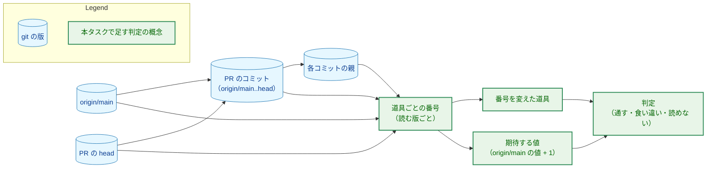
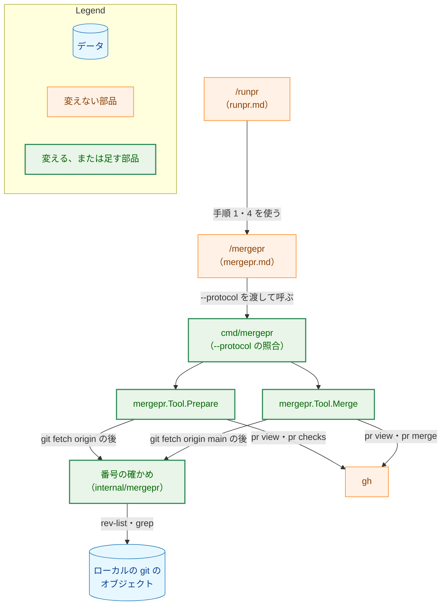
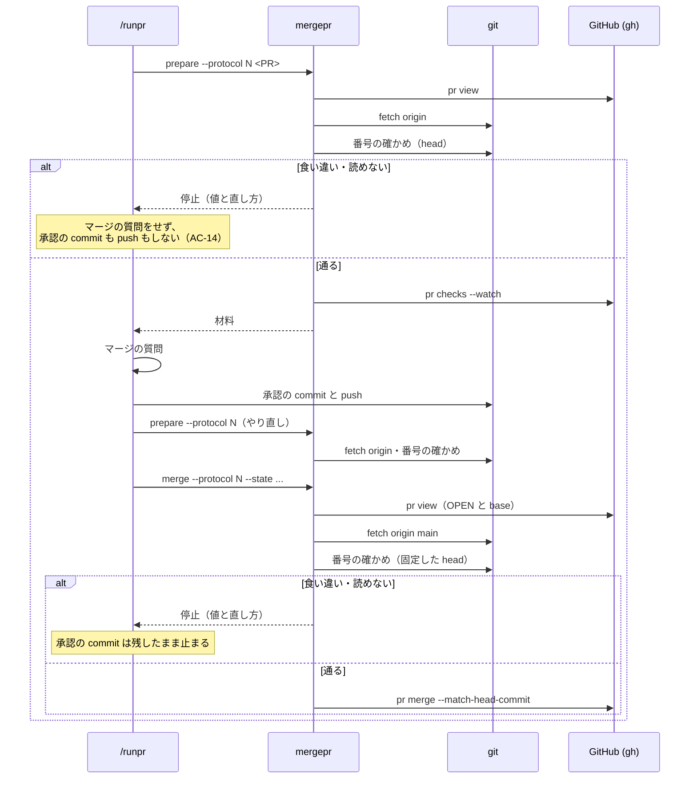
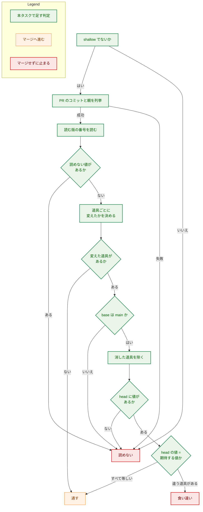

# アーキテクチャ設計書：プロトコル番号は文書に書かず「main の値 + 1」とし、マージの時点で確かめる

## Document Status

| Item | Value |
|---|---|
| Status | `draft` |
| Created | 2026-11-17 |
| Review date | - |
| Reviewer | - |
| Comments | - |

本書は [01_requirements.md](01_requirements.md)（要件定義書。以下、要件書）の設計である。「計画で決める」は、本タスクの実装計画書（`03_implementation_plan.md`）で決めることを指す。既存のファイルの内容は、コミット `e638505d` で確かめた。`file:line` の行番号は、このコミットでの行番号である。F-NNN・AC-NN は要件書の項番を、H-NN は [design_handoff.md](design_handoff.md)（以下、申し送り）の項番を指す。申し送りへの対応は付録 A に、受け入れ基準との対応は付録 B にまとめる。

本書は、要件書 3 章の用語（プロトコル番号・道具・PR のコミット・番号を変えた PR・期待する値）を、同じ意味で使う。そのほかに、次の用語を使う。

-   **番号の確かめ:** F-003 の確かめ。PR のコミットから番号を変えた道具を見つけ、PR の head のその道具の番号を期待する値と比べる（3.2）。
-   **読む版:** 番号の確かめが番号を読むコミット。`origin/main`、PR の head、PR のコミットのそれぞれと、その親のすべてである（3.1）。
-   **宣言の行:** ある道具のパッケージの `.go` ファイルにある、`Protocol` を宣言しているように見える行（3.1）。
-   **受け付ける行:** 宣言の行のうち、`const Protocol = <整数>` の決まった形を持つ行（3.1）。

## 1. 設計の全体像 (Design Overview)

### 1.1. 設計原則

-   **確かめは、マージが必ず通る `mergepr` の中で行う。** `/runpr` からのマージも、`/mergepr` を単独で使うマージも、`mergepr prepare` と `mergepr merge` を必ず通る（`.claude/commands/mergepr.md` の手順 1 と 4、`.claude/commands/runpr.md:910`、`.claude/commands/runpr.md:1240`）。そこで確かめれば、コマンドの定義が手順を読み違えても確かめは抜けない（[ADR-0014](../../dev/adr/0014-deterministic-checks-in-go.md) の「順序を、コマンドの定義ではなく道具の中で強制する」）。
-   **判定は、テストのある Go のコードで行う。** 番号を変えたかどうかの判定は、マージのコミットの扱いを含めて分岐が多い。エージェントの判断に任せず、一時ディレクトリの実際の git のリポジトリでテストする（ADR-0014 の「判定と副作用を持つ開発の道具は Go で書き、テストを持つ」）。
-   **読めないときは止める。** 読めない値を「番号を変えていない」として扱わない（AC-13）。
-   **番号は git の木から、毎回読む。** 確かめの基準値は、そのつど取得した `origin/main` と、PR のコミットの木である。`state.json` には確かめの結果を書かず、`merge` も読み返さない（3.4）。
-   **道具の一覧は持たない。** 確かめの対象は、`internal/<名前>/` に受け付ける行がある道具として、木から見つける。新しい道具を足しても、一覧を書き換える必要はない（AC-19、4.5）。
-   **規則の正本は CLAUDE.md の 1 か所に置く。** 手引きとコマンドの定義は、それを参照する（F-004）。

### 1.2. 設計の際に決めたこと（2026-11-17）

-   **確かめは `mergepr prepare` と `mergepr merge` の中で行う。`prepare` は `origin` を取得した直後に確かめる。`merge` は、`gh pr merge` の直前に `git fetch origin main` を行い、`prepare` で固定した head についてもう一度確かめる（申し送りの H-01、AC-06〜AC-16）。** 両方の経路のマージが、この 2 つのサブコマンドを必ず通るためである。独立したサブコマンド（`mergepr check` など）を作り、`/mergepr`・`/runpr` の定義から呼ぶ案は採らない。定義が呼び忘れると、確かめが黙って抜けるためである。ADR: [ADR-0014](../../dev/adr/0014-deterministic-checks-in-go.md) を本 PR で更新した（決定の項に置き場所を書き、採らなかった案に独立したサブコマンドの案を加えた）。
-   **マージの直前の確かめ直し（AC-16）で止まったとき、`/runpr` がすでに push した承認の commit は戻さず、ブランチに残す（申し送りの H-01）。** 直した後に `/runpr` をやり直すと、今の手順で PRE_MERGE は記録済みとして扱われ、二重には記録されない（`.claude/commands/runpr.md:318-325`）。直した commit はレビューを経てから、もう一度マージの質問を受ける（`.claude/commands/runpr.md:1240-1245`）。`/runpr` が revert の commit を push する案は採らない。`/runpr` を受け持つ OpenCode のモデルに git の書き換えをさせることになり、要件書が自動の直しを採らなかった理由と同じ危険があるためである。ADR: なし（`/runpr` の手順の細部で、このタスクの中で閉じるため）。
-   **定数は、`git grep` で読む版の木から行として読む。宣言の行を広めに拾い、そのうち受け付ける行だけを値として読む。宣言の行なのに受け付ける行でない行がある場合と、受け付ける行が 2 つ以上ある場合は、読めないものとして止める（申し送りの H-02・H-03、AC-13）。** 今ある 3 つの道具は、どれも受け付ける行の形で定数を書いている（`internal/fixprguard/types.go:21`、`internal/codexreview/types.go:15`、`internal/chief/records.go:28`）。`go/parser` でファイルを解析し、型付きの定数や const ブロックの中の定数も受け付ける案は採らない。読む版ごとにファイルを取り出す回数が増え、受け付ける値の形は結局 AC-13(4) で狭まるためである。ADR: なし（読み方は `mergepr_guide.md` に書く仕様で、ADR-0014 の決定に収まるため）。
-   **CLAUDE.md の規則は、「Development Notes」の下に新しく立てる「Protocol numbers」の節に置く（申し送りの H-04、AC-17）。** 「Development Notes」は開発の手順と道具の約束を書く節で、隣の「Dependencies」と同じ階層に置けるためである。「Key Design Patterns」に置く案は採らない。製品のコードの原則を書く節だからである。ADR: ADR-0014 を本 PR で更新した（決定の項に、正本の場所としてこの見出しを書いた）。
-   **確かめが止まったときの出力は、今の `mergepr` のほかの停止と同じく、標準エラーへの英語の文と終了コード `1` にする。** `/runpr` と `/mergepr` は今、`mergepr` が止まったら、その誤りと示された対処を報告して止まる（`.claude/commands/mergepr.md:31-32`）。番号の確かめで止まったときも同じ扱いで足り、コマンドの定義が出力を読み分ける必要はない。ADR: なし（出力の形はこのタスクの中で閉じるため）。
-   **AC-19 は、3 つの集合が一致することを確かめるテストで満たす。(a) 番号の確かめが作業ツリーで見つける道具。(b) コマンドの定義で、`--protocol` の直前の命令の語として書かれた `cmd/<名前>` の名前。(c) 文書のガードが `--protocol` を割り当てる道具の一覧（`internal/doctestutil/protocol.go:23` の `protocolTools`）。** (a) と (b) が食い違えば、`--protocol` を渡して呼ぶのに確かめの対象にない道具があることになる。(c) を合わせるのは、新しい道具の `--protocol` も文書のガードの対象にするためである。`cmd/*/` のソースから `--protocol` の定義を読む案は採らない。道具ごとに引数の解析の書き方が違い（`cmd/fixprguard/main.go:79` は `flag` の名前、`cmd/codexreview/main.go:41` は自前の解析）、読み方を 1 つに決められないためである。ADR: なし（テストの手段のため）。

### 1.3. なぜ今の仕組みでは足りないか

今の `mergepr` は、番号を読まない。`merge` が確かめ直すのは、PR が開いていることと、base の名前が `prepare` のときと同じことだけである（`internal/mergepr/mergepr.go:241-250`）。文書のガードテスト（`cmd/chief/docs_test.go:205` など）は、ブランチの中で文書と定数が合っていることを確かめるが、ほかのブランチがすでに `main` に入れた番号とは比べない。そのため、要件書 1 章の「背景」のとおり、同じ番号に上げた 2 つのブランチは、どちらもテストとマージを通る。

番号の比べ方を `origin/main` との差分（3 点の差分）にする、より簡単な案は採らない。ブランチに `main` を取り込むと、差分から番号の変更が消える（AC-08）。PR のコミットを 1 つずつ親と比べる必要がある（3.2）。

### 1.4. 概念モデル

矢印 A → B は「A が B を持つ、または A から B を求める」ことを表す。



## 2. システム構成 (System Structure)

### 2.1. 全体構成

矢印 A → B は「A が B を呼ぶ、または読む」ことを表す。



`/runpr` と `/mergepr` の定義は、手順そのものは変えない。変えるのは、`mergepr` の呼び出しに `--protocol` を足すことと、確かめで止まったときの報告の書き方である（3.6）。

### 2.2. コンポーネント配置

| ファイル | 種類 | 内容 |
|---|---|---|
| `internal/mergepr/protocol.go` | 新規 | 番号の読み取りと番号の確かめ（3.1・3.2）。誤りの型（4.1） |
| `internal/mergepr/mergepr.go` | 変更 | `mergepr` の `Protocol` 定数。`Prepare` と `Merge` から番号の確かめを呼ぶ（3.3・3.4） |
| `internal/mergepr/errors.go` | 変更 | 番号の確かめの番兵の誤り（4.1） |
| `internal/mergepr/protocol_test.go` | 新規 | 実際の git のリポジトリでの、番号の確かめのテスト（7.1） |
| `internal/mergepr/mergepr_test.go` | 変更 | `Prepare`・`Merge` の手順の台本に、番号の確かめの git の呼び出しを足す（3.7） |
| `cmd/mergepr/main.go` | 変更 | すべてのサブコマンドで `--protocol` を必須にし、照合する（3.5） |
| `cmd/mergepr/main_test.go` | 変更 | `--protocol` の照合のテスト（3.7） |
| `cmd/mergepr/docs_test.go` | 新規 | 文書の `mergepr` の `--protocol` が定数と合うことのガード（7.2） |
| `internal/doctestutil/protocol.go` | 変更 | `protocolTools` に `mergepr` を足す（3.6） |
| AC-19 のテスト（置き場所は計画で決める） | 新規 | 1.2 の 3 つの集合の一致（7.2） |
| `.claude/commands/mergepr.md` | 変更 | 呼び出しに `--protocol`、確かめで止まったときの報告（3.6） |
| `.claude/commands/runpr.md` | 変更 | 呼び出しに `--protocol`、確かめで止まったときの報告と承認の commit の扱い（3.6） |
| `CLAUDE.md` | 変更 | 「Development Notes」の「Protocol numbers」の節（3.8） |
| `docs/dev/guides/mergepr_guide.md` | 変更 | 番号の確かめの仕様、ネットワーク操作の表、保証、止まったときの対処（3.6） |
| `docs/dev/guides/fixprguard_guide.md` | 変更 | §9 の番号の決め方を CLAUDE.md への参照に、§3 の fail-closed の文を直す（AC-18） |
| `docs/dev/adr/0014-deterministic-checks-in-go.md` | 変更（本 PR） | 確かめの置き場所と正本の場所。実装の PR では、決定の後の食い違いの段落を消す（3.8） |

### 2.3. データフロー

`/runpr` からのマージの流れを示す。`/mergepr` を単独で使うときは、承認の commit の段がなく、マージの質問が承認の質問になる。



## 3. コンポーネント設計 (Component Design)

### 3.1. 番号の読み取り（H-02・H-03）

番号の確かめは、読む版のすべてについて、道具ごとの番号を読む。

-   **読むファイル.** 各版の木の、`internal/<名前>/` の直下にある `.go` ファイルのうち、名前が `_test.go` で終わらないもの。下の階層のパッケージ（`internal/llm/claude` など）は読まない。道具は `cmd/<名前>` と `internal/<名前>` の組だからである（ADR-0014 の決定の 1 つ目）。
-   **読み方.** 読む版をまとめて 1 回の `git grep` に渡し、各版の宣言の行を拾う。宣言の行は、行頭の空白と `const` の語を除いた後に、語 `Protocol` で始まり、`=` が続く行（間に型の名前があってもよく、`==` は含まない）とする。構造体のフィールド（`Protocol int \`json:"protocol"\``、`internal/chief/output.go:15` など）と、複合リテラルの要素（`Protocol: Protocol,`、`internal/codexreview/run.go:575`）は、`=` を持たないので拾わない。
-   **受け付ける行.** 行の全体が、行頭から `const Protocol = ` に続けて、`1` から `9` で始まる 10 進の数字だけを持つ行である。先頭の `0`、区切りの `_`、型の名前、行末のコメントは受け付けない（AC-13(4)）。
-   **版ごとの値.** 道具ごとに、次のどれかになる。
    -   **ない:** その道具のパッケージに宣言の行がない。
    -   **値:** 宣言の行がちょうど 1 つで、受け付ける行である。
    -   **読めない:** 宣言の行が 2 つ以上ある（AC-13(5)）か、受け付ける行でない宣言の行がある（AC-13(4)）。
-   **道具.** 読む版のどれかで、値か読めないかになったパッケージの名前を、道具とする。一覧は持たない。

読めないの値が読む版のどこかにある道具があれば、番号の確かめは、その道具を変えたかどうかにかかわらず、読めないものとして止まる。読めない値を「変えていない」と扱わないためである（AC-13 の最後の文）。

### 3.2. 番号の確かめ（F-003）

番号の確かめは、PR の head のコミット ID と base の名前を受け取り、次の 3 つのどれかを返す。判定の順序と細部（git の呼び出しの並びなど）は計画で決める。

-   **通す:** 番号を変えた道具がないか、変えたすべての道具で head の値が期待する値に等しい。
-   **食い違い:** 番号を変えた道具のうち、head の値が期待する値と違うものがある。食い違ったすべての道具を返す（AC-06・AC-11）。
-   **読めない:** 確かめに要るものを読めない。読めなかったものを返す（AC-13）。

判定の規則は次のとおりである。

1.  **読む前の確かめ.** リポジトリが shallow なら、読めないとする（AC-13(7)）。
2.  **PR のコミット.** `origin/main` から辿れず、head から辿れるコミットを、親とともに列挙する。列挙に失敗したら読めないとする（AC-13(2)・(7)）。
3.  **変えたかどうか.** 道具ごとに、PR のコミットのどれかが番号を変えたかを、要件書 3 章の「番号を変えた PR」の定義で決める。マージのコミットでないコミットは、親の値と違えば変えたものとする。マージのコミットは、その値がどの親の値とも違うときだけ変えたものとする。「ない」も 1 つの値として比べるので、定数が現れることと消えることも、変えたものに数える。
4.  **base.** PR の base が `main` でなく、番号を変えた道具が 1 つでもあれば、読めないとする（AC-13(6)）。変えた道具がなければ、base によらず通す。
5.  **消した道具.** head の値が「ない」で、PR のコミットのどれかがその道具の定数を消した（親で値があり、そのコミットでない）なら、その道具は確かめない（AC-10）。head の値が「ない」で、PR のコミットが消していなければ、読めないとする（AC-13(3)）。
6.  **比べる.** 変えたほかの道具について、head の値を期待する値と比べる。期待する値は、`origin/main` の値に 1 を足した値で、`origin/main` の値が「ない」なら `1` である（AC-10）。

規則 3 のとおり、`main` を取り込んだだけの PR は、マージのコミットの値が `main` の側の親と等しいので、変えたものにならない（AC-09）。同じ番号に上げた 2 本目のブランチは、`main` を取り込んでも、番号を上げた自分のコミットが親と違うので変えたものになり、規則 6 で `origin/main` の値と等しい head の値が食い違う（AC-08）。

この規則の結果として、`origin/main` にあり、head になく、PR のコミットが消していない定数（ブランチが道具より古い場合）は、PR のコミットの中で値が動かないので変えたものにならず、確かめない（AC-13(3) のただし書き）。

### 3.3. `Prepare` への組み込み

`Prepare` は、`git fetch origin`（`internal/mergepr/mergepr.go:134`）の直後、CI を待つ（`internal/mergepr/mergepr.go:137`）前に、番号の確かめを PR の head と base で行う。止まれば、作業ディレクトリを作らずに誤りを返す。CI を待つ前に置くのは、番号の食い違いを、CI の完了を待たずに早く示すためである。

`/runpr` はマージの質問の前に `prepare` を実行する（`.claude/commands/runpr.md:910`）ので、ここで止まれば、マージの質問も、承認の commit も、push も起きない（AC-14）。PRE_MERGE の後のやり直しの `prepare`（`.claude/commands/runpr.md:1226`）でも、同じ確かめが行われる。

### 3.4. `Merge` への組み込み（AC-16）

`Merge` は、PR が開いていることと base の名前を確かめた（`internal/mergepr/mergepr.go:241-250`）後、`gh pr merge`（`internal/mergepr/mergepr.go:254`）の前に、次を行う。

1.  `git fetch origin main` を行う。失敗したら、読めない（AC-13(1)）として止まる。
2.  `state.json` に記録した head のコミット ID と base の名前で、番号の確かめを行う。止まれば、マージせずに誤りを返す。作業ディレクトリは消さない。誤りの文は、`mergepr discard --state <state-file>` で準備を捨ててから直すことを示す。

`state.json` から読むのは、今の `Merge` が `--match-head-commit` に使う head のコミット ID と、base の名前だけである（`internal/mergepr/mergepr.go:229-250`）。確かめた番号は `state.json` に書かず、`Merge` は毎回 git の木から読み直す。ADR-0014 の「道具は、判定に使う基準値を状態のファイルから読み返さない」に当たらないのは、確かめの基準値（`origin/main` の番号）を、取得し直した木からそのつど読むためである。

確かめ直しと `gh pr merge` の間には数秒の時間差が残る。その間にほかの PR が同じ番号でマージされることは、受け入れた危険である（AC-20(2)）。

### 3.5. `mergepr` のプロトコル番号（AC-16a）

`internal/mergepr` に、ほかの道具と同じ形の定数を置く。値は、実装の時点の `origin/main` に定数がないので、期待する値の `1` になる。

```go
// Protocol is the version of the tool's command-line contract. The command
// documents pass it back with --protocol, so an installed binary that predates
// the documents stops instead of merging without the checks they expect.
const Protocol = 1
```

`cmd/mergepr` は、`prepare`・`merge`・`cleanup`・`discard` のすべてで `--protocol` を必須にする。値が `Protocol` と違うか、渡されなければ、何も読まず、何も書かずに止まる。止まったときは、インストールし直すことを示す。

確かめを入れる前の `mergepr` は、`--protocol` を定義していないので、`flag.FlagSet.Parse`（`cmd/mergepr/main.go:31-35`、`flag.ContinueOnError`）が未定義のフラグとして誤りを返し、何もせずに止まる。新しい定義と古い道具の組み合わせも、古い定義（`--protocol` を渡さない）と新しい道具の組み合わせも、こうして止まる。

### 3.6. コマンドの定義と手引き

-   **`--protocol` の付け方.** `.claude/commands/mergepr.md` と `.claude/commands/runpr.md` の、`mergepr` のすべての呼び出しに `--protocol <番号>` を書く。文書のガード（7.2）は、文書の `mergepr` の `--protocol` を `internal/mergepr` の `Protocol` と比べる。そのため `internal/doctestutil/protocol.go` の `protocolTools` に `mergepr` を足す。`mergepr` の呼び出しは位置引数の前に `--protocol` を書く（`flag` はフラグの解析を最初の位置引数で止めるため）。書き方の細部は計画で決める。
-   **`mergepr.md`.** 手順 1 で、番号の確かめで止まったときは、`mergepr` が示した道具・値・直し方をそのまま報告し、直した後に `/mergepr` をやり直すことを書く。手順 4 で、確かめ直しで止まったときは、準備を `discard` で捨てて報告することを書く。
-   **`runpr.md`.** step 4 の項 2 の `prepare` で止まったときは、マージの質問をせず、承認の commit も push もしないで、`mergepr` の示した内容と、直した後に `/runpr` をもう一度実行することを報告する（AC-14）。項 5 の `merge` で止まったときは、準備を捨て、承認の commit がブランチに残っていること、直した後に `/runpr` をやり直せばそれを記録済みとして扱うことを報告する（1.2）。
-   **`mergepr_guide.md`.** 番号の確かめの仕様（3.1・3.2 の規則）、`merge` に足すネットワーク操作（4 章の表に `git fetch origin main`）、6.1 の保証（番号を変えた PR は期待する値でしかマージしない）、6.2 の保証しないこと（AC-20 の 4 つ）、7 章の止まったときの対処（AC-12・AC-15 の直し方）、`--protocol` を上げたときのインストールのし直しを書く。確かめの仕様の正本はこの手引きとし、ADR-0014 はここにリンクする（本 PR で更新済み）。
-   **`fixprguard_guide.md`.** AC-18 の 2 点だけを直す。

### 3.7. 既存のテストへの影響

-   `internal/mergepr/mergepr_test.go` の `Prepare` と `Merge` のテストは、`fakeRunner` に、呼ぶ順のコマンドの台本を渡す（`internal/mergepr/test_helpers.go:46-68`）。番号の確かめが git の呼び出しを足すので、`Prepare` と `Merge` を最後まで通すテストの台本は、すべて書き換える。
-   `cmd/mergepr/main_test.go` の引数のテストは、`--protocol` を渡す形に変える。

### 3.8. 文書の規則（F-001・F-002・F-004）

CLAUDE.md の「Development Notes」の下に「Protocol numbers」の節を立て、次を書く。

-   規則の対象（AC-01）。
-   タスク文書には上げた後の番号を書かず「`main` の値 + 1」と書くこと、今の仕様を持つ文書には実際の番号を書くこと（AC-02・AC-03）。
-   番号の決め方（実装の時点の `origin/main` の値 + 1、上げるだけ、`main` は取り込みをマージで行う、足し直す道具は `1` から）（AC-04）。
-   マージの時点の確かめがあることと、止まったときの直し方（`mergepr_guide.md` への参照）（AC-05）。
-   受け入れた危険の 4 つ（AC-20）。

ADR-0014 の決定の後の、まだ反映していないことを述べる段落（「この決定のうち、…#933 の実装で解消する。」）は、規則と確かめを入れる実装の PR で消す（`docs/dev/conventions/adr.md` の「Editorial corrections」）。

## 4. エラーハンドリング設計 (Error Handling Design)

### 4.1. 誤りの型

```go
// Sentinel errors of the protocol-number check. Callers and tests match
// them with errors.Is.
var (
	// errProtocolMismatch: a tool whose number the PR's commits changed has a
	// head value other than origin/main's value plus one.
	errProtocolMismatch = errors.New("protocol number is not origin/main's value plus one")
	// errProtocolUnreadable: something the check needs cannot be read, so the
	// PR is not merged.
	errProtocolUnreadable = errors.New("cannot check protocol numbers")
	// errProtocolFlag: --protocol is missing or names another contract.
	errProtocolFlag = errors.New("--protocol does not match this mergepr")
)

// protocolMismatch is one tool whose number disagrees (AC-07).
type protocolMismatch struct {
	Tool     string
	Main     protocolValue // origin/main's value; absent for a new tool
	Head     protocolValue
	Expected int
}

// protocolValue is one tool's number at one revision.
type protocolValue struct {
	Present bool
	Value   int
}
```

誤りの文は、食い違いでは `errProtocolMismatch` を、読めないでは `errProtocolUnreadable` を包む。テストは `errors.Is` で見分ける。

### 4.2. 示し方

-   **食い違い（AC-07・AC-11・AC-12・AC-15）.** 食い違った道具ごとに、道具の名前、`origin/main` の値（ないときは `none`）、head の値、期待する値を 1 行で示す。その後に AC-12 の直し方を示す。head の値が `origin/main` の値に等しい道具があるときは、AC-15 の、履歴をまとめ直す直し方と、それを使ってよい条件を加える。
-   **読めない（AC-13）.** 読めなかったもの（`origin/main` の取得、コミットの列挙、どの版のどの道具の定数か、base の名前、shallow）を示す。読めない値の行は、制御文字を見えるようにして示す（`%q`）。
-   **言語.** 文は英語で書く（CLAUDE.md の「Language」）。`/runpr` と `/mergepr` は、それを利用者に日本語で報告する。

## 5. セキュリティ考慮事項 (Security Considerations)

N/A。条件付きの手引き（`docs/dev/security.md`）の対象に当たらない（要件書 4.2）。

-   番号の確かめは、git のオブジェクトを `git grep` と `git rev-list` で読むだけで、PR のコードを実行しない。外部コマンドは、今と同じく `internal/cmdrunner` の `Runner` 越しに、シェルを通さずに呼ぶ。
-   読む値は、受け付ける行の決まった形だけで、それ以外は読めないとして止まる。
-   `mergepr` は利用者自身の PR とチェックアウトを信頼する道具で（`internal/mergepr/mergepr.go:4-7`）、悪意のある PR の内容を防がない。この前提は変えない。

## 6. 処理フロー詳細 (Processing Flow Details)

### 6.1. 番号の確かめ



矢印 A → B は「A の次に B を行う」ことを表す。ラベルは分岐の条件である。「消した道具を除く」で除いた道具は、「head に値があるか」以降の確かめを受けない（3.2 の規則 5）。

### 6.2. 2 つのブランチが同じ番号に上げた場合（AC-08）

ブランチ A と B が、どちらも `chief` の番号を `1` から `2` に上げた例である。

1.  A が先にマージされ、`origin/main` の値は `2` になる。
2.  B に `main` をマージで取り込む。取り込みのマージのコミットの値は `2` で、親の両方（B の側 `2`、`main` の側 `2`）と等しいので、変えたものにならない。
3.  B の、`1` から `2` に上げたコミットは、親の値 `1` と違うので、変えたものになる。
4.  期待する値は `3`、head の値は `2` で、食い違う。head の値が `origin/main` の値に等しいので、AC-15 の直し方も示す。

B を `main` の上に rebase するか、履歴をまとめ直すと、手順 3 のコミットが親 `2` から `2` への変更になり、変えたものにならない。この場合の見落としは、受け入れた危険である（AC-20(3)）。

## 7. テスト戦略 (Test Strategy)

### 7.1. ユニットテスト

-   **番号の確かめ（申し送りの H-05）.** 一時ディレクトリに実際の git のリポジトリを作り、`origin/main` に当たる参照と PR のブランチの履歴を組んで確かめる。AC-06（同じ値・2 以上大きい・小さい）、AC-08（2 本目のブランチが `main` を取り込んだ場合）、AC-09（`main` を取り込んだだけの PR）、AC-10（新しい道具・`--protocol` を足す道具・消す道具・足し直す道具）、AC-11（2 つの道具）、AC-13 の (2)〜(7)、AC-15（上げてから元に戻した PR）の履歴を、それぞれ作る。番号の確かめが呼ぶ git だけを実際に動かす。
-   **読み取り.** 宣言の行と受け付ける行の区別（先頭の `0`、`_`、型付き、const ブロックの中、行末のコメント、2 行、構造体のフィールド、複合リテラルの要素、下の階層のパッケージ、`_test.go`）を、表のテストで確かめる。
-   **`Prepare`・`Merge` への組み込み.** `fakeRunner` の台本で、`Prepare` が CI を待つ前に、`Merge` が `gh pr merge` の前に、確かめで止まり、後のコマンドを呼ばないことを確かめる（AC-14・AC-16）。`Merge` が `git fetch origin main` の失敗で止まることも確かめる（AC-13(1)）。
-   **`--protocol`.** `cmd/mergepr` が、4 つのサブコマンドで、違う値と、渡されない場合を拒むことを確かめる（AC-16a）。

どのテストも、確かめる対象を壊して失敗することを、コミットの前に確かめる（CLAUDE.md の「Testing Strategy」）。

### 7.2. 文書のガード

-   `cmd/mergepr/docs_test.go` に、コマンドの定義の `mergepr` の `--protocol` が `internal/mergepr` の `Protocol` と等しいことを確かめる `TestDocumentedProtocolMatches` を置く（ほかの 3 つの道具と同じ形）。
-   AC-19 のテストは、1.2 の 3 つの集合が等しいことを確かめる。(a) は 3.1 の読み取りを作業ツリーに当てて求める。
-   CLAUDE.md・手引きの規則の文は、PR のレビューで読む（ADR-0016、要件書 5 章）。`fixprguard_guide.md` の差分が AC-18 の 2 点に限ることは、マージベースとの `diff` の確かめで行う（`docs/dev/conventions/requirements_process.md` の「`diff` verification」）。

### 7.3. 結合テストと手での確かめ

`gh` を相手にした結合テストは置かない。実装の PR 自身のマージで、新しい `mergepr` を入れ、番号の確かめが「`mergepr` は `origin/main` にないので期待する値 `1`」として通ることを確かめる（8 章）。

### 7.4. セキュリティのテスト

N/A（5 章）。読めない値で止まることは、7.1 の読み取りのテストが確かめる。

## 8. 実装の優先順位 (Implementation Priorities)

1.  番号の読み取りと番号の確かめ（`internal/mergepr/protocol.go`）と、そのテスト。
2.  `Prepare`・`Merge` への組み込みと、`cmd/mergepr` の `--protocol`。
3.  コマンドの定義・手引き・CLAUDE.md・文書のガード・AC-19 のテスト、ADR-0014 の食い違いの段落の削除。

道具と、それを呼ぶ文書と、ガードは同じ PR で変える（ADR-0014 の「道具の引数・出力・終了コードは…契約にする」）。そのため、1〜3 は 1 つの PR にまとめることを勧める。PR の分け方は計画で決める。

実装の PR の扱いは次のとおりである。

-   その PR の `/runpr` の前に、その PR のブランチで `make install-mergepr` を行う。PR の定義が `--protocol` を渡すので、古い `mergepr` は止まるためである。
-   マージまでの間、`main` を取り込んでいないほかの worktree の `/mergepr`・`/runpr` は、新しい `mergepr` に `--protocol` を渡さないので止まる。`main` を取り込めば進める。どちらも、確かめを抜いてマージすることはない。
-   マージの後は、`main` で `make install-mergepr` を行う。

## 9. 将来の拡張 (Future Extensibility)

-   **新しい道具.** `internal/<名前>/` に受け付ける行の形で `Protocol` を置けば、番号の確かめの対象になる。AC-19 のテストが、文書のガードの一覧に足すことを求める。
-   **ブランチごとに一意の番号.** マージの前に、並行するブランチが同じ番号を共有する危険（AC-20(1)）を閉じるには、番号を配る仕組みが要る。本タスクの範囲の外である（要件書 2.3）。
-   **chief の案内.** `docs/dev/guides/chief_guide.md` §2 の番号の説明は、本タスクでは変えない（AC-18 は `fixprguard_guide.md` の差分だけを定める）。chief の番号を上げるタスクが、必要なら合わせる。

## 付録 A: 申し送り（design_handoff.md）への対応

| 項目 | とった方針 | 本書の場所 |
|---|---|---|
| H-01 | 確かめを `mergepr` の `prepare` と `merge` に置く。`merge` は `git fetch origin main` の後に固定した head で確かめ直す。確かめ直しで止まったときの承認の commit は残し、やり直しの `/runpr` が記録済みとして扱う | 1.2、3.3、3.4、3.6 |
| H-02 | PR のコミットとその親を列挙し、親ごとに番号を比べる。マージのコミットはどの親とも違うときだけ数える | 3.2、6.2 |
| H-03 | 道具は、受け付ける行がある `internal/<名前>/` として木から見つける。宣言の行を広めに拾い、受け付ける行だけを値とする。AC-19 は 3 つの集合の一致で確かめる | 1.2、3.1、7.2 |
| H-04 | CLAUDE.md の「Development Notes」の下に「Protocol numbers」を立て、ADR-0014 の決定からその見出しを示す | 1.2、3.8 |
| H-05 | 一時ディレクトリの実際の git のリポジトリで、履歴を組んで確かめる | 7.1 |

## 付録 B: 受け入れ基準との対応

| AC | 設計 | 確かめ方 |
|---|---|---|
| AC-01〜AC-03 | 3.8 | PR のレビューで読む |
| AC-04・AC-05 | 3.8 | PR のレビューで読む |
| AC-06 | 3.2 の規則 6 | 7.1 |
| AC-07 | 4.2 | 7.1 |
| AC-08 | 3.2 の規則 3、6.2 | 7.1 |
| AC-09 | 3.2 の規則 3 | 7.1 |
| AC-10 | 3.2 の規則 5・6 | 7.1 |
| AC-11 | 3.2、4.2 | 7.1 |
| AC-12 | 4.2、3.6 | 7.1（誤りの文に直し方があること）、PR のレビュー（手引き） |
| AC-13 | 3.1、3.2 の規則 1・2・4・5、3.4 | 7.1 |
| AC-14 | 3.3、3.6 | 7.1（`Prepare` が CI の前に止まる）、PR のレビュー（`runpr.md`） |
| AC-15 | 4.2 | 7.1 |
| AC-16 | 3.4 | 7.1 |
| AC-16a | 3.5、3.6 | 7.1、7.2 |
| AC-17 | 3.8 | PR のレビューで読む |
| AC-18 | 3.6 | `diff` の確かめ（7.2） |
| AC-19 | 1.2、7.2 | 7.2 |
| AC-20 | 3.4、3.8、6.2 | PR のレビューで読む |

## 変更履歴
