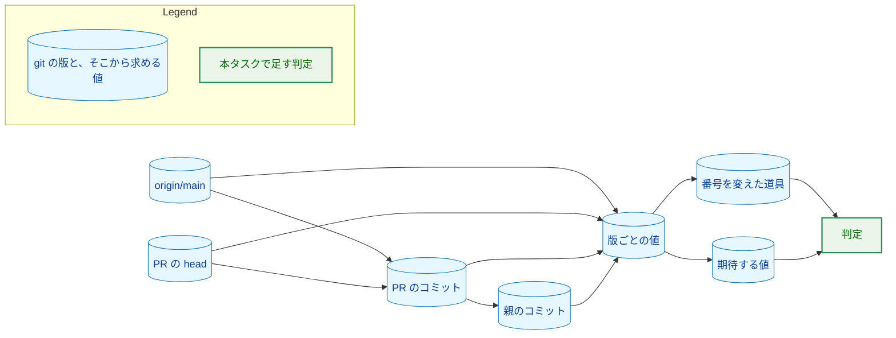
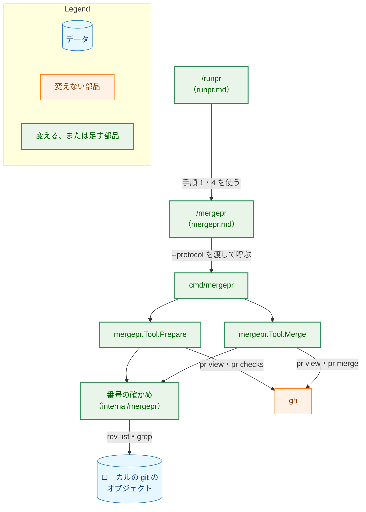
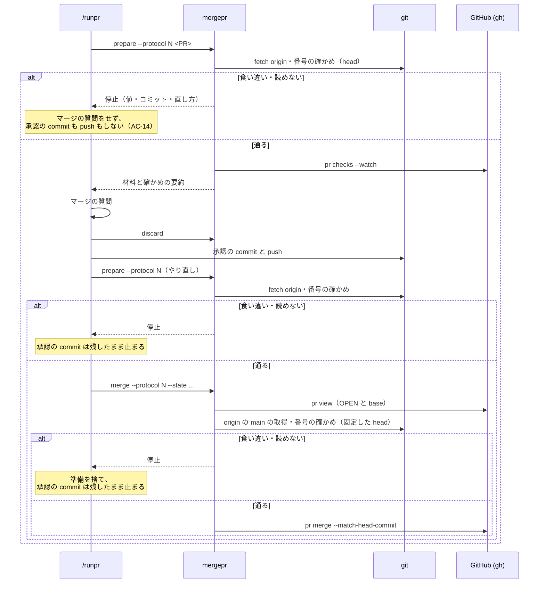
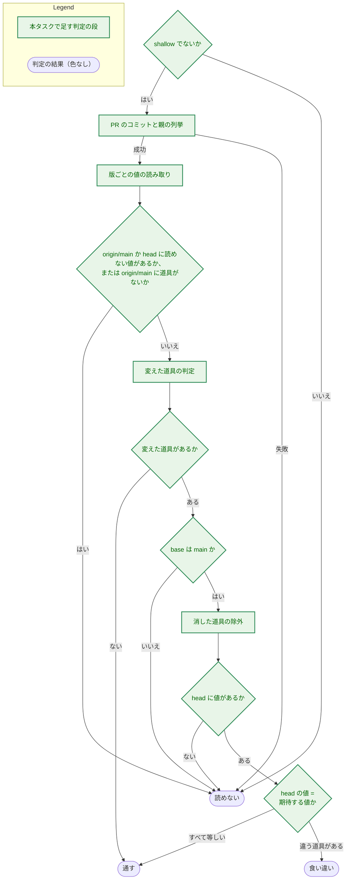

# アーキテクチャ設計書：プロトコル番号は文書に書かず「main の値 + 1」とし、マージの時点で確かめる

## Document Status

| Item | Value |
|---|---|
| Status | `draft` |
| Created | 2026-11-17 |
| Review date | - |
| Reviewer | - |
| Comments | - |

本書は [01_requirements.md](01_requirements.md)（要件定義書。以下、要件書）の設計である。「計画で決める」は、本タスクの実装計画書（`03_implementation_plan.md`）で決めることを指す。既存のファイルの内容と `file:line` の行番号は、コミット `e638505d` のものである。F-NNN・AC-NN は要件書の項番を、H-NN は [design_handoff.md](design_handoff.md)（以下、申し送り）の項番を指す。申し送りへの対応は付録 A に、受け入れ基準との対応は付録 B にまとめる。

本書は、要件書 3 章の用語（プロトコル番号・道具・PR のコミット・番号を変えた PR・期待する値）を、同じ意味で使う。要件書は、道具を「パッケージ `internal/<名前>` の `Protocol` 定数で見分ける」ものと定める。本書は、その定数の読み方を 3.1 で定める。そのほかに、次の用語を使う。

-   **番号の確かめ:** F-003 の確かめ。PR のコミットから番号を変えた道具を見つけ、その道具の番号について、PR の head での値を期待する値と比べる（3.2）。
-   **読む版:** 番号の確かめが番号を読むコミット。`origin/main`、PR の head、PR のコミットのそれぞれと、その親のすべてである（3.1）。
-   **宣言の行:** 道具のパッケージの `.go` ファイルにある、`Protocol` を宣言しているように見える行（3.1）。
-   **受け付ける行:** 宣言の行のうち、`const Protocol = <整数>` の決まった形を持つ行（3.1）。
-   **版ごとの値:** ある読む版での、ある道具の番号の状態。「ない」「値」「読めない値」の 3 つのどれかである（3.1）。
-   **判定:** 番号の確かめの結果。「通す」「食い違い」「読めない」の 3 つのどれかである（3.2）。版ごとの値の「読めない値」とは別の語として使う。

## 1. 設計の全体像 (Design Overview)

### 1.1. 設計原則

-   **確かめは、マージが必ず通る `mergepr` の中で行う。** `/runpr` からのマージも、`/mergepr` を単独で使うマージも、`mergepr prepare` と `mergepr merge` を必ず通る（`.claude/commands/mergepr.md` の手順 1 と 4、`.claude/commands/runpr.md:910`、`.claude/commands/runpr.md:1226`、`.claude/commands/runpr.md:1240`）。そこで確かめるので、エージェントがコマンドの定義の手順を読み違えても、確かめは抜けない（[ADR-0014](../../dev/adr/0014-deterministic-checks-in-go.md) の「順序を、コマンドの定義ではなく道具の中で強制する」）。
-   **判定は、テストのある Go のコードで行う。** 番号を変えたかどうかの判定は、マージのコミットの扱いを含めて分岐が多い。エージェントの判断に任せず、一時ディレクトリの実際の git のリポジトリでテストする（ADR-0014 の「判定と副作用を持つ開発の道具は Go で書き、テストを持つ」）。
-   **読めないとき、何も見つからないときは止める。** 読めない値を「番号を変えていない」として扱わない（AC-13）。読み方の誤りで道具が 1 つも見つからない場合も、「どの道具も変えていない」とせずに止める（3.2 の規則 1）。
-   **git の設定と環境に左右されない。** 番号の確かめの git の呼び出しは、利用者の git の設定と `GIT_*` の環境変数の影響を受けない形で行い、参照は完全な名前で指す（3.1・3.4）。
-   **番号は git の木から、毎回読む。** 確かめの基準値は、そのつど取得した `origin/main` と、PR のコミットの木である。`state.json` には確かめの結果を書かず、`merge` も読み返さない（3.4）。
-   **道具は木から見つけ、文書のガードの一覧はそれと突き合わせる。** 番号の確かめは、道具の一覧を持たずに、宣言の行がある `internal/<名前>/` を道具として見つける。文書のガードは道具の一覧（`internal/doctestutil/protocol.go:23` の `protocolTools`）を持つので、AC-19 のテストがそれを見つけた道具と突き合わせる（1.2、7.2）。
-   **規則の正本は CLAUDE.md の 1 か所に置く。** 手引きとコマンドの定義は、それを参照する（F-004）。

### 1.2. 設計の際に決めたこと（2026-11-17）

-   **確かめは `mergepr prepare` と `mergepr merge` の中で行う。`prepare` は `origin` を取得した直後に確かめる。`merge` は、`gh pr merge` の直前に `origin` の `main` を取得し直し、`prepare` で固定した head についてもう一度確かめる（申し送りの H-01、AC-06〜AC-16）。** 両方の経路のマージが、この 2 つのサブコマンドを必ず通るためである。独立したサブコマンド（`mergepr check` など）を作り、`/mergepr`・`/runpr` の定義から呼ぶ案は採らない。定義が呼び忘れると、確かめが黙って抜けるためである。ADR: [ADR-0014](../../dev/adr/0014-deterministic-checks-in-go.md) を本 PR で更新した（決定の項に置き場所を書き、採らなかった案に独立したサブコマンドの案を加えた）。
-   **`/runpr` が承認の commit を push した後に確かめで止まったときは、承認の commit を戻さず、ブランチに残す。止まりうるのは、PRE_MERGE の後のやり直しの `prepare`（`.claude/commands/runpr.md:1226`）と、`merge` の確かめ直し（AC-16）の 2 か所である（申し送りの H-01）。** 直した後に `/runpr` をやり直すと、今の手順で PRE_MERGE は記録済みとして扱われ、二重には記録されない（`.claude/commands/runpr.md:318-325`）。直した commit は `/runpr` の外で作るので、やり直しの `/runpr` はそれをローカルの CLI レビューにかけない。step 3 の Escalation（`.claude/commands/_lib/pr-review-escalation.md`）が Codex の PR レビューを頼むかを判断し、マージの質問は、それを Codex がレビューしていない変更として示す（`.claude/commands/runpr.md:984`）。`/runpr` が revert の commit を push する案は採らない。`/runpr` を受け持つ OpenCode のモデルに git の書き換えをさせることになり、要件書が自動の直しを採らなかった理由と同じ危険があるためである。ADR: なし（`/runpr` の手順の細部で、このタスクの中で閉じるため）。
-   **定数は、`git grep` で読む版の木から行として読む。宣言の行を広めに拾い、そのうち受け付ける行だけを値として読む。宣言の行なのに受け付ける行でない行がある場合と、宣言の行が 2 つ以上ある場合は、読めない値とする（申し送りの H-02・H-03、AC-13）。** 今ある 3 つの道具は、どれも受け付ける行の形で定数を書いている（`internal/fixprguard/types.go:21`、`internal/codexreview/types.go:15`、`internal/chief/records.go:28`）。`go/parser` でファイルを解析し、型付きの定数や const ブロックの中の定数も受け付ける案は採らない。読む版ごとにファイルを取り出す回数が増え、受け付ける行の形は、どのみち AC-13(4) で狭めるためである。ADR: ADR-0014 を本 PR で更新した（道具が定数を置く形は、後のタスクが新しい道具を足すときに守る約束なので、決定の項に書いた）。
-   **CLAUDE.md の規則は、「Development Notes」の下に新しく立てる「Protocol numbers」の節に置く（申し送りの H-04、AC-17）。** 「Development Notes」は開発の手順と道具の約束を書く節で、隣の「Dependencies」と同じ階層に置けるためである。「Key Design Patterns」に置く案は採らない。製品のコードの原則を書く節だからである。ADR: ADR-0014 を本 PR で更新した（決定の項に、正本の場所としてこの見出しを書いた）。
-   **AC-13(4)・(5)（読めない定数）は、`origin/main` と head の値に当てはめる。PR の途中のコミットと親の読めない値は、ほかのどの値とも違う 1 つの値として扱う（3.1）。** 比べるのに要るのは `origin/main` と head の値だけで、途中の読めない値は「変えた」として数えれば、AC-13 の最後の文（読めないものを、番号を変えていないものとして扱わない）を守れるためである。読む版のすべてで止める案は採らない。途中のコミットで一度読めない形を書いた PR は、後で直しても履歴をまとめ直すまで止まり続け、番号を上げたブランチの履歴をまとめ直さないという規則（AC-04）とぶつかるためである。ADR: なし（要件の項目の当てはめ方で、このタスクの中で閉じるため）。
-   **番号に触れていない PR が `main` の取り込みの衝突を自分の側の値で解決すると、`main` の番号が下がったまま確かめを通る。これは既知の限界として記録し、要件書の定義の見直しは [#947](https://github.com/isseis/yt2column/issues/947) で扱う（3.2 の末尾）。** 要件書 3 章の「番号を変えた PR」の定義どおりの結果で、直すには承認済みの定義を変える必要があるためである。ADR: なし（今の決定を変えず、限界の記録だけのため）。
-   **確かめが止まったときの出力は、今の `mergepr` のほかの停止と同じく、標準エラーへの英語の文と終了コード `1` にする。文は `protocol check: ` で始める。** `/runpr` と `/mergepr` は今、`mergepr` が止まったら、その誤りと示された対処を報告して止まる（`.claude/commands/mergepr.md:31-32`）。番号の確かめで止まったときも同じ扱いで足りる。決まった書き出しは、`merge` の停止が番号の確かめによるのか、head が動いたことによるのかを、報告で取り違えないためのものである。ADR: なし（出力の形はこのタスクの中で閉じるため）。
-   **AC-19 は、3 つの集合が一致することを確かめるテストで満たす。(a) 番号の確かめの読み方で、作業ツリーから見つかる道具。(b) コマンドの定義が `--protocol` を渡して呼ぶ `cmd/<名前>` の名前。(c) 文書のガードの道具の一覧（`protocolTools`）。** 道具が `--protocol` を受け付けるのは、それを渡すコマンドの定義と版を照合するためである。`--protocol` を渡す定義のない道具は、番号が衝突しても版を照合する相手がない。そのため、(a) を (b) と突き合わせれば足りる。(a) と (b) が食い違えば、定義が `--protocol` を渡すのに、確かめの対象にない道具があることになる。宣言を `var` に変えた場合や、下の階層のパッケージや `cmd/<名前>` に移した場合も、この食い違いとして見つかる。(c) を合わせるのは、新しい道具の `--protocol` も文書のガードの対象にするためである。ADR: なし（テストの手段のため）。

### 1.3. なぜ今の仕組みでは足りないか

今の `mergepr` は、番号を読まない。`merge` が確かめ直すのは、PR が開いていることと、base の名前が `prepare` のときと同じことだけである（`internal/mergepr/mergepr.go:241-250`）。文書のガードテスト（`cmd/chief/docs_test.go:205` など）は、ブランチの中で文書と定数が合っていることを確かめるが、ほかのブランチがすでに `main` に入れた番号とは比べない。そのため、要件書 1 章の「背景」のとおり、同じ番号に上げた 2 つのブランチは、どちらもテストとマージを通る。

番号の比べ方を `origin/main` との差分（3 点の差分）にする、より簡単な案は採らない。ブランチに `main` を取り込むと、差分から番号の変更が消える（AC-08）。PR のコミットを 1 つずつ親と比べる必要がある（3.2）。

### 1.4. 概念モデル

矢印 A → B は「B を A から求める」ことを表す。



## 2. システム構成 (System Structure)

### 2.1. 全体構成

矢印 A → B は「A が B を呼ぶ、または読む」ことを表す。`Prepare` と `Merge` は、どちらも `origin` を取得した後に番号の確かめを呼ぶ（3.3・3.4）。



`/runpr` と `/mergepr` の定義は、手順の順序は変えない。変えるのは、`mergepr` の呼び出しに `--protocol` を足すことと、確かめで止まったときの報告の書き方である（3.6）。

### 2.2. コンポーネント配置

| ファイル | 種類 | 内容 |
|---|---|---|
| `internal/mergepr/protocolcheck.go` | 新規 | 番号の読み取りと番号の確かめ、確かめの入口の型と誤りの型（3.1・3.2・4.1） |
| `internal/mergepr/mergepr.go` | 変更 | `mergepr` の `Protocol` 定数。`Tool` に番号の確かめを持たせ、`Prepare` と `Merge` から呼ぶ（3.3・3.4）。誤りの文が示すコマンドに `--protocol` を付ける（3.5） |
| `internal/mergepr/errors.go` | 変更 | 番号の確かめの番兵の誤り（4.1） |
| `internal/mergepr/runner.go` | 変更 | 番号の確かめが使う、git の設定と環境に左右されない git の呼び出し（3.1） |
| `internal/mergepr/protocolcheck_test.go` | 新規 | 実際の git のリポジトリでの番号の確かめのテストと、読み取りの表のテスト（7.1） |
| `internal/mergepr/mergepr_test.go` | 変更 | `Prepare`・`Merge` の、番号の確かめの差し替えを使うテスト（3.7） |
| `internal/mergepr/test_helpers.go` | 変更 | 番号の確かめの差し替え（3.7） |
| `cmd/mergepr/main.go` | 変更 | すべてのサブコマンドで `--protocol` を必須にし、照合する。使い方の文に `--protocol` を足す（3.5） |
| `cmd/mergepr/main_test.go` | 変更 | `--protocol` の照合のテスト（7.1） |
| `cmd/mergepr/docs_test.go` | 新規 | 文書の `mergepr` の `--protocol` が定数と合うことのガードと、AC-19 のテスト（7.2） |
| `internal/doctestutil/protocol.go` | 変更 | 道具の一覧に `mergepr` を足す。AC-19 のテストが使うため、一覧と、`--protocol` を渡して呼ばれる名前を求める関数を公開する（7.2） |
| `internal/doctestutil/protocol_test.go` | 変更 | 上の変更のテスト |
| `.github/workflows/ci.yml` | 変更 | `doc-guard` の job の `go test` の対象に `./cmd/mergepr` を足す（7.2） |
| `.claude/commands/mergepr.md` | 変更 | 呼び出しに `--protocol`、確かめで止まったときの報告（3.6） |
| `.claude/commands/runpr.md` | 変更 | 呼び出しに `--protocol`、確かめで止まったときの報告と承認の commit の扱い（3.6） |
| `CLAUDE.md` | 変更 | 「Development Notes」の「Protocol numbers」の節（3.8）。`doc-guard` の対象の一覧の文に `./cmd/mergepr` を足す |
| `docs/dev/guides/mergepr_guide.md` | 変更 | 番号の確かめの仕様、4 章の図とネットワーク操作の表、5.2 の使い方、6 章の保証、7 章の止まったときの対処、8 章のテストの説明（3.6） |
| `docs/dev/guides/fixprguard_guide.md` | 変更 | §9 の番号の決め方を CLAUDE.md への参照に、§3 の fail-closed の文を直す（AC-18） |
| `docs/dev/conventions/package_reference.md` | 変更 | `internal/mergepr` の行に番号の確かめを足す |
| `docs/dev/adr/0014-deterministic-checks-in-go.md` | 変更（本 PR） | 確かめの置き場所、定数の形、正本の場所。実装の PR では、決定の後の食い違いの段落を消す（3.8） |

### 2.3. データフロー

`/runpr` からのマージの流れを示す。`/mergepr` を単独で使うときは、承認の commit の段がなく、マージの質問が承認の質問になる。



## 3. コンポーネント設計 (Component Design)

### 3.1. 番号の読み取り（H-02・H-03）

番号の確かめは、読む版のすべてについて、道具ごとの番号を読む。

-   **読むファイル.** 各版の木の、`internal/<名前>/` の直下にある `.go` ファイルのうち、名前が `_test.go` で終わらないもの。ビルドの制約（`//go:build test` など）があるファイルも読む。下の階層のパッケージ（`internal/llm/claude` など）は読まない。道具は `cmd/<名前>` と `internal/<名前>` の組だからである（ADR-0014 の決定の 1 つ目）。git のパス指定で `*` が `/` を越えないように指定する。
-   **宣言の行.** 行頭の空白と `const` の語を除いた後に `Protocol` の語で始まり、その後に `=` が現れる行（間に型の名前があってもよい。`==`・`!=`・`<=`・`>=`・`:=` の中の `=` は数えない）。構造体のフィールド（`Protocol int \`json:"protocol"\``、`internal/chief/output.go:15` など）と、複合リテラルの要素（`Protocol: Protocol,`、`internal/codexreview/run.go:575`）は、`=` を持たないので拾わない。関数の中の `Protocol := …` は定数の宣言ではないので拾わない。構造体のタグや行末のコメントの中の `=` は数えない。`const Protocol, X = …` のような複数の名前の宣言は、宣言の行として拾い、受け付ける行ではないので読めない値になる。
-   **受け付ける行.** 行頭から `const Protocol = ` が続き、その後に `1` から `9` で始まる 10 進の数字だけが並ぶ行である。先頭の `0`、区切りの `_`、型の名前、行末のコメントは受け付けない（AC-13(4)）。値は 9 桁までとし、それより長い数字は読めない値とする（期待する値を求める足し算があふれないようにするため）。
-   **版ごとの値.** 道具ごとに、次のどれかになる。
    -   **ない:** その道具のパッケージに宣言の行がない。
    -   **値:** 宣言の行がちょうど 1 つで、受け付ける行である。
    -   **読めない値:** 宣言の行が 2 つ以上ある（AC-13(5)）か、受け付ける行でない宣言の行がある（AC-13(4)）。
-   **道具.** 読む版のどれかで、値か読めない値になったパッケージの名前を、道具とする。
-   **git の呼び出し.** 番号の確かめの git の呼び出しは、ほかの開発用ツールと同じく `cmdrunner.GitHardening()` の引数と `cmdrunner.GitEnv` の環境で行う（`internal/cmdrunner/git.go:19-45`）。`git replace` による置き換えを無効にし、受け継いだ `GIT_*` の環境変数を除くためである。今の `Runner` は環境を引数に取らない（`internal/cmdrunner/runner.go:25`）ので、番号の確かめには、この環境で git を動かす別の `Runner` を持たせる。`git grep` には、固定の文字列 `Protocol` を含む行を拾わせるだけにし、宣言の行かどうかと受け付ける行かどうかは Go のコードで見分ける。正規表現の方言（`\b` などを解さない版がある）で黙って何も拾わないことを避けるためである。あわせて、バイナリと見なされたファイルの行も出させ（`--text`）、出力の形（行番号・列・色・パスの書き方・区切り）を、利用者の設定によらないように引数で決める。コミットの列挙には `git rev-list` を使い、`git log` は使わない。
-   **git の失敗.** `git grep` の終了コード `1`（一致なし）だけを「宣言の行がない」と読み、それ以外の失敗は、判定を「読めない」とする。失敗を「ない」に変えないためである。

`origin/main` か head で読めない値になった道具があれば、番号の確かめは、その道具を変えたかどうかにかかわらず、判定を「読めない」として止まる（AC-13(4)・(5)）。期待する値と head の値を、どちらも読めないと比べられないためである。それ以外の読む版（PR の途中のコミットと親）の読めない値は、ほかのどの値とも違う 1 つの値として扱う。そのため、その前後のコミットは番号を変えたものになり、その道具は head の値を期待する値と比べられる。読めない値を「変えていない」と扱わない（AC-13 の最後の文）。途中のコミットで一度読めない形を書き、後のコミットで直した PR は、head の値が期待する値なら通り、元の値に戻したなら食い違いとして止まって AC-15 の直し方が示される。

`main` に読めない値が入ると、それを直す PR を含め、すべての PR のマージが止まる。`main` へはふつう `mergepr` を通してしか入らないので、めったに起きない。起きたときの抜け道は、`mergepr_guide.md` の 7 章に書く（3.6）。

テストの補助のファイル（`test_helpers.go` など、名前が `_test.go` で終わらないもの）も読むので、そこに `const Protocol = …` の行を書くと、その道具の宣言の行になる。番号の確かめのテストが使う、宣言の行を持つ Go のソースは、`_test.go` のファイルの中で組み立てるか、`testdata` の下に置く。`testdata` は下の階層なので読まれない。

### 3.2. 番号の確かめ（F-003）

番号の確かめは、PR の head のコミット ID と base の名前を受け取り、判定を返す。下の規則は、判定の結果を定めるものである。git の呼び出しの並びと回数は計画で決める。

-   **通す:** 番号を変えた道具がないか、変えたすべての道具で head の値が期待する値に等しい。
-   **食い違い:** 番号を変えた道具のうち、head の値が期待する値と違うものがある。食い違ったすべての道具を返す（AC-06・AC-11）。
-   **読めない:** 確かめに要るものを読めない。読めなかったものを返す（AC-13）。

判定の規則は次のとおりである。

1.  **前提の確かめ.** リポジトリが shallow なら、読めないとする（AC-13(7)）。示す文は、`git fetch --unshallow` で直せることを含める。`origin/main` は、参照の完全な名前（`refs/remotes/origin/main`）で指す。同じ名前のローカルのブランチがあっても取り違えないためである。番号を読んだ結果、`origin/main` に道具が 1 つも見つからなければ、読めないとする。読み方の誤りで何も見つからないときに、すべての PR を「通す」と判定してしまわないためである。
2.  **PR のコミット.** `origin/main` から辿れず、head から辿れるコミットを、親とともに列挙する。列挙に失敗したら読めないとする（AC-13(2)・(7)）。親のないコミット（関係のない履歴を取り込んだ場合）の親の値は「ない」とする。
3.  **変えたかどうか.** 道具ごとに、PR のコミットのどれかが番号を変えたかを、要件書 3 章の「番号を変えた PR」の定義で決める。マージのコミットでないコミットは、親の値と違えば変えたものとする。マージのコミットは、その値がどの親の値とも違うときだけ変えたものとする。「ない」も 1 つの値として比べるので、定数が現れることと消えることも、変えたものに数える。
4.  **base.** PR の base が `main` でなく、番号を変えた道具が 1 つでもあれば、読めないとする（AC-13(6)）。変えた道具がなければ、base によらず通す。PR のコミットは base によらず `origin/main` から数えるので、base のブランチに番号を変えたコミットが 1 つ入ると、そのブランチへの PR はすべて、番号に触れていなくても止まる。今のコマンドは `main` を base にした PR だけを作る（要件書 1 章）ので、これは受け入れる。
5.  **消した道具.** head の値が「ない」で、PR のコミットのどれかがその道具の定数を消した（規則 3 で、そのコミットが値を「ない」へ変えたものとされる）なら、その道具は確かめない（AC-10）。head の値が「ない」で、PR のコミットが消していなければ、読めないとする（AC-13(3)）。定数を `var` に変えるか、別のパッケージに移すと、この規則では消したものに見える。それは AC-19 のテスト（7.2）が CI で止める。
6.  **比べる.** 変えたほかの道具について、head の値を期待する値と比べる。期待する値は、`origin/main` の値に 1 を足した値で、`origin/main` の値が「ない」なら `1` である（AC-10）。

規則 3 のとおり、`main` を取り込んだだけの PR は、マージのコミットの値が `main` の側の親と等しいので、変えたものにならない（AC-09）。同じ番号に上げた 2 本目のブランチは、`main` を取り込んでも、番号を上げた自分のコミットが親と違うので変えたものになり、規則 6 で `origin/main` の値と等しい head の値が食い違う（AC-08、6.2）。

`origin/main` にあって head になく、PR のコミットも消していない定数（ブランチが道具より古い場合）は、PR のコミットの中で値が動かず、変えたものにならないので、確かめない（AC-13(3) のただし書き）。

**既知の限界.** 番号に触れていない PR が、`main` を取り込むときの衝突を自分の側の値で解決すると、マージのコミットの値は PR の側の親と等しくなり、規則 3 では番号を変えたものにならない。その PR をマージすると、`main` の番号は下がる。要件書 3 章の「番号を変えた PR」の定義どおりの結果で、AC-04 の「下げない」とは食い違うが、AC-20 の受け入れた危険にも入っていない。文書のガードテスト（7.2）は、文書と定数が食い違うので CI で止めるが、文書まで下げれば通る。定義の見直しは [#947](https://github.com/isseis/yt2column/issues/947) で扱う。

### 3.3. `Prepare` への組み込み

`Prepare` は、`origin` の取得（`internal/mergepr/mergepr.go:134`）の直後、CI を待つ（`internal/mergepr/mergepr.go:137`）前に、番号の確かめを PR の head と base で行う。今の `git fetch origin` はそのまま残し、その後に、`main` を `refs/remotes/origin/main` へ取り込む refspec を明示した取得を加える。今の取得は PR の head と base の材料のために要り、加える取得は、リポジトリの `remote.origin.fetch` の設定によらず `origin/main` を最新にするためである。取得に失敗したときは、今と同じく止まる（AC-13(1)）。確かめで止まれば、作業ディレクトリを作らずに誤りを返す。CI を待つ前に確かめるのは、番号の食い違いを早く示すためである。

確かめが通ったときは、標準出力に 1 行の要約を示す。比べた `origin/main` と head のコミット ID、`origin/main` で見つけた道具と値、番号を変えた道具である。確かめが何を見たかを、マージの後でも報告から辿れるようにするためである。この要約は出力で、`mergepr` は読み返さない。

`/runpr` はマージの質問の前に `prepare` を実行する（`.claude/commands/runpr.md:910`）ので、ここで止まれば、マージの質問も、承認の commit も、push も起きない（AC-14）。PRE_MERGE の後のやり直しの `prepare`（`.claude/commands/runpr.md:1226`）でも、同じ確かめが行われる。そこで止まったときの扱いは 1.2 と 3.6 のとおりである。

### 3.4. `Merge` への組み込み（AC-16）

`Merge` は、PR が開いていることと base の名前を確かめた（`internal/mergepr/mergepr.go:241-250`）後、`gh pr merge`（`internal/mergepr/mergepr.go:254`）の前に、次を行う。

1.  `origin` の `main` を、`refs/remotes/origin/main` へ取り込む refspec を明示して取得する。失敗したら、読めない（AC-13(1)）として止まる。
2.  `state.json` に記録した head のコミット ID と base の名前で、番号の確かめを行う。止まれば、マージせずに誤りを返す。誤りの文は、`mergepr discard --protocol <番号> --state <state-file>` で準備を捨ててから直すことを示す。通れば、3.3 と同じ要約を示す。

`state.json` から読むのは、今の `Merge` が `--match-head-commit` に使う head のコミット ID と、base の名前だけである（`internal/mergepr/mergepr.go:229-254`）。確かめた番号は `state.json` に書かず、`Merge` は毎回 git の木から読み直す。これは ADR-0014 の「道具は、判定に使う基準値を状態のファイルから読み返さない」に反しない。確かめの基準値（`origin/main` の番号）は、取得し直した木からそのつど読むためである。

確かめ直しと `gh pr merge` の間には数秒の時間差が残る。その間にほかの PR が同じ番号でマージされることは、受け入れた危険である（AC-20(2)）。

### 3.5. `mergepr` のプロトコル番号（AC-16a）

`internal/mergepr` に、ほかの道具と同じ形の定数を置く。値は、実装の時点の `origin/main` に定数がないので、期待する値の `1` になる。

```go
// Protocol is the version of the tool's command-line contract. The command
// documents pass it back with --protocol, so an installed binary that predates
// the documents stops instead of merging without the checks they expect.
const Protocol = 1
```

`cmd/mergepr` は、`prepare`・`merge`・`cleanup`・`discard` のすべてで `--protocol` を必須にする。値が `Protocol` と違うか、渡されなければ、何も読まず、何も書かずに止まる。照合と誤りは、ほかの道具と同じく `cmd/mergepr` の中に置き、使い方の誤り（`cmd/mergepr/main.go:16` の `errUsage`）を包んで、`--protocol does not match this binary's <N>` の形で示す（`cmd/fixprguard/main.go:252-253` と同じ）。止まったときの誤りの文は、2 つの直し方を示す。道具が古いなら `main` から入れ直すこと、ブランチの定義が古い（`main` を取り込んでいない）なら `main` を取り込むことである。`mergepr` には、どちらが古いかが分からないためである。

`mergepr` が誤りの文で示すコマンド（`mergepr cleanup --state …` など、`internal/mergepr/mergepr.go:246`・`:255`）には、すべて `--protocol <Protocol>` を付ける。示されたコマンドをそのまま実行すれば通るようにするためである（`.claude/commands/mergepr.md:31-32` は、示された対処を報告するよう求める）。

確かめを入れる前の `mergepr` は、`--protocol` を定義していないので、`flag.FlagSet.Parse`（`cmd/mergepr/main.go:31-35`、`flag.ContinueOnError`）が未定義のフラグとして誤りを返し、何もせずに止まる。`--protocol` を渡す新しい定義と古い道具の組み合わせも、`--protocol` を渡さない古い定義と新しい道具の組み合わせも、どちらも止まる。

### 3.6. コマンドの定義と手引き

-   **`--protocol` の付け方.** `.claude/commands/mergepr.md` と `.claude/commands/runpr.md` の、`mergepr` のすべての呼び出しに `--protocol <番号>` を書く。`flag` はフラグの解析を最初の位置引数で止めるので、`--protocol` は位置引数の前に書く。
-   **`mergepr.md`.** 手順 1 で、番号の確かめで止まったときは、`mergepr` が示した内容と直し方をそのまま報告し、直した後に `/mergepr` をやり直すことを書く。手順 4 で、確かめ直しで止まったときは、準備を `discard` で捨てて報告することを書く。
-   **`runpr.md`.** step 4 の 3 か所の停止を、次のとおり書く。
    -   項 2 の `prepare` で止まったとき: マージの質問をせず、承認の commit も push もしないで、`mergepr` の示した内容と、直した後に `/runpr` をもう一度実行することを報告する（AC-14）。
    -   項 4 のやり直しの `prepare` と、項 5 の `merge` で止まったとき: `merge` で止まったときだけ準備を捨てる。どちらの停止でも、`mergepr` の示した内容に加えて、承認の commit がブランチに残っていることと、直した後に `/runpr` をやり直せばそれを記録済みとして扱うことを報告する（1.2）。項 4 の今の文（CI の失敗を想定した「report and stop」）は、番号の確かめの停止も含むように書き直す。
-   **`mergepr_guide.md`.** 次を書く。確かめの仕様の正本はこの手引きとし、ADR-0014 はここにリンクする（本 PR で更新済み）。
    -   番号の確かめの仕様（3.1・3.2 の規則）と、道具が定数を置く形。
    -   4 章の流れの図と、ネットワーク操作の表（`prepare` と `merge` の `origin` の取得）。
    -   5.2 の使い方の各コマンドの `--protocol`。
    -   6.1 の保証（番号を変えた PR は期待する値でしかマージしない）と、6.2 の保証しないこと（AC-20 の 4 つ、確かめを変える PR は、その PR のブランチから入れた道具で確かめられること、入れ直していない古い道具と `main` を取り込んでいない古い定義の組み合わせは確かめずにマージすること、3.2 の末尾の既知の限界）。
    -   7 章に、古い道具に新しい定義を渡したときの誤り（`flag provided but not defined: -protocol`）と、その直し方（`main` から入れ直す）。
    -   7 章の止まったときの対処（AC-12・AC-15 の直し方）。`main` に読めない値が入ってすべてのマージが止まったときの抜け道。番号を手で確かめたうえで、直す PR を `gh pr merge --squash --match-head-commit` でマージする手順と、この手順を使ってよい条件を書く。
    -   8 章のテストの説明（番号の確かめは実際の git で試すこと）。
    -   `--protocol` を上げたときの、インストールのし直し。
-   **`fixprguard_guide.md`.** AC-18 の 2 点だけを直す。

### 3.7. テストのための差し替え口と、既存のテストへの影響

`Tool` に番号の確かめを持たせ、`Prepare` と `Merge` はそれを呼ぶ。本番では 3.1・3.2 の実装を使い、テストでは結果（通す・食い違い・読めない）を返す差し替えを使う。`Prepare`・`Merge` のテストは、番号の確かめの git の呼び出しの細部を台本に書かずにすむ。

```go
// protocolChecker checks the protocol numbers of the PR head against
// origin/main (3.2). It returns nil to pass, an error wrapping
// errProtocolMismatch or errProtocolUnreadable to stop, and the summary
// Prepare and Merge print on a pass.
type protocolChecker interface {
	check(ctx context.Context, headOID, baseRefName string) (protocolSummary, error)
}
```

-   `internal/mergepr/mergepr_test.go` の `Prepare` と `Merge` のテストは、`fakeRunner` に、呼ぶ順のコマンドの台本を渡す（`internal/mergepr/test_helpers.go:46-68`）。`Prepare` と `Merge` に `origin/main` の取得が加わるので、`Prepare` と `Merge` を最後まで通すテストの台本は書き換える。番号の確かめそのものは差し替えで返す。
-   `cmd/mergepr/main_test.go` の引数のテストは、`--protocol` を渡す形に変える。

### 3.8. 文書の規則（F-001・F-002・F-004）

CLAUDE.md の「Development Notes」の下に「Protocol numbers」の節を立て、次を書く。

-   規則の対象（AC-01）。
-   タスク文書には上げた後の番号を書かず「`main` の値 + 1」と書くこと、今の仕様を持つ文書には実際の番号を書くこと（AC-02・AC-03）。
-   番号の決め方（実装の時点の `origin/main` の値 + 1 にすること、上げるだけで戻さないこと、ブランチは `main` をマージで取り込むこと、足し直す道具は `1` から始めること）（AC-04）。
-   マージの時点の確かめがあることと、止まったときの直し方（`mergepr_guide.md` への参照）（AC-05）。
-   受け入れた危険の 4 つ（AC-20）。

ADR-0014 の決定の後の、まだ反映していないことを述べる段落は、規則と確かめを入れる実装の PR で消す（`docs/dev/conventions/adr.md` の「Editorial corrections」）。

## 4. エラーハンドリング設計 (Error Handling Design)

### 4.1. 誤りの型

番兵の誤りは `internal/mergepr/errors.go` に、型は `internal/mergepr/protocolcheck.go` に置く。`--protocol` の照合の誤りは、3.5 のとおり `cmd/mergepr` に置く。

```go
// Sentinel errors of the protocol-number check.
var (
	errProtocolMismatch   = errors.New("protocol check: number is not origin/main's value plus one")
	errProtocolUnreadable = errors.New("protocol check: cannot check protocol numbers")
)

// protocolState is the state of one tool's number at one revision. The zero
// value is not a valid state, so a value never read is not taken as absent.
type protocolState int

const (
	protocolStateInvalid protocolState = iota
	protocolAbsent                     // no declaration line
	protocolPresent                    // exactly one accepted line
	protocolUnreadable                 // a declaration line not accepted, or two
)

// protocolValue is one tool's number at one revision.
type protocolValue struct {
	State protocolState
	Value int // meaningful only when State is protocolPresent
}

// protocolChange is a PR commit that changed a tool's number (3.2 rule 3).
type protocolChange struct {
	Commit  string
	Subject string
	Before  []protocolValue // one per parent
	After   protocolValue
}

// protocolMismatch is one tool whose head number disagrees (AC-07).
type protocolMismatch struct {
	Package string        // the tool's directory name under internal/
	Main    protocolValue // protocolAbsent for a new tool
	Head    int
	Changes []protocolChange
}

// protocolMismatchError wraps errProtocolMismatch (AC-06, AC-11, AC-15).
type protocolMismatchError struct {
	MainOID, HeadOID string
	Mismatches       []protocolMismatch
}

// unreadableKind names what could not be read (AC-13 (1)-(7)).
type unreadableKind int

// protocolUnreadableError wraps errProtocolUnreadable (AC-13).
type protocolUnreadableError struct {
	Kind   unreadableKind
	Rev    string // the revision, when one applies
	Path   string // the file, when one applies
	Line   string // the line as read, shown with %q
	Detail string
}

// protocolSummary is what Prepare and Merge print on a pass.
type protocolSummary struct {
	MainOID, HeadOID string
	MainTools        map[string]protocolValue
	Changed          []string
}
```

期待する値は `Main` から求められるので、型には持たせない。AC-15 の直し方を示すかどうかは、`Head` が `Main` の値に等しいかで決まる。テストは、`errors.Is` で番兵を、`errors.AsType` で型の中身（どの道具か、どの値か、どのコミットか、どの種類の読めないか）を確かめ、誤りの文の中身には頼らない（CLAUDE.md の「Testing Strategy」）。

### 4.2. 示し方

-   **書き出し.** 番号の確かめの誤りの文は、`protocol check: ` で始める（1.2）。
-   **食い違い（AC-07・AC-11・AC-12・AC-15）.** 比べた `origin/main` と head のコミット ID を示す。食い違った道具ごとに、道具の名前、`origin/main` の値（ないときは `none`）、head の値、期待する値を 1 行で示し、その下に番号を変えたコミット（コミット ID・件名・変える前と後の値。読めない値は読めないと示す）を示す。その後に AC-12 の直し方を示す。head の値が `origin/main` の値に等しい道具があるときは、AC-15 の、履歴をまとめ直す直し方と、それを使ってよい条件を加える。番号を変えたコミットを示すのは、それがこの PR 自身のものか、ほかのブランチから来たものかを、利用者が見分けて直し方を選べるようにするためである。
-   **読めない（AC-13）.** 読めなかったもの（`origin/main` の取得、コミットの列挙、shallow、base の名前、どの版のどのファイルのどの行か）を示す。行は、制御文字を見えるようにして示す（`%q`）。
-   **言語.** 文は英語で書く（CLAUDE.md の「Language」）。`/runpr` と `/mergepr` は、それを利用者に日本語で報告する。

## 5. セキュリティ考慮事項 (Security Considerations)

N/A。条件付きの手引き（`docs/dev/security.md`）の対象に当たらない（要件書 4.2）。

-   番号の確かめは、git のオブジェクトを `git grep` と `git rev-list` で読むだけで、PR のコードを実行しない。外部コマンドは、今と同じく `internal/cmdrunner` の `Runner` 越しに、シェルを通さずに呼ぶ。番号の確かめの git の呼び出しは、3.1 のとおり、利用者の設定と環境に左右されない形で行う。
-   読む値は、受け付ける行の決まった形だけで、それ以外は読めない値として止まる。
-   `mergepr` は利用者自身の PR とチェックアウトを信頼する道具で（`internal/mergepr/mergepr.go:4-7`）、悪意のある PR の内容を防がない。この前提は変えない。

## 6. 処理フロー詳細 (Processing Flow Details)

### 6.1. 番号の確かめ

矢印 A → B は「A の次に B を行う」ことを表す。ラベルは分岐の条件である。図は 3.2 の規則を当てる順を示す。「消した道具を除く」で除いた道具は、それより後の確かめを受けない（3.2 の規則 5）。



### 6.2. 2 つのブランチが同じ番号に上げた場合（AC-08）

ブランチ A と B が、どちらも `chief` の番号を `1` から `2` に上げた例である。

1.  A が先にマージされ、`origin/main` の値は `2` になる。
2.  B に `main` をマージで取り込む。取り込みのマージのコミットの値は `2` で、親の両方（B の側 `2`、`main` の側 `2`）と等しいので、変えたものにならない。
3.  B の、`1` から `2` に上げたコミットは、親の値 `1` と違うので、変えたものになる。
4.  期待する値は `3`、head の値は `2` で、食い違う。head の値が `origin/main` の値に等しいので、AC-15 の直し方も示す。示されたコミットを見れば、手順 3 のコミットが B 自身のものだと分かるので、利用者は AC-12 の直し方を選ぶ。

B を `main` の上に rebase するか、履歴をまとめ直すと、手順 3 のコミットが親 `2` から `2` への変更になり、変えたものにならない。この場合の見落としは、受け入れた危険である（AC-20(3)）。

## 7. テスト戦略 (Test Strategy)

### 7.1. ユニットテスト

-   **番号の確かめ（申し送りの H-05）.** 一時ディレクトリに実際の git のリポジトリを作り、`refs/remotes/origin/main` と PR のブランチの履歴を組んで確かめる。AC-06（同じ値・2 以上大きい・小さい）、AC-08（2 本目のブランチが `main` を取り込んだ場合）、AC-09（`main` を取り込んだだけの PR）、AC-10（新しい道具・`--protocol` を足す道具・消す道具・足し直す道具）、AC-11（2 つの道具）、AC-13 の (2)〜(7)、AC-15（上げてから元に戻した PR）、途中のコミットで読めない形を書き、後のコミットで直した PR（番号を上げた場合は通し、元の値に戻した場合は食い違いとする）、親のないコミット、base のブランチに番号の変更がある PR、3.2 の規則 1（`origin/main` に道具がない、`origin/main` という名前のローカルのブランチがある）の履歴を、それぞれ作る。
-   **読み取り.** 宣言の行と受け付ける行の区別（先頭の `0`、`_`、10 桁以上、型付き、const ブロックの中、複数の名前、行末のコメント、2 行、構造体のフィールド、複合リテラルの要素、`:=`、`!=`・`<=`・`>=`、下の階層のパッケージ、`_test.go`、ビルドの制約のあるファイル）を、表のテストで確かめる。
-   **`Prepare`・`Merge` への組み込み.** 番号の確かめの差し替え（3.7）と `fakeRunner` で、`Prepare` が CI を待つ前に、`Merge` が `gh pr merge` の前に、確かめで止まり、後のコマンドを呼ばないことを確かめる（AC-14・AC-16）。`Merge` が `origin` の取得の失敗で止まることも確かめる（AC-13(1)）。
-   **`--protocol`.** `cmd/mergepr` が、4 つのサブコマンドで、違う値と、渡されない場合を拒むことを確かめる（AC-16a）。`mergepr` が誤りの文で示すコマンドが、`--protocol` を含み、そのまま `cmd/mergepr` の引数の解析を通ることも確かめる。

どのテストも、確かめる対象を壊して失敗することを、コミットの前に確かめる（CLAUDE.md の「Testing Strategy」）。

### 7.2. 文書のガード

-   `cmd/mergepr/docs_test.go` に、コマンドの定義の `mergepr` の `--protocol` が `internal/mergepr` の `Protocol` と等しいことを確かめる `TestDocumentedProtocolMatches` を置く（ほかの 3 つの道具と同じ形）。`mergepr_guide.md` の使い方と直し方のコマンドの `--protocol` も、同じテストで確かめる（`cmd/fixprguard/docs_test.go:371-374` が `fixprguard_guide.md` を確かめるのと同じ）。
-   AC-19 のテストも `cmd/mergepr/docs_test.go` に置き、1.2 の 3 つの集合が等しいことを確かめる。(a) は、3.1 の読み方を作業ツリーのファイルに当てて求める。そのために `internal/mergepr` は、ファイルの中身から版ごとの値を読む部分を、作業ツリーにも当てられる形で公開する。(b) は、`internal/doctestutil` に今ある、`--protocol` の前のコマンドの名前を求める読み方（`lastTool`）を、`cmd/` の下のディレクトリの名前にも当てられるように広げて求める。今の 3 つのガードが `--protocol` を割り当てる道具は変えない。(c) は、`internal/doctestutil` が公開する道具の一覧である。公開の名前は計画で決める。
-   このテストは、3.2 の規則 5 が「消した」と見誤る変更（`var` への変更、別のパッケージへの移動）を止める役目も持つ。そのため、CI の `doc-guard` の job（`.github/workflows/ci.yml:215`）の対象に `./cmd/mergepr` を足し、文書だけの変更でも走るようにする。CLAUDE.md の「Development Notes」の、`doc-guard` の対象の一覧の文も合わせる。
-   CLAUDE.md・手引きの規則の文は、PR のレビューで読む（ADR-0016、要件書 5 章）。`fixprguard_guide.md` の差分が AC-18 の 2 点に限ることは、マージベースとの `diff` の確かめで行う（`docs/dev/conventions/requirements_process.md` の「`diff` verification」）。

### 7.3. 結合テストと手での確かめ

`gh` を相手にした結合テストは置かない。実装の PR 自身のマージで、新しい `mergepr` を入れ、番号の確かめが「`mergepr` は `origin/main` にないので期待する値 `1`」として通ることと、通ったときの要約を確かめる（8 章）。

### 7.4. セキュリティのテスト

N/A（5 章）。読めない値で止まることは、7.1 の読み取りのテストが確かめる。

## 8. 実装の優先順位 (Implementation Priorities)

1.  番号の読み取りと番号の確かめ（`internal/mergepr/protocolcheck.go`）と、そのテスト。
2.  `Prepare`・`Merge` への組み込みと、`cmd/mergepr` の `--protocol`。
3.  コマンドの定義・手引き・CLAUDE.md・文書のガード・AC-19 のテスト・CI の `doc-guard`、ADR-0014 の食い違いの段落の削除。

道具と、それを呼ぶ文書と、ガードは同じ PR で変える（ADR-0014 の「道具の引数・出力・終了コードは…契約にする」）。そのため、1〜3 は 1 つの PR にまとめることを勧める。PR の分け方は計画で決める。

実装の PR の扱いは次のとおりである。

-   新しい `mergepr` を入れる前に、どの worktree にも、準備したまま使っていない作業ディレクトリ（`mergepr-*`）と、終わっていない片付け（`cleanup`）がないことを確かめる。新しい `mergepr` は、古い定義が書く `--protocol` のない `discard`・`cleanup` を拒む。残っていたときは、新しい `mergepr` で `mergepr discard --protocol 1 --state <state-file>`（片付けなら `cleanup`）を手で実行する。`state.json` の形は変わらない。`mergepr` の番号を後で上げるときも同じである。

-   `mergepr` は、すべてのマージの経路にある。その PR のブランチから新しい `mergepr` を入れると、その PR がマージされるまで、ほかのすべての worktree の `/mergepr`・`/runpr` は、`--protocol` を渡さない定義のために止まる。`main` にはまだ新しい定義がないので、worktree に `main` を取り込んでも、止まったままである。
-   この止まる間を短くするため、新しい `mergepr` は、その PR の `/runpr` が最初に `mergepr` を呼ぶ前に入れ、マージの直後に `main` から入れ直す。途中でほかの PR をマージする必要が生じたら、`main` から `make install-mergepr` で入れ直せば、ほかの worktree は元どおり進める。新しい `mergepr` と古い定義の組み合わせでも、古い `mergepr` と新しい定義の組み合わせでも、確かめを抜いてマージすることはない。
-   その PR の確かめは、その PR のブランチから入れた `mergepr` が行う。確かめの実装を変える PR は、変えた後の実装で確かめることになる。`fixprguard` の番号を上げる PR と同じ前提である（`docs/dev/guides/fixprguard_guide.md` §3）。

## 9. 将来の拡張 (Future Extensibility)

-   **新しい道具.** `internal/<名前>/` に受け付ける行の形で `Protocol` を置けば、番号の確かめの対象になる。AC-19 のテストが、文書のガードの一覧に足すことを求める。
-   **ブランチごとに一意の番号.** マージの前に、並行するブランチが同じ番号を共有する危険（AC-20(1)）を閉じるには、番号を配る仕組みが要る。本タスクの範囲の外である（要件書 2.3）。
-   **chief の案内.** `docs/dev/guides/chief_guide.md` §2 の番号の説明は、本タスクでは変えない（AC-18 は `fixprguard_guide.md` の差分だけを定める）。chief の番号を上げるタスクが、必要なら合わせる。

## 付録 A: 申し送り（design_handoff.md）への対応

| 項目 | とった方針 | 本書の場所 |
|---|---|---|
| H-01 | 確かめを `mergepr` の `prepare` と `merge` に置く。`merge` は `origin` の `main` を取得し直してから、固定した head で確かめ直す。承認の commit の後に止まったとき（やり直しの `prepare` と `merge`）は承認の commit を残し、やり直しの `/runpr` が記録済みとして扱う。直した commit は、マージの質問が Codex のレビューしていない変更として示す | 1.2、3.3、3.4、3.6 |
| H-02 | PR のコミットとその親を列挙し、親ごとに番号を比べる。マージのコミットはどの親とも違うときだけ数える | 3.2、6.2 |
| H-03 | 道具は、受け付ける行がある `internal/<名前>/` として木から見つける。宣言の行を広めに拾い、受け付ける行だけを値とする。AC-19 は 3 つの集合の一致で確かめる | 1.2、3.1、7.2 |
| H-04 | CLAUDE.md の「Development Notes」の下に「Protocol numbers」を立て、ADR-0014 の決定からその見出しを示す | 1.2、3.8 |
| H-05 | 一時ディレクトリの実際の git のリポジトリで、履歴を組んで確かめる | 7.1 |

## 付録 B: 受け入れ基準との対応

| AC | 設計 | 確かめ方 |
|---|---|---|
| AC-01〜AC-03 | 3.8 | PR のレビューで読む |
| AC-04・AC-05 | 3.8 | PR のレビューで読む |
| AC-06 | 3.2 の規則 6 | 7.1 |
| AC-07 | 4.1、4.2 | 7.1（`protocolMismatchError` の中身） |
| AC-08 | 3.2 の規則 3、6.2 | 7.1 |
| AC-09 | 3.2 の規則 3 | 7.1 |
| AC-10 | 3.2 の規則 5・6 | 7.1 |
| AC-11 | 3.2、4.1 | 7.1 |
| AC-12 | 4.2、3.6 | PR のレビュー（誤りの文と手引き） |
| AC-13 | 3.1、3.2 の規則 1・2・4・5、3.4 | 7.1（`protocolUnreadableError` の種類） |
| AC-14 | 3.3、3.6 | 7.1（`Prepare` が CI の前に止まる）、PR のレビュー（`runpr.md`） |
| AC-15 | 4.1、4.2 | 7.1（`Head` と `Main` が等しい食い違い） |
| AC-16 | 3.4 | 7.1 |
| AC-16a | 3.5、3.6 | 7.1、7.2 |
| AC-17 | 3.8 | PR のレビューで読む |
| AC-18 | 3.6 | `diff` の確かめ（7.2） |
| AC-19 | 1.2、7.2 | 7.2 |
| AC-20 | 3.4、3.8、6.2 | PR のレビューで読む |

## 変更履歴
