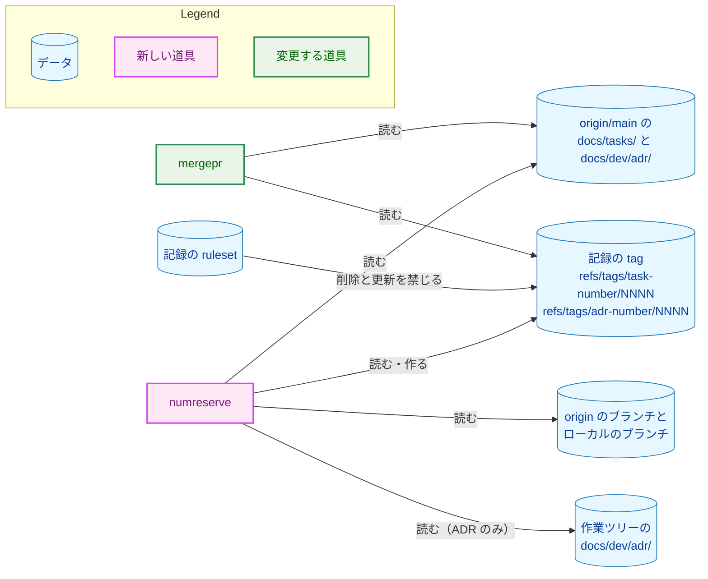
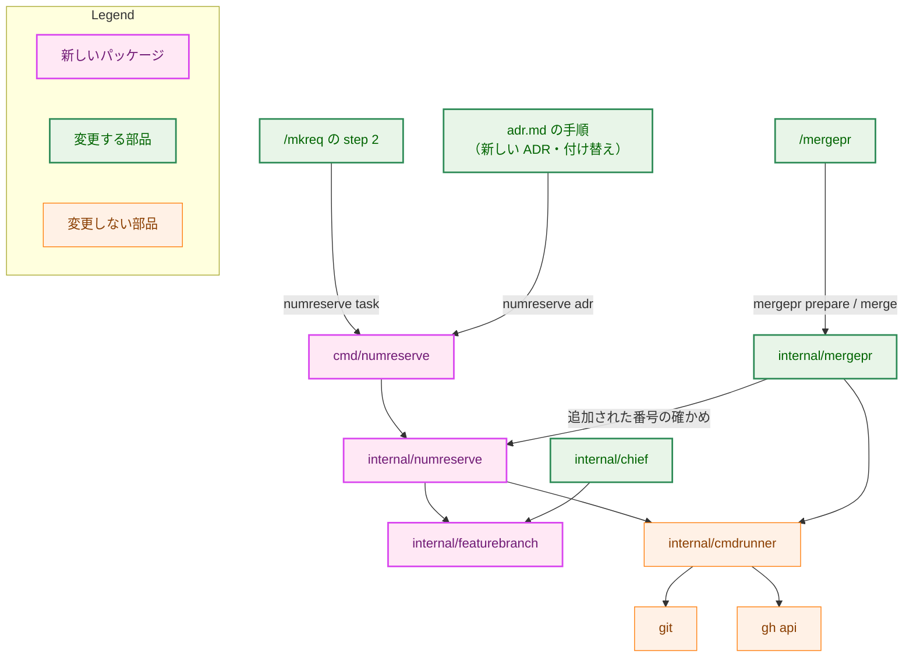
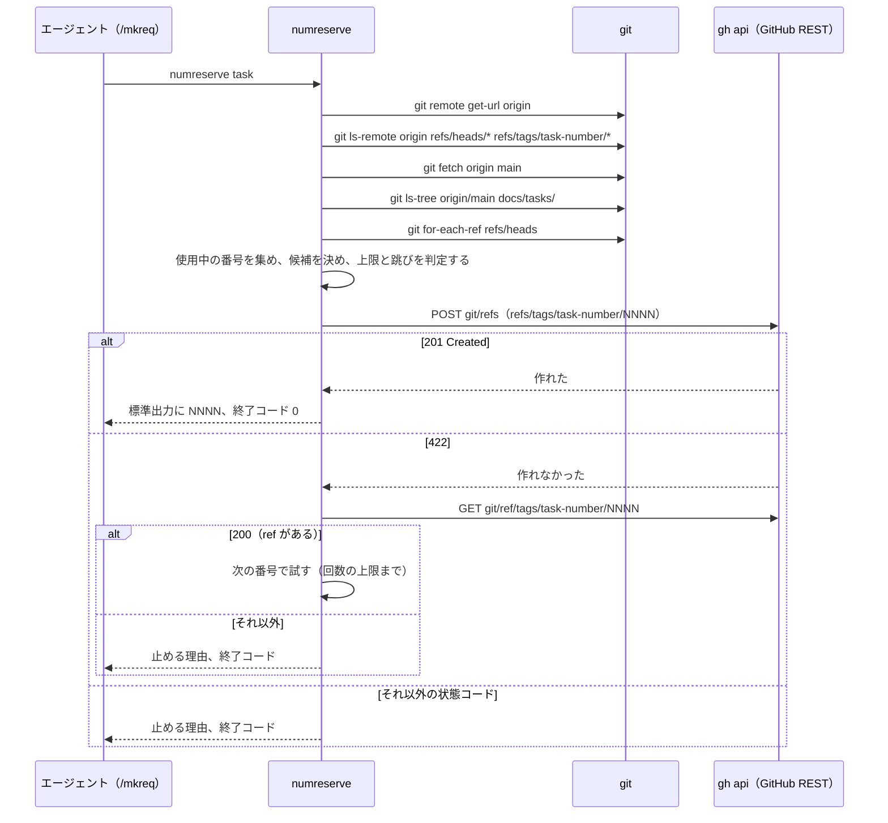
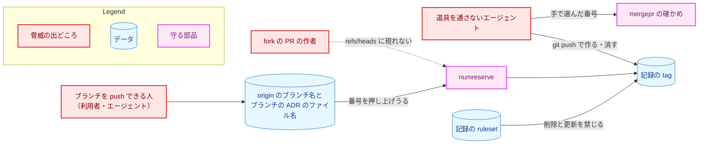
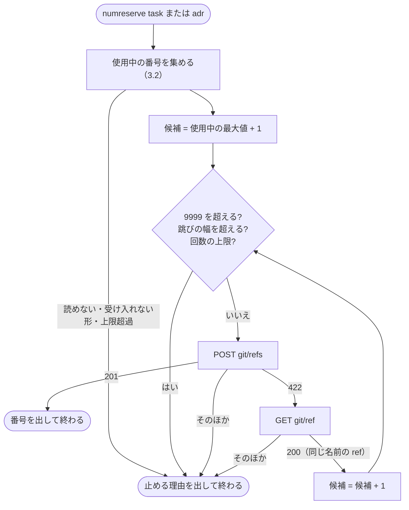
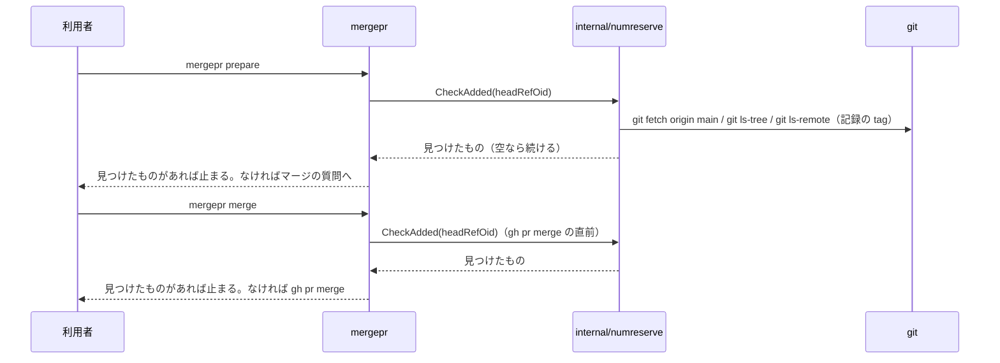

# アーキテクチャ設計書：タスク番号と ADR 番号が並行して重複しないようにする

## Document Status

| Item | Value |
|---|---|
| Status | `draft` |
| Created | 2026-11-17 |
| Review date | - |
| Reviewer | - |
| Comments | - |

本書は [01_requirements.md](01_requirements.md)（要件定義書。以下、要件書）の設計である。「計画で決める」は、本タスクの実装計画書（`03_implementation_plan.md`）で決めることを指す。既存のファイルの内容は、コミット `b48db108` で確かめた。`file:line` の行番号は、このコミットでの行番号である。F-NNN・AC-NN は要件書の項番を、H-NN は [design_handoff.md](design_handoff.md)（以下、申し送り）の項番を指す。申し送りへの対応は付録 A に、受け入れ基準との対応は付録 B にまとめる。

本書は、要件書 6 章の用語（番号の空間・番号を決める道具・番号の記録・欠番）を同じ意味で使う。そのほかに、次の用語を使う。

-   **`numreserve`:** 本書が加える番号を決める道具の名前。`cmd/numreserve` と `internal/numreserve` の組である（3.1）。
-   **記録の tag:** 番号の記録の実体。GitHub の `origin` に作る tag で、名前はタスク番号なら `refs/tags/task-number/NNNN`、ADR 番号なら `refs/tags/adr-number/NNNN` である（3.3）。
-   **記録の ruleset:** 記録の tag の削除と更新を禁じる、GitHub の tag の ruleset（3.3.3）。
-   **使用中の番号:** 番号の空間ごとに、道具が「すでに使われている」と数える番号の集まり（3.2）。
-   **基準の最大値:** `origin/main` にある番号と記録の tag の番号のうち、最大のもの。番号の跳びを判定する基準である（AC-09、3.4）。
-   **しきい値:** 記録の tag がなくてもマージの前の確かめで拒まない、番号の空間ごとの上限の番号（3.6）。
-   **止める理由:** 道具が番号を決めずに止まるときの理由の種類（AC-06、4.1）。

## 1. 設計の全体像 (Design Overview)

### 1.1. 設計原則

-   **一意性は GitHub の ref の作成が保証する。** 番号ごとに 1 つの tag を GitHub の REST で作り、作れた番号だけを返す。同じ名前の ref は GitHub の上で 2 つ作れないので、別のクローンや cloud のセッションの間でも、2 つのセッションが同じ番号を得ることはない（AC-01・AC-10、要件書 5 章）。ローカルのロックは使わない。
-   **判定は道具が行い、コマンドの文書には呼び出しの形だけを書く。** 使用中の番号の集め方、次の番号を試すか止めるかの判定、上限は、Go の道具 `numreserve` の中にあり、テストで壊して確かめる（[ADR-0014](../../dev/adr/0014-deterministic-checks-in-go.md)、要件書 4.5）。エージェントは、道具が標準出力に出した 4 桁の番号だけを使う（AC-05）。
-   **分からなければ止める。** 「その番号の ref がすでにある」と GitHub から読み直して確かめた失敗だけを、次の番号を試す理由にする。そのほかの失敗、受け入れない形の入力、上限の超過は、すべて止める理由にする。従来の計算には戻らない（要件書 4.2、[ADR-0051](../../dev/adr/0051-number-reservation.md)）。
-   **記録は消させない。** 記録の tag は、記録の ruleset でサーバ側から削除と更新を禁じる。`CLAUDE.md` の規則（AC-21）は、ruleset がまだ設定されていない間と、ruleset を迂回できる人の操作に対する守りである。
-   **最後の守りをマージの前に置く。** 古い `mkreq.md` や `adr.md` で手で選んだ番号は、番号を決める側では見つけられない。`mergepr` が、マージの直前に最新の `origin/main` と記録の tag を読んで確かめる（F-007）。
-   **既存の部品を使う。** 外部のコマンドの実行は `internal/cmdrunner` を使う。feature branch の形は、`chief` の判定（`internal/chief/task.go:739`）を共有の部品に移して両方で使う（3.7）。

### 1.2. 設計の際に決めたこと（2026-11-17）

-   **方式は案 A（番号ごとの ref の予約）とし、ref は `gh api` で GitHub の REST（`POST /repos/{owner}/{repo}/git/refs`）を呼んで作る。作成が HTTP 422 で失敗したら、その名前の ref を `GET /repos/{owner}/{repo}/git/ref/{ref}` で読み直し、あれば次の番号を試し、なければ止める（申し送りの H-02・H-04）。** 案 B（タスク番号を issue 番号にする）は、同じ issue に 2 つの `/mkreq` を走らせると同じ番号になり（AC-01 に反する）、中断した issue からはタスクを作れなくなり（AC-03 との兼ね合い）、ADR 番号には使えないので仕組みが 2 つになる。案 D（再確認）は、2 つのセッションが同時に確かめると重複が残る。`git push` で tag を作る案は、同じ SHA を指す同じ名前の tag の 2 回目の push も終了コード 0 で終わる（申し送りの H-04）ので、成功を終了コードで判定できない。REST なら、作れたかどうかを HTTP の状態コードという宣言された値で判定できる。ADR: [ADR-0051](../../dev/adr/0051-number-reservation.md) を更新する（方式は ADR-0051 が「0100 の設計で決める」としていたため）。
-   **記録は tag の名前空間 `refs/tags/task-number/NNNN` と `refs/tags/adr-number/NNNN` に置き、記録の ruleset（対象 `refs/tags/task-number/*` と `refs/tags/adr-number/*`、規則は削除と更新の禁止、迂回できる人なし）を利用者が設定する（申し送りの H-01）。** 2026-11-17 に `gh api repos/{owner}/{repo}/rulesets` で読み取って確かめた。今ある ruleset は、ブランチを対象にする 2 つだけである。1 つは `main` を除くすべてのブランチの作成と更新を禁じ、管理者の役割だけが迂回できる（ID 26400325）。もう 1 つは `main` の削除・非 fast-forward を禁じ、PR を要する（ID 24096227）。tag を対象にする ruleset はなく、tag は 1 つもない。したがって、記録の tag の作成を今の ruleset は拒まない。ruleset で記録の削除を禁じられるのは tag とブランチの名前空間だけであり、独自の名前空間（`refs/number-reservations/...`）は ruleset で守れない。ブランチの名前空間は、`chief` と `/mkreq` が読むブランチの一覧に混ざる。tag にすると、`git fetch` の tag の自動追従で記録の tag が各クローンに入る。これを受け入れる。ADR: [ADR-0051](../../dev/adr/0051-number-reservation.md) を更新する。
-   **マージの前の確かめは `mergepr` だけに置き、CI には置かない（申し送りの H-10）。** マージの方法は `/mergepr` による squash merge と決まっている（`.claude/commands/_context.md` の「PR merge method」）。`mergepr` はマージの直前に最新の `origin/main` を読めるので、PR を作った後に `main` に入った同じ番号も見つけられる（AC-28）。CI は PR の時点の `main` としか比べられず、記録の tag を読むネットワークの処理も CI に要る。`/mergepr` を通らない手のマージで漏れる危険は受け入れる。ADR の重複は、`main` で `TestADRRecords` が見つける。ADR: [ADR-0051](../../dev/adr/0051-number-reservation.md) を更新する。
-   **仕組みより前に作られた作業中の PR は、番号のしきい値で扱う（申し送りの H-08・H-10）。** 導入の時点で使用中のタスク番号と ADR 番号のそれぞれの最大値を、しきい値として道具に持たせる。しきい値以下の番号には、記録の確かめ（AC-27）をかけず、重複の確かめ（AC-28）だけをかける。道具が返す番号は、導入の後も使用中の番号の最大値より大きいので、ふつうはしきい値より大きい。導入の時点で最大の番号を持っていたブランチが、マージされずに消された場合に限り、しきい値以下の番号を返しうる。その番号にも記録の tag があるので、確かめは弱まらない。古いクローンが導入の後に「最大値 + 1」で計算した番号もしきい値より大きいので、記録がなければ AC-27 で見つかる。PR の作成日時で分ける案は、GitHub から読む値に判定を頼るうえ、導入の前に作った PR の中で導入の後に加えた番号を見逃す。使用中の番号の記録をまとめて作る案は、そのための経路が道具に要るので採らない。しきい値の値は計画で決める。ADR: [ADR-0051](../../dev/adr/0051-number-reservation.md) を更新する。
-   **道具は Go で書き、`cmd/numreserve` と `internal/numreserve` に置き、利用者が `make install-numreserve` で `main` から入れる（申し送りの H-03）。** [ADR-0014](../../dev/adr/0014-deterministic-checks-in-go.md) の方針どおりである。`_lib/` の bash のスクリプトにする案は、判定（使用中の番号の集め方、どの失敗で次を試すか、上限）をテストで壊して確かめられないので採らない。エージェントは道具を入れたりビルドしたりしない（`codexreview` と同じ）。ADR: [ADR-0014](../../dev/adr/0014-deterministic-checks-in-go.md) を更新する（道具の一覧とインストールの規則が ADR-0014 の決定にあるため）。
-   **上限と幅の値は 3.4 の表のとおりにする（申し送りの H-09）。** 2026-11-17 の `origin` には、ブランチが 15、ref が全体で 755（PR の ref を含む）あり、タスクは 100、ADR は 51 ある。値はこの規模から余裕を持たせて決めた。ADR: なし（値はこのタスクの中で閉じる。変えても ADR-0051 の決定は変わらない）。
-   **feature branch の形の判定を、`internal/chief` から共有のパッケージ `internal/featurebranch` に移し、`chief` と `numreserve` で使う。** 同じ形を 2 か所で別々に書くと、片方だけが変わりうる（CLAUDE.md の「DRY」）。`chief` の振る舞いは変えない（AC-04）。ADR: なし（部品の置き場所であり、このタスクの中で閉じる）。

### 1.3. なぜ今の仕組みでは足りないか

-   **タスク番号:** `/mkreq` の step 2 は、エージェントが「使用中の最大値 + 1」を計算する（`.claude/commands/mkreq.md:69-76`）。計算してからブランチを作るまでに排他がないので、2 つのセッションが同じ番号を得る。ブランチ名にはスラッグが入るので、ブランチの作成も重ならずに成功する（要件書 1 章）。番号を一度でも GitHub の上の 1 つの名前に結びつけなければ、AC-01 を満たせない。
-   **ADR 番号:** 規約は「`main` と、その PR のブランチにある最大の番号の次」とし（`docs/dev/conventions/adr.md` の「Location and naming」）、ほかの PR のブランチを見ない。#927 と #934 の重複はこれで起きた。ほかのブランチを見るようにしても、案 D と同じく同時の確かめで重複が残る。
-   **欠番:** `TestADRRecords` は欠番を誤りとする（`cmd/yt2column/adr_test.go:336-355` の `checkADRNumbers`）。番号を決めた順とマージの順が違うと、`main` に一時的な欠番ができ、すべての PR でこのテストが失敗する。欠番を許すように変える必要がある（F-003）。

### 1.4. 方式の比較

申し送りの H-02 のとおり、issue #917 の案 A〜D を比べた。

| 観点 | A：ref の予約（採る） | B：タスク番号を issue 番号にする | C：ローカルのロック | D：再確認 |
|---|---|---|---|---|
| 同じ時点から 2 つが決めても違う番号（AC-01・AC-10） | 満たす（GitHub の ref の作成が排他） | 同じ issue の 2 つの `/mkreq` で重複する | 別のクローンの間で重複する | 同時に確かめると重複する |
| 中断した番号を使い回さない（AC-03） | 記録の tag が残る | 満たすが、その issue からはタスクを作れなくなる | ロックは残らない | 記録がない |
| ADR 番号にも使える（F-002） | 使える（名前空間を分ける） | 使えない（ADR は issue に結びつかない） | 使える | 使える |
| cloud のセッション（F-005） | GitHub の REST に届けば動く（AC-22 で確かめる） | 動く | 動かない | 動くが重複が残る |
| 仕組みの数 | 1 つ（空間ごとに名前空間だけ違う） | タスクと ADR で 2 つ | 1 つ | 1 つ |

案 A だけが、AC-01〜AC-15 を 1 つの仕組みで満たす。採らなかった案と理由は ADR-0051 の「採らなかった案」に書く（AC-25）。

### 1.5. 概念モデル

矢印 A → B は「A が B を読む、または作る」を表す。



番号の空間は 2 つあり（タスク番号と ADR 番号）、互いに影響しない（AC-15）。それぞれの空間で、使用中の番号は次の和集合である（3.2）。

-   タスク番号：`origin/main` の `docs/tasks/` の番号、ローカルと `origin` のブランチ名の番号、記録の tag `task-number/*` の番号。
-   ADR 番号：`origin/main` の `docs/dev/adr/` の番号、`HEAD` と作業ツリーの `docs/dev/adr/` の番号、`origin` の各ブランチの `docs/dev/adr/` の番号、記録の tag `adr-number/*` の番号。

## 2. システム構成 (System Structure)

### 2.1. 全体構成

矢印 A → B は「A が B を呼ぶ」を表す。



### 2.2. コンポーネント配置

| ファイル・パッケージ | 新規・変更 | 責務 |
|---|---|---|
| `cmd/numreserve` | 新規 | 引数を読み、`internal/numreserve` を呼び、番号か止める理由を出して終了コードを返す（3.1） |
| `internal/numreserve` | 新規 | 使用中の番号の収集、次の番号の決定、記録の tag の作成と読み直し、上限と止める理由、マージの前の確かめ（3.2〜3.6） |
| `internal/featurebranch` | 新規 | feature branch の名前の形の判定と、名前からタスク番号とスラッグを取り出すこと（3.7） |
| `internal/chief/task.go` | 変更 | `featureBranch` の正規表現と `branchTask` の判定を `internal/featurebranch` の呼び出しに置き換える。振る舞いは変えない |
| `internal/mergepr` | 変更 | `prepare` と `merge` で、PR が加える番号を `internal/numreserve` で確かめる（3.5） |
| `cmd/mergepr` | 変更 | 新しい止める理由の終了の扱い（4.1） |
| `cmd/yt2column/adr_test.go` | 変更 | `checkADRNumbers` から欠番の判定（`adrMissingNumber`）を除き、重複の判定を残す（F-003） |
| `Makefile` | 変更 | `install-numreserve` を加える |
| `.claude/settings.json` | 変更 | `permissions.allow` に `Bash(numreserve task)` と `Bash(numreserve adr)` を加える |
| `.claude/commands/mkreq.md` | 変更 | step 2 の番号の計算を `numreserve task` の呼び出しに置き換え、Authorization に加える（AC-05・AC-20） |
| `.claude/commands/mergepr.md` | 変更 | 番号の確かめで止まったときの報告を加える |
| `.claude/commands/_lib/settle-decisions.md` | 変更 | ADR を作るときは、規約の「Location and naming」の手順で番号を決めると明記する（AC-12） |
| `docs/dev/conventions/adr.md` | 変更 | AC-18 の 4 つの差分（3.9） |
| `CLAUDE.md` | 変更 | 「Tool Execution Safety」の常設の承認と記録の書き換えの例外（AC-19・AC-21）、「Build Commands」の `make install-numreserve`、Quick Links の手引き |
| `docs/dev/guides/numreserve_guide.md` | 新規 | 道具の手引き（AC-26）。日本語 |
| `docs/dev/guides/mergepr_guide.md` | 変更 | 番号の確かめと止まったときの対処 |
| `docs/dev/conventions/package_reference.md` | 変更 | `internal/numreserve` と `internal/featurebranch` の行 |
| `docs/dev/adr/0051-number-reservation.md` | 変更 | 方式・名前空間・確かめの場所・しきい値を決定に加える（AC-24・AC-25） |
| `docs/dev/adr/0014-deterministic-checks-in-go.md` | 変更 | 道具の一覧とインストールの規則に `numreserve` を加える |

### 2.3. データフロー

`/mkreq` がタスク番号を決めるときの流れを示す。ADR 番号も、読む一覧が違うだけで同じ流れである。



## 3. コンポーネント設計 (Component Design)

### 3.1. 道具 `numreserve` の呼び出しと出力

呼び出しの形は、次の 2 つだけである。引数は番号の空間を選ぶ 1 語で、ほかの引数とフラグは受け付けない。

```text
numreserve task
numreserve adr
```

-   リポジトリの中（作業ツリーのどこか）で実行する。`adr` は、番号を決める PR のブランチの作業ツリーで実行する。
-   番号を決めたときは、標準出力に 4 桁の番号を 1 行だけ出し、終了コード 0 で終わる。
-   止まったときは、標準出力に何も出さず、標準エラーに 1 行の止める理由（`numreserve: stop <理由>: <詳細>`）を出し、理由ごとの終了コードで終わる（4.1）。詳細には、番号の跳びを起こしたブランチの名前やファイルの名前など、利用者が原因を探すための値を出す。GitHub の応答の本文と、`gh` の認証の情報は出さない。
-   コマンドの文書が読む契約は、呼び出しの形、標準出力の 1 行、終了コードである（ADR-0014 の「道具の引数・出力・終了コード」）。標準エラーの文言は利用者が読むためのものであり、コマンドの文書は読まない。

道具は、`--protocol` の番号を持たない。呼び出しの形が 2 つだけで、引数を変えるときは道具と文書を同じ PR で変える（ADR-0014）。

### 3.2. 使用中の番号の集め方

道具は、番号の空間ごとに、次の入力から番号を集める。読む順は 2.3 のとおりで、どれか 1 つでも読めなければ止まる。

| 入力 | 取り方 | タスク番号の空間 | ADR 番号の空間 | 受け入れない形のとき |
|---|---|---|---|---|
| `origin` の URL | `git remote get-url origin` | 使う | 使う | `https://github.com/<owner>/<repo>(.git)?` と `git@github.com:<owner>/<repo>(.git)?` のどちらでもなければ止める（malformed） |
| `origin` のブランチと記録の tag | `git ls-remote origin 'refs/heads/*' 'refs/tags/<空間>-number/*'` | 使う | 使う | 1 行が `<40 桁の 16 進>\t<ref>` でなければ止める。記録の tag の名前空間の下に 4 桁の数字だけでない名前があれば止める（malformed） |
| `origin/main` の一覧 | `git fetch origin main` の後、`git ls-tree origin/main docs/tasks/` または `docs/dev/adr/` | `docs/tasks/` の下 | `docs/dev/adr/` の下 | 3.2.1 |
| ローカルのブランチ | `git for-each-ref refs/heads` | 使う | 使わない | 形に合わない名前は数えない（拒否しない） |
| `origin` の各ブランチの ADR | `git fetch origin` で `ls-remote` のブランチを取得した後、各ブランチの `git ls-tree <sha> docs/dev/adr/` | 使わない | 使う | 形に合わない名前は数えない（拒否しない） |
| 作業中のブランチの ADR | `git ls-tree HEAD docs/dev/adr/` と、作業ツリーの `docs/dev/adr/` のディレクトリの一覧 | 使わない | 使う | 形に合わない名前は数えない（拒否しない） |

-   **ブランチ名からの番号:** feature branch の形（`internal/featurebranch`、3.7）に合う名前だけからタスク番号を読む。`origin` のブランチは `git ls-remote` が返すものだけであり、fork からの PR のヘッドは `origin` の `refs/heads/` に現れないので数えない（AC-02・AC-11）。PR の一覧は読まない。このリポジトリの中にヘッドがある PR のヘッドブランチは、`origin` のブランチに含まれる。
-   **ADR を読むブランチ:** `git ls-remote` が返した `origin` のすべてのブランチである（feature branch の形に限らない）。`main` もここに含まれる。
-   **`git fetch` の書き込み:** 道具は `git fetch` でローカルのリポジトリにオブジェクトと remote-tracking の ref を書く。これは `/mkreq` が step 1 で行う `git fetch origin` と同じ種類の書き込みである。作業ツリーとローカルのブランチは変えない。

#### 3.2.1. `origin/main` の一覧の形

要件書 4.2 のとおり、`origin/main` のディレクトリの一覧は拒否の対象である。

-   `docs/tasks/` の下：ディレクトリ（tree）で、名前が `NNNN_<name>`（`internal/chief/task.go:742` の `taskDirName` と同じ形）のものから番号を読む。ディレクトリでない項目と、この形でないディレクトリがあれば止める（malformed）。`0000_template` はこの形に合うので番号 `0000` として数える。番号の最大値に影響しないので、扱いを分けない。2026-11-17 の `origin/main` では、`docs/tasks/` の 100 項目はすべてディレクトリで、この形に合う。
-   `docs/dev/adr/` の下：`README.md` を除き、ファイル（blob）で名前が `NNNN-<kebab>.md` のものから番号を読む。それ以外の項目があれば止める（malformed）。`TestADRRecords` が `main` でこの形を保っている。

### 3.3. 記録の tag

#### 3.3.1. 作り方

道具は、候補の番号 `NNNN` について次を呼ぶ。`<owner>/<repo>` は `origin` の URL から読んだ値、`<sha>` は `git ls-remote` が返した `refs/heads/main` の SHA である。

```text
gh api -i -X POST repos/<owner>/<repo>/git/refs -f ref=refs/tags/<空間>-number/NNNN -f sha=<sha>
gh api -i repos/<owner>/<repo>/git/ref/tags/<空間>-number/NNNN
```

-   `-i` を付けると、`gh api` は失敗したときも標準出力の先頭に HTTP の状態行を出す。2026-11-17 に、`gh` 2.96.0 で存在しない ref を読み、終了コード 1 と、標準出力の先頭の `HTTP/2.0 404 Not Found` を確かめた。道具は、状態行の状態コードだけで成否を判定し、応答の本文の `message` の文は読まない（CLAUDE.md の「Declare, don't infer」）。
-   tag は軽量の tag で、決めたときの `origin/main` の commit を指す。tag の中身（指す commit）は判定に使わない。番号の判定には名前だけを使う（申し送りの H-06）。
-   どのタスクや PR のために決めたかを tag に持たせない。番号はブランチ名とディレクトリ名に現れるので、残っているブランチや PR から辿れる。注釈付きの tag にすると、tag のオブジェクトと ref の 2 回の作成が要り、途中で失敗したときの扱いが増える。

#### 3.3.2. 作成の結果の判定

| `POST` の状態コード | 判定 |
|---|---|
| 201 | 番号が決まった。番号を出して終わる |
| 422 | `GET` で同じ名前の ref を読み直す。200 なら「すでに使われている」と確かめたので次の番号へ進む。404 を含むそれ以外なら、ruleset による拒否などの、使用中と確かめられない失敗なので止める（network-or-github） |
| 401・403・404 | 止める（permission）。404 は、リポジトリが見えない権限の不足として GitHub が返すためである |
| そのほか（5xx、状態行がない、`gh` が起動しない、時間切れ） | 止める（network-or-github） |

`GET` が 200 を返したときも、返された `ref` の名前が問い合わせた名前と一致することを確かめる。一致しなければ止める（malformed）。

#### 3.3.3. 記録の ruleset

利用者が、導入のときに GitHub で次の tag の ruleset を設定する。設定の手順は手引きに書く（AC-26）。

-   対象：`refs/tags/task-number/*` と `refs/tags/adr-number/*`
-   規則：削除の禁止（deletion）と、更新の禁止（update）。作成は禁じない
-   迂回できる人：なし（管理者も迂回しない）

道具は ruleset の有無を確かめない。ruleset はリポジトリの外の設定であり、道具が読んでも利用者が変えられるためである。ruleset がない間の守りは、`CLAUDE.md` の規則（AC-21）だけになる。導入のときに ruleset が効くことの確かめ方は、計画で決める。

### 3.4. 候補の番号と上限

-   **最初の候補:** 使用中の番号の最大値 + 1。
-   **次の候補:** 3.3.2 で「すでに使われている」と確かめたとき、その番号 + 1。使用中の番号の一覧は読み直さない。
-   **4 桁の上限:** 候補が 9999 を超えたら止める（exhausted、AC-08）。
-   **跳び:** 候補が「基準の最大値 + 跳びの幅」を超えたら止める（jump、AC-09）。詳細には、基準の最大値より大きい番号を持つ入力（ブランチの名前、ADR のファイルのパスとそのブランチ）をすべて出す。基準の最大値は、`origin/main` の番号と記録の tag の番号の最大値であり、ブランチと作業ツリーの番号を含まない。
-   **回数の上限:** `POST` を試す回数が上限に達したら止める（attempts、AC-07）。

| 値 | 決めた値 | 理由 |
|---|---|---|
| 跳びの幅 | 20 | 並行して作業中のタスクや ADR は多くても数件であり、記録のないブランチがあっても基準の最大値から 20 は離れない。迷い込んだ 1 本のブランチ（例：`0999-...`）は確実にこれを超える |
| `POST` の回数の上限 | 10 | 同時に番号を決めるセッションは多くても数個であり、1 回の実行で 10 回続けて先を越されることはない |
| 外部のコマンド 1 つの時間の上限 | 60 秒 | `git fetch origin` が最も遅い。今の規模では数秒で終わる |
| 外部のコマンドの出力の上限 | 4 MiB | 2026-11-17 の `origin` の ref は全体で 755、ブランチは 15 である。`refs/heads/*` と記録の tag に絞った `git ls-remote` の出力は、1 行がおよそ 100 バイトなので、数万の ref まで収まる |
| ブランチの数の上限 | 500 | ADR の空間では、ブランチごとに `git ls-tree` を 1 回呼ぶ。15 の 30 倍の余裕を見た |

-   **一覧の上限の超過:** `git ls-remote` はページに分かれない。出力が上限を超えたら（`cmdrunner.ErrOutputTooLarge`）、またはブランチの数が上限を超えたら、止める（list-limit）。読めた分だけで番号を決めない。
-   **所要時間:** 番号を決める `/mkreq` の 1 回の実行で、道具を 1 回呼ぶ（要件書 4.1）。所要時間の上限は、外部のコマンドの時間の上限と回数から決まり、ADR の空間で最も長い（`git fetch` と、ブランチごとの `git ls-tree` と、最大 10 回の `POST`・`GET`）。

### 3.5. マージの前の確かめ（`mergepr`）

`mergepr` は、`prepare` と `merge` の両方で、PR が加える番号を確かめる。`prepare` で確かめるのは、マージの質問の前に止まるためである。`merge` で確かめるのは、`prepare` の後に `main` に入った番号を見つけるためで、`gh pr merge` の直前に行う。

-   **PR が加える番号:** PR のヘッド（`prepare` が記録した `headRefOid`）の `docs/tasks/` にあり、最新の `origin/main` の `docs/tasks/` にないディレクトリの番号と、PR のヘッドの `docs/dev/adr/` にあり、最新の `origin/main` にないファイルの番号である。名前の形は 3.2.1 と同じで、形に合わない名前は数えない（`TestADRRecords` が見つける）。
-   **記録の確かめ（AC-27）:** PR が加える番号がしきい値（3.6）より大きく、記録の tag がなければ、番号と理由を示して止まる。
-   **重複の確かめ（AC-28）:** PR が加える番号を、最新の `origin/main` の別のディレクトリまたは別のファイルが使っていれば、番号と、使っているディレクトリまたはファイルを示して止まる。「別の」は名前が違うことで判定する。
-   **対象（AC-29）:** PR が加える番号だけを確かめる。`origin/main` にすでにある番号では失敗しない。
-   **読むもの:** `git fetch origin main` の後の `origin/main` と、`git ls-remote origin 'refs/tags/task-number/*' 'refs/tags/adr-number/*'` である。どちらかが読めないか、受け入れない形なら、マージせずに止まる（安全側に倒す）。
-   **共有:** 記録の tag の読み方、名前の形、しきい値は `internal/numreserve` にあり、`mergepr` はそれを呼ぶ。同じ判定を `mergepr` に書き直さない。

### 3.6. しきい値

-   しきい値は、番号の空間ごとの定数として `internal/numreserve` に置く。値は、記録の確かめを入れる PR の実装のときに、その時点の使用中の番号（`origin/main` とすべての `origin` のブランチ）の最大値にする。値の決め方と順序は計画で決める（申し送りの H-08）。
-   しきい値は、番号を決める判定（3.4）には使わない。番号を決めるときは、記録のない番号も使用中として数えるので、しきい値に頼らずに既存の番号を避ける。

### 3.7. feature branch の形の共有（`internal/featurebranch`）

`chief` の `featureBranch`（`internal/chief/task.go:739`）は、`_context.md` の「Feature branch name」の形を正規表現で持つ。`numreserve` も同じ形でブランチ名からタスク番号を読む。この判定を `internal/featurebranch` に移し、両方から呼ぶ。`chief` の `branchTask` は、その結果を `paneinput.TaskID` に変える部分だけを残す。

### 3.8. 型（高レベルのインタフェース）

```go
// Package numreserve decides a collision-free task or ADR number by creating
// a record tag on GitHub, and checks the numbers a PR adds before a merge.
package numreserve

// Space is a number space. Its zero value is invalid, so a caller must choose.
type Space int

const (
	spaceInvalid Space = iota
	SpaceTask          // refs/tags/task-number/NNNN, docs/tasks/NNNN_<name>
	SpaceADR           // refs/tags/adr-number/NNNN, docs/dev/adr/NNNN-<kebab>.md
)

// Number is a validated four-digit number, 0001 to 9999.
type Number struct{ n int }

// StopKind is the declared reason the tool stopped without a number.
type StopKind int

const (
	stopInvalid StopKind = iota
	StopPermission
	StopNetworkOrGitHub
	StopAttempts
	StopExhausted
	StopJump
	StopListLimit
	StopMalformed
	StopLocalGit
)

// StopError carries the kind and the values a user needs to find the cause
// (branch names, file paths). It never carries a response body or a token.
type StopError struct {
	Kind   StopKind
	Detail string
}

// Reserve decides a number in space and creates its record tag.
func (t *Tool) Reserve(ctx context.Context, space Space) (Number, error)

// AddedNumberIssue is one finding of the pre-merge check.
type AddedNumberIssue struct {
	Space  Space
	Number Number
	Kind   AddedIssueKind // unreserved (AC-27) or in use on main (AC-28)
	Path   string         // the PR's directory or file
	UsedBy string         // the directory or file on origin/main (AC-28 only)
}

// CheckAdded returns the issues of the numbers the commit head adds over the
// freshly fetched origin/main. An empty result means the merge may go on.
func (t *Tool) CheckAdded(ctx context.Context, head string) ([]AddedNumberIssue, error)
```

```go
// Package featurebranch parses the feature branch name of _context.md.
package featurebranch

// Parse returns the task number and the slug of a feature branch name, and
// false for any other name.
func Parse(name string) (number int, slug string, ok bool)
```

`Tool` は `internal/cmdrunner.Runner` を受け取って作り、テストでは fake の Runner に差し替える。

### 3.9. 文書と設定の変更

-   **`mkreq.md` の step 2:** 「`NNNN` is one above the highest task number in use ...」を、`numreserve task` を実行し、標準出力の 4 桁の番号を `NNNN` に使うことに置き換える。道具が止まったとき（`numreserve` がない場合を含む）は、ブランチもディレクトリも作らずに止まり、標準エラーの 1 行と手引きの節を示す（AC-06）。Authorization に `numreserve task` を加える（AC-20）。`[task]` の経路と、止まった simple process の続きの経路は道具を呼ばない（要件書 2.3）。
-   **`adr.md`:** AC-18 の 4 つの差分だけを変える。
    -   「Location and naming」の Number：「`0001` から欠番なしで続く」と「main と PR のブランチの最大の次」を除き、新しい ADR の番号は PR のブランチの作業ツリーで `numreserve adr` を実行して決めること、コマンドが作る PR にも手で作る PR にも当てはまること、道具が止まったら推測した番号でファイルを作らないこと、を書く。番号を使い回さない規則は残す。
    -   「Taking in `main`」の手順 2：「the next free number」を、`numreserve adr` が返す番号に置き換える。
    -   「When `TestADRRecords` fails on `main`」：欠番を失敗の原因から除き、付け替えの番号を `numreserve adr` で決める。重複の記述は残す。
    -   「Index」：「A new row goes at the end of the table」を、番号の順の位置に入れる規則に置き換える。
-   **`_lib/settle-decisions.md`:** ADR を作る段の「as the ADR convention ... says」に、番号は規約の「Location and naming」の手順で決めることを明記する（AC-12）。
-   **`CLAUDE.md` の「Tool Execution Safety」:** 2 項目を加える（AC-19・AC-21）。
    -   `numreserve task` と `numreserve adr` は、その形で呼ぶ限り承認なしで実行してよい。道具は `origin` に記録の tag を 1 つ作る（ネットワークへの書き込み）。エージェントは道具を入れたりビルドしたりしない。
    -   記録の tag（`refs/tags/task-number/*` と `refs/tags/adr-number/*`）を、道具を介さずに作る・変える・消すこと（`git push` と `gh api` によるものを含む）は、利用者の承認を要る。`git push` を承認なしで認める規則の例外である。
-   **`.claude/settings.json`:** `Bash(numreserve task)` と `Bash(numreserve adr)` を許可に加える。ほかの形は許可しない。
-   **手引き `docs/dev/guides/numreserve_guide.md`（AC-26）:** インストール、呼び出しの形、止める理由ごとの意味と次にすること（4.1 の表）、記録の ruleset の設定、cloud のセッションでの制約（AC-22 の結果）、番号の跳びや受け入れない形のデータで止まったときに原因のブランチやファイルを誰がどう片付けるか、マージの前の確かめで止まったときの直し方。置き場所は、ほかの道具の手引きと同じ `docs/dev/guides/` にする。
-   **ADR-0051:** 「決定」の「番号を一意にする方式は … 0100 の設計で決めてこの ADR に書く」を、本書の 1.2 の決定（REST による tag の作成、記録の ruleset、`mergepr` での確かめ、しきい値）に置き換える。食い違いの記述に、まだない道具・ruleset・`mergepr` の確かめを挙げる（AC-24）。「採らなかった案」に B・D・`git push`・独自の名前空間・ブランチの名前空間・CI での確かめ・PR の作成日時・記録をまとめて作る案を加える（AC-25）。「結果」に、記録の tag が各クローンに入ることを加える。
-   **ADR-0014:** 「決定」の道具の一覧とインストールの規則に `numreserve` を加え、まだないことを食い違いの記述として書く。

### 3.10. 既存のテストと既存の読み手への影響

-   `cmd/yt2column/adr_test.go` の `TestCheckADRRecords` の「missing number」の行（`adr_test.go:666` 付近の `want: []adrIssueKind{adrMissingNumber}`）は、欠番を誤りとする振る舞いを確かめている。F-003 で、欠番があっても issue を返さないことを確かめる行に変える。重複の行（`adr_test.go:653`・`676`）はそのまま残す。
-   `internal/chief` の `branchTask` のテストは、`internal/featurebranch` に移した後も同じ入力で同じ結果になることを確かめる。`chief` が読む規則は変わらない（AC-04）。
-   `internal/mergepr` の `prepare` と `merge` のテストは、番号の確かめの呼び出しが加わるので、fake の Runner に `git ls-remote` と `git ls-tree` の応答を足す必要がある。
-   `chief` と `/mkreq` の step 1 は、ブランチの一覧（`refs/heads`・`refs/remotes/origin`）だけを読む（`mkreq.md:54`、`internal/chief/task.go:739`）。記録の tag は `refs/tags/` にあるので、どちらの読み手にも混ざらない。

## 4. エラーハンドリング設計 (Error Handling Design)

### 4.1. 止める理由

| 理由（標準エラーの `<理由>`） | 終了コード | 要件書 AC-06 の種類 | 起きるとき | 次にすること（手引きに書く） |
|---|---|---|---|---|
| `usage` | 2 | -（呼び出しの誤り） | 引数が `task`・`adr` の 1 語でない | コマンドの文書の呼び出しの形を確かめる |
| `permission` | 3 | 権限がない | `POST` が 401・403・404 | `gh auth status` で認証と権限を確かめる。cloud のセッションでは手引きの制約を読む |
| `network-or-github` | 4 | ネットワークまたは GitHub の失敗 | 時間切れ、`gh`・`git` のネットワークの失敗、5xx、422 の後に ref を読めない（ruleset による拒否を含む） | 時間をおいて再実行する。続くときは GitHub の状態と ruleset を確かめる |
| `attempts` | 5 | 試す回数の上限に達した | `POST` を 10 回試して、どれも先を越された | 再実行する |
| `exhausted` | 6 | 4 桁の番号が残っていない | 候補が 9999 を超えた | 利用者が番号の形を見直す（このタスクの範囲外） |
| `jump` | 7 | 番号が不自然に跳んだ | 候補が基準の最大値 + 20 を超えた | 詳細に出たブランチやファイルを利用者が確かめ、迷い込んだものなら持ち主が消すか名前を直す |
| `list-limit` | 8 | 一覧が上限を超えた | 出力が 4 MiB を超えた、ブランチが 500 を超えた | 使わないブランチを片付ける。上限を変えるなら道具を変える |
| `malformed` | 9 | 受け入れない形のデータ | 3.2・3.2.1・3.3.2 の受け入れない形 | 詳細に出た名前を利用者が確かめ、直す |
| `local-git` | 10 | -（AC-06 の「少なくとも」に加える） | ローカルの git が失敗した（リポジトリの外で実行した、など） | リポジトリの中で実行し直す |

-   止まったとき、道具は番号を出さない。記録の tag を作った後に止まることはない（作れたら直ちに番号を出して終わる）。
-   `/mkreq` と `adr.md` の手順は、終了コード 0 以外をすべて「番号を決められなかった」として扱い、標準エラーの 1 行と手引きの節を利用者に示して止まる。終了コードごとに手順を分けない。理由の種類と次にすることは手引きにある。
-   `numreserve` が見つからない（入っていない）ときも、同じく止まる。手引きにインストールの節を書く。

### 4.2. `mergepr` の止まり方

`mergepr` は、番号の確かめで見つけたものを 1 件 1 行で示し、マージせずに止まる。読めなかったとき（4.1 の理由のどれか）も、理由を示して止まる。新しい終了の扱いは `cmd/mergepr` に加え、`mergepr_guide.md` の「止まったときの対処」に、直し方（ADR なら `numreserve adr` で付け替える、タスクなら番号を決め直してディレクトリを付け替える）を書く。

## 5. セキュリティ考慮事項 (Security Considerations)

### 5.1. 製品

N/A（要件書 4.2。製品のコードと拡張に触れない）。

### 5.2. 開発の道具の信頼の境界

矢印 A → B は「A が B に影響を与えうる」を表す。



| 脅威 | 守り |
|---|---|
| fork の PR のブランチ名で番号を押し上げ、4 桁の範囲を使い切らせる | `origin` の `refs/heads/` だけを読み、PR の一覧は読まない。fork のヘッドは現れない（AC-02・AC-11） |
| 迷い込んだブランチや打ち間違えたファイル名で番号が黙って跳び、記録に残る | 跳びの判定（3.4）で、記録を作る前に止める（AC-09） |
| 受け入れない形の ref・一覧を読み飛ばして、使用中の番号を見落とす | 3.2 の表の拒否（要件書 4.2） |
| 記録の tag を消して番号を使い回す、または道具が止まった後に手で記録を作る | 記録の ruleset が削除と更新を禁じる。作成は `CLAUDE.md` の規則が承認を求める（AC-21）。手で作った番号の使用は、ほかのセッションの番号と重なればマージの前の確かめで見つかる |
| 道具を通さずに手で番号を選ぶ（古いクローン、古い `adr.md`） | マージの前の確かめ（3.5） |
| `gh` の認証の情報の漏れ | 道具は認証の情報を読まず、`gh` に任せる。応答の本文と `gh` の標準エラーを出力に出さない（要件書 4.2） |

**副作用の範囲:** `numreserve` がネットワークに書き込むのは、1 回の実行で記録の tag 1 つだけである（作れた 1 つ。422 で先を越された試みは何も書かない）。ローカルには、`git fetch` によるオブジェクトと remote-tracking の ref を書く。作業ツリー、ローカルのブランチ、ローカルの tag は変えない。`mergepr` の確かめは読むだけで、何も書かない。

**残る危険:**

-   記録の ruleset を設定する前は、記録の tag をエージェントが `git push --delete` で消せる。守りは `CLAUDE.md` の規則だけになる。導入の手順で、ruleset を早く設定する（計画で決める）。
-   `/mergepr` を通らない手のマージは、マージの前の確かめを通らない（1.2）。

## 6. 処理フロー詳細 (Processing Flow Details)

### 6.1. 番号を決める



### 6.2. マージの前の確かめ



## 7. テスト戦略 (Test Strategy)

### 7.1. ユニットテスト

`internal/numreserve` は、`internal/cmdrunner` の fake の Runner で `git` と `gh` の応答を差し替え、GitHub を呼ばずに確かめる（要件書 4.5）。

-   使用中の番号の集め方：各入力（3.2 の表）が、それぞれ単独で最大値を決める入力で、その入力が番号を押し上げることを確かめる。ほかの入力だけでは同じ結果にならないように作る（CLAUDE.md の「A layered path needs inputs only one layer can handle」）。
-   fork の除外：`refs/heads/` に現れない名前は数えないことは構成で決まるので、PR の一覧を読まないこと（Runner に `gh pr list` の呼び出しがないこと）を確かめる。
-   作成の判定：201、422 の後の `GET` 200（次へ進む）、422 の後の `GET` 404（止める）、401・403・404、5xx、状態行のない出力、時間切れ。
-   上限：9999、跳び（詳細に原因の名前が出ること）、回数、出力の上限、ブランチの数。
-   受け入れない形：`origin` の URL、`ls-remote` の行、記録の tag の名前、`origin/main` の一覧。
-   空間の独立（AC-15）：ADR の記録の tag があっても、タスク番号の候補が変わらないこと。逆も同じ。
-   マージの前の確かめ：加えた番号に記録がない（しきい値の上と下）、`origin/main` の別のものが使っている、`origin/main` にすでにある番号は対象にしない。
-   出力：止まったときに標準出力が空であること、標準エラーに応答の本文を出さないこと。

### 7.2. 結合テストと文書のガード

-   `cmd/numreserve` のテストで、終了コードと標準出力・標準エラーの形を確かめる。
-   `TestCheckADRRecords` を、欠番で失敗しないこと（AC-16）と、重複で失敗すること（AC-17）を確かめる形に変える。
-   文書のガード：`CLAUDE.md` の「Tool Execution Safety」・`mkreq.md`・`adr.md` に書く呼び出しの形が、道具の受け付ける形（`task`・`adr`）と一致することを確かめる（AC-20）。これは CLAUDE.md の「Testing Strategy」が例外として認める、信頼の境界でエージェントが実行するコマンドの確かめに当たる。`.claude/settings.json` の許可も同じ形であることを確かめる。

### 7.3. 実地の確かめ（manual）

-   **AC-22（cloud のセッション）:** cloud のセッションで、番号の空間ごとに `numreserve` を 1 回ずつ実行して結果を記録する。決められた番号の記録の tag は残る（欠番になる）。決められなかったときは、止める理由が示されることを確かめ、制約として ADR-0051 の「結果」と手引きに書く。`gh` が入っていない、認証されていない、道具を入れられない場合も、その旨を制約として書く（申し送りの H-07）。手順と、どの PR で行うかは計画で決める。
-   **記録の ruleset:** 設定した後、記録の tag の削除が拒まれることを確かめる。確かめ方（消えてしまったときに同じ名前で直ちに作り直すことを含む）は計画で決める。

### 7.4. セキュリティのテスト

5.2 の表の守りは、7.1 の fork の除外、跳び、受け入れない形、出力に本文を出さないことのテストで確かめる。

## 8. 実装の優先順位 (Implementation Priorities)

PR の分け方と順序は計画で決める。依存の順は次のとおりである。

1.  `internal/featurebranch` を作り、`chief` を移す（振る舞いを変えない）。
2.  `internal/numreserve` と `cmd/numreserve`（番号を決める側）と、`make install-numreserve`。
3.  `TestADRRecords` の欠番の許容と、`adr.md` の 4 つの差分。
4.  `mkreq.md`・`_lib/settle-decisions.md`・`CLAUDE.md`・`.claude/settings.json`・手引き。利用者が道具を入れ、記録の ruleset を設定した後に、コマンドの文書を道具の呼び出しに切り替える（申し送りの H-08）。
5.  `mergepr` の確かめとしきい値。
6.  cloud のセッションでの確かめ（AC-22）と、その結果の記録。

ADR-0051 と ADR-0014 の食い違いの記述は、各 PR が直した分を除く（AC-24）。

## 9. 将来の拡張 (Future Extensibility)

-   番号の空間を足すときは、`Space` に値を足し、記録の tag の名前空間と、`origin/main` の一覧の形を決める。
-   CI でもマージの前の確かめを行いたくなったら、`CheckAdded` を CI のジョブから呼べる。そのときは、PR の時点の `main` としか比べられないことを前提にする。
-   記録の tag に、どのタスクや PR のために決めたかを持たせたくなったら、注釈付きの tag にできる。番号の判定は名前だけで行う規則は変えない。

## 付録 A: 申し送り（design_handoff.md）への対応

| 項目 | 対応 |
|---|---|
| H-01 | tag の名前空間を空間ごとに分け（`task-number/`・`adr-number/`）、記録の ruleset で削除と更新を禁じる。今の ruleset を読み取って、tag の作成を拒むものがないことを確かめた（1.2、3.3.3） |
| H-02 | A・B・C・D を比べ、A を採った（1.4）。採らなかった案は ADR-0051 に書く |
| H-03 | Go の道具 `cmd/numreserve`・`internal/numreserve` にし、`main` から入れる。ADR-0014 を更新する（1.2） |
| H-04 | REST の `POST` が 422 のとき、`GET` で同じ名前の ref を読み直して見分ける。状態コードは `gh api -i` の状態行から読む（3.3.2）。`git push` は使わない |
| H-05 | 使用中の番号は、記録の tag と、`origin/main`・ブランチ・作業ツリーの番号の和集合にする。記録のない既存の番号も数える。記録をまとめて作ることはしない（3.2） |
| H-06 | 決めたときの `origin/main` の commit を指す軽量の tag にし、判定には名前だけを使う。REST で作るので、同じ commit を指す同じ名前の tag の 2 回目は 422 になり、`git push` の問題は起きない（3.3.1） |
| H-07 | 設計の段では確かめていない。AC-22 の実地の確かめで、`gh` の有無と認証、道具のインストール、ref の作成を確かめ、結果を制約として記録する。手順は計画で決める（7.3） |
| H-08 | 道具は記録のない使用中の番号も数える（3.2）。古い手順で決めた番号は、マージの前の確かめで見つける（3.5）。導入の前の PR はしきい値で扱う（3.6）。PR の順序は計画で決める（8 章） |
| H-09 | 値を 3.4 の表に決めた |
| H-10 | `mergepr` の `prepare` と `merge` で確かめる。CI には置かない（1.2、3.5） |

## 付録 B: 受け入れ基準との対応

| AC | 設計 |
|---|---|
| AC-01 | REST の ref の作成の排他（1.1、3.3） |
| AC-02 | 3.2 の表（`origin/main`、ローカルと `origin` のブランチ、fork の除外） |
| AC-03 | 記録の tag を消さない。記録の ruleset（3.3.3） |
| AC-04 | 番号は 4 桁。ブランチ名とディレクトリ名の形を変えない。`chief` の判定は共有の部品に移すだけ（3.7） |
| AC-05 | `mkreq.md` の step 2 を道具の呼び出しに置き換える（3.9） |
| AC-06 | 止める理由と終了コード（4.1）。`/mkreq` はブランチもディレクトリも作らずに止まる（3.9） |
| AC-07 | `POST` の回数の上限 10（3.4） |
| AC-08 | 9999 の上限（3.4） |
| AC-09 | 跳びの幅 20 と、原因の名前の表示（3.4） |
| AC-10 | AC-01 と同じ。ほかのブランチの ADR も数える（3.2） |
| AC-11 | 3.2 の表（ADR の空間） |
| AC-12 | `adr.md` の「Location and naming」、`_lib/settle-decisions.md`（3.9） |
| AC-13 | `adr.md` の「Taking in `main`」の手順 2 と「When `TestADRRecords` fails on `main`」（3.9） |
| AC-14 | AC-06〜AC-09 と同じ道具の止まり方。跳びの基準に `origin/main` の `docs/dev/adr/` を使う（3.4） |
| AC-15 | 名前空間と読む一覧を空間ごとに分ける（1.5、3.2） |
| AC-16・AC-17 | `checkADRNumbers` の変更（3.10） |
| AC-18 | `adr.md` の 4 つの差分（3.9） |
| AC-19・AC-21 | `CLAUDE.md` の「Tool Execution Safety」（3.9） |
| AC-20 | `mkreq.md` の Authorization と `adr.md` の呼び出しの形を一致させ、文書のガードで確かめる（3.9、7.2） |
| AC-22 | 実地の確かめ（7.3） |
| AC-23 | ADR-0051 の索引の行はすでにある（`docs/dev/adr/README.md`） |
| AC-24・AC-25 | ADR-0051 の更新（3.9） |
| AC-26 | 手引き `docs/dev/guides/numreserve_guide.md`（3.9、4.1） |
| AC-27・AC-28・AC-29 | `mergepr` の確かめとしきい値（3.5、3.6） |
