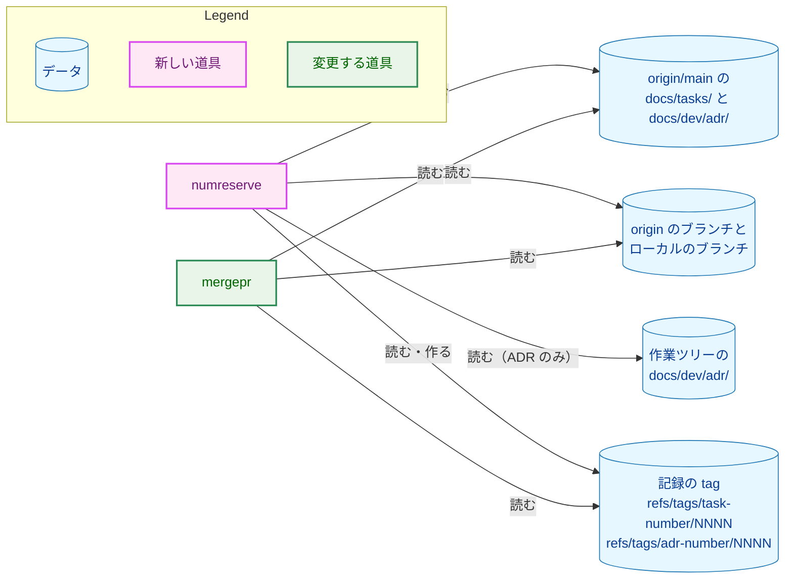
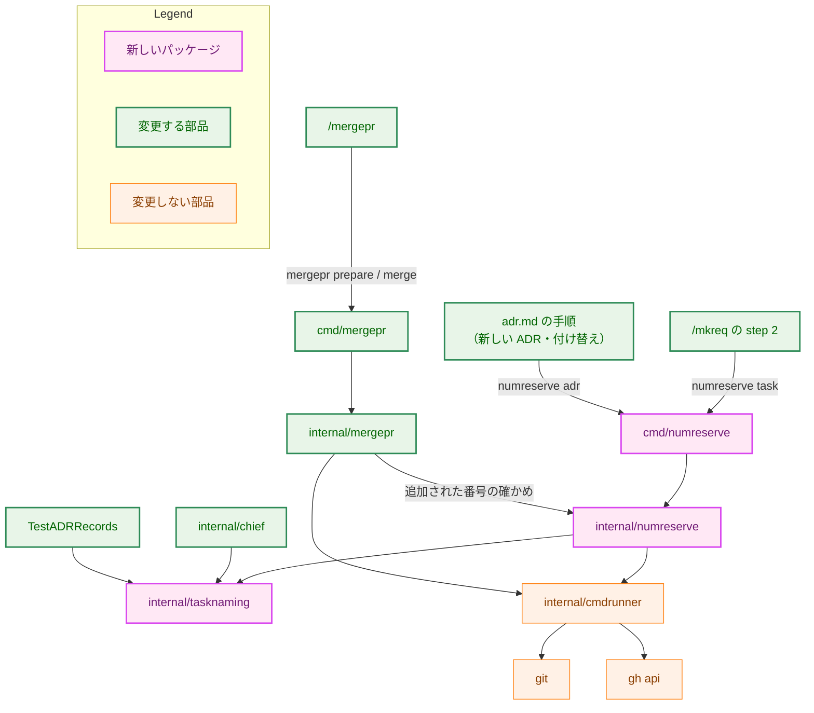
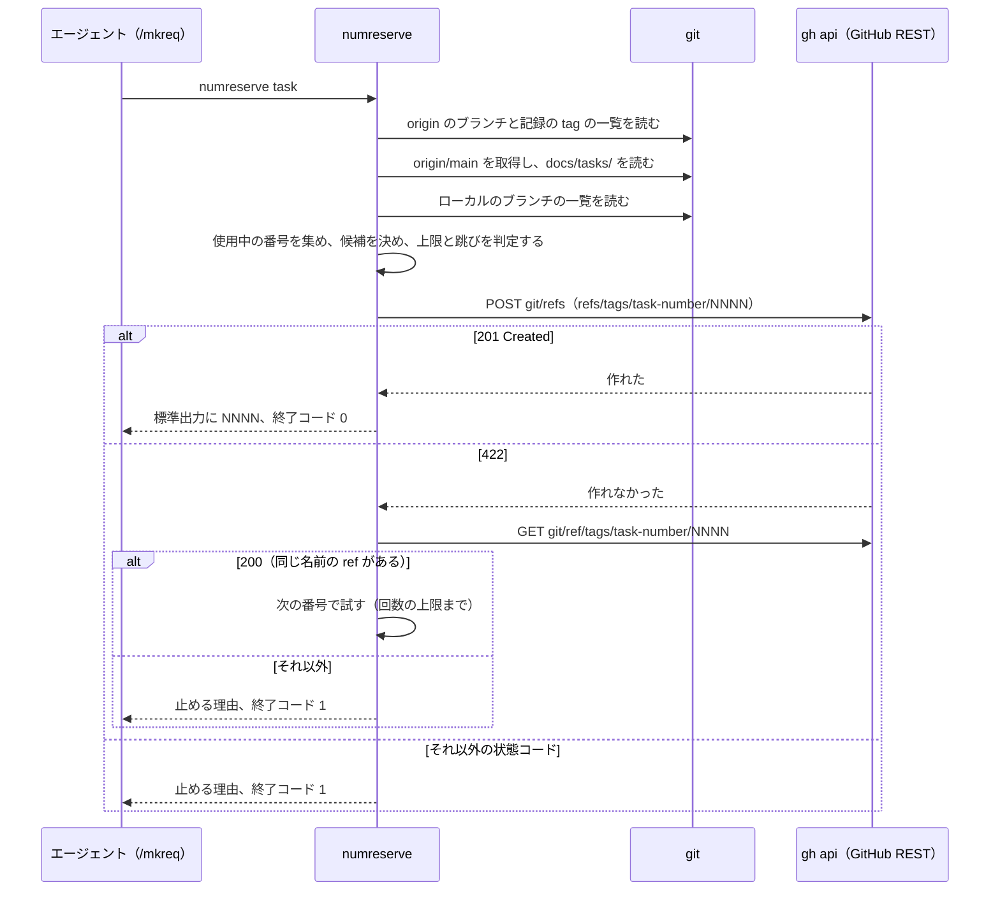
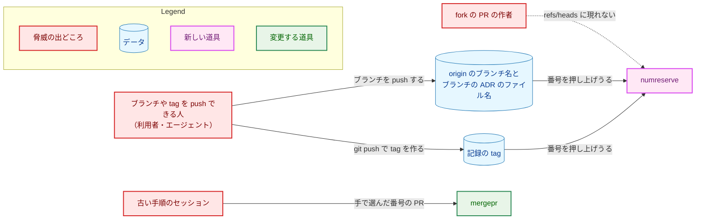
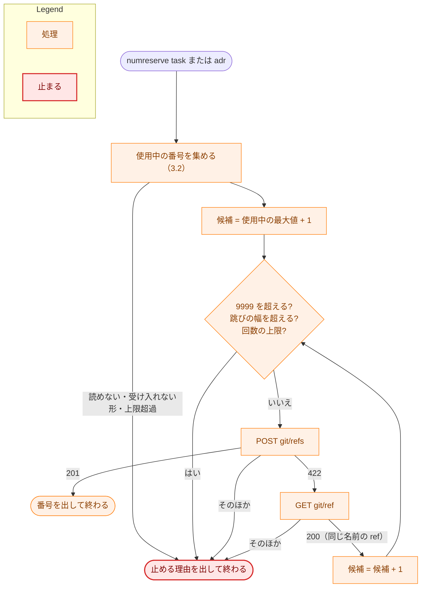
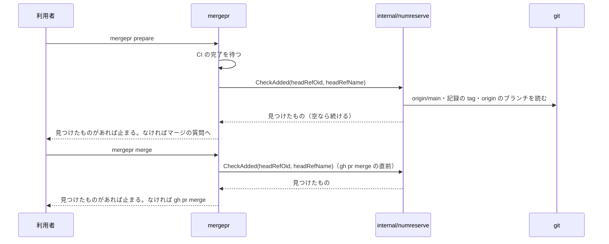

# アーキテクチャ設計書：タスク番号と ADR 番号が並行して重複しないようにする

## Document Status

| Item | Value |
|---|---|
| Status | `approved` |
| Created | 2026-11-17 |
| Review date | 2026-11-17 |
| Reviewer | isseis |
| Comments | - |

本書は [01_requirements.md](01_requirements.md)（要件定義書。以下、要件書）の設計である。「計画で決める」は、本タスクの実装計画書（`03_implementation_plan.md`）で決めることを指す。既存のファイルの内容は、コミット `b48db108` で確かめた。`file:line` の行番号は、このコミットでの行番号である。F-NNN・AC-NN は要件書の項番を、H-NN は [design_handoff.md](design_handoff.md)（以下、申し送り）の項番を指す。申し送りへの対応は付録 A に、受け入れ基準との対応は付録 B にまとめる。

本書は、要件書 6 章の用語（番号の空間・番号を決める道具・番号の記録・欠番）を同じ意味で使う。そのほかに、次の用語を使う。

-   **`numreserve`:** 本書が加える番号を決める道具の名前。`cmd/numreserve` と `internal/numreserve` の組である（3.1）。
-   **記録の tag:** 番号の記録の実体。GitHub の `origin` に作る tag で、名前はタスク番号なら `refs/tags/task-number/NNNN`、ADR 番号なら `refs/tags/adr-number/NNNN` である（3.3）。
-   **記録の ruleset:** 記録の tag の削除と更新を禁じる、GitHub の tag の ruleset（3.3.3）。
-   **名前の部品:** タスクのブランチ名・タスクのディレクトリ名・ADR のファイル名の形と、4 桁の番号の型を持つ共有のパッケージ `internal/tasknaming`（3.7）。
-   **使用中の番号:** 番号の空間ごとに、道具が「すでに使われている」と数える番号の集まり（3.2）。
-   **基準の最大値:** `origin/main` にある番号と記録の tag の番号のうち、最大のもの。番号の跳びを判定する基準である（AC-09、3.4）。
-   **しきい値:** 記録の tag がなくてもマージの前の確かめで拒まない、番号の空間ごとの上限の番号（3.6）。
-   **止める理由:** 道具が番号を決めずに止まるときの理由の種類（AC-06、4.1）。

## 1. 設計の全体像 (Design Overview)

### 1.1. 設計原則

-   **一意性は GitHub の ref の作成が保証する。** 番号ごとに 1 つの tag を GitHub の REST で作り、作れた番号だけを返す。同じ名前の ref は GitHub の上で 2 つ作れないので、別のクローンや cloud のセッションの間でも、2 つのセッションが同じ番号を得ることはない（AC-01・AC-10、要件書 5 章）。ローカルのロックは使わない。
-   **判定は道具が行い、コマンドの文書には呼び出しの形だけを書く。** 使用中の番号の集め方、次の番号を試すか止めるかの判定、上限は、Go の道具 `numreserve` の中にあり、テストで壊して確かめる（[ADR-0014](../../dev/adr/0014-deterministic-checks-in-go.md)、要件書 4.5）。エージェントは、道具が標準出力に出した 4 桁の番号だけを使う（AC-05）。
-   **分からなければ止める。** 「その番号の ref がすでにある」と GitHub から読み直して確かめた失敗だけを、次の番号を試す理由にする。そのほかの失敗、受け入れない形の入力、上限の超過は、すべて止める理由にする。従来の計算には戻らない（要件書 4.2、[ADR-0051](../../dev/adr/0051-number-reservation.md)）。
-   **記録は消させない。** 記録の tag は、記録の ruleset でサーバ側から削除と更新を禁じる。ただし、管理者の資格で動くエージェントは ruleset 自体を変えられるので、ruleset を変えることと、ruleset がまだ設定されていない間と、記録の tag を新しく作ることに対する守りは、`CLAUDE.md` の規則（AC-21 と、ネットワークの操作の承認）である（5.2）。
-   **最後の守りをマージの前に置く。** 古い `mkreq.md` や `adr.md` で手で選んだ番号は、番号を決める側では見つけられない。`mergepr` が、マージの直前に最新の `origin/main`、記録の tag、ほかのブランチを読んで確かめる（F-007）。
-   **上限は道具自身が持つ。** 時間と出力の上限は `internal/numreserve` が自分で課し、呼び出し側（`cmd/numreserve` か `mergepr`）によって変わらない（3.4）。
-   **既存の部品を使う。** 外部のコマンドの実行は `internal/cmdrunner` を使う。名前の形は、`chief` と `TestADRRecords` が持つ判定を名前の部品に移し、すべての読み手で使う（3.7）。

### 1.2. 設計の際に決めたこと（2026-11-17）

-   **方式は案 A（番号ごとの ref の予約）とする。ref は `gh api` で GitHub の REST（`POST /repos/{owner}/{repo}/git/refs`）を呼んで作る。作成が HTTP 422 で失敗したら、その名前の ref を `GET /repos/{owner}/{repo}/git/ref/{ref}` で読み直し、あれば次の番号を試し、なければ止める（申し送りの H-02・H-04）。** 案 B（タスク番号を issue 番号にする）は、同じ issue に 2 つの `/mkreq` を走らせると同じ番号になり（AC-01 に反する）、中断した issue からはタスクを作れなくなり（AC-03 との兼ね合い）、ADR 番号には使えないので仕組みが 2 つになる。案 D（再確認）は、2 つのセッションが同時に確かめると重複が残る。`git push` で tag を作る案は、同じ SHA を指す同じ名前の tag の 2 回目の push も終了コード 0 で終わる（申し送りの H-04）ので、成功を終了コードで判定できない。REST なら、作れたかどうかを HTTP の状態コードという宣言された値で判定できる。この方式は、「すでにある ref の作成を GitHub が 2xx で受けない」ことを前提にする。この前提は設計の段では確かめていないので、コマンドの文書を道具に切り替える前に確かめる（7.3）。ADR: [ADR-0051](../../dev/adr/0051-number-reservation.md) を更新する（方式は ADR-0051 が「0100 の設計で決める」としていたため）。
-   **記録は tag の名前空間 `refs/tags/task-number/NNNN` と `refs/tags/adr-number/NNNN` に置き、記録の ruleset（3.3.3）を利用者が設定する（申し送りの H-01）。** 2026-11-17 に `gh api repos/{owner}/{repo}/rulesets` で読み取って確かめた。今ある ruleset は、ブランチを対象にする 2 つだけである。1 つは `main` を除くすべてのブランチの作成と更新を禁じ、管理者の役割だけが迂回できる（ID 26400325）。もう 1 つは `main` の削除・非 fast-forward を禁じ、PR を要する（ID 24096227）。tag を対象にする ruleset はなく、tag は 1 つもない。したがって、記録の tag の作成を今の ruleset は拒まない。ruleset で記録の削除を禁じられるのは tag とブランチの名前空間だけであり、独自の名前空間（`refs/number-reservations/...`）は ruleset で守れない。ブランチの名前空間は、`chief` と `/mkreq` が読むブランチの一覧に混ざる。tag にすると、`git fetch` の tag の自動追従で記録の tag が各クローンに入る。この副作用は受け入れる。ADR: [ADR-0051](../../dev/adr/0051-number-reservation.md) を更新する。
-   **マージの前の確かめは `mergepr` だけに置き、CI には置かない（申し送りの H-10）。** マージの方法は `/mergepr` による squash merge と決まっている（`.claude/commands/_context.md` の「PR merge method」）。`mergepr` はマージの直前に最新の `origin/main` を読めるので、PR を作った後に `main` に入った同じ番号も見つけられる（AC-28）。CI は PR の時点の `main` としか比べられず、記録の tag を読むネットワークの処理も CI に要る。`/mergepr` を通らない手作業のマージで漏れる危険は受け入れる。ADR の重複は、`main` で `TestADRRecords` が見つける。ADR: [ADR-0051](../../dev/adr/0051-number-reservation.md) を更新する。
-   **マージの前の確かめは、ほかの `origin` のブランチが同じ番号を別の名前で加えていないかも見る（AC-27 を強める）。** 記録の tag があるかだけを見ると、古いクローンが、ほかのセッションが予約した番号を手で選んで作った PR は、記録の確かめを通る。その PR は、相手の PR が先にマージされるまでは、重複の確かめ（AC-28）も通る。ほかのブランチの一覧は、番号を決めるときと同じ読み方で得られる。tag に PR の情報を持たせて結びつける案は、注釈付きの tag と ref の 2 段の作成が要り、途中で失敗したときの扱いが増えるので採らない。ADR: [ADR-0051](../../dev/adr/0051-number-reservation.md) を更新する。
-   **仕組みより前に作られた作業中の PR は、番号のしきい値で扱う（申し送りの H-08・H-10）。** 導入の時点で使用中のタスク番号と ADR 番号のそれぞれの最大値を、しきい値として道具に持たせる。しきい値以下の番号には、記録の確かめ（AC-27）をかけず、重複の確かめ（AC-28）とほかのブランチの確かめだけをかける。古いクローンが導入の後に「最大値 + 1」で計算した番号はしきい値より大きいので、記録がなければ AC-27 で見つかる。道具がしきい値以下の番号を返すのは、導入の時点で最大の番号を持っていたブランチがマージされずに消された場合に限られ、その番号にも記録の tag があるので、確かめは弱まらない。PR の作成日時で分ける案は、導入の前に作った PR が導入の後に加えた番号を見逃す。使用中の番号の記録をまとめて作る案は、そのための経路が道具に要る。どちらも採らない。しきい値の値は計画で決める。ADR: [ADR-0051](../../dev/adr/0051-number-reservation.md) を更新する。
-   **道具は Go で書き、`cmd/numreserve` と `internal/numreserve` に置き、利用者が `make install-numreserve` で `main` から入れる（申し送りの H-03）。** [ADR-0014](../../dev/adr/0014-deterministic-checks-in-go.md) の方針どおりである。`_lib/` の bash のスクリプトにする案は、判定（使用中の番号の集め方、どの失敗で次を試すか、上限）をテストで壊して確かめられないので採らない。エージェントは道具を入れたりビルドしたりしない（`codexreview` と同じ）。ADR: [ADR-0014](../../dev/adr/0014-deterministic-checks-in-go.md) を更新する（道具の一覧とインストールの規則が ADR-0014 の決定にあるため）。
-   **GitHub のリポジトリ（`isseis/yt2column`）は道具の定数に持ち、`origin` の URL を読まない。** cloud のセッションでは `origin` がローカルのプロキシの URL でありうる（確かめていない）。URL を読むと、環境ごとに受け入れる形の規則が要る。さらに、URL に入ったトークンを、止める理由の詳細に出す恐れもある。`git ls-remote` と `git fetch` は `origin` に対して行い、URL の中身は読まない。ADR: なし（道具の中の値で、このタスクの中で閉じる）。
-   **`numreserve` が外部の出力を読んで振る舞いを選ぶことを、`CLAUDE.md` の「Declare, don't infer」の例外として書く。** 読むのは、`gh api -i` の出力の HTTP の状態行と rate limit の見出し（`X-RateLimit-Remaining` と `Retry-After`）、`GET` の応答の `ref`（本文の全体は厳密な JSON として読み、合わなければ `malformed` で止める）、`git ls-remote` の行、`git ls-tree` の項目の種類と名前、`git for-each-ref` のローカルのブランチの行、`git rev-parse --show-toplevel` の 1 行（絶対パス 1 つでなければ `local-git` で止める）、マージの前の確かめでの `git merge-base` の 1 行（commit ID 1 つでなければ `malformed` で止める）、取得に失敗したときの `git cat-file --batch-check` の行（止める理由の詳細に出すブランチを選ぶだけ）、作業ツリーの `docs/dev/adr/` の項目の名前と、それらに名前の形を当てる `internal/tasknaming` の判定である。`codexreview` と `coveragecompare` と同じく、外部の道具が書く値で、型にできないためである。範囲はこれらの読み取りだけで、合わない形は `malformed` で止める（境界）。ADR: なし（CLAUDE.md の規則であり、CLAUDE.md の「Design decisions (ADR)」により ADR にしない）。
-   **番号の跳び（AC-09）は、要件書のとおり「`origin/main` と記録の tag の最大値」を基準にし、記録の tag だけに別の上限をかけることはしない。** 記録の tag に「`main` の最大値 + 跳びの幅」の上限をかけると、道具は自分の候補にその上限をかけないので、正当な予約が跳びの幅だけたまると、次の実行がその上限を超える tag を自分で作り、以後のすべての実行が止まる。直すには正当な記録を消すしかなく、AC-03 に反する。手で作られた大きな番号の tag が基準を押し上げる危険は、`CLAUDE.md` の承認の規則（AC-21）と管理者の手順（3.3.3）に任せ、残る危険とする（5.2）。Fable の部分レビューの指摘を受けて決めた。ADR: [ADR-0051](../../dev/adr/0051-number-reservation.md) の「結果」に残る危険として書く（決定は AC-09 のとおりで変わらない）。
-   **PR の base が `main` でないときは、`mergepr` は番号の確かめを行わずにマージを続ける。** 今の `mergepr` はどの base の PR もマージでき、その PR の変更は、後で `main` に入る PR が確かめを受ける。止めると、今マージできる PR がマージできなくなる。Fable の部分レビューの指摘を受けて決めた。ADR: なし（`mergepr` の確かめの適用範囲であり、このタスクの中で閉じる）。
-   **止まったときの契約は、終了コード 1 と、標準エラーの 1 行の理由の語にする。理由ごとの終了コードは設けない（3.1）。** 終了コードを理由ごとに分けても、それを使い分ける手順がない。エージェントは止まったことと理由の語を利用者に示し、理由ごとの次にすることは手引きの 1 つの表にまとめる。ADR: なし（道具の出力の形であり、ADR-0014 の「契約は手引きにある」の範囲で閉じる）。
-   **上限と幅の値は 3.4 の表のとおりにする（申し送りの H-09）。** 2026-11-17 の `origin` には、ブランチが 15、ref が全体で 755（PR の ref を含む）あり、タスクは 100、ADR は 51 ある。値はこの規模から余裕を持たせて決めた。ADR: なし（値はこのタスクの中で閉じる。変えても ADR-0051 の決定は変わらない）。
-   **名前の形（タスクのブランチ名・タスクのディレクトリ名・ADR のファイル名）と 4 桁の番号の型を、共有のパッケージ `internal/tasknaming` に置く。** 今は `chief` が `featureBranch` と `taskDirName`（`internal/chief/task.go:739`・`742`）を、`TestADRRecords` が `adrNameRE`（`cmd/yt2column/adr_test.go:50`）を持つ。`numreserve` と `mergepr` も同じ形を読むので、別々に書くと片方だけが変わりうる（CLAUDE.md の「DRY」）。`chief` と `TestADRRecords` の振る舞いは変えない（AC-04）。ADR: なし。複数の部品が使うが、形そのものは `_context.md` の「Feature branch name」と `adr.md` の「Location and naming」が決めており、本書はその判定のコードの置き場所を決めるだけで、置き場所を変えても決定は変わらないためである。

### 1.3. なぜ今の仕組みでは足りないか

-   **タスク番号:** `/mkreq` の step 2 は、エージェントが「使用中の最大値 + 1」を計算する（`.claude/commands/mkreq.md:69-76`）。計算してからブランチを作るまでに排他がないので、2 つのセッションが同じ番号を得る。ブランチ名にはスラッグが入るので、ブランチの作成も重ならずに成功する（要件書 1 章）。番号を一度でも GitHub の上の 1 つの名前に結びつけなければ、AC-01 を満たせない。
-   **ADR 番号:** 規約は「`main` と、その PR のブランチにある最大の番号の次」とし（`docs/dev/conventions/adr.md` の「Location and naming」）、ほかの PR のブランチを見ない。#927 と #934 の重複はこれで起きた。ほかのブランチを見るようにしても、案 D と同じく同時の確かめで重複が残る。
-   **欠番:** `TestADRRecords` は欠番を誤りとする（`cmd/yt2column/adr_test.go:336-355` の `checkADRNumbers`）。番号を決めた順とマージの順が違うと、`main` に一時的な欠番ができ、すべての PR でこのテストが失敗する。欠番を許すように変える必要がある（F-003）。

### 1.4. 方式の比較

申し送りの H-02 のとおり、issue #917 の案 A〜D を比べた。

| 観点 | A：ref の予約（採る） | B：タスク番号を issue 番号にする | C：ローカルのロック | D：再確認 |
|---|---|---|---|---|
| 同じ時点から 2 つが決めても違う番号（AC-01・AC-10） | 満たす（GitHub の ref の作成が排他） | 同じ issue の 2 つの `/mkreq` で重複する | 別のクローンの間で重複する | 同時に確かめると重複する |
| 中断した番号を使い回さない（AC-03） | 記録の tag が残る | 満たすが、その issue からはタスクを作れなくなる | ロックは残らない | 記録がない |
| ADR 番号にも使える（F-002） | 使える（名前空間を分ける） | 使えない（ADR は issue に結びつかない） | 使える | 使える |
| cloud のセッション（F-005） | `gh` が GitHub の REST に届けば動く（AC-22 で確かめる） | 動く | 動かない | 動くが重複が残る |
| 仕組みの数 | 1 つ（空間ごとに名前空間だけ違う） | タスクと ADR で 2 つ | 1 つ | 1 つ |

案 A だけが、AC-01〜AC-15 を 1 つの仕組みで満たす。採らなかった案と理由は ADR-0051 の「採らなかった案」に書く（AC-25）。

### 1.5. 概念モデル

矢印 A → B は「A が B を読む、または作る」を表す。記録の ruleset が記録の tag を守る関係は、矢印ではなく 3.3.3 に書く。



番号の空間は 2 つあり（タスク番号と ADR 番号）、互いに影響しない（AC-15）。それぞれの空間で、使用中の番号は次の和集合である（3.2）。

-   タスク番号：`origin/main` の `docs/tasks/` の番号、ローカルと `origin` のブランチ名の番号、記録の tag `task-number/*` の番号。
-   ADR 番号：`origin/main` の `docs/dev/adr/` の番号、`HEAD` と作業ツリーの `docs/dev/adr/` の番号、`origin` の各ブランチの `docs/dev/adr/` の番号、記録の tag `adr-number/*` の番号。

## 2. システム構成 (System Structure)

### 2.1. 全体構成

矢印 A → B は「A が B を呼ぶ、または使う」を表す。



### 2.2. コンポーネント配置

| ファイル・パッケージ | 新規・変更 | 責務 |
|---|---|---|
| `cmd/numreserve` | 新規 | 引数を読み、`internal/numreserve` を呼び、番号か止める理由を出して終了コードを返す（3.1） |
| `internal/numreserve` | 新規 | 使用中の番号の収集、次の番号の決定、記録の tag の作成と読み直し、上限と止める理由、マージの前の確かめ（3.2〜3.6） |
| `internal/tasknaming` | 新規 | 4 桁の番号の型と、タスクのブランチ名・タスクのディレクトリ名・ADR のファイル名の形の判定（3.7） |
| `internal/chief/task.go` | 変更 | `featureBranch`・`taskDirName` を `internal/tasknaming` の呼び出しに置き換える。振る舞いは変えない |
| `cmd/yt2column/adr_test.go` | 変更 | `adrNameRE` を `internal/tasknaming` の呼び出しに置き換え、`checkADRNumbers` から欠番の判定を除く（3.10） |
| `cmd/yt2column` の文書のガード | 新規 | `docs/tasks/` の下の項目がすべてタスクのディレクトリ名の形のディレクトリであることを確かめるテスト（3.5） |
| `internal/mergepr` | 変更 | `prepare` と `merge` で、PR が加える番号を `internal/numreserve` で確かめる（3.5）。パッケージの doc コメントの「Its only safety obligations」に番号の確かめを加える |
| `cmd/mergepr` | 変更 | 番号の確かめで見つけたものを 1 件 1 行で出す。終了コードは今と同じ 1（4.2） |
| `Makefile` | 変更 | `install-numreserve` を加える |
| `.github/workflows/ci.yml` | 変更 | `doc-guard` のジョブのパッケージの一覧に `./cmd/numreserve` を加える（7.2） |
| `.claude/settings.json` | 変更 | `permissions.allow` に `Bash(numreserve task)` と `Bash(numreserve adr)` を加える |
| `.claude/commands/mkreq.md` | 変更 | step 2 の番号の計算を `numreserve task` の呼び出しに置き換え、Authorization に加える（AC-05・AC-20） |
| `.claude/commands/mergepr.md` | 変更 | 番号の確かめで止まったときの報告を加える |
| `.claude/commands/runpr.md` | 確かめる | `/mergepr` が番号の確かめで止まったときの報告が、今の「`/mergepr` が止まったとき」の扱いで足りるかを確かめ、足りなければ変える（計画で決める） |
| `.claude/commands/_lib/settle-decisions.md` | 変更 | ADR を作るときは、規約の「Location and naming」の手順で番号を決めると明記する（AC-12） |
| `docs/dev/conventions/adr.md` | 変更 | AC-18 の 4 つの差分（3.9） |
| `CLAUDE.md` | 変更 | 「Tool Execution Safety」（AC-19・AC-21）、「Declare, don't infer」の例外、「Testing Strategy」の信頼の境界の例外の一覧、「Development Notes」の `doc-guard` のパッケージの一覧、「Build Commands」の `make install-numreserve`、Quick Links の手引き（3.9） |
| `docs/dev/guides/numreserve_guide.md` | 新規 | 道具の手引き（AC-26）。日本語 |
| `docs/dev/guides/mergepr_guide.md` | 変更 | 番号の確かめ、保証すること、止まったときの対処 |
| `docs/dev/conventions/package_reference.md` | 変更 | `cmd/numreserve`・`internal/numreserve`・`internal/tasknaming` の行 |
| `docs/dev/adr/0051-number-reservation.md` | 変更 | 方式・名前空間・確かめの場所・しきい値を決定に加える（AC-24・AC-25） |
| `docs/dev/adr/0014-deterministic-checks-in-go.md` | 変更 | 道具の一覧・インストールの規則・契約の置き場所に `numreserve` を加える |

### 2.3. データフロー

`/mkreq` がタスク番号を決めるときの流れを示す。ADR 番号では、使用中の番号を集める段で、`origin` の各ブランチの `docs/dev/adr/` と作業ツリーも読む（3.2）。記録の tag を作る段は同じである。



## 3. コンポーネント設計 (Component Design)

### 3.1. 道具 `numreserve` の呼び出しと出力

呼び出しの形は、次の 2 つだけである。引数は番号の空間を選ぶ 1 語で、ほかの引数とフラグは受け付けない。

```text
numreserve task
numreserve adr
```

-   リポジトリの中（作業ツリーのどこか）で実行する。`adr` は、番号を決める PR のブランチの作業ツリーで実行する。
-   **番号を決めたとき:** 標準出力に 4 桁の番号を 1 行だけ出し、終了コード 0 で終わる。標準エラーには、作った記録の tag の名前と、それが指す `origin/main` の commit を 1 行出す。セッションの記録に、誰がいつ番号を決めたかを残すためである。
-   **止まったとき:** 標準出力に何も出さず、標準エラーに 1 行（`numreserve: stop <理由>: <詳細>`）を出し、終了コード 1 で終わる。`<理由>` は 4.1 の表の語である。引数の誤りは終了コード 2 で終わる。
-   **詳細:** 止まった段（どの一覧を読んでいたか、どの番号の作成か）、HTTP の状態コードやコマンドの終了コード、番号の跳びを起こしたブランチの名前や ADR のファイルのパスを出す。GitHub の応答の本文、`gh` と `git` の標準エラー、`origin` の URL、認証の情報は出さない。詳細に出るブランチ名とファイル名は、ブランチを push できる人が付けた値であり、エージェントにとってはデータである。改行や制御文字で出力の行を偽れないように、これらの値は Go の引用の形（`%q`）で、長さを 200 バイトまでに切って出す。`GET` の応答の `ref` が一致しなかったときも、その値は出さない。
-   **契約:** コマンドの文書と文書のガードが読むのは、呼び出しの形、標準出力の 1 行、終了コード、標準エラーの行の `<理由>` の語である（ADR-0014 の「道具の引数・出力・終了コード」）。詳細の文言は利用者が読むためのもので、契約ではない。

道具は、`--protocol` の番号を持たない。呼び出しの形が 2 つだけで、引数を変えるときは道具と文書を同じ PR で変える（ADR-0014）。

### 3.2. 使用中の番号の集め方

道具は、番号の空間ごとに、次の入力から番号を集める。どれか 1 つでも読めなければ止まる。

| 入力 | タスク番号の空間 | ADR 番号の空間 | 受け入れない形のとき |
|---|---|---|---|
| `origin` のブランチ（`git ls-remote` の `refs/heads/*`） | 名前から読む | 各ブランチの `docs/dev/adr/` から読む | 1 行が「40 桁の 16 進、タブ、ref の名前」でなければ止める（malformed） |
| 記録の tag（`git ls-remote` の `refs/tags/<空間>-number/*`） | 使う | 使う | 3.3.3 |
| `origin/main` の一覧 | `docs/tasks/` の下 | `docs/dev/adr/` の下 | 3.2.1 |
| ローカルのブランチ | 名前から読む | 使わない | 形に合わない名前は数えない（拒否しない） |
| 作業中のブランチ（`HEAD` と作業ツリー） | 使わない | `docs/dev/adr/` から読む | 形に合わない名前は数えない（拒否しない） |

-   **ブランチ名からの番号:** タスクのブランチ名の形（名前の部品、3.7）に合う名前だけからタスク番号を読み、ほかの名前は数えない。`origin` のブランチは `git ls-remote` が返すものだけである。fork からの PR のヘッドは `origin` の `refs/heads/` に現れないので数えない（AC-02・AC-11）。PR の一覧は読まない。このリポジトリの中にヘッドがある PR のヘッドブランチは、`origin` のブランチに含まれる。
-   **`git ls-remote` の行の分け方:** `git ls-remote` の名前の照合は末尾で行われるので、`refs/heads/*` を指定しても `refs/tags/y/refs/heads/...` のような名前も返る（Fable の部分レビューで、git 2.50.1 の手元の実験で確かめた）。道具は、名前が `refs/heads/` で始まる行だけをブランチとし、`refs/tags/<空間>-number/` で始まる行だけを記録の tag とする。どちらでもない行は読み飛ばす。
-   **ADR を読むブランチ:** `git ls-remote` が返した `origin` のすべてのブランチである（タスクのブランチ名の形に限らない）。`main` もここに含まれる。各ブランチの `docs/dev/adr/` の形に合わない名前は数えない（拒否しない）。
-   **取得:** 道具は、`git ls-remote` が返した SHA だけを取得し、remote-tracking の ref もローカルのブランチも更新しない（`FETCH_HEAD` も書かない）。同じリポジトリの worktree で 2 つの道具が同時に動いても、ref のロックで衝突しないためである。取得には `--no-tags` を付ける。`remote.origin.tagOpt` が `--tags` のクローンでも、ローカルの tag を書かないためである（Fable の部分レビューで確かめた）。`FETCH_HEAD` を書かない指定には git 2.29 以上が要る。`ls-remote` の後にブランチが消されたか書き換えられて、その SHA を取得できなかったときは止める（network-or-github、詳細にブランチ名）。
-   **git と gh の環境:** git は `cmdrunner.GitEnv` と `GitHardening`（`internal/cmdrunner/git.go`）の環境と設定で実行し、認証の入力を待たない。`gh` は `--hostname github.com` を付け、利用者への問いを出さず（`GH_PROMPT_DISABLED`）、色を付けない（`NO_COLOR` を設定し、`CLICOLOR_FORCE` と `GH_FORCE_TTY` を外す）環境で実行する。色を付けると、見出しの名前がエスケープの列で囲まれ、rate limit を読み違えるためである（Fable の部分レビューで確かめた）。
-   **前提:** `origin` は GitHub の `isseis/yt2column` である（`mergepr` と同じ前提）。`origin` が古いクローンや別のリポジトリを指すと、使用中の番号を見落として、使用中の番号の tag を作りうる。その番号はマージの前の確かめで見つかる。手引きに前提を書く。
-   **ローカルのブランチ:** クローンごとに違うので、同じ実行でもクローンによって結果が変わりうる。迷い込んだローカルのブランチで番号が跳んだときは止まり、ブランチ名を示す（3.4）。手引きに片付け方を書く。

#### 3.2.1. `origin/main` の一覧の形

要件書 4.2 のとおり、`origin/main` のディレクトリの一覧は拒否の対象である。

-   `docs/tasks/` の下：ディレクトリで、名前がタスクのディレクトリ名の形（`NNNN_<name>`）のものから番号を読む。ディレクトリでない項目と、この形でないディレクトリがあれば止める（malformed）。`0000_template` はこの形に合い、番号 `0000` として数える。番号の型は `0000` を表せる（3.7）。最大値に影響しないので、扱いを分けない。2026-11-17 の `origin/main` では、`docs/tasks/` の 100 項目はすべてディレクトリで、この形に合う。
-   `docs/dev/adr/` の下：`README.md` を除き、ファイルで名前が `NNNN-<kebab>.md` のものから番号を読む。それ以外の項目があれば止める（malformed）。`TestADRRecords` が `main` でこの形を保っている。

`docs/tasks/` には `TestADRRecords` のような形の検査がない。形に合わない項目が `main` に入ると、以後の `numreserve task` と `mergepr` の確かめがすべて止まる。これを防ぐため、マージの前の確かめは、PR が `docs/tasks/` の下に加える形に合わない項目を拒む（3.5）。

### 3.3. 記録の tag

#### 3.3.1. 作り方

道具は、候補の番号 `NNNN` について、REST の `POST /repos/isseis/yt2column/git/refs`（`ref` は `refs/tags/<空間>-number/NNNN`、`sha` は `git ls-remote` が返した `refs/heads/main` の SHA）を `gh api -i` で呼ぶ。読み直しは `GET /repos/isseis/yt2column/git/ref/tags/<空間>-number/NNNN` である。

-   `-i` を付けると、`gh api` は失敗したときも標準出力の先頭に HTTP の状態行を出す。2026-11-17 に、`gh` 2.96.0 で存在しない ref を読み、終了コード 1 と、標準出力の先頭の `HTTP/2.0 404 Not Found` を確かめた。道具は、状態行の状態コードと、3.3.2 の見出しだけで判定し、応答の本文の `message` の文は読まない。見出しの名前は大文字と小文字を区別せずに読む（`gh` は `X-Ratelimit-Remaining` の形で出す）。状態行は `HTTP/1.1`・`HTTP/2`・`HTTP/2.0` の形を受け入れ、それ以外は止める（network-or-github）。cloud のセッションのプロキシが接続の版を変えうるためである。
-   tag は軽量の tag で、決めたときの `origin/main` の commit を指す。tag の中身（指す commit）は判定に使わない。番号の判定には名前だけを使う（申し送りの H-06）。
-   どのタスクや PR のために決めたかを tag に持たせない。番号はブランチ名とディレクトリ名に現れるので、残っているブランチや PR から辿れる。番号を決めたことは、セッションの記録にも残る（3.1）。

#### 3.3.2. 作成の結果の判定

| `POST` の状態コード | 判定 |
|---|---|
| 201 | 番号が決まった。番号を出して終わる |
| 422 | `GET` で同じ名前の ref を読み直す。200 で、返された `ref` が問い合わせた名前と一致すれば「すでに使われている」と確かめたので次の番号へ進む。一致しなければ止める（malformed）。404 を含むそれ以外なら、ruleset による拒否などの、使用中と確かめられない失敗なので止める（network-or-github） |
| 429、または 403 で `X-RateLimit-Remaining: 0` か `Retry-After` の見出しがある | 止める（network-or-github）。一時的な rate limit（二次の rate limit を含む）であり、時間をおけば通るためである |
| そのほかの 401・403・404 | 止める（permission）。404 は、リポジトリが見えない権限の不足として GitHub が返すためである |
| `gh` が認証されていない（`gh` の終了コード 4。状態行は出ない） | 止める（permission） |
| そのほか（5xx、状態行がない、`gh` が起動しない、時間切れ） | 止める（network-or-github） |

時間切れなどで、GitHub では作れたのに道具が失敗として止まることがある。その番号は欠番になる。重複は起きないので、これを受け入れる。

#### 3.3.3. 記録の ruleset と記録の tag の名前

利用者が、導入のときに GitHub で次の tag の ruleset を設定する。設定の手順は手引きに書く（AC-26）。

-   対象：`refs/tags/task-number/**/*` と `refs/tags/adr-number/**/*`（名前空間の下のすべての名前。入れ子の名前を含む）
-   規則：削除の禁止（deletion）と、更新の禁止（update）。作成は禁じない
-   迂回できる人：なし（管理者も迂回しない）

道具は、記録の tag の名前空間の下に、4 桁の数字だけの名前以外（入れ子の名前、`^{}` の付いた注釈付きの tag の行を含む）を見つけたら止め、その名前を詳細に出す（malformed）。ruleset の対象と道具が読む範囲を、名前空間の下のすべての名前でそろえるためである。

道具は ruleset の有無を確かめない。ruleset はリポジトリの外の設定であり、道具が読んでも利用者が変えられるためである。ruleset がない間の守りは、`CLAUDE.md` の規則（AC-21）だけになる。導入のときに ruleset が効くことの確かめ方は、計画で決める。

**消せない記録が誤っているとき:** 誰も迂回できないので、受け入れない名前の tag が作られると、その空間の番号を決めることが止まり続ける。大きな番号の tag が作られると、番号を使い切らせうる。手引きに、利用者（管理者）が誤った tag だけを消す手順を書く。ruleset を無効にせず、誤った tag の名前だけを ruleset の対象から一時的に除いて消し、除いた名前を戻す。無効にすると、その間すべての記録が守られなくなるためである。消した tag は各クローンにローカルの tag として残り、`git push --tags` で作り直されうるので、各クローンのローカルの tag も消すことを手順に含める。この手順は利用者が行い、エージェントは行わない。

### 3.4. 候補の番号と上限

-   **最初の候補:** 使用中の番号の最大値 + 1。
-   **次の候補:** 3.3.2 で「すでに使われている」と確かめたとき、その番号 + 1。使用中の番号の一覧は読み直さない。確かめた番号は記録の tag の番号なので、跳びの基準の最大値に入れる（読み直した実行が数えるのと同じにする）。
-   **跳び（AC-09）:** 候補が「基準の最大値 + 跳びの幅」を超えたら止める（jump）。基準の最大値は、`origin/main` の番号と記録の tag の番号の最大値であり、ブランチと作業ツリーの番号を含まない。詳細には、基準の最大値より大きい番号を持つ入力（ブランチの名前、ADR のファイルのパスとそのブランチ）を、番号の大きい順に 10 件まで出し、残りは件数だけを出す（候補を押し上げた入力が必ず名指される）。
-   **4 桁の上限:** 候補が 9999 を超えたら止める（exhausted、AC-08）。跳びの判定を先に行う。迷い込んだ `9999` の番号のブランチで候補が 10000 になったときに、原因のブランチ名を示す jump で止めるためである。
-   **回数の上限:** `POST` を試す回数が上限に達したら止める（attempts、AC-07）。

| 値 | 決めた値 | 理由 |
|---|---|---|
| 跳びの幅 | 20 | 並行して作業中のタスクや ADR は多くても数件であり、記録のないブランチや中断した番号があっても、`main` の最大値から 20 は離れない。迷い込んだ 1 本のブランチ（例：`0999-...`）は確実にこれを超える |
| `POST` の回数の上限 | 10 | 同時に番号を決めるセッションは多くても数個であり、1 回の実行で 10 回続けて先を越されることはない |
| 外部のコマンド 1 つの時間の上限 | 60 秒 | 最も遅いのは取得である。今の規模では数秒で終わる |
| 1 回の実行の時間の上限 | 3 分 | これを超えたら止める（network-or-github）。今の規模では ADR の空間でも数十秒で終わる |
| 外部のコマンドの出力の上限 | 4 MiB | 2026-11-17 の `origin` の ref は全体で 755、ブランチは 15 である。ブランチと記録の tag に絞った `git ls-remote` の出力は、1 行がおよそ 100 バイトなので、数万の ref まで収まる |
| ブランチの数の上限 | 500 | ADR の空間では、ブランチごとに `docs/dev/adr/` を読む。15 の 30 倍の余裕を見た |

-   **上限を持つ場所:** 上限は `internal/numreserve` が自分で課す。外部のコマンドは、出力の上限を付けた `cmdrunner` の Runner で、1 つごとの時間の上限と、1 回の実行の時間の上限の付いた Go の `context` で実行する。`mergepr` から呼ばれたときも同じである（`mergepr` 自身の Runner は上限を持たない。`internal/mergepr/runner.go:7`）。
-   **一覧の上限の超過:** `git ls-remote` はページに分かれない。出力が上限を超えたら、またはブランチの数が上限を超えたら、止める（list-limit）。読めた分だけで番号を決めない。
-   **所要時間:** 番号を決める `/mkreq` の 1 回の実行で、道具を 1 回呼ぶ（要件書 4.1）。上限は 1 回の実行の時間の上限（3 分）である。

### 3.5. マージの前の確かめ（`mergepr`）

`mergepr` は、`prepare` と `merge` の両方で、PR が加える番号を確かめる。`prepare` では CI の完了を待った後、作業ディレクトリを作る前に確かめ、マージの質問の前に止まる。`merge` では、`prepare` の後に `main` に入った番号を見つけるため、`gh pr merge` の直前に確かめる。

-   **base:** PR の base が `main` でなければ、番号の確かめを行わずに続ける（1.2）。
-   **PR が加える番号:** PR のヘッド（`prepare` が記録した `headRefOid`）の `docs/tasks/` にあり、PR のヘッドと最新の `origin/main` の merge-base の `docs/tasks/` にないディレクトリの番号と、同じく PR のヘッドの `docs/dev/adr/` にあり、merge-base にないファイルの番号である。最新の `origin/main` と比べないのは、PR が分かれた後に `main` で名前を変えたもの（例：#918 の `0094_chief_question_transcript` から `0096_…` への付け替え）が、古いヘッドに残っているだけで「加えた」と数えられるためである（Fable の部分レビューの指摘）。PR が加える番号がなければ、`origin` のブランチの一覧、merge-base、2 つの木のほかは何も読まずに確かめを終える。
-   **形の確かめ:** PR が `docs/tasks/` の下に加える項目が、タスクのディレクトリ名の形のディレクトリでなければ止まる（3.2.1）。`docs/dev/adr/` の下の形は `TestADRRecords` が CI で確かめる。`docs/tasks/` の下の形も、`cmd/yt2column` の文書のガードに新しいテストを加え、CI の `doc-guard` のジョブで確かめる。`/mergepr` を通らないマージや古い `mergepr` のバイナリでも、形に合わない項目が `main` に入らないようにするためである。
-   **記録の確かめ（AC-27）:** PR が加える番号がしきい値（3.6）より大きく、記録の tag がなければ、番号と理由を示して止まる。
-   **重複の確かめ（AC-28）:** PR が加える番号を、最新の `origin/main` の別のディレクトリまたは別のファイルが使っていれば、番号と、使っているディレクトリまたはファイルを示して止まる。「別の」は名前が違うことで判定する。PR が消す項目（merge-base にあって PR のヘッドにない項目）は、マージの後に残らないので数えない。PR が同じ番号のまま名前を変えたときに止めないためである。
-   **ほかのブランチの確かめ:** PR が加える番号を、PR のヘッドブランチでない `origin` のブランチが、別の名前で加えていれば（`origin/main` にない、同じ番号の別のディレクトリまたはファイル）、番号と、そのブランチと名前を示して止まる（1.2）。同じ名前なら同じタスクまたは ADR とみなし、止めない。タスクの空間でも、ブランチ名ではなく各ブランチの `docs/tasks/` を読む（ブランチの数の上限は 3.4 と同じ）。マージされずに残った古いブランチが同じ番号を別の名前で持つときも止まる。そのブランチを消すかどうかは利用者が決める（手引きに書く）。
-   **対象（AC-29）:** PR が加える番号だけを確かめる。`origin/main` にすでにある番号では失敗しない。
-   **読むもの:** 最新の `origin/main`、記録の tag、`origin` の各ブランチの一覧である。読むのは、PR が番号を加える空間の分だけである。番号を加えない PR と、もう一方の空間の記録の tag の誤りで、マージが止まらないようにするためである。`origin/main` の一覧は重複の確かめに使う番号だけを読み、形に合わない項目では止めない。その項目を消す PR のマージを止めないためである。読み方と上限は 3.2・3.4 と同じで、`internal/numreserve` が受け持つ。読めないか、読む記録の tag とブランチが受け入れない形なら、マージせずに止まる（安全側に倒す）。
-   **共有:** 記録の tag の読み方、名前の形、しきい値は `internal/numreserve` と名前の部品にあり、`mergepr` はそれを呼ぶ。同じ判定を `mergepr` に書き直さない。確かめは読むだけで、何も書かない。

**止まったときの直し方（手引きに書く）:**

-   ADR：`numreserve adr` で新しい番号を決め、`adr.md` の「Taking in `main`」の手順 2 と同じ形で付け替える。
-   タスク：番号はブランチ名にも入り、`chief` はブランチ名とディレクトリ名の一致を求める（`internal/chief/task.go:808`）。開いている PR のヘッドブランチの名前は変えられないので、`numreserve task` で新しい番号を決め、新しいブランチと PR で作り直す。仕組みより前に作った PR で、番号がしきい値より大きく、ほかに使っている所がないと確かめられたときは、利用者の承認のもとで、その番号の記録の tag を手で作ってもよい（AC-21 の承認を要る操作）。

### 3.6. しきい値

-   しきい値は、番号の空間ごとの定数として `internal/numreserve` に置く。値は、記録の確かめを入れる PR の実装のときに、その時点の使用中の番号（`origin/main` とすべての `origin` のブランチ）の最大値にする。値の決め方と順序は計画で決める（申し送りの H-08）。
-   しきい値は、番号を決める判定（3.4）には使わない。番号を決めるときは、記録のない番号も使用中として数えるので、しきい値に頼らずに既存の番号を避ける。

### 3.7. 名前の部品（`internal/tasknaming`）

名前の部品は、次の形と型を持つ。

-   **4 桁の番号の型:** `0000` から `9999` までの、4 桁の ASCII の数字から作った値。`0000_template` があるので、`0000` も正しい値である。ゼロ値は正しくない値とし、番号のない値（形に合わない項目の指摘など）と区別する。`chief` の `paneinput.TaskID`（`internal/chief/paneinput/paneinput.go:29-47`）は、この型の値を文字列にしたものから作る。`numreserve` の番号もこの型である。
-   **タスクのブランチ名の形:** `_context.md` の「Feature branch name」（今の `internal/chief/task.go:739` の `featureBranch`）。番号とスラッグを返す。
-   **タスクのディレクトリ名の形:** `NNNN_<name>`（今の `internal/chief/task.go:742` の `taskDirName`）。
-   **ADR のファイル名の形:** `NNNN-<kebab>.md`（今の `cmd/yt2column/adr_test.go:50` の `adrNameRE`）。

`chief` と `TestADRRecords` は、今の正規表現を名前の部品の呼び出しに置き換え、同じ入力で同じ結果を返す。

### 3.8. 型（高レベルのインタフェース）

```go
// Package tasknaming holds the name forms of task branches, task
// directories, and ADR files, and the four-digit number they carry.
package tasknaming

// Number is a validated four-digit number, 0000 to 9999. Its zero value
// is invalid and stands for no number.
type Number struct{ s string }

func ParseNumber(s string) (Number, error) // ErrInvalid when s is not four ASCII digits
func (n Number) String() string // four digits
func (n Number) Int() int // the value, or 0 for the zero value

// ParseBranch returns the number and slug of a task branch name, and false
// for any other name.
func ParseBranch(name string) (Number, string, bool)

// ParseTaskDir returns the number of a task directory name, and false for
// any other name.
func ParseTaskDir(name string) (Number, bool)

// ParseADRFile returns the number of an ADR file name, and false for any
// other name.
func ParseADRFile(name string) (Number, bool)
```

```go
// Package numreserve decides a collision-free task or ADR number by creating
// a record tag on GitHub, and checks the numbers a PR adds before a merge.
package numreserve

// Space is a number space. Its zero value is invalid, so a caller must choose.
type Space int

const (
	spaceInvalid Space = iota
	SpaceTask          // refs/tags/task-number/NNNN, docs/tasks/NNNN_<name>
	SpaceADR           // refs/tags/adr-number/NNNN, docs/dev/adr/NNNN-<kebab>.md
)

// ParseSpace accepts "task" and "adr" only.
func ParseSpace(arg string) (Space, error)

// StopKind is the declared reason the tool stopped without a number. Its
// zero value is invalid.
type StopKind int

const (
	stopInvalid StopKind = iota
	StopPermission
	StopNetworkOrGitHub
	StopAttempts
	StopExhausted
	StopJump
	StopListLimit
	StopMalformed
	StopLocalGit
)

// StopError carries the kind, the step, and the values a user needs to find
// the cause (branch names, file paths, a status code). It never carries a
// response body, a command's standard error, a remote URL, or a token.
// Callers read it with errors.AsType[*StopError].
type StopError struct {
	Kind   StopKind
	Step   string
	Detail string
}

// Tool runs git and gh with its own bounds (3.4), whoever calls it.
type Tool struct{ /* unexported */ }

// New returns the production Tool, which builds its own bounded runner from
// environ, the process environment cmd/numreserve read.
// It refuses to run under go test, so no test can create a real tag.
// Tests build a Tool on a fake runner through a test helper.
func New(environ []string) *Tool

// Reservation is the decided number, the record tag created for it, and the
// origin/main commit the tag points at (3.1 prints the last two).
type Reservation struct {
	Number tasknaming.Number
	Tag    string
	Commit string
}

// Reserve decides a number in space and creates its record tag.
func (t *Tool) Reserve(ctx context.Context, space Space) (Reservation, error)

// AddedIssueKind is the kind of one pre-merge finding. Its zero value is
// invalid.
type AddedIssueKind int

const (
	addedInvalid      AddedIssueKind = iota
	AddedUnreserved                  // AC-27
	AddedInUseOnMain                 // AC-28
	AddedOnOtherBranch               // another origin branch adds the number
	AddedMalformed                   // a docs/tasks entry of the wrong form
)

// AddedNumberIssue is one finding of the pre-merge check.
type AddedNumberIssue struct {
	Space  Space
	Number tasknaming.Number
	Kind   AddedIssueKind
	Path   string // the PR's directory or file
	UsedBy string // the directory or file that already uses it
	Branch string // the origin branch UsedBy is on, for AddedOnOtherBranch
}

// CheckAdded returns the issues of the numbers the commit head adds over the
// freshly fetched origin/main, excluding headBranch from the other branches.
// An empty result means the merge may go on; an error means it may not.
func (t *Tool) CheckAdded(ctx context.Context, head, headBranch string) ([]AddedNumberIssue, error)
```

### 3.9. 文書と設定の変更

-   **`mkreq.md` の step 2:** 「`NNNN` is one above the highest task number in use ...」を、`numreserve task` を実行し、標準出力の 4 桁の番号を `NNNN` に使うことに置き換える。道具が止まったとき（`numreserve` が見つからない場合を含む）は、ブランチもディレクトリも作らずに止まり、標準エラーの 1 行（理由の語を含む）と、手引きの止める理由の表の節を示す（AC-06）。Authorization に `numreserve task` を加える（AC-20）。`[task]` の経路と、止まった simple process の続きの経路は道具を呼ばない（要件書 2.3）。
-   **`adr.md`:** AC-18 の 4 つの差分だけを変える。
    -   「Location and naming」の Number：「`0001` から欠番なしで続く」と「main と PR のブランチの最大の次」を除き、新しい ADR の番号は PR のブランチの作業ツリーで `numreserve adr` を実行して決めること、コマンドが作る PR にも手で作る PR にも当てはまること、道具が止まったら推測した番号でファイルを作らないこと、を書く。番号を使い回さない規則は残す。
    -   「Taking in `main`」の手順 2：「the next free number」を、`numreserve adr` が返す番号に置き換える。
    -   「When `TestADRRecords` fails on `main`」：欠番を失敗の原因から除き、付け替えの番号を `numreserve adr` で決める。重複の記述は残す。
    -   「Index」：「A new row goes at the end of the table」を、番号の順の位置に入れる規則に置き換える。
-   **`_lib/settle-decisions.md`:** ADR を作る段の「as the ADR convention ... says」に、番号は規約の「Location and naming」の手順で決めることを明記する（AC-12）。
-   **`CLAUDE.md`:**
    -   「Tool Execution Safety」（AC-19・AC-21）：`numreserve task` と `numreserve adr` は、その形で、手順が新しい番号を求めるときに限って呼ぶ限り、承認なしで実行してよい。試しや確かめのために呼ばない（呼ぶたびに消せない tag を作るため）。道具は `origin` に記録の tag を 1 つ作る（ネットワークへの書き込み）。エージェントは道具を入れたりビルドしたりしない。記録の tag（`refs/tags/task-number/` と `refs/tags/adr-number/` の下）を、道具を介さずに作る・変える・消すこと（`git push` と `gh api` によるものを含む）は、利用者の承認を要る。`git push` を承認なしで認める規則の例外である。記録の ruleset を変える・無効にする・消すことも、利用者の承認を要る。
    -   「Declare, don't infer」：`numreserve` の例外（1.2）。範囲は `internal/numreserve` の、`gh api -i` の状態行と rate limit の見出し、`GET` の応答の `ref`、`git ls-remote` の行、`git ls-tree` の項目、`git for-each-ref` の行、`git cat-file --batch-check` の行（詳細に出すブランチを選ぶだけ）、`git rev-parse --show-toplevel` の行、マージの前の確かめでの `git merge-base` の行と作業ツリーの `docs/dev/adr/` の項目の読み取りと、そこで使う `internal/tasknaming` の名前の形の判定である。境界は、合わない形は `malformed`（状態行は `network-or-github`）で止まり、広く読まないことである。
    -   「Testing Strategy」：信頼の境界でエージェントが実行するコマンドの例外の一覧に、`numreserve` の呼び出しの形を加える（7.2）。
    -   「Development Notes」：`doc-guard` のジョブのパッケージの一覧に `./cmd/numreserve` を加える。
    -   「Build Commands」に `make install-numreserve` を、Quick Links に手引きを加える。
-   **`.claude/settings.json`:** `Bash(numreserve task)` と `Bash(numreserve adr)` を許可に加える。ほかの形は許可しない。
-   **手引き `docs/dev/guides/numreserve_guide.md`（AC-26）:** 次を書く。置き場所は、ほかの道具の手引きと同じ `docs/dev/guides/` にする。
    -   インストールと呼び出しの形。
    -   止める理由ごとの意味と次にすること（4.1 の表）。
    -   記録の ruleset の設定と、誤った記録の tag を管理者が消す手順（3.3.3）。
    -   cloud のセッションでの制約（AC-22 の結果）。
    -   番号の跳びや受け入れない形のデータで止まったときに、原因のブランチ（ローカルのブランチを含む）やファイルを誰がどう片付けるか。
    -   マージの前の確かめで止まったときの直し方（3.5）。
-   **ADR-0051:** 「決定」の「番号を一意にする方式は … 0100 の設計で決めてこの ADR に書く」を、本書の 1.2 の決定（REST による tag の作成、記録の ruleset、`mergepr` での確かめとほかのブランチの確かめ、しきい値、`numreserve`）に置き換える。食い違いの記述に、まだない道具・ruleset・`mergepr` の確かめを挙げる（AC-24）。「採らなかった案」に、B・D・`git push`・独自の名前空間とブランチ・CI での確かめ・PR の作成日時・記録をまとめて作る案・tag に PR を結びつける案を加える（AC-25）。「結果」に、記録の tag が各クローンに入ることと、5.2 の残る危険を加える。
-   **ADR-0014:** 「決定」の道具の一覧、インストールの規則、契約の置き場所に `numreserve` と手引きを加え、まだないことを食い違いの記述として書く。

### 3.10. 既存のテストと既存の読み手への影響

-   `cmd/yt2column/adr_test.go`：`checkADRNumbers` から欠番の判定を除き、`adrMissingNumber` の値とその説明（`adr_test.go:65`・`87`）と doc コメント（`adr_test.go:336-337`）も除く。`TestCheckADRRecords` の「missing number」のケース（`adr_test.go:666` 付近）は、欠番があっても issue を返さないことを確かめるケースに変える（AC-16）。2 つのファイルが同じ番号を持つケース（`adr_test.go:653`）は残す（AC-17）。索引の行が重なるケース（`adr_test.go:676`）は、この変更に関わらない。
-   `internal/chief` の `branchTask` と、タスクのディレクトリ名の判定のテストは、名前の部品に移した後も同じ入力で同じ結果になることを確かめる。`chief` が読む規則は変わらない（AC-04）。
-   `internal/mergepr` の `prepare` と `merge` のテストは、番号の確かめが加わるので、確かめの結果を差し替えられるようにする必要がある（計画で決める）。
-   `chief` と `/mkreq` の step 1 は、ブランチの一覧（`refs/heads`・`refs/remotes/origin`）だけを読む（`.claude/commands/mkreq.md:54`、`internal/chief/task.go:739`）。記録の tag は `refs/tags/` にあるので、どちらの読み手にも混ざらない。

## 4. エラーハンドリング設計 (Error Handling Design)

### 4.1. 止める理由

止まったときの終了コードは 1 で、標準エラーの 1 行の `<理由>` が次の語のどれかである。

| 理由の語 | 要件書 AC-06 の種類 | 起きるとき | 次にすること（手引きに書く） |
|---|---|---|---|
| `permission` | 権限がない | `POST` が 401・403・404（rate limit を除く） | `gh auth status` で認証と権限を確かめる。cloud のセッションでは手引きの制約を読む |
| `network-or-github` | ネットワークまたは GitHub の失敗 | 時間切れ、`gh`・`git` のネットワークの失敗、5xx、rate limit、状態行の形の誤り、422 の後に ref を読めない（ruleset による拒否を含む）、取得できない SHA | 時間をおいて再実行する。続くときは GitHub の状態と ruleset を確かめる |
| `attempts` | 試す回数の上限に達した | `POST` を 10 回試して、どれも先を越された | 再実行する |
| `exhausted` | 4 桁の番号が残っていない | 候補が 9999 を超えた | 利用者が番号の形を見直す（このタスクの範囲外） |
| `jump` | 番号が不自然に跳んだ | 候補が基準の最大値 + 20 を超えた | 詳細に出たブランチ（ローカルのブランチを含む）やファイルを利用者が確かめ、迷い込んだものなら持ち主が消すか名前を直す |
| `list-limit` | 一覧が上限を超えた | 出力が 4 MiB を超えた、ブランチが 500 を超えた | 使わないブランチを片付ける。上限を変えるなら道具を変える |
| `malformed` | 受け入れない形のデータ | 3.2・3.2.1・3.3.2・3.3.3 の受け入れない形 | 詳細に出た名前を利用者が確かめ、直す。tag なら 3.3.3 の手順 |
| `local-git` | -（AC-06 の「少なくとも」に加える） | ローカルの git が失敗した（リポジトリの外で実行した、など） | リポジトリの中で実行し直す |

-   止まったとき、道具は番号を出さない。記録の tag を作れたら、直ちに番号を出して終わる。
-   `/mkreq` と `adr.md` の手順は、終了コード 0 以外をすべて「番号を決められなかった」として扱い、標準エラーの 1 行と手引きの止める理由の表の節を利用者に示して止まる。理由ごとに手順を分けない。
-   `numreserve` が見つからない（入っていない）ときも、同じく止まる。手引きにインストールの節を書く。

### 4.2. `mergepr` の止まり方

`mergepr` は、番号の確かめで見つけたものを 1 件 1 行（種類・番号・PR の名前・使っている所）で出し、マージせずに終了コード 1 で終わる。読めなかったとき（4.1 の理由のどれか）も、理由を示して終了コード 1 で終わる。終了コードは今の `cmd/mergepr` と同じで（`cmd/mergepr/main.go:19-22`）、`mergepr.md` は出力の行を利用者に報告する。直し方は 3.5 のとおりで、`mergepr_guide.md` の「止まったときの対処」に書く。

## 5. セキュリティ考慮事項 (Security Considerations)

### 5.1. 製品

N/A（要件書 4.2。製品のコードと拡張に触れない）。

### 5.2. 開発の道具の信頼の境界

矢印 A → B は「A が B に影響を与えうる」を、ラベルはその経路を表す。



| 脅威 | 守り |
|---|---|
| fork の PR のブランチ名で番号を押し上げ、4 桁の範囲を使い切らせる | `origin` の `refs/heads/` だけを読み、PR の一覧は読まない。fork のヘッドは現れない（AC-02・AC-11） |
| 迷い込んだブランチや打ち間違えたファイル名で番号が黙って跳び、記録に残る | 跳びの判定（3.4）で、記録を作る前に止める（AC-09） |
| 手で作った大きな番号の記録の tag で基準を押し上げ、番号を使い切らせる | 作成は `CLAUDE.md` の規則が承認を求める（AC-21）。作られた tag は利用者が消す（3.3.3）。道具では防がない（残る危険） |
| 管理者の資格で、記録の ruleset を変える・無効にする・消す | `CLAUDE.md` の規則が承認を求める（3.9）。道具は ruleset を確かめない（残る危険） |
| 受け入れない形の ref・一覧を読み飛ばして、使用中の番号を見落とす | 3.2 の表と 3.3.3 の拒否（要件書 4.2） |
| 形に合わない項目が `main` の `docs/tasks/` に入り、以後の番号の決定とマージがすべて止まる | マージの前の確かめが、PR が加える形に合わない項目を拒む（3.5） |
| 記録の tag を消して番号を使い回す、または道具が止まった後に手で記録を作る | 記録の ruleset が削除と更新を禁じる。作成は `CLAUDE.md` の規則が承認を求める（AC-21） |
| 道具を通さずに手で番号を選ぶ（古いクローン、古い `adr.md`） | マージの前の確かめ（3.5）。記録・`main`・ほかのブランチを見る |
| 認証の情報の漏れ | 道具は認証の情報を読まず、`gh` と `git` に任せる。`origin` の URL を読まない（1.2）。応答の本文と、`gh`・`git` の標準エラーを出力に出さない（要件書 4.2） |

**副作用の範囲:** `numreserve` がネットワークに書き込むのは、1 回の実行で記録の tag 1 つだけである（作れた 1 つ。422 で先を越された試みは何も書かない）。ローカルには、取得したオブジェクトだけを書く。作業ツリー、ローカルのブランチ、remote-tracking の ref、ローカルの tag は変えない。`mergepr` の確かめは読むだけで、何も書かない。

**残る危険:**

-   記録の ruleset を設定する前は、記録の tag をエージェントが `git push --delete` で消せる。守りは `CLAUDE.md` の規則だけになる。導入の手順で、ruleset を早く設定する（8 章）。
-   誤った記録の tag は誰も迂回できずに残り、利用者が消すまで、その空間の番号の決定が止まる（3.3.3）。手で作った大きな番号の tag は、跳びの基準を押し上げ、番号を使い切らせうる（1.2）。
-   エージェントは利用者の管理者の資格で動くので、記録の ruleset を変える・無効にすることができる。守りは `CLAUDE.md` の規則だけであり、道具は ruleset の状態を確かめない。
-   `/mergepr` を通らない手作業のマージは、マージの前の確かめを通らない（1.2）。
-   2 つの `/mergepr` が同時に確かめると、どちらも重複の確かめを通りうる。ADR の重複は `main` で `TestADRRecords` が見つけるが、タスク番号の重複は `main` で見つける検査がない。
-   古い手順のセッションが、中断されてブランチが消えた番号を手で選ぶと、その番号の記録の tag があるので、マージの前の確かめは使い回しを見つけない。
-   古い `mergepr` のバイナリは、確かめなしにマージする。導入の手順で、利用者が `make install-mergepr` を実行し直す（8 章）。
-   cloud のセッションで `gh` が使えるか、認証されているか、道具を入れられるか、ref を作れるかは、設計の段では確かめていない。今のブランチの ruleset（ID 26400325）は、管理者でない者のブランチの作成を禁じるので、cloud のセッションの権限によってはタスクのブランチも作れない。AC-22 で確かめ、制約として記録する（7.3）。
-   「すでにある ref の作成を GitHub が 2xx で受けない」という前提（1.2）が崩れると、一意性が崩れる。コマンドの文書を切り替える前に確かめる（7.3）。

## 6. 処理フロー詳細 (Processing Flow Details)

### 6.1. 番号を決める

矢印は処理の順を、ラベルは分かれる条件を表す。



### 6.2. マージの前の確かめ



## 7. テスト戦略 (Test Strategy)

### 7.1. ユニットテスト

`internal/numreserve` は、`internal/cmdrunner` の fake の Runner で `git` と `gh` の応答を差し替え、GitHub を呼ばずに確かめる（要件書 4.5）。

-   使用中の番号の集め方：3.2 の表の各入力について、その入力だけが最大値を決める状況を作り、その入力が番号を押し上げることを確かめる。ほかの入力だけでは同じ結果にならないように作る（CLAUDE.md の「A layered path needs inputs only one layer can handle」）。
-   fork の除外：`refs/heads/` に現れない名前を数えないのは、読む範囲の構成からそうなるので、PR の一覧を読まないこと（Runner に `gh pr list` の呼び出しがないこと）を確かめる。
-   作成の判定：201、422 の後の `GET` 200（次へ進む）、`GET` 200 で名前が違う、422 の後の `GET` 404（止める）、401・403・404、429 と rate limit の 403、5xx、状態行のない出力、`HTTP/1.1` と `HTTP/2` の状態行、時間切れ。
-   上限：9999、跳び（詳細に原因の名前が出ること）、跳びと 4 桁の上限が同時に当たるときに跳びで止まること、回数、出力の上限、ブランチの数、1 回の実行の時間の上限。上限が呼び出し側の Runner によらないこと。
-   受け入れない形：`ls-remote` の行、記録の tag の名前（入れ子、`^{}`、4 桁でない）、`origin/main` の一覧。
-   空間の独立（AC-15）：ADR の記録の tag があっても、タスク番号の候補が変わらないこと。逆も同じ。
-   出力：止まったときに標準出力が空であること、標準エラーに応答の本文、コマンドの標準エラー、`origin` の URL を出さないこと、改行や制御文字を含む名前を引用の形で 1 行に出すこと。
-   本番の `Tool`：テストの中では作れないこと（`New` がテストの実行を拒むこと）。テストが実の GitHub に消せない tag を作らないためである。
-   `git ls-remote` の行の分け方：`refs/heads/` と記録の tag の名前空間で始まらない行（末尾の照合で返った行）を数えないこと。
-   マージの前の確かめ：加えた番号に記録がない（しきい値の上と下）、`origin/main` の別のものが使っている、ほかのブランチが別の名前で加えている、同じ名前のほかのブランチは止めない、形に合わない `docs/tasks/` の項目、`main` で名前を変えたものが古いヘッドに残る PR を止めないこと、番号を加えない PR は何も読まないこと、base が `main` でない PR は確かめないこと、`origin/main` にすでにある番号は対象にしない、base が `main` でない。
-   名前の部品：`chief` と `TestADRRecords` の今の正規表現が受け入れる入力と拒む入力を、名前の部品も同じく扱うこと。

### 7.2. 結合テストと文書のガード

-   `cmd/numreserve` のテストで、終了コードと標準出力・標準エラーの形を確かめる。
-   `TestCheckADRRecords` を、欠番で失敗しないこと（AC-16）と、重複で失敗すること（AC-17）を確かめる形に変える。
-   文書のガード（`cmd/numreserve` のテスト）：`CLAUDE.md` の「Tool Execution Safety」・`mkreq.md`・`adr.md` に書く呼び出しの形と、`.claude/settings.json` の許可が、道具の受け付ける形（`task`・`adr`）と一致することを確かめる（AC-20）。これは CLAUDE.md の「Testing Strategy」が例外として認める、信頼の境界でエージェントが実行するコマンドの確かめに当たり、その一覧に加える（3.9）。`doc-guard` のジョブでも動くように、パッケージの一覧に加える。

### 7.3. 実地の確かめ（manual）

-   **REST の前提:** コマンドの文書を道具に切り替える前に、すでにある ref の作成が、同じ SHA でも違う SHA でも 2xx にならないことを、実の GitHub で確かめる。試しに作る記録の tag は欠番として残る。前提が崩れたら、方式を決め直す。手順は計画で決める。
-   **AC-22（cloud のセッション）:** cloud のセッションで、番号の空間ごとに `numreserve` を 1 回ずつ実行して結果を記録する。決められた番号の記録の tag は残る（欠番になる）。決められなかったときは、止める理由が示されることを確かめ、制約として ADR-0051 の「結果」と手引きに書く。`gh` が入っていない、認証されていない、道具を入れられない場合も、その旨を制約として書く（申し送りの H-07）。手順と、どの PR で行うかは計画で決める。
-   **記録の ruleset:** 設定した後、実際の名前の形（`task-number/NNNN`・`adr-number/NNNN`）の記録の tag の削除が拒まれることを確かめる。対象の `**/*` がこの形に合うかは、GitHub の照合の規則によるので、入れ子の名前ではなく実際の名前で確かめる。確かめ方（消えてしまったときに同じ名前で直ちに作り直すことを含む）は計画で決める。

### 7.4. セキュリティのテスト

5.2 の表の守りは、7.1 の fork の除外、跳び、受け入れない形、出力に本文と URL を出さないこと、形に合わない `docs/tasks/` の項目のテストで確かめる。

## 8. 実装の優先順位 (Implementation Priorities)

PR の分け方と順序は計画で決める。依存の順は次のとおりである。

1.  `internal/tasknaming` を作り、`chief` と `TestADRRecords` を移す（振る舞いを変えない）。
2.  道具を作る前に、REST の前提（7.3）と、cloud のセッションで `gh` の REST に届くか、道具を入れられるか（AC-22 の一部）を確かめる。結果によっては方式を決め直すためである。
3.  `internal/numreserve` と `cmd/numreserve`（番号を決める側）と、`make install-numreserve`。
4.  `TestADRRecords` の欠番の許容と、`adr.md` の 4 つの差分。
5.  利用者が道具を入れ、記録の ruleset を設定した後に、`mkreq.md`・`_lib/settle-decisions.md`・`CLAUDE.md`・`.claude/settings.json`・手引きを、道具の呼び出しに切り替える（申し送りの H-08）。
6.  `mergepr` の確かめとしきい値、`docs/tasks/` の形の文書のガード。マージの後に、利用者が `make install-mergepr` を実行し直す。
7.  cloud のセッションでの確かめ（AC-22）の残りと、その結果の記録。

ADR-0051 と ADR-0014 の食い違いの記述からは、各 PR が直した分を、その PR で取り除く（AC-24）。

## 9. 将来の拡張 (Future Extensibility)

-   番号の空間を足すときは、`Space` に値を足し、記録の tag の名前空間と、`origin/main` の一覧の形を名前の部品に加える。
-   CI でもマージの前の確かめを行いたくなったら、`CheckAdded` を CI のジョブから呼べる。そのときは、PR の時点の `main` としか比べられないことを前提にする。
-   記録の tag を作らずに候補とその根拠だけを示す読み取りの形は、作らない。要件がなく、試すたびに消せない tag を作る負担は、AC-22 と 7.3 の数回に限られるためである。必要になったら、常設の承認の外に置いて加える。

## 付録 A: 申し送り（design_handoff.md）への対応

| 項目 | 対応 |
|---|---|
| H-01 | tag の名前空間を空間ごとに分け（`task-number/`・`adr-number/`）、記録の ruleset で削除と更新を禁じる。今の ruleset を読み取って、tag の作成を拒むものがないことを確かめた（1.2、3.3.3） |
| H-02 | A・B・C・D を比べ、A を採った（1.4）。採らなかった案は ADR-0051 に書く |
| H-03 | Go の道具 `cmd/numreserve`・`internal/numreserve` にし、`main` から入れる。ADR-0014 を更新する（1.2） |
| H-04 | REST の `POST` が 422 のとき、`GET` で同じ名前の ref を読み直して見分ける。状態コードは `gh api -i` の状態行から読む（3.3.2）。`git push` は使わない。すでにある ref の作成が 2xx にならないことは、実地で確かめる（7.3） |
| H-05 | 使用中の番号は、記録の tag と、`origin/main`・ブランチ・作業ツリーの番号の和集合にする。記録のない既存の番号も数える。記録をまとめて作ることはしない（3.2） |
| H-06 | 決めたときの `origin/main` の commit を指す軽量の tag にし、判定には名前だけを使う（3.3.1）。REST で作るので、`git push` の同じ SHA の問題は起きない。REST の振る舞いは 7.3 で確かめる |
| H-07 | 設計の段では確かめていない。確かめるには cloud のセッションで GitHub に書き込む実験が要り、試した tag は消せないので、道具の実装の前の確かめ（8 章の 2）に回した。AC-22 の実地の確かめで、`gh` の有無と認証、道具のインストール、ref とブランチの作成を確かめ、結果を制約として記録する（5.2、7.3） |
| H-08 | 道具は記録のない使用中の番号も数える（3.2）。古い手順で決めた番号は、マージの前の確かめで見つける（3.5）。導入の前の PR はしきい値で扱う（3.6）。PR の順序は計画で決める（8 章） |
| H-09 | 値を 3.4 の表に決めた |
| H-10 | `mergepr` の `prepare` と `merge` で確かめる。CI には置かない（1.2、3.5） |

## 付録 B: 受け入れ基準との対応

| AC | 設計 |
|---|---|
| AC-01 | REST の ref の作成の排他（1.1、3.3） |
| AC-02 | 3.2 の表（`origin/main`、ローカルと `origin` のブランチ、fork の除外） |
| AC-03 | 記録の tag を消さない。記録の ruleset（3.3.3） |
| AC-04 | 番号は 4 桁。ブランチ名とディレクトリ名の形を変えない。`chief` の判定は名前の部品に移すだけ（3.7） |
| AC-05 | `mkreq.md` の step 2 を道具の呼び出しに置き換える（3.9） |
| AC-06 | 止める理由（4.1）。`/mkreq` はブランチもディレクトリも作らずに止まる（3.9） |
| AC-07 | `POST` の回数の上限 10（3.4） |
| AC-08 | 9999 の上限（3.4） |
| AC-09 | 跳びの幅 20 と、原因の名前の表示（3.4） |
| AC-10 | AC-01 と同じ。ほかのブランチの ADR も数える（3.2） |
| AC-11 | 3.2 の表（ADR の空間） |
| AC-12 | `adr.md` の「Location and naming」、`_lib/settle-decisions.md`（3.9） |
| AC-13 | `adr.md` の「Taking in `main`」の手順 2 と「When `TestADRRecords` fails on `main`」（3.9） |
| AC-14 | AC-06〜AC-09 と同じ道具の止まり方。跳びの基準に `origin/main` の `docs/dev/adr/` を使う（3.4） |
| AC-15 | 名前空間と読む一覧を空間ごとに分ける（1.5、3.2） |
| AC-16・AC-17 | `checkADRNumbers` の変更（3.10） |
| AC-18 | `adr.md` の 4 つの差分（3.9） |
| AC-19・AC-21 | `CLAUDE.md` の「Tool Execution Safety」（3.9） |
| AC-20 | `mkreq.md` の Authorization と `adr.md` の呼び出しの形を一致させ、文書のガードで確かめる（3.9、7.2） |
| AC-22 | 実地の確かめ（7.3） |
| AC-23 | ADR-0051 の索引の行はすでにある（`docs/dev/adr/README.md`） |
| AC-24・AC-25 | ADR-0051 の更新（3.9） |
| AC-26 | 手引き `docs/dev/guides/numreserve_guide.md`（3.9、4.1） |
| AC-27・AC-28・AC-29 | `mergepr` の確かめとしきい値（3.5、3.6） |

## 変更履歴

- 2026-11-17 承認（isseis、#943）
