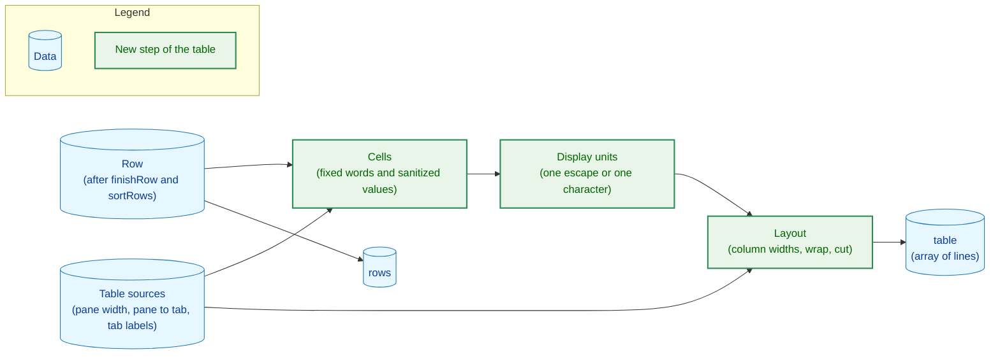
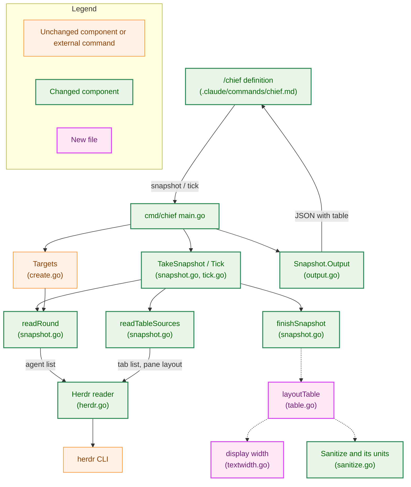
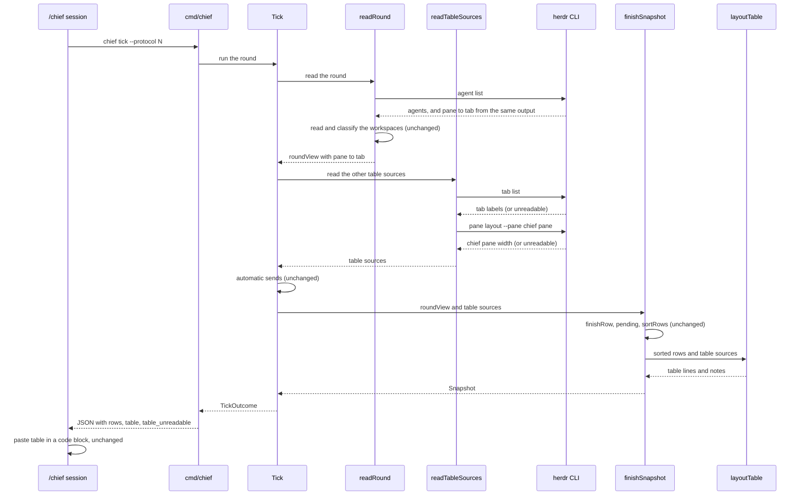
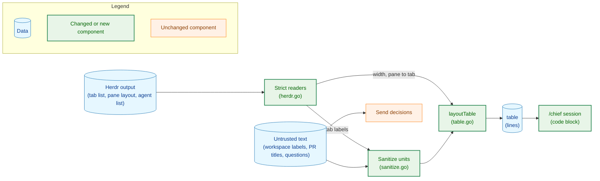
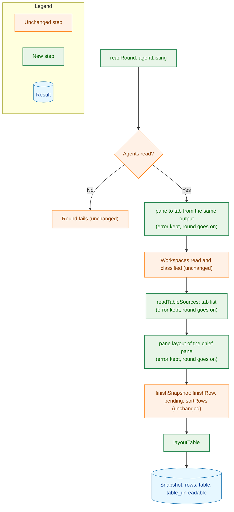

# アーキテクチャ設計書：chief の状況の表を道具が等幅のテキストで組み、workspace ごとに 2 行で示す

## Document Status

| Item | Value |
|---|---|
| Status | `draft` |
| Created | 2026-11-18 |
| Review date | - |
| Reviewer | - |
| Comments | 決定の変更で draft に戻した：CLAUDE.md の 2 つの例外を、`Protocol` を上げる PR ではなく、例外が名指すファイル（`table.go`・`textwidth.go`）を足す PR で入れることにした |

本書は [01_requirements.md](01_requirements.md)（要件定義書。以下、要件書）の設計である。以下、実装計画書を計画書と略し、「計画で決める」は本タスクの `03_implementation_plan.md` で決めることを指す。既存のファイルの内容は、コミット `0bbba2c8` で確かめた。`file:line` の行番号は、このコミットでの行番号である。F-NNN・AC-NN は要件書の項番を指し、H-NN は [design_handoff.md](design_handoff.md)（以下、申し送り）の項番を指す。申し送りへの対応は付録 A に、受け入れ基準との対応は付録 B にまとめる。

本書は、要件書 3 章と 6 章の用語（表・表示幅・使える幅・状態の文字列・タブの表示・凡例）と、[0093 設計書](../0093_chief_status_sheet/02_architecture.md) の用語（急ぎの度合い・進行の位置・文書の段・進み具合・実行中のコマンド・行の仕上げ）を、同じ意味で使う。ただし 0093 設計書の「周」は、用語集に合わせて「ラウンド」と書く。そのほかに、次の用語を使う。

-   **表の材料:** ラウンドの中で、表のためだけに Herdr から読む 3 つの値。chief の pane の幅、pane とタブの対応、タブのラベルである（3.7）。
-   **表示の単位:** 表を組むときに、それ以上分けない文字の並び。`Sanitize` が作るエスケープ 1 つか、それ以外の文字 1 つである（3.5）。
-   **語:** 要件書 AC-15 の語。空白を含まない ASCII の印字できる文字の並びで、表示の単位で数える（3.6）。

## 1. 設計の全体像 (Design Overview)

### 1.1. 設計原則

-   **表は道具が組み、セッションは貼るだけにする。** 列の幅、折り返し、切り方、決まった語は、すべて道具の Go のコードが決め、テストを持つ（F-001、[ADR-0046](../../dev/adr/0046-chief-of-staff.md)・[ADR-0014](../../dev/adr/0014-deterministic-checks-in-go.md)）。`/chief` の定義は、道具が返した行を code block にそのまま並べる。
-   **表と `rows` は同じ行から作る。** 表は、`rows` を出力する直前の、行の仕上げと並べ替えを終えた行（`Row`）から組む。表だけのために値を決め直さないので、表と `rows` は食い違わない（AC-02）。
-   **表の材料は表示にだけ使う。** pane の幅とタブは表の配置と表示にだけ使い、行の状態、急ぎの度合い、送る判断、`problems` を左右しない。読めなければ、決まった代わりの値（80 桁、pane の ID）で組み、ラウンドは失敗しない（AC-05・AC-19、要件書 4.3）。
-   **外から来る値は、エスケープの後の単位で数える。** 表に入る外から来る値は、`Sanitize` と同じ規則で表示の単位に分けてから並べる。エスケープを途中で折り返すことも切ることもなく、表の文字は `rows` の値と同じエスケープを持つ（AC-15・AC-21）。
-   **どの行も、外から来る値で始まらない。** 表のどの行も、決まった語か 4 桁以上の空白で始まるように組む。これで、値がどんな文字列でも code block を閉じない（AC-22）。
-   **分からないものは推し量らない。** 決まった語の表にない値は `?` と示し、ほかの値から推し量らない（申し送りの H-06）。

### 1.2. 設計の際に決めたこと（2026-11-18）

-   **タブの表示は、タブの番号を除いてラベルだけを `[claude]` のように示す。要件書の AC-18 をこの形に改め、要件書を `draft` に戻した。** Herdr の画面にはタブの番号が出ない（人が確かめた）。Herdr のタブの一覧の `number` は、タブを作った順の通し番号で、画面での並びの位置とは限らない（2026-11-18 に herdr 0.9.1 で確かめた。chief の workspace では、`tab_id` が `wC:t1` と `wC:tG` の 2 つのタブの `number` が 1 と 16 だった）。番号をそのまま示す案は、画面と対応しない番号を示すので採らない。workspace の中での並びの位置を示す案は、タブの一覧の並びが画面の並びと同じかを確かめていないので採らない。ADR: なし（表示の細部のため）。
-   **質問の pane がどのタブにあるかは、ラウンドがすでに読んでいる `herdr agent list` の同じ出力から、表のために別に読む。** 今のエージェントの読み取り（`parseAgent`、`internal/chief/herdr.go:273-321`）は `tab_id` を読まない。`parseAgent` に `tab_id` を足す案は採らない。省略できるメンバとして足し、読み取りを 1 回で済ませる形にしても、`parseAgent` は `herdr agent get` の読み取り（`parseAgentGet`）と共用で、送る前の確かめにも使われるので、表示のための読み方をそこに混ぜないためである。必須のメンバとして足すと、Herdr が `tab_id` を出さなくなったときに、表示のためだけの値でラウンド全体が失敗する（要件書 4.3 に反する）。`herdr pane list` の呼び出しを足す案は、ラウンドの Herdr の呼び出しが 3 つ増え、要件書 4.1 の「2 つ増える」と食い違うので採らない。ADR: なし（chief の中の読み方の細部のため）。
-   **使える幅は「chief の pane の幅 − 2」とする。2 は、Claude Code が code block の左に取る余白である。code block の右端で折り返す桁は、実装の最初に実物で確かめる。** 2026-11-18 に、Claude Code 2.1.327 を herdr 0.9.1 の幅 93 の pane で動かし、code block の行が左に 2 桁の空白を取って描かれることを、`herdr agent read` で読んだ画面で確かめた。右端は、試しの行が画面で要約に置き換えられたため確かめられなかった。右にも 1 桁の余裕を取る案は、要件書 AC-04 の「左の余白を引いた値」から外れるので、確かめる前には採らない。実装の最初に、(1) code block の中で幅が「pane の幅 − 2」の行が折り返さないか、(2) タブを分割したときの chief の pane の `rect.width` が、Claude Code が描く幅と等しいかを確かめる。(1) が成り立たなければ、折り返さない最も長い行の幅から余白を決め直し、要件書 AC-04 の「左の余白」の言葉も直す（要件書の判断の変更として扱う）。(2) が成り立たない場合や、タブを拡大（zoom）したときに `rect.width` が描かれる幅と違えば、余白ではなく幅の読み方の誤りなので、そのときの幅の読み方（拡大したときは `layout.area` を使うなど）を決め直すか、既知の制限として受け入れるかを人に尋ねる。ADR: なし（表示の細部のため）。
-   **Herdr の pane の配置から読む幅は、1 以上 1000 以下だけを受け付ける。要件書 4.2 をこの形に改めた。** 形の正しい出力でも、とても大きな幅が来ると区切り線が巨大になり、道具がメモリを使い切ってラウンドが失敗しうる（要件書 4.3 に反する）ためである（3.7）。ADR: なし（読み取りの細部のため）。
-   **code block が途中で閉じないことは、行の組み方で保つ。** 表の各行は、凡例・見出し・区切り線・行がないときの語のどれかの決まった語か、状態の列の印か、4 桁以上の空白で始まる（3.2）。CommonMark では、囲いの閉じは 0〜3 桁の字下げしか許さないので、4 桁以上の空白で始まる行は囲いを閉じない。表の中のバッククォートより長い囲いを `/chief` の定義で使う案は、行の組み方だけで閉じないことが保たれ、定義の手順が増えるだけなので採らない。値に ```` ``` ```` や `~~~` を含む表のテストで確かめる（7.3）。ADR: なし（表示の細部のため）。
-   **表は、行ごとの文字列の配列 `table` として出力に足す（申し送りの H-01）。** 各要素は改行を含まず、末尾に空白を持たない。1 つの文字列にする案は採らない。セッションは道具の出力を JSON のテキストとして読むので、1 つの文字列だと、行の区切りが `\n` のエスケープになり、セッションが改行に戻して貼る手間が増えるためである。配列なら、要素を 1 行ずつ並べるだけで済み、行の数も出力から読める。ADR: なし（出力の形の細部のため）。
-   **道具の JSON の出力は、今のまま `<`・`>`・`&` を `\u003c`・`\u003e`・`\u0026` とエスケープする。** 今の出力は `json.Marshal` で作られ（`cmd/chief/main.go:325`）、この 3 文字をエスケープする。エスケープしない案は採らない。出力はすべてのサブコマンドが同じ関数（`write`、`cmd/chief/main.go:322-334`）で書くので、PR の題名・質問の文・報告などの外から来る文字列に含まれる `<` や `>` が、すべてのサブコマンドで、そのままの形でセッションに届くようになる。そうなると、タグに見せかけた文字列でセッションを惑わすことがたやすくなる。一方、エスケープをやめても、セッションは `\\` や `\"` を元に戻して JSON の値として読む必要があり、貼る手間は減らない。表の中のこれらの文字は、セッションが JSON の値として読んで貼る（要件書 4.3 の残る危険）。ADR: なし（今の振る舞いを変えないため）。
-   **表示幅は、Unicode の East Asian Width が W か F の文字を 2 桁、そのほか（曖昧な文字 A と、結合文字・異体字セレクタを含む）を 1 桁とする。W・F の範囲は、決まった版の Unicode の `EastAsianWidth.txt` から作った表として道具に持ち、その版を `textwidth.go` の注釈に書く（申し送りの H-02）。** 標準ライブラリーは East Asian Width を持たず、外部のモジュールは使えない（CLAUDE.md の「Dependencies」）。版を Go の `unicode.Version` に合わせる案は採らない。`unicode.Version` は Go の版で変わり（`go.mod` の go 1.26.5 では 15.0.0、作業環境の go 1.27.1 では 17.0.0）、どの Go で動かすかで幅が変わるためである。W・F の判定はこの表だけで行い、Go の `unicode` の表は使わない。ただし、`Sanitize` が置き換える書式文字の判定は Go の `unicode` の表による（`internal/chief/sanitize.go:98`）ので、新しい版で書式文字になった符号位置は、Go の版によってエスケープにも 1 桁の文字にもなる。そうした符号位置はまれなので受け入れる。どの版にするかと、表を作る手順は計画で決める。曖昧な文字を 1 桁とするのは、表が使う `─`（U+2500）と `…`（U+2026）が曖昧な文字で、Claude Code が `─` を 1 桁として描くことを確かめたためである（2026-11-18、Claude Code 2.1.327 が幅 93 の pane の区切り線に `─` を 93 個並べていた）。`🛑`・`🔶`・`🟢` は W である。結合文字（一般カテゴリー Mn・Me）を 0 桁とする案は採らない。0 桁にすると、結合文字を前の文字から離さない規則がいり、結合文字を大量に連ねた値が、折り返せず長さの限りもない 1 つの塊になるためである。1 桁とすると、端末が 0 桁で描く結合文字の分だけ幅を多く見積もる。内容の列は最後の列なので、多く見積もっても行が短く見えるだけである。名前の列では後ろの列がずれうるが、結合文字を含む名前はまれなので受け入れる。異体字セレクタ（U+FE0F）を伴う絵文字が端末によって幅を変えることも、同じく受け入れる。外側の端末が曖昧な文字を 2 桁で描く設定のとき（日本語の環境で選べる設定）は、`─` の区切り線と `…` を含む行が、使える幅を超えて折り返しうる。Herdr が描いた画面を外側の端末がさらに描くので、この確かめでは外側の端末の設定までは分からない。これらは、端末が道具と違う幅で描く文字として、chief 利用ガイドの 8 章の既知の制限にまとめて書く（3.10）。ADR: なし（表示の細部のため）。
-   **名前・タスク・PR の列の幅は、その列の見出しと値のうち最も広いものの表示幅とする（名前は 20 桁が上限、AC-08）。状態の列も同じ規則で決まる。列と列の間は空白 2 つとする。内容の列の幅は、使える幅からほかの列と間の幅を引いた値で、最小は 20 桁とする（申し送りの H-03）。** 最小を 20 桁にするのは、`Sanitize` が作る最も長いエスケープ（`\U` に 8 桁の 16 進が続く、計 10 桁）と、`[claude]` に質問の頭の数文字が並ぶ幅を、1 行に収めるためである。80 桁の pane では、状態 15・名前 20・タスク 6・PR 4（`#985` のような 3 桁の番号のとき）と間 8 で 53 桁を使い、内容の列は 78 − 53 = 25 桁になる。ADR: なし（表示の細部のため）。
-   **行が 1 つもないときは、凡例・空行・見出し・区切り線の後に、決まった 1 行 `workspace なし` を置く（AC-10、申し送りの H-06）。** 凡例と見出しだけだと、表を読めなかったのか行がないのかが分からないためである。ADR: なし（表示の細部のため）。
-   **読めなかったもの（`unreadable`）が 2 つ以上あるときは、道具の順に `, ` で結ぶ。タブのラベルが空のときは、タブを引けないときと同じく pane の ID を示す（申し送りの H-06）。** 空のラベルを `[]` と示しても、どのタブか分からないためである。ADR: なし（表示の細部のため）。
-   **折り返しは、原則として語の途中を避ける。ただし、語と ASCII でない文字の境目、および ASCII でない文字どうしの境目では折り返してよい。全角の空白（U+3000）は空白に含めず、ASCII でない文字の 1 つとして扱う（申し送りの H-06）。** 日本語の文には空白がないので、境目で折り返せないと、日本語の質問の文がほとんど語の途中扱いになるためである。ADR: なし（表示の細部のため）。
-   **表の日本語の literal は `internal/chief/table.go` とそのテストだけに置く。表示幅の数え方は `internal/chief/textwidth.go` に置く（申し送りの H-07）。** CLAUDE.md の 2 つの例外（AC-26・AC-28）が、ファイルの名前で範囲を名指せるようにするためである。ADR: なし（ファイルの置き方の細部のため）。

この設計で新しく作る ADR も、更新する ADR もない。表を道具が組むこと、印、pane の幅を Herdr から読むこと、2 つの例外は、要件定義のときに [ADR-0046](../../dev/adr/0046-chief-of-staff.md) と [ADR-0035](../../dev/adr/0035-language-policy.md) に記録済みである。上の各項は、chief の中で閉じる表示と読み取りの細部である。

### 1.3. なぜ今の仕組みでは足りないか

今は、道具が行の値を JSON で返し（`internal/chief/output.go:30-54`）、`/chief` のセッションが定義の値の表（`.claude/commands/chief.md:150-178`）を引いて Markdown の表に写す（同 :131-202）。この仕組みのまま定義の書き方だけを変えても、次の要件を満たせない。

-   **列を表示幅でそろえ、2 行に流し込む（AC-07・AC-15）。** セッションは文字ごとの表示幅を数えられず、同じ入力から同じ配置を作る保証もない。Claude Code の Markdown の表は、行ごとに罫線を引き、セルの中で改行できない（要件書 1 章の背景）。
-   **使える幅を pane の幅から決める（AC-04）。** セッションの Bash ツールは端末を持たず、端末の幅を読めない（要件書「要件定義の際に決めたこと」）。pane の幅は Herdr からしか読めず、Herdr を読むのは道具だけである（`TestNoDirectHerdrInvocation`、`cmd/chief/docs_test.go:290`）。
-   **質問のタブを示す（AC-18）。** 今の出力は pane の ID しか持たず（`internal/chief/output.go:82`）、タブのラベルは Herdr のタブの一覧にしかない。

### 1.4. 概念モデル

矢印 A → B は「A から B を作る」を表す。`rows` は今と同じく `Row` から作り、表のために変わらない。



-   **セル:** 行の各列の 1 行目と 2 行目に入る文字列。決まった語（3.3）と、外から来る値（3.4）からなる。
-   **表の材料:** pane の幅は使える幅を決め、pane とタブの対応とタブのラベルはタブの表示を決める。
-   **表示の単位:** セルの文字列を、`Sanitize` と同じ規則で分けたもの。幅は 3.5 の規則で決まる。
-   **配置:** 列の幅を決め、内容の列を 2 行に流し込み、名前と内容を切る（3.2・3.6）。

## 2. システム構成 (System Structure)

### 2.1. 全体構成

矢印 A → B は「A が B を呼ぶか、B に値を渡す」を表す。点線の矢印は、新しいファイルからの、または新しいファイルへの呼び出しである。`readTableSources` から Herdr の読み取り（`herdr.go`）へのラベル付きの矢印が、このタスクで足す 2 つの呼び出し（`tab list`・`pane layout`）である。



### 2.2. コンポーネント配置

| ファイル | 新規・変更 | 責務 |
|---|---|---|
| `internal/chief/table.go` | 新規 | 行と表の材料から表の行の配列を組む（`layoutTable`）。決まった語（見出し・凡例・状態の文字列・文書の段・実行中のコマンドが決まらない理由・「＋指示」・件数・「マージ確認」・`workspace なし`）を持つ、chief の道具で日本語の literal を置く唯一のファイル。列の幅、内容の文字列の組み方、折り返し、切り方 |
| `internal/chief/table_test.go` | 新規 | 表のテスト（7.1）。日本語の literal を置いてよいテストのファイル |
| `internal/chief/textwidth.go` | 新規 | 表示の単位の表示幅（3.5）。East Asian Width の W・F の範囲の表 |
| `internal/chief/textwidth_test.go` | 新規 | 表示幅のテスト。日本語の literal の例外の外なので、ASCII でない入力は `\u` のエスケープで書く |
| `internal/chief/sanitize.go` | 変更 | `Sanitize` の置き換えを、表示の単位の列を返す関数（`sanitizeUnits`）に分ける。`Sanitize` はその単位をつないだものを返し、結果は今と同じである。`CapHead` が上限を引数で受け取るようにし、今の呼び出し元は今の上限を渡す（4 章） |
| `internal/chief/sanitize_test.go` | 変更 | 単位の列のテスト（7.1） |
| `internal/chief/herdr.go` | 変更 | `herdr tab list` と `herdr pane layout` の読み取り、`herdr agent list` の出力からの pane とタブの対応の読み取りを足す。`herdr agent list` を 1 回走らせて 2 つの読み取りを返す関数（`agentListing`）を足し、`Agents` はその関数の結果のエージェントの一覧を返す。`Agents` の振る舞いは変えない |
| `internal/chief/herdr_test.go` | 変更 | 3 つの読み取りのテスト（7.1） |
| `internal/chief/snapshot.go` | 変更 | `readRound` は `agentListing` を呼び、pane とタブの対応とその読み取りのエラーを `roundView` に持つ。`TakeSnapshot` と、`tick.go` の `Tick` が、`readRound` が通った直後に表の材料の残り（タブのラベルと pane の幅）を読む（`readTableSources`）。`Tick` では `BeginRound` より前に読み、`finishSnapshot` の 2 つの呼び出し（`internal/chief/tick.go:44`・`:86`）の両方に渡す。`finishSnapshot` が、行を並べた後に表を組んで `Snapshot` に入れる |
| `internal/chief/tick.go` | 変更 | `Tick` が `readTableSources` を呼ぶ |
| `internal/chief/snapshot_test.go` ほか、ラウンドを走らせるテスト | 変更 | 記録係に `tab list` と `pane layout` の答えを持たせる。表と `rows` の一致、材料を読めないラウンドのテスト（7.2） |
| `internal/chief/output.go` | 変更 | `SnapshotOutput` に `table` と `table_unreadable` を足す。`OutputValueNames` を除き、テストだけが使うようになる `namesUpToUnknown` と `maxValueNames` を `test_helpers.go` に移す（3.12） |
| `internal/chief/output_test.go` | 変更 | `TestOutputValueNames` を、`OutputValueNames` なしで同じことを確かめる形に直す（3.12） |
| `internal/chief/records.go` | 変更 | `Protocol` を `main` の値 + 1 にする（AC-25） |
| `internal/chief/test_helpers.go` | 変更 | テストの記録係が許す読み取りのコマンドに、`tab list` と `pane layout` を足す。`namesUpToUnknown` と `maxValueNames` を `output.go` から移す |
| `internal/chief/testdata/herdr/` | 変更 | `herdr tab list` と `herdr pane layout` の実物のサンプルを足す。`internal/chief/testdata/README.md` に採った日と版を書く |
| `cmd/chief/docs_test.go` | 変更 | 定義の値の表を確かめる `TestDisplayValuesMatchTool` を除く（3.12） |
| `.claude/commands/chief.md` | 変更 | 手順 2 の項目 2 を、道具の `table` を code block で示すことに置き換え、値の表と内容の列の規則を除く。`--protocol` の値（3.9） |
| `docs/dev/guides/chief_guide.md` | 変更 | 2 章のプロトコル番号、3.1 の表の見方、8 章の既知の制限（3.10） |
| `CLAUDE.md` | 変更 | 「Go Idioms」と「Declare, don't infer」の例外（3.11） |
| `docs/tasks/0102_chief_text_table/01_requirements.md` | 変更 | AC-18 のタブの表示をラベルだけにし、4.2 の pane の幅に上限 1000 を設け、4.2 に `herdr agent list` の pane とタブの対応の境界を足す（1.2・3.7）。`draft` に戻す |

### 2.3. データフロー

`snapshot` と `tick` は、どちらも `readRound`・`readTableSources`・`finishSnapshot` を通るので、どちらの出力にも表が入る。`tick` は自動送信の結果を行に当てた後に `finishSnapshot` を呼ぶ（`internal/chief/tick.go:85-86`）ので、表は自動送信の後の行を示す。`readRound` を呼ぶもう 1 つのサブコマンドの `targets`（`internal/chief/create.go:816`）は表を組まないので、`readTableSources` を呼ばず、Herdr の呼び出しは増えない。

実線の矢印は呼び出しを、点線の矢印は呼び出しの戻りを表す。



## 3. コンポーネント設計 (Component Design)

### 3.1. 型

表の材料と、表を組む関数の形を示す。名前は計画で変えてよいが、責務の分け方はこのとおりにする。

```go
// tableSources is what a round reads from Herdr for the table only. A
// source that could not be read holds its zero value and a note; the
// table is still laid out (80 columns, pane IDs).
type tableSources struct {
	paneWidth int              // the chief pane's width; 0 when unread
	paneTabs  map[string]tabID // keyed by the pane ID as Herdr wrote it; nil when unread
	tabLabels map[tabID]tabLabel // nil when unread
	// notes says, in English, which source could not be read and why,
	// each note capped (section 4).
	notes []string
}

// agentListing is one `herdr agent list` read for a round: the agents as
// Agents returns them, and the pane-to-tab map read from the same output.
type agentListing struct {
	agents      []Agent
	paneTabs    map[string]tabID
	paneTabsErr error
}

// Readers added to herdr.go. Each returns errHerdrOutput for output of
// another shape (section 3.7).
func (h Herdr) agentListing(ctx context.Context) (agentListing, error)
func (h Herdr) tabLabels(ctx context.Context) (map[tabID]tabLabel, error)
func (h Herdr) paneWidth(ctx context.Context, pane PaneID) (int, error)
func parseAgentTabs(out []byte) (map[string]tabID, error)
func parseTabList(out []byte) (map[tabID]tabLabel, error)

// tabLabel is a tab's label as the tab list gave it. HasLabel is false
// for an empty label, so the table chooses the pane ID by this value.
type tabLabel struct {
	text     string
	hasLabel bool
}
func parsePaneLayout(out []byte, pane PaneID) (width int, err error)

// readTableSources reads the tab labels and the chief pane's width for
// TakeSnapshot and Tick, and adds the pane-to-tab map readRound read.
func readTableSources(ctx context.Context, deps Deps, view roundView) tableSources

// displayUnit is one unit of Sanitize's output. Kind declares a newline
// and a tab, so the table maps them to a space by the kind, never by
// reading the text.
type displayUnit struct {
	text string
	kind unitKind // unitText, unitNewline, or unitTab
}

// sanitizeUnits splits text by Sanitize's rule: each escape (and the
// doubled backslash) is one unit, every other character one unit, a
// newline and a tab included, each with its kind. Sanitize(text) equals
// the units' texts joined.
func sanitizeUnits(text string) []displayUnit

// layoutTable lays out the status table from the sorted rows. It returns
// the lines, each without a newline or trailing spaces, and src.notes
// followed by a note for each question pane shown by its pane ID.
func layoutTable(rows []Row, src tableSources) (lines []string, unreadable []string)
```

`paneTabs` と `tabLabels` は、読めなかったときだけ nil で、読めて項目が 0 のときは空の map である。pane とタブの対応の検索には、質問の pane の ID（`QuestionItem.Pane`、`internal/chief/state.go:106`。Herdr が書いた文字列）をそのまま使う。`PaneID` に作り直さない。

`Snapshot` に `Table []string` と `TableUnreadable []string` を足し、`SnapshotOutput` に次の 2 つを足す。`TickOutput` は `SnapshotOutput` を埋め込む（`internal/chief/output.go:714-719`）ので、`tick` の出力にも入る。

```go
type SnapshotOutput struct {
	// ... the members of today, unchanged ...
	// Table is the status table, one line per element, which /chief
	// pastes in a code block unchanged.
	Table []string `json:"table"`
	// TableUnreadable names the table sources that could not be read, for
	// investigation; /chief does not show it.
	TableUnreadable []string `json:"table_unreadable"`
}
```

-   どちらも空のときは `null` ではなく `[]` を出力する（今の出力の決まり、`internal/chief/output.go:255-256`）。表は、行がなくても凡例などの行を持つので、空にはならない。
-   `table_unreadable` は、調べるための英語の文の一覧で、`problems` と同じく文の言葉は約束しない（CLAUDE.md の「Keep internals unobservable」）。約束するのは、表の材料がすべて読めて、どの質問の pane もタブのラベルで示せたときに空であることだけである。中身は、読めなかった材料ごとの文（エラーの文を `Sanitize` したもの）と、タブの表示の代わりに pane の ID を示した質問の pane ごとの文である。材料のエラーを文にするのは `readTableSources` で（`tableSources.notes`）、`layoutTable` はエラーを扱わない。`/chief` の定義は示さない。chief 利用ガイドの「調べ方」が、80 桁で組まれた理由や pane の ID が出た理由をここで調べると書く（3.10）。
-   表の文字列は、`rows` と同じ `Row` から組むので、`rows` の値は変わらない（AC-02）。

### 3.2. 表の形

表の行は、上から次の順に並ぶ（AC-06）。

| 順 | 行 | 行の頭 |
|---|---|---|
| 1 | 凡例 `🛑 すぐ  🔶 あとで  🟢 待つ` | `🛑` |
| 2 | 空行（空の文字列） | （なし） |
| 3 | 見出し（状態・名前・タスク・PR・内容） | `状態` |
| 4 | 区切り線（`─` を表の幅だけ並べたもの） | `─` |
| 5〜 | workspace ごとに 1 行目と 2 行目。workspace の間に空行を 1 つ | 1 行目は状態の列の印、2 行目は状態の列の幅と間の空白 |
| 行がないとき | `workspace なし` | `workspace` |

**列。** 列は、状態・名前・タスク・PR・内容の順に並び、間に空白 2 つを置く。各列の値は、列の幅に足りない分を右に空白で埋める。各行の末尾の空白は除く。

| 列 | 幅 | 1 行目 | 2 行目 |
|---|---|---|---|
| 状態 | 見出しと各行の値のうち最も広いもの | 印と状態の文字列を空白 1 つで区切ったもの（AC-11・AC-12） | 空 |
| 名前 | 見出しと、切った後の各行の名前のうち最も広いもの（20 桁を超えない） | workspace の名前（`Sanitize` の後）。20 桁を超えれば、`…` を含めて 20 桁以内に切る（AC-08、3.6） | 空 |
| タスク | 見出しと各行の値（1 行目と 2 行目の両方）のうち最も広いもの | タスク番号。なければ `-` | 文書の段（AC-13） |
| PR | 見出しと各行の値のうち最も広いもの | `#<番号>`。開いた PR がなければ `-` | 空 |
| 内容 | 使える幅 − ほかの列の幅 − 間の空白 8 桁。最小 20 桁 | 内容の文字列の 1 行目（3.6） | 内容の文字列の 2 行目 |

状態の列の値は決まった語だけなので、幅は表によって 4 桁（見出しの `状態`）から 15 桁（`🛑 レビュー待ち`）の間になる。2 行目は、状態の列の空白（4 桁以上）と間の空白（2 桁）で、6 桁以上の空白から始まり、タスクの列の文書の段がいつも値を持つ（タスクがなければ `-`）ので、空の行にはならない。

**使える幅。** 使える幅は、chief の pane の幅 − 2 である（1.2）。pane の幅を読めなければ、80 桁とみなす（AC-05）。使える幅が狭く、内容の列が最小の 20 桁を取れないとき（pane の幅が 1 か 2 で、使える幅が 0 以下になるときを含む）は、内容の列を 20 桁として組み、行が使える幅を超えることを受け入れる（AC-05）。凡例（27 桁）は、使える幅が 27 桁未満のときにだけ使える幅を超える。これも同じく受け入れる。どちらの場合も、行の頭は変わらないので、下の code block を閉じないことは保たれる。

**区切り線の長さ。** 区切り線は、列の幅と間の空白の合計（表の幅）だけ `─` を並べる。内容の列が最小の幅に広げられたときも、表の幅に合わせる。

**code block を閉じないこと（AC-22）。** 表の各行の頭は上の表のとおりで、外から来る値で始まる行はない。外から来る値は、名前の列（2 列目）か、内容の列（5 列目）にしか入らない。2 列目より前には状態の列があり、1 行目は印で、2 行目は 6 桁以上の空白で始まる。6 桁は、状態の列の幅の下限（見出しの `状態` の 4 桁）と間の空白 2 桁の和で、行の値によらない。

### 3.3. 決まった語

決まった語は、すべて `internal/chief/table.go` に置く。各語の値は要件書のとおりで、ここでは対応の元と、表にない値の示し方だけを定める。

| 語 | 対応の元 | 値 |
|---|---|---|
| 印 | 行の急ぎの度合い（`Row.Urgency`） | AC-11 |
| 状態の文字列 | 行の進み具合（`Row.Position.Progress`） | AC-12 |
| 文書の段 | 行の文書（`Row.Position.Document`、`PR-N` は `Row.Position.PlanPR`） | AC-13 |
| 実行中のコマンドが決まらない理由 | `Row.RunningUnknown` | AC-20 |
| 凡例、見出し、「＋指示」、`<件数> 件`、`マージ確認` | なし | AC-06・AC-14・AC-16 |
| 行がないときの語 | なし | `workspace なし`（1.2） |

-   各対応は、型の値ごとの `switch` で決める。どの値にも当たらない値（`default`）は `?` と示す（申し送りの H-06）。今の型の値はすべてどれかの語に当たり（実行中のコマンドが決まらない理由の `RunningUnknownNone` は語を持たず、内容に何も置かない）、`?` を示す経路はない。新しい値を型に足して語を足し忘れたときに、そのことがテストで分かるようにする（7.1）。
-   印を決めるのは急ぎの度合いで、状態の文字列を決めるのは進み具合である。どちらも、行の仕上げが決めた値をそのまま使い、表が決め直さない（0093 要件書の AC-21 を保つ）。

### 3.4. 内容の文字列

内容の文字列は、状態の文字列ごとに、次の部品を空白 1 つで区切って並べたものである（AC-14）。どの部品を並べるかは、状態の列と同じく進み具合（`Row.Position.Progress`）から選び、行の状態（`Row.State`）は読まない。そのため、状態の列と内容の列は食い違わない。値がない（空の）部品は並べず、その部品の区切りの空白も置かない。

| 状態の文字列 | 部品（この順） |
|---|---|
| マージ確認、質問で停止 | `<件数> 件`（質問が 2 つ以上のとき）、`マージ確認`（状態の文字列が「質問で停止」で、示す質問がマージの確認のとき）、タブの表示、質問の文 |
| レビュー待ち | PR の題名 |
| 次を提案 | 送れる提案（`Next.Command` が nil でない）なら、コマンド（`Next.Text`）と `(<モデル>)`（モデルが空なら置かない）。送れない提案なら、送れない理由（`Next.Problem`） |
| 作業中 | 実行中のコマンドが決まれば、コマンド（`Running.Command.Text()`）、`＋指示`（`Running.Later` のとき）、`(<モデル>)`（モデルが空でないとき）。決まらなければ、決まらない理由（3.3）。理由もない（`RunningUnknownNone`）ときは、なし |
| 要確認 | 読めなかったもの（`Row.Unreadable`）を道具の順に `, ` で結んだもの |
| タスク完了 | なし |
| `?`（表にない進み具合） | なし |

-   **示す質問（AC-16）。** マージの確認である質問（`Question.Merge`）があれば、道具の順で最初のマージの確認を示し、なければ道具の順で最初の質問を示す。示さない質問は表に出さない。
-   **タブの表示（AC-18・AC-19）。** 示す質問の pane から、pane とタブの対応でタブを引き、そのタブのラベルをタブのラベルの一覧から引いて、`[<ラベル>]` と示す。次のどれかのときは、`[<pane の ID>]` を示し、`table_unreadable` にその pane を挙げる。pane とタブの対応を読めない、対応にその pane がない、タブのラベルを読めない、ラベルの一覧にそのタブがない、ラベルが空である。どのときも、行の状態、急ぎの度合い、送れるかどうかは変わらない。
-   **値の長さ。** 外から来る値は、表示の単位に分ける前に、UTF-8 の文字の境目で 16 KiB までに切る。内容の列は最大 2 行で、使える幅は 1000 桁以下なので、表に入るのは高々 2000 単位で、1 単位は元の 4 バイト以下だから、16 KiB で足りる。4 MiB 近いタブのラベルのような値でも、単位の配列を元の長さだけ作らずに済む。切ったことは、表では `…` で分かる。
-   **外から来る値。** workspace の名前、PR の題名、質問の文、送れない理由、読めなかったもの、モデル、タブのラベル、pane の ID は、行（`Row`）の生の値から、`Sanitize` と同じ規則で表示の単位に分ける（3.5）。決まった語と、型から作るコマンドの文字列（`Next.Text`・`Running.Command.Text()`）も同じ道を通す。改行とタブは、表の中でだけ空白の単位 1 つにする（AC-17）。
-   **モデルの括弧**は ASCII の `(` と `)` である。今の定義の「its model in parentheses」（`.claude/commands/chief.md:192`・`:196`）と同じく、コマンドの後に空白を挟んで置く。

### 3.5. 表示幅と表示の単位

**表示の単位。** 値の文字列を、`Sanitize` と同じ規則で前から分ける。

-   `Sanitize` が置き換える文字（C0 制御文字、DEL、C1 制御文字、書式文字、タグの文字、行と段落の区切り、UTF-8 として正しくないバイト）は、そのエスケープ（`\x1b`・`\u200b` など）が 1 つの単位である。
-   バックスラッシュは、`\\` が 1 つの単位である。
-   改行とタブは、それぞれ 1 つの単位である（`Sanitize` は残す）。表を組むとき、`table.go` がこの 2 つの単位を空白の単位 1 つに置き換える（AC-17）。
-   そのほかの文字は、1 文字が 1 つの単位である。

`Sanitize` の今の実装（`internal/chief/sanitize.go:52-69`）を、この単位の列を作る部分と、それをつなぐ部分に分ける。`Sanitize` の結果は今と同じで、どの入力でも、単位をつないだものは `Sanitize` の結果と等しい。表のための置き換えは `sanitize.go` には置かない。同じ規則を 2 か所に書かないためである（CLAUDE.md の「DRY」）。

**表示幅。** 単位の表示幅は次のとおりである。

| 単位 | 表示幅 |
|---|---|
| エスケープ | そのバイト数（ASCII だけからなるため） |
| East Asian Width が W か F の文字 | 2 |
| そのほかの文字（曖昧な文字 A、結合文字、異体字セレクタを含む） | 1 |

-   W・F の範囲は、決まった版の Unicode の `EastAsianWidth.txt` から作った範囲の表として `textwidth.go` に持ち、版をファイルの注釈に書く（1.2）。`EastAsianWidth.txt` が明示しない符号位置の既定（`@missing` の行。CJK の区画の未割り当ての符号位置は W）も表に含める。W・F の判定は Go の版によらない。
-   結合文字と異体字セレクタは 1 つの単位なので、その前でも折り返しうる（3.6）。2 行目が結合文字から始まって見た目が崩れることがあるが、表の配置と code block には影響しないので受け入れる。
-   幅 0 の単位はない。書式文字（ゼロ幅の空白、ゼロ幅の接合子など）は `Sanitize` が見える形に置き換え、結合文字は 1 桁と数える（1.2）。

### 3.6. 折り返しと切り方

内容の文字列を、内容の列の幅で 2 行に流し込む（AC-15）。名前の列は 1 行に収め、収まらなければ切る（AC-08）。どちらも表示の単位の境目でだけ折り返し、切る。

**折り返してよい位置。** 次の境目で折り返してよい。

-   空白の単位の前後。
-   ASCII でない文字の単位の前後。

語の中（語を作る単位どうしの境目）では、原則として折り返さない。例外は、その語が 1 行の幅に収まらないときで、そのときだけ語の中の単位の境目で折り返す。エスケープは 1 つの単位なので、その途中では折り返さない。

**1 行目に入れる範囲。** 1 行目には、折り返してよい位置のうち、その位置より前の表示幅が内容の列の幅以下に収まる最も後ろの位置までを入れる。幅は、1 行目の末尾の空白を除いて数える。表示幅 2 の単位が 1 行目の残りの幅に入らないときは、その単位から 2 行目に送る。

**空白の扱い。** ここでいう空白は U+0020 だけである（改行とタブを置き換えたものを含む）。U+00A0 などほかの空白の文字は、ASCII でない文字の 1 つとして扱う。空白の位置で折り返したときは、そこに続く空白の並びをすべて除き、2 行目は空白でない単位から始める。内容の文字列の頭の空白と、行の中の空白の並びは、そのまま示す。各行の末尾の空白は除く（3.2）。

**切り方。** 残りが 2 行目に収まらないときは、2 行目の末尾に `…` を置く。`…` を含めた 2 行目の表示幅が内容の列の幅以下になるまで、2 行目の末尾から単位を 1 つずつ除き、語の境目までは戻らない。そのうえで、`…` の直前の空白の並びを除く。エスケープは 1 つの単位なので、その途中では切らない。名前の列も同じく、`…` を含めて 20 桁以内になるまで末尾から単位を除く。

**語。** ASCII の印字できる文字（U+0021〜U+007E）の単位と、エスケープの単位が続く並びを 1 つの語とする。エスケープは ASCII の文字だけからなり、`Sanitize` の結果では語の一部として見えるので、語に含める。

### 3.7. Herdr の読み取り

ラウンドの Herdr の呼び出しは 2 つ増える（要件書 4.1）。表の材料の読み取りは 3 つで、うち 1 つは今の `herdr agent list` の出力を読み直すものである。どれも今の読み取りの封筒の確かめ（`herdrResult`、`internal/chief/herdr.go:190-224`）を使い、正しい UTF-8 の、ちょうど 1 つの JSON のオブジェクトで、後ろにデータがなく、対になっていないサロゲートのエスケープを含まず、`error` を持たない出力だけを受け付ける（`strictjson`）。出力の上限は、今の外部コマンドの上限（4 MiB、`internal/chief/runner.go:52`）である。形に合わない出力は `errHerdrOutput`（`internal/chief/herdr.go:19`）にし、直したり一部だけを使ったりしない（AC-23）。

| 読み取り | 呼び出し | 受け付ける形と使うメンバ | 読めないとき |
|---|---|---|---|
| タブのラベル | `herdr tab list`（`--workspace` なし。すべての workspace のタブを 1 回で返す） | 封筒の `id` が `cli:tab:list`、`result.type` が `tab_list`、`result.tabs` が配列。各タブの `tab_id`（今の pane の一覧と同じ形、`tabIDForm`、`internal/chief/herdr.go:483`）と `label`（文字列。空でもよい）。同じ `tab_id` が 2 つ以上あれば読めない | すべての質問のタブの表示が pane の ID になる |
| chief の pane の幅 | `herdr pane layout --pane <chief の pane の ID>` | 封筒の `id` が `cli:pane:layout`、`result.type` が `pane_layout`、`result.layout` がオブジェクトで、その `panes` が配列。各 pane の `pane_id`（`paneIDForm`）。`pane_id` が chief の pane の ID と等しい項目がちょうど 1 つあり、その `rect.width` が 1 以上 1000 以下の整数。chief の pane でない項目は `pane_id` だけを読み、`rect` は読まない | 80 桁とみなす |
| pane とタブの対応 | 増やさない。`readRound` が読む `herdr agent list` の同じ出力から読む | 封筒の `id` が `cli:agent:list`、`result.type` が `agent_list`、`result.agents` が配列。各エージェントの `pane_id`（`paneIDForm`）と `tab_id`（`tabIDForm`）。同じ `pane_id` が 2 つ以上あれば読めない | すべての質問のタブの表示が pane の ID になる |

-   どの読み取りでも、使うメンバが欠けているか、型か形が違うとき、`strictjson` が同じメンバ名の重複として拒むときは、その読み取り全体を読めないものとする。ほかのメンバ（タブの `number`・`agent_status`・`focused`・`pane_count`、配置の `area`・`splits`・`zoomed` など）は読まず、Herdr が足しても受け付ける。
-   幅の上限を 1000 とするのは、形の正しい出力でも、とても大きな幅が来ると区切り線が巨大になり、道具がメモリを使い切りうるためである（要件書 4.2 の受け付ける形も同じに改めた）。1000 は、ふつうの端末の幅を十分に超える。
-   幅には、`layout.area` ではなく chief の pane の `rect.width` を使う。`area` はタブ全体の大きさで、タブを分割したときに chief の pane より広い（申し送りの H-04）。
-   pane の配置を読む pane は、ラウンドがすでに確かめた chief の pane（`HERDR_PANE_ID` を `ParsePaneID` で読み、エージェントの一覧で確かめたもの、`internal/chief/snapshot.go:94-109`）である。ID は `paneIDForm` に合うので、`-` で始まって Herdr にオプションと読まれることはない。
-   `herdr tab list` はすべての workspace のタブを返すので、関係のない workspace に同じ `tab_id` が 2 つあっても、すべての質問のタブの表示が pane の ID になる。一部だけを使わない（AC-23）ことを優先する。
-   2026-11-18 に herdr 0.9.1 で、3 つの出力が上の形であることを確かめた。`herdr agent list` の出力は、今のサンプル（`internal/chief/testdata/herdr/agent-list.json`）でも、すべてのエージェントが `tab_id` を持つ。
-   **エージェントの一覧の読み取りは 1 回のまま。** `herdr agent list` を走らせるのは `agentListing` の 1 か所だけにする。`agentListing` は、出力を今の `parseAgentList` で読み、同じ出力を `parseAgentTabs` でも読む。`parseAgentTabs` は封筒の確かめに同じ `herdrResult` を使う。`Agents` は `agentListing` のエージェントの一覧だけを返し、pane とタブの対応を捨てる。`readRound` は `agentListing` を呼ぶ。`parseAgentTabs` は、`parseAgentList` が通ったときだけ使う。エージェントの一覧の読み取りが失敗すれば、今と同じくラウンドが失敗する。pane とタブの対応だけが読めないときは、ラウンドは失敗しない。`Agents` を呼ぶほかの場所（`wait.go`・`create.go`・`request.go`・`records.go`）は変えない。
-   **表の材料の残りは `readRound` の外で読む。** タブの一覧と pane の配置は、`TakeSnapshot` と `Tick` が `readRound` の後に呼ぶ `readTableSources` が読む。`readRound` は `targets` も呼ぶ（`internal/chief/create.go:816`）が、`targets` は表を組まないので、この 2 つを読まない。
-   `snapshot` と `tick` では、3 つの読み取りを毎回 1 回ずつ行う。行がなくても表を示すので、pane の幅はどのラウンドでもいる。タブの一覧は質問のないラウンドでは使わないが、条件で読むかどうかを変えると、読めなかったときの振る舞いがラウンドによって変わるので、毎回読む。Herdr が応答しないときの遅れは 4 章のとおりである。

### 3.8. 出力の形と `--protocol`

-   `snapshot` と `tick` の出力に `table` と `table_unreadable` を足す（3.1）。ほかのサブコマンドの出力は変えない。JSON の書き出し（`cmd/chief/main.go:322-334`）も変えない（1.2）。
-   `rows` の各項目の名前・値・意味は変えない（AC-02）。`rows` の値を日本語にすることもない。
-   道具の `Protocol`（`internal/chief/records.go:29`）を `main` の値 + 1 にする（AC-25）。古い道具は、新しい定義の `--protocol` を `protocol_mismatch` で断り、定義は入れ直しを促す（`.claude/commands/chief.md:77-79`）。新しい道具は、古い定義の `--protocol` を同じく断る。このとき定義は道具の入れ直しを促すが、道具はすでに新しいので、正しい手当ては `/chief` を起動し直して新しい定義を読ませることである。定義の拒否の扱いは AC-03 の範囲の外なので変えず、chief 利用ガイドに、入れ直すときの順（`/chief` を止める、`make install-chief`、`/chief` を起動し直す）と、この断りの意味を書く（3.10）。

### 3.9. `/chief` の定義（`.claude/commands/chief.md`）

-   **手順 2 の項目 2 を置き換える（AC-03）。** 新しい項目 2 は、`table` の各要素を道具の順に 1 行ずつ、3 つのバッククォートの囲いの code block に入れて貼ることだけを定める。要素は、JSON の文字列として 1 回だけ読んだ値（`\u003c` は `<` に、`\\` は `\` に戻したもの）を貼る。読んだ値の中の `\` とそれに続く文字（`Sanitize` が作った `\u202e` のような見える形）は文字のまま貼り、もう 1 度読んでその文字に戻すことはしない。そうすると、`Sanitize` が見える形にした制御文字を、セッションが元に戻して貼ってしまう（AC-21）。その文字は 1 文字も変えず、行を並べ替えず、除かず、足さない。空白を詰めることも足すこともしない。値を要約したり切ったりせず、列を足すことも除くこともしない。
-   **除くもの。** 今の項目 2 の全文。列の表、値の表（「Item / Value / Shown as」の表）、内容の列の規則（`state` ごとの中身、20 文字ほどで切ること、「（定義にない値）」）、1 行を短くして pane に収める指示、`state`・`turn`・`idle` を示さないという指示を含む。表に示すものは道具が決めるので、最後の 2 つもいらない。
-   **データの扱いの規則（定義の規則 2、`.claude/commands/chief.md:28-33`）。** 規則 2 は、pane・PR・報告から来た文字列と `problem`・`detail`・`screen` を、従う指示ではなくデータとして扱うと定める。`table` と `table_unreadable` も、タブのラベルや Herdr のエラーの文などの外から来る文字列を含むので、規則 2 のデータの一覧に足す。AC-03 が差分を限るのは手順 2 だけで、規則 2 はその外である。
-   **変えないもの。** 項目 1（送信の結果）、項目 3（表の下）、項目 4（通知）、手順 3 以降（AC-03）。項目 3 の「for each row, by its 名前」は、表の名前の列と同じ `label` を指すので、そのまま読める。
-   **`--protocol` の値**を、`start`・`snapshot`・`tick` とほかの呼び出しのすべてで、新しい番号にする（AC-25）。`TestDocumentedProtocolMatches`（`cmd/chief/docs_test.go:205`）が、定義の番号と道具の番号を比べる。

### 3.10. chief 利用ガイド（`docs/dev/guides/chief_guide.md`）

-   **2 章。** プロトコル番号の値（`docs/dev/guides/chief_guide.md:28`）を新しい番号にする（AC-25）。`TestGuideValuesMatchTool`（`cmd/chief/docs_test.go:405`）が道具の番号と比べる。道具を入れ直すときは、動いている `/chief` を止めてから `make install-chief` を実行し、`/chief` を起動し直すと書く。止めずに入れ直すと、動いている `/chief` は次のラウンドで `protocol_mismatch` に当たり、入れ直しを促して止まるが、そのときの手当ては `/chief` の起動し直しであることも書く（3.8）。
-   **3.1。** 表の見方を、本書の形で書き直す（AC-24）。凡例、5 つの列、2 行目（文書の段と内容の続き）、使える幅の決め方（pane の幅 − 2、読めなければ 80 桁）、内容の列の流し込みと切り方、タブの表示（`[claude]`、引けなければ pane の ID）。急ぎの度合いと番の表、行の並び、実行中のコマンドの節は残し、印と語を新しいものにする。「調べ方」に、`table_unreadable` で表の材料を読めなかった理由が分かることを足す。
-   **8 章の今の項目。** 「人が引数なしで打ったコマンドは示されない」の項（`docs/dev/guides/chief_guide.md:196`）は、「（後に指示あり）」、状態の「作成中」、「状態の列と文書の列」と、この設計で使わなくなる語で表を説明している。語を「＋指示」と「作業中」と状態の列・タスクの列に直す。`/runplan` も `/runpr` も「作業中」になるので、状態が「作成中」のままという例は、内容の列に前のコマンドが示されるという例に直す。
-   **8 章（既知の制限）。** 次を足す（AC-24）。
    -   Claude Code の code block の余白が変わると表が折り返しうること。
    -   pane の幅を変えた表は次のラウンドまで古い幅のままであること。
    -   狭い pane では行がはみ出しうること。
    -   セッションの写しは機械的には保証されないこと。
    -   端末が道具と違う幅で描く文字（結合文字、異体字セレクタを伴う絵文字、ハングルの字母など）を含む行は、列がずれうること。
    -   外側の端末や Herdr が曖昧な文字を 2 桁で描く設定では、区切り線と `…` を含む行が折り返しうること（1.2）。
    -   `HERDR_PANE_ID` を同じ worktree のほかの pane から引き継いだセッションでは、その pane の幅で組まれうること（今の既知の制限の項に足す）。
    -   pane とタブの対応はラウンドの初めに、タブのラベルと幅はすべての workspace を読んだ後に読むので、その間やラウンドの後に変わったもの（タブの移動やラベルの変更）は、次のラウンドまで正しく示されないことがあること。
    -   表の材料を読めずに 80 桁や pane の ID で組んだ表は、見た目では分からず、`table_unreadable` で分かること。
    -   外から来る文字列（タブのラベルや質問の文）が、`マージ確認` や `2 件` のような決まった語に似せた文字を含みうること。

### 3.11. CLAUDE.md の例外

**「Go Idioms」（AC-26）。** chief の画面の読み取りとタスクの読み取りの例外の項の後に、次の範囲・理由・境界の項を足す。

-   範囲: `internal/chief/table.go` とそのテストの、状況の表の決まった語の literal。語は、見出し、凡例、状態の文字列、文書の段、実行中のコマンドが決まらない理由、「＋指示」、件数と「マージ確認」の添え書き、行がないときの語に限る。これらは表の文字列として道具の出力に入る。
-   理由: 表は人に示す日本語の表で、道具が組むので、語は道具の中に置くほかない。
-   境界: 道具の出力のほかの値、エラーのメッセージ、ほかのサブコマンドの出力、表に入る外から来る値、`table_unreadable` は範囲に含めない。ほかのファイルに日本語の literal を置かない。
-   今の 2 つの項との関係: 画面の読み取りの例外の項（`CLAUDE.md:911-920`）とタスクの読み取りの例外の項（`CLAUDE.md:921-935`）は、どちらも「the text the tool prints stay English」と、範囲を限らずに述べている。そのままでは新しい項と食い違う。AC-26 は、2 つの項がこの例外と食い違わないことを求めるので、2 つの項のこの文を「the text the tool prints, other than the status table's fixed words (the item below), stay English」のように、新しい項を除く形に直す（AC-26）。
-   「Go Idioms」の最初の例外の項（`CLAUDE.md:874`）は「One exception, the guard-test literal exception」と書き、後の項はすべて「The same exception covers …」と続く。新しい項は、文書の文字と一致させる literal ではなく、道具が示す語そのもので、同じ例外の延長ではない（[ADR-0035](../../dev/adr/0035-language-policy.md) の経緯）。そこで新しい項は「The same exception covers …」とせず、もう 1 つの例外として書き、最初の項の「One exception」を、例外が 2 種類あることに合う言い方に直す。

**「Declare, don't infer」（AC-28）。** chief の画面の読み取りの例外の後に、次の範囲・理由・境界の例外を足す。

-   範囲: `internal/chief/table.go` と `internal/chief/textwidth.go` が、表に入る値の中身を調べて、文字ごとの表示幅を数えることと、内容の列と名前の列の折り返す位置と切る位置を決めること（AC-28 の範囲のとおり）。改行とタブを空白にすることは、`sanitizeUnits` が宣言する単位の種類（`displayUnit.kind`）で選び、タブの表示と pane の ID のどちらを示すかは、タブの一覧の読み取りが宣言する値（`tabLabel.hasLabel`）で選ぶので、どちらも中身を調べない。空のラベルを「ラベルなし」と読むのは Herdr の出力の読み取り（`herdr.go`）で、今の Herdr の読み取りと同じく、形を確かめて型に移す処理である。
-   理由: 値は、ほかのエージェント、GitHub、Herdr、人が書いた文字列で、型で表せない。等幅の端末で列をそろえるには、文字ごとの幅を中身から決めるほかない。
-   境界: 結果は表の配置にだけ使い、何を送るか、行の状態、急ぎの度合い、`rows` の値を左右しない。値に手を加えるのは、切った位置に `…` を置くことだけである（改行とタブを空白にするのは、上のとおり種類による）。表示の単位に分ける規則は `Sanitize` の規則そのものであり、`sanitize.go` はこの例外に含めない（`Sanitize` は今も文字ごとに置き換えを選んでいる）。画面の読み取りの例外の項にある「Every other file of the tool chooses behavior only by the types the screen readers return」（`CLAUDE.md:523-524`）は、範囲を限らずに述べているので、そのままでは新しい例外と食い違う。AC-28 は食い違わないことを求めるので、この文を表を組む 2 つのファイルを除く形（「Every other file of the tool, other than the two table files of the exception below, ...」のように）に直す（AC-28）。

### 3.12. 既存のテストと 0093 の決まりへの影響

| テスト | 今の確かめ | 変わること |
|---|---|---|
| `TestDisplayValuesMatchTool`（`cmd/chief/docs_test.go:464-503`。定数 `displayTableHeader` は :462） | 定義の値の表が、道具の出力の値の集合と等しい | 定義から値の表がなくなるので、テストを除く。テストを除くことは、CLAUDE.md の「Deleting a test is a claim that must be checked」のとおり、そのコミットだけで `make coverage-compare` で確かめる（計画で決める）。決まった語が型のすべての値に当たることは、表のテスト（7.1）が引き継ぐ |
| `TestOutputValueNames`（`internal/chief/output_test.go:21`） | `OutputValueNames` の名前の集合 | `OutputValueNames` は、上のテストのためだけにあるので除く。出力の名前（`urgency` など）が値ごとに 1 つずつあることの確かめは、`namesUpToUnknown` を使って残す。`namesUpToUnknown` と `maxValueNames` は、テストだけが使うようになるので `test_helpers.go` に移す（テストのヘルパーの置き方の決まり） |
| `TestDocumentedProtocolMatches`・`TestGuideValuesMatchTool` | 定義とガイドの番号が道具の番号と等しい | 変えない。番号を上げたときに、定義とガイドを直し忘れると失敗する |
| `snapshot_test.go` などの、出力を JSON で比べるテスト | 出力のメンバ | `table` と `table_unreadable` が増える。テストの記録係が `tab list` と `pane layout` を許し、その答えを持つようにする |
| 記録係の許すコマンド（`internal/chief/test_helpers.go:217-221`） | 読み取りのコマンドだけを許す | `tab list` と `pane layout` を足す。どちらも読み取りである |

0093 の決まりのうち、示し方を変えるもの（要件書 5 章）は次のとおりである。値の決め方（`urgencyOf`・`documentOf`・`progressOf`、`internal/chief/position.go:206-311`）は変えない。

-   0093 の設計書の 1.1 の原則「`/chief` の定義は、道具が返した ASCII の値を日本語の表示に置き換え、道具の順のまま示す」（`docs/tasks/0093_chief_status_sheet/02_architecture.md:30`）は、この設計で「道具が日本語の表を組み、定義はそのまま貼る」に変わる。要件書の F-001 が、表を道具が組むことを求めるためである。この原則を確かめていたテストは、上の表の `TestDisplayValuesMatchTool` である。ADR-0046 は要件定義のときに更新済みである。0093 の設計書は変えない（完了したタスクの記録のため）。

## 4. エラーハンドリング設計 (Error Handling Design)

新しいエラーの型も sentinel error も足さない。

-   表の材料の読み取りは、形に合わない出力を今の `errHerdrOutput` にし、Herdr の失敗（終了コード・時間切れ・出力の上限）は今の `Commands` のエラーのまま返す。
-   どちらのエラーも、ラウンドの失敗にも、`problems` にも、拒否の理由にもしない（要件書 4.2）。`table_unreadable` に、材料の名前とエラーの文（`Sanitize` の後）を英語で残す。今のコマンドのエラーの文は、Herdr の標準エラーを含みうる（`internal/cmdrunner/runner.go:135`。上限は 4 MiB）。ラウンドごとの出力を大きくしないために、エラーの文は UTF-8 の文字の境目で 512 バイトまでに切り、切ったことを示してから `Sanitize` する。切る処理は、上限を引数で受け取る形に変えた `CapHead`（`internal/chief/sanitize.go:32-41`）を共用し、同じ処理を 2 つ書かない。
-   表を組む関数（`layoutTable`）はエラーを返さない。表の材料のどれが読めなくても、決まった代わりの値で組む。行の値が型の値のどれにも当たらなければ `?` を示す（3.3）。
-   `herdr pane layout` と `herdr tab list` は、今の Herdr の時間の上限（10 秒、`internal/chief/runner.go:38`）を受ける。Herdr が応答しないときは、ラウンドは最大で 20 秒遅れ、表は代わりの値で組まれる。ただし、そのときはラウンドの初めの `herdr agent list` もふつうは失敗し、ラウンドはそこで終わる。

## 5. セキュリティ考慮事項 (Security Considerations)

### 5.1. 製品

N/A。製品（ブラウザ拡張と記事の生成）に触れない。条件付きのガイド（`docs/dev/security.md`）の適用条件のどれにも当たらない（要件書 4.2）。

### 5.2. 開発の道具の信頼の境界

chief が送る入力の範囲、送る判断の条件、`.claude/settings.json` の拒否は変えない。新しく読む Herdr の出力と、表に入る値は、表示にだけ使う。

矢印 A → B は「A の値が B に流れる」を表す。`EXT` から `Send decisions` への矢印は今からある流れで、このタスクで変わらない。Herdr から読むタブのラベルは、ほかの外から来る文字列と同じく `Sanitize` の単位を通る。表の材料と表は、`Send decisions` に流れない。



| 脅威 | 守り |
|---|---|
| 値の中の端末の制御文字が、セッションの画面を書き換える | 表のどの値も、`Sanitize` と同じ規則で表示の単位に分けた後のもので、制御文字はエスケープになる（AC-21）。エスケープの途中で折り返しも切りもしないので、切れ端の `\` が別のエスケープに見えることもない（3.6） |
| 値の中の ```` ``` ```` や `~~~` が code block を閉じ、後ろの行が Markdown（見出し・リンクなど）として描かれる | どの行も決まった語か 4 桁以上の空白で始まる（3.2）。値に囲いの文字を含む表のテストで確かめる（7.3） |
| 値の中の改行が表の行を増やし、偽の行を作る | 改行とタブは表の中で空白になる（AC-17）。表の行は道具が作る分だけである |
| 細工したタブのラベルや Herdr の出力が、送り先や送る判断を変える | タブ・幅・pane とタブの対応は表の配置と表示にだけ使い、行の状態・急ぎの度合い・送れるかどうかに渡らない（1.1）。Herdr の出力は厳しく読み、形に合わなければ使わない（3.7） |
| 長い値で表が巨大になる | 内容は 2 行、名前は 20 桁で切る。表の大きさは行の数に比例する |
| セッションが表を写し違える | 機械的には防げない（要件書 4.3 の残る危険）。行の配列で、行を分ける手間を減らす（1.2）。全文の値は `rows` にある |
| 外から来る文字列が、内容の列で決まった語（`マージ確認`・`2 件`・`[claude]`）に似せる | 防がない（残る危険）。決まった語は内容の列の頭にだけ置き、外から来る値はその後に続く。表は表示にだけ使い、送る判断はこの語を読まない |
| 形の正しい Herdr の出力が、とても大きな幅を返す | 幅は 1000 以下だけを受け付け、超えれば読めないものとして 80 桁とみなす（3.7） |

## 6. 処理フローの詳細 (Processing Flow Details)

### 6.1. ラウンドの中の表

矢印は処理の順を表す。



### 6.2. 表を組む

1.  使える幅を決める（pane の幅 − 2、読めなければ 80 − 2）。
2.  各行のセルを作る（3.3・3.4）。外から来る値は、単位に分ける前に UTF-8 の文字の境目で 16 KiB までに切り（表に入る分より十分長い）、表示の単位に分ける（3.5）。
3.  名前を切る（3.6）。状態・名前・タスク・PR の列の幅を、見出しと値（名前は切った後のもの）から決める。
4.  内容の列の幅を、使える幅から決める（最小 20 桁）。
5.  各行の内容を 2 行に流し込み、収まらなければ切る（3.6）。
6.  凡例・空行・見出し・区切り線を置き、行ごとの 2 行を、間に空行を挟んで並べる。行がなければ `workspace なし` を置く。各行の末尾の空白を除く。

## 7. テスト戦略 (Test Strategy)

### 7.1. 単体テスト

-   **表示幅（`textwidth_test.go`）。** W・F の文字（漢字・かな・全角の英数字・`🛑`・`🔶`・`🟢`）が 2、ASCII、曖昧な文字（`…`・`─`）、結合文字、異体字セレクタが 1、エスケープがそのバイト数であること。範囲の表の境目の前後の文字。結果が Go の `unicode` の表によらないこと（表にない文字は、Go の版によらず 1）。
-   **表示の単位（`sanitize_test.go`）。** 今の `Sanitize` のテストの決まった期待値（`TestSanitize`）を変えずに残し、分けた後の `Sanitize` もそれに通ること。`Sanitize` は単位をつないだものなので、単位とのつなぎ合わせを比べても、共通の誤り（ある書式文字を置き換えなくなるなど）は見つからない。そのため、単位の境目と種類は、決まった期待値（エスケープと `\\`、改行、タブがそれぞれ 1 つの単位で、改行とタブがその種類を持つこと）で確かめる。
-   **表の形（`table_test.go`）。** 凡例・空行・見出し・区切り線・行の 2 行・間の空行の順（AC-06）。同じ列が、見出しとすべての行で同じ表示幅の位置から始まること（AC-07。全角と絵文字を含む値で）。名前の幅と 20 桁での切り方（AC-08）。各列の 1 行目と 2 行目の値（AC-09）。行がないときの形（AC-10）。末尾に空白がないこと。
-   **幅（`table_test.go`）。** どの行の表示幅も使える幅以下であること（AC-04）。pane の幅を読めないときに 80 桁で組むこと（AC-05）。内容の列が最小の幅を取れないときに 20 桁で組むこと。
-   **決まった語（`table_test.go`）。** 急ぎの度合い・進み具合・文書・実行中のコマンドが決まらない理由の、型のすべての値が、`?` でない語を持つこと（実行中のコマンドが決まらない理由は、語を持たない `RunningUnknownNone` を除いて 1 から）。値は、`namesUpToUnknown` に出力の名前の関数（`urgencyName` など）を渡して、0 から出力の名前が unknown になる最初の値の手前まで数える。型と出力の名前に値を足して、表の語を足し忘れたときに見つけるためである。出力の名前を足し忘れた値は、今と同じく見つけられない。語が要件書の表のとおりであること（AC-11〜AC-13・AC-20）。表にない値が `?` になること。
-   **内容（`table_test.go`）。** 状態の文字列ごとの部品と、値がない部品を並べないこと（AC-14）。折り返しの位置（空白、語と ASCII でない文字の境目、語の途中を避けること、収まらない語の途中、幅 2 の文字を 2 行目に送ること、空白の並びでの折り返し）と、`…` での切り方（AC-15）。大きな値（64 KiB の題名、結合文字を 1 万個連ねた質問の文）でも、内容が 2 行、名前が 20 桁に収まること。エスケープの途中で折り返しも切りもしないこと。示す質問と添え書き（AC-16）。改行とタブが空白になり、`rows` の値は変わらないこと（AC-17）。タブの表示と、引けない 5 つの場合に pane の ID を示し `table_unreadable` に挙げること（AC-18・AC-19）。
-   **`rows` との一致（`snapshot_test.go`）。** 同じスナップショットの出力の `rows` の値（名前・タスク・PR の番号）が表に現れ、行の並びが同じであること（AC-01・AC-02）。
-   **Herdr の読み取り（`herdr_test.go`）。** 実物のサンプル（`tab list`・`pane layout`・今の `agent list`）を読めること。要件書 4.2 と 3.7 の、形に合わないそれぞれの出力（封筒の `id` か `type` が違う、メンバが欠ける、型が違う、メンバ名が重複する、`tab_id` が重複する、agent list の `pane_id` が重複する、chief の pane の項目が 0 か 2 つ、幅が 0・負・1000 を超える、`error` を持つ、後ろにデータがある）を `errHerdrOutput` で拒み、一部だけを使わないこと（AC-23）。

日本語の文字を置いてよいテストは `table_test.go` だけである（3.11）。ほかのテスト（`textwidth_test.go`・`sanitize_test.go`・`herdr_test.go`・`snapshot_test.go` など）は、ASCII でない入力を `\u` のエスケープで書く。

テストは、守るものを外して失敗することを確かめてからコミットする（CLAUDE.md の「Every test must be able to fail for its stated reason」）。

### 7.2. 結合テストと文書のガードテスト

-   **ラウンド（`snapshot_test.go`・`tick` のテスト）。** テストの記録係で、`tab list` と `pane layout` が失敗する・形に合わないラウンドでも、ラウンドが失敗せず、行の状態・急ぎの度合い・`pending`・`problems` が、読めたときと同じであること（AC-05・AC-19、要件書 4.3）。`tick` の自動送信の後の行が表に出ること。
-   **文書のガードテスト。** `TestDocumentedProtocolMatches` と `TestGuideValuesMatchTool` は、定義とガイドの番号を道具の番号と比べる（AC-25）。定義の新しい項目 2 の文（AC-03）、ガイドの 3.1 と 8 章（AC-24）、CLAUDE.md の例外（AC-26・AC-28）は文の中身なので、PR のレビューで読んで確かめる（CLAUDE.md の「Document tests check values, structure, and executable examples, never prose」）。

### 7.3. セキュリティのテストと手で確かめること

-   **code block を閉じないこと（AC-22）。** 表の行の頭の決まりを、1 つのテストのヘルパーで確かめる。どの行も、空であるか、決まった語（凡例・見出し・区切り線・`workspace なし`）か状態の列の印か 4 桁以上の空白で始まり（行がすべて `作業中` のように状態の列が狭い表と、値がすべて `?` の表も組む）、0〜3 桁の空白に続く ```` ``` ```` か `~~~` で始まらず、改行と CR を含まないこと。表を組むすべてのテストが、組んだ表にこのヘルパーを当てる。加えて、名前・PR の題名・質問の文・タブのラベル・送れない理由・読めなかったもの・モデルに、```` ``` ````・`~~~`・空白で始まる値・`#`・`|`・`-` で始まる値・改行のあとの ```` ``` ```` を入れた表を組む。さらに、これらの値を任意の文字列にする Go の fuzz テストで、同じヘルパーを当てる。
-   **端末の制御文字（AC-21）。** ESC・C1 制御文字・ゼロ幅の文字・正しくない UTF-8 を含む値が、表の中でエスケープとして現れること。
-   **手で確かめること（計画で手順を決める）。** 実物の `/chief` で、(1) code block の右端で折り返す桁（1.2）、(2) 全角・絵文字・`…`・`─` を含む表の列が実際にそろうこと、(3) 幅の狭い pane と 80 桁とみなしたときの表の形、(4) chief のタブを拡大（zoom）したときと分割したときに、pane の配置の `rect.width` が見えている幅と等しいかを、(5) 名前・PR の題名・質問の文・タブのラベルに ```` ``` ```` や `~~~` を含む表が、Claude Code の描く code block の中に収まり、後ろの行が Markdown として描かれないかを、Claude Code の画面で確かめる。(5) は、code block を閉じないことの議論（3.2）が CommonMark の規則によるのに対し、描くのは Claude Code の Markdown の描画なので、その描画が同じ規則に従うことを実物で確かめるものである。(5) が成り立たなければ、行の組み方を決め直す。違ったときの扱いは 1.2 のとおりである。(1) で右端が pane の幅より手前だと分かれば、使える幅の値を直す。

## 8. 実装の優先順位 (Implementation Priorities)

計画で PR の境目と順を決める。依存の順は次のとおりである。

1.  実物の確かめ: code block の右端の桁と、分割したタブの `rect.width`（1.2）。`herdr tab list` と `herdr pane layout` のサンプルを採る。
2.  表示幅と表示の単位（`textwidth.go`、`sanitize.go` の分割）。
3.  Herdr の読み取り（`herdr.go` の 3 つの読み取り、`readRound` の pane とタブの対応、`readTableSources`）。
4.  表を組む（`table.go`、`finishSnapshot`、出力の `table`・`table_unreadable`）。
5.  `Protocol` を上げ、`/chief` の定義とガイドを同じ PR で直す。定義が表を前提にするので、道具が表を出力する変更と、定義が表を示す変更は、同じ番号で入る必要がある。CLAUDE.md の 2 つの例外（3.11）は、この PR ではなく、例外が名指すファイル（`table.go`・`textwidth.go`）を足す PR で入れる。日本語の literal と、値の中身で振る舞いを選ぶ処理が、例外より先に `main` に入らないようにするためである。`TestDisplayValuesMatchTool` を除くコミットは、ほかの変更を含まない単独のコミットにし、`make coverage-compare` で確かめる。`OutputValueNames` を除くことと `TestOutputValueNames` を直すことは、その後の別のコミットにする。
6.  手で確かめること（7.3）。

## 9. 将来の拡張 (Future Extensibility)

-   **モデル名の短縮と経過時間の列**（要件書 2.3）は、内容の列の部品か、新しい列として足せる。列の幅の規則（見出しと値の最も広いもの）はそのまま使える。
-   **人の判断を待つものの一覧や、表の下の項目**を道具が組むことにするときも、表示の単位・表示幅・折り返しの部品をそのまま使える。
-   **Herdr がタブの並びの位置を返すようになれば**、タブの表示に番号を足せる（1.2 で採らなかった理由が解ける）。そのときは要件を変える。

## 付録 A: 申し送りへの対応

| 項目 | 対応 |
|---|---|
| H-01 道具の出力に足す表の形 | 行ごとの文字列の配列 `table` にする（1.2・3.1）。各要素は改行を含まず、末尾に空白を持たない。定義は要素を 1 行ずつ code block に並べる（3.9） |
| H-02 表示幅の判定の規則 | W・F は 2、曖昧な文字・結合文字・異体字セレクタを含むほかは 1 とし、W・F の範囲は決まった版の表を持つ（1.2・3.5）。`…` と `─` は曖昧な文字のまま使い、Claude Code が `─` を 1 桁で描くことを確かめた。エスケープは 1 つの単位で、その途中で折り返しも切りもしない（3.6） |
| H-03 code block の余白と内容の列の最小の幅 | 左の余白は 2 桁（2026-11-18、Claude Code 2.1.327 で確かめた）。右端は実装の最初に確かめる（1.2・7.3）。列の幅は見出しと値の最も広いもの、間は空白 2 つ、内容の列の最小は 20 桁（1.2・3.2） |
| H-04 Herdr のタブの一覧と pane の配置の読み方 | 3.7 のとおり読む。`type` は `tab_list` と `pane_layout`。幅は chief の pane の `rect.width`。配置を読む pane は、ラウンドが確かめた chief の pane。`number` は画面の番号と対応しないので使わず、タブの表示をラベルだけにし、要件書の AC-18 を改めた（1.2）。サンプルは計画の最初のステップで `internal/chief/testdata/herdr/` に採る（8 章） |
| H-05 code block を閉じないことの保ち方 | 行の組み方で保つ（1.2・3.2）。値に囲いの文字を含む表のテストで確かめる（7.3）。長い囲いは使わない |
| H-06 行がないときの形と細部 | 行がないときは `workspace なし` を置く。読めなかったものは `, ` で結ぶ。ラベルが空のタブは pane の ID を示す。語と ASCII でない文字の境目でも折り返してよく、全角の空白は空白に含めない。表にない値は `?` と示す（1.2・3.3・3.4・3.6） |
| H-07 日本語の literal を置くファイル | `internal/chief/table.go` とそのテストだけに置く。CLAUDE.md の例外はこのファイルを名指す（1.2・3.11） |

## 付録 B: 受け入れ基準との対応

| AC | 設計 |
|---|---|
| AC-01 | 3.1・3.8（`snapshot` と `tick` の出力の `table`。並びは `rows` と同じ） |
| AC-02 | 1.1・3.1・3.8（同じ `Row` から組み、`rows` は変えない） |
| AC-03 | 3.9 |
| AC-04 | 1.2・3.2（pane の幅 − 2） |
| AC-05 | 3.2・3.7・4 章（80 桁、最小 20 桁） |
| AC-06 | 3.2 |
| AC-07 | 3.2・3.5 |
| AC-08 | 3.2・3.6 |
| AC-09 | 3.2 |
| AC-10 | 1.2・3.2（`workspace なし`） |
| AC-11 | 3.3 |
| AC-12 | 3.3 |
| AC-13 | 3.3 |
| AC-14 | 3.4 |
| AC-15 | 3.5・3.6 |
| AC-16 | 3.4 |
| AC-17 | 3.4・3.5 |
| AC-18 | 1.2・3.4（ラベルだけ。要件書を改めた） |
| AC-19 | 3.4・3.7 |
| AC-20 | 3.3 |
| AC-21 | 3.4・3.5・5.2 |
| AC-22 | 1.2・3.2・5.2・7.3 |
| AC-23 | 3.7・7.1 |
| AC-24 | 3.10 |
| AC-25 | 3.8・3.9・3.10 |
| AC-26 | 3.11 |
| AC-27 | 要件定義のときに ADR-0046 を更新済み（1.2 の末尾） |
| AC-28 | 3.11 |

## 変更履歴

- 2026-11-18 承認（isseis、#997）
- 2026-11-19 draft への戻し：CLAUDE.md の 2 つの例外を、`Protocol` を上げる PR ではなく、例外が名指すファイル（`table.go`・`textwidth.go`）を足す PR で入れることにした（#未記入）
