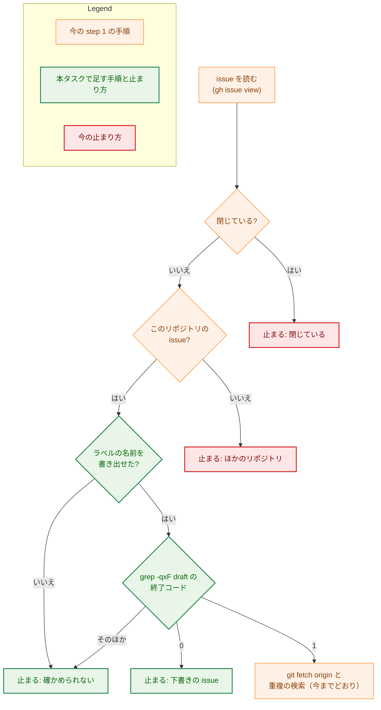

# 設計書：`/mkreq` はラベル `draft` が付いた issue からタスクを始めない

## Document Status

| Item | Value |
|---|---|
| Status | `approved` |
| Created | 2026-11-18 |
| Review date | 2026-11-18 |
| Reviewer | isseis |
| Comments | - |

## 1. 設計の全体像

本タスクで変えるのは、エージェントが従うコマンドの定義 2 つで、Go のコードと拡張のコードは変えない（[01_requirements.md](01_requirements.md) F-001・F-002）。

-   `.claude/commands/mkreq.md` の step 1 に、下書きの issue の確かめを足す。確かめは、閉じているかとこのリポジトリの issue かの確かめの後、`git fetch origin` と重複の検索より前に行う（AC-01）。
-   `.claude/commands/_context.md` の「Process convention」の表に、下書きの issue のラベルの行を 1 つ足す（AC-06）。

ADR-0053 は本書と同じ 3 文書の PR で作る。実装の PR は、その「決定」から食い違いの記述を消す（AC-09）。

**設計原則:**

-   **判定をエージェントの読み取りに任せない。** ラベルの名前が `draft` と等しいかは、コマンドの終了コードで決める。要件は名前がバイト列でちょうど等しいことを求める（AC-02）。エージェントに名前を読ませると、`Draft` のような名前を読み違える余地が残る。
-   **確かめられないときは止まる。** ラベルを読むコマンドや比べるコマンドが失敗したら、下書きでないとみなして進めず、止まる（AC-04）。下書きの issue からタスク番号を決めると、取り消せない記録の tag が残るためである（[ADR-0051](../../dev/adr/0051-number-reservation.md)）。
-   **判定を chief とそろえる。** 名前の等しさだけを見て、閉じた issue ではラベルを見ない（`internal/chief/issue.go:239-246`）。

**設計の際に決めたこと（2026-11-18）:**

-   **`/mkreq` は、ラベルの名前の一覧を `gh issue view <N> --json labels --jq '.labels[].name'` で 1 行に 1 つずつ書き出し、`grep -qxF -- draft` の終了コードで下書きかを決める。エージェントは名前を読んで比べない（3 章）。** `grep -x` は行全体の一致、`-F` は固定の文字列としての比較なので、名前がバイト列でちょうど `draft` の行だけが当たる。大文字と小文字の区別もコマンドが決めるので、エージェントの読み違いで判定が変わらない。どちらの案も、名前が 1 つの値と等しいかを見るだけの判定である。そのため、[ADR-0014](../../dev/adr/0014-deterministic-checks-in-go.md) が Go の道具に置くよう求める、分岐の多い判定には当たらない。人の答え：コマンドの終了コード。
    -   採らなかった案：issue を読む最初の `gh issue view` の `--json` に `labels` を足し、閉じているかの判定と同じように、エージェントが JSON の `labels[].name` を読んで比べる案。手順は短いが、名前の比べ方がエージェントに残る。
    -   ADR：同じ PR で作る [ADR-0053](../../dev/adr/0053-draft-issue-label.md) の「決定」に、判定の方法の項目を入れる。`/mkreq` の判定の方法は、ラベルの名前や比べ方を変えるときに `_context.md` と chief と合わせて変える対象になるためである。
-   **実装の PR で、レビュアーが、PR のブランチを取り出した新しい Claude Code のセッションで、タスクを与えて `/mkreq 928 0104_draft_issue_label` を走らせ、step 1 で止まることを見る。** 7 章で述べる。人の答え：タスク付きでレビュアーが走らせる。
    -   ADR：なし。本タスクの確かめ方の選択で、本タスクの中で閉じる。

概念モデルの Mermaid の図は省く。変わるのは 1 つのコマンドの 1 つの手順と、表の 1 行だけで、コンポーネントの関係が変わらない（`docs/dev/conventions/requirements_process.md`「Simple Process」の「May be omitted」）。

## 2. システム構成

N/A。コンポーネントの構成を変えない。`/mkreq` が GitHub から issue を読む操作が 1 つ増えるだけである（6 章）。

## 3. コンポーネント設計

変更・追加するファイルは次のとおりである。

| ファイル | 変更 | PR |
|---|---|---|
| `docs/dev/adr/0053-draft-issue-label.md`（新規） | 下書きの issue の方針の ADR。「決定」には、`mkreq.md` がまだ止まらないことを述べる食い違いの記述を置く（AC-07・AC-08・AC-09） | 本書の 3 文書の PR |
| `docs/dev/adr/README.md` | ADR-0053 の行を足す（AC-07） | 本書の 3 文書の PR |
| `docs/dev/adr/0046-chief-of-staff.md` | 下書きの issue の項目に ADR-0053 へのリンクを足し、「経緯」に 1 行を足す（AC-07） | 本書の 3 文書の PR |
| `.claude/commands/mkreq.md` | step 1 に、下書きの issue の確かめを足す（F-001） | 実装の PR |
| `.claude/commands/_context.md` | 「Process convention」の表に、下書きの issue のラベルの行を足す（F-002） | 実装の PR |
| `docs/dev/adr/0053-draft-issue-label.md` | 「決定」から食い違いの記述を消す（AC-09） | 実装の PR |

### 3.1. `mkreq.md` の step 1 の確かめ

step 1 の今の手順は、issue を読み、閉じていれば止まり、`url` がこのリポジトリのものでなければ止まり、それから `git fetch origin` と重複の検索を行う（`.claude/commands/mkreq.md:46-66`）。この 2 つの確かめの後、`git fetch origin` の前に、次の確かめを足す。

次の 2 つのコマンドは、それぞれ 1 回ずつ別の Bash の呼び出しで走らせ、終了コードを別々に読む。`&&` や `;` でつないで 1 回で走らせない。`gh` の失敗も `grep` の「当たる行がない」も終了コード `1` なので（`gh help exit-codes`、`man grep`）、つなぐと読めなかったことを「下書きでない」と取り違え、先へ進むためである。

1.  ラベルの名前の一覧を、スクラッチパッド（追跡されるツリーの外）のファイルに書き出す：`gh issue view <N> --json labels --jq '.labels[].name' > <file>`。`<N>` は、step 1 が `gh issue view` から得た番号である。このコマンドが 0 以外で終わったら、止まり、ラベルを読めなかったことを報告する（AC-04）。
2.  `command grep -qxF -- draft <file>` を走らせ、終了コードで分ける。`command` を付けるのは、Claude Code のシェルでは `grep` が別の検索の道具を呼ぶ関数で、バイナリとみなすファイルやディレクトリで終了コードが違うためである（`_context.md`「Checking a squash subject」と同じ書き方）。
    -   `0`：下書きの issue である。止まり、issue が下書きの issue であることと、ラベル `draft` を外せば正式な issue になり、`/mkreq <N>` を走らせ直せることを報告する（AC-01）。
    -   `1`：下書きの issue ではない。先へ進む。
    -   そのほか：確かめが失敗した。止まり、確かめられなかったことを報告する（AC-04）。

-   **書き出す先をファイルにする理由。** パイプにすると、`pipefail` の設定によらず、`gh` の失敗は `grep` が入力の空を読んだときと同じ終了コード `1` になり、見分けられない。ファイルに書き出せば、`gh` の終了コードを `grep` と分けて見られる。スクラッチパッドに置くのは、step 2 が作業ツリーがきれいかを確かめるためである（`.claude/commands/mkreq.md` step 2）。
-   **閉じた issue。** 確かめは閉じているかの確かめの後に置く。閉じた issue はそこで止まるので、ラベルは見ない（AC-03）。
-   **`[task]` と、止まった run の続き。** どちらの経路も `git fetch origin` と重複の検索より後で分岐するので、この確かめを通らずに進む経路はない（AC-01）。
-   **ラベルのない issue。** ファイルは空になり、`grep` は `1` で終わるので、先へ進む（4.4）。
-   **読んだラベルが全部か。** chief はラベルの件数を照らし合わせ、すべてを読めなかった応答を拒む（[0092 設計書](../0092_chief_task_workspace/02_architecture.md) 1.5）。`gh issue view` の出力には件数がないので、`/mkreq` はこの照らし合わせをしない。chief との違いとして受け入れる。理由は [01_requirements.md](01_requirements.md) 4.2 にある。
-   **名前に改行を含むラベル。** 名前が改行を含めば、1 つの名前が複数の行に分かれる。そのどれかの行がちょうど `draft` なら下書きとみなすので、誤りは止まる側に倒れる。
-   **ラベルの名前を会話に出さない。** 判定は終了コードで決まるので、エージェントはファイルの中身を読まない。報告にもラベルの名前を書かない。
-   **権限。** `gh issue view` は、`/mkreq` を起動したことですでに承認されている操作である（`.claude/commands/mkreq.md` の「Authorization」）。新しい承認は要らない。

### 3.2. `_context.md` の行

「Process convention」の表の、`Task process record` の行の後に、次のことを英語で述べる行を 1 つ足す（AC-06）。`_context.md` は英語の指示ファイルである（CLAUDE.md「Document language」の原則 (b)）。

-   行の名前は `Draft issue label`、値はラベルの名前 `draft` である。名前がバイト列でちょうど `draft` と等しいラベルだけが当たる。
-   そのラベルが付いた開いた issue は下書きの issue で、そこからタスクを始めない。`mkreq.md` の step 1 は止まり、`chief` の道具はその issue の workspace を作らない（`internal/chief/issue.go`）。
-   閉じた issue は、ラベルによらず閉じた issue として扱う。
-   人がラベルを外せば、正式な issue になる。

「Process convention」の表を読む Go のコードはない。`internal/chief` が読むのは同じファイルの「Command routing」の表で、これとは別の節である（`internal/chief/routing.go`）。そのため、行を足してもガードテストは変わらない。

### 3.3. ADR-0053

ADR-0053 は本書の PR で作る。「決定」の項目と AC の対応は次のとおりである。

-   ラベル `draft` で宣言すること、名前の等しさで判定すること、`/mkreq` が止まること、chief が workspace を作らないこと（ADR-0046 へのリンク）、正式にするには人がラベルを外すこと（AC-08）。
-   判定をコマンドの終了コードで行うこと（本書「設計の際に決めたこと」）。
-   食い違いの記述（AC-09）。実装の PR は、`git grep -nE 'issues/934([^0-9]|$)' origin/main -- docs/dev/adr/` で見つかる、ADR-0053 の「決定」の食い違いの記述を消す（`docs/dev/conventions/adr.md`「Discrepancy statements」）。

規約は、食い違いの記述を足す PR で、リンク先の issue の本文に ADR の名前を挙げておくことを求める（`docs/dev/conventions/adr.md`「Discrepancy statements」）。issue #934 の本文は ADR-0053 を挙げる。

## 4. エラーハンドリング設計

| 状況 | `/mkreq` の振る舞い | AC |
|---|---|---|
| 開いた issue に、名前がちょうど `draft` のラベルがある | step 1 で止まる。下書きの issue であることと、ラベルを外せば正式になり走らせ直せることを報告する | AC-01・AC-02 |
| 開いた issue に、名前が `draft` と等しくないラベルだけがある（`Draft`・`draft-x` など）、またはラベルがない | 先へ進む（今までどおり） | AC-02 |
| 閉じた issue（ラベルによらない） | 今までどおり、閉じた issue として止まる | AC-03 |
| ラベルの読み取り（`gh`）が 0 以外で終わる | 止まる。ラベルを読めなかったことを報告する | AC-04 |
| `grep` が `0`・`1` のほかで終わる | 止まる。確かめられなかったことを報告する | AC-04 |

どの止まり方でも、タスク番号を決めず、ブランチもタスクのディレクトリも作らない。報告は会話の言語（日本語）で行う（CLAUDE.md「Language」）。

## 5. セキュリティ考慮事項

N/A。`docs/dev/security.md` の規則と前提に触れない（[01_requirements.md](01_requirements.md) 4.2）。ラベルの名前は GitHub から読む値だが、`grep` の固定の文字列との比較にだけ使い、会話に取り込まない（3.1）。誤りと失敗は、どれも止まる側に倒れる。

## 6. 処理フローの詳細

矢印は、step 1 の中で次に行う手順を表す。ひし形は判定で、矢印のラベルはその結果である。本タスクで足すのは、ラベルの名前の書き出し、`grep` の判定、その 2 つの止まり方である。

## 7. テスト戦略

変えるのはエージェント向けの指示文だけで、Go のコードを変えない。

-   **`mkreq.md` と `_context.md` の文の中身（AC-01〜AC-04・AC-06）:** 自然言語の内容なので、実装の PR のレビューで読んで確かめる（`manual`）。
-   **判定のコマンド（AC-02・AC-04）:** `mkreq.md` に書いた `grep -qxF -- draft` を、ネットワークなしで、名前の一覧の見本のファイル（`draft` を含むもの、`Draft` だけ、`draft-x` だけ、空）に対して走らせ、終了コードを計画書に記録する。書いたコマンドの例を走らせる確かめである。CLAUDE.md「Document tests check values, structure, and executable examples, never prose」に従い、文の中身を確かめる文書テストは足さない。
-   **実際に止まること（AC-01 を補う確かめ）:** 実装の PR のレビューで、レビュアーが、PR のブランチを取り出した新しい Claude Code のセッションで `/mkreq 928 0104_draft_issue_label` を走らせる。#928 はラベル `draft` が付いた開いた issue で、走らせる前にラベルが付いたままかを確かめる。step 1 で止まり、下書きの issue であることを報告することを見て、結果を PR のコメントに残す（`manual`）。
    -   タスクを与えるのは、確かめの実装が誤っていても取り消せないことを起こさないためである。タスクを与えると、step 2 は `origin/main` の `0104_draft_issue_label` にすでに `01_requirements.md` があることで止まり、`numreserve` を走らせず、ブランチも作らない（`.claude/commands/mkreq.md` step 2）。下書きの確かめは step 1 にあるので、タスクを与えても通る経路は同じである（3.1）。
    -   `/runplan` のセッションでは走らせない。`/mkreq` は Claude Code で動くコマンドで（`_context.md`「Command routing」の `task-documents` の行）、`sonnet` の `/runplan` は OpenCode で動く。
    -   この確かめはエージェントが指示文に従うかを見るもので、テストにできるコードがない。そのため AC にはせず、AC-01 の読む確かめを補うものとする。
-   **ADR-0053 と索引（AC-07）:** `TestADRRecords`（`cmd/yt2column/adr_test.go`）が、ADR の形と索引との対応を確かめる（`test`）。リンク先は `TestInstructionDocPaths`（`cmd/yt2column/docpaths_test.go`）が確かめる。
-   **ADR-0053 の「決定」の内容（AC-08）と、食い違いの記述が消えたこと（AC-09）:** 内容は PR のレビューで読む（`manual`）。食い違いの記述の削除は、AC-10 の差分の確かめに含める。
-   **差分の範囲（AC-10）:** 変更の前と後の関係なので、`diff` の確かめにする。差分は小さいので、記録した diff の読み取りとする（`docs/dev/conventions/requirements_process.md`「`diff` verification」）。比べる 2 つのコミットは、規約のマージベースと比べる対象のコミット（compared commit）である。

## 8. 実装の優先順位

フェーズは 1 つで、実装の PR も 1 つである。3 文書の PR のマージの後に `/runplan` で、`_context.md` の行、`mkreq.md` の step 1、ADR-0053 の食い違いの記述の削除をまとめて行い、判定のコマンドの実行と AC-09・AC-10 の差分を記録する。実際に `/mkreq` を走らせる確かめは、その PR のレビューでレビュアーが行う。

## 9. 将来の拡張性

-   ラベルの名前や判定の規則を変えるときは、`_context.md`・`mkreq.md`・chief（`internal/chief/issue.go`）を同じ PR で変える（ADR-0053 の「結果」）。
-   ほかのコマンドが issue からタスクを始めるようになったら、同じ確かめを `_context.md` の行の定義に従って入れる。

## 変更履歴

- 2026-11-18 承認（isseis、#987）
