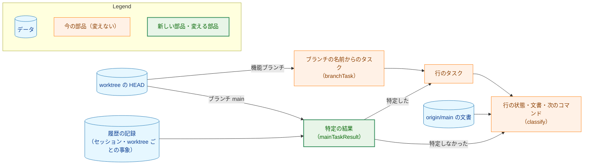
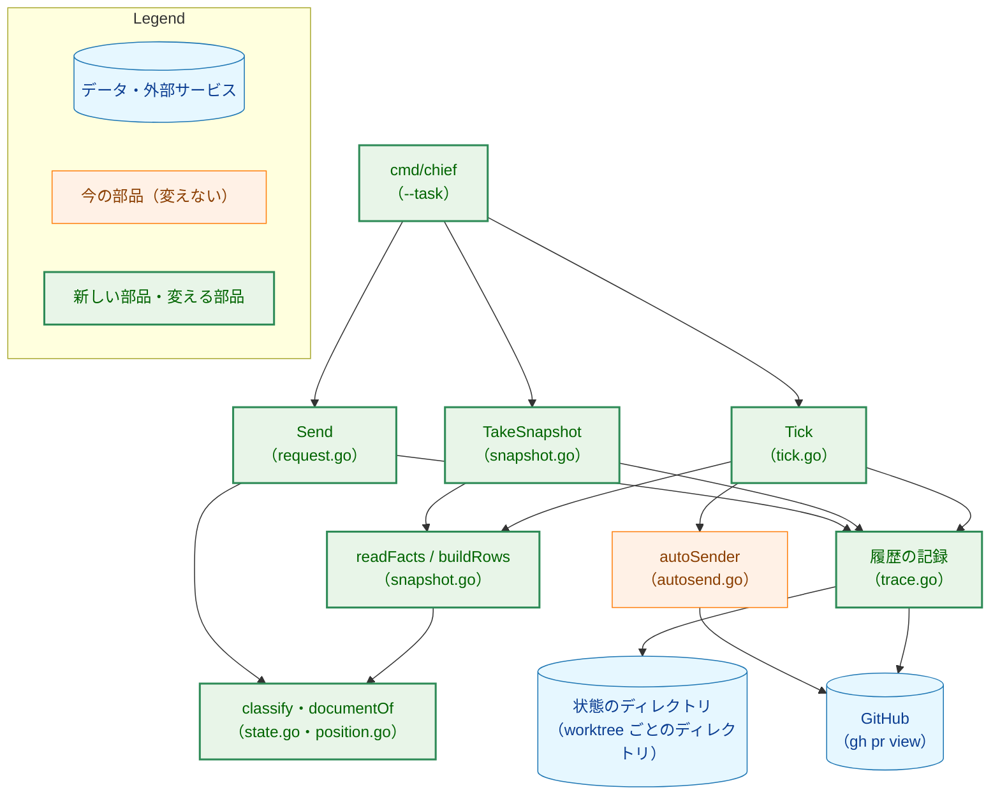
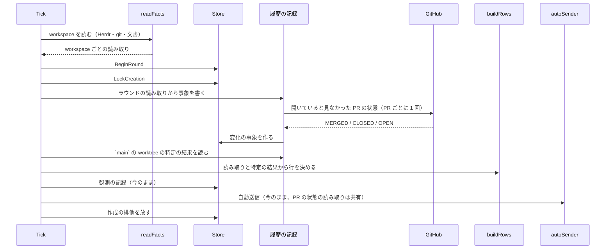
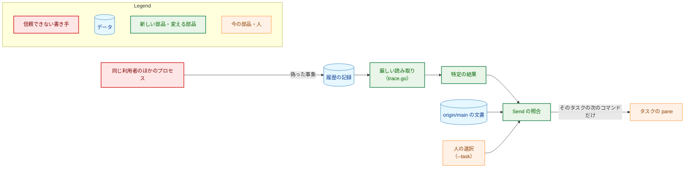
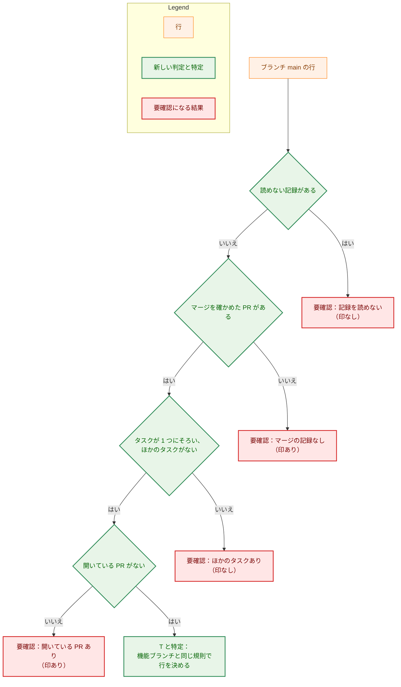

# 設計書：chief は `main` をチェックアウトした worktree をタスクのない workspace と読まず、マージを確かめた PR からタスクを特定する

## Document Status

| Item | Value |
|---|---|
| Status | `draft` |
| Created | 2026-11-19 |
| Review date | - |
| Reviewer | - |
| Comments | - |

## 1. 設計の全体像

本書は [01_requirements.md](01_requirements.md)（以下、要件定義書）の F-001〜F-004 を実現する設計である。対象は chief（`internal/chief`・`cmd/chief`）、`/chief` の定義（`.claude/commands/chief.md`）、chief 利用ガイド（`docs/dev/guides/chief_guide.md`）である。既存のコードについての記述は、コミット `910bb12b`（`origin/main`）で確かめた。

語は要件定義書 3.1 の冒頭の定義に従う（「`main` をチェックアウトした worktree」「chief の pane のセッション」「chief がマージを確かめた PR」「PR のブランチ名から抽出したタスク」「候補のタスク T」「chief が確かめたほかのタスク」「chief が最後に開いていると確かめた PR」）。本書では次の語を足す。

-   **履歴の記録**：chief の pane のセッションが、worktree ごとに、PR とブランチについて確かめたことを 1 件ずつ残す記録（3.1）。1 件を**事象**と呼ぶ。
-   **`main` の行**：`main` をチェックアウトした worktree の行。
-   **特定の結果**：`main` の行について、履歴の記録から決めた結果（3.2）。タスクを特定したか、特定しなかった理由の種類のどちらかである。

### 1.1. 設計原則

-   **`main` を HEAD の種類として宣言する。** 今の HEAD の種類（`headState`、`internal/chief/state.go:222-233`）は、ブランチ・detached・読めないの 3 つである。これに「ブランチ `main`」を足す。ブランチの名前とバイト列でちょうど `main` を比べるのは、ブランチを読む 1 か所だけにする。以降の判定は、HEAD の種類と特定の結果の型だけで分かれる（CLAUDE.md の「Declare, don't infer」、要件定義書 5 章）。
-   **タスクを決める源は 2 つに限る。** ブランチの名前（今の `branchTask`、`internal/chief/task.go:741-751`）と、履歴の記録から決めた特定の結果だけである。`main` の行にだけ後者を使い、ほかの HEAD の行は今のまま読む（AC-11、要件定義書 4.5）。
-   **分からなければ要確認にする。** 記録がない、食い違う、開いている PR がある、読めない、のどれでも、タスクを決めず、次のコマンドを示さず、`/mkreq` も示さない（AC-06・AC-07・AC-09、要件定義書 4.3）。
-   **記録は書き換えず、変わったときに追記する。** 履歴の記録は、今の記録と同じく、同名のものがあれば作らず、上書きもしない（ADR-0046 の「記録」）。セッションの間の状態は、そのセッションの事象をすべて読み、順に当てはめて決める。
-   **自動送信は変えない。** 自動送信の条件、窓（15 分）、引き継ぎの期限（10 分）、観測の記録の読み方は変えない（AC-10）。履歴の記録は自動送信の条件に使わない。
-   **人が選ぶ送信は、人に示したタスクで縛る。** `chief send` は、人が見た行のタスクを受け取る。送る直前に作り直した行のタスクと次のコマンドが、それと同じときだけ送る（AC-05）。

### 1.2. 設計の際に決めたこと（2026-11-19）

-   **AC-05 の確かめのため、`chief send` に `--task <タスク番号>` を足す。タスクのコマンド（`mkarch`・`mkplan`・`runplan`・`runplan-takeover`）では必須とし、ほかのコマンドでは受け付けない。** 道具は、送る直前に作り直した行のタスクがこの値と等しいときだけ送る。この確かめは `main` の行だけでなく、機能ブランチの行にも当てる（3.5）。今の `chief send` は、タスクを引数に取らず、送る直前に作り直した行のコマンドの種類だけを比べる（`internal/chief/request.go:386-412` の `offered`）。そのため、人が見た後に行のタスクが変わっても、同じ種類のコマンドなら別のタスクへ送ってしまう。`main` の行だけ送る直前に記録から作り直す案は採らなかった。道具は人が見たタスクを知らないので、変わったことに気付けないためである。道具の口の形が変わるので、プロトコル番号を `main` の値 + 1 にし、`/chief` の定義の呼び出しを直す（H-04）。人の答え：`--task` を必須にする。
    -   ADR：[ADR-0046](../../dev/adr/0046-chief-of-staff.md) を更新する（「人の判断の中継」に、人が選ぶ送信を人に示したタスクで縛ることを足す）。送る入力の確かめの決定を変え、道具の口とプロトコル番号にかかわるので、主要な決定に当たる。
-   **履歴で開いている PR のうち、そのラウンドの worktree のブランチで開いているのを見なかったものは、自動送信の窓の外でも、今の `gh pr view`（`PRStateOf`、`internal/chief/workspace.go:390`）で状態を確かめる。同じラウンドで自動送信が同じ PR を読んだときは、その結果を使い、PR ごとに 1 回だけ読む（3.3）。** 要件定義書 3.1 の「後のどの `tick` でも `MERGED` であることを確かめれば」を満たすには、窓の外でも状態を読む必要がある。要件定義書 4.1 の「新しい GitHub や git のネットワークの呼び出しを足さない」は、「新しい種類の呼び出しを足さない」と読む。足すのは、今も自動送信が使う同じ読み取りだけで、ふつうはマージの後に PR ごとに 1 回である。読む数が増えるのは、ラウンドの間が 15 分以上あいたときと、PR が開いたまま worktree が別のブランチに移ったときだけである。マージを確かめるのを自動送信の窓の中だけにする案は採らなかった。15 分以上あくと、セッションが続いてもタスクを特定できず、要件定義書 3.1 と合わないためである。人の答え：呼ぶ（種類は足さない）。
    -   ADR：ADR-0046 を更新する（「ブランチ `main` をチェックアウトした worktree のタスク」に、マージの確かめ方を足す）。
-   **履歴の記録は、worktree ごとの記録のディレクトリに、変化があったときだけ 1 件ずつ追記する事象の記録とする（3.1）。** 名前にセッションのハッシュを含め、今のセッションのものだけを読む。ほかのセッションの事象は `start` が消す。worktree ごとのディレクトリに置くので、同じパスに worktree を作り直す前と workspace を消し終えた後には、今の `ClearRecords`（`internal/chief/records.go:1362-1382`）が消す（H-06 の 3 つ目）。毎ラウンド履歴の全体を新しい記録へ引き継ぎ、古いラウンドの分を消す案は採らなかった。書けなかったことと空の履歴を見分けられず、作り直したパスの記録を消す規則も別に要るためである。人の答え：変化の事象を追記する。
    -   ADR：ADR-0046 を更新する（「記録」の記録の種類と、「ブランチ `main` をチェックアウトした worktree のタスク」に、履歴の記録の形と消し方を足す）。記録の種類と消し方の決定を変えるので、主要な決定に当たる。
-   **`tick` は、そのラウンドの履歴を書いてから行を決める。** 今の `readRound`（`internal/chief/snapshot.go:90-149`）は、読み取りと行の判定を続けて行う。これを、workspace の読み取りと、行の判定（`classify` と、行への記録・リセット・削除の提案の付け足し）の 2 つに分ける。`tick` はその間で履歴を書く（3.4）。こうすると、マージを確かめたラウンドの行に、もう特定したタスクが示される。分けずに次のラウンドから示す案は採らなかった。`chief wait` は変化があるまで次のラウンドを始めないので、要確認の行が長く残りうるためである。
    -   ADR：なし。`internal/chief` の中の処理の順で、このタスクの中で閉じる。
-   **`snapshot` と `chief send` は、履歴の記録を読むだけで書かない。** `snapshot` の「記録を作らない」約束（`internal/chief/snapshot.go:74-78`）を保つためである。今のセッションで `tick` が一度も走っていなければ、事象がないので要確認になる（AC-07）。
    -   ADR：なし。ADR-0046 の「結果」がすでに書いている振る舞いの実現である。
-   **履歴の記録を書くのは、`tick` が作成の排他（`LockCreation`、`internal/chief/records.go:1403-1419`）を持つ間だけにする。** `create` は同じ排他を持って、作り直すパスの記録を消す（`internal/chief/create.go:299`・`create.go:500`）。排他なしで書くと、消した直後に古い worktree の事象を書きうるためである。排他を取れないラウンドは、事象を書かず、今と同じく自動送信もしない。
    -   ADR：なし。記録の書き方の細部で、このタスクの中で閉じる。
-   **特定に使う読み取りの形の求め（要件定義書 4.2）は、履歴の記録にだけ当てる。今の観測の記録の読み取りは変えない（H-06 の 1 つ目）。** 観測の記録は自動送信の照合にしか使わず、自動送信は変えないためである（AC-10）。履歴の記録の読み取りは、`internal/strictjson` で不正な UTF-8・対のないサロゲート・項目の繰り返しを拒み、知らない項目も拒む。
    -   ADR：なし。読み取りの細部で、このタスクの中で閉じる。
-   **特定したタスクの文書は、最後にマージを確かめたそのタスクの PR のブランチ名を、今の `Tasks.Read`（`internal/chief/task.go:789-823`）に渡して読む（H-05）。** 機能ブランチの行と同じく、ディレクトリの名前がブランチの slug と合うことまで確かめられる。番号だけで読む `ReadDir` の規則を当てる案は採らなかった。slug の照合を外すことになるためである。
    -   ADR：なし。読み取りの細部で、このタスクの中で閉じる。
-   **`main` の行の git の状態（`origin/main` より先のコミット、未コミットの変更）は、人が選ぶ送信の条件に足さない（H-02 の 2 つ目）。** 機能ブランチの行の人が選ぶ送信も、git の状態を見ない（`internal/chief/request.go:194-254` の `Send`）。送ったコマンドは、自分の手順（`_lib/task-pr-handoff.md` の Part A）で、作業ツリーが汚れていれば止まり、新しいブランチを `origin/main` から作る。
    -   ADR：なし。次のコマンドの規則と送る条件を変えないためである。
-   **AC-07 の行には、使っていないか残った worktree の印（`Row.Idle`）を付ける。AC-06・AC-09 の行には付けない（H-03）。** 食い違いと読み取りの失敗は、人が見るべきものなので、表の最後に回さないためである。AC-07 の行でも、fetch に失敗したときは付けない。今の detached HEAD の行と同じ扱いである（`internal/chief/state.go:464`、H-06 の 4 つ目）。
    -   ADR：なし。ADR-0046 の「結果」がすでに書いている並べ方の実現である。

## 2. システム構成

### 2.1. 概念モデル

`main` の行のタスクは、履歴の記録から決まる。図の矢印 A → B は「A から B を決める」を表す。



detached HEAD と、`main` でも機能ブランチでもないブランチの行は、図の上の道を通らない。今のとおりである（AC-11）。

### 2.2. コンポーネント配置

図の矢印 A → B は「A が B を呼ぶか読む」を表す。緑は本タスクで足すか変える部品である。



### 2.3. データの流れ（`tick` の 1 ラウンド）

図の矢印は呼び出しと応答を表す。今のラウンドとの違いは、読み取りと行の判定の間で履歴を書くことと、作成の排他を履歴を書く前に取ることである。



自動送信は、行を決めた後に走る。今も自動送信は行を読まず、workspace の読み取り（`roundView.found`・`facts`）だけを読む（`internal/chief/autosend.go:350-394` の `gather`）。そのため、順を入れ替えても自動送信の判断は変わらない。行の判定が自動送信の結果を受けるのは、今の `applyAutoSends`（`internal/chief/tick.go:99-137`）のとおり、自動送信の後である。

## 3. コンポーネント設計

### 3.1. 履歴の記録

worktree ごとの記録のディレクトリ（`workspaceDirOf`、`internal/chief/records.go:551-`）に置く。名前は `trace-<セッションのハッシュ>-<ラウンドの ID>-<事象のハッシュ>.json` で、ラウンドの ID は今のラウンドの記録と同じもの（時刻順に並ぶ）、事象のハッシュは事象の種類・PR の番号・タスクから作る。同じラウンドで同じ事象は 1 件しか作らない。

```go
// traceKind is the kind of one event of a worktree's history. The zero value
// is traceUnknown, which no reader accepts.
type traceKind int

const (
	traceUnknown traceKind = iota
	// tracePROpen: the round saw the PR open on the worktree's branch.
	tracePROpen
	// tracePRMerged: the round read the PR's state as MERGED.
	tracePRMerged
	// tracePRClosed: the round read the PR's state as CLOSED.
	tracePRClosed
	// traceBranchTask: the round saw the worktree on a feature branch of Task.
	traceBranchTask
)

// traceEvent is one record of a worktree's history in one chief session.
type traceEvent struct {
	Session  string
	Round    string
	Worktree string
	Kind     traceKind
	// PR is the PR's number; 0 for traceBranchTask.
	PR int
	// Task is the four-digit task of the PR's branch when it was seen open,
	// or of the feature branch.
	Task paneinput.TaskID
	// Branch is the PR's branch when it was seen open, and its head branch
	// when its merge was read; empty otherwise.
	Branch string
}
```

JSON の項目は `session`・`round`・`worktree`・`kind`（`pr_open`・`pr_merged`・`pr_closed`・`branch_task`）・`pr`・`task`・`branch` とする。

**読み取り（要件定義書 4.2）。** 1 件の大きさは `recordLimit`（512 KiB、`internal/chief/records.go:103`）までとする。`internal/strictjson` で読み、不正な UTF-8・対のないサロゲート・項目の繰り返し・知らない項目を拒む。`task` は `paneinput.ParseTaskID`（4 桁の数字だけ、`internal/chief/paneinput/paneinput.go:37-47`）で読み、前後の空白やほかの文字を直さずに拒む。`kind` が上の 4 つのどれでもないもの、`session`・`round`・`worktree` が名前やディレクトリと合わないもの、種類に要る値（PR の事象の `pr`、`pr_open` の `branch`）がないものも拒む。拒んだ記録は `errRecord`（`internal/chief/records.go:32`）で包み、`errors.Is` で判定できる。

**名前の形。** `trace-` で始まり上の形に合わない名前の記録は、読めない記録とする。ほかのセッションのハッシュを持つ記録は読まない。

**書く条件。** 事象は、そのセッションの事象をすべて当てはめた状態（3.2）と、そのラウンドの読み取りが違うときだけ書く。

| 事象 | 書く条件 |
|---|---|
| `branch_task` | worktree が機能ブランチにいて、その worktree の最後の `branch_task` のタスクと違うか、`branch_task` がまだない |
| `pr_open` | worktree のブランチの PR が開いていて（今の観測の記録を書く条件と同じ、`internal/chief/tick.go:49-60`）、その PR の状態が開いているでない（事象がない、マージ、閉じた） |
| `pr_merged`・`pr_closed` | 状態が開いている PR を、そのラウンドの worktree のブランチで開いているのを見ず、その PR の状態を読んだら `MERGED`・`CLOSED` だった |

PR の状態を読めなかったときと、まだ `OPEN` だったときは何も書かない。その PR は開いているままになり、`main` の行は特定しない（AC-07）。

**消し方。** 今のセッションの事象は消さない。ほかのセッションの事象は、`start` の片付け（`removeFinishedSessions` と worktree ごとのディレクトリの片付け）で消す。worktree ごとのディレクトリの記録として `isRecordFile`（`internal/chief/records.go:1349-1353`）に足すので、`create` が同じパスに作り直す前と、`remove` が消し終えた後に、`ClearRecords` が消す。

**数。** 事象は変化のときだけ書くので、1 つの worktree で、PR 1 件につき開く・マージの 2 件ほどと、ブランチのタスクが変わるたびに 1 件である。

### 3.2. 特定の結果

`main` の行ごとに、今のセッションのその worktree の事象をラウンドの ID の順に当てはめて、PR ごとの最後の状態と、ブランチのタスクの移り変わりを得る。そこから次の順で、最初に当たるものを特定の結果とする。

| 順 | 条件 | 結果 | 要件 |
|---|---|---|---|
| 1 | 今のセッションの履歴の記録に、読めないものが 1 つでもある（どの worktree のものでも） | 読めない | AC-09 |
| 2 | マージを確かめた PR がない | マージの記録なし | AC-07 |
| 3 | マージを確かめた PR のタスクが 2 つ以上ある（マージを読んだときの head ブランチのタスクが、開いていたときのタスクと違うか、抽出できないものを含む） | ほかのタスクあり | AC-06 |
| 4 | 候補のタスク T のほかに、chief が確かめたほかのタスクがある（その worktree の PR のタスクが T でない、または T の PR のマージを最後に確かめた事象の後に、T でない `branch_task` がある） | ほかのタスクあり | AC-06 |
| 5 | 最後の状態が開いている PR がある | 開いている PR あり | AC-07 |
| 6 | どれにも当たらない | T と特定 | F-001 |

```go
// mainTaskKind is what the history of a worktree on main gives. The zero
// value is mainTaskUnread, the reading that assumes least.
type mainTaskKind int

const (
	mainTaskUnread mainTaskKind = iota
	mainTaskUnreadable
	mainTaskNoMerge
	mainTaskOtherTask
	mainTaskOpenPR
	mainTaskIdentified
)

// mainTaskResult is the identification of a worktree on main.
type mainTaskResult struct {
	Kind mainTaskKind
	// Task and Branch are set for mainTaskIdentified: the task and the branch
	// of the last PR of it whose merge this session read.
	Task   paneinput.TaskID
	Branch string
	// Detail names the PRs, tasks, or record behind the result, for the
	// row's reason.
	Detail string
}
```

**行への当てはめ。** `workspaceFacts`（`internal/chief/state.go:190-218`）に、HEAD の種類 `headMain` と、特定の結果を足す。

-   T と特定したとき：`Task` を T とし、`Docs` を `Tasks.Read(worktree, Branch)` で読む（読めなければ今の機能ブランチの行と同じく `DocsUnreadable`）。そのうえで `classify` は、機能ブランチの行と同じ規則で状態と次のコマンドを決める（AC-01〜AC-03）。
-   特定しなかったとき：状態は要確認で、`Unreadable` に結果の理由（4.2）を入れる。次のコマンドは示さず、`/mkreq` も示さない。

`decideNext`（`internal/chief/state.go:308-342`）の HEAD の確かめ（`headProblem`）は、`headMain` を、T と特定したときだけブランチと同じに扱う。特定しなかった `headMain` には、タスクのないブランチの `/mkreq` の規則（`internal/chief/state.go:312-314`）を当てない。

`main` の行には、引き継ぎの提案（`takeoverProposal`、`internal/chief/state.go:482-493`）を出さない。引き継ぎは、ブランチに PR のためのコミットと計画書があることが前提で、`main` にはそのタスクのコミットがないためである。

**印（`Row.Idle`）。** マージの記録なしと開いている PR ありの行に付け、fetch に失敗した行には付けない。読めない・ほかのタスクありの行には付けない（1.2）。

**進行の位置の文書（`taskDocumentOf`、`internal/chief/position.go:246-269`）。** `headMain` で特定しなかった行は要確認とし、タスクのないブランチの「-」（`PositionDocNoTask`）にしない（AC-07）。T と特定した行は、機能ブランチの行と同じ規則で決まる。行で `/mkreq` が走っている（人が pane で打った）ときは、今の最初の規則のとおり要件定義書になる。

**削除の提案。** 変えない。T のタスクが完了していれば、行はタスク完了になる。T の workspace を chief が作っていれば、今の `addRemovals`（`internal/chief/removal.go:380-402`）が削除の提案を付け、HEAD が detached でないことで確かめが止まる（AC-03）。

**観測の記録と自動送信。** 観測の記録は、今のとおり `f.Head == headBranch` の行だけに書く（`internal/chief/tick.go:52`）。`headMain` の行は、特定したタスクがあっても書かない。自動送信の `gather` は HEAD を自分で読み直すので（`internal/chief/autosend.go:367-374`）、`main` の worktree は今のとおり `headBranch` で読まれ、`headConditions` が「ブランチ `main` はタスクの機能ブランチでない」を理由に返す（AC-10、`internal/chief/autosend.go:212-237`）。

### 3.3. 履歴を書く（`tick`）

`tick` は、ラウンドの読み取りの後、作成の排他を持つ間に、ラウンドの各 worktree について 3.1 の書く条件を当てはめる。PR の状態を読むのは、状態が開いている PR のうち、そのラウンドでその worktree のブランチで開いているのを見なかったものだけで、そのラウンドに Herdr にある worktree のものに限る。読んだ状態は、ラウンドの中の表（PR の番号ごと）に置き、自動送信の `gather` が同じ PR を読むときにはそれを使う。こうして、1 つの PR を 1 ラウンドに 2 回読まない。

事象を書けなかったときは、ラウンドの問題（`problems`）に示す。書けなかった事象は、次のラウンドでも同じ違いがあれば、また書こうとする。

### 3.4. ラウンドの読み取りと行の判定を分ける

`readRound` を次の 2 つに分ける。

-   `readFacts`：Herdr・fetch・送り先の表・旧い値の表・各 workspace の読み取り（今の `readWorkspace`）。記録を作らない。
-   `buildRows`：各 workspace の読み取りと、`main` の worktree の特定の結果から行を決め（`classifyWorkspace`）、今のとおり、記録・リセット・削除の提案を行に付ける（`addRecords`・`addResets`・`addRemovals`）。記録を作らない。

`TakeSnapshot` は、`readFacts` の後に履歴の記録を読み（書かない）、`buildRows` を呼ぶ。`Tick` は 2.3 の順で呼ぶ。

### 3.5. 人が選ぶ送信（`chief send`）

```go
// SendRequest gains the task the human saw on the row.
type SendRequest struct {
	workspace string
	kind      RequestKind
	issue     paneinput.IssueNumber
	pr        fixprguard.PRNumber
	// task is the task of the row the human chose from; required for the
	// task commands and refused for the others.
	task paneinput.TaskID
}

// ParseSendRequest takes --task as well.
func ParseSendRequest(workspace, command, issue, pr, task string) (SendRequest, error)
```

-   `--task` は、`mkarch`・`mkplan`・`runplan`・`runplan-takeover` で必須、`mkreq`・`runpr` では受け付けない。形は `paneinput.ParseTaskID` で読み、合わなければ `ErrBadRequest` とする。
-   `Send` は、今のとおり workspace の排他を持ってから行を作り直す。そのとき、`main` の worktree なら、履歴の記録を読んで特定の結果を決める。読むのは呼び出した chief の pane のセッション（`Owner.Session`）の記録だけである。作り直した行のタスクが `--task` と違えば、何も送らずに `NotSentNotOffered` で拒み、理由に「人に示したタスクと今の行のタスクが違う」ことを示す（AC-05）。次のコマンドの種類が違うときは、今のとおり拒む。
-   `main` の行は `/mkreq` を提案しないので、`mkreq` の送信は今の `offeredMkreq`（`internal/chief/request.go:416-425`）の確かめで拒まれる（AC-08）。
-   送る前の確かめ（送り先の pane、モデル、送信の記録）は、今の `sendCommand` をそのまま通す（AC-04）。

`cmd/chief` は `--task` を受け取り、`Send` に呼び出し元の `Owner` を渡す。

### 3.6. `/chief` の定義・利用ガイド・プロトコル番号

-   **`/chief` の定義（`.claude/commands/chief.md`）。** 提案を送る呼び出しを `chief send --workspace <workspace> --command <request> --task <task> --protocol <番号>` にする。`<task>` は、同じラウンドの出力で、その項目の workspace の行の `task` である。人は表でこの値を見て選ぶ。`task` が空なら、`mkreq` 以外の提案は送らない。出力の項目は変えない（要件定義書 4.4）。
-   **プロトコル番号（H-04）。** `chief send` の引数が変わり、古い定義の呼び出し（`--task` なし）は新しい道具に拒まれ、新しい定義の呼び出しは古い道具に拒まれる。そのため `main` の値 + 1 にする（今の値は `internal/chief/records.go:29` の `Protocol`）。値の組み合わせの変化だけなら上げる必要はない。`/chief` の定義は、行の `task` が空かどうかで送るコマンドを決めておらず、`position.document` の値の表（`.claude/commands/chief.md:176-182`）にも新しい値はないためである。
-   **利用ガイド（AC-12）。** `docs/dev/guides/chief_guide.md` の進行の位置の説明（今の `chief_guide.md:82`）に、要件定義書 AC-12 の 4 点と、「-」が `main` をチェックアウトした worktree には使われないことを書く。`chief send` の `--task` も、ガイドの送信の説明に書く。

### 3.7. コンポーネントの責務

| ファイル | 変更 | 責務 |
|---|---|---|
| `internal/chief/trace.go` | 新規 | 履歴の記録の型・名前・読み取り（形の求め）・書く条件の判定・特定の結果 |
| `internal/chief/records.go` | 変更 | 履歴の記録の名前を `isRecordFile` に足す。`start` の片付けでほかのセッションの事象を消す。`Protocol` を `main` の値 + 1 にする |
| `internal/chief/state.go` | 変更 | `headMain`、`workspaceFacts` の特定の結果、`classify`・`decideNext`・`headProblem` の `headMain` の扱い、`Row.Idle` |
| `internal/chief/position.go` | 変更 | `taskDocumentOf` の `headMain` の規則 |
| `internal/chief/snapshot.go` | 変更 | `readRound` を `readFacts` と `buildRows` に分ける。`readWorkspace` がブランチ `main` を `headMain` と読む。`TakeSnapshot` が履歴の記録を読む |
| `internal/chief/tick.go` | 変更 | 作成の排他を履歴を書く前に取る。履歴を書き、特定の結果で行を決める。PR の状態の読み取りを自動送信と共有する |
| `internal/chief/autosend.go` | 変更 | `gather` の PR の状態の読み取りに、ラウンドの中の表を使う（条件と結果は変えない） |
| `internal/chief/request.go` | 変更 | `SendRequest` の `task`、`ParseSendRequest`、`Send` の履歴の読み取りとタスクの照合 |
| `cmd/chief/main.go` | 変更 | `--task` の受け取り、`Send` への `Owner` |
| `.claude/commands/chief.md` | 変更 | `chief send` の呼び出しの `--task` とプロトコル番号 |
| `docs/dev/guides/chief_guide.md` | 変更 | AC-12 の説明と `--task` |
| `docs/dev/adr/0046-chief-of-staff.md` | 変更 | 1.2 の ADR の更新（本 PR で更新済み） |

今の振る舞いを確かめるテストのうち、変わるもの：

-   ブランチ `main` をタスクのないブランチの例として使うテスト（`internal/chief/snapshot_test.go:71-73`・`snapshot_test.go:99`・`snapshot_test.go:154`・`snapshot_test.go:172`・`snapshot_test.go:465`・`snapshot_test.go:486-496`・`snapshot_test.go:707`・`snapshot_test.go:730`・`snapshot_test.go:880-881`、`internal/chief/workspace_test.go:53`）。今の「`main` は `/mkreq`」を前提にしているので、`main` でも機能ブランチでもない名前に替える。AC-11 の 3 つ目は、替えた後のテストが確かめる。
-   `ParseSendRequest` を呼ぶテスト（`internal/chief/records_test.go`・`reset_test.go`・`resetoffer_test.go`・`send_test.go`）。引数に `task` が加わる。
-   `/chief` の定義の呼び出しの形とプロトコル番号を確かめる文書のテスト（`cmd/chief/docs_test.go`）。
-   `internal/chief/removal_test.go` の `main` は、削除の確かめの HEAD の読み取りで、行の判定ではないので変わらない。

## 4. エラーハンドリング設計

### 4.1. エラーの型

新しい sentinel は足さない。履歴の記録の形に合わない記録は、今の `errRecord` で包む（要件定義書 4.2）。`chief send` の `--task` の誤りは、今の `ErrBadRequest` で包む。

### 4.2. 理由の文言（H-03）

道具の出力は英語である。`main` の行の `Unreadable` に入れる理由は、次の形とする。`<...>` には `Detail` の値が入る。

| 特定の結果 | 理由 |
|---|---|
| 読めない | `the worktree is on main and a history record of this chief session cannot be read: <記録のパスと誤り>` |
| マージの記録なし | `the worktree is on main and this chief session has seen no merged PR of it, so its task is not known` |
| ほかのタスクあり | `the worktree is on main and this chief session has seen it with more than one task: <タスクの並び>` |
| 開いている PR あり | `the worktree is on main and a PR this chief session saw open on it is not known to be merged or closed: <PR の並び>` |

`chief send` の拒否の理由：

| 場合 | 結果と理由 |
|---|---|
| 行のタスクが `--task` と違う（AC-05） | `not_sent`・`not_offered`、`the workspace's task is <今のタスク> now, not <--task の値> as shown` |
| `main` の行への `mkreq`（AC-08） | 今の `offeredMkreq` のとおり `not_sent`・`not_offered`、`the workspace is not one without a task that waits for input` |

履歴を書けなかったときは、ラウンドの `problems` に `the history record of <worktree> cannot be written: <誤り>` と示す。

### 4.3. 失敗の向き

| 失敗 | 振る舞い |
|---|---|
| 履歴の記録を読めない | そのラウンドのすべての `main` の行を要確認にする（AC-09）。読めない記録を除いて特定しない |
| 履歴の記録を書けない | ラウンドの問題に示す。次のラウンドで同じ違いがあれば書き直す。残る危険は 5 章 |
| PR の状態を読めない | 事象を書かない。その PR は開いているままで、`main` の行は特定しない |
| 作成の排他を取れない | 事象を書かず、自動送信もしない（今と同じ）。行は書かれている事象から決める |
| 特定したタスクの文書を読めない | 機能ブランチの行と同じく、`DocsUnreadable` で要確認 |

## 5. セキュリティ考慮事項

条件付きのガイド（`docs/dev/security.md`）の発動条件（`yt-dlp`、API キー、キャッシュ、LLM API、信頼できない文字列のプロンプトや記事への埋め込み）には当たらない：N/A。

信頼できない入力の境界は、履歴の記録である（要件定義書 4.2）。状態のディレクトリは同じ利用者のほかのプロセスが書ける（ADR-0046 の「結果」）。図の矢印は「データの流れ」を表し、赤は信頼できない入力である。



-   **形の求め。** 3.1 の読み取りが、要件定義書 4.2 の形をすべて求める。形に合わない記録は、直さずに拒み、すべての `main` の行を要確認にする。
-   **送るもの。** 偽った事象が別のタスク T' を示すと、`main` の行は T' の次のコマンドを示しうる。それでも、自動送信はせず（AC-10）、人が行のタスクを見て `--task` で選んだときだけ送る。送られるのは、T' の `origin/main` の文書が示す次のコマンドだけで、送りうる入力の範囲（ADR-0046）は変わらない。これは要件定義書 4.2 が受け入れた残る危険である。
-   **書けなかった事象。** 事象を書けないと、その worktree がほかのタスクのブランチにいたことを履歴が知らないまま `main` に戻ることがある。そのとき行は古いタスクを示しうる。ラウンドの問題に書けなかったことが示され、送るには人の選択が要るので、上と同じ残る危険として受け入れる。
-   **作り直したパス。** chief の `create` と `remove` を通さずに、人が同じパスに worktree を作り直して `main` をチェックアウトすると、そのセッションの古い事象が当てはまりうる。行に示されるタスクを人が見てから選ぶので、同じく残る危険として受け入れる。chief の `create` と `remove` を通せば、`ClearRecords` が消す。
-   **競り合い。** 事象を書くのは作成の排他を持つ `tick` だけで、`create` が記録を消すのと交わらない。`chief send` は workspace の排他の下で行を作り直してから照合するので、人が見た後の変化は照合で拒まれる。

## 6. 処理フローの詳細

### 6.1. `main` の行の判定

図の矢印は判定の順を表す。



### 6.2. issue #996 の事象の流れ

1.  ラウンド N-1：worktree は `isseis/0102-chief-text-table-02` にいて、PR が開いている。`branch_task(0102)` と `pr_open(#991, 0102)` を書く。
2.  マージの後、`mergepr cleanup` が worktree を `main` に移す。
3.  ラウンド N：worktree は `main` にいる。#991 は履歴で開いているが、ブランチで開いているのを見ないので状態を読み、`MERGED` なので `pr_merged(#991)` を書く。特定の結果は T = 0102 である。
4.  行は、`origin/main` の 0102 の文書から決まる。設計書が `draft` なら要確認で、理由は「設計書が approved でない」である（AC-02）。設計書が approved で計画書がなければ、`/mkplan 0102` を提案する（AC-01）。自動送信は、今のとおり「ブランチ `main` はタスク 0102 の機能ブランチでない」を理由に送らない（AC-10）。
5.  人が提案を選ぶと、`/chief` は `chief send ... --command mkplan --task 0102` を呼び、道具は行を作り直して 0102 と `/mkplan` を確かめてから送る（AC-04・AC-05）。

## 7. テスト戦略

### 7.1. 単体テスト

-   **履歴の記録の読み取り（AC-09）。** `task` が `"../x"`・`"0102 "` の記録、不正な UTF-8、対のないサロゲート、項目の繰り返し、知らない項目、知らない `kind`、名前やディレクトリと合わない `session`・`worktree`、上限を超える記録を、それぞれ `errors.Is(err, errRecord)` で拒むこと。
-   **特定の結果（3.2）。** 表で、6 つの順の条件ごとに結果を確かめる。AC-06 の 2 つの例、AC-07 の 3 つの例、T の PR のマージの後に T2 のブランチを見てから T のブランチに戻った場合、T2 のブランチを見た後に T の PR のマージを確かめた場合（特定する）、閉じた PR が開き直された場合を含める。
-   **書く条件（3.1）。** 変化がないラウンドでは事象を書かないこと、`OPEN` と読み取りの失敗では書かないこと、同じ PR の状態を 1 ラウンドに 1 回しか読まないこと。
-   **行の判定（AC-01〜AC-03・AC-07）。** `headMain` と特定の結果を与えた `classify`・`documentOf` の結果（状態・文書・進み具合・次のコマンド・`Idle`）。AC-03 では、chief が作った workspace の削除の提案が detached の確かめで止まること。
-   **送信（AC-04・AC-05・AC-08）。** `--task` が要るコマンドと要らないコマンドの `ParseSendRequest`、行のタスクが変わったときの `not_offered`、`main` の行への `mkreq` の拒否、特定した行への `/mkplan` が今の送る前の確かめを通ること。
-   **変えない振る舞い（AC-10・AC-11）。** 特定した `main` の worktree の PR の自動送信の結果が、今と同じ理由で送らないこと。機能ブランチ・detached HEAD・ほかのブランチの行が、事象があっても今と同じ行になること。
-   **消し方。** `ClearRecords` が履歴の記録を消すこと、`start` がほかのセッションの事象を消し、今のセッションの事象を残すこと。

各テストは、CLAUDE.md の「Every test must be able to fail for its stated reason」のとおり、確かめる部分を壊して失敗することを確かめる。

### 7.2. 結合テスト

`tick` の偽の Herdr・git・GitHub（今のテストの道具立て、`internal/chief/test_helpers.go`）で、6.2 の流れを 2 ラウンドで走らせる。マージを確かめたラウンドの行に T が示されること、続く `chief send --task` で送られること、そのセッションと違うセッションの `snapshot` では要確認になることを確かめる。

### 7.3. 文書のテスト

`cmd/chief/docs_test.go` の、`/chief` の定義の呼び出しの形とプロトコル番号の確かめに、`--task` を足す。ガイドの文言は、PR のレビューで読んで確かめる（CLAUDE.md の「Document tests check values, structure, and executable examples, never prose」）。

## 8. 実装の優先順位

1.  履歴の記録の型・名前・読み取り・特定の結果（`trace.go`）と、`isRecordFile`・`start` の片付け。
2.  `headMain`・`classify`・`documentOf` と、`readRound` の分割、`TakeSnapshot` の読み取り。
3.  `tick` の書く順と、PR の状態の読み取りの共有。
4.  `chief send` の `--task`、`Send` の照合、`cmd/chief`、プロトコル番号、`/chief` の定義、利用ガイド。

1〜3 は道具の口を変えないので、プロトコル番号は 4 で上げる。タスク 0102（[0102 計画書](../0102_chief_text_table/03_implementation_plan.md)）も chief の出力と `/chief` の定義を変える。番号は、実装するときの `origin/main` の値 + 1 にする（CLAUDE.md の「Protocol numbers」）。

## 9. 将来の拡張性

-   detached HEAD の worktree にも履歴の記録からの特定を当てるなら、3.2 の結果を detached の行に当てはめ、削除の提案の行（`RemovalRow`）との順を決めれば足りる。本タスクではしない（要件定義書 2.3）。
-   chief の pane のセッションを越えて特定するなら、履歴の記録をセッションに属さない記録にし、消す規則を足す必要がある。本タスクではしない（要件定義書 2.3）。

## 付録 A. 申し送りの扱い

| 項目 | とった方針 | 本書の節 |
|---|---|---|
| H-01 | 自動送信の引き継ぎとは別に、セッションに属する worktree ごとの履歴の記録を足す。窓と引き継ぎの期限は当てない | 1.2・3.1・3.3 |
| H-02 | `chief send --task` で人に示したタスクを渡し、送る直前に作り直した行と照合する。`main` の git の状態は送る条件に足さない | 1.2・3.5 |
| H-03 | 理由の文言は 4.2。AC-07 の行に印を付け、AC-06・AC-09 の行には付けない | 1.2・3.2・4.2 |
| H-04 | `/chief` の定義は値の組み合わせに依らないが、`chief send` の引数が変わるのでプロトコル番号を上げる | 3.6 |
| H-05 | 最後にマージを確かめた T の PR のブランチ名で `Tasks.Read` を使う | 1.2・3.2 |
| H-06 | 形の求めは履歴の記録にだけ当てる。鍵は worktree の正規のパスで、作り直しは `ClearRecords` が消す。fetch に失敗した AC-07 の行には印を付けない。T のディレクトリが `origin/main` にないときは、機能ブランチの行と同じく要件定義書がない要確認 | 1.2・3.1・3.2・5 |
| H-07 | 履歴の記録の `branch_task` と PR の最後の状態で、chief が確かめたほかのタスクと、chief が最後に開いていると確かめた PR を決める | 3.1・3.2 |
