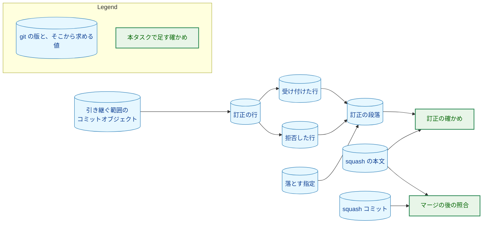
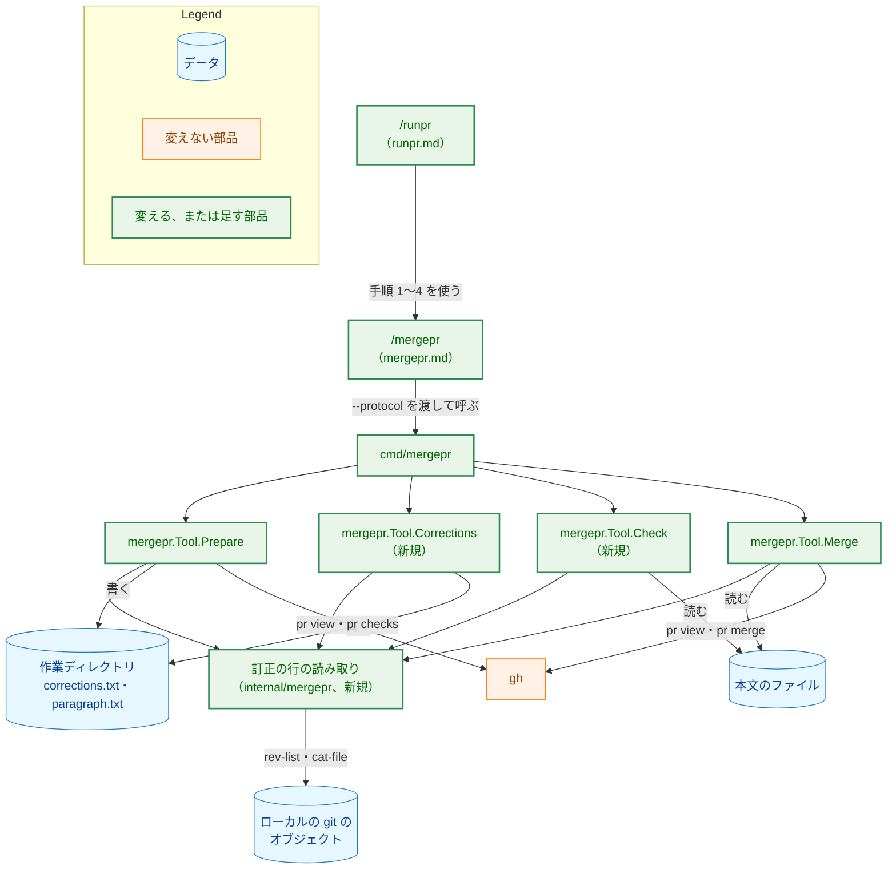
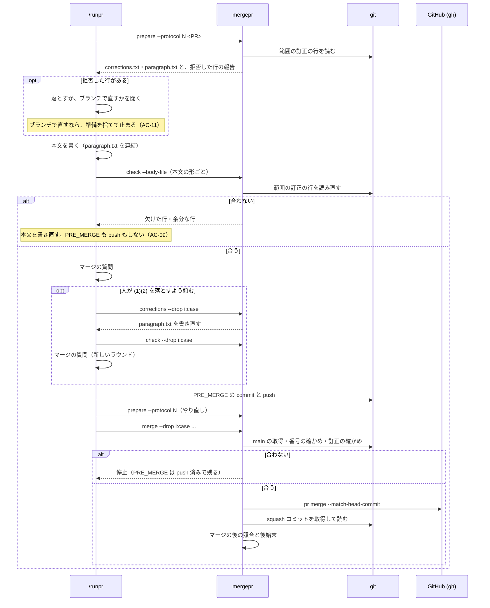
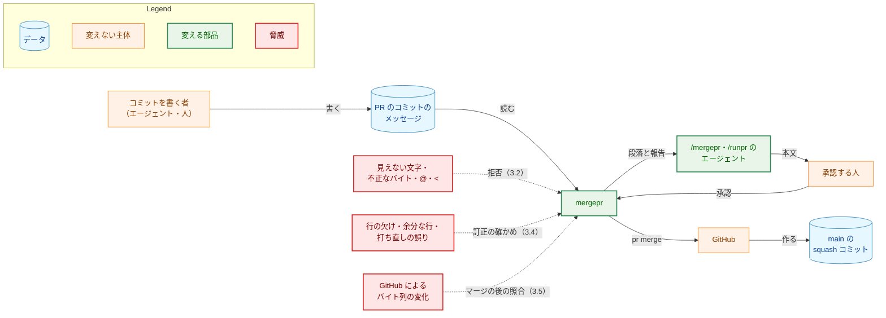
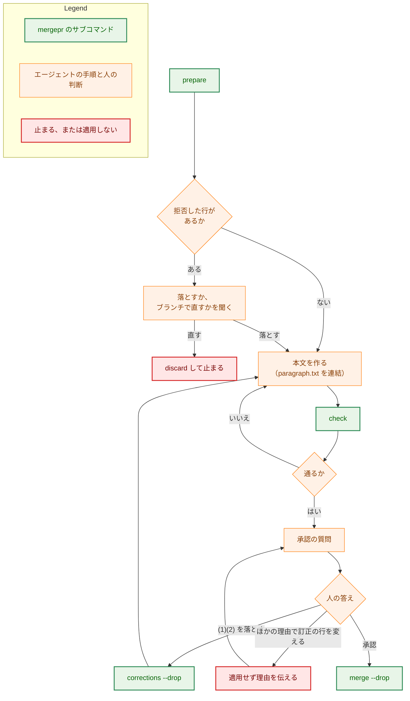

# アーキテクチャ設計書：編集上の訂正の行を、squash コミットの本文に引き継ぐ

## Document Status

| Item | Value |
|---|---|
| Status | `draft` |
| Created | 2026-11-19 |
| Review date | - |
| Reviewer | - |
| Comments | - |

本書は [01_requirements.md](01_requirements.md)（要件定義書。以下、要件書）の設計である。「計画で決める」は、本タスクの実装計画書（`03_implementation_plan.md`）で決めることを指す。既存のファイルの内容と `file:line` の行番号は、コミット `60de9ced` のものである。F-NNN・AC-NN は要件書の項番を、H-NN は [design_handoff.md](design_handoff.md)（以下、申し送り）の項番を指す。申し送りへの対応は付録 A に、受け入れ基準との対応は付録 B にまとめる。

本書は、要件書 3 章の用語（訂正の行・引き継ぐ範囲・範囲の順・受け付けない文字・squash の本文・承認の質問・落とした記録の行）を、同じ意味で使う。ただし「受け付けない文字」には、1.2 の決定 3 のとおり、非文字も含める。そのほかに、次の用語を使う。

-   **受け付けた行:** 引き継ぐ範囲の訂正の行から、バイト列として同じ行を初めて現れた位置の 1 つだけにまとめ（AC-03）、受け付けない文字を含む行を除いて、範囲の順に並べたもの。1 から始まる番号を持つ（3.2）。
-   **拒否した行:** 引き継ぐ範囲の訂正の行のうち、受け付けない文字を含むもの。重複は受け付けた行と同じくまとめる（3.2）。
-   **落とす指定:** 承認の質問で人が示した、受け付けた行のどれを (1)(2) のどちらとして落とすかの指定。`--drop <番号>:<場合>` の形で `mergepr` に渡す（3.3）。
-   **訂正の段落:** 受け付けた行から落とす指定の行を除いたものと、落とした記録の行（1 行以上を落とすときだけ）を、この順に並べた行の並び。squash の本文に 1 つの段落として入る（3.3）。要件書 6 章の「訂正の段落」（PR の説明に書く日本語の段落）とは別のものであり、本書では PR の説明のものを「PR の説明の訂正の段落」と呼ぶ。
-   **訂正の確かめ:** squash の本文の、`Editorial correction: ` か落とした記録の行の接頭辞で始まる行が、訂正の段落とバイト列として一致し、1 つの段落をなすことの確かめ（3.4）。
-   **マージの後の照合:** マージでできた squash コミットの、上の 2 つの接頭辞で始まる行が、`merge` に渡した本文の同じ行とバイト列として一致することの確かめ（3.5）。

## 1. 設計の全体像 (Design Overview)

### 1.1. 設計原則

-   **取り出し・判定・確かめは、マージが必ず通る `mergepr` の中で、テストのある Go のコードで行う。** `/runpr` からのマージも、`/mergepr` を単独で使うマージも、`mergepr prepare` と `mergepr merge` を必ず通る（`.claude/commands/mergepr.md:41`、`.claude/commands/mergepr.md:150`、`.claude/commands/runpr.md:965`、`.claude/commands/runpr.md:1325`）。バイト列の一致や見えない文字の判定をエージェントの読み取りに任せると、同じ入力でも結果が変わりうる（[ADR-0014](../../dev/adr/0014-deterministic-checks-in-go.md) の「判定と副作用を持つ開発の道具は Go で書き、テストを持つ」「順序を、コマンドの定義ではなく道具の中で強制する」）。
-   **訂正の行のバイト列は、エージェントに打ち直させない。** 訂正の段落は `mergepr` が作業ディレクトリのファイルに書き、エージェントはそのファイルを本文に連結する（3.3）。日本語や記号を含む行を打ち直すと、1 バイトの違いで AC-01 を破る。
-   **判定の基準は、確かめるたびに git から求め直す。** `check` と `merge` は、作業ディレクトリのファイル（`corrections.txt` など）を読み返さず、コミットオブジェクトから受け付けた行と拒否した行を求め直す（ADR-0014 の「道具は、判定に使う基準値を状態のファイルから読み返さない」）。作業ディレクトリのファイルは、エージェントが書き換えうるためである。
-   **落とす行は、宣言で渡す。** 人が示した (1)(2) の指定は、`--drop <番号>:<場合>` の形で `mergepr` に渡す。`mergepr` は本文の落とした記録の行を読み解いて場合を決めない（`CLAUDE.md`「Declare, don't infer」）。
-   **読めないとき、合わないときは止める。** コミットを読めないときと、本文が訂正の段落と合わないときは、マージしない（要件書 4.3）。受け付けない文字を含む行は、文字を除いたり置き換えたりせず、そのままでは写さない（`CLAUDE.md`「Reject, don't normalize」）。

### 1.2. 設計の際に決めたこと（2026-11-19）

1.  **訂正の行の取り出し・判定・確かめを、`mergepr` に置く（H-01）。** `prepare` が受け付けた行と拒否した行を求めて書き出し、新しいサブコマンド `corrections` が訂正の段落を作り、新しいサブコマンド `check` が承認の質問の前に本文を確かめる。`merge` は、GitHub にマージを頼む直前に同じ確かめを行う。
    -   **理由:** 上の設計原則の 1 つ目のとおりである。`mergepr` は、プロトコル番号とタスク番号の確かめで、すでに「承認の前と、マージの直前の 2 回」確かめる形を持つ（`internal/mergepr/mergepr.go` の `Prepare` と `Merge`）。AC-09 と AC-11 が求める 2 回の確かめも、同じ形に収まる。
    -   **採らなかった案:** `mergepr.md` の手順で、エージェントが `log.txt` を読んで行を取り出し確かめる案。`log.txt` は `git log` が再エンコードした出力で、コミットの境目と行番号を機械的に読めず（申し送り H-01）、見えない文字の判定も、壊して失敗を確かめるテストも持てない。
    -   **人の答え:** `mergepr` ツールに置く（推奨の案）。
    -   **ADR:** なし。ADR-0014 の今の決定を当てはめるだけで、決定を変えない。
2.  **(1)(2) の行を落とすことを、`--drop <番号>:<場合>` の宣言で `mergepr` に渡す（H-03）。** 番号は、受け付けた行の番号（`corrections.txt` の行番号）である。場合は `disputed`（(1)）か `reverted`（(2)）である。(3) は指定しない。拒否した行は、すべて (3) として落ちる。
    -   **理由:** 上の設計原則の 4 つ目のとおりである。`check` と `merge` は、宣言と git から訂正の段落を求め直して本文と比べるだけで、本文の文面から振る舞いを選ばない。
    -   **採らなかった案:** エージェントが書いた落とした記録の行を、`mergepr` が読み解いて件数を確かめる案。呼び出し側が書いた文字列の中身で振る舞いを選ぶことになる。
    -   **人の答え:** `--drop` フラグで宣言する（推奨の案）。
    -   **ADR:** なし。`mergepr` の引数の形で、本タスクの中で閉じる。
3.  **非文字（U+FDD0〜U+FDEF と、各面の最後の 2 つの符号位置）を、「UTF-8 として不正なバイト列」の側に含めて、受け付けない文字とする（H-08 の 1 つ目）。** 報告では、種類を「不正な UTF-8」とし、文字を `U+XXXX` の形で示す。
    -   **理由:** `git commit` は非文字を UTF-8 でないものとして書き換え、格納されるメッセージが変わる（`internal/fixprguard/write.go:69-74` の `isFormatOrNoncharacter` の説明）。`fixprguard finish` の訂正の行の確かめも非文字を拒否しており（`internal/fixprguard/write.go:101-127`）、それとそろえる。
    -   **採らなかった案:** Go の `utf8.Valid` に従い、非文字をそのまま写す案。git やほかの道具がバイト列を書き換えうる文字が、`main` の履歴に入りうる。
    -   **人の答え:** 含める（推奨の案）。
    -   **ADR:** なし。`mergepr` が行を受け付ける条件で、仕様は `mergepr.md` と手引きに置く（要件書 1 章の F-003 の項目と同じ扱い）。
4.  **3 章の分類に入らないが見えにくい文字（U+3164 などの埋め草の文字、異体字セレクタ、私用領域の文字）は、受け付けない文字に足さない（H-08 の 2 つ目）。** 残るリスクとして 5.3 に記録する。
    -   **理由:** 要件書の分類のままで、要件書に戻らずに済む。訂正の行を書くのは、PR を作ったエージェントのセッションと人であり、人は承認の質問で行を読む。
    -   **人の答え:** 足さない（推奨の案）。
    -   **ADR:** なし。要件書の決定を変えない。
5.  **訂正の行の `#N` と、issue を閉じるキーワード（`fixes #N` など）は、受け付ける（H-07 の 2 つ目）。** 残るリスクとして 5.3 に記録する。
    -   **理由:** このリポジトリでは「Auto-close issues with merged linked pull requests」の設定が off で、`/runpr` は squash の本文の `Closes` 行で issue が閉じることを当てにしていない（`.claude/commands/runpr.md:1362-1364`）。`#N` は参照先の issue に参照の記録を残すだけで、squash の件名はすでに `(#N)` を持つ。行は承認の質問で人が読む。
    -   **採らなかった案:** 要件書に戻り、`#` を受け付けない文字に足す案。訂正の行で issue 番号に触れられなくなる。
    -   **人の答え:** 受け入れる（推奨の案）。
    -   **ADR:** なし。要件書の決定を変えない。
6.  **`gh pr merge --body` で渡した訂正の行がバイト列のまま squash コミットに入ることを、マージの後の照合で確かめる（H-07 の 1 つ目）。** `merge` は、マージの後に squash コミットを取得して読み、本文の訂正の行と落とした記録の行と比べる。食い違えば、後始末を終えた後に誤りとして報告する。
    -   **理由:** 日本語を含む訂正の行が UTF-8 のまま `main` に届いた実例はある（#976 の squash コミット `7c3a9653` の本文）。しかし、行末の空白などが保たれるかの実例はない。マージの後の照合なら、GitHub の振る舞いが後で変わっても検出でき、GitHub への書き込みを増やさない。
    -   **採らなかった案:** 実装の前に使い捨ての PR で一度だけ確かめる案。GitHub への書き込みが要り、その後の振る舞いの変化は検出できない。リスクとして受け入れるだけの案は、AC-01 の破れが見えないまま残る。
    -   **人の答え:** マージの後に照合する（推奨の案）。
    -   **ADR:** なし。`mergepr` の保証の細部で、仕様は手引きに置く。
7.  **訂正の段落は、本文の要約（リード・箇条書き・`CLAUDE.md` が求める記録）の後ろ、`Closes #N` の行とトレーラーの段落の前に、見出しも導入の文もなしに置く。落とした記録の行は、段落の最後の行とする（H-02）。** 落とした記録の行の形は、3.3 で定める。
    -   **理由:** 見出しや導入の文を置くと、訂正の行のない PR の本文（AC-06）や、`git log --grep='^Editorial correction: '` で探す読み手にとって余分な行になる。段落の最後に落とした記録の行を置くと、訂正の行の並びが途切れない。
    -   **ADR:** なし。本文の書き方の細部で、本タスクの中で閉じる。
8.  **プロトコル番号を、`mergepr` の今の `main` の値 + 1 に上げる（H-01）。** サブコマンドと引数と出力が変わり、古い `mergepr` で新しい定義を走らせると、確かめが黙って抜けるためである（`CLAUDE.md`「Protocol numbers」、ADR-0014 の「`--protocol` の番号を上げる PR は…」）。
    -   **ADR:** なし。ADR-0014 の今の決定を当てはめるだけである。
9.  **止まる理由と直し方を、`docs/dev/guides/mergepr_guide.md` の 7 章に載せる（H-06）。** 手引きは、止まったときに人が読む文書で、プロトコル番号とタスク番号の確かめの止まり方もそこにある。
    -   **ADR:** なし。

### 1.3. なぜ今の仕組みでは足りないか

-   `prepare` は、PR のコミットのメッセージを `git log --format=%h %s%n%n%b` で `log.txt` に書くだけである（`internal/mergepr/mergepr.go:250`）。`git log` は `encoding` ヘッダーや `i18n.logOutputEncoding` に従って再エンコードするので、コミットオブジェクトのバイト列（要件書 3 章の「訂正の行」）を読めない。コミットの境目と各行の行番号も読めず、件名の行は `%h ` の後ろに出るので 1 列目から始まらない。
-   `merge` は、受け取った本文をそのまま `gh pr merge --body` に渡し、中身を確かめない（`internal/mergepr/mergepr.go:382`）。訂正の行が欠けても、余分な行があっても、マージは進む。
-   `/mergepr` の step 2 は、本文を 10 行程度に抑えるよう求め、その例外に訂正の行を含めない（`.claude/commands/mergepr.md:104-131`）。

どれも、今の仕組みを残したまま手順の文を足すだけでは、AC-01（バイト列の一致）・AC-09（確かめ）・AC-10（行番号と種類の報告）を満たせない。

### 1.4. 概念モデル

矢印 A → B は「B を A から求める」ことを表す。



拒否した行は、訂正の段落には行として入らない。落とした記録の行の (3) の件数として入る（3.3）。

## 2. システム構成 (System Structure)

### 2.1. 全体構成

矢印 A → B は「A が B を呼ぶ、または読む」ことを表す。



`corrections` と `check` は、ネットワークに触れない。`prepare` が取得した `origin/<base>` と、状態のファイルが固定した head から範囲を求める（3.1）。`merge` は、今と同じく `main` を取得し直した後に確かめる。

### 2.2. コンポーネント配置

| ファイル | 種類 | 内容 |
|---|---|---|
| `internal/mergepr/corrections.go` | 新規 | 訂正の行の読み取り、受け付けない文字の分類、訂正の段落の組み立て、訂正の確かめ、マージの後の照合、報告用の表示形（3.1〜3.5） |
| `internal/mergepr/corrections_test.go` | 新規 | 実際の git のリポジトリでの読み取りのテストと、分類・組み立て・確かめの表のテスト（7.1） |
| `internal/mergepr/mergepr.go` | 変更 | `Protocol` を `main` の値 + 1 に。`Tool` に訂正の行の読み取りを持たせる。`Prepare` が `corrections.txt` と `paragraph.txt` を書き、結果に受け付けた行の数と拒否した行を持たせる。`Corrections`・`Check` を足す。`Merge` に訂正の確かめとマージの後の照合を足す（3.6） |
| `internal/mergepr/errors.go` | 変更 | 訂正の確かめの番兵の誤りと誤りの型（4.1） |
| `internal/mergepr/test_helpers.go` | 変更 | 訂正の行の読み取りの差し替え（7.1） |
| `internal/mergepr/test_helpers_git.go` | 変更 | 任意のバイト列のメッセージを持つコミットを作る補助（7.1） |
| `internal/mergepr/mergepr_test.go` | 変更 | `Prepare`・`Merge` のテストを、読み取りの差し替えを使う形に。新しいサブコマンドのテスト（3.7） |
| `cmd/mergepr/main.go` | 変更 | `corrections` と `check` のサブコマンド、`check`・`corrections`・`merge` の `--drop`、`prepare` の出力の行、使い方の文（3.6） |
| `cmd/mergepr/main_test.go` | 変更 | 新しいサブコマンドと `--drop` の引数のテスト、拒否した行の出力のテスト（7.1） |
| `cmd/mergepr/docs_test.go` | 変更 | `definitionCalls` に `corrections` と `check` を足し、`--drop` の置き換えの値を足す（7.2） |
| `.claude/commands/mergepr.md` | 変更 | F-001〜F-004 の手順（3.8） |
| `.claude/commands/runpr.md` | 変更 | マージの質問の前の確かめ、詳細ファイル、自由記述での落とし方、PRE_MERGE の後の準備のやり直しとマージでの `--drop`、止まったときの報告（3.8） |
| `.claude/commands/_context.md` | 変更 | 「PR merge method」の行に、squash の本文が訂正の行も運ぶことを足す（3.9） |
| `docs/dev/conventions/requirements_process.md` | 変更 | 記録の置き場所の段落（`requirements_process.md:132-142`）と「Recording in the PR description」に、squash の本文が訂正の行を運ぶことを足す（3.9） |
| `docs/dev/conventions/adr.md` | 変更 | 「Editorial corrections」の「Recording」に、同じことを足す（3.9） |
| `docs/dev/guides/mergepr_guide.md` | 変更 | 4 章の流れ、5 章の新しいサブコマンド、6 章の保証、7 章の止まったときの対処、プロトコル番号（3.9） |
| `docs/dev/conventions/package_reference.md` | 変更 | `internal/mergepr` の行に訂正の行の引き継ぎを足す |
| `docs/dev/adr/0039-adr-writing-criteria.md` | 変更（実装の PR） | 「決定」の #747 へのずれの記述を消し、仕様の置き場所のリンクを `mergepr.md` と手引きへ向ける（AC-16） |
| `docs/dev/adr/0036-task-document-status-records.md` | 変更（実装の PR） | 「決定」の #747 へのずれの記述を消す（AC-16） |

変えないもの: `CLAUDE.md` は、訂正の記録の置き場所を述べていない（`grep -n -i correction CLAUDE.md` は該当なし）ので変えない。`_lib/task-pr-handoff.md` と `fixpr.md` の PR の説明の訂正の段落の作り方は、要件書 2.3 のとおり変えない。`log.txt` の形も変えない。下書きの材料として今のまま使い、訂正の段落の材料にはしない。

### 2.3. データフロー

`/runpr` からのマージの流れを示す。`/mergepr` を単独で使うときは、PRE_MERGE の段がなく、マージの質問が承認の質問になる。



## 3. コンポーネント設計 (Component Design)

### 3.1. 訂正の行の読み取り（AC-01〜AC-04、H-01）

-   **範囲:** `git rev-list --reverse --topo-order origin/<base>..<head>` が挙げるコミットである（要件書 3 章の「範囲の順」）。`<head>` は状態のファイルが固定した `headRefOid`、`<base>` は `baseRefName` である。`origin/<base>` は、読むときの remote-tracking ref の値を使う。`prepare` と `check`・`corrections` は `prepare` が取得した値を、`merge` は取得し直した値を読む。`main` は前へ進むだけで、PR のコミットは squash マージの前に `main` に入らないので、どちらの値でも範囲は同じコミットになる。この前提が崩れて範囲が変わったときは、訂正の確かめが食い違いとして止める（3.4）。
-   **バイト列:** 各コミットを `git cat-file commit <oid>` で読み、最初の空行より後ろをメッセージのバイト列とする。`git log` を使わないので、`encoding` ヘッダーと `i18n.logOutputEncoding` による再エンコードは起きない。`encoding` ヘッダーが UTF-8 以外を名指すコミットでも、バイト列をそのまま UTF-8 として判定する。そのため、非 ASCII の文字を含む行は不正な UTF-8 として拒否される。
-   **行:** メッセージを LF で分け、件名を 1 行目として数える。行の末尾の CR は、行の一部として残す（受け付けない文字として拒否される）。1 列目が `Editorial correction: `（大文字と小文字を区別する）で始まる行だけが訂正の行である（AC-04）。行の残りの形は問わない（AC-02）。
-   **git の呼び出し:** プロトコル番号の確かめと同じく、`GIT_*` の環境変数を除いた git の呼び出し（`internal/mergepr/runner.go`）を使う。利用者の環境によって読むリポジトリや結果が変わらないようにするためである。読み取りに失敗したときは、読めたところまでの結果を返さずに止める（4.1）。
-   **差し替え口:** 読み取りは `Tool` の中の interface を通す。`Prepare`・`Merge` のテストは、git のコマンドの並びを変えずに、読み取りを差し替える（3.7）。

```go
// correctionSource reads the correction lines of the PR's commits and the
// message of one commit. The production source runs git without the GIT_*
// variables; tests substitute a fake.
type correctionSource interface {
	// rangeLines returns every correction line of the commits reachable from
	// head and not from origin/<base>, in range order, with its commit and
	// its line number in that commit's message.
	rangeLines(ctx context.Context, base, head string) ([]correctionLine, error)
	// message returns the message bytes of one commit object.
	message(ctx context.Context, oid string) ([]byte, error)
}

// correctionLine is one correction line as the commit object stores it.
type correctionLine struct {
	Commit string // full object ID
	Line   int    // 1-based line number in the commit message; the subject is 1
	Text   []byte // the line without its LF
}
```

### 3.2. 受け付けた行と拒否した行（AC-03、AC-10、AC-12、H-08）

範囲の訂正の行を、バイト列として同じ行は初めて現れた位置の 1 つにまとめ（AC-03）、次の分類で受け付けた行と拒否した行に分ける。分類は訂正の行だけに行う（AC-12）。

| 種類（報告の語） | 当たる文字 | 示し方 |
|---|---|---|
| 見えない文字（`invisible`） | 一般カテゴリ Cc のうちタブ（U+0009）以外（行の末尾の CR を含む）、Cf、Zl、Zp | `U+XXXX` |
| 不正な UTF-8（`invalid-utf8`） | UTF-8 として不正なバイト列。非文字（U+FDD0〜U+FDEF と、各面の最後の 2 つの符号位置）を含む（1.2 の決定 3） | 不正なバイトは `\xNN`、非文字は `U+XXXX` |
| `@`（`at`） | U+0040 | そのまま |
| `<`（`lt`） | U+003C | そのまま |

一般カテゴリは、ビルドに使う Go の `unicode` パッケージの表で判定する。タブを含む行は受け付けた行になり、書かれたとおり引き継がれる（AC-12）。

`fixprguard` の `isControl` と `isFormatOrNoncharacter`（`internal/fixprguard/write.go:67-74`）は使い回さない。`fixprguard` はタブを拒否し `<` を受け付けるので集合が違い、関数は別の道具のパッケージの非公開の関数で、共有するとプロトコル番号を持つ 2 つの道具が同じコードの変更でそろって変わるためである。非文字の定義は同じにし、7.1 のテストで同じ符号位置を確かめる。

受け付けた行は、範囲の順に 1 から番号を振る。この番号が落とす指定の番号である。番号は、`prepare` が書く `corrections.txt` の行番号と同じであり、`mergepr` の引数の契約の一部とする（手引きに書く）。拒否した行は番号を持たない。

```go
// rejectKind is a kind of rejected character (AC-10).
type rejectKind int

const (
	rejectInvisible   rejectKind = iota + 1 // Cc other than tab, Cf, Zl, Zp
	rejectInvalidUTF8                       // invalid UTF-8, or a noncharacter
	rejectAt                                // '@'
	rejectLessThan                          // '<'
)

// RejectedLine is a correction line that holds a rejected character,
// reported by commit, line number, kinds, and a shown form in which every
// rejected invisible character or noncharacter is U+XXXX and every invalid
// byte is \xNN.
type RejectedLine struct {
	Commit string
	Line   int
	Kinds  []string // "invisible", "invalid-utf8", "at", "lt", in that order
	Shown  string
}
```

拒否した行の重複も、初めて現れた位置の 1 つにまとめ、その位置のコミットと行番号を報告する。

### 3.3. 訂正の段落と落とす指定（AC-05、AC-06、AC-13、AC-14、H-02）

訂正の段落は、次の行をこの順に並べたものである。

1.  受け付けた行のうち、落とす指定にない行を、番号の順に。
2.  1 行以上を落とすとき（落とす指定があるか、拒否した行があるとき）、落とした記録の行を 1 行。

訂正の段落の行が 1 つもないとき（範囲に訂正の行がないとき）、訂正の段落は空で、本文には何も入らない（AC-06）。行の数と長さに上限はない（AC-05）。

落とした記録の行の形は、次のとおりとする（AC-14）。3 つの件数を、0 であっても常に書く。件数は、AC-03 で重複をまとめた後の行の数である。

```text
Dropped editorial corrections: <a> disputed by a reviewer, <b> reverted on the branch, <c> with rejected characters
```

`<a>` は `disputed` の指定の数、`<b>` は `reverted` の指定の数、`<c>` は拒否した行の数である。行は `Editorial correction: ` で始まらず、落とした行の文字を含まない。接頭辞 `Dropped editorial corrections: ` は、`mergepr` が落とした記録の行のために予約する。この接頭辞で始まる行は、訂正の確かめが本文から集める（3.4）。

落とす指定は `--drop <番号>:<場合>` の形で、繰り返して渡す。`<場合>` は `disputed`（(1)、レビュアーが訂正であることに異を唱えた行）か `reverted`（(2)、ブランチの中で後から戻し、PR の head でも戻したままの行）である。同じ番号を 2 度指定すること、受け付けた行の範囲の外の番号、ほかの `<場合>`、番号のない形は、使い方の誤りとして止める（4.1）。(1)(2) に当たるかは、人が示したとおりとし、`mergepr` は確かめない（要件書 1 章の「残るリスク」）。(3) は指定しない。拒否した行はすべて (3) として落ちる（AC-13）。

```go
// dropCase is a case under which an accepted correction line may be
// dropped at the approval question (F-004 (1) and (2)). Case (3) is not
// declared: every rejected line falls under it.
type dropCase int

const (
	dropDisputed dropCase = iota + 1 // --drop N:disputed
	dropReverted                     // --drop N:reverted
)

// Drop declares that accepted correction line Index (1-based, the line
// number in corrections.txt) is dropped under Case.
type Drop struct {
	Index int
	Case  dropCase
}
```

**作業ディレクトリのファイル。** `prepare` は、今のファイルに加えて次の 2 つを作業ディレクトリに書く。

| ファイル | 中身 |
|---|---|
| `corrections.txt` | 受け付けた行を番号の順に、1 行ずつ LF で終えて書く。受け付けた行がなければ空 |
| `paragraph.txt` | 落とす指定がないときの訂正の段落を、1 行ずつ LF で終えて書く。拒否した行があれば、最後に落とした記録の行が入る。訂正の段落が空なら空 |

`corrections --drop ...` は、範囲を git から読み直し、指定を当てはめた訂正の段落で `paragraph.txt` を書き直す。書くのは、状態のファイルが記録した作業ディレクトリの中だけで、`discard` と同じく、その作業ディレクトリが `prepare` の作ったものであることを確かめてから書く。エージェントは、本文のファイルを、要約の部分・`paragraph.txt`・`Closes` の行とトレーラーの部分を `cat` で連結して作る（3.8）。

### 3.4. 訂正の確かめ（AC-06、AC-07、AC-09、AC-11）

`check` と `merge` は、次の確かめを同じコードで行う。

1.  3.1 と 3.2 で、範囲の受け付けた行と拒否した行を求め直す。読めなければ止める。
2.  落とす指定を、そのときの受け付けた行に当てはめる。番号が範囲の外なら止める。
3.  3.3 で、期待する訂正の段落を作る。
4.  本文のファイルから、1 列目が `Editorial correction: ` か `Dropped editorial corrections: ` で始まる行を、書かれた順に集める。
5.  集めた行の並びが、期待する訂正の段落とバイト列として一致することを確かめる。一致しなければ、欠けた行（段落にあって本文にない行）と余分な行（本文にあって段落にない行、順序が違う行を含む）を示して止める。
6.  集めた行が本文の中で連続し、前が本文の始まりか空行、後ろが本文の終わりか空行であること（1 つの段落をなし、ほかの行を含まないこと）を確かめる。違えば止める。

`check` は承認の質問の前に、エージェントが書いた本文の形ごとに走らせる（AC-07。`/runpr` では、承認の行のある本文とない本文の両方）。`merge` は、プロトコル番号とタスク番号の確かめの後、`gh pr merge` の前に走らせる。どちらも、拒否した行は (3) の件数としてだけ期待する段落に入るので、拒否した行がそのまま本文にあれば余分な行として止まる（AC-07 の「受け付けない文字を含む行は承認の質問の本文には現れない」）。

確かめ 6 は、AC-06 の「トレーラーの段落とは空行で分けて」を守る。訂正の行がトレーラーと同じ段落に混ざると、git はその段落をトレーラーの段落と見なさなくなる。git 2.50.1 で、最後の段落を訂正の行・落とした記録の行・`Co-Authored-By:` の行の 3 行にしたメッセージに `git interpret-trailers --parse` を実行すると、何も出力されなかった（2026-11-19 に確かめた）。同じ 3 行を空行で 2 つの段落に分けると、`Co-Authored-By:` の行だけが出力された。訂正の行と落とした記録の行は、どちらの形でも出力に入らなかった。

訂正の段落がトレーラーの段落より前にあること（AC-06）は、`mergepr` は確かめない。手順が、本文を要約・訂正の段落・`Closes` の行とトレーラーの順に連結して作り（3.8）、人が承認の質問で本文を読む。上の git の振る舞いは、7.1 のテストで確かめ続ける。

### 3.5. マージの後の照合（H-07）

`merge` は、`gh pr merge` が成功した後、次の順に進む。

1.  PR の `mergeCommit` を読み（今の後始末と同じ `gh pr view`）、`origin` の base を取得して、squash コミットのメッセージを `git cat-file commit` で読む。
2.  そのメッセージの、1 列目が上の 2 つの接頭辞で始まる行の並びと、`merge` に渡した本文の同じ行の並びを、バイト列として比べる。
3.  結果にかかわらず、今の後始末（base の fast-forward と head のブランチの削除）を続ける。
4.  食い違っていれば、後始末の結果を報告した後に、食い違った行を示す誤りを返す。マージは取り消さない（取り消せない）。報告は、`main` の squash コミットが訂正の行を正しく持たないことと、その ID を示す。

読めなかったときも、後始末を続け、照合ができなかったことを誤りとして返す。照合は、`cleanup` サブコマンドを単独で走らせたときには行わない。`cleanup` は本文のファイルを受け取らないためである。

### 3.6. `mergepr` のサブコマンドと出力

| サブコマンド | 変わること |
|---|---|
| `prepare --protocol N [PR]` | `corrections.txt` と `paragraph.txt` を書く。出力に `corrections: <受け付けた行の数> accepted, <拒否した行の数> rejected` の行と、拒否した行ごとに `correction rejected: <コミット ID> line <行番号>: <種類>[,<種類>...]: <表示形>` の行を足す。拒否した行があっても止まらない（AC-11 の「落とす」を選べるように、準備を残す） |
| `corrections --protocol N --state FILE [--drop I:CASE]...`（新規） | 3.3 のとおり `paragraph.txt` を書き直し、そのパスを出力する |
| `check --protocol N --state FILE --body-file FILE [--drop I:CASE]...`（新規） | 3.4 の確かめを行う。通れば `corrections: <訂正の段落の行の数> line(s) checked` を出力して終了コード 0、止まれば 4 章の報告をして終了コード 1。ネットワークに触れない |
| `merge --protocol N --state FILE --subject-file FILE --body-file FILE [--drop I:CASE]...` | 3.4 の確かめを、番号の確かめの後、`gh pr merge` の前に行う。マージの後に 3.5 の照合を行い、報告に `corrections carried: <行の数> line(s) verified` の行を足す |
| `cleanup`・`discard` | 変えない |

`prepare` の出力の拒否した行の表示形には、印字できる文字はそのまま出る（AC-10）。日本語の文字や `@`・`<` もそのまま出る。見えない文字・非文字・不正なバイトは、3.2 の形に置き換えて出すので、端末の表示を乱さない。受け付けた行は出力しない。受け付けた行は `corrections.txt` で読む。

すべてのサブコマンドの `--protocol` の値は、`main` の値 + 1 になる（1.2 の決定 8）。

### 3.7. テストのための差し替え口と、既存のテストへの影響

-   `Tool` は、3.1 の `correctionSource` を持つ。`New` は本番の読み取りを入れ、テストは偽物を入れる。プロトコル番号の確かめ（`protocolChecker`）と同じ形である。
-   `internal/mergepr/mergepr_test.go` の `Prepare` と `Merge` のテスト（`TestPrepare`・`TestMerge`・`TestMergeRunsProtocolCheck`・`TestMergeNumberCheck`・`TestMergeKeepsSummaryWhenMergeFails` など）は、git と gh のコマンドの並びを `fakeRunner` で固定している（`internal/mergepr/test_helpers.go:31-60`）。読み取りを差し替えるので、`Prepare` の並びは変わらない。`Merge` の並びには、マージの後の照合のための取得が加わるかどうかで変わりうる。どちらの形にするかは計画で決める。
-   `TestPrepare` は、作業ディレクトリに書くファイルを確かめるので、`corrections.txt` と `paragraph.txt` を足す。
-   `cmd/mergepr/main_test.go` の `TestParseRequiresProtocol` は、サブコマンドと引数の組を表で確かめるので、新しいサブコマンドと `--drop` の行を足す。
-   `cmd/mergepr/docs_test.go` の `TestDocumentedInvocationsParse` は、文書の呼び出しを `parse` に通し、`definitionCalls` が挙げるサブコマンドを定義が呼ぶことを確かめる（`cmd/mergepr/docs_test.go:26-31`）。`mergepr.md` と `runpr.md` の行に `corrections` と `check` を足し、`--drop` の値の置き換え（`placeholderValues`）を足す。`TestDocumentedProtocolMatches` は、文書の `--protocol` が新しい番号と合うことを、変えずに確かめる。

### 3.8. コマンドの定義（AC-07〜AC-11、AC-13〜AC-15、AC-17、H-03）

**`.claude/commands/mergepr.md`**

-   **step 1:** `prepare` の出力の `corrections:` の行と `correction rejected:` の行を読むことを足す。拒否した行があるときは、承認の質問の前に、行ごとの報告（コミット ID・行番号・種類・表示形）と 2 つの直し方を示し、人に選んでもらう（AC-10・AC-11）。1 つは、その行を (3) として落として続けることである。もう 1 つは、ブランチでコミットのメッセージを書き直してから `/mergepr` をやり直すことで、このときは準備を `discard` で捨てて止まる。選ぶまで、step 2 以降に進まない。
-   **step 2:** 本文を短く保つ規則の例外として、訂正の段落を足す（AC-17）。本文は、要約・`paragraph.txt`・トレーラーの順に、`cat` で連結して作る。訂正の行を打ち直さず、要約の中で訂正の行を言い換えたり、箇条書きにしたりしない。訂正の行の形は `requirements_process.md`「Recording in the PR description」を名指して参照し、書き写さない（要件書 4.5）。書いた後に `check` を走らせ、止まったら示された行を見て本文を作り直す（AC-09）。
-   **step 3:** 人が本文の修正を頼んだときの扱いを足す。訂正の段落を変える修正は、(1)(2) を落とすことだけを受け付け、`corrections --drop` で `paragraph.txt` を書き直して本文を作り直し、`check --drop` を走らせてから聞き直す。訂正の行を消すか書き換える修正（(1)(2) 以外の理由で落とすことを含む）と、`Editorial correction: ` で始まる行を足す修正は適用せず、訂正の行は変えられないことと理由を伝える（AC-08・AC-15）。修正の後も、訂正の段落は本文に残る（AC-08）。
-   **step 4:** `merge` に、承認した本文と同じ `--drop` を渡す。訂正の確かめで止まったとき（誤りが `correction check: ` で始まる）と、マージの後の照合が食い違ったときの報告を足す。

**`.claude/commands/runpr.md`**

-   **step 4 item 2:** `mergepr.md` の steps 1–2 を使うので、拒否した行の選択（AC-11）はここで行う。ブランチで直すことを選んだときは、準備を捨て、PRE_MERGE の commit も push もせずに止まる。承認の行のある本文とない本文の両方を、`check` で確かめる（AC-07）。止まったときは、本文を作り直し、PRE_MERGE の commit も push もしない（AC-09）。
-   **step 4 item 3（詳細ファイル）:** 受け付けた行を番号つきで示す。番号は `corrections.txt` の行番号で、`cat -n` で連結する。あわせて、今の落とす指定と拒否した行の報告を示す。人は、(1)(2) を落とすことを自由記述で頼むときに、この番号を使う。
-   **step 4 item 3（自由記述）:** 今の「Any other free text revises the message」（`.claude/commands/runpr.md:1153-1159`）に、`mergepr.md` step 3 の訂正の段落の扱いを当てはめることを足す。落とす指定は、この到着の間（PRE_MERGE の後の準備のやり直しを含む）だけ保つ。step 2 へ戻ったときは捨て、人が改めて示す。
-   **step 4 item 4:** 準備をやり直した後、マージは聞き直さずに進む。訂正の確かめは `merge` が行う。
-   **step 4 item 5:** `merge` に `--drop` を渡す。訂正の確かめで止まったときは、マージせずに、欠けた行と余分な行と、PRE_MERGE の commit が push 済みでブランチに残ることを報告する（AC-09・AC-11）。マージの後の照合の食い違いは、マージの報告に足す。

### 3.9. 規則の文書（AC-16、AC-18、H-04）

| 文書 | 変えること |
|---|---|
| `.claude/commands/_context.md`「PR merge method」 | squash の本文が、`CLAUDE.md` が求める記録に加えて、PR のコミットの訂正の行を運ぶことを足し、`mergepr.md` を名指す |
| `docs/dev/conventions/requirements_process.md` の記録の置き場所の段落（`:132-142`） | コミットのメッセージの訂正の行が、`/mergepr` の squash マージで squash の本文にも残ることを足す |
| `docs/dev/conventions/requirements_process.md`「Recording in the PR description」 | 項目「Squash body」を足し、訂正の行が `/mergepr` で squash の本文に引き継がれることと、その仕様の置き場所（`mergepr.md`）を書く。行と PR の説明の訂正の段落の形は変えない |
| `docs/dev/conventions/adr.md`「Editorial corrections」の「Recording」 | 訂正の行が squash の本文にも残ることを 1 文で足し、`requirements_process.md` を参照する |
| `docs/dev/guides/mergepr_guide.md` | 4 章の処理の流れと図、5.2 に `corrections` と `check` の使い方と `merge` の `--drop`、6.1 の保証に訂正の確かめとマージの後の照合、7 章に `correction check:` で止まったときと照合が食い違ったときの対処（1.2 の決定 9）、プロトコル番号 |
| `docs/dev/adr/0039-adr-writing-criteria.md` | 実装の PR で、「決定」の訂正の引き継ぎの項目にある #747 へのずれの記述を消す。仕様の置き場所のリンクを、要件書から `mergepr.md` と手引きに変える（AC-16） |
| `docs/dev/adr/0036-task-document-status-records.md` | 実装の PR で、「決定」の squash の項目にある #747 へのずれの記述を消す（AC-16） |

ADR の 2 つの変更は、ずれの記述を消す編集上の訂正である（`docs/dev/conventions/adr.md`「Editorial corrections」）。その PR のコミットに、訂正の行を書く。

## 4. エラーハンドリング設計 (Error Handling Design)

### 4.1. 誤りの型

訂正の確かめの誤りは、どれも文が `correction check: ` で始まる。プロトコル番号の確かめ（`protocol check: `）とタスク番号の確かめ（`number check: `）の止まり方と見分けられるようにするためである（`internal/mergepr/errors.go:24-35`）。

```go
// Sentinel errors of the correction check. Their messages start with
// "correction check: ".
var (
	// errCorrectionUnreadable: the correction lines of the range could not
	// be read (rev-list or cat-file failed, or its output had an
	// unexpected form).
	errCorrectionUnreadable = errors.New("correction check: cannot read the correction lines of the PR's commits")
	// errInvalidDrop: a --drop names no accepted correction line, names one
	// twice, or has an unknown case.
	errInvalidDrop = errors.New("correction check: --drop does not name an accepted correction line")
	// errCorrectionsNotCarried: after the merge, the squash commit's
	// correction lines differ from the body's, or could not be read.
	errCorrectionsNotCarried = errors.New("correction check: the merged commit does not carry the body's correction lines")
)

// CorrectionMismatchError reports a body whose correction lines do not match
// the correction paragraph. Missing and Extra hold shown forms (3.2), so a
// line from the body cannot disturb the terminal.
type CorrectionMismatchError struct {
	Missing      []string
	Extra        []string
	NotParagraph bool // the lines do not form one paragraph of their own
}
```

`--drop` の形の誤り（`:` のない値、数でない番号、知らない場合）は、`cmd/mergepr` の `parse` が使い方の誤り（`errUsage`）として、何も読まずに止める。番号が範囲の外であること、同じ番号を 2 度指定したことは、受け付けた行を読んだ後にしか分からないので、`errInvalidDrop` とする。

### 4.2. 示し方

-   `CorrectionMismatchError` は、`cmd/mergepr` の `printError` が、欠けた行と余分な行を 1 行ずつ `mergepr: correction check: missing: <表示形>`・`mergepr: correction check: extra: <表示形>` として出す。番号の確かめの指摘を 1 行ずつ出す今の形（`cmd/mergepr/main.go:41-50`）と同じである。
-   `prepare` の拒否した行の報告は、誤りではなく通常の出力（3.6）である。
-   `merge` が訂正の確かめで止まったときの文は、今の番号の確かめと同じく、何もマージしなかったことと、準備を捨てる `discard` のコマンドを示す。準備を捨てるのは、本文か落とす指定を直して、承認を聞き直す必要があるためである。
-   マージの後の照合の誤りは、マージの報告（`merge commit:` などの行）を出した後に出す。squash コミットの ID と、食い違った行の表示形を示す。

## 5. セキュリティ考慮事項 (Security Considerations)

### 5.1. `docs/dev/security.md` の条件

外部コマンド `yt-dlp` の起動、API キー、キャッシュ、LLM API への送信、信頼しない文字列のプロンプトや記事への埋め込みには当たらない。N/A。

### 5.2. 信頼しない入力の境界

本タスクが読む入力は、PR のコミットのメッセージである。`/mergepr` は今と同じく、PR のタイトル・説明・コミットのメッセージ・差分を要約するデータとして扱い、指示として従わない（`.claude/commands/mergepr.md:68-70`、[ADR-0015](../../dev/adr/0015-untrusted-review-threads.md) の決定は変えない）。

-   **受け付ける形:** 訂正の行のうち、受け付けない文字を含まないもの。残りの形は問わない（AC-02）。
-   **拒否:** 受け付けない文字を含む行は、そのままでは写さず、文字を除きも置き換えもしない。落とすか、ブランチで直すかを人が選ぶ（AC-10・AC-11）。
-   **番兵の誤り:** 4.1 のとおり。
-   **大きさの上限:** 設けない（AC-05）。コミットを読むのはマージ 1 回につき範囲のコミットの数だけで、エージェントのセッションが PR を作れる大きさを超える入力はない。
-   **読むもの:** 訂正の行と、本文の 2 つの接頭辞で始まる行だけを読む。訂正の行でない行は、振る舞いを変えない（AC-04・AC-12）。
-   **表示:** `mergepr` が端末に出す行は、見えない文字・非文字・不正なバイトを置き換えた表示形だけである（3.6・4.2）。



矢印 A → B は、実線が「A が B に渡す、または書く」ことを、点線が「A の脅威を B がどの仕組みで防ぐか」を表す。

### 5.3. 残るリスク

-   **(1)(2) に当たるか:** 人が示したとおりとし、`mergepr` は確かめない（要件書 1 章）。落とした記録の行の件数は、`main` に残る。
-   **見えにくい文字:** U+3164 などの埋め草の文字、異体字セレクタ、私用領域の文字、似た形の文字は受け付ける（1.2 の決定 4）。人は承認の質問で行を読むが、これらは見分けにくい。
-   **閉じるキーワードと `#N`:** 訂正の行の `fixes #N` などは受け付ける（1.2 の決定 5）。リポジトリの自動で閉じる設定を on にすると、`main` に入った squash コミットのキーワードで issue が閉じうる。その設定を変えるときは、この点を見直す。
-   **マージの後の照合で見つかった食い違い:** マージは取り消せない。照合は検出と報告だけを行う（1.2 の決定 6）。直すには、`main` の履歴を書き換えない方法（後の PR の本文に記録するなど）を人が選ぶ。
-   **`mergepr` を通らないマージ:** 要件書 2.3 のとおり、引き継がれない。

## 6. 処理フロー詳細 (Processing Flow Details)

### 6.1. 承認の質問の前

`/mergepr` を単独で使うときの流れを示す。`/runpr` では、同じ流れが step 4 の item 2 と item 3 にある（3.8）。



矢印 A → B は「A の次に B へ進む」ことを表す。本文の訂正の段落以外の部分の修正は、今と同じく本文を書き直して聞き直す（図では「承認」以外の答えのうち、訂正の段落に触れないものは省いた）。

### 6.2. マージ

`merge` の中の順序は次のとおりである。今の手順に、4 と 6 と 7 を足す。

1.  状態・件名・本文を読む。
2.  PR が開いていて、base が変わっていないことを確かめる。
3.  `main` を取得し直して、プロトコル番号の確かめを行う。
4.  訂正の確かめを行う（3.4）。止まれば、何もマージしない。
5.  タスク番号の確かめを行い、`gh pr merge --match-head-commit` でマージする。
6.  マージの後の照合を行う（3.5）。
7.  後始末をし、照合が食い違っていれば誤りを返す。

訂正の確かめを番号の確かめの前に置くか後ろに置くかは、計画で決める。どちらも `gh pr merge` の前である。

## 7. テスト戦略 (Test Strategy)

### 7.1. ユニットテスト

-   **読み取り（実際の git）:** `internal/mergepr/test_helpers_git.go` の一時リポジトリで、次を確かめる。件名の行の訂正の行、マージのコミットを含む範囲の順（`--topo-order`）、`main` から取り込んだコミットが範囲に入らないこと、字下げした行と大文字と小文字の違う行が入らないこと、行番号、`encoding` ヘッダーを持つコミットのバイト列が再エンコードされないこと。不正な UTF-8 や非文字を含むメッセージは `git commit` が書き換えるので、テストは `git hash-object -t commit` でコミットオブジェクトを直接作る。
-   **分類（表）:** 3.2 の各種類の境界の文字（タブ、CR、U+00AD、U+200B、U+202E、U+FEFF、U+2028、U+2029、U+FDD0、U+FDEF、U+FFFE、U+10FFFF、`\xff`、途中で切れた多バイト列、`@`、`<`）と、受け付ける文字（日本語、U+3164 など）を確かめる。非文字の定義が `fixprguard` と同じ符号位置であることも、同じ表で確かめる。
-   **段落（表）:** 重複のまとめと初めて現れた位置、落とす指定の当てはめ、落とした記録の行の件数、拒否した行だけがあるときの段落、訂正の行がないときの空の段落。
-   **確かめ（表）:** 欠けた行、余分な行、順序の違い、拒否した行が本文にある場合、1 つの段落でない場合、落とす指定の範囲外と重複、訂正の行がないときに本文に接頭辞の行がある場合。
-   **トレーラー:** 訂正の段落をトレーラーの段落と空行で分けた本文で、`git interpret-trailers --parse` の出力がトレーラーだけを含み、訂正の行と落とした記録の行を含まないことを、実際の git で確かめる（3.4）。
-   **`Prepare`・`Merge`:** 読み取りの差し替えで、`Prepare` が 2 つのファイルを書き拒否した行を返すこと、`Merge` が訂正の確かめで止まると `gh pr merge` を呼ばないこと、マージの後の照合が食い違うと後始末の後に誤りを返すことを確かめる。
-   **`cmd/mergepr`:** `--drop` の形の誤りが使い方の誤りになること、新しいサブコマンドの引数の組、`printError` が欠けた行と余分な行を 1 行ずつ出すこと。

どのテストも、確かめる仕組みを壊して失敗することを確かめ、そのことをコミットのメッセージに書く（`CLAUDE.md`「Testing Strategy」）。

### 7.2. 文書のガード

`cmd/mergepr/docs_test.go` の 3 つのテストは、新しいサブコマンドと番号に合わせて表を足すだけで、仕組みは変えない（3.7）。文の意味（訂正の段落の扱い、落とし方）は、PR のレビューで読む（[ADR-0016](../../dev/adr/0016-document-test-policy.md)）。AC-16 の「ずれの記述が残っていない」は、文書のテストにせず、実装の PR のレビューで読む（ADR-0016 の「古い名前が文書にないことを確かめない」）。

### 7.3. 結合テストと手での確かめ

実装の PR 自身は、変える前の `mergepr`（`main` から入れたもの）でマージする（`CLAUDE.md`「Protocol numbers」と、プロトコル番号を上げる PR の手順）。新しい `mergepr` で訂正の行を持つ PR を初めてマージするときに、マージの後の照合の結果（`corrections carried:` の行）を確かめる。

### 7.4. セキュリティのテスト

7.1 の分類と確かめの表が、5.2 の境界のテストを兼ねる。

## 8. 実装の優先順位 (Implementation Priorities)

1.  **道具:** 読み取り・分類・段落・確かめ・マージの後の照合と、`prepare`・`corrections`・`check`・`merge` の変更、プロトコル番号の引き上げ、7.1 のテスト。
2.  **コマンドの定義と手引き:** `mergepr.md`・`runpr.md`・`mergepr_guide.md` と、`docs_test.go` の表。プロトコル番号を変える PR は、道具と文書とガードを同じ PR で変える（ADR-0014 の「道具の引数・出力・終了コードは…」）ので、1 と同じ PR に入れる。
3.  **規則の文書と ADR:** `_context.md`・`requirements_process.md`・`adr.md`・`package_reference.md` と、ADR-0039・ADR-0036 のずれの記述の削除（AC-16・AC-18）。

PR の分け方は、計画で決める。

## 9. 将来の拡張 (Future Extensibility)

-   **ほかの記録の行の引き継ぎ:** `CLAUDE.md` が求める記録（壊して確かめた記録など）も、決まった接頭辞の行にすれば、同じ読み取りと確かめで引き継げる。今は形が決まっていないので扱わない（要件書 2.3）。
-   **受け付けない文字の追加:** 見えにくい文字（5.3）を足すときは、3.2 の分類の表に行を足し、プロトコル番号を上げる。

## 付録 A: 申し送り（design_handoff.md）への対応

| 項目 | 対応 |
|---|---|
| H-01 | `mergepr` に置く（1.2 の決定 1）。ADR-0014 の決定を当てはめ、変えない。プロトコル番号は `main` の値 + 1 に上げる（1.2 の決定 8）。番兵の誤りは 4.1。`log.txt` の再エンコードと行番号の問題は、`git cat-file commit` で読むことで避ける（3.1） |
| H-02 | 要約の後ろ、`Closes` の行とトレーラーの前に、見出しなしで置く（1.2 の決定 7）。落とした記録の行の文面は 3.3 |
| H-03 | 保ち方と落とし方は 3.8。(1)(2) は自由記述で番号を示して頼み、`--drop` に渡す（1.2 の決定 2）。拒否した行の選択は、承認の質問の前に聞く（3.8） |
| H-04 | 変える文書と変えない文書は 2.2 と 3.9 |
| H-05 | 古くなる文書のテストは 3.7、コードのテストは 7.1 |
| H-06 | 手引きの 7 章に載せる（1.2 の決定 9） |
| H-07 | バイト列はマージの後の照合で確かめる（1.2 の決定 6、3.5）。日本語は #976 の実例で届いている。閉じるキーワードと `#N` は受け付け、リスクとして記録する（1.2 の決定 5、5.3） |
| H-08 | 非文字は受け付けない文字に含める（1.2 の決定 3）。埋め草の文字などは足さず、リスクとして記録する（1.2 の決定 4、5.3） |

## 付録 B: 受け入れ基準との対応

| AC | 設計の箇所 |
|---|---|
| AC-01 | 3.1（コミットオブジェクトのバイト列）、3.3（段落）、3.4（確かめ）、3.5（マージの後の照合） |
| AC-02 | 3.1（接頭辞だけで判定し、パスと残りの形を問わない） |
| AC-03 | 3.2（初めて現れた位置にまとめる）、3.3 |
| AC-04 | 3.1（1 列目、大文字と小文字を区別） |
| AC-05 | 3.3（上限なし）、3.8（短く保つ規則の例外） |
| AC-06 | 3.3（空の段落）、3.4（1 つの段落とトレーラー）、1.2 の決定 7 |
| AC-07 | 3.4（本文の形ごとの `check`）、3.8 |
| AC-08 | 3.8（`mergepr.md` step 3） |
| AC-09 | 3.4、6.2、3.8（止まったときの報告） |
| AC-10 | 3.2（種類と表示形）、3.6（`prepare` の報告） |
| AC-11 | 3.8（選択と止まり方）、3.4（マージの直前の確かめ） |
| AC-12 | 3.2（訂正の行だけを分類、タブ） |
| AC-13 | 3.3（`--drop` と (3)） |
| AC-14 | 3.3（落とした記録の行） |
| AC-15 | 3.8（適用しない） |
| AC-16 | 3.9（実装の PR での ADR の変更） |
| AC-17 | 3.8（`mergepr.md`） |
| AC-18 | 3.9（規則の文書） |
| AC-19 | 7.1・7.2、8 |
