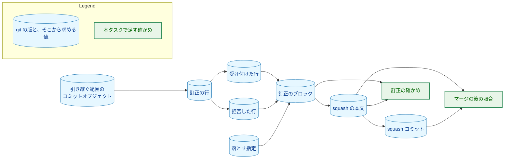
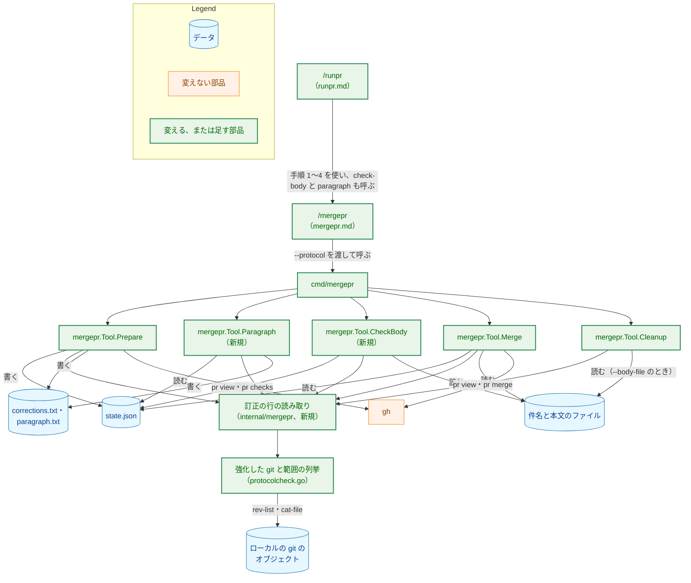
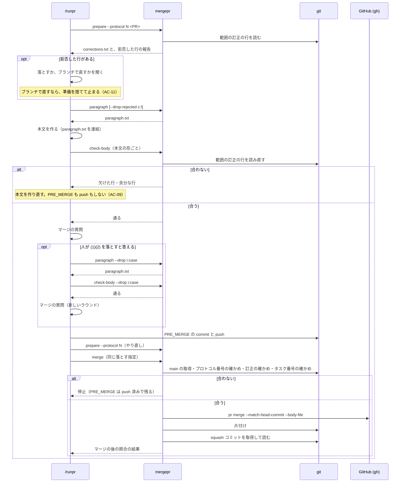
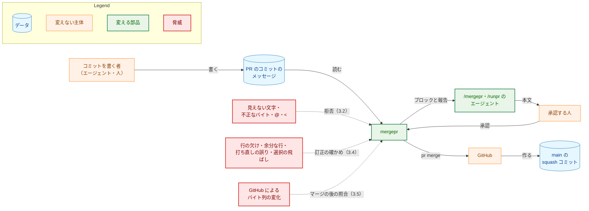
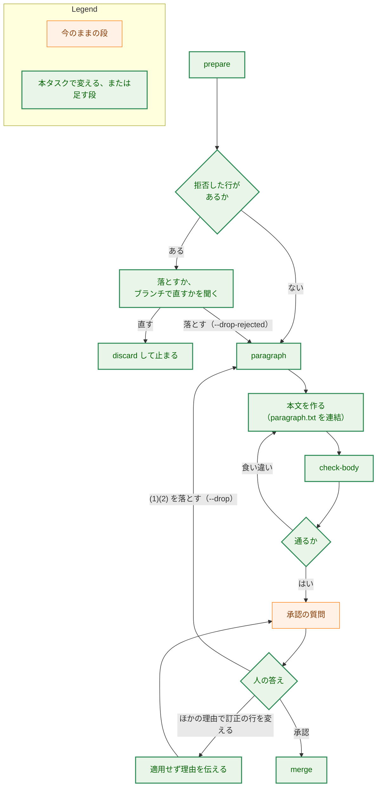

# アーキテクチャ設計書：編集上の訂正の行を、squash コミットの本文に引き継ぐ

## Document Status

| Item | Value |
|---|---|
| Status | `approved` |
| Created | 2026-11-19 |
| Review date | 2026-11-19 |
| Reviewer | isseis |
| Comments | - |

本書は [01_requirements.md](01_requirements.md)（要件定義書。以下、要件書）の設計である。「計画で決める」は、本タスクの実装計画書（`03_implementation_plan.md`）で決めることを指す。既存のファイルの内容と `file:line` の行番号は、コミット `60de9ced` のものである。F-NNN・AC-NN は要件書の項番を、H-NN は [design_handoff.md](design_handoff.md)（以下、申し送り）の項番を指す。申し送りへの対応は付録 A に、受け入れ基準との対応は付録 B にまとめる。

本書は、要件書 3 章の用語（訂正の行・引き継ぐ範囲・範囲の順・受け付けない文字・squash の本文・承認の質問・落とした記録の行）を、同じ意味で使う。ただし「受け付けない文字」には、1.2 の決定 3 のとおり、非文字も含める。そのほかに、次の用語を使う。

-   **受け付けた行:** 引き継ぐ範囲の訂正の行を、バイト列として同じ行は初めて現れた位置の 1 つにまとめ（AC-03）、受け付けない文字を含む行を除いて、範囲の順に並べたもの。1 から始まる番号を持つ（3.2）。
-   **拒否した行:** 引き継ぐ範囲の訂正の行のうち、受け付けない文字を含むもの。重複は、受け付けた行と同じくまとめる。初めて現れたコミットと行番号で指す（3.2）。
-   **落とす指定:** どの行を、要件書 F-004 のどの場合として落とすかの宣言。受け付けた行を (1)(2) として落とす `--drop <番号>:<場合>` と、拒否した行を (3) として落とす `--drop-rejected <コミット ID>:<行番号>` の 2 つの形で `mergepr` に渡す（3.3）。
-   **訂正のブロック:** squash の本文に入れる行の並び。受け付けた行から落とす指定の行を除いたものと、落とした記録の行（1 行以上を落とすときだけ）を、この順に並べたもの（3.3）。要件書 6 章の「訂正の段落」（PR の説明に書く日本語の段落）とは別のものである。
-   **予約した接頭辞:** `Editorial correction: ` と、落とした記録の行の接頭辞 `Dropped editorial corrections: ` の 2 つ（3.3）。
-   **訂正の確かめ:** 件名と本文の、予約した接頭辞で始まる行が、訂正のブロックとバイト列として一致し、本文の中で 1 つの段落をなすことなどの確かめ（3.4）。
-   **マージの後の照合:** マージでできた squash コミットの、予約した接頭辞で始まる行が、マージに渡した本文の同じ行とバイト列として一致することの確かめ（3.5）。

## 1. 設計の全体像 (Design Overview)

### 1.1. 設計原則

-   **取り出し・判定・確かめは、マージが必ず通る `mergepr` の中で、テストのある Go のコードで行う。** `/runpr` からのマージも、`/mergepr` を単独で使うマージも、`mergepr prepare` と `mergepr merge` を必ず通る（`.claude/commands/mergepr.md:41`、`.claude/commands/mergepr.md:150`、`.claude/commands/runpr.md:965`、`.claude/commands/runpr.md:1325`）。バイト列の一致や見えない文字の判定をエージェントの読み取りに任せると、同じ入力でも結果が変わりうる（[ADR-0014](../../dev/adr/0014-deterministic-checks-in-go.md) の「判定と副作用を持つ開発の道具は Go で書き、テストを持つ」「順序を、コマンドの定義ではなく道具の中で強制する」）。
-   **訂正の行のバイト列は、エージェントに打ち直させない。** 訂正のブロックは `mergepr` が作業ディレクトリのファイルに書き、エージェントはそのファイルを本文に連結する（3.3）。日本語や記号を含む行を打ち直すと、1 バイトの違いで AC-01 を破る。
-   **判定の基準は、確かめるたびに git から求め直す。** `check-body` と `merge` は、`prepare` が書いた `corrections.txt` や、`paragraph` が書いた `paragraph.txt` を読み返さず、コミットオブジェクトから受け付けた行と拒否した行を求め直す（ADR-0014 の「道具は、判定に使う基準値を状態のファイルから読み返さない」）。これらのファイルは、エージェントが書き換えうるためである。状態のファイル（`state.json`）の PR 番号・head・base は、今までどおり、準備を固定する値として読む。`merge` も今までどおり PR の base が変わっていないことを確かめ、`--match-head-commit` で head を固定する。そのため、`state.json` が書き換えられても、別の head や base にマージすることはない（`internal/mergepr/mergepr.go:337-385`）。
-   **落とす行は、3 つの場合とも宣言で渡す。** (1)(2) も (3) も、落とす指定として `mergepr` に渡す。拒否した行のうち宣言のないものがあれば、`mergepr` は止まる（3.4）。これで、人が落とすと選んだことと、エージェントが選択を飛ばしたことを、道具が区別できる。`mergepr` は本文の落とした記録の行を読み解いて場合を決めない（`CLAUDE.md`「Declare, don't infer」）。
-   **読めないとき、合わないときは止める。** コミットを読めないときと、本文が訂正のブロックと合わないときは、マージしない（要件書 4.3）。受け付けない文字を含む行は、文字を除いたり置き換えたりせず、そのままでは写さない（`CLAUDE.md`「Reject, don't normalize」）。

### 1.2. 設計の際に決めたこと（2026-11-19）

1.  **訂正の行の取り出し・判定・確かめを、`mergepr` に置く（H-01）。** `prepare` は、受け付けた行を書き出し、拒否した行を報告する。新しいサブコマンド `paragraph` は、訂正のブロックを作る。新しいサブコマンド `check-body` は、承認の質問の前に件名と本文を確かめる。`merge` は、GitHub にマージを頼む前に同じ確かめを行う。
    -   **理由:** 上の設計原則の 1 つ目のとおりである。`mergepr` は、プロトコル番号とタスク番号の確かめで、すでに「承認の前と、マージの直前の 2 回」確かめる形を持つ（`internal/mergepr/mergepr.go` の `Prepare` と `Merge`）。AC-09 と AC-11 が求める 2 回の確かめも、同じ形に収まる。
    -   **採らなかった案:** `mergepr.md` の手順で、エージェントが `log.txt` を読んで行を取り出し確かめる案。`log.txt` は `git log` が再エンコードした出力で、コミットの境目と行番号を機械的に読めず（申し送り H-01）、見えない文字の判定も、壊して失敗を確かめるテストも持てない。
    -   **人の答え:** `mergepr` ツールに置く（推奨の案）。
    -   **ADR:** なし。ADR-0014 の今の決定を当てはめるだけで、決定を変えない。
2.  **(1)(2) の行を落とすことを、`--drop <番号>:<場合>` の宣言で `mergepr` に渡す（H-03）。** 番号は受け付けた行の番号（`corrections.txt` の行番号）、場合は `disputed`（(1)）か `reverted`（(2)）である。
    -   **理由:** 上の設計原則の 4 つ目のとおりである。`check-body` と `merge` は、宣言と git から訂正のブロックを求め直して本文と比べるだけで、本文の文面から振る舞いを選ばない。
    -   **採らなかった案:** エージェントが書いた落とした記録の行を、`mergepr` が読み解いて件数を確かめる案。呼び出し側が書いた文字列の中身で振る舞いを選ぶことになる。
    -   **人の答え:** `--drop` フラグで宣言する（推奨の案）。
    -   **ADR:** なし。`mergepr` の引数の形で、本タスクの中で閉じる。
    -   **ここから決まること:** (3) も同じく `--drop-rejected <コミット ID>:<行番号>` で宣言する。宣言のない拒否した行があれば止まる（設計原則の 4 つ目）。拒否した行は番号を持たないので、報告に出すコミットと行番号で指す。
3.  **非文字（U+FDD0〜U+FDEF と、各面の最後の 2 つの符号位置）を、「UTF-8 として不正なバイト列」の側に含めて、受け付けない文字とする（H-08 の 1 つ目）。** 報告では、種類を「不正な UTF-8」とし、文字を `U+XXXX` の形で示す。
    -   **理由:** `git commit` は非文字を UTF-8 でないものとして書き換え、格納されるメッセージが変わる（`internal/fixprguard/write.go:69-74` の `isFormatOrNoncharacter` の説明）。`fixprguard finish` の訂正の行の確かめも非文字を拒否しており（`internal/fixprguard/write.go:101-127`）、それとそろえる。
    -   **採らなかった案:** Go の `utf8.Valid` に従い、非文字をそのまま写す案。git やほかの道具がバイト列を書き換えうる文字が、`main` の履歴に入りうる。
    -   **人の答え:** 含める（推奨の案）。
    -   **ADR:** なし。`mergepr` が行を受け付ける条件で、仕様は `mergepr.md` と手引きに置く（要件書 1 章の F-003 の項目と同じ扱い）。
4.  **3 章の分類に入らないが見えにくい文字（U+3164 などの埋め草の文字、異体字セレクタ、私用領域の文字）は、受け付けない文字に足さない（H-08 の 2 つ目）。** 残るリスクとして 5.3 に記録する。
    -   **理由:** 要件書の分類のままで、要件書に戻らずに済む。訂正の行を書くのは、PR を作ったエージェントのセッションと人であり、人は承認の質問で行を読む。
    -   **人の答え:** 足さない（推奨の案）。
    -   **ADR:** なし。要件書の決定を変えない。
5.  **訂正の行の `#N` と、issue を閉じるキーワード（`fixes #N` など）は、受け付ける（H-07 の 2 つ目）。** 残るリスクとして 5.3 に記録する。
    -   **理由:** このリポジトリでは「Auto-close issues with merged linked pull requests」の設定が off で、`/runpr` は squash の本文の `Closes` 行で issue が閉じることを当てにしていない（`.claude/commands/runpr.md:1362-1364`）。行は承認の質問で人が読む。ただし、既定のブランチに入ったコミットのメッセージのキーワードで issue が閉じるのを、この設定が止めるかは、確かめていない。`main` の squash コミット `f5b511e1` の本文は `Closes #934` を持つが、#934 がそのコミットで閉じたか、`/runpr` が閉じたかは、ローカルの記録からは分からない。人は、確かめていないことを知ったうえで受け入れた。
    -   **採らなかった案:** 要件書に戻り、`#` を受け付けない文字に足す案。訂正の行で issue 番号に触れられなくなる。
    -   **人の答え:** 受け入れる（推奨の案）。
    -   **ADR:** なし。要件書の決定を変えない。
6.  **`gh pr merge` に渡した訂正の行がバイト列のまま squash コミットに入ることを、マージの後の照合で確かめる（H-07 の 1 つ目）。** 本文は、引数ではなく `gh pr merge --body-file` で渡す（3.5）。
    -   **理由:** 日本語を含む訂正の行が UTF-8 のまま `main` に届いた実例はある（#976 の squash コミット `7c3a9653` の本文）。しかし、行末の空白などが保たれるかの実例はない。マージの後の照合なら、GitHub の振る舞いが後で変わっても検出でき、GitHub への書き込みを増やさない。
    -   **採らなかった案:** 実装の前に使い捨ての PR で一度だけ確かめる案。GitHub への書き込みが要り、その後の振る舞いの変化は検出できない。リスクとして受け入れるだけの案は、AC-01 の破れが見えないまま残る。
    -   **人の答え:** マージの後に照合する（推奨の案）。
    -   **ADR:** なし。`mergepr` の保証の細部で、仕様は手引きに置く。
7.  **訂正のブロックは、本文の要約（リード・箇条書き・`CLAUDE.md` が求める記録）の後ろ、`Closes #N` の行とトレーラーの段落の前に、見出しも導入の文もなしに 1 つの段落として置く。落とした記録の行は、段落の最後の行とする（H-02）。** 落とした記録の行の形は、3.3 で定める。
    -   **理由:** 見出しや導入の文は、`git log --grep='^Editorial correction: '` で探す読み手にとって余分な行で、記録として何も足さない。要約の後ろに置くと、本文の先頭は今と同じく PR の要約のままになる。トレーラーより前に置くのは、git がトレーラーとして読むのは本文の最後の段落だけで、ブロックを最後に置くとトレーラーが読めなくなるためである（3.4 の確かめ 7）。`Closes #N` の行との前後は、`.claude/commands/runpr.md:972-974` が本文の最後に置くと定めているので、その前に置く。段落の最後に落とした記録の行を置くと、訂正の行の並びが途切れない。
    -   **ADR:** なし。本文の書き方の細部で、本タスクの中で閉じる。
    -   **人の答え:** なし（申し送り H-02 が設計に委ねた細部で、人に聞いていない）。
8.  **プロトコル番号を、`mergepr` の今の `main` の値 + 1 に上げる（H-01）。** サブコマンドと引数と出力が変わり、古い `mergepr` で新しい定義を走らせると、確かめが黙って抜けるためである（`CLAUDE.md`「Protocol numbers」、ADR-0014 の「`--protocol` の番号を上げる PR は…」）。
    -   **ADR:** なし。ADR-0014 の今の決定を当てはめるだけである。
9.  **止まる理由と直し方を、`docs/dev/guides/mergepr_guide.md` の 7 章に載せる（H-06）。** 手引きは、止まったときに人が読む文書で、プロトコル番号とタスク番号の確かめの止まり方もそこにある。
    -   **ADR:** なし。
10. **拒否した行があるときは、マージの質問の前に、すべての拒否した行について 1 つの単一選択の問いで「すべて落とす」か「ブランチで直す（止まる）」かを聞く（H-03）。** 行ごとの報告は、`/runpr` では詳細ファイルに、単独の `/mergepr` では会話に示す。`/runpr` のマージの質問の自由記述に、(1)(2) を落とす答えの形 `C<番号>:<場合>` を足す。
    -   **理由:** ブランチで直すときは、どの行についても `/mergepr` をやり直すので、行ごとに聞いても選べる組み合わせは増えない。chief が中継するのは 1 つを選ぶ問いだけで（[ADR-0046](../../dev/adr/0046-chief-of-staff.md)）、deferred のスレッドの問いと同じ形にそろう。
    -   **採らなかった案:** 拒否した行ごとに問う案。実質の差がなく、問いの数だけが増える。
    -   **人の答え:** まとめて 1 問にする（推奨の案）。
    -   **ADR:** [ADR-0047](../../dev/adr/0047-runpr-merge-question.md) を本書の PR で更新する。マージの質問の前に置く問いと、マージの質問の自由記述の形は、ADR-0047 の「決定」が定めており、それに項目を足すためである（既存の ADR の決定を変える決定）。`runpr.md` は実装の PR まで変わらないので、ずれの記述を置き、#747 へリンクする。
11. **`/runpr` のマージの質問の要約に、訂正の行があるときだけ `訂正の行: <n> 行（落とす <m>、詳細ファイル）` の行を足す（H-03）。** 要約の行は最大 14 行になる。
    -   **理由:** 落とす行があることを、詳細ファイルを開く前に人が気づけるようにするためである。
    -   **人の答え:** 足す（推奨の案）。
    -   **ADR:** ADR-0047 の更新に含める（要約に何を出すかは ADR-0047 の決定の細部で、項目はマージの質問の項目にまとめる）。
12. **`mergepr` の訂正の行の読み取りと訂正の確かめを、`CLAUDE.md`「Declare, don't infer」の例外として、実装の PR で `CLAUDE.md` に足す。** 範囲は、コミットのメッセージの 1 列目の接頭辞と文字の分類、件名と本文の予約した接頭辞の行と段落の形、本文のトレーラーの読み取りである。
    -   **理由:** どれも、git と呼び出し側が書いた文字列の中身で振る舞いを選ぶ。訂正の行は要件書が接頭辞で定めた外部の値で、型では表せない。ほかの道具の同じ種類の読み取り（`numreserve`、`codexreview` など）も、例外として範囲・理由・境界を `CLAUDE.md` に持つ。
    -   **人の答え:** 足す（推奨の案）。
    -   **ADR:** なし。`CLAUDE.md` の規則と横断的な原則は ADR にしない（`CLAUDE.md`「Design decisions (ADR)」）。

### 1.3. なぜ今の仕組みでは足りないか

-   `prepare` は、PR のコミットのメッセージを `git log --format=%h %s%n%n%b` で `log.txt` に書くだけである（`internal/mergepr/mergepr.go:250`）。`git log` は `encoding` ヘッダーや `i18n.logOutputEncoding` に従って再エンコードするので、コミットオブジェクトのバイト列（要件書 3 章の「訂正の行」）を読めない。コミットの境目と各行の行番号も読めず、件名の行は `%h ` の後ろに出るので 1 列目から始まらない。
-   プロトコル番号の確かめは、PR のコミットを強化した git（`cmdrunner.GitHardening()` を付けた git。3.1）で列挙する（`internal/mergepr/protocolcheck.go:585-610` の `history`）。ただし、コミットのファイルを読むだけで、メッセージは読まない。列挙も `--topo-order` を付けないので、範囲の順（要件書 3 章）と一致しない。本書は、この列挙の部品を使い回し、順序の指定とメッセージの読み取りを足す（3.1）。
-   `merge` は、受け取った本文をそのまま `gh pr merge --body` の引数に渡し、中身を確かめない（`internal/mergepr/mergepr.go:382`）。訂正の行が欠けても、余分な行があっても、マージは進む。
-   `/mergepr` の step 2 は、本文を 10 行程度に抑えるよう求め、その例外に訂正の行を含めない（`.claude/commands/mergepr.md:104-131`）。

どれも、今の仕組みを残したまま手順の文を足すだけでは、AC-01（バイト列の一致）・AC-09（確かめ）・AC-10（行番号と種類の報告）を満たせない。

### 1.4. 概念モデル

矢印 A → B は「B を A から求める」ことを表す。



拒否した行は、訂正のブロックには行として入らない。落とした記録の行の (3) の件数として入る（3.3）。

## 2. システム構成 (System Structure)

### 2.1. 全体構成

矢印 A → B は「A が B を呼ぶ、読む、または書く」ことを表す。



`paragraph` と `check-body` は、ネットワークに触れない。`prepare` が取得した `origin/<base>` と、`state.json` が固定した head から範囲を求める（3.1）。`merge` は、今と同じく `main` を取得し直した後に確かめる。

### 2.2. コンポーネント配置

| ファイル | 種類 | 内容 |
|---|---|---|
| `internal/mergepr/corrections.go` | 新規 | 訂正の行の読み取り、受け付けない文字の分類、訂正のブロックの組み立て、訂正の確かめ、マージの後の照合、報告用の表示形（3.1〜3.5） |
| `internal/mergepr/corrections_test.go` | 新規 | 実際の git のリポジトリでの読み取りのテストと、分類・組み立て・確かめの表のテスト（7.1） |
| `internal/mergepr/protocolcheck.go` | 変更 | 範囲の列挙を、範囲の順（`--topo-order`）で列挙できる形にして訂正の行の読み取りと共有する（3.1） |
| `internal/mergepr/mergepr.go` | 変更 | `Protocol` を `main` の値 + 1 に。`Tool` に訂正の行の読み取りを持たせる。`Prepare` が `corrections.txt` を書き、拒否した行を返す。`Paragraph`・`CheckBody` を足す。`Merge` に訂正の確かめとマージの後の照合を足し、本文を `--body-file` で渡す。`Cleanup` に任意の本文のファイルを足す（3.6） |
| `internal/mergepr/errors.go` | 変更 | 訂正の確かめとマージの後の照合の番兵の誤りと誤りの型（4.1） |
| `internal/mergepr/test_helpers.go` | 変更 | 訂正の行の読み取りの差し替え（3.7） |
| `internal/mergepr/test_helpers_git.go` | 変更 | 任意のバイト列のメッセージを持つコミットを作る補助（7.1） |
| `internal/mergepr/mergepr_test.go` | 変更 | `Prepare`・`Merge`・`Cleanup` のテストを、読み取りの差し替えを使う形に。`gh pr merge` の引数の変更。新しいサブコマンドのテスト（3.7） |
| `internal/mergepr/protocolcheck_test.go` | 変更 | 共有にした範囲の列挙のテスト |
| `cmd/mergepr/main.go` | 変更 | `paragraph` と `check-body` のサブコマンド、`--drop` と `--drop-rejected` の解析、`cleanup` の `--body-file`、`prepare` と `merge` の出力の行、誤りの示し方、使い方の文（3.6・4.2） |
| `cmd/mergepr/main_test.go` | 変更 | 新しいサブコマンドと落とす指定の引数のテスト、拒否した行と食い違いの出力のテスト（7.1） |
| `cmd/mergepr/docs_test.go` | 変更 | `definitionCalls` と置き換えの値（3.7） |
| `.claude/commands/mergepr.md` | 変更 | F-001〜F-004 の手順（3.8） |
| `.claude/commands/runpr.md` | 変更 | マージの質問の前の選択と確かめ、詳細ファイル、自由記述での落とし方、PRE_MERGE の後の準備のやり直しとマージでの落とす指定、止まったときの報告（3.8） |
| `.claude/commands/_context.md` | 変更 | 「PR merge method」の行に、squash の本文が訂正の行も運ぶことを足す（3.9） |
| `docs/dev/conventions/requirements_process.md` | 変更 | 記録の置き場所の段落（`requirements_process.md:132-142`）と「Recording in the PR description」に、squash の本文が訂正の行を運ぶことを足す（3.9） |
| `docs/dev/conventions/adr.md` | 変更 | 「Editorial corrections」の「Recording」に、同じことを足す（3.9） |
| `docs/dev/guides/mergepr_guide.md` | 変更 | 4 章の流れ、5 章の新しいサブコマンド、6 章の保証、7 章の止まったときの対処、プロトコル番号（3.9） |
| `docs/dev/conventions/package_reference.md` | 変更 | `internal/mergepr` の行に訂正の行の引き継ぎを足す |
| `CLAUDE.md` | 変更（実装の PR） | 「Declare, don't infer」に、訂正の行の読み取りと確かめの例外の段落を足す（1.2 の決定 12、3.9） |
| `docs/dev/adr/0047-runpr-merge-question.md` | 変更（本書の PR） | 拒否した行の問い、`C<番号>:<場合>` の自由記述、要約の行を「決定」に足し、#747 へのずれの記述を置く。実装の PR でずれの記述を消す（1.2 の決定 10・11） |
| `docs/dev/adr/0039-adr-writing-criteria.md` | 変更（実装の PR） | 「決定」の #747 へのずれの記述を消し、仕様の置き場所のリンクを `mergepr.md` と手引きへ向ける（AC-16） |
| `docs/dev/adr/0036-task-document-status-records.md` | 変更（実装の PR） | 「決定」の #747 へのずれの記述を消す（AC-16） |

変えないもの: `CLAUDE.md` は、訂正の記録の置き場所を述べていない（`grep -n -i correction CLAUDE.md` の該当は 334 行目の 1 つで、訂正の記録とは関係がない）ので、その点では変えない（変えるのは 1.2 の決定 12 の例外だけである）。`_lib/task-pr-handoff.md` と `fixpr.md` の、PR の説明の訂正の段落の作り方は、要件書 2.3 のとおり変えない。`log.txt` の形も変えない。下書きの材料として今のまま使い、訂正のブロックの材料にはしない。

### 2.3. データフロー

`/runpr` からのマージの流れを示す。`/mergepr` を単独で使うときは、PRE_MERGE の段がなく、マージの質問が承認の質問になる。



## 3. コンポーネント設計 (Component Design)

### 3.1. 訂正の行の読み取り（AC-01〜AC-04、H-01）

-   **範囲:** head から辿れ、`origin/<base>` から辿れないコミットを、`--topo-order` を付けた逆順（`git rev-list --reverse --topo-order`）で並べたもの（要件書 3 章の「範囲の順」）。`<head>` は `state.json` の `headRefOid`、`<base>` は `baseRefName` である。
-   **列挙の部品の共有:** 範囲の列挙は、プロトコル番号の確かめの部品を使い回す（`internal/mergepr/protocolcheck.go:414-416` の強化した `git`、`:474` の `isObjectID`、`:487` の `resolveCommit`、`:585-610` の `history` の shallow の拒否、`:508-547` の `listPRCommits` と `parseRevList`）。今の `listPRCommits` は `--topo-order` を付けないので、順序の指定を足して共有する。そのため、次のことが両方の確かめに当てはまる。
    -   shallow のリポジトリでは止まる。shallow だと範囲に `main` のコミットが入りうるためである。
    -   `origin/<base>` と head は、使う前にコミット ID に解決する。`baseRefName` は `refs/remotes/origin/` の下の ref としてだけ解決し、オプションや別の rev として読まない。解決できなければ止まる。
    -   git は `GIT_*` の環境変数を除き、`cmdrunner.GitHardening()`（`internal/cmdrunner/git.go:19-30`。`--no-replace-objects` を含む）を付けて呼ぶ。`refs/replace` があっても、格納されたコミットオブジェクトそのものを読む。
-   **`origin/<base>` の値:** 読むときの remote-tracking ref の値を使う。`prepare`・`paragraph`・`check-body` は `prepare` が取得した値を、`merge` は取得し直した値を読む。`merge` が取得し直すのは `main` だけである（`internal/mergepr/mergepr.go:146` の `mainRefspec`）。base が `main` でない PR では、`merge` も `prepare` が取得した値を読む。`main` が前へ進んでも、PR のコミットは squash マージの前に `main` に入らないので、範囲は同じコミットになる。前提が崩れて範囲が変わったときは、訂正の確かめが食い違いとして止める（3.4）。
-   **バイト列:** 各コミットを `git cat-file commit <oid>` で読み、最初の空行より後ろをメッセージのバイト列とする。`git log` を使わないので、`encoding` ヘッダーと `i18n.logOutputEncoding` による再エンコードは起きない。`encoding` ヘッダーは見ず、格納されたバイト列をそのまま UTF-8 として判定する。`encoding` ヘッダーが UTF-8 以外を名指すコミットの行は、そのバイト列が不正な UTF-8 なら拒否され、たまたま正しい UTF-8 なら受け付けられて書かれたバイト列のまま引き継がれる。後者は、ブランチで `git log` が見せた文字と、`main` の squash コミット（`encoding` ヘッダーを持たない）で見える文字が違いうる。AC-01 は格納されたバイト列の一致を求めるので、このときもバイト列は一致する。1 コミットに 1 回 `cat-file` を呼ぶか、`--batch` で読むかは、計画で決める。
-   **行:** メッセージを LF で分け、件名を 1 行目として数える。行の末尾の CR は、行の一部として残す（受け付けない文字として拒否される）。1 列目が `Editorial correction: `（大文字と小文字を区別する）で始まる行だけが訂正の行である（AC-04）。行の残りの形は問わない（AC-02）。
-   **失敗:** 読み取りに失敗したときは、読めたところまでの結果を返さずに止める（4.1）。
-   **差し替え口:** 読み取りは `Tool` の中の interface を通す。`Prepare`・`Merge`・`Cleanup` のテストは、git と gh のコマンドの並びを変えずに、読み取りを差し替える（3.7）。

```go
// correctionSource reads correction lines from git. The production source
// runs git without the GIT_* variables and with cmdrunner.GitHardening, and
// refuses a shallow repository; tests substitute a fake.
type correctionSource interface {
	// rangeLines resolves origin/<baseRefName> and headOID to object IDs and
	// returns every correction line of the commits reachable from the head
	// and not from the base, in range order.
	rangeLines(ctx context.Context, baseRefName, headOID string) ([]correctionLine, error)
	// mergedLines fetches baseRefName from origin and returns the lines of
	// the merge commit's message that start with a reserved prefix.
	mergedLines(ctx context.Context, baseRefName, mergeOID string) ([][]byte, error)
}

// correctionLine is one correction line as the commit object stores it.
type correctionLine struct {
	Commit string // full object ID
	Line   int    // 1-based line number in the commit message; the subject is 1
	Text   []byte // the line without its LF
}
```

### 3.2. 受け付けた行と拒否した行（AC-03、AC-10、AC-12、H-08）

範囲の訂正の行を、バイト列として同じ行は初めて現れた位置の 1 つにまとめ（AC-03）、次の分類で受け付けた行と拒否した行に分ける。分類は訂正の行だけに行う（AC-12）。

| 種類（報告の語） | 当たる文字 | 示し方 |
|---|---|---|
| 見えない文字（`invisible`） | 一般カテゴリ Cc のうちタブ（U+0009）以外（行の末尾の CR を含む）、Cf、Zl、Zp | `U+XXXX` |
| 不正な UTF-8（`invalid-utf8`） | UTF-8 として不正なバイト列。非文字（U+FDD0〜U+FDEF と、各面の最後の 2 つの符号位置）を含む（1.2 の決定 3） | 不正なバイトは `\xNN`、非文字は `U+XXXX` |
| `@`（`at`） | U+0040 | そのまま |
| `<`（`lt`） | U+003C | そのまま |

一般カテゴリは、ビルドに使う Go の `unicode` パッケージの表で判定する。Go のバージョンを上げて Unicode の版が変わると分類が変わりうるが、変わるのは新しく割り当てられた文字の扱いだけで、その変化はマージの前の確かめで見える。タブを含む行は受け付けた行になり、書かれたとおり引き継がれる（AC-12）。

`fixprguard` の `isControl` と `isFormatOrNoncharacter`（`internal/fixprguard/write.go:67-74`）と、訂正の行の接頭辞の定数（同 `:97-100` の `editorialCorrectionPrefix`）は使い回さない。`mergepr` は自分の定義を持つ。理由は次の 2 つである。

-   **受け付けない文字の集合が違う。** `fixprguard` はタブを拒否して `<` を受け付けるが、`mergepr` はタブを受け付けて `<` を拒否する。
-   **共有できない。** どちらも別の道具のパッケージの非公開の識別子である。

2 つの定義は独立した写しであり、そろっていることを確かめる仕組みはない。非文字の範囲は Unicode が固定しているので、ずれる心配は小さい。

受け付けた行は、範囲の順に 1 から番号を振る。この番号が `--drop` の番号で、`prepare` が書く `corrections.txt` の行番号と同じである。番号の振り方は、`mergepr` の引数の契約の一部として手引きに書く。拒否した行は番号を持たず、初めて現れたコミットの ID と行番号で指す。

```go
// RejectKind is a kind of rejected character (AC-10). String returns the
// report word: "invisible", "invalid-utf8", "at", or "lt".
type RejectKind int

const (
	RejectInvisible   RejectKind = iota + 1 // Cc other than tab, Cf, Zl, Zp
	RejectInvalidUTF8                       // invalid UTF-8, or a noncharacter
	RejectAt                                // '@'
	RejectLessThan                          // '<'
)

// RejectedLine is a correction line that holds a rejected character, at
// the position where it first appears in range order.
type RejectedLine struct {
	Commit string       // full object ID
	Line   int          // 1-based line number in the commit message
	Kinds  []RejectKind // in the order of the constants, each once
	Shown  string       // the shown form (3.6)
}
```

### 3.3. 訂正のブロックと落とす指定（AC-05、AC-06、AC-13、AC-14、H-02）

訂正のブロックは、次の行をこの順に並べたものである。

1.  受け付けた行のうち、`--drop` で指定していない行を、番号の順に。
2.  1 行以上を落とすとき、落とした記録の行を 1 行。

範囲に訂正の行がないとき、訂正のブロックは空で、本文には何も入らない（AC-06）。行の数と長さに上限はない（AC-05）。

落とした記録の行の形は、次のとおりとする（AC-14）。3 つの件数を、0 であっても常に書く。件数は、AC-03 で重複をまとめた後の行の数である。

```text
Dropped editorial corrections: <a> disputed by a reviewer, <b> reverted on the branch, <c> with rejected characters
```

`<a>` は `disputed` の指定の数、`<b>` は `reverted` の指定の数、`<c>` は `--drop-rejected` の指定の数である。行は `Editorial correction: ` で始まらず、落とした行の文字を含まない。

**落とす指定。** どちらも繰り返して渡せる。

| 形 | 意味 |
|---|---|
| `--drop <番号>:disputed` | 受け付けた行 `<番号>` を (1)（PR のレビュアーが訂正であることに異を唱えた行）として落とす |
| `--drop <番号>:reverted` | 受け付けた行 `<番号>` を (2)（ブランチの中で後から戻し、PR の head でも戻したままの行）として落とす |
| `--drop-rejected <コミット ID>:<行番号>` | 拒否した行を (3) として落とす。コミット ID は 40 桁の完全な ID、行番号は `prepare` の報告のもの |

(1)(2) に当たるかは、人が示したとおりとし、`mergepr` は確かめない（要件書 1 章の「残るリスク」）。(3) に当たるのは、拒否した行だけである（AC-13）。

`cmd/mergepr` の `parse` は、形の誤り（`:` のない値、数でない番号、0 以下の番号、知らない場合、40 桁の 16 進数でないコミット ID）と、同じ番号や同じ拒否した行の重複を、使い方の誤りとして何も読まずに止める。番号が受け付けた行の範囲の外であること、`--drop-rejected` が拒否した行を指さないこと、宣言のない拒否した行があることは、範囲を読んだ後に分かるので、訂正の確かめの誤りとして止める（4.1）。

```go
// DropCase is the case under which an accepted correction line is dropped
// at the approval question (F-004 (1) and (2)).
type DropCase int

const (
	DropDisputed DropCase = iota + 1 // --drop N:disputed
	DropReverted                     // --drop N:reverted
)

// Drop declares that accepted correction line Index (1-based, the line
// number in corrections.txt) is dropped under Case.
type Drop struct {
	Index int
	Case  DropCase
}

// RejectedDrop declares that the rejected line first appearing at Commit's
// message line Line is dropped (F-004 (3)).
type RejectedDrop struct {
	Commit string
	Line   int
}

// Drops is the whole declaration a caller passes to Paragraph, CheckBody,
// and Merge. Its zero value drops nothing.
type Drops struct {
	Accepted []Drop
	Rejected []RejectedDrop
}

// ParseDrop and ParseRejectedDrop parse one --drop and one --drop-rejected
// value; cmd/mergepr calls them so the forms are defined in one place.
func ParseDrop(s string) (Drop, error)
func ParseRejectedDrop(s string) (RejectedDrop, error)
```

**作業ディレクトリのファイル。**

| ファイル | 書くもの | 中身 |
|---|---|---|
| `corrections.txt` | `prepare` | 受け付けた行を番号の順に、1 行ずつ LF で終えて書く。受け付けた行がなければ空 |
| `paragraph.txt` | `paragraph` | 落とす指定を当てはめた訂正のブロック。空でなければ、1 行ずつ LF で終え、最後にもう 1 つ LF（空行）を足す。空なら 0 バイト |

`prepare` は `paragraph.txt` を書かない。エージェントは、拒否した行の選択の後に、必ず `paragraph` を呼ぶ。`paragraph` は、範囲を git から読み直し、落とす指定を当てはめて、宣言のない拒否した行があれば止まり（3.4 の確かめ 2）、`paragraph.txt` を書き直す。書くのは、`state.json` が記録した作業ディレクトリの中だけで、`discard` と同じく、その作業ディレクトリが `prepare` の作ったものであることを確かめてから書く（`internal/mergepr/mergepr.go:421-440` の `removeWorkDir` と同じ確かめ）。

**本文の組み立て。** エージェントは、次の 3 つを `cat` で連結して本文のファイルを作る。

1.  要約の部分。最後の行の後ろに空行を 1 つ置く（`…\n\n` で終える）。
2.  `paragraph.txt`。
3.  `Closes #N` の行（あるとき）とトレーラーの部分。

`paragraph.txt` が空のときも、空でないときも、この連結で段落の間に空行がちょうど 1 つ入る。

### 3.4. 訂正の確かめ（AC-06、AC-07、AC-09、AC-11）

`paragraph`・`check-body`・`merge` は、次の確かめを同じコードで行う。`paragraph` が行うのは 1〜3 だけである。

1.  3.1 と 3.2 で、範囲の受け付けた行と拒否した行を求め直す。読めなければ止める（`errCorrectionUnreadable`）。
2.  落とす指定を当てはめる。番号が受け付けた行の範囲の外、`--drop-rejected` が拒否した行を指さない、宣言のない拒否した行がある、のどれかなら止める。宣言のない拒否した行は、`prepare` と同じ報告の形（コミット・行番号・種類・表示形）で示す（AC-10・AC-11）。
3.  3.3 で、期待する訂正のブロックを作る。
4.  件名のファイルの行が、予約した接頭辞のどちらかで始まれば止める。件名も squash コミットのメッセージの一部で、AC-01 が数える行に入るためである。
5.  本文のファイルから、1 列目が予約した接頭辞のどちらかで始まる行を、書かれた順に集める。集めた行の並びが、期待する訂正のブロックとバイト列として一致することを確かめる。一致しなければ、欠けた行（ブロックにあって本文にない行）と余分な行（本文にあってブロックにない行、順序が違う行を含む）を示して止める。
6.  集めた行が本文の中で連続し、前が本文の始まりか空行、後ろが本文の終わりか空行であること（1 つの段落をなし、ほかの行を含まないこと）を確かめる。違えば止める。
7.  訂正のブロックが空でないとき、件名・空行・本文をつなげたメッセージに `git interpret-trailers --parse --no-divider` を実行した出力と、そのメッセージから訂正のブロックの段落を除いたものに同じく実行した出力が、一致することを確かめる。件名を前に付けるのは、git がメッセージの最初の段落を件名として読み、トレーラーとして読まないためである。本文だけを渡すと、本文の最初の段落がトレーラーの段落のとき、それを読み落とす（git 2.50.1 で、件名を付けずに `Co-Authored-By:` の行だけを渡すと何も出力されず、件名を付けると出力された）。違えば止める。ブロックを置いたことでトレーラーの読まれ方が変わった本文を止めるためである。範囲のコミットのトレーラーは読まない。この git も、3.1 の読み取り（`correctionSource`）を通して強化した git で呼び、失敗すれば `errCorrectionUnreadable` とする。`--no-divider` を付けるのは、本文の `---` の行で読むのをやめないようにするためである。本文の渡し方（ファイルの引数か標準入力か）と、利用者の `trailer.*` の設定が結果を変えないようにする方法は、計画で決める。

確かめ 6 と 7 は、AC-06 の「トレーラーの段落とは空行で分けて」「トレーラーの段落より前」を守る。git 2.50.1 で確かめた振る舞い（2026-11-19）は次のとおりである。

-   git は本文の最後の段落だけをトレーラーとして読む。最後の段落を、訂正の行・落とした記録の行・`Co-Authored-By:` の行の 3 行にしたメッセージに `git interpret-trailers --parse` を実行すると、何も出力されなかった。同じ 3 行を空行で 2 つの段落に分けると、`Co-Authored-By:` の行だけが出力された。訂正の行と落とした記録の行は、どちらの形でも出力に入らなかった。
-   git が自分で書くトレーラー（`Signed-off-by:` など）は、ほかの行と同じ段落にあっても読まれる。この場合は確かめ 6 が止める。

このため、ブロックがトレーラーの段落の後ろ（本文の最後）にあると、ブロックを除いた本文ではトレーラーが読め、本文そのものでは読めないので、確かめ 7 が止める。ブロックがトレーラーより前にあるとき、本文にトレーラーがないとき、本文の最後が `Closes #N` の行でもともとトレーラーが読めないときは、2 つの出力が一致して通る。最後の場合はブロックがあってもなくても同じで、今の本文の置き方（`.claude/commands/runpr.md:972-974`）が持つ性質である。

**どこで走らせるか。**

-   **`check-body`:** 承認の質問の前に、エージェントが書いた本文の形ごとに走らせる（AC-07）。`/runpr` では、承認の行のある本文とない本文の両方である。
-   **`merge`:** プロトコル番号の確かめの後、タスク番号の確かめの前に走らせる。タスク番号の確かめは、今と同じく `gh pr merge` の前の最後の確かめとして残す（`internal/mergepr/mergepr.go:371-372` の説明）。

期待するブロックには、拒否した行は (3) の件数としてしか入らない。そのため、拒否した行がそのまま本文にあれば、余分な行として止まる（AC-07 の「受け付けない文字を含む行は承認の質問の本文には現れない」）。

### 3.5. マージの後の照合（H-07）

-   **本文の渡し方:** `merge` は、本文のファイルを最初に 1 回だけ読み、そのバイト列で訂正の確かめを行う。GitHub には、確かめたバイト列を `merge` が新しく作るファイル（作業ディレクトリの外の一時ファイル、所有者だけが読み書きできるもの）に書き、`gh pr merge --body-file <そのファイル>` で渡す。確かめた後に呼び出し側の本文のファイルが書き換えられても、マージされるのは確かめたバイト列である。今の `--body <本文>` の引数（`internal/mergepr/mergepr.go:382`）は、Linux で 1 つの引数の長さの上限（128 KiB）を超えうる。訂正の行の数に上限がない（AC-05）ので、引数では渡さない。一時ファイルは `merge` が返る前に消す。
-   **照合の順序:** `gh pr merge` が成功した後、今の片付け（`cleanup`）を先に行う。その後、片付けが読んだ squash コミットの ID（`Report.MergeCommitOID`）について、3.1 の読み取りの `mergedLines` で `origin` の base を取得し、squash コミットのメッセージの予約した接頭辞で始まる行を読む。それを、確かめたバイト列（メモリにあるもの）の同じ行の並びと、バイト列として比べる。本文のファイルを読み直さない。
-   **結果の示し方:** 一致すれば、報告に `corrections carried: <行の数> line(s) verified` の行を足す。食い違えば、`post-merge check: ` で始まる誤りを返す。誤りのメッセージには、PR が `<ID>` としてマージ済みで捨てる準備がないことと、食い違った行を示す。`main` の squash コミットが訂正の行を正しく持たないことを、人に知らせるためである。マージは取り消さない（取り消せない）。
-   **片付けとの組み合わせ:** 片付けが止まったときも、squash コミットの ID が分かっていれば照合を行う。誤りは、片付けの誤り、照合の誤りの順に並べて返す。ID が分からず照合できなかったときは、報告に `corrections carried: not verified` の行を出す。
-   **作業ディレクトリ:** 今と同じく、片付けが終われば消す（`internal/mergepr/mergepr.go:390`）。照合の比べる相手は確かめたバイト列で、作業ディレクトリのファイルを使わないので、消す時点によらない。食い違いの証拠は、誤りのメッセージが示す行と、`main` の squash コミットそのものである。
-   **`cleanup` での照合:** `cleanup` サブコマンドは、任意の `--body-file` を受け取る。渡されたときは、片付けの前に本文を読み、片付けの後に同じ照合を行う。マージは成功したが `merge` が片付けの前に止まったときに、照合を行えるようにするためである。回復の道筋は 3 つあり、どれも `--body-file` を渡す。
    -   `.claude/commands/mergepr.md:179-181` の回復の手順。
    -   `.claude/commands/runpr.md` の step 5 の片付けの確かめ（`runpr.md:1342-1343`）。
    -   `merge` が誤りのメッセージに示す `cleanup` のコマンド（`internal/mergepr/mergepr.go:131` の `cleanupCommand`）。`merge` は、受け取った本文のファイルのパスを付けて示す。

    渡されないときは、`corrections carried: not verified` の行を出す。

### 3.6. `mergepr` のサブコマンドと出力

| サブコマンド | 変わること |
|---|---|
| `prepare --protocol N [PR]` | `corrections.txt` を書く。出力に `corrections: <受け付けた行の数> accepted, <拒否した行の数> rejected` の行を足す。拒否した行ごとに `correction rejected: <コミット ID> line <行番号>: <種類>[,<種類>...]: <表示形>` の行も足す。拒否した行があっても止まらない（AC-11 で「落とす」を選べるように、準備を残す） |
| `paragraph --protocol N --state FILE [--drop I:CASE]... [--drop-rejected C:L]...`（新規） | 3.3 のとおり `paragraph.txt` を書き、そのパスと `paragraph: <行の数> line(s)` を出力する。ネットワークに触れない |
| `check-body --protocol N --state FILE --subject-file FILE --body-file FILE [--drop I:CASE]... [--drop-rejected C:L]...`（新規） | 3.4 の確かめ 1〜7 を行う。通れば `corrections: <訂正のブロックの行の数> line(s) checked` を出力して終了コード 0、止まれば 4 章の報告をして終了コード 1。ネットワークに触れない |
| `merge --protocol N --state FILE --subject-file FILE --body-file FILE [--drop I:CASE]... [--drop-rejected C:L]...` | 3.4 の確かめを番号の確かめの間に行い、本文を `--body-file` で渡し、マージの後に 3.5 の照合を行う |
| `cleanup --protocol N --state FILE [--body-file FILE]` | `--body-file` のときに 3.5 の照合を行う |
| `discard` | 変えない |

**表示形。** `mergepr` が端末に出す訂正の行（拒否した行、欠けた行、余分な行）は、次の表示形にする。

-   行の全体を `"` で囲む。行末の空白が見えるようにするためである。
-   見えない文字と非文字は `U+XXXX`、不正なバイトは `\xNN` に置き換える（AC-10）。食い違いの報告では、タブも `U+0009` に置き換える。
-   印字できる文字は、日本語の文字や `@`・`<` も含めて、そのまま出す（AC-10）。

元の行に `U+200B` という文字列が書かれていると、置き換えた文字と見分けられない。そのときは、報告のコミットと行番号から `git cat-file commit` で元のバイト列を読む。なお、受け付けた行は端末に出さない。読むなら `corrections.txt` で読む。

すべてのサブコマンドの `--protocol` の値は、`main` の値 + 1 になる（1.2 の決定 8）。

```go
// The exported surface cmd/mergepr uses. Existing methods keep their shape
// except where shown.

// Prepared gains the corrections Prepare found.
type Prepared struct {
	State         State
	Dir           string
	ProtocolCheck string
	Accepted      int            // number of accepted correction lines
	Rejected      []RejectedLine // in range order
}

// Report gains the post-merge comparison's result.
type Report struct {
	ProtocolCheck  string
	MergeCommitOID string
	BaseUpdated    bool
	LocalDeleted   bool
	Note           string
	// CorrectionsChecked is true only when the post-merge comparison ran
	// and found the lines equal, so the zero value means "not verified".
	CorrectionsChecked bool
	// CorrectionsVerified is the number of reserved-prefix lines found
	// equal; meaningful only when CorrectionsChecked is true.
	CorrectionsVerified int
}

func (t *Tool) Paragraph(ctx context.Context, statePath string, drops Drops) (path string, lines int, err error)
func (t *Tool) CheckBody(ctx context.Context, statePath, subjectPath, bodyPath string, drops Drops) (lines int, err error)
func (t *Tool) Merge(ctx context.Context, statePath, subjectPath, bodyPath string, drops Drops) (Report, error)
func (t *Tool) Cleanup(ctx context.Context, statePath, bodyPath string) (Report, error) // bodyPath may be empty
```

### 3.7. テストのための差し替え口と、既存のテストへの影響

-   `Tool` は、3.1 の `correctionSource` を持つ。`New` は本番の読み取りを入れ、テストは偽物を入れる。プロトコル番号の確かめ（`protocolChecker`）と同じ形である。
-   `internal/mergepr/mergepr_test.go` の `Prepare`・`Merge`・`Cleanup` のテストは、git と gh のコマンドの並びを `fakeRunner` で固定している（`internal/mergepr/test_helpers.go:31-60`）。訂正の行の読み取りとマージの後の取得は `correctionSource` を通すので、`fakeRunner` の並びに加わらない。変わるのは `gh pr merge` の引数（`--body` から `--body-file`）だけで、`TestMerge`・`TestMergeRunsProtocolCheck`・`TestMergeNumberCheck`・`TestMergeKeepsSummaryWhenMergeFails` の該当の行を直す。
-   `TestPrepare` は、作業ディレクトリに書くファイルを確かめるので、`corrections.txt` を足す。
-   `internal/mergepr/protocolcheck_test.go` の範囲の列挙のテストは、`--topo-order` を足した列挙に合わせる。
-   `cmd/mergepr/main_test.go` の `TestParseRequiresProtocol` は、サブコマンドと引数の組を表で確かめるので、新しいサブコマンド・落とす指定・`cleanup --body-file` の行を足す。
-   `cmd/mergepr/docs_test.go` の `TestDocumentedInvocationsParse` は、文書の呼び出しを `parse` に通し、`definitionCalls` が挙げるサブコマンドを定義が呼ぶことを確かめる（`cmd/mergepr/docs_test.go:23-31`）。`definitionCalls` は次のとおりにする。
    -   `mergepr.md`: `prepare`・`paragraph`・`check-body`・`merge`・`cleanup`・`discard`。
    -   `runpr.md`: `prepare`・`paragraph`・`check-body`・`cleanup`・`discard`。`runpr.md` は本文の形ごとの確かめと落とす指定の書き直しを自分で書き、`merge` は今と同じく `mergepr.md` の step 4 を通して呼ぶ。

    `placeholderValues` には、落とす指定の置き換えの値（`<drop>`・`<rejected-drop>` など。名前は計画で決める）を足す。`TestDocumentedProtocolMatches` は、文書の `--protocol` が新しい番号と合うことを、変えずに確かめる。

### 3.8. コマンドの定義（AC-07〜AC-11、AC-13〜AC-15、AC-17、H-03）

**`.claude/commands/mergepr.md`**

-   **step 1:** `prepare` の出力の `corrections:` の行と `correction rejected:` の行を読むことを足す。拒否した行があるときは、承認の質問の前に、行ごとの報告を示し、すべての拒否した行について 1 つの単一選択の問いで 2 つの直し方から選んでもらう（AC-10・AC-11、1.2 の決定 10）。
    -   **すべて落とす:** 拒否した行をすべて (3) として落として続ける。行ごとに `--drop-rejected` を指定する。
    -   **直す:** ブランチでコミットのメッセージを書き直してから `/mergepr` をやり直す。準備を `discard` で捨てて止まる。

    選ぶまで、step 2 以降に進まない。
-   **step 2:** 本文を短く保つ規則の例外として、訂正のブロックを足す（AC-17）。
    -   `paragraph` で `paragraph.txt` を作り、3.3 の「本文の組み立て」のとおり `cat` で本文を作る。
    -   訂正の行を打ち直さない。要約の中で訂正の行を言い換えたり、箇条書きにしたりしない。
    -   訂正の行の形は、`requirements_process.md`「Recording in the PR description」を名指して参照し、書き写さない（要件書 4.5）。
    -   本文を作った後に `check-body` を走らせる。食い違いで止まったら、示された行を見て本文を作り直す（AC-09）。読めないことで止まったら（`correction check: cannot read`）、作り直さずに報告して止まる。
-   **step 3:** 人が本文の修正を頼んだときの扱いを足す。
    -   **受け付ける修正:** 訂正のブロックを変える修正のうち、受け付けた行を (1)(2) として落とすことだけを受け付ける。`paragraph --drop` で `paragraph.txt` を書き直して本文を作り直す。
    -   **確かめ直し:** どの修正の後も（訂正のブロックに触れない要約の修正も）、本文を書き直したら `check-body` を走らせてから聞き直す（AC-09）。
    -   **適用しない修正:** 訂正の行を消すか書き換える修正（(1)(2) 以外の理由で落とすことを含む）と、予約した接頭辞で始まる行を足す修正は適用しない。訂正の行は変えられないことと、その理由を伝える（AC-08・AC-15）。
    -   修正の後も、訂正のブロックは本文に残る（AC-08）。
-   **step 4:** `merge` に、承認した本文と同じ落とす指定を渡す。報告を次のように分ける。
    -   **訂正の確かめで止まったとき:** 誤りが `correction check: ` で始まる。食い違いなら何もマージしておらず、準備を捨てる。読めないことなら、準備を残して同じ `merge` をもう一度だけ走らせる。
    -   **マージの後の照合が食い違ったとき:** 誤りが `post-merge check: ` で始まる。マージ済みであることと squash コミットの ID を報告し、準備は捨てない。
    -   **片付けの回復:** マージの後に片付けが止まったときの `cleanup` には、`--body-file` を渡す。`merge` が示す `cleanup` のコマンドには、すでに付いている。

**`.claude/commands/runpr.md`**

-   **step 4 item 2:** `mergepr.md` の steps 1–2 を使うので、拒否した行の選択（AC-11）はここで行う。問いは deferred の問いと同じく 1 つの単一選択の `AskUserQuestion` で、行ごとの報告は詳細ファイルに書き、会話には件数だけを出す（1.2 の決定 10）。ブランチで直すことを選んだときは、準備を捨て、PRE_MERGE の commit も push もせずに止まる。承認の行のある本文とない本文の両方を、`check-body` で確かめる（AC-07）。食い違いで止まったときは、本文を作り直し、PRE_MERGE の commit も push もしない（AC-09）。
-   **step 4 item 3（詳細ファイル）:** 受け付けた行を `C1`、`C2`、… の番号を付けて示す。番号は `corrections.txt` の行番号である。除外したスレッドの番号（`1`、`2`、…）とは、見出しと番号の形で見分けられるようにする。あわせて、今の落とす指定と、(3) として落とした拒否した行の報告を示す。要約には、訂正の行があるときだけ `訂正の行: <n> 行（落とす <m>、詳細ファイル）` の行を足す（1.2 の決定 11）。
-   **step 4 item 3（自由記述）:** 落とす答えの形を、`C<番号>:disputed` または `C<番号>:reverted` の並びとして定める。
    -   **落とす答え:** この形の答えは、`mergepr.md` step 3 の扱いで落とす。
    -   **数字だけの答え:** 今のまま、除外したスレッドの番号の答え（`.claude/commands/runpr.md:1140-1152`）として読む。
    -   **ほかの自由記述:** 今の「Any other free text revises the message」（`.claude/commands/runpr.md:1153-1159`）のとおりで、訂正のブロックについては `mergepr.md` step 3 の扱いを当てはめる。今は item 1 と item 2 を走らせ直さないが、本文を書き直したときは、新しいラウンドの前に本文の形ごとに `check-body` を走らせる（AC-09）。

    落とす指定は、マージの質問を最初に聞いてから step 2 に戻るまでの間だけ保つ。PRE_MERGE の後の準備のやり直しの間も保つ。step 2 に戻ったときは捨て、人が改めて示す。
-   **step 4 item 4:** 準備をやり直した後、マージは聞き直さずに進む。訂正の確かめは `merge` が行う。PRE_MERGE のコミットのメッセージは `/runpr` が決まった形で書き、訂正の行を持たない。そのため、受け付けた行の番号は、やり直しの前後で変わらない。変わったときは、`merge` の訂正の確かめが食い違いとして止める。
-   **step 4 item 5:** `merge` に落とす指定を渡す。
    -   **訂正の確かめで止まったとき:** マージせずに、欠けた行と余分な行（または宣言のない拒否した行の報告）と、PRE_MERGE の commit が push 済みでブランチに残ることを報告する（AC-09・AC-11）。
    -   **マージの後の照合の食い違い:** マージの報告に足す。
-   **step 5:** 片付けが残っていたときの `cleanup` に、マージに使った本文のファイル（`approved-<round>.body` か本文のファイル）を `--body-file` で渡す。

### 3.9. 規則の文書（AC-16、AC-18、H-04）

| 文書 | 変えること |
|---|---|
| `.claude/commands/_context.md`「PR merge method」 | squash の本文が、`CLAUDE.md` が求める記録に加えて、PR のコミットの訂正の行を運ぶことを足し、`mergepr.md` を名指す |
| `docs/dev/conventions/requirements_process.md` の記録の置き場所の段落（`:132-142`） | コミットのメッセージの訂正の行が、`/mergepr` の squash マージで squash の本文にも残ることを足す |
| `docs/dev/conventions/requirements_process.md`「Recording in the PR description」 | 項目「Squash body」を足し、訂正の行が `/mergepr` で squash の本文に引き継がれることと、その仕様の置き場所（`mergepr.md`）を書く。行と PR の説明の訂正の段落の形は変えない |
| `docs/dev/conventions/adr.md`「Editorial corrections」の「Recording」 | 訂正の行が squash の本文にも残ることを 1 文で足し、`requirements_process.md` を参照する |
| `docs/dev/guides/mergepr_guide.md` | 4 章の処理の流れと図、5.2 に `paragraph` と `check-body` の使い方、`merge` の落とす指定、`cleanup` の `--body-file`、受け付けた行の番号の振り方、6.1 の保証に訂正の確かめとマージの後の照合、7 章に `correction check:` と `post-merge check:` で止まったときの対処（1.2 の決定 9）、プロトコル番号 |
| `docs/dev/adr/0039-adr-writing-criteria.md` | 実装の PR で、「決定」の訂正の引き継ぎの項目にある #747 へのずれの記述を消す。仕様の置き場所のリンクを、要件書から `mergepr.md` と手引きに変える（AC-16） |
| `docs/dev/adr/0036-task-document-status-records.md` | 実装の PR で、「決定」の squash の項目にある #747 へのずれの記述を消す（AC-16） |

ADR の 2 つの変更は、ずれの記述を消す編集上の訂正である（`docs/dev/conventions/adr.md`「Editorial corrections」）。その PR のコミットに、訂正の行を書く。

## 4. エラーハンドリング設計 (Error Handling Design)

### 4.1. 誤りの型

`paragraph`・`check-body`・`merge` の訂正の確かめの誤りは、どれも文が `correction check: ` で始まる。マージの後の照合の誤りは、`post-merge check: ` で始まる。プロトコル番号の確かめ（`protocol check: `）とタスク番号の確かめ（`number check: `）の止まり方と見分けられるようにするためである（`internal/mergepr/errors.go:24-35`）。`post-merge check: ` を別にするのは、マージの後の誤りは、マージの前の誤りと直し方が逆（捨てる準備がもうない）だからである。

```go
// Sentinel errors of the correction check. Their messages start with
// "correction check: ".
var (
	// errCorrectionUnreadable: the correction lines of the range could not
	// be read (the repository is shallow, a ref did not resolve, rev-list or
	// cat-file failed, or its output had an unexpected form). The
	// preparation still holds.
	errCorrectionUnreadable = errors.New("correction check: cannot read the correction lines of the PR's commits")
	// errCorrectionMismatch: the drops, the subject, or the body do not
	// match the correction lines of the range.
	errCorrectionMismatch = errors.New("correction check: the message does not match the PR's correction lines")
	// errCorrectionsNotCarried: the post-merge comparison found a difference
	// or could not read the merge commit. Its message starts with
	// "post-merge check: ".
	errCorrectionsNotCarried = errors.New("post-merge check: the merged commit does not carry the body's correction lines")
)

// CorrectionMismatchError reports why the message does not match. Every
// line field holds shown forms (3.6), so a line from the body cannot disturb
// the terminal. Error starts with "correction check: "; Unwrap returns
// errCorrectionMismatch.
type CorrectionMismatchError struct {
	Missing          []string       // in the block, not in the body
	Extra            []string       // in the body (or the subject), not in the block
	NotParagraph     bool           // the reserved-prefix lines are not one paragraph of their own
	TrailersChanged  bool           // the block changes which trailers git reads from the body
	Undeclared       []RejectedLine // rejected lines with no --drop-rejected
	UnknownDrops     []string       // --drop or --drop-rejected values that name no line
}

// CorrectionsNotCarriedError reports the post-merge comparison's result.
// Error starts with "post-merge check: " and names MergeCommit; Unwrap
// returns errCorrectionsNotCarried.
type CorrectionsNotCarriedError struct {
	MergeCommit string
	Missing     []string // in the body, not in the merge commit (shown forms)
	Extra       []string // in the merge commit, not in the body (shown forms)
	Detail      string   // set when the merge commit could not be read
}
```

落とす指定の形の誤りと重複は、`cmd/mergepr` の `parse` が `ParseDrop`・`ParseRejectedDrop` を呼んで使い方の誤り（`errUsage`）とし、何も読まずに止める（3.3）。

### 4.2. 示し方

-   `CorrectionMismatchError` は、`cmd/mergepr` の `printError` が、理由ごとに 1 行ずつ出す。
    -   欠けた行・余分な行: `mergepr: correction check: missing: <表示形>`・`mergepr: correction check: extra: <表示形>`
    -   宣言のない拒否した行: `prepare` と同じ `correction rejected:` の形
    -   そのほかの理由: それぞれ 1 行

    番号の確かめの指摘を 1 行ずつ出す今の形（`cmd/mergepr/main.go:41-50`）と同じである。
-   `prepare` の拒否した行の報告は、誤りではなく通常の出力である（3.6）。
-   **`merge` の訂正の確かめの文:** 今の番号の確かめと同じく、何もマージしなかったことを示す。
    -   食い違いのとき: 準備を捨てる `discard` のコマンドも示す。本文か落とす指定を直して、承認を聞き直す必要があるためである。
    -   読めないとき: 準備が残っていて、同じ `merge` をもう一度走らせられることを示す。プロトコル番号の確かめの取得の失敗と同じ扱いである（`internal/mergepr/mergepr.go:364-367`）。
-   マージの後の照合の誤りは、マージの報告（`merge commit:` などの行）を出した後に出す。squash コミットの ID と、食い違った行の表示形と、作業ディレクトリを残したことを示す。

## 5. セキュリティ考慮事項 (Security Considerations)

### 5.1. `docs/dev/security.md` の条件

外部コマンド `yt-dlp` の起動、API キー、キャッシュ、LLM API への送信、信頼しない文字列のプロンプトや記事への埋め込みには当たらない。N/A。

### 5.2. 信頼しない入力の境界

本タスクが読む入力は、PR のコミットのメッセージである。`/mergepr` は今と同じく、PR のタイトル・説明・コミットのメッセージ・差分を要約するデータとして扱い、指示として従わない（`.claude/commands/mergepr.md:68-70`、[ADR-0015](../../dev/adr/0015-untrusted-review-threads.md) の決定は変えない）。

-   **受け付ける形:** 訂正の行のうち、受け付けない文字を含まないもの。残りの形は問わない（AC-02）。
-   **拒否:** 受け付けない文字を含む行は、そのままでは写さず、文字を除きも置き換えもしない。落とすか、ブランチで直すかを人が選び、落とすときは宣言で渡す（AC-10・AC-11）。
-   **番兵の誤り:** 4.1 のとおり。
-   **大きさの上限:** 設けない（AC-05）。本文は `--body-file` で渡すので、引数の長さの上限にも当たらない（3.5）。コミットを読むのは、確かめ 1 回につき範囲のコミットの数だけである。
-   **読むもの:** コミットのメッセージからは訂正の行だけを読む。訂正の行でない行は、振る舞いを変えない（AC-04・AC-12）。件名と本文のファイル（エージェントが書いたもの）からは、予約した接頭辞で始まる行と段落の形を読み、本文のトレーラーの読まれ方を git に読ませる（3.4 の確かめ 4〜7）。
-   **git の読み方:** 強化した git で、置き換えのオブジェクトを無視して読み、shallow のリポジトリでは止まる（3.1）。
-   **表示:** `mergepr` が端末に出す訂正の行は、見えない文字・非文字・不正なバイトを置き換えた表示形だけである（3.6）。



矢印 A → B は、実線が「A が B に渡す、または書く」ことを、点線が「A の脅威を B がどの仕組みで防ぐか」を表す。

### 5.3. 残るリスク

-   **(1)(2) に当たるか:** 人が示したとおりとし、`mergepr` は確かめない（要件書 1 章）。落とした記録の行の件数は、`main` に残る。
-   **見えにくい文字:** U+3164 などの埋め草の文字、異体字セレクタ、私用領域の文字、似た形の文字は受け付ける（1.2 の決定 4）。人は承認の質問で行を読むが、これらは見分けにくい。
-   **閉じるキーワードと `#N`:** 訂正の行の `fixes #N` などは受け付ける（1.2 の決定 5）。既定のブランチに入ったコミットのメッセージのキーワードで issue が閉じるかは確かめていない。閉じる場合は、訂正の行のキーワードで issue が閉じうる。
-   **マージの後の照合で見つかった食い違い:** マージは取り消せない。照合は検出と報告だけを行う（1.2 の決定 6）。直すには、`main` の履歴を書き換えない方法（後の PR の本文に記録するなど）を人が選ぶ。
-   **`mergepr` を通らないマージ:** 要件書 2.3 のとおり、引き継がれない。

## 6. 処理フロー詳細 (Processing Flow Details)

### 6.1. 承認の質問の前

`/mergepr` を単独で使うときの流れを示す。`/runpr` では、同じ流れが step 4 の item 2 と item 3 にある（3.8）。



矢印 A → B は「A の次に B へ進む」ことを表す。`check-body` が読めないことで止まったとき（図では省いた）は、作り直さずに報告して止まる。本文の訂正のブロック以外の部分の修正は、今と同じく本文を書き直して聞き直す（図では省いた）。

### 6.2. マージ

`merge` の中の順序は次のとおりである。今の手順に 4 と 7 を足し、5 では本文を `--body-file` で渡す。

1.  状態・件名・本文を読む。
2.  PR が開いていて、base が変わっていないことを確かめる。
3.  `main` を取得し直して、プロトコル番号の確かめを行う。
4.  訂正の確かめを行う（3.4）。止まれば、何もマージしない。
5.  タスク番号の確かめを行い、`gh pr merge --match-head-commit --body-file` でマージする。
6.  片付けをする。
7.  マージの後の照合を行い（3.5）、片付けと照合の結果を返す。

## 7. テスト戦略 (Test Strategy)

### 7.1. ユニットテスト

-   **読み取り（実際の git）:** `internal/mergepr/test_helpers_git.go` の一時リポジトリで、次を確かめる。
    -   件名の行の訂正の行と、行番号。
    -   マージのコミットを含む範囲の順（`--topo-order`）。
    -   `main` から取り込んだコミットが範囲に入らないこと。
    -   字下げした行と、大文字と小文字の違う行が入らないこと。
    -   `encoding` ヘッダーを持つコミットのバイト列が、再エンコードされないこと。
    -   `refs/replace` があっても、元のオブジェクトを読むこと。
    -   shallow のリポジトリで止まること。

    不正な UTF-8 や非文字を含むメッセージは `git commit` が書き換えるので、テストは `git hash-object -t commit` でコミットオブジェクトを直接作る。
-   **分類（表）:** 3.2 の各種類の境界の文字（タブ、CR、U+00AD、U+200B、U+202E、U+FEFF、U+2028、U+2029、U+FDD0、U+FDEF、U+FFFE、U+10FFFF、`\xff`、途中で切れた多バイト列、`@`、`<`）と、受け付ける文字（日本語、U+3164 など）を確かめる。
-   **ブロック（表）:** 重複のまとめと初めて現れた位置、落とす指定の当てはめ、落とした記録の行の件数、拒否した行だけがあるときのブロック、訂正の行がないときの空のブロック（0 バイト）、空でないブロックの最後の空行。
-   **確かめ（表）:** 次のそれぞれで止まることと、止まらない場合を確かめる。
    -   欠けた行、余分な行、順序の違い。
    -   件名の予約した接頭辞。
    -   拒否した行が本文にある場合。
    -   宣言のない拒否した行。
    -   範囲外の番号と、拒否した行を指さない `--drop-rejected`。
    -   1 つの段落でない場合。
    -   トレーラーが読めなくなる置き方（ブロックがトレーラーと同じ段落にある、最後の段落にある）。
    -   訂正の行がないときに本文に予約した接頭辞の行がある場合。
-   **トレーラー:** 3.4 の git の振る舞いを、実際の git で確かめ続ける。`Co-Authored-By:` のトレーラーがブロックと同じ段落にあると読まれず、空行で分けると読まれること。`Signed-off-by:` は同じ段落でも読まれること。`--no-divider` を付けると `---` の行の後ろも読むこと。最初の段落は件名として読み、トレーラーとして読まないこと。訂正の行と落とした記録の行は、どの形でも出力に入らないこと。
-   **`Prepare`・`Merge`・`Cleanup`:** 読み取りの差し替えで、次を確かめる。
    -   `Prepare` が `corrections.txt` を書き、拒否した行を返すこと。
    -   `Merge` が訂正の確かめで止まると `gh pr merge` を呼ばないこと。
    -   マージの後の照合が食い違うと、片付けの後に `post-merge check: ` の誤りを返すこと。照合の相手が確かめたバイト列で、本文のファイルを読み直さないこと。
    -   `Cleanup` が `--body-file` のときだけ照合すること。
-   **`cmd/mergepr`:** 次を確かめる。
    -   落とす指定の形の誤りと重複が使い方の誤りになること。
    -   新しいサブコマンドの引数の組。
    -   `printError` が欠けた行・余分な行・宣言のない拒否した行を 1 行ずつ出すこと。
    -   表示形が `"` で囲まれ、見えない文字を置き換えること。

どのテストも、確かめる仕組みを壊して失敗することを確かめ、そのことをコミットのメッセージに書く（`CLAUDE.md`「Testing Strategy」）。

### 7.2. 文書のガード

`cmd/mergepr/docs_test.go` の 3 つのテストは、新しいサブコマンドと番号に合わせて表を足すだけで、仕組みは変えない（3.7）。文の意味（訂正のブロックの扱い、落とし方）は、PR のレビューで読む（[ADR-0016](../../dev/adr/0016-document-test-policy.md)）。AC-16 の「ずれの記述が残っていない」は、文書のテストにせず、実装の PR のレビューで読む（ADR-0016 の「古い名前が文書にないことを確かめない」）。

### 7.3. 結合テストと手での確かめ

プロトコル番号を上げる PR は、その PR の `/runpr` の前に、その PR のブランチで `mergepr` を入れ直す（ADR-0014 の「道具は `main` からインストールして使う」）。そのため、実装の PR は新しい `mergepr` でマージされ、その PR の訂正の行（ADR のずれの記述を消す訂正を含む）も引き継がれる。そのマージで、`corrections carried:` の行と、`git cat-file commit <squash コミット> | grep '^Editorial correction: '` の出力を確かめ、PR に記録する。

## 8. 実装の優先順位 (Implementation Priorities)

1.  **道具:** 範囲の列挙の共有、読み取り・分類・ブロック・確かめ・マージの後の照合、`prepare`・`paragraph`・`check-body`・`merge`・`cleanup` の変更、`--body-file` での本文の受け渡し、プロトコル番号の引き上げ、7.1 のテスト。
2.  **コマンドの定義と手引き:** `mergepr.md`・`runpr.md`・`mergepr_guide.md` と、`docs_test.go` の表。プロトコル番号を変える PR は、道具と文書とガードを同じ PR で変える（ADR-0014 の「道具の引数・出力・終了コードは…」）ので、1 と同じ PR に入れる。
3.  **規則の文書と ADR:** `_context.md`・`requirements_process.md`・`adr.md`・`package_reference.md` と、ADR-0039・ADR-0036 のずれの記述の削除（AC-16・AC-18）。

PR の分け方は、計画で決める。

## 9. 将来の拡張 (Future Extensibility)

-   **ほかの記録の行の引き継ぎ:** `CLAUDE.md` が求める記録（壊して確かめた記録など）も、決まった接頭辞の行にすれば、同じ読み取りと確かめで引き継げる。今は形が決まっていないので扱わない（要件書 2.3）。
-   **受け付けない文字の追加:** 見えにくい文字（5.3）を足すときは、3.2 の分類の表に行を足し、プロトコル番号を上げる。

## 付録 A: 申し送り（design_handoff.md）への対応

| 項目 | 対応 |
|---|---|
| H-01 | `mergepr` に置く（1.2 の決定 1）。ADR-0014 の決定を当てはめ、変えない。プロトコル番号は `main` の値 + 1 に上げる（1.2 の決定 8）。番兵の誤りは 4.1。`log.txt` の再エンコードと行番号の問題は、`git cat-file commit` で読むことで避ける（3.1）。止まったことは、`correction check: ` と `post-merge check: ` で始まる誤りで示す（4.2） |
| H-02 | 要約の後ろ、`Closes` の行とトレーラーの前に、見出しなしで置く（1.2 の決定 7）。落とした記録の行の文面は 3.3、本文の組み立ては 3.3 |
| H-03 | 保ち方と落とし方は 3.8。(1)(2) は自由記述で `C<番号>:<場合>` の形で答え、`--drop` に渡す（1.2 の決定 2）。拒否した行の選択は、承認の質問の前に 1 つの単一選択の問いで聞き、`--drop-rejected` に渡す（1.2 の決定 10、3.8）。マージの質問の要約の行（1.2 の決定 11）。ADR-0047 を更新する |
| H-04 | 変える文書と変えない文書は 2.2 と 3.9 |
| H-05 | 古くなる文書のテストは 3.7、コードのテストは 7.1 |
| H-06 | 手引きの 7 章に載せる（1.2 の決定 9） |
| H-07 | バイト列はマージの後の照合で確かめる（1.2 の決定 6、3.5）。日本語は #976 の実例で届いている。閉じるキーワードと `#N` は受け付け、確かめていないことをリスクとして記録する（1.2 の決定 5、5.3） |
| H-08 | 非文字は受け付けない文字に含める（1.2 の決定 3）。埋め草の文字などは足さず、リスクとして記録する（1.2 の決定 4、5.3） |

## 付録 B: 受け入れ基準との対応

| AC | 設計の箇所 |
|---|---|
| AC-01 | 3.1（コミットオブジェクトのバイト列）、3.3（ブロック）、3.4（確かめ。件名を含む）、3.5（マージの後の照合） |
| AC-02 | 3.1（接頭辞だけで判定し、パスと残りの形を問わない） |
| AC-03 | 3.2（初めて現れた位置にまとめる）、3.3 |
| AC-04 | 3.1（1 列目、大文字と小文字を区別） |
| AC-05 | 3.3（上限なし）、3.5（`--body-file`）、3.8（短く保つ規則の例外） |
| AC-06 | 3.3（空のブロックと本文の組み立て）、3.4（確かめ 6・7）、1.2 の決定 7 |
| AC-07 | 3.4（本文の形ごとの `check-body`）、3.8 |
| AC-08 | 3.8（`mergepr.md` step 3） |
| AC-09 | 3.4、6.2、3.8（止まったときの報告） |
| AC-10 | 3.2（種類）、3.6（`prepare` の報告と表示形） |
| AC-11 | 3.8（選択と止まり方）、3.4（確かめ 2。宣言のない拒否した行で、承認の前にもマージの直前にも止まり、AC-10 の形で示す） |
| AC-12 | 3.2（訂正の行だけを分類、タブ） |
| AC-13 | 3.3（`--drop` と `--drop-rejected`） |
| AC-14 | 3.3（落とした記録の行） |
| AC-15 | 3.8（適用しない） |
| AC-16 | 3.9（実装の PR での ADR の変更） |
| AC-17 | 3.8（`mergepr.md`） |
| AC-18 | 3.9（規則の文書） |
| AC-19 | 7.1・7.2、8 |

## 変更履歴

- 2026-11-19 承認（isseis、#1010）
