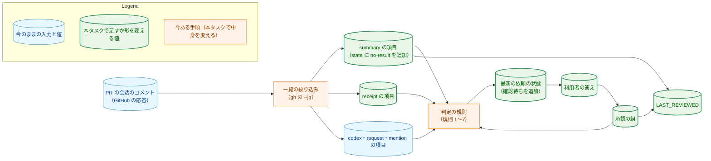
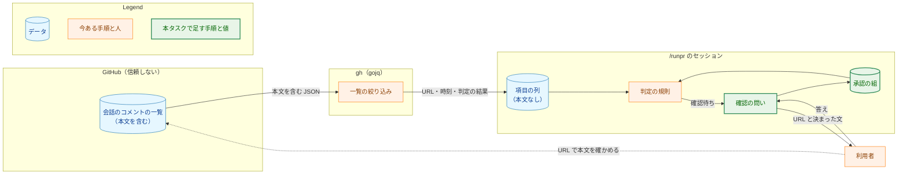
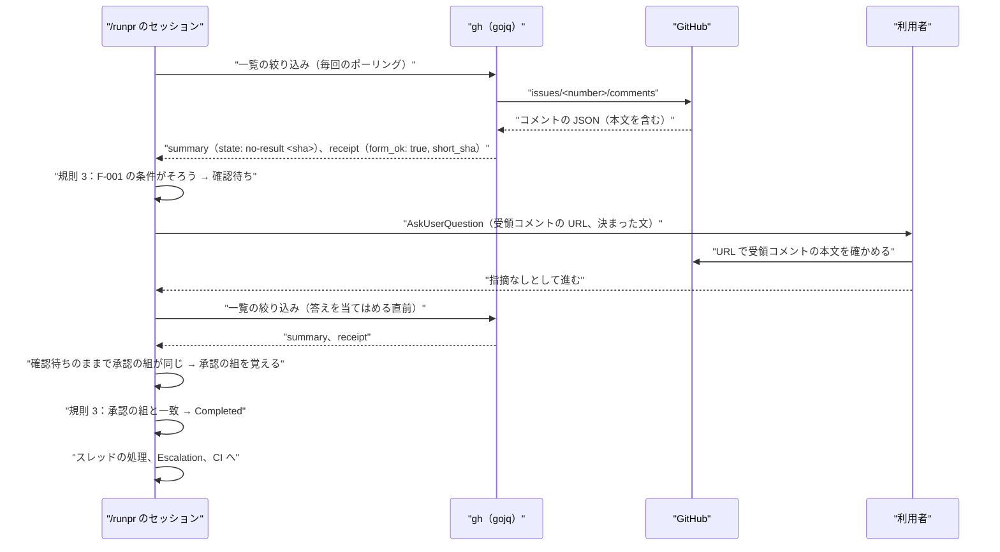
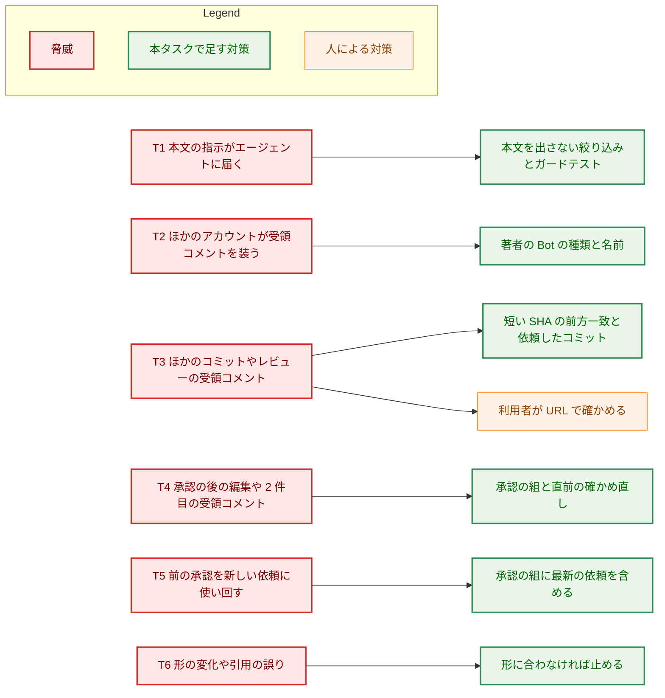
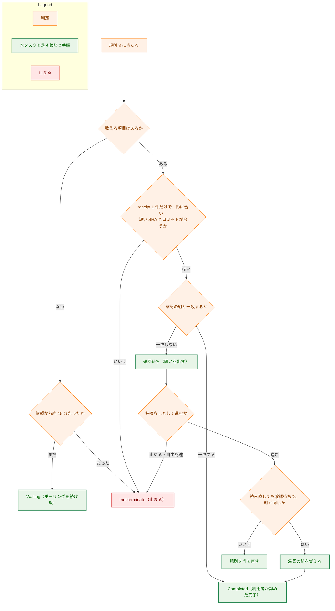

# アーキテクチャ設計書：`/runpr` は、結果のない完了の要約コメントを受領コメントで利用者に確かめて進める

## Document Status

| Item | Value |
|---|---|
| Status | `draft` |
| Created | 2026-11-19 |
| Review date | - |
| Reviewer | - |
| Comments | - |

本書は [01_requirements.md](01_requirements.md)（要件定義書。以下、要件書）の設計である。既存のファイルの内容と `file:line` の行番号は、コミット `c2342f37` のものである。F-NNN・AC-NN は要件書の項番を、H-NN は [design_handoff.md](design_handoff.md)（以下、申し送り）の項番を指す。「計画で決める」は、本タスクの実装計画書（`03_implementation_plan.md`）で決めることを指す。申し送りへの対応は付録 A に、受け入れ基準との対応は付録 B にまとめる。

本書は、要件書 6 章の用語（要約コメント、状態の行、完了の印、結果のない完了、受領コメント、断りのコメント、利用者が認めた完了）と、要件書 1 章の「依頼」「依頼したコミット」「数える `codex` のコメント」を同じ意味で使う。「規則 N」は、とくに断らない限り、本書の 3.2 で定める新しい番号を指す。今の番号を指すときは「今の規則 N」と書く。そのほかに、次の用語を使う。

-   **一覧の絞り込み:** `runpr.md` step 3 の「Reading the PR」で、PR の会話のコメントを読む `gh api --paginate .../issues/<number>/comments --jq '...'` の絞り込み（`.claude/commands/runpr.md:416-442`）。
-   **`no-result` の状態:** 一覧の絞り込みが、結果のない完了の要約コメントに付ける状態の値 `no-result <sha>`（3.1）。
-   **`receipt` の項目:** 一覧の絞り込みが受領コメントについて出す 1 件の出力（3.1）。
-   **形の判定:** 受領コメントが受け入れる形（AC-06）に合うかどうか。`receipt` の項目の `form_ok` に入る（3.1）。
-   **確認待ち:** 最新の依頼の状態の 1 つで、F-001 の条件がそろい、利用者に尋ねる状態（3.2・3.3）。
-   **承認の組:** 利用者の承認を結び付ける値の組。最新の依頼、要約コメントの URL・`commit_sha`・`updated_at`、受領コメントの URL・`updated_at` からなる（3.3）。

## 1. 設計の全体像 (Design Overview)

### 1.1. 設計原則

-   **受領コメントの形は、`gh` の `--jq` の中で判定し、セッションには判定の結果だけを出す。** 一覧の絞り込みが出すのは、URL・時刻・形の判定の真偽値・形に合ったときの短い SHA だけである（AC-07）。本文の文字列はエージェントに届かない。要約コメントの最初の 2 行のほかは本文をセッションに出さないという今の原則（`.claude/commands/runpr.md:413-414`）と、[ADR-0015](../../dev/adr/0015-untrusted-review-threads.md) の考え方を保つ。
-   **判定の規則は、順に当てて最初に当たったものが決める、という今の構造を保つ。** 結果のない完了は、独立した規則（新しい規則 3）で扱う。1 つの規則が 1 つの状態だけを決めるのではなく、規則 3 の中で「確認待ち」「Completed」「Waiting」「Indeterminate」のどれかを決めるが、規則 3 の条件（要約コメントが依頼の後に `no-result` になった）に当たるものは、ほかの規則を見ない（3.2）。
-   **崩れたら止まる側に倒す。** 受領コメントの形が合わない、件数が合わない、コミットが合わない、承認の組が変わった、のどれでも、補わずに判定できない状態か判定のやり直しにする（要件書 4.3、`CLAUDE.md`「Reject, don't normalize」）。
-   **利用者の承認は、その実行の中の値として持つ。** 承認はファイルにも GitHub にも書かない。セッションが承認の組として覚え、毎回のポーリングで組と照らし合わせる（AC-13・AC-17）。ほかのコマンドが読む値にはしない（`CLAUDE.md`「Keep internals unobservable」）。
-   **今の振る舞いは、結果のない完了と受領コメントに関わる所のほかは変えない。** 完了の印（`completed <sha>`）、`running`、ほかの判定できない形、要約コメントが 2 件以上の場合の判定は変わらない（AC-04）。

### 1.2. 設計の際に決めたこと（2026-11-19）

1.  **結果のない完了は、状態の値 `no-result <sha>` と新しい規則 3 で扱う（H-01）。** 一覧の絞り込みは、結果のない完了の要約コメントに `indeterminate` ではなく `no-result <sha>` を付ける。判定の規則には、今の規則 2（Completed）の直後に新しい規則 3「Completed without a result」を置き、今の規則 3〜6 を 4〜7 に繰り下げる。規則 3 は、受領コメントの条件から「確認待ち」「Completed」「Waiting」「Indeterminate」のどれかを決める。最新の依頼の状態に「確認待ち（Awaiting confirmation）」を足し、「On arriving at this step」と「Never post while ...」に加える。
    -   **理由:** 規則 3 を今の規則 3（想定外の投稿）と今の規則 4（期限切れ）より前に置くと、受領コメントで止まらずに尋ねられ（AC-01）、#984 の形は期限切れではなく判定できない状態で止まる（AC-14・AC-15）。規則 1 の例外として書くと、規則 1 が判定できない状態のほかに 3 つの結果を持ち、「最初に当たった規則が決める」という読み方が崩れる。規則の番号を参照しているのは `runpr.md` の中だけで（`.claude/commands/runpr.md:626` の "rule 1"。繰り下げない番号）、ほかのコマンドの定義・コード・テストからの参照はない（コミット `c2342f37` で `.claude`・`cmd`・`internal`・`docs/dev` を検索して確かめた）ので、繰り下げの費用は小さい。
    -   **採らなかった案:** 規則 1 の中で、結果のない完了だけを例外として扱う案（上の理由）。
    -   **人の答え:** 新しい規則を足す（推奨の案）。
    -   **ADR:** なし。`runpr.md` の中の規則の書き方で、本タスクの中で閉じる。ADR-0013 の決定（要件書の PR で更新済み）を変えない。
2.  **受領コメントは、一覧の絞り込みの新しい種類 `receipt` として出す（H-02）。** 形は `{kind: "receipt", url, created_at, updated_at, form_ok, short_sha}` で、`short_sha` は形に合わないとき `null` である（3.1）。受領コメントでない Codex のコメントは、今までどおり `codex` の種類である。
    -   **理由:** 受領コメントとそれ以外とで、規則の扱いが違う（形に合う受領コメントは想定外の投稿に数えず、断りのコメントの例外も当てない）。種類で分けると、規則の文が種類の名前だけで書け、`codex` の種類の出力も今のままになる。
    -   **採らなかった案:** `codex` の種類に `receipt`・`form_ok`・`short_sha` のメンバーを足す案。受領コメントでない Codex のコメントにも値のないメンバーが付き、`codex` を数える今の規則の文をすべて書き直すことになる。
    -   **人の答え:** 別の kind `receipt`（推奨の案）。
    -   **ADR:** なし。一覧の絞り込みの出力の形で、本タスクの中で閉じる。
3.  **利用者への問いは、step 3 のほかの問いと同じ形で出す（H-03）。** 会話に値を数行示し、`AskUserQuestion` の単一選択の 1 問で尋ねる。問いの文には受領コメントの URL を入れる。step 4 の要約と詳細ファイルは使わない（3.3）。
    -   **理由:** step 3 の問い（ほかの Bot のメンションの問い `.claude/commands/runpr.md:510`、想定外のスレッドの問い `:757`）は、どれもこの形である。詳細ディレクトリは step 4 の最初の問いの直前に作る決まり（`.claude/commands/runpr.md:799-803`）で、step 3 で使うにはその決まりも変えることになる。示す値は数行に収まる。
    -   **採らなかった案:** step 4 と同じく、要約と詳細ファイルを使う案（上の理由）。
    -   **人の答え:** step 3 の問いの形（推奨の案）。
    -   **ADR:** なし。問いの見せ方で、本タスクの中で閉じる。
4.  **結果の行の前方のアポストロフィは、jq の文字列の中で `'` と書く（H-06）。** 一覧の絞り込みは今までどおり単一引用符で囲む。
    -   **理由:** ガードテストは、`--jq '...'` の中に単一引用符がないことを前提に絞り込みを取り出す（`cmd/yt2column/fixpr_docs_test.go:215-217`）。単一引用符で囲まない形にすると、取り出しと、シェルの展開を受けないという今の性質の両方を変えることになる。
    -   **確かめたこと（2026-11-19）:** `gh api --jq` は、`gh` に組み込まれた gojq で絞り込みを実行する。ガードテストは jq で実行する。次の 2 つを確かめた。
        -   `gh` 2.96.0 の gojq で、`'` を含む受領コメントの判定の絞り込みを、PR #998 の会話のコメントに対して実行した（読み取りだけで、本文は出さない絞り込み）。受領コメント 2 件（`#issuecomment-6980619384`、`#issuecomment-6996903008`）が、どちらも形に合うと判定され、10 桁の短い SHA（`9130d9c2cc`、`9c73a8180b`）が出た。
        -   jq 1.7.1 で、同じ絞り込みを偽の本文に対して実行した。`Didn't`（U+0027）は形に合い、`Didn’t`（U+2019）、3 行目の終わりの CR、大文字の 16 進、6 桁と 41 桁の SHA、5 行に満たない本文は、どれも形に合わないと判定された。
    -   **採らなかった案:** 絞り込みを単一引用符で囲まない形（二重引用符やファイル）にする案（上の理由）。
    -   **人の答え:** 今確かめる（推奨の案）。確かめた結果は上のとおり。
    -   **ADR:** なし。値の書き方の細部である。
5.  **状態の値の名前は `no-result <sha>` とする。** `completed-null` のように `completed` で始まる名前にしない。
    -   **理由:** 完了の印は `completed <sha>` で、規則 2 はこの値で判定する。`completed` で始まる別の値を作ると、規則を読むエージェントが前方だけで完了の印と取り違えうる。
    -   **人の答え:** なし。設計で決めた（1 の人の答えで「`completed-null <sha>`（たとえば）」として示した名前を、上の理由で変えた）。
    -   **ADR:** なし。値の名前の細部である。
6.  **利用者が認めた完了は、承認の組をセッションが覚えることで持ち、LAST_REVIEWED の「その実行で見た完了の印」に、認めた `commit_sha` を加える（H-04）。** step 4 のマージの質問と step 5 の最後の報告には、認めた完了の `commit_sha` と受領コメントの URL を示す（3.4）。
    -   **理由:** 要件書の「要件定義の際に決めたこと」（承認を組に結び付けて毎回見直す項、LAST_REVIEWED に数える項、報告とマージの質問だけに示す項）を、そのまま手順に移したものである。今の要約コメントは `no-result` のままなので、加えないと LAST_REVIEWED が「なし」になる（申し送り H-04）。
    -   **人の答え:** なし。要件書の決定から決まる。
    -   **ADR:** ADR-0013 の今の決定（「利用者が認めた完了は、その実行の中だけで完了の印として扱い、LAST_REVIEWED を決める完了の印に含める」）のとおりで、変えない。
7.  **step 4 のマージの質問の要約では、認めた完了があったことを、今の 4 行目（「未レビューの変更」の行）の後ろに決まった文で示す（AC-18）。** 文の正確な言い回しは計画で決める。
    -   **理由:** 認めた完了は、Codex がどのコミットまでレビューしたか（LAST_REVIEWED）に関わり、4 行目はその結果（未レビューの変更があるか）を示す行である。行を増やすと、要約の行数の決まり（`.claude/commands/runpr.md:1035-1036`、最大 13 行）を変えることになる。4 行目の最も長い形（`未レビューの変更: あり（Escalation: request）`）に、20 桁ほどの文を足しても 80 桁に収まる。
    -   **人の答え:** なし。設計で決めた。
    -   **ADR:** なし。要約の見せ方の細部である。
8.  **ガードテストは、今の `runprListingFixtures` に受領コメントの偽のコメントを足し、`receipt` の項目の `form_ok` と `short_sha` も、今の `state` や `by_user` と同じく、項目ごとの期待する値と比べる（H-05）。** 別の subtest は作らない（3.5）。
    -   **理由:** 今の `checkListings` は、絞り込みが作るすべてのオブジェクトの鍵（`checkListingConstructors`）、出力の値、本文の印（`bodyMarker`）が出ないことを、同じ偽のデータで確かめる（`cmd/yt2column/fixpr_docs_test.go:447-486`、`:638-706`）。別の subtest にすると、絞り込みの取り出しと実行を重ねて書くことになり、`CLAUDE.md` の「Check for duplication before adding a table test for a helper」に反する。
    -   **人の答え:** なし。設計で決めた。
    -   **ADR:** なし。テストの作り方で、本タスクの中で閉じる。

### 1.3. なぜ今の仕組みでは足りないか

今の一覧の絞り込みは、`completed` で `has_any_findings` が真偽値でない状態の行を `indeterminate` とし（`.claude/commands/runpr.md:425-428`）、今の規則 1 がそれで止める（`:537-539`）。受領コメントは `codex` の種類として数えるだけで、本文は読まない（`:434`）。そのため、結果が受領コメントにあっても、`/runpr` はそれを知る手段を持たない。

-   今の規則 1 の前に「受領コメントがあれば進む」と書き足すだけでは、受領コメントの形を判定する値がセッションに届かない。判定を一覧の絞り込みの中で行う必要がある（F-002）。
-   受領コメントは、結果が真偽値のレビューでも投稿される（要件書 1 章の背景、2026-11-19 の受領コメント）。今の規則 3 は、依頼の後の `codex` の種類のコメントを想定外の投稿として止めるので、要約コメントが `running` の間に受領コメントが届くと、結果のない完了でなくても止まる。受領コメントを `codex` の種類から分ける必要がある（AC-03）。

### 1.4. 概念モデル

矢印 A → B は「B を A から求める」ことを表す。



承認の組は、規則 3 が「Completed」を決めるための入力にもなる（3.3）。そのため、利用者の答えから承認の組へ、承認の組から判定の規則へ、の 2 本の矢印がある。

## 2. システム構成 (System Structure)

### 2.1. 全体構成

矢印 A → B は「A が B にデータを渡す」ことを表す。点線の枠は信頼の境界で、枠の外は信頼しない入力である。



本文が通るのは、GitHub から `gh` の gojq までである。gojq の出力からは本文が除かれ、セッションには URL・時刻・判定の結果だけが届く。本文を読むのは、URL から GitHub で確かめる利用者だけである。

### 2.2. コンポーネント配置

| ファイル | 変更 | 内容 | 関わる AC |
|---|---|---|---|
| `.claude/commands/runpr.md` step 3「Reading the PR」 | 変更 | 一覧の絞り込みに `no-result` の状態と `receipt` の種類を足し、その定義を書く（3.1） | AC-05〜AC-09 |
| `.claude/commands/runpr.md` step 3「State of the latest request」 | 変更 | 規則 3 を足し、今の規則 3〜6 を 4〜7 に繰り下げる。規則 4 に、形に合わない `receipt` を数えることを書く。「None of these is an unexpected post」に形に合う `receipt` を足す（3.2） | AC-01〜AC-04、AC-14 |
| `.claude/commands/runpr.md` step 3 の新しい項目「Confirming a completion without a result」 | 新規の項目 | 確認待ちの問い、答えの当てはめ、承認の組、直前の確かめ直し（3.3） | AC-10〜AC-13、AC-17 |
| `.claude/commands/runpr.md` step 3「LAST_REVIEWED」 | 変更 | 認めた完了の `commit_sha` を「その実行で見た完了の印」に含める（3.4） | AC-16 |
| `.claude/commands/runpr.md` step 3「Requesting the review」 | 変更 | 「On arriving」「Never post」に確認待ちを足す。「Stops」の indeterminate の報告に、依頼の後の `codex` と `receipt` の URL と判定を加える（3.2・3.3） | AC-02、AC-12、AC-14、AC-15 |
| `.claude/commands/runpr.md` step 4 item 3 | 変更 | マージの質問の詳細ファイルと要約の 4 行目に、認めた完了を示す（3.4） | AC-18 |
| `.claude/commands/runpr.md` step 5 | 変更 | 最後の報告に、認めた完了を示す（3.4） | AC-18 |
| `cmd/yt2column/fixpr_docs_test.go` | 変更 | `receipt` の鍵、偽の受領コメント、`form_ok`・`short_sha` の比べ方、`no-result` の偽の要約コメント（3.5） | AC-19、AC-20 |
| `docs/dev/adr/0013-review-setup.md` | 変更（実装の PR） | 「決定」の食い違いの記述を消す（3.6） | AC-21、AC-22 |

新しいパッケージ、Go のコード、ツールはない。`mergepr`・`fixprguard`・`codexreview`・`pr-review-escalation.md`・`review-records.sh`・chief・`_lib/task-pr-handoff.md` は変えない（要件書 2.3）。

### 2.3. データフロー

結果のない完了から、利用者の承認を経て Completed になるまでの流れを示す。矢印は、呼び出しかデータの受け渡しを表す。



## 3. コンポーネント設計 (Component Design)

### 3.1. 一覧の絞り込みの出力（AC-05〜AC-09、H-02、H-06）

一覧の絞り込みが出す項目の形を、次に示す。`codex`・`request`・`mention` は今のままである。

```text
summary: {kind: "summary", url, updated_at, state}
  state: "completed <sha>" | "no-result <sha>" | "running <sha>" | "indeterminate"
receipt: {kind: "receipt", url, created_at, updated_at, form_ok, short_sha}
  form_ok:   JSON の真偽値
  short_sha: form_ok が true のとき 7〜40 桁の小文字の 16 進の文字列、false のとき null
codex:   {kind: "codex", url, created_at}
request: {kind: "request", url, created_at}
mention: {kind: "mention", url, created_at, updated_at, by_user, by_bot}
```

**`no-result <sha>`。** 状態の行が今の形（`code_review` がオブジェクトで、`status` が文字列、`commit_sha` が小文字の 16 進の 40 桁）に合い、`status` が `completed` で、`code_review` が `has_any_findings` のメンバーを持ち、その値が JSON の `null` のとき、`no-result <sha>` とする。jq では、メンバーがないときも `.has_any_findings` が `null` になる。そのため、メンバーがあることを `has` で確かめる。メンバーがないもの、ほかの型のものは、今までどおり `indeterminate` である（要件書 6 章の「結果のない完了」）。

**`receipt`。** 著者が `Bot` の種類で名前が `<awaited-reviewer>[bot]`、本文を LF で分けた 1 行目がちょうど `<!-- codex-review-receipt:v1 -->` のコメントを、`receipt` とする（AC-05）。著者の確かめは、今の `summary` と同じ分岐の中で行う。1 行目の終わりに CR があれば `receipt` でも `summary` でもなく、今までどおり `codex` である。

**形の判定。** `form_ok` は、次のすべてが成り立つときだけ真である（AC-06）。

-   本文が 5 行以上ある。
-   2〜5 行目のどれも CR を含まない。3 行目の前方一致は行の終わりの CR を見逃すので、CR がないことを別に確かめる。
-   2 行目と 4 行目が空である。
-   3 行目が `Codex Review: Didn't find any major issues.` で始まる。アポストロフィは U+0027 で、絞り込みの中では `'` と書く（1.2 の決定 4）。
-   5 行目の全体が、`` **Reviewed commit:** ` `` と、小文字の 16 進の 7〜40 桁と、`` ` `` を並べたものである。

6 行目から後は読まない。大きさの上限は設けない（AC-09）。`short_sha` は、`form_ok` が真のときだけ 5 行目から取り出す。偽のときは `null` で、5 行目の文字列を出さない（AC-07）。

**使うメンバー。** 受領コメントで使うのは `user.type`・`user.login`・`body`（絞り込みの中で 1〜5 行目だけ）・`html_url`・`created_at`・`updated_at` だけである（AC-08）。`html_url` と `created_at` は、今の一覧のほかのコメントと同じ規則で読む。

**読み取りの回数。** `receipt` の項目は、今の一覧の読み取りと同じ API の呼び出しで出る。呼び出しは増えない（要件書 4.1）。

**`runpr.md` の文。** 「Reading the PR」の、一覧の絞り込みの後の定義の段落に、`no-result <sha>`、`receipt`、`form_ok`、`short_sha` の定義と、形に合わない受領コメントの例（CR、U+2019、大文字、桁数、行数）を足す。「Only the first two lines of a summary comment are read, and no other body reaches the session」（`.claude/commands/runpr.md:413-414`）の文は、受領コメントの 1〜5 行目を絞り込みの中で判定し、判定の結果だけを出すことを含めて書き直す。

### 3.2. 判定の規則（AC-01〜AC-04、AC-14、AC-15、H-01）

「State of the latest request」の規則を、次のとおりにする。順に当て、最初に当たったものが決める。

| 規則 | 名前 | 条件 | 今の規則との関係 |
|---|---|---|---|
| 1 | Indeterminate | `summary` が 2 件以上ある。または、依頼の後に更新された `summary` の状態が `indeterminate` である | 今の規則 1 のまま |
| 2 | Completed | 依頼の後に更新された `summary` の状態が `completed <sha>` で、`<sha>` が依頼したコミットである | 今の規則 2 のまま |
| 3 | Completed without a result | 依頼の後に更新された `summary` の状態が `no-result <sha>` である。結果は下の表で決まる | 新しい規則 |
| 4 | Ended (unexpected post) | 依頼の後に作られた `codex` か、`form_ok` が偽の `receipt` がある。断りのコメントの例外は、今までどおり両方に当てる | 今の規則 3 に、形に合わない `receipt` を足したもの |
| 5 | Ended (timed out) | 依頼から約 15 分たった | 今の規則 4 のまま |
| 6 | Not started | 今の規則 5 のまま | 今の規則 5 のまま |
| 7 | Waiting | どれにも当たらない | 今の規則 6 のまま |

規則 3 の中の判定は、次の表の順に当て、最初に当たったものが決める。ここで「数える項目」は、依頼の後に作られた `codex` のうち断りのコメントの例外に当たらないものと、依頼の後に作られた `receipt` のすべて（`form_ok` によらない）を合わせたものである（F-001 の条件 3）。

| 順 | 条件 | 状態 |
|---|---|---|
| 3a | 数える項目がない。依頼から約 15 分たっていない | Waiting |
| 3b | 数える項目がない。依頼から約 15 分たった | Indeterminate |
| 3c | 数える項目が `receipt` 1 件だけで、その `form_ok` が真で、`short_sha` が `<sha>` の先頭と一致し、`<sha>` が依頼したコミットである。承認の組（3.3）が、この実行で利用者が承認した組と一致する | Completed（利用者が認めた完了） |
| 3d | 3c と同じ条件で、承認の組が、この実行で承認した組のどれとも一致しない | 確認待ち |
| 3e | どれにも当たらない（受領コメントが 2 件以上、受領コメントでない数える項目、`form_ok` が偽、短い SHA の不一致、`<sha>` が依頼したコミットでない） | Indeterminate |

この置き方から、次のことが決まる。

-   **受領コメントで止まらない（AC-01・AC-03）。** 形に合う `receipt` は規則 4 に当たらない。結果のない完了では、規則 3 が規則 4 より先に当たる。
-   **受領コメントを待つ（AC-02）。** 3a の Waiting は、今の Waiting と同じ扱い（依頼をせずにポーリングを続け、依頼の時刻から数える期限を延ばさない）である。
-   **要約コメントがまだ完了していない間（AC-03）。** 要約コメントが `running` か、依頼の後に更新されていない間は、規則 3 に当たらない。形に合う `receipt` は規則 4 にも当たらないので、規則 5（期限切れ）か規則 7（Waiting）になる。
-   **#984 の形と、受領コメントでない Codex のコメント（AC-14）。** 3b と 3e は、今の規則 1 と同じ Indeterminate である。規則 4 の想定外の投稿にも、規則 5 の期限切れにもならないので、再実行は依頼を投稿しない（AC-15）。
-   **今の振る舞い（AC-04）。** 規則 1・2・5・6・7 は今のままである。`completed <sha>` の要約コメントは、受領コメントの有無によらず規則 2 で決まる。形に合う `receipt` は、Completed の判定にも Waiting の判定にも関わらない。

「None of these is an unexpected post, and none decides a rule」の一覧（`.claude/commands/runpr.md:558-562`）に、「形に合う `receipt`（規則 3 の中で数える）」を足す。

「Requesting the review」の各項は、次のとおりにする。

-   **On arriving at this step:** 確認待ちは、依頼をせずに 3.3 の問いを出す。Completed（利用者が認めた完了を含む）は、今の Completed と同じく依頼をしない。
-   **Never post while ...:** 確認待ちを、Waiting と Indeterminate に加える。Escalation か step 4 が依頼を求めたときに最新の依頼が確認待ちなら、先に 3.3 の問いを出す。Completed になったら、今の Waiting の後と同じく、head がレビュー済みか（LAST_REVIEWED が head か）を確かめ直す。
-   **Stops の indeterminate の報告:** 規則 3 で Indeterminate になったときは、今の報告に、依頼の後に作られた `codex` と `receipt` のそれぞれについて、URL、`receipt` かどうか、`receipt` なら形に合ったかどうかを加える（AC-14）。本文は出さない。今の報告にある要約コメントの 2 行目は、`no-result` の状態の行で、今までどおり先頭の 500 文字までをデータとして示す。

### 3.3. 確認待ちと承認（AC-10〜AC-13、AC-17、H-03、H-04）

step 3 に新しい項目「Confirming a completion without a result」を置き、次のことを書く。

**承認の組。** 承認は、次の値の組に結び付ける（AC-13）。

```text
承認の組:
  最新の依頼:     自動の依頼か依頼のコメントか、その時刻、依頼のコメントなら URL
  要約コメント:   URL、commit_sha（40 桁）、updated_at
  受領コメント:   URL、updated_at
```

組の値は、どれも一覧の絞り込みの出力と、今の手順が覚えている最新の依頼から取る。新しい読み取りは足さない。

**問い（AC-10）。** 確認待ちになり、その組をまだ尋ねていないとき、会話に次の値を示してから、`AskUserQuestion` で単一選択の 1 問だけを尋ねる。推奨の印は付けない（利用者が本文を確かめることが前提のため）。

-   示す値: 要約コメントの URL、`commit_sha`（40 桁）と受領コメントの短い SHA、そのコミットが依頼したコミットであること、受領コメントの結果の行が指摘なしの決まった形に合ったこと（本文から読んだ文字列ではなく、決まった文で示す）。
-   問いの文: 受領コメントの URL と、利用者がその URL で本文を確かめてから答えること。chief は問いの文と選択肢を中継するので、URL は問いの文そのものに入れる（要件書 2.3）。問いの文は、chief がマージの質問として読む形（`internal/chief/screen.go:113`）に合わない。
-   選択肢: 「指摘なしとして進む」と「止める」。

文言は計画で決める。

**答えの当てはめ（AC-11〜AC-13）。**

-   答えを当てはめる直前に、一覧を読み直して規則を当て直す（今のポーリング 1 回と同じ読み取り）。まだ確認待ちで、承認の組が問いを出したときと同じときだけ、答えを当てはめる。変わっていたら答えを捨て、当て直した結果に従う（Indeterminate で止まることも、別の組で確認待ちになって尋ね直すこともある）。
-   「指摘なしとして進む」なら、承認の組を覚える。規則 3 の 3c が当たって Completed になり、step 3 の続き（スレッドの処理、Escalation、CI）へ進む。
-   それ以外（「止める」と自由記述）なら、今の判定できない状態と同じく止まる。報告は 3.2 の indeterminate の報告に、受領コメントの URL を加えたものである（AC-12）。

**見直し（AC-13）。** 毎回のポーリングで規則を当て直す。覚えた承認の組は、組の値がすべて同じで規則 3 の 3c の条件がそろうときだけ効く。組のどれかが変わる（新しい依頼、要約コメントの書き換え、受領コメントの編集）か、条件が崩れる（2 件目の要約コメントは規則 1、2 件目の受領コメントや受領コメントでない数える項目は 3e）と、承認は効かず、規則がそのまま決める。組と条件が変わらない間は、3c が当たり続けるので、同じ問いを 2 度出さない。

**実行の中だけで持つ（AC-17）。** 承認の組はセッションが覚えるだけで、ファイル・コミット・GitHub には書かない。再実行は、同じ要約コメントと受領コメントを見ても、承認の組を持たないので 3d の確認待ちになり、もう一度尋ねる。

### 3.4. LAST_REVIEWED と、step 4・step 5 の表示（AC-16、AC-18、H-04）

**LAST_REVIEWED（AC-16）。** 定義（`.claude/commands/runpr.md:563-575`）の「every completion marker seen in this run」に、「この実行で利用者が認めた完了の `commit_sha`」を含める、と書き足す。承認の組が後で効かなくなっても、認めた `commit_sha` は「その実行で見た」側に残る。今の定義が、書き換えられた要約コメントの完了の印を「その実行で見た」側に残すのと同じである（要件書の「要件定義の際に決めたこと」）。ほかの部分（祖先の判定、なしのとき、Escalation への渡し方）は変えない。

**step 4 のマージの質問（AC-18）。** 利用者が認めた完了があった実行では、次のようにする。

-   詳細ファイル: 認めた完了ごとに、要約コメントの `commit_sha`、受領コメントの URL、Codex の完了を受領コメントで利用者が認めたこと、を書く。
-   要約: 4 行目（「未レビューの変更」の行）の後ろに、認めた完了があったことを示す決まった文を足す（1.2 の決定 7）。URL は入れない。行数は増えない。

**step 5 の最後の報告（AC-18）。** 認めた完了の `commit_sha` と受領コメントの URL を示す。その行は `NEXT` で始めない（chief が読む NEXT の行は 1 行だけ、の決まり。`.claude/commands/runpr.md:1396-1403`）。

**記録しないもの。** コミット・PR へのコメント・PR の説明・squash の本文には、認めた完了を記録しない（AC-18、要件書 2.3）。

### 3.5. ガードテスト（AC-19、AC-20、H-05）

`TestRunprDocContract` の `listings_print_no_body`（`cmd/yt2column/fixpr_docs_test.go:187-189`）を、次のように広げる。テストの関数の数は増やさない（1.2 の決定 8）。

-   **鍵の一覧。** `runprListingKeys`（`:226-231`）に `receipt` の鍵（`kind`・`url`・`created_at`・`updated_at`・`form_ok`・`short_sha`）を足す。`runprRequiredKeys`（`:239`）に、`receipt` が `form_ok` と `short_sha` を必ず持つことを足す。`runpr.md` はこの 2 つで判定するので、絞り込みが片方を出さなくなればテストが落ちる。
-   **期待する値。** `listingItem`（`:255-260`）に、`receipt` の項目の期待する `form_ok` と `short_sha` を足す。`checkListingOutput`（`:638-706`）は、`state`・`by_user`・`by_bot` と同じく、この 2 つを項目ごとの期待する値と比べる。`short_sha` は、形に合わないとき `null` であることも比べる。
-   **偽の要約コメント。** `has_any_findings` が `null` の要約コメントを足し、`no-result <sha>` になることを確かめる。`has_any_findings` のない要約コメント（`:327` の今の項目）が `indeterminate` のままであることは、今の項目が確かめる。
-   **偽の受領コメント（AC-19・AC-20）。**
    -   形に合うもの: 3 行目の前方の後ろの文と、6 行目から後に `bodyMarker` を置く。出力に `bodyMarker` が出ないこと（AC-19）と、`form_ok` が真で `short_sha` が 5 行目の SHA であることを確かめる。
    -   形に合わないもの: 2〜5 行目のそれぞれの終わりの CR、3 行目の違い（`Didn’t` の U+2019 を含む）、5 行目の SHA の大文字・6 桁・41 桁、5 行に満たない本文。どれも `form_ok` が偽で `short_sha` が `null` であることを確かめる。5 行目に `bodyMarker` を置いた項目も入れ、形に合わない 5 行目の文字列が出ないことを確かめる。
    -   受領コメントでないもの: 1 行目の終わりに CR がある `<awaited-reviewer>[bot]` のコメント（`codex` になる）と、受領コメントの 1 行目を持つ、著者が違うコメント（`Bot` でないもの、名前が違うもの。何も出ないか、メンションを含めば `mention` になる）。

偽の本文の組み立て方（関数の分け方）は計画で決める。

テストは jq で絞り込みを実行し、実際の `gh` は gojq で実行する。2 つの実装が同じ判定をすることは、1.2 の決定 4 で、`'` と PR #998 の実際の受領コメントについて確かめた。jq を使うことは今の `checkListings` の前提で（`:447-452`）、本タスクでは変えない。

### 3.6. ADR-0013（AC-21、AC-22）

AC-21 の決定は、要件書の PR（#1009）で ADR-0013 の「レビュー済みの判定」に書かれている。本書の PR では、ADR-0013 を変えない。本書の決定（1.2）は、どれも `runpr.md` の中の書き方か、要件書の決定から決まるもので、ADR-0013 の決定を変えないためである。

実装の PR では、ADR-0013 の「決定」から、食い違いの記述（「食い違い: `runpr.md` の step 3 は、まだ結果のない完了で受領コメントを確かめずに止まり、…」）を消す（AC-22）。実装で決定が変わったときは、同じ PR で「決定」を直す（AC-23）。「経緯」の本タスクの 1 行は、要件書の PR で足されている。`TestADRRecords` が通ることを確かめる。

### 3.7. 既存のテストへの影響

-   `cmd/yt2column/fixpr_docs_test.go` の `TestRunprDocContract` は、3.5 のとおり広げる。今の偽の要約コメントのうち、期待する状態が変わるものはない（`has_any_findings` が `null` の要約コメントは、今の偽のデータにない）。
-   `runpr.md` step 3 を読むほかのガードテストは、`cmd/yt2column/review_records_test.go:1253`（Escalation の判定のスクリプトの呼び方）と `cmd/yt2column/codex_review_docs_test.go`（`codexreview` の呼び方とメンション）である。本タスクは、それらが読む部分を変えない。実装で文言を変えて落ちたときは、AC-23 の範囲で直す。
-   chief のテスト（`internal/chief`）は、マージの質問の問いの行（`internal/chief/screen.go:111-117`）を読む。本タスクは問いの行を変えず、要約の 4 行目の後ろに文を足すだけである。chief の画面の見本（`internal/chief/testdata/screens/*merge-question.ansi`）には「未レビューの変更: なし」の行があるが、chief はこの行を読まない（`internal/chief/screen.go` に「未レビュー」の文字列はない）。

## 4. エラーハンドリング設計 (Error Handling Design)

### 4.1. 誤りの型

本タスクはコマンドの定義の手順を変えるだけで、Go のコードを足さない。番兵のエラー（sentinel error）は定義しない（AC-09）。止まる理由は、今の手順と同じく、最新の依頼の状態（Indeterminate、Ended）と報告で表す。

| 止まる場合 | 状態 | 再実行の振る舞い |
|---|---|---|
| 規則 3 の 3b（受領コメントが来ない） | Indeterminate | 依頼を投稿しない（AC-15） |
| 規則 3 の 3e（形・件数・コミットが合わない） | Indeterminate | 依頼を投稿しない（AC-15） |
| 利用者が「指摘なしとして進む」以外を答えた | Indeterminate と同じ | 依頼を投稿しない。同じ組なら、もう一度尋ねる（AC-17） |
| 規則 4 の、形に合わない `receipt` | Ended (unexpected post) | 今の規則 3 と同じく、依頼を投稿し直す |

### 4.2. 示し方

-   規則 3 で止まったときの報告は、今の indeterminate の報告（要約コメントの URL と、2 行目の先頭 500 文字）に、依頼の後の `codex` と `receipt` の URL・`receipt` かどうか・形に合ったかを加える。本文は出さない（AC-14）。利用者は URL から GitHub で確かめる。
-   利用者が「止める」を選んだときは、それに受領コメントの URL を加える（AC-12）。
-   規則 4 で、形に合わない `receipt` で止まったときは、今の想定外の投稿の報告（投稿の URL と、そのときに読む本文の要約）のままである。本文を読むのは止まったときの報告のためだけで、データとして扱う（`.claude/commands/runpr.md:496-497`）。
-   止まり続けるときの回避の手段（GitHub で確かめて `/mergepr` で直接マージする、手で依頼を投稿して再実行する）は、今の「When it keeps stopping」のままである（要件書 4.3）。

## 5. セキュリティ考慮事項 (Security Considerations)

### 5.1. `docs/dev/security.md` の条件

N/A。条件付きのガイドの適用条件（外部コマンド `yt-dlp`、API キー、キャッシュ、LLM API への送信、信頼できないテキストのプロンプトや記事への埋め込み）にはどれも当たらない（要件書 4.2）。`docs/dev/security.md` の規則と前提は変えない。

### 5.2. 信頼しない入力の境界と脅威モデル

受領コメントは、GitHub の応答から読む信頼しない入力である。境界は gojq の絞り込みで、その外の本文はセッションに届かない（2.1）。

矢印 A → B は「脅威 A を対策 B が防ぐ」ことを表す。



-   **T1（本文の指示）:** 一覧の絞り込みは、URL・時刻・真偽値・16 進と確かめた短い SHA だけを出す（3.1）。ガードテストは、本文の印が出力に出ないことを、絞り込みを実行して確かめる（3.5）。問いには、本文から読んだ文字列を入れない（3.3）。
-   **T2（装う）:** `receipt` は、著者が `Bot` の種類で名前が `<awaited-reviewer>[bot]` のコメントだけである（AC-05）。`User` の種類で同じ名前のアカウントは `receipt` にならない。
-   **T3（ほかのコミット）:** 短い SHA が要約コメントの 40 桁の `commit_sha` の先頭と一致し、その `commit_sha` が依頼したコミットであることを求める（3.2 の 3c）。短い SHA の桁数を 7〜40 に広げても、受け入れるコミットは要約コメントの `commit_sha` だけである。
-   **T4（後の変化）:** 承認の組に受領コメントの `updated_at` を含め、答えを当てはめる直前に一覧を読み直す（3.3）。問いを出している間の 2 件目の受領コメントは 3e で止まる。
-   **T5（使い回し）:** 承認の組に最新の依頼を含めるので、Escalation や step 4 が新しい依頼を出すと、前の承認は効かない（3.3）。
-   **T6（形の変化）:** Codex が受領コメントの形を変えたり、絞り込みの引用を誤ったりすると、形に合わないと判定され、止まる側に倒れる（3.2 の 3e、規則 4）。

### 5.3. 残るリスク

-   **実際にはレビューしていない「指摘なし」:** Codex 自身が、実際にはレビューしていないのに指摘なしの受領コメントを投稿した場合は、利用者の確認でも見分けられない。`completed` と真偽値がそろっても中身のあるレビューを保証しない、という今の危険（[0031 設計書](../0031_codex_pr_review/02_architecture.md) 5 章）と同じ種類で、受け入れる（要件書 4.2）。
-   **公式の文書がない形:** `codex-review-state:v1` の行と受領コメントの形は、観測に基づく。形が変われば止まる（要件書 4.5）。
-   **jq と gojq の違い:** ガードテストは jq で、実際の実行は gojq である。本タスクで使う機能（`'`、`startswith`、`test`、`has`、`all`、配列の切り出し）は、両方で同じ判定をすることを確かめた（1.2 の決定 4）。後で絞り込みを変えるときに、jq だけにある機能を使うと、ガードテストは通るのに `gh` で失敗しうる。そのときは `gh` の実行が誤りを返して止まる側に倒れる。
-   **Escalation の対象:** 本変更はレビューの関門（LAST_REVIEWED の定義）を変えるので、実装の PR は Escalation の基準で PR レビューの追加の依頼の対象になる（[ADR-0013](../../dev/adr/0013-review-setup.md)、要件書 4.2）。

## 6. 処理フロー詳細 (Processing Flow Details)

### 6.1. 規則 3 の判定と承認

毎回のポーリングで、規則 1・2 に当たらず、依頼の後に更新された要約コメントが `no-result <sha>` のときの流れを示す。矢印は判定の順を表す。



「規則を当て直す」は、答えを捨てて、読み直した一覧で規則 1 から当て直すことである。別の組で確認待ちになれば、尋ね直す。

### 6.2. 要約コメントの完了より先に受領コメントが届くとき

結果が真偽値のレビューでも、結果のないレビューでも、受領コメントが要約コメントの完了より先に届くことがある（要件書の「要件定義の際に決めたこと」）。

1.  要約コメントが `running` の間に、形に合う `receipt` が届く。規則 3 には当たらず（`no-result` でない）、規則 4 にも当たらない（形に合う）。期限前なら規則 7 で Waiting になる。
2.  要約コメントが `completed <sha>` になれば、規則 2 で Completed になる。`receipt` は判定に関わらない。
3.  要約コメントが `no-result <sha>` になれば、規則 3 の 3c か 3d になる。

## 7. テスト戦略 (Test Strategy)

### 7.1. ユニットテスト

Go のコードを足さないので、新しいユニットテストはない。`runpr.md` の一覧の絞り込みは、ガードテスト（7.2）が実行して確かめる。

### 7.2. 文書のガード

`TestRunprDocContract` の `listings_print_no_body` を 3.5 のとおり広げる。これは `CLAUDE.md` の「Document tests check values, structure, and executable examples, never prose」の例外（信頼の境界で実行するコマンドの `--jq` の絞り込み）に当たる。`CLAUDE.md` の「Every test must be able to fail for its stated reason」に従い、実装では少なくとも次を壊して落ちることを確かめる。

-   形の判定を常に真にする（形に合わない受領コメントの項目が落ちる）。
-   形の判定を常に偽にする（形に合う受領コメントの項目が落ちる）。
-   3 行目の CR の確かめを外す（3 行目の終わりに CR がある項目が落ちる）。
-   `short_sha` を形に合わないときも出す（その項目が落ちる）。
-   受領コメントの本文の 3 行目を出す（`bodyMarker` で落ちる）。
-   `has` の確かめを外す（`has_any_findings` のない要約コメントが `no-result` になって落ちる）。

`runpr.md` の規則・問い・報告の文は、PR のレビューで読んで確かめる（manual）。

### 7.3. 結合テストと手での確かめ

コマンドの定義の手順は、自動の結合テストを持たない。実装の PR の後、結果のない完了の要約コメントが実際に出たときに、`/runpr` が問いを出すことを観察できる。いつ出るかは Codex 次第で、再現の手段はない。本タスクの受け入れは、ガードテストと PR のレビューで行う。

## 8. 実装の優先順位 (Implementation Priorities)

1.  一覧の絞り込み（3.1）とガードテスト（3.5）。絞り込みが本文を出さないことを先に固める。
2.  判定の規則と「Requesting the review」（3.2）、確認待ちと承認（3.3）、LAST_REVIEWED（3.4 の前半）。
3.  step 4 と step 5 の表示（3.4 の後半）。
4.  ADR-0013 の食い違いの記述を消す（3.6）。

PR の分け方と実装モデル要件は、計画で決める。どれも `runpr.md` の step 3 の信頼の境界に関わるので、1 と 2 を別の PR に分けると、途中の `main` で絞り込みと規則が食い違う。

## 9. 将来の拡張 (Future Extensibility)

-   **指摘ありの受領コメント:** 今は受け入れる形に入れない（要件書 2.3）。受け入れるときは、`form_ok` を形ごとの値に変え、規則 3 の 3c の条件と問いの選択肢を広げることになる。
-   **ほかの状態の値（`status: failed` など）:** 今は `indeterminate` のまま止まる（要件書 2.3）。対応するときは、`no-result` と同じく状態の値を足し、規則を足す。
-   **受領コメントの形の変化:** 1 行目の印、3 行目の前方、5 行目の形は、`runpr.md` の絞り込みとその文、ガードテストの偽のデータの 3 か所にある（要件書 4.5）。Codex が形を変えたときは、3 つとも変える。

## 付録 A: 申し送り（design_handoff.md）への対応

| 項目 | 対応 |
|---|---|
| H-01: 判定の規則の中での置き場所 | 状態の値 `no-result <sha>` と新しい規則 3 を足し、今の規則 3〜6 を繰り下げる（1.2 の決定 1、3.2）。形に合う `receipt` を規則 4 から除き、規則 3 の中では断りのコメントの例外を `receipt` に当てない（3.2）。承認は承認の組で持つ（3.3） |
| H-02: 受領コメントの絞り込みの形 | 新しい種類 `receipt` として `{kind, url, created_at, updated_at, form_ok, short_sha}` を出す（1.2 の決定 2、3.1）。`short_sha` は形に合うときだけ出す |
| H-03: 利用者への問いと、詳細の示し方 | step 3 のほかの問いと同じく、会話に値を示して単一選択の 1 問で尋ねる。結果の行は決まった文で示す（1.2 の決定 3、3.3） |
| H-04: 認めた完了の持ち方と、LAST_REVIEWED・step 4 への渡し方 | 承認の組をセッションが覚え、LAST_REVIEWED の「その実行で見た完了の印」に認めた `commit_sha` を加える。step 4 は詳細ファイルと要約の 4 行目、step 5 は最後の報告に示す（1.2 の決定 6・7、3.3、3.4） |
| H-05: ガードテストの偽のデータ | `runprListingFixtures` に受領コメントを足し、`form_ok` と `short_sha` を項目ごとの期待する値と比べる。別の subtest は作らない（1.2 の決定 8、3.5） |
| H-06: 結果の行の前方一致の文字列と、シェルの引用 | jq の文字列の中で `'` と書き、単一引用符の囲みは今のままにする。gojq と jq の両方で確かめた（1.2 の決定 4） |

## 付録 B: 受け入れ基準との対応

| AC | 設計 | 確かめ方 |
|---|---|---|
| AC-01 | 3.2（規則 3 の 3d）、3.3 | PR のレビュー（manual） |
| AC-02 | 3.2（規則 3 の 3a、Never post） | PR のレビュー（manual） |
| AC-03 | 3.2（規則 4、None of these の一覧）、6.2 | PR のレビュー（manual） |
| AC-04 | 3.2（規則 1・2・5〜7 を変えない） | PR のレビュー（manual）、ガードテストの今の要約コメントの項目 |
| AC-05 | 3.1（`receipt` の定義） | ガードテスト（著者が違うもの、1 行目が違うもの） |
| AC-06 | 3.1（形の判定） | ガードテスト（形に合うもの、合わないもの） |
| AC-07 | 3.1（出力の形） | ガードテスト（`bodyMarker`、`short_sha` が `null`） |
| AC-08 | 3.1（使うメンバー） | ガードテスト（鍵の一覧と出力の値の出どころ） |
| AC-09 | 3.1、4.1 | PR のレビュー（manual） |
| AC-10 | 3.3（問い） | PR のレビュー（manual） |
| AC-11 | 3.3（答えの当てはめ） | PR のレビュー（manual） |
| AC-12 | 3.3、4.2 | PR のレビュー（manual） |
| AC-13 | 3.3（承認の組、見直し、直前の確かめ直し） | PR のレビュー（manual） |
| AC-14 | 3.2（規則 3 の 3b・3e、Stops の報告）、4.2 | PR のレビュー（manual） |
| AC-15 | 3.2、4.1 | PR のレビュー（manual） |
| AC-16 | 3.4（LAST_REVIEWED） | PR のレビュー（manual） |
| AC-17 | 3.3（実行の中だけで持つ） | PR のレビュー（manual） |
| AC-18 | 3.4（step 4・step 5） | PR のレビュー（manual） |
| AC-19 | 3.5 | ガードテスト |
| AC-20 | 3.5 | ガードテスト |
| AC-21 | 3.6（要件書の PR で済み） | `TestADRRecords`、PR のレビュー（manual） |
| AC-22 | 3.6 | 実装の PR の差分を読む（manual） |
| AC-23 | 2.2、3.7 | 実装の PR の差分を読む（manual） |
