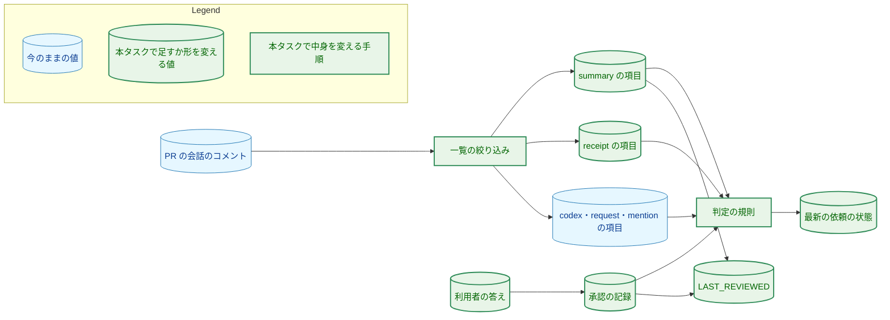
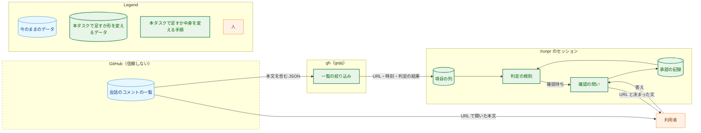
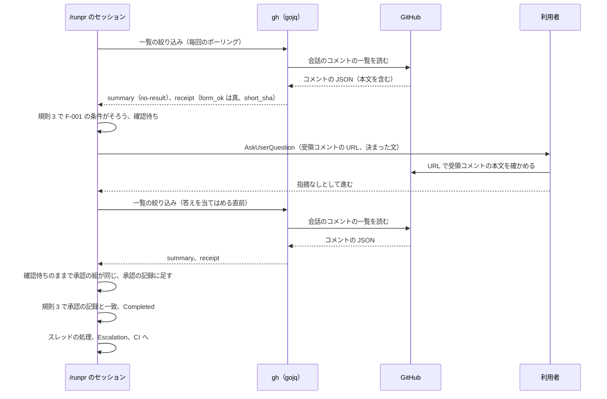
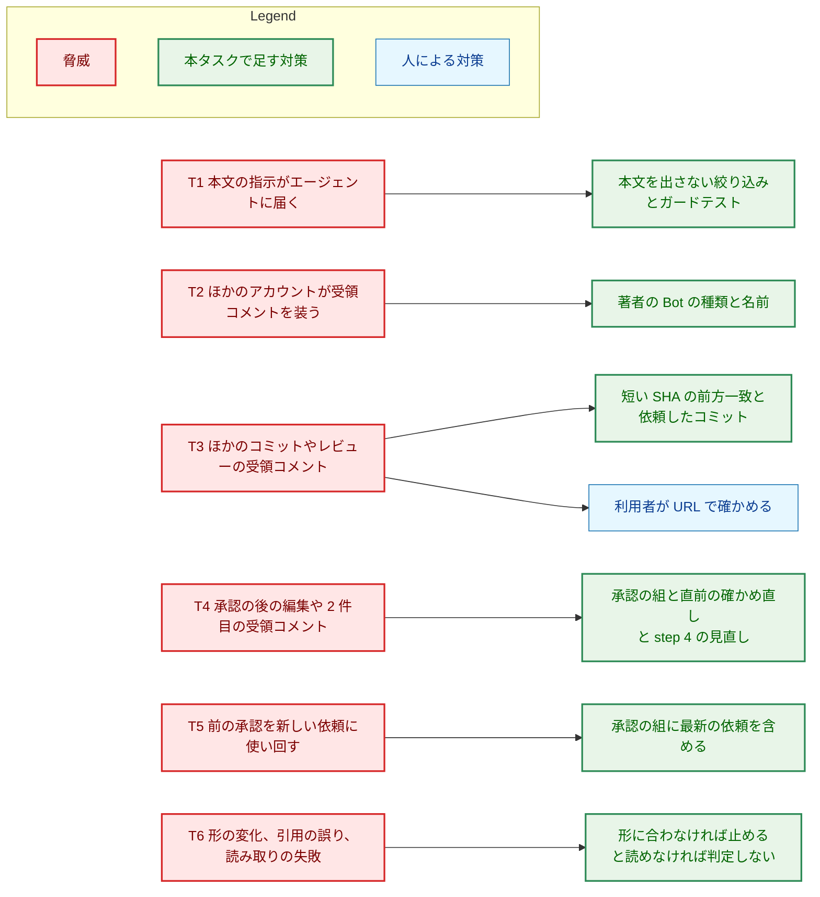
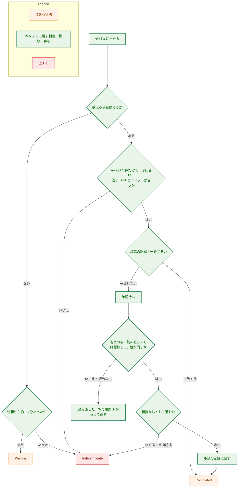

# アーキテクチャ設計書：`/runpr` は、結果のない完了の要約コメントを受領コメントで利用者に確かめて進める

## Document Status

| Item | Value |
|---|---|
| Status | `approved` |
| Created | 2026-11-19 |
| Review date | 2026-11-19 |
| Reviewer | isseis |
| Comments | - |

本書は [01_requirements.md](01_requirements.md)（要件定義書。以下、要件書）の設計である。既存のファイルの内容と `file:line` の行番号は、コミット `c2342f37` のものである。F-NNN・AC-NN は要件書の項番を、H-NN は [design_handoff.md](design_handoff.md)（以下、申し送り）の項番を指す。「計画で決める」は、本タスクの実装計画書（`03_implementation_plan.md`）で決めることを指す。申し送りへの対応は付録 A に、受け入れ基準との対応は付録 B にまとめる。

本書は、要件書 6 章の用語（要約コメント、状態の行、完了の印、結果のない完了、受領コメント、断りのコメント、利用者が認めた完了）と、要件書 1 章の「依頼」「依頼したコミット」を同じ意味で使う。

**規則の番号。** 本書の「規則 N」は、とくに断らない限り、3.2 で定める新しい番号を指す。今の番号を指すときは「今の規則 N」と書く。要件書の AC の文は今の番号で書かれている。対応は次のとおりである：今の規則 1・2 は規則 1・2 のまま、今の規則 3（想定外の投稿）は規則 4、今の規則 4（期限切れ）は規則 5、今の規則 5（Not started）は規則 6、今の規則 6（Waiting）は規則 7 になる。新しい規則 3 は、結果のない完了を扱う。

**`codex` の意味。** 要件書の「`codex` の種類のコメント」は、受領コメントを含む（要件書 F-001・AC-14）。本書では、一覧の絞り込みが受領コメントを `receipt` の項目として分けるので、`codex` の項目は受領コメントを含まない。

-   要件書の「`codex` の種類のコメント」は、本書の `codex` の項目と `receipt` の項目を合わせたものである。
-   要件書の「数える `codex` のコメント」（F-001 の条件 3）は、本書の「数える項目」（3.2）である。

そのほかに、次の用語を使う。

-   **一覧の絞り込み:** `runpr.md` step 3 の「Reading the PR」で、PR の会話のコメントを読む `gh api --paginate .../issues/<number>/comments --jq '...'` の絞り込み（`.claude/commands/runpr.md:416-442`）。
-   **`no-result` の状態:** 一覧の絞り込みが、結果のない完了の要約コメントに付ける状態の値 `no-result <sha>`（3.1）。
-   **`receipt` の項目:** 一覧の絞り込みが受領コメントについて出す 1 件の出力（3.1）。
-   **形の判定:** 受領コメントが受け入れる形（AC-06）に合うかどうか。`receipt` の項目の `form_ok` に入る（3.1）。
-   **確認待ち:** 最新の依頼の状態の 1 つで、F-001 の条件がそろい、利用者に尋ねる状態（3.2・3.3）。
-   **承認の組:** 利用者の承認を結び付ける値の組。最新の依頼、要約コメントの URL・`commit_sha`・`updated_at`、受領コメントの URL・`updated_at` からなる（3.3）。
-   **承認の記録:** その実行で利用者が承認した承認の組を、承認のたびに足していく集まり。消さない（3.3）。

## 1. 設計の全体像 (Design Overview)

### 1.1. 設計原則

-   **受領コメントの形は、`gh` の `--jq` の中で判定し、セッションには判定の結果だけを出す。** 一覧の絞り込みが出すのは、URL・時刻・形の判定の真偽値・形に合ったときの短い SHA だけである（AC-07）。本文の文字列は、一覧の読み取りではエージェントに届かない。本文を読むのは、今と同じく、想定外の投稿で止まったときの報告（`.claude/commands/runpr.md:602-606`）だけで、そこでもデータとして扱う。要約コメントの最初の 2 行のほかは本文をセッションに出さないという今の原則（`.claude/commands/runpr.md:413-414`）と、[ADR-0015](../../dev/adr/0015-untrusted-review-threads.md) の考え方を保つ。
-   **判定の規則は、順に当てて最初に当たったものが決める、という今の構造を保つ。** 結果のない完了は、独立した規則（新しい規則 3）で扱う。規則 3 は、その中で「確認待ち」「Completed」「Waiting」「Indeterminate」のどれかを決める。規則 3 の条件（要約コメントが依頼の後に `no-result` になった）に当たるときは、ほかの規則を見ない（3.2）。
-   **崩れたら止まる側に倒す。** 受領コメントの形が合わない、件数が合わない、コミットが合わない、承認の組が変わった、一覧を読めなかった、のどれでも、補わずに、判定できない状態（Indeterminate）にするか、判定をやり直す（要件書 4.3、`CLAUDE.md`「Reject, don't normalize」）。
-   **利用者の承認は、その実行の中の値として持つ。** 承認はファイルにも GitHub にも書かない。セッションが承認の記録として覚え、毎回のポーリングで今の承認の組と照合する（AC-13・AC-17）。ほかのコマンドが読む値にはしない（`CLAUDE.md`「Keep internals unobservable」）。
-   **今の振る舞いは、結果のない完了と受領コメントに関わる所のほかは変えない。** 完了の印（`completed <sha>`）、`running`、ほかの判定できない形、要約コメントが 2 件以上の場合の判定は変わらない（AC-04）。

### 1.2. 設計の際に決めたこと（2026-11-19）

1.  **結果のない完了は、状態の値 `no-result <sha>` と新しい規則 3 で扱う（H-01）。** 一覧の絞り込みは、結果のない完了の要約コメントに `indeterminate` ではなく `no-result <sha>` を付ける。判定の規則には、今の規則 2（Completed）の直後に新しい規則 3「Completed without a result」を置き、今の規則 3〜6 を 4〜7 に繰り下げる。規則 3 は、受領コメントの条件から「確認待ち」「Completed」「Waiting」「Indeterminate」のどれかを決める。最新の依頼の状態に「確認待ち（Awaiting confirmation）」を足し、「On arriving at this step」と「Never post while ...」に加える。
    -   **理由:** 規則 3 を、今の規則 3（想定外の投稿）と今の規則 4（期限切れ）より前に置く。そうすると、受領コメントで止まらずに尋ねられ（AC-01）、#984 の形は期限切れではなく判定できない状態で止まる（AC-14・AC-15）。規則 1 の例外として書くと、規則 1 が判定できない状態のほかに 3 つの結果を持ち、「最初に当たった規則が決める」という読み方が崩れる。規則の番号を参照しているのは `runpr.md` の中だけで（`.claude/commands/runpr.md:626` の "rule 1"。繰り下げない番号）、ほかのコマンドの定義・コード・テストからの参照はない（コミット `c2342f37` で `.claude`・`cmd`・`internal`・`docs/dev` を検索して確かめた）。そのため、繰り下げの費用は小さい。
    -   **採らなかった案:** 規則 1 の中で、結果のない完了だけを例外として扱う案（上の理由）。
    -   **人の答え:** 新しい規則を足す（推奨の案）。
    -   **ADR:** なし。`runpr.md` の中の規則の書き方で、本タスクの中で閉じる。ADR-0013 の決定（要件書の PR で更新済み）を変えない。
2.  **受領コメントは、一覧の絞り込みの新しい種類 `receipt` として出す（H-02）。** 形は `{kind: "receipt", url, created_at, updated_at, form_ok, short_sha}` で、`short_sha` は形に合わないとき `null` である（3.1）。受領コメントでない Codex のコメントは、今までどおり `codex` の種類である。
    -   **理由:** 受領コメントとそれ以外とで、規則の扱いが違う。形に合う受領コメントは想定外の投稿に数えず、規則 3 の中では断りのコメントの例外も当てない。種類で分けると、規則の文が種類の名前だけで書け、`codex` の種類の出力も今のままになる。
    -   **採らなかった案:** `codex` の種類に `receipt`・`form_ok`・`short_sha` のメンバーを足す案。受領コメントでない Codex のコメントにも値のないメンバーが付き、`codex` を数える今の規則の文をすべて書き直すことになる。
    -   **人の答え:** 別の kind `receipt`（推奨の案）。
    -   **ADR:** なし。一覧の絞り込みの出力の形で、本タスクの中で閉じる。
3.  **利用者への問いは、step 3 のほかの問いと同じ形で出す（H-03）。** 会話に値を数行示し、`AskUserQuestion` の単一選択の 1 問で尋ねる。問いの文には受領コメントの URL を入れる。step 4 の要約と詳細ファイルは使わない（3.3）。
    -   **理由:** step 3 の問い（ほかの Bot のメンションの問い `.claude/commands/runpr.md:510`、想定外のスレッドの問い `:757`）は、どれもこの形である。詳細ディレクトリは step 4 の最初の問いの直前に作る決まり（`.claude/commands/runpr.md:799-803`）で、step 3 で使うにはその決まりも変えることになる。示す値は数行に収まる。
    -   **採らなかった案:** step 4 と同じく、要約と詳細ファイルを使う案（上の理由）。
    -   **人の答え:** step 3 の問いの形（推奨の案）。
    -   **ADR:** なし。問いの見せ方で、本タスクの中で閉じる。
4.  **結果の行の決まった書き出しの中のアポストロフィ（U+0027）は、絞り込みの中で `([39] | implode)` と書いて作り、前後の文字列とつなぐ（H-06）。** 一覧の絞り込みは今までどおり単一引用符で囲む。絞り込みの中には、U+0027 のバイトも、バックスラッシュで始まる Unicode のエスケープも置かない。
    -   **理由:** 絞り込みはシェルの単一引用符で囲まれているので、U+0027 を置くと囲みが終わる。ガードテストも、`--jq '...'` の中に単一引用符がないことを前提に絞り込みを取り出す（`cmd/yt2column/fixpr_docs_test.go:215-217`）。jq の文字列のエスケープ（バックスラッシュと `u0027`）も使わない。エージェントのツールが、コマンドやファイルを書く途中でこのエスケープを本物の U+0027 に変えることを、2026-11-19 に 2 度観測したためである。
        -   本書を Write ツールで書いたとき、本文の中のエスケープが U+0027 になった。
        -   Fable の部分レビューのセッションでは、Bash ツールに渡した単一引用符の中のエスケープが、3 回とも U+0027 としてシェルに届き、引用が閉じなかった。

        `/runpr` のセッションでこれが起きると、毎回のポーリングで一覧の読み取りが失敗する。`([39] | implode)` は数字と記号だけで書け、この変換を受けない。
    -   **確かめたこと（2026-11-19）:** `gh api --jq` は、`gh` に組み込まれた gojq で絞り込みを実行する。ガードテストは jq で実行する。次の 3 つを確かめた。
        -   `gh` 2.96.0 の gojq で、U+0027 を jq の文字列のエスケープで書いた受領コメントの判定の絞り込みを、PR #998 の会話のコメントに対して実行した（読み取りだけで、本文は出さない絞り込み。この実行ではエスケープが変換を受けなかった）。受領コメント 2 件（`#issuecomment-6980619384`、`#issuecomment-6996903008`）が、どちらも形に合うと判定され、10 桁の短い SHA（`9130d9c2cc`、`9c73a8180b`）が出た。
        -   jq 1.7.1 で、同じ絞り込みを偽の本文に対して実行した。`Didn't`（U+0027）は形に合い、`Didn’t`（U+2019）、3 行目の終わりの CR、大文字の 16 進、6 桁と 41 桁の SHA、5 行に満たない本文は、どれも形に合わないと判定された。
        -   Fable の部分レビューが、jq 1.7.1 で、`([39] | implode)` をつないだ前方一致がエスケープと同じ判定をすることを確かめた。

        `([39] | implode)` の書き方は、gojq ではまだ確かめていない。実装の PR で `gh` でも一度実行して確かめる（計画で決める）。
    -   **採らなかった案:** 絞り込みを単一引用符で囲まない形（二重引用符やファイル）にする案は、上の取り出しの理由で採らない。jq の文字列のエスケープと、正規表現の `x27` のエスケープは、どちらもバックスラッシュを使い、同じ種類の変換を受けうるので採らない。
    -   **人の答え:** 今確かめる（推奨の案）。確かめた結果は上のとおり。書き方を `([39] | implode)` にしたのは、その後の Fable の部分レビューの指摘による。
    -   **ADR:** なし。値の書き方の細部である。
5.  **状態の値の名前は `no-result <sha>` とする。** `completed` で始まる名前にしない。
    -   **理由:** 完了の印は `completed <sha>` で、規則 2 はこの値で判定する。`completed` で始まる別の値を作ると、規則を読むエージェントが先頭の `completed` だけを見て完了の印と取り違えうる。
    -   **人の答え:** なし。設計で決めた。
    -   **ADR:** なし。値の名前の細部である。
6.  **利用者が認めた完了は、承認の記録としてセッションが持ち、LAST_REVIEWED の「その実行で見た完了の印」に、承認の記録のすべての `commit_sha` を加える（H-04）。** step 4 のマージの質問と step 5 の最後の報告、承認の後の止まるときの報告には、認めた完了の `commit_sha` と受領コメントの URL を示す（3.4）。
    -   **理由:** 要件書の「要件定義の際に決めたこと」の 3 つの項を、そのまま手順に移したものである。承認を組に結び付けて毎回見直す項、LAST_REVIEWED に数える項、報告とマージの質問だけに示す項である。今の要約コメントは `no-result` のままなので、加えないと LAST_REVIEWED が「なし」になる（申し送り H-04）。
    -   **人の答え:** なし。要件書の決定から決まる。
    -   **ADR:** ADR-0013 の今の決定（「利用者が認めた完了は、その実行の中だけで完了の印として扱い、LAST_REVIEWED を決める完了の印に含める」）のとおりで、変えない。
7.  **step 4 のマージの質問の要約では、認めた完了があったことを、今の 4 行目（「未レビューの変更」の行）の後ろに決まった文で示す（AC-18）。** 文の正確な言い回しは計画で決める。
    -   **理由:** 認めた完了は、Codex がどのコミットまでレビューしたか（LAST_REVIEWED）に関わる。4 行目は、その結果（未レビューの変更があるか）を示す行である。行を増やすと、要約の行数の決まり（`.claude/commands/runpr.md:1035-1036`、最大 13 行）を変えることになる。4 行目の最も長い形（`未レビューの変更: あり（Escalation: request）`）に、表示幅で 20 桁ほどの文を足しても 80 桁に収まる。
    -   **人の答え:** なし。設計で決めた。
    -   **ADR:** なし。要約の見せ方の細部である。
8.  **ガードテストは、今の `runprListingFixtures` に受領コメントの偽のコメントを足す。`receipt` の項目の `form_ok` と `short_sha` も、今の `state` や `by_user` と同じく、項目ごとの期待する値と比べる（H-05）。** 別の subtest は作らない（3.5）。
    -   **理由:** 今の `checkListings` は、同じ偽のデータで 3 つのことを確かめる。絞り込みが作るすべてのオブジェクトの鍵（`checkListingConstructors`）、出力の値、本文の印（`bodyMarker`）が出ないことである（`cmd/yt2column/fixpr_docs_test.go:447-486`、`:638-706`）。別の subtest にすると、絞り込みの取り出しと実行を 2 度書くことになる。
    -   **人の答え:** なし。設計で決めた。
    -   **ADR:** なし。テストの作り方で、本タスクの中で閉じる。
9.  **3 行目の CR は、行の終わりにあるときだけ拒む。** 2・4 行目は空であることを、5 行目は行の全体が決まった形であることを求めるので、これらの行の CR はその確かめで拒まれる。3 行目は前方一致なので、行の終わりの CR を別に確かめる。
    -   **理由:** AC-06 は、2〜5 行目の終わりの CR を拒み、3 行目の後ろの文は問わないと定める。行の中ほどの CR まで拒むと、AC-06 より狭くなる。
    -   **人の答え:** なし。設計で決めた（AC-06 のとおり）。
    -   **ADR:** なし。値の形の細部である。
10. **一覧を読めなかったときは、そのポーリングの出力を捨て、次のポーリングで読み直す。** 一覧の読み取り（3 つの一覧のどれか）が 0 以外で終わるか、標準エラーに何か出したときは、そのポーリングで読んだ一覧の出力を判定に使わない。最初の失敗から続けて約 15 分読めなければ止まる。step 4 の問いの前とマージの前の読み取りで失敗したときは、問わず、マージせずに止まる（3.2）。一覧の絞り込みは、どんな本文と型にも誤りを出さずに値を返す形に書く（3.1）。一覧の読み取りの標準エラーは、セッションに出さずにファイルに書き出し、セッションは終了コードと標準エラーのバイト数だけを見る（3.2）。
    -   **理由:** `--paginate` は、絞り込みをページごとに実行する。途中のページで誤りになると、前のページの出力だけが出ている。その一部から判定すると、2 件目の受領コメントや 2 件目の要約コメントを見落とし、止まるべき所で進みうる。止まる側に倒すのに要るのは、一部の出力で判定しないことである。すぐに止めると、一時的な失敗（502、ネットワークの切断など）でも、結果が真偽値の PR を含むすべての `/runpr` が止まり、承認の記録など実行の中の値も失う。次のポーリングで読み直すのも、判定を進めないので止まる側である。step 4 で読み直さないのは、その読み取りが、その場で問いやマージを決めるためである。今の `runpr.md` の step 3 は、一覧の読み取りの失敗の扱いを定めていない。新しい形の判定は行の位置で本文を見るので、短い本文で誤りを出さないことも設計で求める。
    -   **標準エラーをファイルに書き出す理由:** jq と gojq の実行時の誤りのメッセージは、誤りの元になった値の一部を含む。jq 1.7.1 の `tonumber` は文字列の全体を、gojq は 24 文字ほどを含むことを、計画書の作成のときに確かめた（2026-11-19。gojq は、ループバックの偽のサーバに `gh api --paginate` で読ませて確かめた）。そのため、絞り込みが本文の値で誤りになると、標準エラーから本文の一部がセッションに届く。Bash ツールは標準エラーも毎回セッションに返すので、報告から外すだけでは足りない。一覧のコマンド自身が、標準エラーを推測できない名前の一時ファイルに書き出す。
    -   **人の答え:** 捨てて次に読み直す（推奨の案）。標準エラーをファイルに書き出すことは、計画書の作成のときの Fable の部分レビューの指摘を受けて、人に確かめて決めた（2026-11-19）。
    -   **ADR:** なし。止まる側に倒す今の方針（ADR-0013 の「結果」）と、一覧の読み取りで本文をセッションに出さない決定（ADR-0013 の「受領コメントの形は `--jq` の絞り込みの中で判定し、本文の文字列はセッションに出さない」）の当てはめで、決定を変えない。
11. **承認の後も、承認の記録の効き目を見直し続ける。** step 3 の後のポーリングで Completed でなくなったら、step 3 の規則のとおりに扱う。step 4 は、毎回の問いの前とマージの前に 3 つの一覧を読み直し、最新の依頼の状態を判定し直す。この見直しは、その回の step 4 に入ったときの Completed が承認によるもの（規則 3 の 3c）だったときだけ行う。そのときに、承認の組が変わっていたか、最新の依頼が承認による Completed でなくなっていたら（規則 2 の Completed に置き換わった場合を含む）、その問いもマージもせずに step 3 に戻り、step 3 の規則で判定し直す（3.3）。step 3 から規則 2 の Completed で step 4 に入った回は、今と同じく見直さない。
    -   **理由:** 承認の根拠は受領コメントで、マージの質問が長く出ている間に、編集や 2 件目の受領コメントで崩れうる。AC-13 は、崩れたら step 3 の規則で判定し直すと定める。step 3 では、崩れ方によっては止まらずに済む（新しい依頼なら Waiting、形に合ったまま編集された受領コメントなら尋ね直す）。3 つの一覧を使うのは、断りのコメントの例外が、ほかの 2 つの一覧のメンションも見るためである（`.claude/commands/runpr.md:544-549`）。規則 2 に置き換わった場合も戻るのは、Codex が遅れて結果を書いたときに、新しいスレッドの処理、Escalation、LAST_REVIEWED の計算を step 3 で通すためである。判定し直すには、3 つの一覧のほか、PR の `headRefOid`、`git fetch origin`、GitHub の `Date` の行が要る（step 3 の「Reading the PR」と「Requested commits」と同じ読み取り）。step 4 は今、問いの前に 3 つの一覧だけを読む（`.claude/commands/runpr.md:786-790`）ので、問いの前とマージの直前に、これらの読み取りが増える。
    -   **人の答え:** step 3 に戻って判定し直す（推奨の案）。
    -   **ADR:** なし。ADR-0013 の「承認の範囲」（変わるか崩れたら効かなくなる）の当てはめで、決定を変えない。
12. **形に合わない受領コメントで規則 4（想定外の投稿）に当たったときの報告は、今の `codex` のコメントと同じく、本文を読んで要約する。**
    -   **理由:** 今の想定外の投稿の報告（`.claude/commands/runpr.md:602-606`）を変えない。本文を読むのは止まったときの報告のためだけで、データとして扱う（`.claude/commands/runpr.md:496-497`）。本書は、AC-07 を一覧の絞り込みの出力についての定めと読み、要件書 4.2 の「本文の文字列はセッションに出さない」もその読み取りについてのものと読む。この報告がその外にあることは、人に確かめた。
    -   **採らなかった案:** 受領コメントだけは本文を読まず、URL と「形に合わない受領コメント」だけを示す案。
    -   **人の答え:** 今どおり本文を要約する。
    -   **ADR:** [ADR-0013](../../dev/adr/0013-review-setup.md) を本書の PR で更新する。「本文の文字列はセッションに出さない」の項の範囲を一覧の読み取りとし、止まったときの報告を書き足す。ADR の決定が `runpr.md` より広い約束を述べたままにならないようにするためである。

### 1.3. なぜ今の仕組みでは足りないか

今の一覧の絞り込みは、`completed` で `has_any_findings` が真偽値でない状態の行を `indeterminate` とし（`.claude/commands/runpr.md:425-428`）、今の規則 1 がそれで止める（`:537-539`）。受領コメントは `codex` の種類として数えるだけで、本文は読まない（`:434`）。そのため、結果が受領コメントにあっても、`/runpr` はそれを知る手段を持たない。

-   今の規則 1 の前に「受領コメントがあれば進む」と書き足すだけでは、受領コメントの形を判定する値がセッションに届かない。判定を一覧の絞り込みの中で行う必要がある（F-002）。
-   受領コメントは、結果が真偽値のレビューでも投稿される（要件書 1 章の背景、2026-11-19 の受領コメント）。今の規則 3 は、依頼の後の `codex` の種類のコメントを想定外の投稿として止める。そのため、要約コメントが `running` の間に受領コメントが届くと、結果のない完了でなくても止まる。受領コメントを `codex` の種類から分ける必要がある（AC-03）。

### 1.4. 概念モデル

矢印 A → B は「B を A から求める」ことを表す。



`summary` の項目には状態の値 `no-result` が、最新の依頼の状態には確認待ちが加わる。利用者の答えは、状態が確認待ちのときに出す問いへの答えである（3.3）。

## 2. システム構成 (System Structure)

### 2.1. 全体構成

矢印 A → B は「A が B にデータを渡す」ことを表す。GitHub の枠の中は信頼しない入力である。



一覧の読み取りでは、本文が通るのは GitHub から `gh` の gojq までである。gojq の出力からは本文が除かれ、セッションには URL・時刻・判定の結果だけが届く。受領コメントの本文を読むのは、URL から GitHub で確かめる利用者である。例外は、今と同じく、想定外の投稿で止まったときの報告である（1.1）。

### 2.2. コンポーネント配置

| ファイル | 変更 | 内容 | 関わる AC |
|---|---|---|---|
| `.claude/commands/runpr.md` step 3「Reading the PR」 | 変更 | 一覧の絞り込みに `no-result` の状態と `receipt` の種類を足し、その定義を書く。一覧を読めなかったときの扱いを書く（3.1・3.2） | AC-05〜AC-09 |
| `.claude/commands/runpr.md` step 3「State of the latest request」 | 変更 | 規則 3 を足し、今の規則 3〜6 を 4〜7 に繰り下げる。規則 4 に、形に合わない `receipt` を数えることを書く。形に合う `receipt` を規則 4 に数えないことを、独立した文で書く（3.2） | AC-01〜AC-04、AC-14 |
| `.claude/commands/runpr.md` step 3 の新しい項目「Confirming a completion without a result」 | 新規の項目 | 確認待ちの問い、答えの当てはめ、承認の組と承認の記録、直前の確かめ直し、承認の後の見直し（3.3） | AC-10〜AC-13、AC-17 |
| `.claude/commands/runpr.md` step 3「LAST_REVIEWED」 | 変更 | 承認の記録の `commit_sha` を「その実行で見た完了の印」に含める（3.4） | AC-16 |
| `.claude/commands/runpr.md` step 3「Requesting the review」 | 変更 | 「On arriving」「Never post」に確認待ちを足す。「Stops」の indeterminate の報告に、依頼の後の `codex` と `receipt` の URL と判定などを加える（3.2・3.3） | AC-02、AC-12、AC-14、AC-15 |
| `.claude/commands/runpr.md` step 4 | 変更 | 毎回の問いの前とマージの前に、承認による Completed が崩れていないかを確かめる（3.3）。マージの質問の詳細ファイルと要約の 4 行目に、認めた完了を示す（3.4） | AC-13、AC-18 |
| `.claude/commands/runpr.md` step 5 | 変更 | 最後の報告に、認めた完了を示す（3.4） | AC-18 |
| `cmd/yt2column/fixpr_docs_test.go` | 変更 | `receipt` の鍵と必須の鍵、偽の受領コメント、`form_ok`・`short_sha` の比べ方、`no-result` の偽の要約コメント、型と鍵の一覧の説明のコメント（3.5） | AC-19、AC-20 |
| `docs/dev/adr/0013-review-setup.md` | 変更（本書の PR と実装の PR） | 本書の PR で、本文を出さない項に 1.2 の決定 12 の範囲を書き足す。実装の PR で、「決定」の食い違いの記述を消す（3.6） | AC-21、AC-22 |

新しいパッケージ、Go のコード（テストを除く）、ツールはない。`mergepr`・`fixprguard`・`codexreview`・`pr-review-escalation.md`・`review-records.sh`・chief・`_lib/task-pr-handoff.md` は変えない（要件書 2.3）。

### 2.3. データフロー

結果のない完了から、利用者の承認を経て Completed になるまでの流れを示す。矢印は、呼び出しかデータの受け渡しを表す。



## 3. コンポーネント設計 (Component Design)

### 3.1. 一覧の絞り込みの出力（AC-05〜AC-09、H-02、H-06）

一覧の絞り込みが出す項目の形を、次に示す。`codex`・`request`・`mention` は今のままである。

```text
summary: {kind: "summary", url, updated_at, state}
  state: "completed <sha>" | "no-result <sha>" | "running <sha>" | "indeterminate"
receipt: {kind: "receipt", url, created_at, updated_at, form_ok, short_sha}
  form_ok:   JSON の真偽値
  short_sha: form_ok が true のとき 7〜40 桁の小文字の 16 進の文字列、false のとき null
codex:   {kind: "codex", url, created_at}
request: {kind: "request", url, created_at}
mention: {kind: "mention", url, created_at, updated_at, by_user, by_bot}
```

**`no-result <sha>`。** 次のすべてが成り立つとき、`no-result <sha>` とする。

-   状態の行が今の形（`code_review` がオブジェクトで、`status` が文字列、`commit_sha` が小文字の 16 進の 40 桁）に合う。
-   `status` が `completed` である。
-   `code_review` が `has_any_findings` のメンバーを持ち、その値が JSON の `null` である。

jq では、メンバーがないときも `.has_any_findings` が `null` になる。そのため、メンバーがあることを `has` で確かめる。メンバーがないもの、ほかの型のものは、今までどおり `indeterminate` である（要件書 6 章の「結果のない完了」）。

**`receipt`。** 次の 2 つがそろうコメントを、`receipt` とする（AC-05）。

-   著者が `Bot` の種類で、名前が `<awaited-reviewer>[bot]` である。
-   本文を LF で分けた 1 行目が、ちょうど `<!-- codex-review-receipt:v1 -->` である。

著者の確かめは、今の `summary` と同じ分岐の中で行う。1 行目の終わりに CR があれば、`receipt` でも `summary` でもなく、今までどおり `codex` である。

**形の判定。** `form_ok` は、次のすべてが成り立つときだけ真である（AC-06）。

-   本文が 5 行以上ある。
-   2 行目と 4 行目が空である。
-   3 行目が `Codex Review: Didn't find any major issues.` で始まり、行の終わりに CR がない（1.2 の決定 9）。アポストロフィは U+0027 で、絞り込みの中では `([39] | implode)` で作る（1.2 の決定 4）。
-   5 行目の全体が、`` **Reviewed commit:** ` `` と、小文字の 16 進の 7〜40 桁と、`` ` `` を並べたものである。

6 行目から後は読まない。大きさの上限は設けない（AC-09）。`short_sha` は、`form_ok` が真のときだけ 5 行目から取り出す。偽のときは `null` で、5 行目の文字列を出さない（AC-07）。

**誤りを出さない。** 一覧の絞り込みは、本文が `null` でも、行が足りなくても、どんな本文でも誤りを出さずに値を返す（1.2 の決定 10）。行の数を確かめてから行を見るか、それと同じ働きの書き方をする。

**使うメンバー。** 受領コメントで使うのは、次のメンバーだけである（AC-08）。

-   `user.type`・`user.login`
-   `body`（絞り込みの中で 1〜5 行目だけ）
-   `html_url`・`created_at`・`updated_at`

`html_url` と `created_at` は、今の一覧のほかのコメントと同じ規則で読む。

**読み取りの回数。** `receipt` の項目は、今の一覧の読み取りと同じ API の呼び出しで出る。呼び出しは増えない（要件書 4.1）。

**`runpr.md` の文。** 「Reading the PR」には、次の 2 つの変更を加える。

-   一覧の絞り込みの後の定義の段落に、`no-result <sha>`、`receipt`、`form_ok`、`short_sha` の定義と、形に合わない受領コメントの例（CR、U+2019、大文字、桁数、行数）を足す。
-   「Only the first two lines of a summary comment are read, and no other body reaches the session」（`.claude/commands/runpr.md:413-414`）の文を書き直す。受領コメントの 1〜5 行目を絞り込みの中で判定し、判定の結果だけを出すことを含める。

### 3.2. 判定の規則（AC-01〜AC-04、AC-14、AC-15、H-01）

「State of the latest request」の規則を、次のとおりにする。順に当て、最初に当たったものが決める。

| 規則 | 名前 | 条件 | 今の規則との関係 |
|---|---|---|---|
| 1 | Indeterminate | `summary` が 2 件以上ある。または、依頼の後に更新された `summary` の状態が `indeterminate` である | 今の規則 1 のまま |
| 2 | Completed | 依頼の後に更新された `summary` の状態が `completed <sha>` で、`<sha>` が依頼したコミットである | 今の規則 2 のまま |
| 3 | Completed without a result | 依頼の後に更新された `summary` の状態が `no-result <sha>` である。結果は下の表で決まる | 新しい規則 |
| 4 | Ended (unexpected post) | 依頼の後に作られた `codex` か、`form_ok` が偽の `receipt` がある。断りのコメントの例外は、今までどおり両方に当てる | 今の規則 3 に、形に合わない `receipt` を足したもの |
| 5 | Ended (timed out) | 依頼から約 15 分たった | 今の規則 4 のまま |
| 6 | Not started | 今の規則 5 のまま | 今の規則 5 のまま |
| 7 | Waiting | どれにも当たらない | 今の規則 6 のまま |

規則 3 の中の判定は、次の表の順に当て、最初に当たったものが決める。ここで「数える項目」は、次の 2 つを合わせたものである（F-001 の条件 3）。

-   依頼の後に作られた `codex` のうち、断りのコメントの例外に当たらないもの。
-   依頼の後に作られた `receipt` のすべて（`form_ok` によらない）。

| 順 | 条件 | 状態 |
|---|---|---|
| 3a | 数える項目がない。依頼から約 15 分たっていない | Waiting |
| 3b | 数える項目がない。依頼から約 15 分たった | Indeterminate |
| 3c | 数える項目が `receipt` 1 件だけで、その `form_ok` が真である。`short_sha` が `<sha>` の先頭と一致し、`<sha>` が依頼したコミットである。今の承認の組が、承認の記録のどれかと一致する | Completed（利用者が認めた完了） |
| 3d | 3c と同じ条件で、今の承認の組が、承認の記録のどれとも一致しない | 確認待ち |
| 3e | どれにも当たらない（受領コメントが 2 件以上、受領コメントでない数える項目、`form_ok` が偽、短い SHA の不一致、`<sha>` が依頼したコミットでない） | Indeterminate |

`short_sha` が `<sha>` の先頭と一致するかは、エージェントが目で比べず、シェルの文字列の比較（たとえば `case` の前方一致）で確かめる。どの書き方にするかは計画で決める。

この置き方から、次のことが決まる。

-   **受領コメントで止まらない（AC-01・AC-03）。** 形に合う `receipt` は規則 4 に当たらない。結果のない完了では、規則 3 が規則 4 より先に当たる。
-   **受領コメントを待つ（AC-02）。** 3a の Waiting は、今の Waiting と同じ扱いである。依頼をせずにポーリングを続け、依頼の時刻から数える期限を延ばさない。
-   **要約コメントがまだ完了していない間（AC-03）。** 要約コメントが `running` か、依頼の後に更新されていない間は、規則 3 に当たらない。形に合う `receipt` は規則 4 にも当たらないので、規則 5（期限切れ）か規則 7（Waiting）になる。
-   **#984 の形と、受領コメントでない Codex のコメント（AC-14）。** 3b と 3e は、今の規則 1 と同じ Indeterminate である。規則 4 の想定外の投稿にも、規則 5 の期限切れにもならないので、再実行は依頼を投稿しない（AC-15）。
-   **今の振る舞い（AC-04）。** 規則 1・2・5・6・7 は今のままである。`completed <sha>` の要約コメントは、受領コメントの有無によらず規則 2 で決まる。形に合う `receipt` は、規則 3 のほかでは判定に関わらない。

`runpr.md` には、「None of these is an unexpected post, and none decides a rule」の一覧（`.claude/commands/runpr.md:558-562`）とは別に、「`form_ok` が真の `receipt` は想定外の投稿でなく、規則 3 の中でだけ数える」という文を置く。今の一覧に入れると、規則 3 を決める項目を「規則を決めない」一覧に置くことになるためである。

**一覧を読めなかったとき（1.2 の決定 10）。** 「Reading the PR」の 3 つの一覧のどれかの読み取りが、0 以外で終わるか、標準エラーに何か出したときは、そのポーリングで読んだ一覧の出力を一切判定に使わず、次のポーリングで読み直す。その間は依頼を投稿しない。最初の失敗から続けて約 15 分読めなければ止まる。3 つの一覧の読み取りは、どれも標準エラーを、実行の初めに `mktemp -d` で作ったディレクトリの中のファイルに書き出す。セッションが見るのは、終了コードと、そのファイルのバイト数だけで、中身は読まない。報告には、どの一覧で失敗したか、終了コード、標準エラーのバイト数、そのファイルのパスを示す。利用者は、そのファイルで標準エラーを確かめる（1.2 の決定 10）。step 4 の問いの前とマージの前の読み取りで失敗したときは、問わず、マージせずに同じ報告で止まる。再実行は依頼を投稿しない（読めない理由は、依頼をし直しても直らないため）。`gh` が更新の知らせなど害のない文を標準エラーに出すことがあるかは、計画で確かめる。

「Requesting the review」の各項は、次のとおりにする。

-   **On arriving at this step:** 確認待ちは、依頼をせずに 3.3 の問いを出す。新しい実行は承認の記録を持たないので、着いたときに規則 3 から Completed になることはない。
-   **Never post while ...:** 確認待ちを、Waiting と Indeterminate に加える。Escalation か step 4 が依頼を求めたときに最新の依頼が確認待ちなら、先に 3.3 の問いを出す。Completed になったら、今の Waiting の後と同じく、head がレビュー済みか（LAST_REVIEWED が head か）を確かめ直す。
-   **Stops の indeterminate の報告:** 規則 3 で Indeterminate になったときは、今の報告に次のことを加える（AC-14）。本文は出さない。
    -   依頼の後に作られた `codex` と `receipt` のそれぞれについて、URL、`receipt` かどうか、`receipt` なら形に合ったかどうか、`codex` なら断りのコメントの例外に当たったか（当たったときは、そのメンションの URL）。
    -   要約コメントの `commit_sha` が依頼したコミットかどうか。
    -   今の報告にある要約コメントの 2 行目は、`no-result` の状態の行で、今までどおり先頭の 500 文字までをデータとして示す。

### 3.3. 確認待ちと承認（AC-10〜AC-13、AC-17、H-03、H-04）

step 3 に新しい項目「Confirming a completion without a result」を置き、次のことを書く。

**承認の組と承認の記録。** 承認は、次の値の組に結び付ける（AC-13）。

```text
承認の組:
  最新の依頼:     自動の依頼か依頼のコメントか、その時刻、依頼のコメントなら URL
  要約コメント:   URL、commit_sha（40 桁）、updated_at
  受領コメント:   URL、updated_at
承認の記録: その実行で承認した承認の組の集まり（承認のたびに足し、消さない）
```

組の値は、どれも一覧の絞り込みの出力と、今の手順が覚えている最新の依頼から取る。新しい読み取りは足さない。問いを出す前に、エージェントは組の値をすべて会話に書き出す。答えを当てはめる直前の照合と、承認の記録との照合は、書き出した値とそのまま比べる。書き出した値を再現できない承認は、ないものとして扱う（もう一度尋ねる側に倒れる）。

**問い（AC-10）。** 確認待ちになったとき、会話に次の値を示してから、`AskUserQuestion` で単一選択の 1 問だけを尋ねる。推奨の印は付けない（利用者が本文を確かめることが前提のため）。

-   示す値: 次の 4 つ。結果の行は、本文から読んだ文字列ではなく、決まった文で示す。
    -   要約コメントの URL
    -   `commit_sha`（40 桁）と、受領コメントの短い SHA
    -   そのコミットが依頼したコミットであること
    -   受領コメントの結果の行が、指摘なしの決まった形に合ったこと
-   問いの文: 受領コメントの URL と、利用者がその URL で本文を確かめてから答えること。chief は問いの文と選択肢を中継するので、URL は問いの文そのものに入れる（要件書 2.3）。問いの文は、chief がマージの質問として読む形（`internal/chief/screen.go:113`）に合わない。
-   選択肢: 「指摘なしとして進む」と「止める」。

文言は計画で決める。

**答えの当てはめ（AC-11〜AC-13）。**

-   どの答えでも、当てはめる直前に、一覧を読み直して規則を当て直す（今のポーリング 1 回と同じ読み取り）。当てはめるのは、まだ確認待ちで、承認の組が問いの前に書き出した組と同じ場合だけである。変わっていたら答えを捨て、当て直した結果に従う。Indeterminate で止まることも、待つことも、別の組で確認待ちになって尋ね直すこともある。
-   この読み直しが失敗したとき（3.2 の「一覧を読めなかったとき」）は、答えを当てはめずに捨てる。読み直しに成功しないまま答えを当てはめることはない。その後は 3.2 のとおり次のポーリングで読み直し、確認待ちなら尋ね直す。
-   「指摘なしとして進む」なら、承認の組を承認の記録に足す。規則 3 の 3c が当たって Completed になり、step 3 の続き（スレッドの処理、Escalation、CI）へ進む。
-   それ以外（「止める」と自由記述）なら、今の判定できない状態と同じく止まる。報告は、3.2 の indeterminate の報告に受領コメントの URL を加えたものである（AC-12）。

**見直し（AC-13）。** 毎回のポーリングで規則を当て直す。承認の記録は、今の承認の組がそのどれかと同じで、規則 3 の 3c の条件がそろうときだけ効く。

-   組のどれかが変わると、承認は効かず、規則がそのまま決める。変わる例は、新しい依頼、要約コメントの書き換え、受領コメントの編集である。
-   条件が崩れたときも同じである。2 件目の要約コメントは規則 1 に、2 件目の受領コメントや受領コメントでない数える項目は 3e に当たる。
-   組と条件が変わらない間は、3c が当たり続けるので、同じ問いを 2 度出さない。

**承認の後の見直し（1.2 の決定 11）。** 承認で Completed になった後も、step 3 の後のポーリングで状態が変われば、その状態に従う。

-   Indeterminate になったら、3.2 の報告で止まる。
-   確認待ちになったら、尋ね直す。
-   step 4 は、毎回の問い（deferred の問いとマージの質問）の前に、最新の依頼の状態を判定し直す。読むのは、3 つの一覧（`.claude/commands/runpr.md:786-790`）と、PR の `headRefOid`、`git fetch origin`、GitHub の `Date` の行である（1.2 の決定 11）。マージに渡す直前にも、読み直して同じことをする。この見直しは、その回の step 4 に入ったときの Completed が承認によるもの（規則 3 の 3c）だったときだけ行い、規則 2 の Completed で入った回は今と同じく見直さない（同じ判定に戻り続けないため）。承認の組が変わっていたか、最新の依頼が承認による Completed でなくなっていたら（規則 2 の Completed に置き換わった場合を含む）、その問いもマージもせずに step 3 に戻り、step 3 の規則で判定し直す（スレッドの処理などへ進む、尋ね直す、待つ、止まる、のどれかになる）。

**実行の中だけで持つ（AC-17）。** 承認の記録はセッションが覚えるだけで、ファイル・コミット・GitHub には書かない。再実行は、同じ要約コメントと受領コメントを見ても、承認の記録を持たないので 3d の確認待ちになり、もう一度尋ねる。

### 3.4. LAST_REVIEWED と、表示（AC-16、AC-18、H-04）

**LAST_REVIEWED（AC-16）。** 定義（`.claude/commands/runpr.md:563-575`）の「every completion marker seen in this run」に、「承認の記録のすべての `commit_sha`」を含める、と書き足す。承認の組が後で効かなくなっても、承認した `commit_sha` は「その実行で見た」側に残る。今の定義でも、書き換えられた要約コメントの完了の印は「その実行で見た」側に残る。それと同じ扱いである（要件書の「要件定義の際に決めたこと」）。ほかの部分（祖先の判定、なしのとき、Escalation への渡し方）は変えない。

**step 4 のマージの質問（AC-18）。** 承認の記録がある実行では、次のようにする。

-   詳細ファイル: 承認の記録の組ごとに、次の 3 つを書く。
    -   要約コメントの `commit_sha` と、受領コメントの URL
    -   Codex の完了を、受領コメントで利用者が認めたこと
    -   その組が今も効いているか、後で効かなくなったか
-   要約: 4 行目（「未レビューの変更」の行）の後ろに、認めた完了があったことを示す決まった文を足す（1.2 の決定 7）。URL は入れない。行数は増えない。

**step 5 の最後の報告と、止まるときの報告（AC-18）。** step 5 の最後の報告に、承認の記録の `commit_sha` と受領コメントの URL を示す。その行は `NEXT` で始めない（chief が読む NEXT の行は 1 行だけ、の決まり。`.claude/commands/runpr.md:1396-1403`）。step 3 か step 4 で、承認の後に止まったとき（`fixpr` の停止、CI の失敗などを含む）の報告にも、同じ値を示す。

**記録しないもの。** コミット・PR へのコメント・PR の説明・squash の本文には、認めた完了を記録しない（AC-18、要件書 2.3）。

### 3.5. ガードテスト（AC-19、AC-20、H-05）

`TestRunprDocContract` の `listings_print_no_body`（`cmd/yt2column/fixpr_docs_test.go:187-189`）を、次のように広げる。テストの関数の数は増やさない（1.2 の決定 8）。

-   **鍵の一覧。** `runprListingKeys`（`:226-231`）に `receipt` の鍵（`kind`・`url`・`created_at`・`updated_at`・`form_ok`・`short_sha`）を足す。`runprRequiredKeys`（`:239`）に、`receipt` が `kind` 以外の 5 つを必ず持つことを足す。`runpr.md` は、`created_at` で依頼の後かを、`updated_at` で承認の組を、`form_ok` と `short_sha` で形を判定する。そのため、絞り込みがどれかを出さなくなればテストが落ちるようにする。
-   **期待する値。** `listingItem`（`:255-260`）に、`receipt` の項目の期待する `form_ok` と `short_sha` を足す。`checkListingOutput`（`:638-706`）は、`state`・`by_user`・`by_bot` と同じく、この 2 つを項目ごとの期待する値と比べる。`short_sha` は、形に合わないとき `null` であることも比べる。`listingItem` の値は今は位置で並べて書いているので、項目に名前を付けて書く形に改めるか、受領コメントの期待する値を別の形で持つ。どちらにするかは計画で決める。
-   **説明のコメント。** `listingFixture` の説明（`source` は kind と state のほかのすべての鍵を表す）と、`runprListingKeys` の説明（本文を写す鍵はない）を、`form_ok` と `short_sha` に合わせて直す。`short_sha` は、本文の 5 行目から、形を確かめた後に取り出す値である。
-   **標準エラーの書き出し。** `runpr.md` の step 3 の 3 つの一覧の読み取りが、どれも標準エラーをファイルに書き出す形（1.2 の決定 10）であることを確かめる。`_lib/task-pr-handoff.md` の一覧（`TestHandoffListingPrintsNoBody`）は本タスクの範囲の外なので、この確かめを求めない。
-   **偽の要約コメント。** `has_any_findings` が `null` の要約コメントを足し、`no-result <sha>` になることを確かめる。`has_any_findings` のない要約コメント（`:327` の今の項目）が `indeterminate` のままであることは、今の項目が確かめる。
-   **偽の受領コメント（AC-19・AC-20）。**
    -   形に合うもの（2 件）:
        -   3 行目の決まった書き出しの後ろの文と、6 行目から後に `bodyMarker` を置く。
        -   ちょうど 5 行で、`bodyMarker` を 3 行目の後ろの文にだけ置く。

        どちらも、出力に `bodyMarker` が出ないこと（AC-19）と、`form_ok` が真で `short_sha` が 5 行目の SHA であることを確かめる。
    -   形に合わないもの: どれも `form_ok` が偽で `short_sha` が `null` であることを確かめる。
        -   2〜5 行目のそれぞれの終わりの CR
        -   空でない 2 行目、空でない 4 行目
        -   3 行目の違い（`Didn’t` の U+2019 を含む）
        -   5 行目の SHA の大文字・6 桁・41 桁
        -   5 行目の前に文字があるもの、閉じる `` ` `` の後に文字があるもの
        -   5 行に満たない本文（1 行目だけの本文を含む）
        -   5 行目に `bodyMarker` を置いたもの。形に合わない 5 行目の文字列が出ないことを確かめる。
    -   受領コメントでないもの:
        -   1 行目の終わりに CR がある `<awaited-reviewer>[bot]` のコメント。`codex` になる。
        -   本文が `null` の `<awaited-reviewer>[bot]` のコメント。1 行目がないので、今の項目のとおり `codex` になる。
        -   受領コメントの 1 行目を持つ、著者が違うコメント（`Bot` でないもの、名前が違うもの）。何も出ないか、メンションを含めば `mention` になる。

偽の本文の組み立て方（関数の分け方）は計画で決める。

テストは jq で絞り込みを実行し、実際の `gh` は gojq で実行する。2 つの実装が同じ判定をすることを gojq で確かめたのは、PR #998 の形に合う受領コメント 2 件だけである（1.2 の決定 4）。決めた形の絞り込みは、実装の PR で `gh` でも一度実行して確かめる（5.3）。jq を使うことは今の `checkListings` の前提で（`:447-452`）、本タスクでは変えない。

AC-08（使うメンバー）は、このテストでは確かめきれない。テストが確かめるのは、出力の値が宣言したメンバーから来ることだけで、絞り込みがほかのメンバーを読んで判定に使っても通る。使うメンバーは PR のレビューで読んで確かめる（付録 B）。

### 3.6. ADR-0013（AC-21、AC-22）

AC-21 の決定は、要件書の PR（#1009）で ADR-0013 の「レビュー済みの判定」に書かれている。本書の PR では、1.2 の決定 12 のために ADR-0013 を更新する。「受領コメントの形は `--jq` の絞り込みの中で判定し、本文の文字列はセッションに出さない」の項に、その範囲（一覧の読み取りについての決まりで、形に合わない受領コメントで想定外の投稿として止まったときの報告は、今の想定外の投稿と同じく本文を読む）を足し、「経緯」に 1 行を足す。本書のほかの決定（1.2）は、どれも `runpr.md` の中の書き方か、要件書と ADR-0013 の決定から決まるもので、ADR-0013 の決定を変えない。

実装の PR では、ADR-0013 の「決定」から、食い違いの記述（「食い違い: `runpr.md` の step 3 は、まだ結果のない完了で受領コメントを確かめずに止まり、…」）を消す（AC-22）。実装で決定が変わったときは、同じ PR で「決定」を直す（AC-23）。「経緯」の本タスクの 1 行は、要件書の PR で足されている。`TestADRRecords` が通ることを確かめる。

### 3.7. 既存のテストへの影響

-   `cmd/yt2column/fixpr_docs_test.go` の `TestRunprDocContract` は、3.5 のとおり広げる。今の偽の要約コメントのうち、期待する状態が変わるものはない（`has_any_findings` が `null` の要約コメントは、今の偽のデータにない）。
-   `runpr.md` を読むほかのガードテストは、次のものである。本タスクは、それらが読む部分を変えない。実装で文言を変えて落ちたときは、AC-23 の範囲で直す。
    -   `cmd/yt2column/review_records_test.go:1253`（Escalation の判定のスクリプトの呼び方）
    -   `cmd/yt2column/codex_review_docs_test.go`（`codexreview` の呼び方とメンション）
    -   `cmd/fixprguard/docs_test.go`（`fixprguard` の呼び出し）
    -   `cmd/mergepr/docs_test.go`（`mergepr` の呼び出し）
-   タスク 0107（コミット `c6fe505a` で要件が入った）は、step 5 の NEXT の行の例を chief の読み取りで守るガードを予定している。本タスクが step 5 の報告に足す行は `NEXT` で始めないので、その読み取りに影響しない（3.4）。
-   chief のテスト（`internal/chief`）は、マージの質問の問いの行（`internal/chief/screen.go:111-117`）を読む。本タスクは問いの行を変えず、要約の 4 行目の後ろに文を足すだけである。chief の画面の見本（`internal/chief/testdata/screens/*merge-question.ansi`）には「未レビューの変更: なし」の行がある。しかし、chief はこの行を読まない（`internal/chief/screen.go` に「未レビュー」の文字列はない）。

## 4. エラーハンドリング設計 (Error Handling Design)

### 4.1. エラーの型

本タスクはコマンドの定義の手順を変え、ガードテストを広げるだけで、製品の Go のコードを足さない。番兵のエラー（sentinel error）は定義しない（AC-09）。止まる理由は、今の手順と同じく、最新の依頼の状態（Indeterminate、Ended）と報告で表す。

| 止まる場合 | 状態 | 再実行の振る舞い |
|---|---|---|
| 規則 3 の 3b（受領コメントが来ない） | Indeterminate | 依頼を投稿しない（AC-15） |
| 規則 3 の 3e（形・件数・コミットが合わない） | Indeterminate | 依頼を投稿しない（AC-15） |
| 利用者が「指摘なしとして進む」以外を答えた | Indeterminate と同じ | 依頼を投稿しない。同じ組なら、もう一度尋ねる（AC-17） |
| 承認による Completed が、後のポーリングか step 4 で崩れた | step 3 の規則で決まる状態（止まるのは Indeterminate のときなど） | その状態のとおり |
| 一覧を読めなかった | そのポーリングは判定しない。続けて約 15 分読めないか、step 4 で読めなければ止まる | 依頼を投稿しない |
| 規則 4 の、形に合わない `receipt` | Ended (unexpected post) | 今の規則 3 と同じく、依頼を投稿し直す |

### 4.2. 示し方

-   規則 3 で止まったときの報告は、今の indeterminate の報告（要約コメントの URL と、2 行目の先頭 500 文字）に、3.2 の値を加えたものである。本文は出さない（AC-14）。利用者は URL から GitHub で確かめる。
-   利用者が「止める」を選んだときは、それに受領コメントの URL を加える（AC-12）。
-   承認の後に止まったときは、承認の記録の `commit_sha` と受領コメントの URL を加える（3.4）。
-   規則 4 で、形に合わない `receipt` で止まったときは、今の想定外の投稿の報告のままである。投稿の URL と、そのときに読む本文の要約を示す。本文を読むのは止まったときの報告のためだけで、データとして扱う（`.claude/commands/runpr.md:496-497`、1.2 の決定 12）。
-   止まり続けるときの回避の手段は、今の「When it keeps stopping」のままである（要件書 4.3）。GitHub で確かめて `/mergepr` で直接マージするか、手で依頼を投稿して再実行する。

## 5. セキュリティ考慮事項 (Security Considerations)

### 5.1. `docs/dev/security.md` の条件

N/A。条件付きのガイドの適用条件（外部コマンド `yt-dlp`、API キー、キャッシュ、LLM API への送信、信頼できないテキストのプロンプトや記事への埋め込み）にはどれも当たらない（要件書 4.2）。`docs/dev/security.md` の規則と前提は変えない。

### 5.2. 信頼しない入力の境界と脅威モデル

受領コメントは、GitHub の応答から読む信頼しない入力である。一覧の読み取りでの境界は gojq の絞り込みで、その外の本文はセッションに届かない（2.1）。

矢印 A → B は「脅威 A を対策 B が防ぐ」ことを表す。



-   **T1（本文の指示）:** 一覧の絞り込みは、URL・時刻・真偽値・16 進と確かめた短い SHA だけを出す（3.1）。ガードテストは、本文の印が出力に出ないことを、絞り込みを実行して確かめる（3.5）。問いには、本文から読んだ文字列を入れない（3.3）。形に合わない受領コメントで規則 4 に当たったときだけ、今の想定外の投稿の報告と同じく本文を読み、データとして扱う（4.2、1.2 の決定 12）。
-   **T2（装う）:** `receipt` は、著者が `Bot` の種類で名前が `<awaited-reviewer>[bot]` のコメントだけである（AC-05）。`User` の種類で同じ名前のアカウントは `receipt` にならない。
-   **T3（ほかのコミット）:** 短い SHA が要約コメントの 40 桁の `commit_sha` の先頭と一致し、その `commit_sha` が依頼したコミットであることを求める（3.2 の 3c）。前方一致はシェルの比較で確かめる。短い SHA の桁数を 7〜40 に広げても、受け入れるコミットは要約コメントの `commit_sha` だけである。
-   **T4（後の変化）:** 承認の組に受領コメントの `updated_at` を含め、答えを当てはめる直前に一覧を読み直す（3.3）。承認の後も、step 3 のポーリングと step 4 の問いの前、マージの直前に見直す。問いを出している間の 2 件目の受領コメントは 3e で止まる。
-   **T5（使い回し）:** 承認の組に最新の依頼を含めるので、Escalation や step 4 が新しい依頼を出すと、前の承認は効かない（3.3）。
-   **T6（形の変化、読み取りの失敗）:** 次のどれでも、止まる側に倒れる（3.2 の 3e、規則 4、一覧を読めなかったとき）。
    -   Codex が受領コメントの形を変えた。
    -   絞り込みの引用を誤った。
    -   読み取りが途中で失敗した（そのポーリングの出力を使わない）。

### 5.3. 残るリスク

-   **実際にはレビューしていない「指摘なし」:** Codex 自身が、実際にはレビューしていないのに指摘なしの受領コメントを投稿した場合は、利用者の確認でも見分けられない。`completed` と真偽値がそろっても中身のあるレビューを保証しない、という今の危険（[0031 設計書](../0031_codex_pr_review/02_architecture.md) 5 章）と同じ種類で、受け入れる（要件書 4.2）。
-   **公式の文書がない形:** `codex-review-state:v1` の行と受領コメントの形は、観測に基づく。形が変われば止まる（要件書 4.5）。
-   **同じ秒の編集:** `updated_at` は秒の単位なので、前の更新と同じ秒に受領コメントが編集されると、承認の組は変わらない。受領コメントは Codex が投稿するもので、投稿の直後の同じ秒の編集は観測されていない。そのため、受け入れる。
-   **jq と gojq の違い:** ガードテストは jq で、実際の実行は gojq である。gojq で確かめたのは、PR #998 の形に合う受領コメント 2 件の判定だけである（1.2 の決定 4）。形に合わない場合、`has` による `no-result` の判定、`([39] | implode)`、2〜5 行目の CR を 1.2 の決定 9 の形で確かめる書き方は、jq でしか確かめていない。そのため、実装の PR で、決めた形の絞り込みを `gh` でも一度実行して確かめる（計画で決める）。`gh api --paginate --jq` が絞り込みをページごとに実行し、後のページで誤りになると前のページの出力が残ること（1.2 の決定 10 の理由）と、そのときの終了コードと標準エラーも、まだ確かめていない。同じときに確かめる。また、jq の正規表現の `$` は末尾の LF の前でも合い、gojq（Go の正規表現）の `$` は文字列の終わりでだけ合う。本文は LF で分けるので行の判定には効かないが、状態の行の `commit_sha` の終わりに LF があると、jq では合い、gojq では合わない（実際の実行のほうが厳しい）。後で絞り込みを変えるときに、jq だけにある機能を使うと、ガードテストは通るのに `gh` で失敗しうる。そのときは、一覧を読めなかったときの規則で読み直し、続けば止まる（3.2）。その誤りのメッセージは本文の一部を含みうるが、標準エラーはファイルに書き出すので、セッションには届かない（1.2 の決定 10）。
-   **承認の記録が会話にだけある:** 承認の記録はセッションの会話にあり、長い待ちの間に会話が要約されうる。3.3 のとおり組の値をそのまま書き出し、再現できない承認はないものとして扱うので、失われても尋ね直す側に倒れる。
-   **Escalation の対象と、自分自身への適用:** 本変更はレビューの関門（LAST_REVIEWED の定義）を変えるので、実装の PR は Escalation の基準で PR レビューの追加の依頼の対象になる（[ADR-0013](../../dev/adr/0013-review-setup.md)、要件書 4.2）。また、実装の PR を `/runpr` で進めると、ブランチの `runpr.md` が新しい判定で自分自身を判定する。実装の PR は、次のどれかで進める。どれにするかは計画で決める。
    -   `main` の `runpr.md` で判定する。
    -   GitHub で Codex のレビューを確かめて、`/mergepr` で直接マージする（`.claude/commands/runpr.md:619-623` が、このコマンド自身を直す PR に挙げる手段）。
    -   ブランチの `runpr.md` で判定し、止まったら前の案に移る。新しい規則が緩めるのは結果のない完了の場合だけで、それも利用者の承認が要る。ブランチの規則の文に、進む側に誤る欠陥があると、その欠陥で自分自身を判定する。そのため、この案を採るときは、PR のレビューで規則の文を読んでから `/runpr` を進める。

## 6. 処理フロー詳細 (Processing Flow Details)

### 6.1. 規則 3 の判定と承認

毎回のポーリングで、規則 1・2 に当たらず、依頼の後に更新された要約コメントが `no-result <sha>` のときの流れを示す。矢印は判定の順を表す。



Waiting は次のポーリングで、Completed はスレッドの処理へ、Indeterminate は 3.2 の報告で止まる。答えは、どれも読み直しの後に当てはめる。「読み直した一覧で規則 1 から当て直す」は答えを捨てることで、その結果が別の組の確認待ちなら尋ね直す。読み直しが失敗したときも答えを捨て、次のポーリングで読み直す。

### 6.2. 要約コメントの完了より先に受領コメントが届くとき

結果が真偽値のレビューでも、結果のないレビューでも、受領コメントが要約コメントの完了より先に届くことがある（要件書の「要件定義の際に決めたこと」）。

1.  要約コメントが `running` の間に、形に合う `receipt` が届く。規則 3 には当たらず（`no-result` でない）、規則 4 にも当たらない（形に合う）。期限前なら規則 7 で Waiting になる。
2.  要約コメントが `completed <sha>` になれば、規則 2 で Completed になる。`receipt` は判定に関わらない。
3.  要約コメントが `no-result <sha>` になれば、規則 3 で判定する。`receipt` の `short_sha` が `<sha>` の先頭と一致し、`<sha>` が依頼したコミットなら 3c か 3d になる。一致しないか、依頼したコミットでなければ 3e の Indeterminate になる。

## 7. テスト戦略 (Test Strategy)

### 7.1. ユニットテスト

製品の Go のコードを足さないので、新しいユニットテストはない。`runpr.md` の一覧の絞り込みは、ガードテスト（7.2）が実行して確かめる。

### 7.2. 文書のガード

`TestRunprDocContract` の `listings_print_no_body` を 3.5 のとおり広げる。これは `CLAUDE.md` の「Document tests check values, structure, and executable examples, never prose」の例外（信頼の境界で実行するコマンドの `--jq` の絞り込み）に当たる。`CLAUDE.md` の「Every test must be able to fail for its stated reason」に従い、実装では少なくとも次を壊し、テストが落ちることと、その理由を確かめる。どの項目で落ちるかは、壊して確かめるもので、本書では断定しない。

-   形の判定を常に真にする。
-   形の判定を常に偽にする。
-   3 行目の終わりの CR の確かめを外す。
-   2・4 行目が空であることの確かめを外す。
-   5 行目の前後の固定（行の全体の一致）を外す。
-   行の数の確かめを 6 行以上にする。
-   `short_sha` を形に合わないときも出す。
-   `receipt` の項目から `updated_at` を外す。
-   受領コメントの本文の 3 行目を出す。
-   `has` の確かめを外す。
-   絞り込みに U+0027 のバイトを置く。
-   一覧の読み取りから、標準エラーのファイルへの書き出しを外す。

`runpr.md` の規則・問い・報告の文は、PR のレビューで読んで確かめる（manual）。

### 7.3. セキュリティテスト

7.2 のうち、次のものが 5.2 の脅威に対するテストである。

-   T1（本文の指示）: `bodyMarker` が出力に出ないこと。形に合う受領コメントの後ろの文と 6 行目から後、形に合わない 5 行目を含む。
-   T2（装う）: 受領コメントの 1 行目を持つ、著者が違うコメントが `receipt` にならないこと。1 行目の終わりに CR がある Codex のコメントが `receipt` にならないこと。実装では、`receipt` の著者の確かめを外して落ちることも確かめる。
-   T4（後の変化）の前提: `receipt` が `updated_at` を必ず持つこと。

T3〜T5 の判定（前方一致、承認の組、見直し）は、コマンドの定義の文で、PR のレビューで読んで確かめる。

### 7.4. 結合テストと手での確かめ

コマンドの定義の手順は、自動の結合テストを持たない。実装の PR の後、結果のない完了の要約コメントが実際に出たときに、`/runpr` が問いを出すことを観察できる。いつ出るかは Codex 次第で、再現の手段はない。本タスクの受け入れは、ガードテストと PR のレビューで行う。

## 8. 実装の優先順位 (Implementation Priorities)

1.  一覧の絞り込み（3.1）とガードテスト（3.5）。絞り込みが本文を出さないことを先に固める。
2.  判定の規則と「Requesting the review」、一覧を読めなかったとき（3.2）。確認待ちと承認（3.3）、LAST_REVIEWED（3.4 の前半）。
3.  step 4 の見直しと表示、step 5 の表示（3.3・3.4）。
4.  ADR-0013 の食い違いの記述を消す（3.6）。

PR の分け方、実装モデル要件、実装の PR をどの `runpr.md` で判定するか（5.3）は、計画で決める。1 と 2 は、どちらも `runpr.md` の step 3 の信頼の境界に関わる。別の PR に分けると、途中の `main` で絞り込みと規則が食い違う。

## 9. 将来の拡張 (Future Extensibility)

-   **指摘ありの受領コメント:** 今は受け入れる形に入れない（要件書 2.3）。受け入れるときは、`form_ok` を形ごとの値に変え、規則 3 の 3c の条件と問いの選択肢を広げることになる。
-   **ほかの状態の値（`status: failed` など）:** 今は `indeterminate` のまま止まる（要件書 2.3）。対応するときは、`no-result` と同じく状態の値を足し、規則を足す。
-   **受領コメントの形の変化:** 1 行目の印、3 行目の書き出し、5 行目の形は、3 か所にある：`runpr.md` の絞り込み、それを述べる文、ガードテストの偽のデータ（要件書 4.5）。Codex が形を変えたときは、3 つとも変える。

## 付録 A: 申し送り（design_handoff.md）への対応

| 項目 | 対応 |
|---|---|
| H-01: 判定の規則の中での置き場所 | 状態の値 `no-result <sha>` と新しい規則 3 を足し、今の規則 3〜6 を繰り下げる（1.2 の決定 1、3.2）。形に合う `receipt` を規則 4 から除き、規則 3 の中では断りのコメントの例外を `receipt` に当てない（3.2）。承認は承認の組と承認の記録で持つ（3.3） |
| H-02: 受領コメントの絞り込みの形 | 新しい種類 `receipt` として `{kind, url, created_at, updated_at, form_ok, short_sha}` を出す（1.2 の決定 2、3.1）。`short_sha` は形に合うときだけ出す |
| H-03: 利用者への問いと、詳細の示し方 | step 3 のほかの問いと同じく、会話に値を示して単一選択の 1 問で尋ねる。結果の行は決まった文で示す（1.2 の決定 3、3.3） |
| H-04: 認めた完了の持ち方と、LAST_REVIEWED・step 4 への渡し方 | 承認の記録をセッションが持ち、LAST_REVIEWED の「その実行で見た完了の印」に、承認の記録の `commit_sha` を加える。step 4 は詳細ファイルと要約の 4 行目、step 5 と承認の後の止まるときの報告にも示す。step 4 は問いの前とマージの前に見直す（1.2 の決定 6・7・11、3.3、3.4） |
| H-05: ガードテストの偽のデータ | `runprListingFixtures` に受領コメントを足し、`form_ok` と `short_sha` を項目ごとの期待する値と比べる。別の subtest は作らない（1.2 の決定 8、3.5） |
| H-06: 結果の行の前方一致の文字列と、シェルの引用 | アポストロフィを `([39] | implode)` で作り、単一引用符の囲みは今のままにする。U+0027 のバイトも、バックスラッシュのエスケープも置かない。gojq では実装の PR で確かめる（1.2 の決定 4） |

## 付録 B: 受け入れ基準との対応

| AC | 設計 | 確かめ方 |
|---|---|---|
| AC-01 | 3.2（規則 3 の 3d）、3.3 | PR のレビュー（manual） |
| AC-02 | 3.2（規則 3 の 3a、Never post） | PR のレビュー（manual） |
| AC-03 | 3.2（規則 4、形に合う `receipt` の文）、6.2 | PR のレビュー（manual） |
| AC-04 | 3.2（規則 1・2・5〜7 を変えない） | PR のレビュー（manual）、ガードテストの今の要約コメントの項目 |
| AC-05 | 3.1（`receipt` の定義） | ガードテスト（著者が違うもの、1 行目が違うもの） |
| AC-06 | 3.1（形の判定） | ガードテスト（形に合うもの、合わないもの） |
| AC-07 | 3.1（出力の形） | ガードテスト（`bodyMarker`、`short_sha` が `null`） |
| AC-08 | 3.1（使うメンバー） | PR のレビュー（manual）。ガードテストは、出力の値が宣言したメンバーから来ることだけを確かめる（3.5） |
| AC-09 | 3.1、4.1 | PR のレビュー（manual） |
| AC-10 | 3.3（問い） | PR のレビュー（manual） |
| AC-11 | 3.3（答えの当てはめ） | PR のレビュー（manual） |
| AC-12 | 3.3、4.2 | PR のレビュー（manual） |
| AC-13 | 3.3（承認の組、見直し、直前の確かめ直し、承認の後の見直し） | PR のレビュー（manual） |
| AC-14 | 3.2（規則 3 の 3b・3e、Stops の報告）、4.2 | PR のレビュー（manual） |
| AC-15 | 3.2、4.1 | PR のレビュー（manual） |
| AC-16 | 3.4（LAST_REVIEWED） | PR のレビュー（manual） |
| AC-17 | 3.3（実行の中だけで持つ） | PR のレビュー（manual） |
| AC-18 | 3.4（step 4・step 5・止まるときの報告） | PR のレビュー（manual） |
| AC-19 | 3.5 | ガードテスト |
| AC-20 | 3.5 | ガードテスト |
| AC-21 | 3.6（要件書の PR で済み） | `TestADRRecords`、PR のレビュー（manual） |
| AC-22 | 3.6 | 実装の PR の差分を読む（manual） |
| AC-23 | 2.2、3.7 | 実装の PR の差分を読む（manual） |

## 変更履歴

- 2026-11-19 承認（isseis、#1023）
- 2026-11-19 draft への戻し：一覧の読み取りの標準エラーをファイルに書き出すようにし、実装の PR をブランチの `runpr.md` で判定する案を加えた（#1031）
- 2026-11-19 承認（isseis、#1031）
