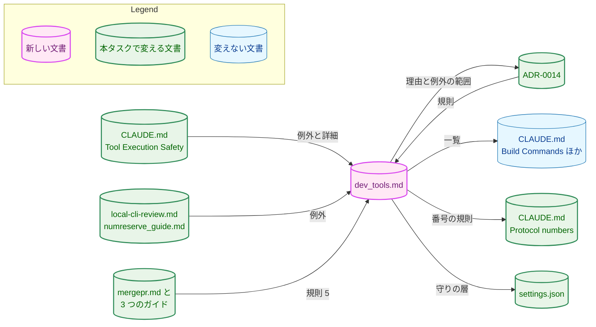
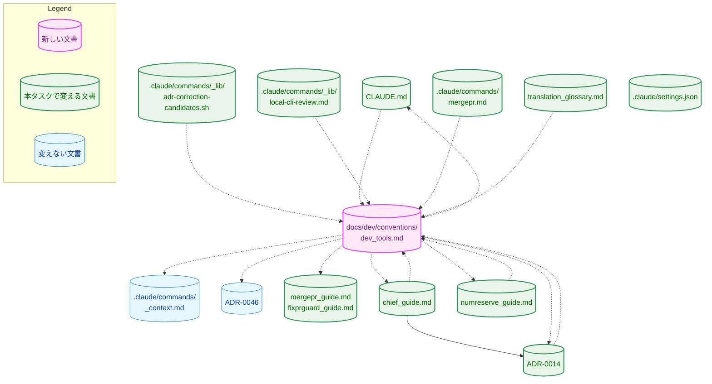
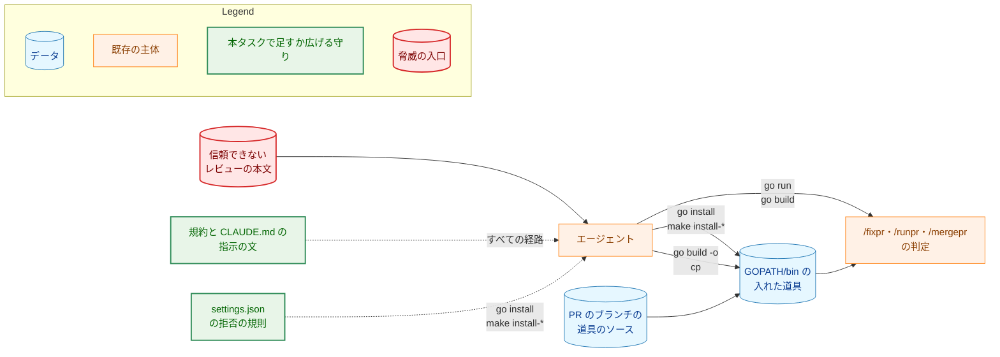
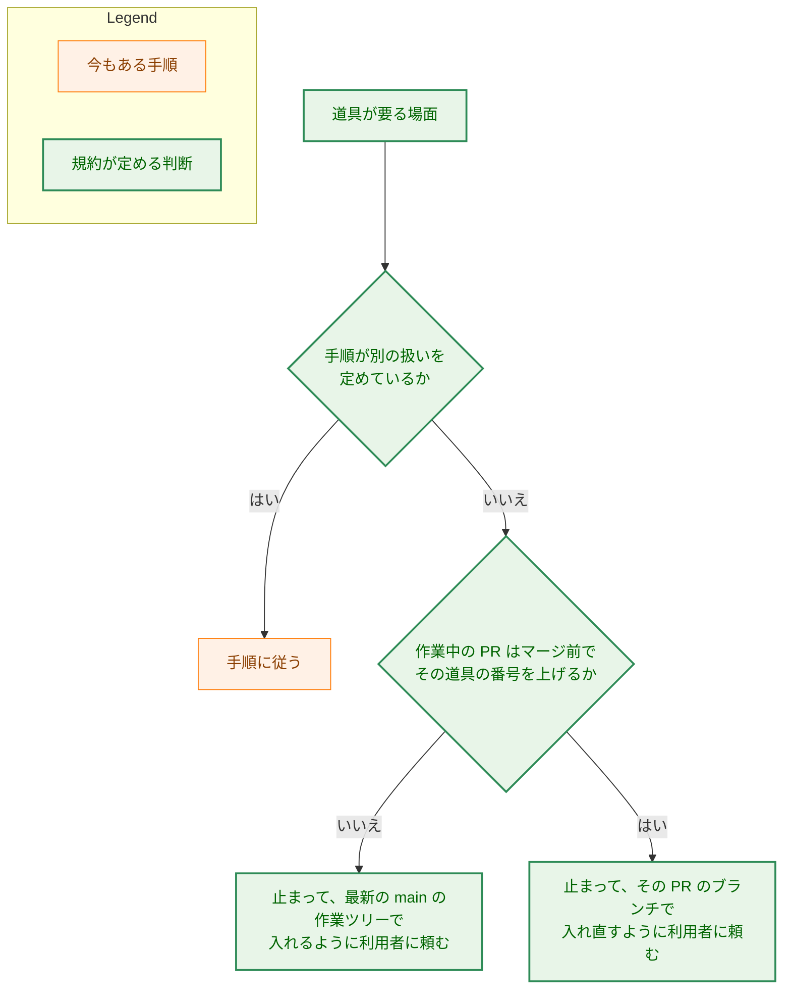

# アーキテクチャ設計書：開発の道具の規則を ADR-0014 から規約 dev_tools.md に移す

## Document Status

| Item | Value |
|---|---|
| Status | `approved` |
| Created | 2026-11-19 |
| Review date | 2026-11-19 |
| Reviewer | isseis |
| Comments | - |

本書は [01_requirements.md](01_requirements.md) を設計に落とす。実装の PR が変えるのは文書と `.claude/settings.json` だけで、Go と TypeScript のコードは変えない。以下の `file:line` は、とくに断らない限りコミット `e43f8161`（`origin/main`）で確かめた。要件定義書の行番号はコミット `a73b2c4e` のものなので、`CLAUDE.md` などでは本書と行番号が違う。本書の F-nn と AC-nn は要件定義書の機能要件と受け入れ基準の番号、H-nn は `design_handoff.md` の項目、I-nn は `implementation_handoff.md` の項目である。

## 1. 設計の全体像 (Design Overview)

### 1.1. 設計原則

-   **規則 1〜6 の条件と手順は、規約に置く。** 新しい規約 `docs/dev/conventions/dev_tools.md`（英語）が、規則 1〜6 の正本になる。ADR-0014 は、要約・理由・採らなかった案・結果・経緯を持ち、規約の節を見出しの名前で指す（`docs/dev/conventions/adr.md`「Writing an ADR」）。ただし、規則 2 の chief の例外の範囲と、TypeScript の補助の規則は、今のとおり ADR-0014 が持つ（要件 1 章）。
-   **写しは、読み手に届けるために置き、正本を指す。** `CLAUDE.md`「Tool Execution Safety」の項目は、Claude Code が毎回読み込む場所に置く規則 5 の写しで、詳細は規約へのリンクで示す（1.3）。
-   **道具は種類で示し、名前の一覧は持たない。** 規約は「入れる道具」と「そのつどビルドする道具」の 2 つの種類を定義し、それぞれの一覧は `CLAUDE.md` の節を指す（H-01、H-06）。
-   **規則の内容は変えない。** 規約の各節は、ADR-0014 の対応する項目の条件を落とさず、広げない（AC-02）。ADR-0014 から外す文は、行き先を 1 文ずつ決める（3.2）。行き先のない文は外さない。
-   **既存の文書のテストが読む値と構造を変えない。** 直す箇所ごとに、それを読むテストと、テストが読む対象を確かめた（3.8）。

### 1.2. 設計の際に決めたこと（2026-11-19）

-   **道具の 3 つの用語の英語名を決め、`docs/translation_glossary.md` に 3 行を足す。** 「開発の道具」は developer tool、「入れる道具」は installed tool、「そのつどビルドする道具」は per-run tool とする。2026-11-19 に人が選んだ。規約（英語）、`CLAUDE.md`、ADR-0014、ガイドに同じ概念が出るので、用語集を基準にして呼び方の揺れを防ぐためである（H-03）。developer tool は、`CLAUDE.md` の「Build Commands」（`:181`・`:183-185`）、「Protocol numbers」（`:810`）、「Tool Execution Safety」（`:1046`・`:1053`）、`.claude/commands/mergepr.md:30` が、すでに `cmd/` と `internal/` の道具を指して使っている語である。外部の CLI の `coderabbit review` を指す「a development tool」（`CLAUDE.md:1043`）と区別できる。
    -   採らなかった案：development tool とする案（最初に人が選んだ）。`CLAUDE.md:1043` が外部の CLI をそう呼んでおり、同じ節で 2 つの意味になる。
    -   採らなかった案：英語名を規約の中で定義するだけにし、用語集は変えない案。日本語の文書の側で呼び方が揺れても、照らす基準がない。
    -   ADR: なし。本タスクの中で閉じる用語の選択である。
-   **拒否の規則は、要件の AC-24 のとおり `Bash(make install-*)` と `Bash(go install *)` の 2 つとし、外部の Go の道具の `go install` も拒むことを受け入れる。** 2026-11-19 に人が選んだ。`Bash(go install *)` は、`go install mvdan.cc/gofumpt@latest`（`Makefile:24`）や `go install golang.org/x/tools/cmd/deadcode@latest`（`Makefile:361`）にも当たる。この 2 つは利用者が一度入れれば `PATH` に残り、golangci-lint は `go run` で走る（`Makefile:10`）。そのため、影響は限られると判断した。人は最初、外部の道具を許可の規則で許す許可リストの形を提案した。しかし、Claude Code は拒否の規則を許可の規則より先に見るので、許可の規則で拒否の規則に穴を開けることはできない。そのため、この形は採れなかった。外部の道具をまとめて入れる make のターゲットは、別の issue で扱う（issue は人が作る）。ターゲットの名前を `install-` で始めれば、`Bash(make install-*)` に当たるので、エージェントは走らせない。
    -   採らなかった案：このリポジトリの道具を指す形（`go install .*`、引数のない `go install`、モジュールのパス、`go install -*`）だけを拒む案。要件の AC-24 を変える決定の変更になり、規則の数が増える。前方一致で迂回できる点も変わらない。
    -   採らなかった案：広く拒み、外部の道具を許可の規則で許す案。上のとおり、Claude Code の規則の評価の順序では成り立たない。
    -   採らなかった案：外部の道具をまとめて入れる make のターゲットを本タスクで足す案。`Makefile` は要件の範囲外（2.3、AC-21）なので、要件定義書を `draft` に戻すことになる。
    -   ADR: なし。AC-24 が定め、ADR-0014 がすでに持つ拒否の規則の範囲を変えない。その帰結は、下の項目で本書に記す。
-   **外部の Go の道具と cloud のセッションについては、規則を足さず、帰結を本書に記すだけにする。** 2026-11-19 に人が選んだ。帰結は次の 2 つである。1 つ目に、拒否の規則は外部の Go の道具の `go install` にも当たるので、gofumpt や deadcode がないと `make fmt` や `make deadcode` は失敗する。エージェントはその失敗をそのまま報告し、利用者が入れる。2 つ目に、cloud のセッションでも、エージェントは止まって利用者に頼む（要件 1 章）。しかし cloud のセッションには利用者が道具を入れる手段がないので、入れる道具を要する手順は手元のクローンで行う。cloud のセッションで番号を決められない `numreserve` と同じ扱いである（`docs/dev/guides/numreserve_guide.md` の 4 章）。外部の道具で止まって頼むことを規則にすると、規則 5 を要件 1 章が決めた範囲より広げることになり、要件の決定の変更になる（AC-02、AC-14）。
    -   採らなかった案：拒否の規則に当たるコマンドが要るときも止まって頼むことを規則 5 に足し、ADR-0014 の「決定」も書き換える案。要件定義書を `draft` に戻すことになる。要るなら別の issue で要件から扱う。
    -   採らなかった案：帰結を ADR-0014 の「結果」にだけ足し、「決定」は変えない案。`docs/dev/conventions/adr.md` の「Approval and the PR」により、決定を変えない PR は ADR に新しい事実も「経緯」の項目も足せない。
    -   ADR: なし。決定を変えない。
-   **エージェントが利用者に頼むときに、入っている道具のビルド元（`go version -m` の `vcs.revision`）を添えることは、求めない。** 2026-11-19 に人が選んだ。添えれば、利用者は次の事態に気づきやすくなる。並行する workspace で、プロトコル番号を上げる PR のためにブランチから入れた道具を、ほかの worktree の依頼に応じて `main` から入れ直してしまう事態である。しかし、規則 5 に要件にない義務を足すことになり、AC-02 の範囲を越える。この危険は 5 章の受け入れる危険に書く。
    -   採らなかった案：依頼にビルド元を添える案。要件の変更になり、要件定義書を `draft` に戻す。
    -   ADR: なし。規則を変えない。

### 1.3. 概念モデル

図 1 は、規則の正本と写しと理由の関係を示す。矢印 A → B は「A が B を指す（リンクするか、名前で示す）」を表す。

各文書の役割（H-04）を表にまとめる。

| 置き場所 | 持つもの | 役割 |
|---|---|---|
| `docs/dev/conventions/dev_tools.md` | 規則 1〜6 の条件と手順、道具の種類の定義 | 規則の正本 |
| `docs/dev/adr/0014-deterministic-checks-in-go.md` | 規則の要約、理由、採らなかった案、結果、経緯。chief の例外の範囲と TypeScript の補助の規則（規約の Rule 2 が指す） | 理由の置き場所。例外の範囲の正本 |
| `CLAUDE.md`「Tool Execution Safety」の新しい項目 | 規則 5 のうち、エージェントが入れない・ビルドしない・止まって頼むこと | 写し（Claude Code が毎回読み込む） |
| `CLAUDE.md`「Tool Execution Safety」の `codexreview`・`numreserve`・`chief` の文、`local-cli-review.md`、`numreserve_guide.md` | 道具ごとの「インストールもビルドもしない」 | 写し（その道具の手順の中で読まれる） |
| `mergepr.md` と、`mergepr_guide.md`・`fixprguard_guide.md`・`chief_guide.md` の入れ直しの文 | 利用者が入れる手順 | 手順 |
| `.claude/settings.json` の `permissions.deny` | `make install-*` と `go install` の拒否 | 守りの層（Claude Code にだけ効く） |

写しを直すときは、正本を先に直す。この順序は規約の冒頭に書く（3.1）。

## 2. システム構成 (System Structure)

### 2.1. 全体構成

図 2 は、本タスクで変える文書と、それらの間の参照を示す。矢印 A → B は「A が B を指す」を表す。実線は本タスクの後も残る今の参照、点線は本タスクで足すか付け替える参照である。

-   `chief_guide.md` から ADR-0014 への実線は、`chief_guide.md:3` の参照である。決定とその理由を指すので残す（要件 2.3）。
-   `chief_guide.md:22`・`numreserve_guide.md:11`・`adr-correction-candidates.sh:63-64` の ADR-0014 への参照は、本タスクで規約への点線に付け替える（F-005）。付け替えた後は残らないので、図には描かない。
-   規約から `_context.md` と 4 つのガイドへの点線は、規約の Rule 4 が契約の置き場所として指すものである。
-   `settings.json` はほかの文書を指さず、ほかの文書からも図の範囲では指されないので、矢印がない。

### 2.2. コンポーネント配置

| 文書 | 言語 | 置き場所の理由 |
|---|---|---|
| `dev_tools.md` | 英語 | エージェントが従う規約なので、`docs/dev/conventions/` に英語で置く（`CLAUDE.md`「Document language」の原則 (b)） |
| ADR-0014 | 日本語 | 原則 (a) |
| ガイド 4 つ、用語集 | 日本語 | 原則 (a) |
| `mergepr.md`、`local-cli-review.md`、`adr-correction-candidates.sh` | 英語 | 原則 (b) |

### 2.3. データの流れ

本タスクは実行時のデータの流れを変えない。規則が読み手に届く経路は、6 章の処理の流れで示す。

## 3. コンポーネント設計 (Component Design)

### 3.1. 規約 dev_tools.md の構成

規約は英語で書く。見出しの名前と各節が持つものを次の表に示す。ADR-0014 とほかの文書は、この見出しの名前で節を指す（アンカーは使わない。`adr.md`「Links」）。文言は実装で決める。

見出しは規則の番号を含む。要件定義書と ADR-0014 が規則を番号で呼ぶため、番号で探せるようにする。規則を足すか番号を変えるときは、見出しを指す文書も直すことになる。この結びつきは受け入れる。

| 見出し | 持つもの | 対応する AC |
|---|---|---|
| `# Developer Tools` | 規約の範囲（developer tool を足すか変えるときにエージェントが従う規則）。規則の理由は ADR-0014 にあることを、リンクで示す。この規約が正本で、`CLAUDE.md`「Tool Execution Safety」などの写しを直すときは先にこの規約を直すこと | AC-01、AC-06 |
| `## Kinds of tools` | developer tool の定義（`cmd/<name>` と `internal/<name>` の組で、製品のバイナリに入らない。`coderabbit` のような外部の CLI は含まない）。installed tool の定義（developer tool のうち、利用者が `make install-<name>` で入れるもの）と、一覧と導入の手順のある場所（`CLAUDE.md`「Build Commands」）。per-run tool の定義（developer tool のうち、make のターゲットが走らせるたびに一時ディレクトリにビルドするもの）と、一覧のある場所（`CLAUDE.md`「Test Commands」の `make coverage-compare` と「Extension Commands」の `make ext-coverage-compare`） | AC-03、H-01、H-06 |
| `## Rule 1: Write a tool in Go, with tests` | 規則 1 | AC-01、AC-02 |
| `## Rule 2: Do not read a decision's baseline back from a state file` | 規則 2。基準値と判定した集合はサブコマンドの出力として返し、次の呼び出しの引数で渡すこと。例外があることだけを書き、範囲は書かずに ADR-0014 と ADR-0046 へリンクする。例として `fixprguard_guide.md` の 1 章（記録のファイルを読み返さないこと）と 7 章（保証の内容）へリンクする | AC-02、AC-04 |
| `## Rule 3: Enforce the order in the tool's code` | 規則 3。コマンドの定義に残るのは、サブコマンドを呼ぶ順序と利用者への確認だけであること。例として `fixprguard_guide.md` の 5 章の `finish` と `push` の説明と、7 章へリンクする | AC-02 |
| `## Rule 4: Arguments, output, and exit codes are a contract` | 規則 4。変えるときは道具と、それを呼ぶ文書と、ガードを同じ PR で変えること。文書と道具を変える順序は、両方が動き続ける形にすること（`fixprguard_guide.md` の 9 章）。契約が書かれている場所の一覧（`CLAUDE.md` の「Build Commands」「Test Commands」「Development Notes」、`_context.md` の「Guard tool」の行、4 つのガイド） | AC-02 |
| `## Rule 5: Install tools from main; agents never install or build them` | 規則 5（下の表） | AC-05 |
| `## Rule 6: Exception: a side-effect-free record check may be a shell script` | 規則 6 の 4 つの条件。スクリプトの判断の規則の全体を常設の Go のテストで確かめる条件は、この例外ができた後に足すスクリプトに当てはまること。それより前からあるスクリプトの扱いは ADR-0014 へリンクする | AC-02 |
| `## Not covered here` | この規約が持たない規則と、その置き場所：プロトコル番号の規則（`CLAUDE.md`「Protocol numbers」）、chief の例外の範囲（ADR-0014 と ADR-0046）、拡張の関数の範囲を TypeScript で求める規則（ADR-0014）、環境変数を読む場所（ADR-0024）、`context.Context` を第 1 引数にする規則など（ADR-0019） | AC-07 |

「文書と道具を変える順序」の文は、ADR-0014 では `main` から入れる項目（`:22`）にあるが、規約では Rule 4 に置く。内容が契約の変え方についての規則であり、Rule 4 の条件として読むのが自然だからである。条件を落としも広げもしないので、AC-02 に反しない。

規則 5 の節は、次の段落からなる。

| 段落 | 持つもの | 出どころ |
|---|---|---|
| Who installs | 入れる道具は利用者が最新の `main` から入れ、道具を変えたマージの後に入れ直す。プロトコル番号を上げる PR では、その PR の `/runpr` の前に、利用者がその PR のブランチで、番号を上げた道具を入れ直す（`fixprguard_guide.md` の 3 章）。`fixprguard` などは `--protocol` の番号で、呼び出す文書と道具の版を照合する。番号の規則は `CLAUDE.md`「Protocol numbers」へリンクする | ADR-0014 `:22`・`:23`、要件 1 章 |
| What agents do not do | エージェントは入れる道具をインストールもビルドもしない。「build」の意味：道具を走らせるためのバイナリを作ること、またはソースから走らせること（`make install-<name>`、`go install`、`go build ./cmd/<name>`、`go run ./cmd/<name>`）。テストや lint のためのコンパイル（`make test`、`make lint`、`go test`、`go vet`）は含まない | ADR-0014 `:23`、要件 1 章 |
| Development exception | 道具を開発したり調べたりするために、ソースからビルドして走らせてよい 3 つの条件（`PATH` の通った場所に置かない、手順の中で入れた道具の代わりに使わない、外に副作用を持つ走らせ方をしない）。走らせてよいのは、テスト、`--help`、手元の入力やコピーに対する実行に限ること（要件 1 章）と、この例外に含まれない走らせ方。共有の状態（chief の状態のディレクトリ、Herdr の workspace と pane、worktree、`$(go env GOPATH)/bin`）に働く実行は、手元の入力やコピーに対する実行に当たらないこと`CLAUDE.md`「Tool Execution Safety」のほかの規則は、この例外の中でも効く | ADR-0014 `:23`、要件 1 章 |
| When a step needs a tool | 下の「止まって頼むときの決まり」 | ADR-0014 `:23`、要件 1 章、AC-05 |
| Per-run tools | そのつどビルドする道具は、この節の対象でない | ADR-0014 `:22`・`:23` |
| The permission layer | Claude Code では `.claude/settings.json` が `make install-*` と `go install` を拒む。この拒否は守りの層の 1 つで、拒まれない形（`go build`、`go run`、拒否の規則が当たらない書き方）を許すものではない。拒否は外部の Go の道具の `go install` にも当たる | ADR-0014 `:23`、要件 F-006 |
| Cloud sessions | cloud のセッションでも、エージェントは道具を入れず、止まって利用者に頼む | 要件 1 章 |
| Links | `CLAUDE.md`「Tool Execution Safety」と「Protocol numbers」 | AC-05 |

「The permission layer」を規約に置くのは、エージェントが「拒まれなかったので許されている」と読むのを防ぐためである。拒否の規則の中身の正本は `settings.json` そのもので、規約は形だけを述べる。

**止まって頼むときの決まり。** 規約の「When a step needs a tool」は、次を定める。

-   **止まる場面：** 道具を入れるかビルドする手順に来たとき、道具が見つからないか番号が合わないためにコマンドが失敗したとき。
-   **手順が別の扱いを定めている場合は、それに従う（要件 1 章）。** 今は次のものがある。
    -   `codexreview` が見つからないか番号が合わないとき、`local-cli-review.md` の手順 3 は `not run` を記録して進む。
    -   番号が合わないとき、`/fixpr`・`/runpr`・`/mergepr` の定義は 2 つの直し方を示して止まる。道具が古ければ `main` から入れ直し、ブランチが古ければ `origin/main` を取り込む（`.claude/commands/runpr.md:199-203`、`fixpr.md:68-74`、`mergepr.md:20-25`）。作業中の PR がその道具の番号を上げていて、利用者がまだブランチで入れ直していないときは、この 2 つの直し方はどちらも不一致を解かない。道具は止まったままなので安全側だが、利用者は PR のブランチで入れ直す必要に自分で気づくことになる（`mergepr_guide.md` などの手順に書かれている）。この 3 つの定義に PR のブランチの場合を足すかは、要件の範囲外なので、9 章に残す。
-   **頼む内容：** 要る道具と、利用者が実行するコマンド。コマンドは、どの作業ツリーで実行するかを明示する。ふつうは、最新の状態にした `main` の作業ツリーで `make install-<name>` を実行するように示し、タスクの worktree では実行しないように添える。タスクの worktree は PR のブランチを checkout しているので、そこで入れると、ブランチの道具が `$(go env GOPATH)/bin` に入るためである。次の項目に当たるときだけ、PR のブランチを checkout した作業ツリーで実行するように示す。
-   **PR のブランチで入れ直すように頼む場合：** 作業中の PR がまだマージされておらず、その道具の `const Protocol` の行を変えている場合だけである。ほかの道具の番号を上げる PR でも、その道具は `main` から入れる。これは要件の「その PR がプロトコル番号を上げる場合」の読み方を定めたもので、規則を変えない。番号を上げるのは道具ごとで（`CLAUDE.md`「Protocol numbers」）、マージした後の入れ直しは `main` から行うためである。

止まったあとの扱い（利用者が入れたあと、どこから続けるか）は、規約では定めず、各手順に従う。

### 3.2. ADR-0014 の書き直し

**前提とする ADR-0014 の版。** 書き直しは、要件定義の PR（#1024）が AC-08 を満たして `main` に入った版（`e43f8161`）を前提に行う。本 PR は ADR-0014 を変えない。行番号は `e43f8161` の ADR-0014 のものである。

実装の PR は、ADR-0014 の「決定」のうち次の 7 つの項目を書き換える（AC-09、AC-10）。

| 行 | 項目 | 書き換え後に残すもの | リンク先の節 |
|---|---|---|---|
| `:17` | 判定と副作用を持つ道具は Go で書く | 太字の要約、理由（テストで壊して確かめる）、何を決めるかの ADR とガイドへのリンク | Rule 1、Kinds of tools |
| `:18` | 基準値を読み返さない | 太字の要約、理由（ディスクの判定は書き換えられる） | Rule 2 |
| `:20` | 順序は道具のコードで強制する | 太字の要約、理由（手順の読み違いで境界が迂回されない） | Rule 3 |
| `:22` | 道具は `main` から入れる | 太字の要約、理由（古い道具が古い想定で黙って判定しない） | Rule 5 |
| `:23` | エージェントは入れない・ビルドしない（タスク 0112） | 太字の要約、理由（ブランチの判定で `main` の判定を迂回できる）、受け入れる危険の理由、拒否の規則を守りの層として置くことと、その理由（ADR-0046 と同じ理由） | Rule 5、`CLAUDE.md`「Tool Execution Safety」 |
| `:25` | 引数・出力・終了コードは契約 | 太字の要約、理由（契約が食い違うと境界が働かない） | Rule 4 |
| `:26` | 副作用のない判定のシェルスクリプトの例外 | 太字の要約、今ある 2 つのスクリプトと、`opus-review-decision.sh` の常設のテストが確かめる範囲の事実、理由、採らなかった案との違い | Rule 6 |

`:19`（chief の例外）、`:21`（TypeScript の補助）、`:24`（プロトコル番号）の中身と、「背景」「採らなかった案」「結果」「経緯」は、実装の PR では変えない（AC-10）。

**「決定」の節の書式。** 7 つの項目を書き換えるので、「決定」の節は、上の 3 項目も含めて、日本語の文書の書式の規約 `docs/dev/conventions/document_formatting.md` に揃える（同「Where the rules apply」、`docs/dev/conventions/adr.md`「Format」、AC-10）。各項目の太字は、文全体ではなく名詞で終わるラベルにする（同「Bold」）。上の表の「太字の要約」も、この形で書く。節の構成（要旨を先に置き、小見出しか入れ子の箇条書きにするか）は、同「Sections with many items」に従って実装で決める。揃えるのは書式だけで、項目の中身は変えない。この規約は、要件定義書の承認と、本書が基にしたコミット `e43f8161` の後に入った（`94e3a1f5`、タスク 0111）。

**外す文の行き先（H-02）。** 7 つの項目のすべての文について、行き先を示す。「ADR に残す」は、書き換え後の項目に残す要約・理由・事実である。

| 行 | 文 | 行き先 |
|---|---|---|
| `:17` | 太字の文（判定と副作用を持つ道具は Go で書き、テストを持つ） | ADR に残す（要約）。規約の Rule 1 |
| `:17` | 理由（テストで壊して確かめる） | ADR に残す |
| `:17` | 今ある道具の名前の一覧（6 つ） | `CLAUDE.md`「Build Commands」「Test Commands」「Extension Commands」（規約の Kinds of tools が指す） |
| `:17` | `cmd/<名前>` と `internal/<名前>` の組、製品の 3 つのバイナリに入らない | 規約の Kinds of tools と Rule 1。バイナリの数（3 つ）は製品の構成についての事実で、規則ではないので、規約には書かない（`CLAUDE.md`「Architecture Overview」が製品の入口を示している） |
| `:17` | 何を決めるかは ADR-0015 ほかとガイドが定める | ADR に残す（リンク） |
| `:17` | 導入手順は `CLAUDE.md`「Build Commands」にある | 規約の Kinds of tools |
| `:18` | 太字の文 | ADR に残す（要約）。規約の Rule 2 |
| `:18` | 基準値と判定した集合はサブコマンドの出力として返し、次の呼び出しの引数で渡す | 規約の Rule 2 |
| `:18` | `fixprguard` は記録を書くが読み返さない | `fixprguard_guide.md` の 1 章（`:23`。規約の Rule 2 が指す） |
| `:18` | 理由（ディスクの判定は書き換えられる） | ADR に残す |
| `:18` | 保証の内容は `fixprguard_guide.md` の 7 章にある | 規約の Rule 2 |
| `:20` | 太字の文 | ADR に残す（要約）。規約の Rule 3 |
| `:20` | 2 つの例（確認より前に build checks を動かさない、hooks や config が変わったら push しない） `fixprguard_guide.md` の 5 章の `finish` と `push` の説明と、7.1 の「書き換えられた hooks・config で git を起動しない」の行（規約の Rule 3 がどちらも指す） |
| `:20` | コマンドの定義に残るのは、呼ぶ順序と利用者への確認だけ | 規約の Rule 3 |
| `:20` | 理由（読み違えても境界が迂回されない） | ADR に残す |
| `:20` | 保証の内容は `fixprguard_guide.md` の 7 章にある | 規約の Rule 3 |
| `:22` | 太字の文 | ADR に残す（要約）。規約の Rule 5 |
| `:22` | `make install-<名前>` の一覧と、道具を変えたマージの後の入れ直し | `CLAUDE.md`「Build Commands」と規約の Rule 5（Who installs） |
| `:22` | プロトコル番号を上げる PR のブランチでの入れ直しと、`fixprguard_guide.md` §3 へのリンク | 規約の Rule 5（Who installs） |
| `:22` | `coveragecompare` はそのつど一時ディレクトリにビルドして走らせる | 規約の Kinds of tools と Rule 5（Per-run tools）、`CLAUDE.md`「Test Commands」 |
| `:22` | `--protocol` の照合 | 規約の Rule 5（Who installs） |
| `:22` | 文書と道具を変える順序（`fixprguard_guide.md` §9） | 規約の Rule 4（3.1） |
| `:22` | 理由（古い道具が古い想定で黙って判定しない） | ADR に残す |
| `:23` | 太字の文 | ADR に残す（要約）。規約の Rule 5 |
| `:23` | 「ビルドする」の意味 | 規約の Rule 5（What agents do not do） |
| `:23` | `coveragecompare` は対象でない | 規約の Rule 5（Per-run tools） |
| `:23` | 開発のための例外とその条件 | 規約の Rule 5（Development exception） |
| `:23` | プロトコル番号を上げる PR のブランチで入れ直すのも利用者 | 規約の Rule 5（Who installs） |
| `:23` | 止まって頼むこと、PR のブランチで頼む場合、手順が別の扱いを定める場合 | 規約の Rule 5（When a step needs a tool） |
| `:23` | Claude Code では `settings.json` に拒否の規則を置く | ADR に残す（守りの層を置くという決定の要約）。規約の Rule 5（The permission layer） |
| `:23` | 「（タスク 0112 の実装で足す）」 | 消す。実装の PR で `settings.json` に入るので、古くなった参照になる |
| `:23` | 理由 3 つ（迂回、受け入れる危険、拒否の規則の層） | ADR に残す |
| `:23` | 「規則は…0112 要件定義書にある」 | 消し、規約の Rule 5 へのリンクに置き換える |
| `:25` | 太字の文 | ADR に残す（要約）。規約の Rule 4 |
| `:25` | 変えたときは道具・文書・ガードを同じ PR で変える | 規約の Rule 4 |
| `:25` | 理由（契約が食い違うと境界が働かない） | ADR に残す |
| `:25` | 契約が書かれている場所の一覧 | 規約の Rule 4 |
| `:26` | 太字の文（4 つの条件を含む） | 要約を ADR に残し、4 つの条件は規約の Rule 6 |
| `:26` | 今ある 2 つのスクリプトと、それぞれの ADR | ADR に残す（事実） |
| `:26` | `opus-review-decision.sh` は例外より前に作られ、常設のテストは計画書の値の読み方だけを確かめる | ADR に残す（事実） |
| `:26` | 新しいスクリプトは、判断の規則の全体を常設の Go テストで確かめる | 規約の Rule 6 |
| `:26` | 理由と、採らなかった案との違い | ADR に残す |

`:26` のスクリプトの一覧に `adr-correction-candidates.sh` が入っていないことは、本タスクでは変えない。このスクリプトのコメントは、このスクリプトが規則 1 の道具でも規則 6 の例外でもないと述べている（`adr-correction-candidates.sh:62-66`）。これは規則 1 と規則 6 の範囲の食い違いに由来し、別の issue で扱う（要件 1 章）。

**「結果」の 1 文。** 「結果」の `:61` の「拒否の規則は、タスク 0112 の実装の PR が `.claude/settings.json` に足すまでは効かない」は、実装の PR のマージで、文の述べる条件（足すまでは効かない）が満たされ、過去の状態を述べる文になる。AC-10 は「結果」を変えないとしているので、実装の PR では直さない。文は誤りにはならないので、後で直すかどうかは 9 章に残す。

**記録。** 7 つの項目の書き換えは、編集上の訂正（`adr.md`「Editorial corrections」）として記録する（AC-11）。「（タスク 0112 の実装で足す）」と「規則は…0112 要件定義書にある」を消すことは 3 つ目の種類（古くなった参照）で、それ以外は 1 つ目の種類（基準に沿った書き直し）である。訂正行は、文を写さずに自分の言葉で書き、`<` と `@` を含めない（I-03）。

### 3.3. CLAUDE.md の変更

`CLAUDE.md` は、次の 4 種類の箇所だけを変える（AC-18）。

| 箇所 | 変更 | AC |
|---|---|---|
| 「Quick Links」の「Development Guides」 | `[Developer Tools](docs/dev/conventions/dev_tools.md)` の行を足し、要旨（開発の道具を足すか変えるときの規則、`main` から入れること、エージェントが入れないこと）を添える | AC-13 |
| 「Tool Execution Safety」 | 1 項目を足す（下） | AC-14 |
| 「Tool Execution Safety」の `codexreview`・`numreserve`・`chief` の文（`CLAUDE.md:1051-1052`・`:1060-1061`・`:1076-1077`） | 今の文を残し、開発のための例外があることを、規約へのリンクで添える | AC-23 |
| 「Protocol numbers」の「The merge checks it.」の項目（`CLAUDE.md:842-843` の「reinstall the tool from the branch」） | 入れ直すのは利用者であることを述べる形にする（たとえば「ask the user to reinstall the tool from the branch」） | AC-15 |

「Tool Execution Safety」に足す項目は、次を持つ。

-   エージェントは、入れる道具をインストールもビルドもしないこと。「ビルドする」の意味（バイナリを作ること、ソースから走らせること。テストや lint のためのコンパイルは含まない）。
-   入れるかビルドする手順に来たとき、道具が見つからないか番号が合わないためにコマンドが失敗したときは、止まって利用者に頼むこと。示すのは最新の `main` の作業ツリーで入れるコマンドで、PR のブランチで入れ直すように頼むのは、その PR がその道具のプロトコル番号を上げる場合だけであること。手順が別の扱いを定めている場合（たとえば `codexreview` について `local-cli-review.md`）はそれに従うこと。
-   開発のための例外と詳細は、規約の Rule 5 へのリンクで示すこと。

項目は、道具を名前で並べない（H-01）。`numreserve task` のような、道具の呼び出しの形をコードスパンで書かない。`cmd/numreserve/docs_test.go:250-276` の `TestDocumentedInvocations` が、この節の呼び出しをすべて許可の規則と照らし合わせるからである（3.8）。

### 3.4. 道具を入れる手順の主語（F-004）

| 箇所 | 今の文 | 変更 | AC |
|---|---|---|---|
| `.claude/commands/mergepr.md:18-19` | 「Install it with `make install-mergepr` from an up-to-date `main` checkout.」 | 利用者が最新の `main` から入れること、エージェントはインストールもビルドもしないことを、規約へのリンクとともに述べる形にする | AC-17 |
| `docs/dev/guides/mergepr_guide.md:48` | 「その PR のブランチで再インストールし」 | 利用者がその PR のブランチで入れ直すことを述べる。同じ段落の「マージの直後に `main` から再インストールする」は直さない（要件 1 章） | AC-16 |
| `docs/dev/guides/mergepr_guide.md:286`（7 章の手順 5） | 「その PR のブランチで、その道具を `make install-<道具>` で入れ直す。」 | 利用者が入れ直すことを述べる | AC-16 |
| `docs/dev/guides/fixprguard_guide.md:54` | 「その PR のブランチで再インストールする。」 | 利用者が入れ直すことを述べる | AC-16 |
| `docs/dev/guides/chief_guide.md:30` | 「その PR のブランチで入れ直す。」 | 利用者が入れ直すことを述べる | AC-16 |
| `CLAUDE.md` の「Protocol numbers」 | 3.3 | 3.3 | AC-15 |

中身を直すガイドの節（`mergepr_guide.md` の 3 章と 7 章、`fixprguard_guide.md` の 3 章、`chief_guide.md` の 2 章）は、書式の規約 `docs/dev/conventions/document_formatting.md` に揃える（同「Where the rules apply」、AC-22）。揃えるのは書式だけで、中身は変えない。

`mergepr_guide.md:48` は `--protocol 2` を文の中に書いている。`cmd/mergepr/docs_test.go` の `TestDocumentedProtocolMatches` は、ガイドの文の中の `--protocol N` まで読む（`cmd/mergepr/docs_test.go:53-60` のコメント）。そのため、直すのは主語の部分だけにし、`--protocol` を含む記述は変えない。

### 3.5. 開発のための例外への参照（AC-23）

| 箇所 | 変更 |
|---|---|
| `CLAUDE.md` の 3 つの道具の文 | 3.3 |
| `.claude/commands/_lib/local-cli-review.md:91-93` | 「never install or build the tool」の文を残し、規約の Rule 5 の開発のための例外があること、その場合でも手順の中で入れた道具の代わりに使わないことを添える |
| `docs/dev/guides/numreserve_guide.md:11` | 「エージェントは道具を入れたりビルドしたりしない。」の後に、開発のための例外は規約の Rule 5 にあることを添える（参照の付け替えは 3.6） |

`numreserve_guide.md` の 1 章は、文を足すので、書式の規約に揃える（3.4 と同じ。AC-22）。

### 3.6. 参照の付け替え（F-005）

| 箇所 | 今の参照 | 変更後 | AC |
|---|---|---|---|
| `docs/dev/guides/chief_guide.md:22` | 「ADR-0014 の『道具は `main` からインストールして使う』」（リンクなし） | `../conventions/dev_tools.md` へのリンクと、Rule 5 の見出しの名前 | AC-19 |
| `docs/dev/guides/numreserve_guide.md:11` | `[ADR-0014](../adr/0014-deterministic-checks-in-go.md)` の「道具は `main` からインストールして使う」 | 同上 | AC-19 |
| `.claude/commands/_lib/adr-correction-candidates.sh:63-64` のコメント | `docs/dev/adr/0014-deterministic-checks-in-go.md puts in Go` | `docs/dev/conventions/dev_tools.md`（Rule 1）を名指す。コードは変えない | AC-20 |

3.3〜3.7 の表に挙げた箇所と、3.4・3.5 で書式の規約に揃えるガイドの節が、AC-22 の対象のファイルで変える箇所のすべてである。

### 3.7. 拒否の規則と用語集

**拒否の規則（F-006）。** `.claude/settings.json` の `permissions.deny` の最後に、次の 2 つを足す。ほかの規則は、並びも含めて変えない（AC-24）。

| 規則 | 拒む例 | 拒まない例 |
|---|---|---|
| `Bash(make install-*)` | `make install-chief`、`make install-fixprguard` | `make test`、`make lint`、`make coverage-compare BASE=x`、`make ext-install` |
| `Bash(go install *)` | `go install ./cmd/chief`、`go install`（引数なし）、`go install mvdan.cc/gofumpt@latest` | `go test ./...`、`go vet ./...`、`go build -o /tmp/x ./cmd/chief`、`go run ./cmd/chief --help` |

-   `go install *` は、末尾に空白のある前方一致の形にする。`cmd/chief/docs_test.go:320-341` の `matchesRule` は、この形が引数のない `go install` にも当たるものとして Claude Code の振る舞いを再現している。本書はそれを確かめてはいない。`go install*` の形にすると、`go installer` のような別のコマンドにも当たる。
-   拒まない例のうち `go build` と `go run` は、開発のための例外があるので拒まない（要件 1 章）。
-   前方一致の規則なので、迂回できる書き方がある。たとえば、`go build -o "$(go env GOPATH)/bin/<name>" ./cmd/<name>` で入れた道具を直接上書きする形、`cp` や `mv` で置く形、`go -C <dir> install`、`make -C <dir> install-<name>`、`make fmt install-<name>` のように別のターゲットを前に置く形、`go` を絶対パスで書く形、`env` や `bash -c` を通す形である。これは例で、すべてではない。Claude Code がコマンドをどう正規化して照らすかは確かめていない。迂回できることは要件 4.2 で受け入れている。
-   外部の道具の `go install` も拒むことと、その帰結は、1.2 で受け入れた。

**用語集（H-03）。** `docs/translation_glossary.md` の用語の表の「ガードツール」の行の後に、次の 3 行を足す。

| 日本語 | English | 備考 |
|---|---|---|
| 開発の道具 | developer tool | `cmd/<名前>` と `internal/<名前>` の組で作る、開発の手順のための Go の道具。製品のバイナリには入らない（`docs/dev/conventions/dev_tools.md`） |
| 入れる道具 | installed tool | 開発の道具のうち、利用者が `make install-<名前>` で `main` から入れるもの |
| そのつどビルドする道具 | per-run tool | 開発の道具のうち、make のターゲットが走らせるたびに一時ディレクトリにビルドするもの |

### 3.8. コンポーネントの責務と、読むテスト

実装の PR で変わるファイルは、次の表に限る（AC-21）。最後の列は、そのファイルで変更する箇所を読む既存のテストと、テストが読む対象である（H-05、H-07）。どのテストも、本設計の変更では読む値と構造が変わらないので、テストを直す必要はない。

`cmd/yt2column` の `TestInstructionDocPaths`（`cmd/yt2column/docpaths_test.go:105-160`）は、`CLAUDE.md`、`.claude/commands` と `docs/dev` の下の文書のリンクがすべて解決すること、リンクの数が抜き出しと合うことを確かめる。表で「リンク」と書いた行は、このテストを指す。

| ファイル | 責務 | 変更する箇所を読むテスト（読む対象） |
|---|---|---|
| `docs/dev/conventions/dev_tools.md`（新規） | 規則の正本 | リンク |
| `docs/dev/adr/0014-deterministic-checks-in-go.md` | 理由の置き場所 | `cmd/yt2column` の `TestADRRecords`（ADR の構造）、リンク |
| `CLAUDE.md` | 一覧、規則 5 の写し、プロトコル番号 | `cmd/numreserve` の `TestDocumentedInvocations`（「Tool Execution Safety」の `numreserve` の呼び出し）、`cmd/yt2column` の `TestCodexMentionOnlyInRequestRow`（`@codex` を書かないこと）、リンク |
| `.claude/commands/mergepr.md` | `mergepr` の手順 | `cmd/mergepr` の `TestDocumentedProtocolMatches`・`TestDocumentedInvocationsParse`（`mergepr` の呼び出しと `--protocol`）、`TestProtocolToolsAgree`（`--protocol` で呼ぶ道具の集合）、リンク |
| `.claude/commands/_lib/local-cli-review.md` | ローカルの CLI レビューの手順 | `cmd/codexreview` の `TestDocumentedProtocolMatches`・`TestDocumentedInvocationsParse`・`TestNoDirectCodexInvocation`（`codexreview` の呼び出しと、`codex` を直接走らせないこと）、リンク |
| `.claude/commands/_lib/adr-correction-candidates.sh` | コメントの参照 | `cmd/yt2column` の `TestADRCorrectionCandidates`（スクリプトを走らせた結果。コメントは読まない） |
| `.claude/settings.json` | 拒否の規則 | `cmd/chief` の `TestSettingsDeniesPaneInput`・`TestSettingsDeniesWorktreeChanges`（`deny` が herdr と git worktree の規則を含むこと、`allow` の規則）・`TestSettingsAsksBeforeRemove`（`ask` の規則）、`cmd/codexreview` の `TestSettingsAllowsTool`（`allow` の規則と `defaultMode`）、`cmd/numreserve` の `TestSettingsAllowsTool`（`allow` の規則） |
| `docs/dev/guides/chief_guide.md` | 参照、主語 | `cmd/chief` の `TestGuideValuesMatchTool`（サブコマンドと終了コードの表、`プロトコル番号` の値、状態のディレクトリ）、リンク |
| `docs/dev/guides/numreserve_guide.md` | 参照、例外への参照 | `cmd/numreserve` の `TestGuideValuesMatchTool`（理由の語の表、番号の空間の表）、リンク |
| `docs/dev/guides/mergepr_guide.md` | 主語 | `cmd/mergepr` の `TestDocumentedProtocolMatches`（文の中の `--protocol N` を含む）、リンク |
| `docs/dev/guides/fixprguard_guide.md` | 主語 | `cmd/fixprguard` のガイドのテスト（表、停止の種類、範囲の規則など。3 章の箇条書きは読まない）、リンク |
| `docs/translation_glossary.md` | 用語 | なし |
| `docs/tasks/0112_dev_tools_convention/` | タスクの記録 | なし |

`.claude/settings.json` を読むテストは、`deny` については決まった規則を「含む」ことだけを確かめ、一覧が同じことは確かめない（`cmd/chief/docs_test.go:415-466`）。そのため、2 つの規則を足してもテストは通る。`internal/fixprguard/ignored_test.go` が読むのは `.claude/settings.local.json` で、`settings.json` ではない。

## 4. エラーハンドリング設計 (Error Handling Design)

コードを変えないので、エラーの型は足さない。道具が出す誤りの文（たとえば `mergepr` の `--protocol is missing or does not match`）も変えない。

エージェントが止まって利用者に頼むときの伝え方は、3.1 の「止まって頼むときの決まり」が定める。本章は、それ以外の決まりを足さない。

## 5. セキュリティ考慮事項 (Security Considerations)

`docs/dev/security.md` の条件（外部コマンドの起動、API キー、キャッシュ、ネットワーク、信頼できない文字列の埋め込み）には当たらない。開発の道具の信頼境界（[ADR-0015](../../dev/adr/0015-untrusted-review-threads.md)）に関わる守るもの・脅威・受け入れる危険は、要件 4.2 のとおりで、本設計はそれを狭めない。

図 3 は脅威の経路と守りを示す。実線の矢印 A → B は「A の結果が B に届く」を、点線の矢印は「守りがエージェントのその行動を止める」を表す。

-   拒否の規則が止めるのは、`go install` と `make install-*` で始まる形だけである。この規則は Claude Code にだけ効き、OpenCode には効かない。`go build -o` や `cp` で入れた道具を上書きする経路、`go run` や手元のバイナリで判定を走らせる経路は、指示の文だけが止める。迂回できる書き方は 3.7 に例を挙げた。これらは要件 4.2 で受け入れた危険である。
-   **並行する workspace の危険（受け入れる）。** プロトコル番号を上げる PR のために、利用者がブランチから道具を入れている間は、ほかの worktree の `/fixpr`・`/runpr` は番号の不一致で止まる（安全側）。そのとき、止まったエージェントが「`main` から入れて」と頼み、利用者が応じると、番号を上げた PR の `/runpr` が止まる。依頼に、入っている道具のビルド元を添えないので（1.2）、利用者は `go version -m` で自分で確かめる（`fixprguard_guide.md` の 3 章）。
-   **ブランチから入れたあとの食い違い（受け入れる）。** 利用者がブランチから入れたあとに、`/fixpr` が同じ道具のパッケージを番号を変えずに直すと、入れた道具はその直しを含まない。`mergepr` の確かめは番号だけを比べるので、これに気づかない。要件 4.2 の「ブランチの判定で動く」危険の一部として受け入れる。
-   **守りが効き始める時点。** `.claude/settings.json` は worktree ごとに checkout されるので、実装の PR より前に分かれたブランチの worktree では、`main` を取り込むまで拒否の規則が効かない。

## 6. 処理フローの詳細 (Processing Flow Details)

図 4 は、エージェントが道具が要る場面に来たときの判断の流れで、3.1 の「止まって頼むときの決まり」を図にしたものである。矢印は判断の順序を表す。

「道具が要る場面」は、道具を入れるかビルドする手順に来たとき、道具が見つからないか番号が合わないためにコマンドが失敗したときである。「手順に従う」には、`local-cli-review.md` の `not run` と、`/fixpr`・`/runpr`・`/mergepr` の定義が番号の不一致で示す 2 つの直し方がある（3.1）。

開発のための例外（道具を変えるタスクでソースから走らせて確かめる）は、この流れの外にある。この例外が許すのは、手順の中で入れた道具の代わりに使わない場合に限られるからである。

## 7. テスト戦略 (Test Strategy)

-   **単体テスト:** 足さない。規約と各文書の文の意味は、文書のテストでは確かめない（`CLAUDE.md`「Testing Strategy」）。規約の文は PR のレビューで読む。実装の PR が変えてよいファイル（AC-21）には、テストのファイルが入らない。そのため、拒否の規則が後で消されたことを見つける常設のテストは足さない（9 章）。
-   **結合テスト:** N/A。実行時の振る舞いを変えない。
-   **既存のガード:** 3.8 の表のテストが通ることを確かめる。`make test` はすべてを含む（AC-12、AC-25）。ステップごとの確かめでは、そのステップが変えるファイルを読むパッケージのテストを走らせる（I-04、計画で決める）。
-   **差分の確かめ:** 変わるファイルと箇所を限る AC（AC-10、AC-18、AC-21、AC-22）と、スクリプトのコメントだけが変わること（AC-20）は、`requirements_process.md` §4 の `diff` の確かめで記録する（I-02、計画で決める）。
-   **記録の確かめ:** AC-11 は、ADR-0014 を書き換えたコミットのメッセージに訂正行があることをタスクの `_checks/` のスクリプトで確かめ（計画で決める）、PR の説明に訂正の段落があることを読んで確かめる。
-   **読んで確かめる:** AC-01〜AC-07、AC-09、AC-13〜AC-17、AC-19、AC-23 は、文の内容なので読んで確かめる。AC-08 は、要件定義の PR（#1024）で満たした。
-   **拒否の規則の形:** AC-24 は、`settings.json` に 2 つの規則があることと、3.7 の表の例が当たるか当たらないかを、タスクの `_checks/` のスクリプトか記録した読み取りで、一度だけ確かめる（計画で決める）。あわせて、Claude Code の中で、拒む形（`make install-` と `go install` で始まり、当たっても何も入らない書き方。たとえば存在しないターゲットやパス）が拒まれ、拒まない形（たとえば `make -n test`）が拒まれないことを一度確かめる。引数のない `go install` は、拒まれなかったときにパッケージを入れてしまうので、Claude Code の中では試さず、3.7 の `matchesRule` のモデルに頼る。
-   **セキュリティのテスト:** 足さない。守りは指示の文と拒否の規則で、どちらも上で確かめる。

## 8. 実装の優先順位 (Implementation Priorities)

実装は 1 つの PR で行う（I-01、実装モデル要件は `sonnet`）。順序は次のとおりで、細かな分け方は計画で決める。

1.  規約 `dev_tools.md` と用語集の 3 行を作る。後のステップがリンクする先を先に作るためである。
2.  ADR-0014 の 7 つの項目を書き直す（編集上の訂正の記録を含む）。
3.  `CLAUDE.md` の 4 種類の箇所を直す。
4.  コマンドの定義・ガイド・スクリプトのコメントを直す（3.4〜3.6）。
5.  `.claude/settings.json` に拒否の規則を足す。
6.  差分の確かめを記録し、`make test` と `make lint` を走らせる。

## 9. 将来の拡張性 (Future Extensibility)

-   **道具を足すとき:** 規約は道具の名前を持たないので、規約を直す必要はない。`make install-<name>` のターゲットを持つ開発の道具を足し、`CLAUDE.md`「Build Commands」に行を足せば、その道具は入れる道具として規約に従い、拒否の規則にも当たる。
-   **外部の道具をまとめて入れるターゲット:** 別の issue で扱う（1.2）。名前を `install-` で始めれば、拒否の規則がそのまま当たる。このターゲットは開発の道具ではないので、入れる道具には当たらない。
-   **拒否の規則のガード:** 規則が後で消されても、今は気づけない。`cmd/chief` の `TestSettingsDeniesPaneInput` と同じ形のテストを足すことは、別の issue の候補である。
-   **依頼にビルド元を添えること:** 5 章の並行する workspace の危険を減らす。要件の変更になるので、別の issue の候補である（1.2）。
-   **番号の不一致の直し方に PR のブランチの場合を足すこと:** `/fixpr`・`/runpr`・`/mergepr` の定義が番号の不一致で示す 2 つの直し方は、作業中の PR がその道具の番号を上げている場合を扱わない（3.1）。足すかは別の issue の候補である。
-   **OpenCode の許可の設定:** 拒否の規則は OpenCode に効かない。OpenCode の設定で同じ守りを置くかは、別の issue の候補である。
-   **ADR-0014 の「結果」の 1 文:** 3.2 のとおり、実装の PR のマージ後に、過去の状態を述べる文が残る。直す場合は、後の PR で編集上の訂正の 3 つ目の種類（古くなった参照）として扱える。
-   **規則 1 と規則 6 の範囲の食い違い:** 別の issue で扱う（要件 1 章）。

## 10. 設計への引き継ぎの扱い (Design Handoff)

| 項目 | 扱い |
|---|---|
| H-01 | 採る。規約の Kinds of tools（3.1）と `CLAUDE.md` の項目（3.3）は、道具を種類で示す |
| H-02 | 3.2 の「外す文の行き先」の表で、7 つの項目のすべての文について行き先を決めた。ほかに置き場所のない事実（`:26` のスクリプトの一覧など）は ADR に残す。`adr-correction-candidates.sh` の扱いは別の issue に残す |
| H-03 | 1.2 で英語名を決め、用語集に 3 行を足す（3.7） |
| H-04 | 1.3 の表で、正本・理由の置き場所・写し・手順・守りの層を分けた。規約の冒頭で、写しを直すときは先に規約を直すことを定める（3.1） |
| H-05 | 3.8 の表で、直す箇所ごとに読むテストと対象を確かめた。`mergepr_guide.md` の `--protocol` を含む文は変えない（3.4）。`CLAUDE.md` の新しい項目は `numreserve` の呼び出しを書かない（3.3） |
| H-06 | 入れる道具は「Build Commands」、そのつどビルドする道具は「Test Commands」と「Extension Commands」を指す（3.1） |
| H-07 | 3.7 で規則の形と、拒む例と拒まない例を示した。3.8 で、`settings.json` を読むテストが `deny` を「含む」ことだけを確かめることを確かめた |

## 変更履歴

- 2026-11-19 承認（isseis、#1032）
- 2026-11-19 draft への戻し：ADR-0014 の「決定」の節と、中身を直すガイドの節を、日本語の文書の書式の規約に揃える；AC-11 の訂正行をスクリプトで確かめる（#1037）
- 2026-11-19 承認（isseis、#1037）
