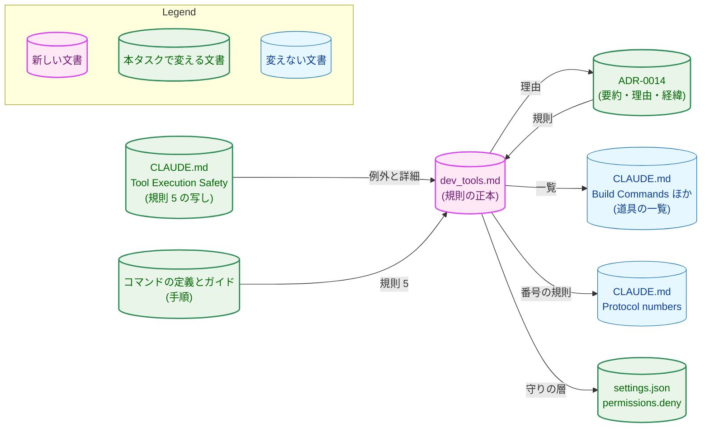
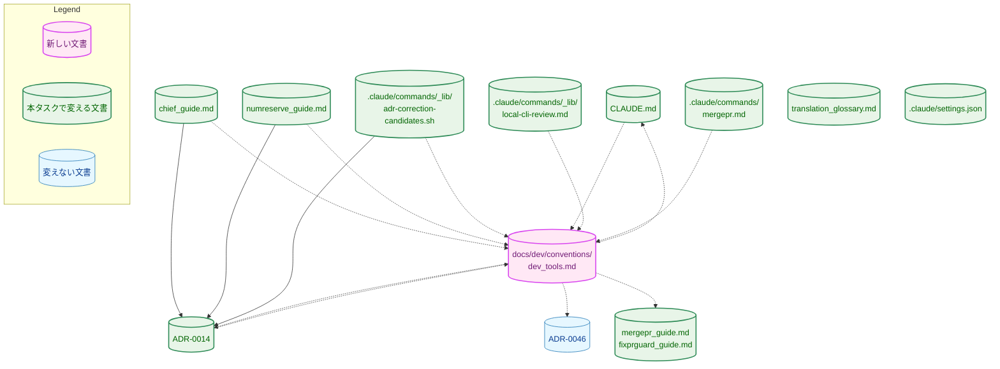
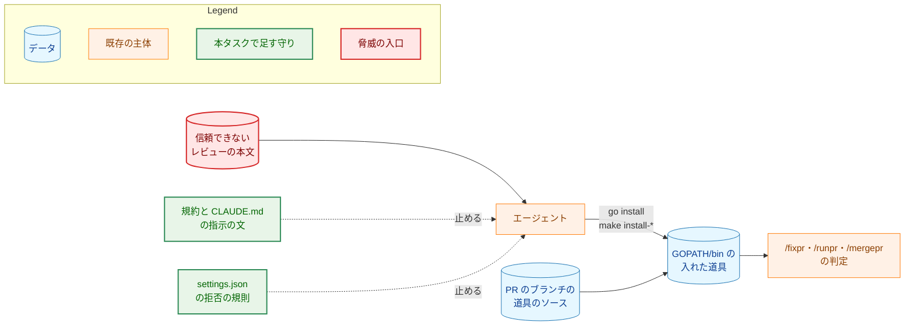
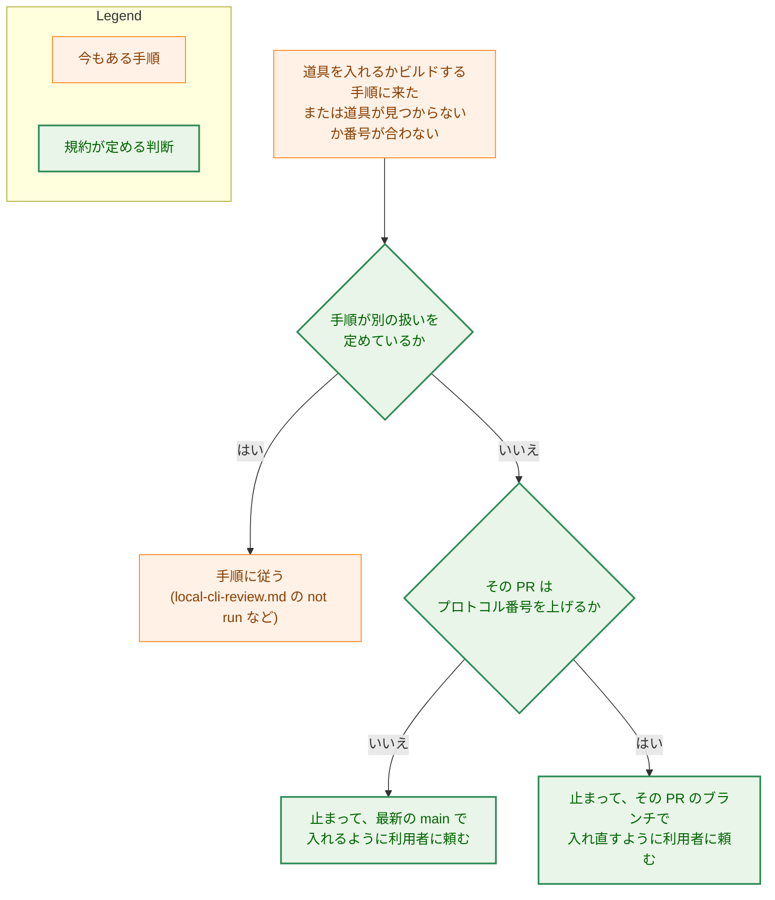

# アーキテクチャ設計書：開発の道具の規則を ADR-0014 から規約 dev_tools.md に移す

## Document Status

| Item | Value |
|---|---|
| Status | `draft` |
| Created | 2026-11-19 |
| Review date | - |
| Reviewer | - |
| Comments | - |

本書は [01_requirements.md](01_requirements.md) を設計に落とす。変更は文書と `.claude/settings.json` だけで、Go と TypeScript のコードは変えない。以下の `file:line` は、とくに断らない限りコミット `e43f8161`（`origin/main`）で確かめた。要件定義書の行番号はコミット `a73b2c4e` のものなので、`CLAUDE.md` などでは本書と行番号が違う。

## 1. 設計の全体像 (Design Overview)

### 1.1. 設計原則

-   **規則の正本は規約に 1 つだけ置く。** 規則 1〜6 の条件と手順は、新しい規約 `docs/dev/conventions/dev_tools.md`（英語）だけが持つ。ADR-0014 は、要約・理由・採らなかった案・経緯を持ち、規約の節を見出しの名前で指す（`docs/dev/conventions/adr.md`「Writing an ADR」）。
-   **写しは、届けるために置き、正本を指す。** `CLAUDE.md`「Tool Execution Safety」の項目は、Claude Code が毎回読み込む場所に置く規則 5 の写しであり、詳細は規約へのリンクで示す（1.3）。
-   **道具は種類で示し、名前の一覧は持たない。** 規約は「入れる道具」と「そのつどビルドする道具」の 2 つの種類を定義し、それぞれの一覧は `CLAUDE.md` の節を指す（H-01、H-06）。
-   **規則の内容は変えない。** 規約の各節は、ADR-0014 の対応する項目の条件を落とさず、広げない（AC-02）。ADR-0014 から外す文は、行き先を 1 文ずつ決める（3.2）。行き先のない文は外さない。
-   **既存の文書のテストが読む値と構造を変えない。** 直す箇所ごとに、それを読むテストと、テストが読む対象を確かめた（3.8）。

### 1.2. 設計の際に決めたこと（2026-11-19）

-   **道具の 3 つの用語の英語名を決め、`docs/translation_glossary.md` に 3 行を足す。** 「開発の道具」は development tool、「入れる道具」は installed tool、「そのつどビルドする道具」は per-run tool とする。2026-11-19 に人が選んだ。規約（英語）、`CLAUDE.md`、ADR-0014、ガイドに同じ概念が出るので、用語集を基準にして呼び方の揺れを防ぐためである（H-03）。用語集は japrose が日本語の用語を揃える基準でもある。
    -   採らなかった案：英語名を規約の中で定義するだけにし、用語集は変えない案。日本語の文書の側で呼び方が揺れても、照らす基準がない。
    -   ADR: なし。本タスクの中で閉じる用語の選択である。
-   **拒否の規則は、要件の AC-24 のとおり `Bash(make install-*)` と `Bash(go install *)` の 2 つとし、外部の道具の `go install` も拒むことを受け入れる。** 2026-11-19 に人が選んだ。`Bash(go install *)` は、`go install mvdan.cc/gofumpt@latest`（`Makefile:24`）や `go install golang.org/x/tools/cmd/deadcode@latest`（`Makefile:361`）にも当たる。この 2 つは利用者が一度入れれば `PATH` に残り、golangci-lint は `go run` で走るので（`Makefile:10`）、影響は小さいためである。人は最初、外部の道具を許可の規則で許すホワイトリストの形を提案した。しかし、Claude Code は拒否の規則を許可の規則より先に見るので、許可の規則で拒否の規則に穴を開けることはできない。そのため、この形は採れなかった。外部の道具をまとめて入れる make のターゲットは、別の issue で扱う（人が作る）。ターゲットの名前を `install-` で始めれば、`Bash(make install-*)` に当たるので、エージェントは走らせない。
    -   採らなかった案：このリポジトリの道具を指す形（`go install .*`、引数のない `go install`、モジュールのパス、`go install -*`）だけを拒む案。要件の AC-24 を変える決定の変更になり、規則の数が増えるうえ、前方一致で迂回できる点は変わらない。
    -   採らなかった案：広く拒み、外部の道具を許可の規則で許す案。上のとおり、Claude Code の規則の評価の順序で成り立たない。
    -   採らなかった案：外部の道具をまとめて入れる make のターゲットを本タスクで足す案。`Makefile` は要件の範囲外（2.3、AC-21）なので、要件定義書を `draft` に戻すことになる。
    -   ADR: なし。AC-24 が定め ADR-0014 が持つ拒否の規則の範囲を変えず、その帰結を記すだけである。

### 1.3. 概念モデル

図 1 は、規則 5 の正本と写しと理由の関係を示す。矢印 A → B は「A が B を指す（リンクするか、名前で示す）」を表す。

正本と写しの関係（H-04）を表にまとめる。

| 置き場所 | 持つもの | 役割 |
|---|---|---|
| `docs/dev/conventions/dev_tools.md` | 規則 1〜6 の条件と手順、道具の種類の定義 | 正本 |
| `docs/dev/adr/0014-deterministic-checks-in-go.md` | 規則の要約、理由、採らなかった案、結果、経緯 | 理由の正本 |
| `CLAUDE.md`「Tool Execution Safety」の新しい項目 | 規則 5 のうち、エージェントが入れない・ビルドしない・止まって頼むこと | 写し（Claude Code が毎回読み込む） |
| `CLAUDE.md`「Tool Execution Safety」の `codexreview`・`numreserve`・`chief` の文、`local-cli-review.md`、`numreserve_guide.md` | 道具ごとの「インストールもビルドもしない」 | 写し（その道具の手順の中で読まれる） |
| `.claude/settings.json` の `permissions.deny` | `make install-*` と `go install` の拒否 | 守りの層（Claude Code にだけ効く） |

写しを直すときは、正本を先に直す。この順序は規約の冒頭に書く（3.1）。

## 2. システム構成 (System Structure)

### 2.1. 全体構成

図 2 は、本タスクで変える文書と、それらの間の参照を示す。矢印 A → B は「A が B を指す」を表す。実線は今もある参照、点線は本タスクで足すか付け替える参照である。

`chief_guide.md`・`numreserve_guide.md`・`adr-correction-candidates.sh` から ADR-0014 への実線は、本タスクで規約への点線に付け替える（F-005）。`chief_guide.md:3` から ADR-0014 への参照は、決定とその理由を指すので残す（要件 2.3）。この参照は図には描かない。用語集と `settings.json` はほかの文書を指さないので、矢印がない。

### 2.2. コンポーネント配置

| 文書 | 言語 | 置き場所の理由 |
|---|---|---|
| `dev_tools.md` | 英語 | エージェントが従う規約なので、`docs/dev/conventions/` に英語で置く（`CLAUDE.md`「Document language」の原則 (b)） |
| ADR-0014 | 日本語 | 原則 (a) |
| ガイド 4 つ | 日本語 | 原則 (a) |
| `mergepr.md`、`local-cli-review.md`、`adr-correction-candidates.sh` | 英語 | 原則 (b) |

### 2.3. データの流れ

本タスクは実行時のデータの流れを変えない。規則が読み手に届く経路は、6 章の処理の流れで示す。

## 3. コンポーネント設計 (Component Design)

### 3.1. 規約 dev_tools.md の構成

規約は英語で書く。見出しの名前と各節が持つものを次の表に示す。ADR-0014 と他の文書は、この見出しの名前で節を指す（アンカーは使わない。`adr.md`「Links」）。文言は実装で決める。

| 見出し | 持つもの | 対応する AC |
|---|---|---|
| `# Development Tools` | 規約の範囲（開発の道具を足すか変えるときにエージェントが従う規則）。規則の理由は ADR-0014 にあることを、リンクで示す。正本はこの規約で、`CLAUDE.md`「Tool Execution Safety」などの写しを直すときは先にこの規約を直すこと | AC-01、AC-06 |
| `## Kinds of tools` | 「development tool」の定義（`cmd/<name>` と `internal/<name>` の組で、製品のバイナリに入らない）。「installed tool」の定義と、一覧のある場所（`CLAUDE.md`「Build Commands」の `make install-<name>`。導入の手順もそこにある）。「per-run tool」の定義と、一覧のある場所（`CLAUDE.md`「Test Commands」の `make coverage-compare` と「Extension Commands」の `make ext-coverage-compare`） | AC-03、H-01、H-06 |
| `## Rule 1: Write a tool in Go, with tests` | 規則 1 | AC-01、AC-02 |
| `## Rule 2: Do not read a decision's baseline back from a state file` | 規則 2。例外があることだけを書き、範囲は書かずに ADR-0014 と ADR-0046 へリンクする。保証の内容として `fixprguard_guide.md` の 7 章へリンクする | AC-04 |
| `## Rule 3: Enforce the order in the tool's code` | 規則 3。例（確認より前に build checks を動かさない、など）は書かず、`fixprguard_guide.md` の 7 章へリンクする | AC-02 |
| `## Rule 4: Arguments, output, and exit codes are a contract` | 規則 4。契約が書かれている場所の一覧（`CLAUDE.md` の「Build Commands」「Test Commands」「Development Notes」、`_context.md` の「Guard tool」の行、4 つのガイド） | AC-02 |
| `## Rule 5: Install tools from main; agents never install or build them` | 規則 5（下の表） | AC-05 |
| `## Rule 6: Exception: a side-effect-free record check may be a shell script` | 規則 6 の 4 つの条件 | AC-02 |
| `## Not covered here` | プロトコル番号の規則は `CLAUDE.md`「Protocol numbers」にあること（リンク） | AC-07 |

規則 5 の節は、次の段落からなる。

| 段落 | 持つもの | 出どころ |
|---|---|---|
| Who installs | 入れる道具は利用者が最新の `main` から入れ、道具を変えたマージの後に入れ直す。プロトコル番号を上げる PR では、その PR の `/runpr` の前に、利用者がその PR のブランチで入れ直す | ADR-0014 の `main` から入れる項目、要件 1 章 |
| What agents do not do | エージェントは入れる道具をインストールもビルドもしない。「build」の意味：道具を走らせるためのバイナリを作ること、またはソースから走らせること（`make install-<name>`、`go install`、`go build ./cmd/<name>`、`go run ./cmd/<name>`）。テストや lint のためのコンパイル（`make test`、`make lint`、`go test`、`go vet`）は含まない | 要件 1 章 |
| Development exception | 道具を開発するか調べるために、ソースからビルドして走らせてよい 3 つの条件（`PATH` の通った場所に置かない、手順の中で入れた道具の代わりに使わない、外に副作用を持つ走らせ方をしない）。走らせてよい例（テスト、`--help`、手元の入力やコピーに対する実行）と、含まない走らせ方。`CLAUDE.md`「Tool Execution Safety」のほかの規則は、この例外の中でも効く | 要件 1 章 |
| When a step needs a tool | 入れるかビルドする手順に来たとき、または道具が見つからないか番号が合わないためにコマンドが失敗したときは、作業を止めて利用者に頼み、実行するコマンドを示す。示すのは最新の `main` の作業ツリーで入れるコマンドで、PR のブランチで入れ直すように頼むのは、その PR がプロトコル番号を上げる場合だけである。手順が別の扱いを定めている場合はそれに従う（今は `local-cli-review.md` の手順 3 の `not run`） | 要件 1 章、AC-05 |
| Protocol numbers and the order of changes | `fixprguard` などは `--protocol` の番号で、呼び出す文書と道具の版を照合する。文書と道具を変える順序は、両方が動き続ける形にする（`fixprguard_guide.md` の 9 章）。番号の規則は `CLAUDE.md`「Protocol numbers」へリンクする | ADR-0014 の `main` から入れる項目 |
| Per-run tools | そのつどビルドする道具は、この節の対象でない | 要件 1 章 |
| The permission layer | Claude Code では `.claude/settings.json` が `make install-*` と `go install` を拒む。この拒否は守りの層の 1 つで、拒まれない形（`go build`、`go run`、拒否の規則が当たらない書き方）を許すものではない | 要件 F-006 |
| Links | `CLAUDE.md`「Tool Execution Safety」と「Protocol numbers」 | AC-05 |

最後の 2 つの段落を規約に置くのは、エージェントが「拒まれなかったので許されている」と読むのを防ぐためである。拒否の規則の中身の正本は `settings.json` そのもので、規約は形だけを述べる。

規約は、ADR-0024 と ADR-0019 の規則を持たない（issue #1014 の対象外）。規約は、道具の名前を一覧として持たない（AC-03）。規則の中の例（`fixprguard`、`local-cli-review.md` の手順 3）として名前を挙げることは、一覧ではないので妨げない。

### 3.2. ADR-0014 の書き直し

実装の PR は、ADR-0014 の「決定」のうち次の 7 つの項目を書き換える（AC-09、AC-10）。行番号は `e43f8161` の ADR-0014 のものである。

| 行 | 項目 | 書き換え後に残すもの | リンク先の節 |
|---|---|---|---|
| `:17` | 判定と副作用を持つ道具は Go で書く | 太字の要約、理由（テストで壊して確かめる）、何を決めるかの ADR とガイドへのリンク | Rule 1、Kinds of tools |
| `:18` | 基準値を読み返さない | 太字の要約、理由（ディスクの判定は書き換えられる） | Rule 2 |
| `:20` | 順序は道具のコードで強制する | 太字の要約、理由（手順の読み違いで境界が迂回されない） | Rule 3 |
| `:22` | 道具は `main` から入れる | 太字の要約、理由（古い道具が古い想定で黙って判定しない） | Rule 5 |
| `:23` | エージェントは入れない・ビルドしない（タスク 0112） | 太字の要約、理由（ブランチの判定で `main` の判定を迂回できる）、受け入れる危険の理由、拒否の規則を守りの層として置く理由（ADR-0046 と同じ理由） | Rule 5、`CLAUDE.md`「Tool Execution Safety」 |
| `:25` | 引数・出力・終了コードは契約 | 太字の要約、理由（契約が食い違うと境界が働かない） | Rule 4 |
| `:26` | 副作用のない判定のシェルスクリプトの例外 | 太字の要約、今ある 2 つのスクリプトと、`opus-review-decision.sh` の常設のテストが確かめる範囲の事実、理由、採らなかった案との違い | Rule 6 |

`:19`（chief の例外）、`:21`（TypeScript の補助）、`:24`（プロトコル番号）と、「背景」「採らなかった案」「結果」「経緯」は変えない（AC-10）。

**外す文の行き先（H-02）。** 外す文はすべて、規約の節か、すでにある正本にある。どこにもない事実は ADR に残す。

| 行 | 外す文 | 行き先 |
|---|---|---|
| `:17` | 今ある道具の名前の一覧（6 つ） | `CLAUDE.md`「Build Commands」「Test Commands」「Extension Commands」（規約の Kinds of tools が指す） |
| `:17` | `cmd/<名前>` と `internal/<名前>` の組、製品のバイナリに入らない | 規約の Kinds of tools と Rule 1 |
| `:17` | 導入手順は `CLAUDE.md`「Build Commands」にある | 規約の Kinds of tools |
| `:18` | 基準値と判定した集合はサブコマンドの出力として返し、次の呼び出しの引数で渡す | 規約の Rule 2 |
| `:18` | `fixprguard` は記録を書くが読み返さない、保証は `fixprguard_guide.md` の 7 章 | `fixprguard_guide.md` の 7 章（規約の Rule 2 が指す） |
| `:20` | 2 つの例（確認より前に build checks を動かさない、hooks や config が変わったら push しない） | `fixprguard_guide.md` の 7 章（規約の Rule 3 が指す） |
| `:20` | コマンドの定義に残るのは、呼ぶ順序と利用者への確認だけ | 規約の Rule 3 |
| `:22` | `make install-<名前>` の一覧、マージの後の入れ直し、プロトコル番号を上げる PR のブランチでの入れ直し | 規約の Rule 5（Who installs）と `CLAUDE.md`「Build Commands」 |
| `:22` | `coveragecompare` はそのつど一時ディレクトリにビルドして走らせる | 規約の Kinds of tools と Rule 5（Per-run tools）、`CLAUDE.md`「Test Commands」 |
| `:22` | `--protocol` の照合と、文書と道具を変える順序 | 規約の Rule 5（Protocol numbers and the order of changes） |
| `:23` | 「ビルドする」の意味、開発のための例外の条件、止まって頼むこと、手順が別の扱いを定める場合 | 規約の Rule 5 |
| `:23` | 「規則は…0112 要件定義書にある」と「（タスク 0112 の実装で足す）」 | 消す。規約へのリンクに置き換わり、拒否の規則は実装の PR で `settings.json` に入る |
| `:25` | 契約が書かれている場所の一覧 | 規約の Rule 4 |
| `:26` | 4 つの条件（置き場所、`origin/main` から取り出して走らせる、安全側、Go のテスト） | 規約の Rule 6 |

`:26` のスクリプトの一覧に `adr-correction-candidates.sh` が入っていないことは、本タスクでは変えない。このスクリプトは、自分は規則 1 の道具でも規則 6 の例外でもないとしている（`adr-correction-candidates.sh:62-66`）。これは規則 1 と規則 6 の範囲の食い違いに依っており、別の issue で扱う（要件 1 章）。

**「結果」の 1 文。** 「結果」の `:61` の「拒否の規則は、タスク 0112 の実装の PR が `.claude/settings.json` に足すまでは効かない」は、実装の PR のマージで、条件が満たされた文になる。AC-10 は「結果」を変えないとしているので、実装の PR では直さない。文は誤りにはならないので、後で直すかどうかは 9 章に残す。

**記録。** 7 つの項目の書き換えは、編集上の訂正（`adr.md`「Editorial corrections」の 1 つ目の種類）として記録する（AC-11）。訂正行は、文を写さずに自分の言葉で書き、`<` と `@` を含めない（I-03）。

### 3.3. CLAUDE.md の変更

`CLAUDE.md` は、次の 4 種類の箇所だけを変える（AC-18）。

| 箇所 | 変更 | AC |
|---|---|---|
| 「Quick Links」の「Development Guides」 | `[Development Tools](docs/dev/conventions/dev_tools.md)` の行を足し、要旨（開発の道具を足すか変えるときの規則、`main` から入れること、エージェントが入れないこと）を添える | AC-13 |
| 「Tool Execution Safety」 | 1 項目を足す（下） | AC-14 |
| 「Tool Execution Safety」の `codexreview`・`numreserve`・`chief` の文（`CLAUDE.md:1051-1052`・`:1060-1061`・`:1076-1077`） | 今の文を残し、開発のための例外があることを、規約へのリンクで添える | AC-23 |
| 「Protocol numbers」の「The merge checks it.」の項目（`CLAUDE.md:842-843` の「reinstall the tool from the branch」） | 入れ直すのは利用者であることを述べる形にする（たとえば「ask the user to reinstall the tool from the branch」） | AC-15 |

「Tool Execution Safety」に足す項目は、次を持つ。

-   エージェントは、入れる道具（installed tool）をインストールもビルドもしないこと。「ビルドする」の意味（バイナリを作ること、ソースから走らせること。テストや lint のためのコンパイルは含まない）。
-   入れるかビルドする手順に来たとき、または道具が見つからないか番号が合わないためにコマンドが失敗したときは、止まって利用者に頼むこと。示すのは最新の `main` の作業ツリーで入れるコマンドで、PR のブランチで入れ直すように頼むのは、その PR がプロトコル番号を上げる場合だけであること。手順が別の扱いを定めている場合（`codexreview` について `local-cli-review.md`）はそれに従うこと。
-   開発のための例外と詳細は、規約の Rule 5 へのリンクで示すこと。

項目は、道具を名前で並べない（H-01）。`numreserve task` のように、道具の呼び出しの形をコードスパンで書かない。`cmd/numreserve/docs_test.go:250-276` の `TestDocumentedInvocations` は、この節の呼び出しをすべて許可の規則と照らし合わせるためである（3.8）。

### 3.4. 道具を入れる手順の主語（F-004）

| 箇所 | 今の文 | 変更 | AC |
|---|---|---|---|
| `.claude/commands/mergepr.md:18-19` | 「Install it with `make install-mergepr` from an up-to-date `main` checkout.」 | 利用者が最新の `main` から入れること、エージェントはインストールもビルドもしないことを、規約へのリンクとともに述べる形にする | AC-17 |
| `docs/dev/guides/mergepr_guide.md:48` | 「その PR のブランチで再インストールし」 | 利用者がその PR のブランチで入れ直すことを述べる。同じ段落の「マージの直後に `main` から再インストールする」は直さない（要件 1 章） | AC-16 |
| `docs/dev/guides/mergepr_guide.md:286`（7 章の手順 5） | 「その PR のブランチで、その道具を `make install-<道具>` で入れ直す。」 | 利用者が入れ直すことを述べる | AC-16 |
| `docs/dev/guides/fixprguard_guide.md:54` | 「その PR のブランチで再インストールする。」 | 利用者が入れ直すことを述べる | AC-16 |
| `docs/dev/guides/chief_guide.md:30` | 「その PR のブランチで入れ直す。」 | 利用者が入れ直すことを述べる | AC-16 |
| `CLAUDE.md` の「Protocol numbers」 | 3.3 | 3.3 | AC-15 |

`mergepr_guide.md:48` は `--protocol 2` を文の中に書いている。`cmd/mergepr/docs_test.go` の `TestDocumentedProtocolMatches` は、ガイドの文の中の `--protocol N` まで読む（`cmd/mergepr/docs_test.go:53-60` のコメント）。そのため、直すのは主語の部分だけにし、`--protocol` を含む文は変えない。

### 3.5. 開発のための例外への参照（AC-23）

| 箇所 | 変更 |
|---|---|
| `CLAUDE.md` の 3 つの道具の文 | 3.3 |
| `.claude/commands/_lib/local-cli-review.md:91-93` | 「never install or build the tool」の文を残し、規約の Rule 5 の開発のための例外があること、その場合でも手順の中で入れた道具の代わりに使わないことを添える |
| `docs/dev/guides/numreserve_guide.md:11` | 「エージェントは道具を入れたりビルドしたりしない。」の後に、開発のための例外は規約の Rule 5 にあることを添える（参照の付け替えは 3.6） |

### 3.6. 参照の付け替え（F-005）

| 箇所 | 今の参照 | 変更後 | AC |
|---|---|---|---|
| `docs/dev/guides/chief_guide.md:22` | 「ADR-0014 の『道具は `main` からインストールして使う』」（リンクなし） | `../conventions/dev_tools.md` へのリンクと、Rule 5 の見出しの名前 | AC-19 |
| `docs/dev/guides/numreserve_guide.md:11` | `[ADR-0014](../adr/0014-deterministic-checks-in-go.md)` の「道具は `main` からインストールして使う」 | 同上 | AC-19 |
| `.claude/commands/_lib/adr-correction-candidates.sh:63-64` のコメント | `docs/dev/adr/0014-deterministic-checks-in-go.md puts in Go` | `docs/dev/conventions/dev_tools.md`（Rule 1）を名指す。コードは変えない | AC-20 |

### 3.7. 拒否の規則と用語集

**拒否の規則（F-006）。** `.claude/settings.json` の `permissions.deny` の最後に、次の 2 つを足す。ほかの規則は、並びも含めて変えない（AC-24）。

| 規則 | 拒む例 | 拒まない例 |
|---|---|---|
| `Bash(make install-*)` | `make install-chief`、`make install-fixprguard` | `make test`、`make lint`、`make coverage-compare BASE=x` |
| `Bash(go install *)` | `go install ./cmd/chief`、`go install`（引数なし）、`go install mvdan.cc/gofumpt@latest` | `go test ./...`、`go vet ./...`、`go build -o /tmp/x ./cmd/chief`、`go run ./cmd/chief --help` |

-   `go install *` は、末尾に空白のある前方一致の形にする。この形は、引数のない `go install` にも当たる。`cmd/chief/docs_test.go:320-341` の `matchesRule` が、この Claude Code の振る舞いをモデルにしている。`go install*` の形にすると、`go installer` のような別のコマンドにも当たる。
-   拒まない例のうち `go build` と `go run` は、開発のための例外があるので拒まない（要件 1 章）。
-   前方一致なので、`make -C . install-chief` や、`go` を絶対パスで書く形は当たらない。迂回できることは要件 4.2 で受け入れている。
-   外部の道具の `go install` も拒むことは、1.2 で受け入れた。

**用語集（H-03）。** `docs/translation_glossary.md` の用語の表の「ガードツール」の行の後に、次の 3 行を足す。

| 日本語 | English | 備考 |
|---|---|---|
| 開発の道具 | development tool | `cmd/<名前>` と `internal/<名前>` の組で作る、開発の手順のための Go の道具。製品のバイナリには入らない（`docs/dev/conventions/dev_tools.md`） |
| 入れる道具 | installed tool | 利用者が `make install-<名前>` で `main` から入れる開発の道具 |
| そのつどビルドする道具 | per-run tool | make のターゲットが、走らせるたびに一時ディレクトリにビルドする開発の道具 |

### 3.8. コンポーネントの責務と、読むテスト

実装の PR で変わるファイルは、次の表に限る（AC-21）。最後の列は、そのファイルの変更する箇所を読む既存のテストと、テストが読む対象である（H-05、H-07）。どのテストも、本設計の変更では読む値と構造が変わらないので、直す必要はない。

| ファイル | 責務 | 変更する箇所を読むテスト（読む対象） |
|---|---|---|
| `docs/dev/conventions/dev_tools.md`（新規） | 規則の正本 | `cmd/yt2column` の `TestInstructionDocPaths`（`docs/dev/` の下の文書のリンクがすべて解決すること、リンクの数） |
| `docs/dev/adr/0014-deterministic-checks-in-go.md` | 理由の正本 | `cmd/yt2column` の `TestADRRecords`（ADR の構造）、`TestInstructionDocPaths`（リンク） |
| `CLAUDE.md` | 一覧、規則 5 の写し、プロトコル番号 | `cmd/numreserve` の `TestDocumentedInvocations`（「Tool Execution Safety」の `numreserve` の呼び出し）、`cmd/yt2column` の `TestCodexMentionOnlyInRequestRow`（`@codex` を書かないこと）、`TestInstructionDocPaths` |
| `.claude/commands/mergepr.md` | `mergepr` の手順 | `cmd/mergepr` の `TestDocumentedProtocolMatches`・`TestDocumentedInvocationsParse`（`mergepr` の呼び出しと `--protocol`）、`TestProtocolToolsAgree`（`--protocol` で呼ぶ道具の集合） |
| `.claude/commands/_lib/local-cli-review.md` | ローカルの CLI レビューの手順 | `cmd/codexreview` の `TestDocumentedProtocolMatches`・`TestDocumentedInvocationsParse`・`TestNoDirectCodexInvocation`（`codexreview` の呼び出しと、`codex` を直接走らせないこと） |
| `.claude/commands/_lib/adr-correction-candidates.sh` | コメントの参照 | `cmd/yt2column` の `TestADRCorrectionCandidates`（スクリプトを走らせた結果。コメントは読まない） |
| `.claude/settings.json` | 拒否の規則 | `cmd/chief` の `TestSettingsDeniesPaneInput`・`TestSettingsDeniesWorktreeChanges`（`deny` が herdr と git worktree の規則を含むこと、`allow` の規則）、`cmd/codexreview` と `cmd/numreserve` の `TestSettingsAllowsTool`（`allow` の規則） |
| `docs/dev/guides/chief_guide.md` | 参照、主語 | `cmd/chief` の `TestGuideValuesMatchTool`（サブコマンドと終了コードの表、`プロトコル番号` の値、状態のディレクトリ） |
| `docs/dev/guides/numreserve_guide.md` | 参照、例外への参照 | `cmd/numreserve` の `TestGuideValuesMatchTool`（理由の語の表、番号の空間の表） |
| `docs/dev/guides/mergepr_guide.md` | 主語 | `cmd/mergepr` の `TestDocumentedProtocolMatches`（文の中の `--protocol N` を含む） |
| `docs/dev/guides/fixprguard_guide.md` | 主語 | `cmd/fixprguard` のガイドのテスト（表、停止の種類、範囲の規則など。3 章の箇条書きは読まない） |
| `docs/translation_glossary.md` | 用語 | なし |
| `docs/tasks/0112_dev_tools_convention/` | タスクの記録 | なし |

`.claude/settings.json` を読むテストは、`deny` については決まった規則を「含む」ことだけを確かめ、一覧が同じことは確かめない（`cmd/chief/docs_test.go:415-466`）。そのため、2 つの規則を足してもテストは通る。`internal/fixprguard/ignored_test.go` が読むのは `.claude/settings.local.json` で、`settings.json` ではない。

## 4. エラーハンドリング設計 (Error Handling Design)

コードを変えないので、エラーの型は足さない。

エージェントが止まって利用者に頼むときの伝え方を、規約の Rule 5 に次の形で定める。

-   どの道具が要るか、止まった理由（入れる手順に来た、道具が見つからない、番号が合わない）。
-   利用者が実行するコマンド。ふつうは最新の `main` の作業ツリーで `make install-<name>`。プロトコル番号を上げる PR だけは、その PR のブランチで実行する。
-   利用者が入れたあとに、エージェントがどこから作業を続けるか。

道具が出す誤りの文（たとえば `mergepr` の `--protocol is missing or does not match`）は変えない。

## 5. セキュリティ考慮事項 (Security Considerations)

`docs/dev/security.md` の条件（外部コマンドの起動、API キー、キャッシュ、ネットワーク、信頼できない文字列の埋め込み）には当たらない。開発の道具の信頼境界（[ADR-0015](../../dev/adr/0015-untrusted-review-threads.md)）に関わる守るもの・脅威・受け入れる危険は、要件 4.2 のとおりで、本設計はそれを変えない。

図 3 は脅威の経路と守りを示す。矢印 A → B は「A の結果が B に届く」を表す。

点線は、守りがエージェントの行動を止める関係を表す。拒否の規則は Claude Code にだけ効き、OpenCode には効かない。`go build` と `go run` は指示の文だけが止める。これらは要件 4.2 で受け入れた危険である。

## 6. 処理フローの詳細 (Processing Flow Details)

図 4 は、エージェントが道具を要する手順に来たときの判断の流れで、規約の Rule 5 が定める。矢印は判断の順序を表す。

開発のための例外（道具を変えるタスクでソースから走らせて確かめる）は、この流れの外にある。その例外は、手順の中で入れた道具の代わりに使わない場合に限られるためである。

## 7. テスト戦略 (Test Strategy)

-   **単体テスト:** 足さない。規約と各文書の文の意味は、文書のテストでは確かめない（`CLAUDE.md`「Testing Strategy」）。規約の文は PR のレビューで読む。実装の PR が変えてよいファイルはタスクのディレクトリを除いて文書と `settings.json` に限られ（AC-21）、テストのファイルを足せない。そのため、拒否の規則が後で消されたことを見つける常設のテストは足さない（9 章）。
-   **既存のガード:** 3.8 の表のテストが通ることを確かめる。`make test` はすべてを含む（AC-12、AC-25）。ステップごとの確かめでは、そのステップが変えるファイルを読むパッケージのテストを走らせる（I-04、計画で決める）。
-   **差分の確かめ:** 変わるファイルと箇所を限る AC（AC-10、AC-18、AC-21、AC-22）と、スクリプトのコメントだけが変わること（AC-20）は、`requirements_process.md` §4 の `diff` の確かめで記録する（I-02、計画で決める）。
-   **読んで確かめる:** AC-01〜AC-07、AC-09、AC-13〜AC-17、AC-19、AC-23 は、文の内容なので読んで確かめる。
-   **拒否の規則の形:** AC-24 は、`settings.json` に 2 つの規則があることと、3.7 の表の例が当たるか当たらないかを、タスクの `_checks/` のスクリプトか記録した読み取りで、一度だけ確かめる（計画で決める）。
-   **セキュリティのテスト:** 足さない。守りは指示の文と拒否の規則で、どちらも上で確かめる。

## 8. 実装の優先順位 (Implementation Priorities)

実装は 1 つの PR で行う（I-01、実装モデル要件は `sonnet`）。順序は次のとおりで、細かな分け方は計画で決める。

1.  規約 `dev_tools.md` と用語集の 3 行を作る。後のステップがリンクする先を先に作るためである。
2.  ADR-0014 の 7 つの項目を書き直す（編集上の訂正の記録を含む）。
3.  `CLAUDE.md` の 4 種類の箇所を直す。
4.  コマンドの定義・ガイド・スクリプトのコメントを直す（3.4〜3.6）。
5.  `.claude/settings.json` に拒否の規則を足す。
6.  差分の確かめを記録し、`make test` と `make lint` を走らせる。

## 9. 将来の拡張性 (Future Extensibility)

-   **道具を足すとき:** 規約は道具の名前を持たないので、規約を直す必要はない。`CLAUDE.md` の該当する節に `make install-<name>` の行を足せば、その道具は入れる道具になり、拒否の規則にも当たる。
-   **外部の道具をまとめて入れるターゲット:** 別の issue で扱う（1.2）。名前を `install-` で始めれば、拒否の規則がそのまま当たる。
-   **拒否の規則のガード:** 規則が後で消されても、今は気づけない。`cmd/chief` の `TestSettingsDeniesPaneInput` と同じ形のテストを足すことは、別の issue で検討できる。
-   **ADR-0014 の「結果」の 1 文:** 3.2 のとおり、実装の PR のマージ後に、条件が満たされた文が残る。直すなら、後の PR で編集上の訂正の 3 つ目の種類（古くなった参照）として直せる。
-   **規則 1 と規則 6 の範囲の食い違い:** 別の issue で扱う（要件 1 章）。

## 10. 設計への引き継ぎの扱い (Design Handoff)

| 項目 | 扱い |
|---|---|
| H-01 | 採る。規約の Kinds of tools（3.1）と `CLAUDE.md` の項目（3.3）は、道具を種類で示す |
| H-02 | 3.2 の「外す文の行き先」の表で、外す文ごとに行き先を決めた。どこにもない事実（`:26` のスクリプトの一覧など）は ADR に残す。`adr-correction-candidates.sh` の扱いは別の issue に残す |
| H-03 | 1.2 で英語名を決め、用語集に 3 行を足す（3.7） |
| H-04 | 1.3 の表で、正本・理由の正本・写し・守りの層を分けた。規約の冒頭で、写しを直すときは先に規約を直すことを定める（3.1） |
| H-05 | 3.8 の表で、直す箇所ごとに読むテストと対象を確かめた。`mergepr_guide.md` の `--protocol` を含む文は変えない（3.4）。`CLAUDE.md` の新しい項目は `numreserve` の呼び出しを書かない（3.3） |
| H-06 | 入れる道具は「Build Commands」、そのつどビルドする道具は「Test Commands」と「Extension Commands」を指す（3.1） |
| H-07 | 3.7 で規則の形と、拒む例と拒まない例を示した。3.8 で、`settings.json` を読むテストが `deny` を「含む」ことだけを確かめることを確かめた |
