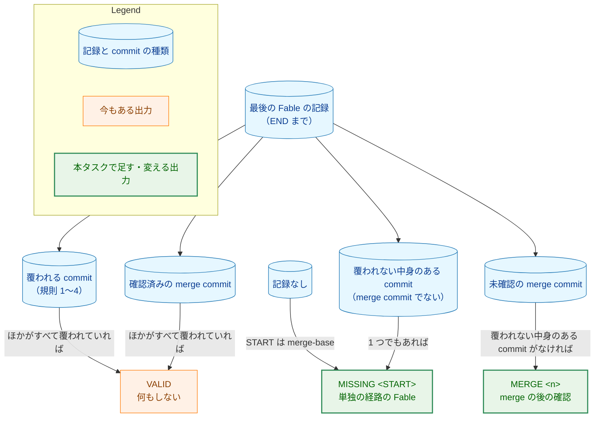
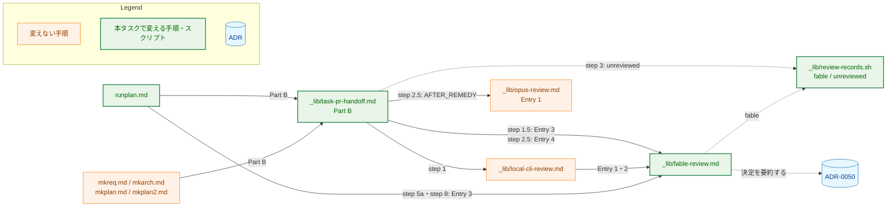
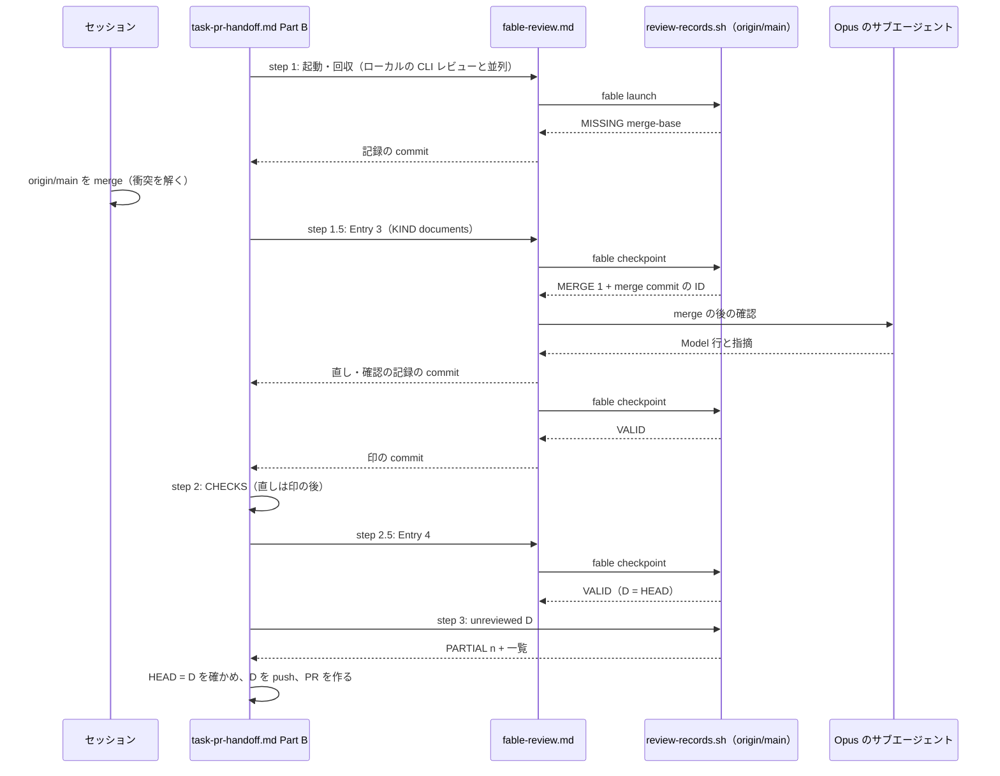
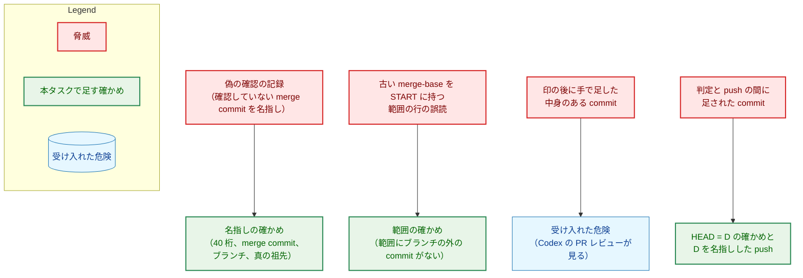
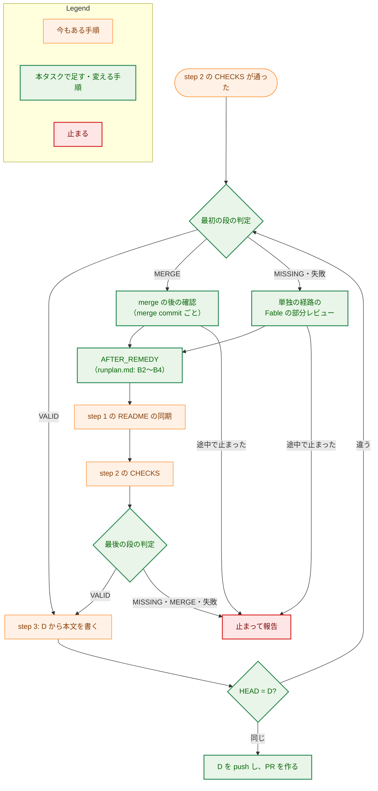

# アーキテクチャ設計書：Fable の部分レビューの記録の後、push の前にできた commit を、PR を開く前に確かめる

## Document Status

| Item | Value |
|---|---|
| Status | `draft` |
| Created | 2026-11-19 |
| Review date | - |
| Reviewer | - |
| Comments | - |

本書は [01_requirements.md](01_requirements.md)（要件定義書。以下、要件書）の設計である。既存のファイルの内容は、コミット `0051d3f4`（`origin/main`）で確かめた。`file:line` の行番号は、このコミットでの行番号である。F-NNN・AC-NN は要件書の項番を、H-NN は [design_handoff.md](design_handoff.md)（以下、申し送り）の項番を指す。申し送りへの対応は 10 章に、受け入れ基準との対応は付録 A にまとめる。

本書は、要件書 3.1 と 6 章の用語（タスクの PR・CHECKS の直し・push の直前・Fable の記録・記録の commit・有効かの判定・チェックポイントの印・中身のない commit・中身のある commit・merge の後の確認・merge の後の確認の記録・未確認の merge commit・単独の経路・merge-base）を、要件書と同じ意味で使う。そのほかに、次の用語を使う。

-   **判定のスクリプト:** `.claude/commands/_lib/review-records.sh`。`origin/main` から取り出して走らせる。
-   **ブランチ:** `origin/main..HEAD` の commit の集まり。判定のスクリプトの `BRANCH`（`review-records.sh:410`）である。
-   **END:** 最後の Fable の記録が見た範囲の終わりの commit（記録の行の `<END12>` が指す commit）。
-   **救済:** 有効かの判定が `VALID` でないときに行う、merge の後の確認か、単独の経路の Fable の部分レビュー（3.3.1）。
-   **判定した commit（D）:** push の直前の最後の判定が `VALID` を返したときの HEAD。push するのはこの commit である（AC-05）。

## 1. 設計の全体像 (Design Overview)

### 1.1. 設計原則

-   **有効かは、今のとおり判定のスクリプトだけが決める。** 記録を無効にする commit・無効にしない commit・merge の後の確認で数える merge commit・Fable を走らせ直す範囲の起点は、どれもスクリプトが commit のデータから決める。セッションは出力の 1 行目を読むだけで、手順の文を読んで決めない（ADR-0050「有効かの判定」、要件 4.5）。
-   **判定の失敗は、Fable を走らせる側に倒す。** 新しい出力の形（`MERGE`）も、形が違えば `MISSING <merge-base>` と読む。誤って有効と判定するより、Fable が PR の全体を見直す方を選ぶ（要件 4.2）。
-   **既存の入口を広げ、新しい入口は 1 つだけ足す。** タスク文書の PR の印は、`/runplan` のチェックポイントの入口（Entry 3）をそのまま使う。新しく足すのは、push の直前の入口（Entry 4）だけである。
-   **merge の後の確認は、Fable の部品を共有する。** 起動・待ち方・状態の確かめ・出力の確かめ・トリアージ・記録の commit は、Fable の部分レビューの単独の経路と同じ部品を使い、違うのはモデル・範囲・指示・記録の行だけにする（決定 3）。
-   **`/runpr` の関門は変えない。** `coverage` のモードの判定は変えない（要件 2.3）。PR の説明の一覧には、新しいモード `unreviewed` を使う（決定 2）。

### 1.2. 設計の際に決めたこと（2026-11-19）

人に問うて決めた項目（決定 1〜3、決定 11）と、要件と申し送りから設計が決めた項目（決定 4〜10）を挙げる。

-   **決定 1. merge の後の確認は、チェックポイントの入口でも走らせる。** 判定が `MERGE` を返したとき、チェックポイントの入口（`/runplan` の step 5a と step 8、タスク文書の PR の Part B step 1.5）でも merge の後の確認を走らせる。push の直前の入口は、その後にできた merge commit を扱う。`/runplan` では、チェックポイントの入口が green gate と「Before the PR」の B2（Opus のレビューの判断、`runplan.md:98`・`:290-292`）より前に走る。そのため、確認の直しが Opus のレビューの範囲に入り、Opus のレビューは 1 回で済む。push の直前だけで走らせると、確認が直したときに AC-09 で Opus のレビューの判断をやり直し、PR の全体に Opus のレビューがもう 1 回走りうる。人の答え：チェックポイントでも（推奨）。
    -   採らなかった案：push の直前だけで走らせる（要件の字面どおり）。上のとおり、Opus のレビューが 2 回走りうる。
    -   ADR：[ADR-0050](../../dev/adr/0050-fable-partial-review.md) を更新する（「`/runplan` のチェックポイント」と「merge commit の扱い」の項目）。確認を走らせる時点は、両方のタスクの PR と、Opus のレビューとの順序（[ADR-0042](../../dev/adr/0042-implementation-model-tiers.md)）を縛る。
-   **決定 2. PR の説明の「どちらの CLI もレビューしなかった commit」は、判定のスクリプトの新しいモード `unreviewed` で求める。** 規則（AC-16〜AC-19）は、スクリプトのヘッダーに置き、Go のテストで確かめる。今の規則は、セッションのレビューの SUMMARY・`not run` の行・Opus のレビューの直しを、セッションが組み合わせる（`task-pr-handoff.md:250-260`）。記録の後の commit を扱う文がないので、#987 では空の記録の commit まで挙がった。文の規則を広げても、AC-17 の「merge で merge-base が動いた後も、見た範囲の行を数える」はセッションが確かめられない。人の答え：スクリプトのモード（推奨）。
    -   採らなかった案：セッションの文の規則を、記録の後の commit まで広げる。テストで確かめられない。
    -   採らなかった案：`coverage` のモードに、START の確かめを緩める引数を足す。`/runpr` の関門のモードに、関門でない用途の分岐が入る。
    -   ADR：なし。[ADR-0014](../../dev/adr/0014-deterministic-checks-in-go.md) がすでに例外として認めている同じスクリプトに、副作用のない判定を 1 つ足すだけである。要件定義の際に決めたこと「PR の説明の一覧」の判断（ADR なし）も変えない。
-   **決定 3. merge の後の確認の手順は、`_lib/fable-review.md` に置く。** 新しい節「The merge check」を足し、Fable の部分レビューと同じ部品を共有する。有効かの判定の規則の正本も、このファイルにある（要件 4.5）。人の答え：fable-review.md（推奨）。
    -   採らなかった案：新しい `_lib/merge-check.md` に置く。共有する部品への参照が 2 つのファイルにまたがり、記録の行の表も 2 か所に分かれる。
    -   ADR：ADR-0050 を更新する（「手順の置き場所」の項目）。
-   **決定 4. タスク文書の PR の印は、チェックポイントの入口（Entry 3）を Part B step 1.5 で走らせて残す。** Part B step 1（ローカルの CLI レビュー、Fable の部分レビュー、README の同期）の後、step 2（CHECKS）の前に、Entry 3 を KIND `documents` で走らせる。Entry 3 は、記録が有効でなければ救済を行い、有効になってから印を残す（H-02）。救済を行わずに印だけ残す形は採らない。その形では、記録が有効でないときに印が残らず、push の直前の救済の後の CHECKS の直しで記録がまた無効になり、AC-06 で止まるためである。
    -   ADR：ADR-0050 の「記録の後の commit」がすでに決めている（要件定義の際に決めたこと「CHECKS の直しの見分け方」）。手段の選択で、決定を変えない。
-   **決定 5. 判定のスクリプトの `<ENTRY>` には、値を足さない。** push の直前の入口も `checkpoint` を渡す。`<ENTRY>` が選ぶのは、印の後の commit を無効にしない規則（規則 3）を当てるかどうかだけで、push の直前でもこの規則を当てる（AC-10、AC-11）。`MERGE` の出力は入口によらず同じで、読み方は呼ぶ側の入口が決める（3.3.1）。
    -   ADR：なし。スクリプトの引数の値の選択で、本タスクの中で閉じる。
-   **決定 6. 新しい出力 `MERGE <n>` を足し、未確認の merge commit を 1 行に 1 つ挙げる。** 形は、`coverage` の `PARTIAL <n>` に合わせる（3.1.1）。H-03 の案の `MERGE <merge commit の ID> ...`（1 行に並べる形）は採らない。1 行目の形の確かめが、数と行の数の照合で済むためである。
    -   ADR：なし。スクリプトの出力の形で、本タスクの中で閉じる。
-   **決定 7. merge の後の確認は、merge commit 1 つにつき 1 回走らせ、記録の行は merge commit を 40 桁の ID で名指しする。** 記録と push の間に merge commit が 2 つ以上できることは稀で、1 回に 1 つなら、記録の行が 1 つの merge commit だけを名指しでき、数え方が単純になる。40 桁にするのは、12 桁の接頭辞の解決（`resolve12`、`review-records.sh:220-234`）を通さずに、名指しした commit を一意に決めるためである（H-03、H-05）。
    -   採らなかった案：1 回の確認で、未確認の merge commit をまとめて見る。記録の行に merge commit の一覧を持たせることになり、読み方が増える。
    -   ADR：ADR-0050 を更新する（「merge commit の扱い」の項目に、名指しの単位を足す）。
-   **決定 8. merge の後の確認の待つ時間は 30 分、呼び直しは 1 回とする。** Fable の部分レビューと同じ値にし、起動と回収の部品をそのまま使う（`fable-review.md:146-206`）。上限は、Opus が返らないときに PR を開けなくなることを防ぐためのもので、範囲の小さい確認では、ふつうは数分で返る（H-05）。
    -   ADR：なし。定数の値の選択である。
-   **決定 9. 「手で解いた箇所」は `git show --remerge-diff` で求める。** 自動の merge の結果（衝突の印を含む）と merge commit の内容との差分を出すオプションである。2026-11-19 に、手元の git 2.50.1 で次のことを確かめた（作業ツリーの外の一時リポジトリ）（H-05）。
    -   衝突を手で解いた merge commit では、衝突の印を含む自動の結果から、解いた内容への差分が出る。
    -   衝突のない merge commit では、差分が何も出ない。
    -   衝突のない merge に、merge commit の中で手で足した変更は、差分として出る。
    -   利用者の git の設定で `log.showSignature` が有効だと、出力の先頭に署名の行が混じる。手順は `-c log.showSignature=false` を付けて走らせる。
    -   ADR：なし。merge の後の確認の範囲の求め方で、本タスクの中で閉じる。
-   **決定 10. push は、判定した commit を名指しして行う。** `git push origin <D>:refs/heads/<branch>` で D だけを送り、その後に `git branch --set-upstream-to=origin/<branch>` で上流を設定する。2026-11-19 に、手元の git 2.50.1 で次のことを確かめた（H-01）。
    -   commit の ID を送り元に書いた push は、その commit だけを送る。HEAD がその先に進んでいても送らない。
    -   この push では、`-u` を付けても上流が設定されない。
    -   この push で、追跡のブランチ `refs/remotes/origin/<branch>` は送った commit に更新され、その後の `--set-upstream-to` は通る。

    上流を設定し直すのは、Part A step 4 の `git switch -c <branch> origin/main` が上流を `origin/main` にしており、今の `-u` がそれを直しているためである。`runplan.md` の AFTER_CREATE（`git push`）も、上流を前提にする。
    -   ADR：なし。ADR-0050 の「push の直前の判定」の項目に「push するのは判定した commit である」がすでにあり、本決定はその手段である。
-   **決定 11. merge の後の確認の直しは、AC-30 の字面どおり、見た範囲の行（`Local CLI reviewed:`）の範囲に入るものだけを数える。** `Local CLI review: not run` の行の範囲は数えない。Fable の規則 2（`review-records.sh:99-103`）は `not run` の行の範囲も数えるので、扱いが違う。帰結として、チェックポイントの入口で確認が直しを作り、その直しを CodeRabbit CLI も Codex CLI もレビューできなかったときは、2 回目の判定が `MISSING` になって止まる（3.3.3）。止まった後の再開は範囲外である（要件 2.3）。どちらの CLI も走らないことは稀で、止まる側は安全な側である。2026-11-19 に人が選んだ。人の答え：字面どおり（推奨）。
    -   採らなかった案：Fable の規則 2 と同じく、`not run` の行の範囲も数える。AC-30 を変える決定の変更になり、要件定義書を `draft` に戻すことになる。
    -   ADR：なし。要件の決定（AC-30）のままで、決定を変えない。

### 1.3. なぜ今の仕組みでは足りないか

-   **判定が入口でしか走らない。** 今の手順は、有効かを、起動の入口（`fable-review.md:139`）とチェックポイントの入口（`fable-review.md:236`）でしか判定しない。その後、push（`task-pr-handoff.md:218`）までにできた commit は、判定されない。#987 では、記録の commit の後の merge commit が、Fable にも何にも見られないまま PR が開いた（要件 1 章）。入口を広げても、push の前の最後の commit は入口の後にできうるので、push の直前に判定を足すほかない。
-   **タスク文書の PR に印がない。** 規則 3（印の後の commit を無効にしない）は `checkpoint` の入口だけで効く（`review-records.sh:104-108`、`:547-562`）。タスク文書の PR では、CHECKS の直しが記録を無効にするので、push の直前に判定を足すと、CHECKS の直しのたびに Fable が走り直す。
-   **merge commit は、いつも記録を無効にする。** `review-records.sh:109` と `:566-573` は、merge commit をどの規則でも覆わない。merge commit だけのときに Fable より軽い確認で済ませる手段がない。
-   **merge で merge-base が動くと、記録が無視される。** 記録の START が古い merge-base のとき、`checked_range`（`review-records.sh:423`）が START を受け付けず、記録が無視される。Fable が PR の全体を見直す（要件 1 章の #987 の形）。
-   **merge の後の START が、記録によって分かれる。** START がブランチの commit の記録は残り、最初の覆われない commit の第 1 親が START になる（`review-records.sh:574-577`）。その範囲には、merge で入った `main` 側の変更が入る（AC-14）。
-   **PR の説明の一覧に、記録の後の commit の規則がない。** 今の規則（`task-pr-handoff.md:250-260`）はセッションのレビューの SUMMARY を使い、記録の後にできた commit を扱わない。`coverage` をそのまま使うと、merge で merge-base が動いた後は、START が古い merge-base の見た範囲の行が無視される（`review-records.sh:50-52`）。

### 1.4. 概念モデル

図 1 は、記録の後、push の前にできた commit が、有効かの判定の出力のどれにつながるかを示す。矢印 A → B は「A があると、判定は B を返しうる」を表す。上から順に当てはめ、最初に当たったものが出力になる。



-   **覆われる commit（規則 1〜4）:** 規則 1（中身のない commit）、規則 2（同じ実行の直し）、規則 3（印の後の commit。merge commit は除く）、規則 4（merge の後の確認の直し。3.1.2 で足す）のどれかに当たる、親が 1 つの commit。
-   **確認済みの merge commit:** merge の後の確認の記録が名指ししている merge commit（3.1.3）。
-   **START:** 記録の後に merge commit が 1 つでもあれば、merge-base である（AC-14）。なければ今のとおり、最初の覆われない commit の第 1 親である。

## 2. システム構成 (System Structure)

### 2.1. 全体構成

図 2 は、変わる手順とスクリプトの呼び出しの関係を示す。矢印 A → B は「A が B を呼ぶか、B の節を走らせる」を表す。点線は、`origin/main` から取り出したスクリプトを走らせることを表す。



-   **`opus-review.md` は変えない。** Part B step 2.5 の AFTER_REMEDY として、`runplan.md` が「Before the PR」の B2〜B4 を走らせるだけである（3.5.2）。
-   **`local-cli-review.md` は変えない。** 起動の入口が `MERGE` を `VALID` と同じに読むことは `fable-review.md` の中で閉じる（3.3.2）。救済の直しを確かめるローカルの CLI レビューは、今の単独の経路と同じ呼び方（RECORD `return`）である。

### 2.2. コンポーネント配置

| ファイル | 変更 | 受け持つこと |
|---|---|---|
| `.claude/commands/_lib/review-records.sh` | 変更 | `fable` のモード：出力 `MERGE`、規則 4、merge の後の確認の記録の読み方、ブランチの範囲の確かめ（AC-32）、START の決め方（AC-14）。新しい `unreviewed` のモード（AC-16〜AC-19） |
| `.claude/commands/_lib/fable-review.md` | 変更 | 入口の表、有効かの判定の出力の読み方、Entry 1 と Entry 3 の `MERGE`、Entry 3 の KIND と SELF_REJECTED、新しい Entry 4、新しい節「The merge check」、記録の行と読み方 |
| `.claude/commands/_lib/task-pr-handoff.md` | 変更 | 入力 FABLE・CHECKPOINT・AFTER_REMEDY、step 1.5（Entry 3）、step 2.5（Entry 4）、step 3 の push と PR の説明 |
| `.claude/commands/runplan.md` | 変更 | step 5a と step 8 の Entry 3 の `MERGE`、Part B の入力（FABLE・CHECKPOINT・AFTER_REMEDY）、B1 の文の直し |
| `docs/dev/adr/0050-fable-partial-review.md` | 変更 | 決定・採らなかった案・経緯（本 PR）、食い違いの文の解消（実装の PR） |
| `cmd/yt2column/review_records_test.go` | 変更 | 判定のスクリプトの新しい規則とモードのテスト、呼び出しの行と記録の行の形の読み取り（7 章） |

`mkreq.md`・`mkarch.md`・`mkplan.md`・`mkplan2.md` は変えない。どれも Part B を「task-document values」で呼んでおり、新しい入力の値は `task-pr-handoff.md` の「Inputs」が task-document command の値として定める（3.4.1）。

### 2.3. データフロー

図 3 は、タスク文書の PR の Part B で、記録の後に `origin/main` を merge したときの流れを示す。`/runplan` の PR では、step 1.5 の代わりに step 5a のチェックポイントの入口が走り、step 2.5 の AFTER_REMEDY で Opus のレビューの判断をやり直す（3.5）。



## 3. コンポーネント設計 (Component Design)

### 3.1. 判定のスクリプト：`fable` のモード（F-002、F-005、AC-10〜AC-15、AC-24、AC-27、AC-28、AC-30、AC-32、H-03）

`fable` のモードの引数（`fable <ENTRY> <HEAD> <PLAN>`）は変えない。変えるのは、出力の形、記録の範囲の確かめ、覆う規則、START の決め方である。規則の正本は、今のとおり `fable-review.md`「The validity decision」と、スクリプトのヘッダーの 2 か所に置く（要件 4.5）。

#### 3.1.1. 出力

| 出力 | 意味 | 呼ぶ側が行うこと |
|---|---|---|
| `VALID` | 最後の Fable の記録が有効で、未確認の merge commit もない | 何もしない |
| `MISSING <START>` | 記録がないか、merge commit でない覆われない commit がある。`<START>` は 40 桁 | 単独の経路の Fable の部分レビュー（`<START>..HEAD`） |
| `MERGE <n>` と、続く `<n>` 行の 40 桁の ID | 覆われない commit が未確認の merge commit だけである。ID は、`git rev-list --reverse --topo-order` の順（古い順） | 起動の入口では何もしない。チェックポイントと push の直前の入口では、merge commit ごとに merge の後の確認 |
| `MISSING`（1 行だけ）、終了コード 1 | 失敗 | `MISSING <merge-base>` と読む |

-   **`MERGE` の形の確かめ:** 呼ぶ側は、1 行目が `MERGE <n>`（`<n>` は 1 以上の 10 進数）で、その後にちょうど `<n>` 行の 40 桁の 16 進数が続き、ほかの行がないときだけ `MERGE` と読む。違えば、形の違う 1 行目と同じく `MISSING <merge-base>` と読む（`fable-review.md:100-103` の規則を広げる）。
-   **入口によらない出力:** スクリプトは、`<ENTRY>` によって出力の形を変えない。`<ENTRY>` が変えるのは規則 3 を当てるかだけである（決定 5）。

#### 3.1.2. 覆う規則

最後の Fable の記録（END と、記録を持つ commit H）について、`HEAD ^END ^origin/main` の commit を、`git rev-list --reverse --topo-order` の順に 1 つずつ見る。親が 1 つの commit は、次のどれかに当たれば覆われる。規則 1〜3 は今のままで、規則 4 を足す。

1.  **中身のない commit**（今の規則 1、`review-records.sh:95-98`）。
2.  **同じ実行の直し**（今の規則 2、`:99-103`）。範囲の行は、3.1.4 の確かめで読む。
3.  **印の後の commit**（今の規則 3、`:104-108`）。`<ENTRY>` が `checkpoint` のときだけ当てる。タスク文書の PR の印（Part B step 1.5）も、`/runplan` の印と同じ行 `Fable review: checkpoint` なので、規則は変えずに効く（AC-11）。
4.  **merge の後の確認の直し**（新規、AC-30）。ブランチのある commit Q が、merge commit M を名指しした確認の記録（3.1.3 の確かめを通るもの）を持つとき、次の 3 つをすべて満たす commit。
    -   M の子孫である（M 自身は含まない）。
    -   Q の祖先である（Q 自身を含む）。
    -   Q のメッセージの見た範囲の行（`Local CLI reviewed:`）の範囲に入る。範囲の行は 3.1.4 の確かめで読む。`Local CLI review: not run` の行の範囲は、AC-30 のとおり数えない（決定 11）。

merge commit（親が 2 つ以上）は、どの規則にも当たらない（今のとおり、`:109`）。merge commit は、3.1.3 の確認の記録で名指しされているときだけ「確認済み」とし、覆われない commit に数えない。

結果は次の順で決める。

-   覆われない、merge commit でない commit が 1 つでもあれば `MISSING <START>`。
-   そうでなく、確認済みでない merge commit があれば `MERGE <n>`。
-   どちらもなければ `VALID`。
-   記録がなければ、今のとおり `MISSING <merge-base>`。

> 規則 4 は、push の直前とチェックポイントの入口では、ふつう規則 3 と重なる。merge の後の確認は印の後に走ることが多く、その直しは印の後の commit として規則 3 にも当たる。規則 4 が単独で効くのは、印のない状態で確認が走ったとき（チェックポイントの入口が、印を残す前に確認を走らせたとき）である。

#### 3.1.3. merge の後の確認の記録の読み方（AC-27、AC-28）

確認の記録は、`origin/main..HEAD` の commit Q のメッセージの、行頭から始まる 1 行全体で、3.3.6 の `Merge check: run` か `Merge check: not run` の形に、正規表現で完全に一致するものである。名指しした ID M は、次のすべてを満たすときだけ数える。

-   40 桁の 16 進数で、commit を指す（`git cat-file -t` が `commit`）。
-   親が 2 つ以上ある（merge commit である）。
-   ブランチの commit である（`BRANCH` にある）。
-   Q の真の祖先である（Q 自身ではない）。

どれかを満たさない行は数えない（AC-27）。`not run` の行も、`run` の行と同じく数える（AC-28）。Fable の記録と違って「最後の記録」だけを読むのではなく、ブランチのすべての確認の記録を読む。merge commit ごとに別の記録を持つためである（決定 7）。

#### 3.1.4. ブランチの範囲の確かめ（AC-32）

今の `checked_range`（`review-records.sh:416-425`）は、START が merge-base かブランチの commit であることを求める（`:423`）。merge で merge-base が動くと、START が古い merge-base の記録はこの確かめを通らず、無視される。`fable` のモードと `unreviewed` のモード（3.2）では、START の条件を次のとおり広げる。ほかの条件（START と END が 1 つの commit に決まり ref を指さない、START が END の祖先、END が持つ commit の真の祖先、END がブランチの commit）は変えない。

-   **START の条件（広げた形）:** START が merge-base か、ブランチの commit であるか、または次の 2 つをともに満たす。
    -   START が `origin/main` から届く commit である。
    -   `git rev-list END ^START` のすべての commit がブランチの commit である（`origin/main` から届く commit を範囲に含まない）。

広げた分で読む記録は、merge の前の PR の commit だけを範囲に持つ記録である。その範囲は、merge の後もブランチの commit のままなので、Fable や CLI が見ていない commit を見たことにはしない。merge の後に作った範囲で、START が古い merge-base のものは、`main` 側の commit を含むので、今のとおり読まない（申し送り H-03）。

`coverage` のモードは、今の確かめ（`checked_range`）のまま変えない（要件 2.3、4.4）。

#### 3.1.5. START の決め方（AC-14）

`MISSING` の START は、次の順で決める。

-   記録がなければ merge-base（今のまま）。
-   `HEAD ^END ^origin/main` に merge commit が 1 つでもあれば（確認済みのものを含む）、merge-base。
-   そうでなければ今のとおり、最初の覆われない commit の第 1 親。それが merge-base でもブランチの commit でもなければ merge-base（`review-records.sh:574-577`）。

確認済みの merge commit があるときも merge-base にするのは、記録から範囲を決めると、範囲に merge で入った `main` 側の変更が入るためである（要件定義の際に決めたこと「Fable を走らせ直すときの範囲」）。

### 3.2. 判定のスクリプト：`unreviewed` のモード（F-003、AC-16〜AC-19、H-04、決定 2）

PR の説明の「どちらの CLI もレビューしなかった commit」を求める、新しいモードである。`/runpr` の関門の `coverage` とは別のモードにし、`coverage` を変えない。

```text
bash <records-script> unreviewed <HEAD> <PLAN>
```

| 引数 | 意味 |
|---|---|
| `HEAD` | 判定した commit D（40 桁） |
| `PLAN` | TASK_DIR の `03_implementation_plan.md`（リポジトリの相対パス。なくてもよい） |

| 出力 | 意味 |
|---|---|
| `ALL` | 挙げる commit がない |
| `PARTIAL <n>` と、続く `<n>` 行の `<12 桁の ID> <件名>` | `<n>` 個の commit を、古い順に挙げる |
| `PARTIAL`（1 行だけ）、終了コード 1 | 失敗 |

-   **挙げる commit:** `origin/main..HEAD` の commit のうち、次のどれでもないもの（AC-16）。
    -   空の commit（親が 1 つで、親との差分がない）。
    -   計画書の PR の進み具合のチェックボックスの行だけを変える commit（`coverage` の `checkbox_only`、`review-records.sh:280-302`）。
    -   見た範囲の行（`Local CLI reviewed:`）の範囲に入る、親が 1 つの commit。範囲の行は、3.1.4 の広げた確かめで読む（AC-17）。
-   **挙げる commit の例:** merge commit・CHECKS の直し・`README.en.md` だけを変える commit・Opus のレビューの直し・`not run` の範囲の commit は、どの CLI の見た範囲にも入らなければ挙がる（AC-16、AC-18）。単独の経路の直しで、そのローカルの CLI レビューが見たものは、その記録の commit の見た範囲の行に入るので挙がらない（AC-19）。
-   **`coverage` との違い:** 判定の範囲（Codex の最後の PR レビューより後ではなく、`origin/main..HEAD` の全体）と、見た範囲の行の START の確かめ（3.1.4）の 2 点だけである。中身のない commit の定義（空の commit とチェックボックスの commit。`README.en.md` だけの commit は挙げる）は `coverage` と同じにする（要件定義の際に決めたこと「PR の説明の一覧」）。
-   **失敗:** 呼ぶ側は、終了コードが 0 でないか、1 行目の形が違うとき、`origin/main..D` のすべての commit を挙げ、一覧を決められなかったと書く。挙げすぎる側に倒すのは、この一覧が、人が PR レビューを追加で頼むかの判断の材料だからである。

### 3.3. Fable の手順 `_lib/fable-review.md`（F-001、F-005、AC-01〜AC-08、AC-15、AC-24〜AC-31、H-01、H-05）

#### 3.3.1. 入口と有効かの判定

入口の表（`fable-review.md:15-19`）は、次の 4 つになる。

| 入口 | 呼ぶ側 | 行うこと |
|---|---|---|
| Entry 1: launch | `local-cli-review.md` step 1 | 今のまま。ただし `MERGE` は `VALID` と同じに読み、起動しない（3.3.2） |
| Entry 2: collection | `local-cli-review.md` step 4 | 今のまま |
| Entry 3: checkpoint | `runplan.md` step 5a・step 8、`task-pr-handoff.md` Part B step 1.5 | 判定し、有効でなければ救済を行い、もう一度判定して `VALID` なら印を残す（3.3.3） |
| Entry 4: pre-push | `task-pr-handoff.md` Part B step 2.5 | 判定し、有効でなければ救済を行う。呼ぶ側の再チェックの後、最後の判定をして D を返す（3.3.4） |

-   **救済:** 判定が `MISSING <START>` なら単独の経路（RANGE `<START>..HEAD`）を、`MERGE` なら挙がった merge commit ごとに、古い順に merge の後の確認（3.3.5）を行う。2 つは同時には起きない。`MISSING` は、未確認の merge commit があっても `MISSING` を返すためである（3.1.2）。
-   **有効かの判定の読み方:** `fable-review.md:94-106` に `MERGE` を足す（3.1.1）。取り出し方と走らせ方（`:88-92`）は変えない（AC-01）。
-   **入力:** Entry 3 と Entry 4 は、呼ぶ側から FABLE（KIND・TASK_DIR・SELF_REJECTED）を受け取る。今の Entry 3 は KIND `implementation` に固定している（`fable-review.md:45-47`）。`runplan.md` は KIND `implementation` を、Part B は呼んだコマンドの FABLE をそのまま渡す（3.4.1、AC-03）。

#### 3.3.2. Entry 1 の `MERGE`

起動の入口は、`MERGE` を `VALID` と同じに読み、Fable を起動しない。未確認の merge commit は、後のチェックポイントか push の直前の入口が、merge の後の確認で扱う。どちらかの入口が、push の前にかならず走るためである（3.4、3.5）。

#### 3.3.3. Entry 3: checkpoint の変更（決定 1、決定 4、AC-11、AC-13、AC-24）

1.  有効かの判定を、`<ENTRY>` `checkpoint` で走らせる。
2.  `VALID` でなければ救済を行い、もう一度判定する。2 回目が `VALID` でなければ、今の `MISSING` と同じく止まって報告する（`fable-review.md:237-243`）。判定が失敗したときは、スクリプトが標準エラーに書いたことも報告する。
3.  `VALID` なら、印の空の commit を作る（今のまま、`:244-248`）。

印の後に作る commit の一覧（`:245-248`）に、タスク文書の PR の Part B step 2 の CHECKS の直しと、step 2.5 の救済とその後の commit を足す。

#### 3.3.4. Entry 4: pre-push（新規、AC-01〜AC-08、AC-15、AC-24）

push の直前の入口は、2 つの段からなる。呼ぶ側（Part B step 2.5）は、2 つの段の間に、自分の再チェック（AFTER_REMEDY、README の同期、CHECKS）を走らせる（3.4.3）。

-   **最初の段:**
    1.  有効かの判定を、`<ENTRY>` `checkpoint` で走らせる（決定 5）。
    2.  `VALID` なら、D をそのときの HEAD として返す。救済も commit もしない（AC-02）。
    3.  `VALID` でなければ救済を行い、REMEDY = `done` を返す（AC-03、AC-24）。判定が失敗したときは `MISSING <merge-base>` として単独の経路を走らせる（AC-03）。
-   **最後の段:** 最初の段が救済を行ったとき、呼ぶ側の再チェックの後に走らせる。
    1.  有効かの判定を、もう一度走らせる。
    2.  `VALID` なら、D をそのときの HEAD として返す（AC-05）。
    3.  `MISSING` か `MERGE` か失敗なら、push せず、PR を開かずに止まる（AC-06）。報告には、止まった理由、判定の出力の 1 行目、失敗のときは標準エラーに書かれたこと、今の HEAD、止まるまでに作った commit（`git log --format='%h %s' <最初の段の HEAD>..HEAD`）を含める。

救済の途中で止まったとき（作業ツリーの確かめ、状態の確かめ、メンションの確かめ、ローカルの CLI レビューが止まったとき）も、push せずに止まり、止まった理由、今の HEAD、作った commit を報告する（AC-08）。Fable が走らない（`not run`）ときと、merge の後の確認が走らないとき（`not run`）は、止めずに記録して進む（AC-07、AC-28）。

> Entry 4 は救済を 1 回だけ行う。最後の段で `VALID` でなければ止まり、もう一度は救済しない。救済の後に有効でなくなるのは、救済の途中で merge commit や手作業の commit が足されたときで（AC-15）、もう一度救済しても同じことが起きうるためである。止まった後の再開は、本タスクの範囲外である（要件 2.3）。

#### 3.3.5. merge の後の確認（新しい節「The merge check」、F-005、AC-24〜AC-31、H-05、決定 3・7・8・9）

merge の後の確認は、merge commit M 1 つについて、単独の経路（`fable-review.md:208-232`）と同じ流れで行う。違うのは、範囲の一覧、モデル、指示、出力の確かめ、記録の行である。

| 部品 | Fable の部分レビュー | merge の後の確認 |
|---|---|---|
| モデル | Agent ツールの `model` `fable` | `model` `opus`。`fork` の種類は使わない |
| 範囲 | RANGE の差分の、4 つの基準に当たる箇所 | M の、手で解いた箇所と、`main` から入った文書を参照する箇所（下の「範囲の一覧」） |
| 呼べないとき | `not run agent-cannot-call` | `not run agent-cannot-call`（OpenCode で動く `/runplan` など） |
| 待つ時間・呼び直し | 30 分、1 回 | 30 分、1 回（決定 8）。部品は `fable-review.md:146-206` をそのまま使う |
| 状態の確かめ | 起動の前・出口・出口の後 | 同じ（AC-29、`fable-review.md`「The state check」） |
| 指示の制約 | 「The prompt」の Constraints | 同じ（AC-29） |
| モデルの確かめ | `Model: claude-fable-[a-z0-9.-]{1,48}` | `Model: claude-opus-[a-z0-9.-]{1,48}`。違えば `not run not-opus`。ほかのモデルで代えない（AC-25） |
| 出力の形 | `No findings.` か、4 行の指摘の塊 | 同じ形。`Criterion` の値だけが違う（下の「指示」） |
| トリアージ・直し | `local-cli-review.md`「Triage rules」 | 同じ（AC-30） |
| 直しの確かめ | ローカルの CLI レビュー（RECORD `return`） | 同じ（AC-30） |
| 記録の commit | 空の commit に、範囲の行と Fable の行 | 空の commit に、範囲の行と merge の後の確認の行（3.3.6） |

-   **範囲の一覧:** セッションが、M について次の 2 種類の箇所を挙げる（AC-26）。
    -   **`resolution`（手で解いた箇所）:** `git -c log.showSignature=false show --remerge-diff --format= <M>` の差分の塊ごとに、`<path>:<start>-<end>`（M の木での行）。差分がなければ、この種類の箇所はない（決定 9）。
    -   **`main-reference`（`main` から入った文書を参照する箇所）:** まず、`git diff --name-only <M>^1...<M>^2` で、merge で `main` から入った変更のうち、`docs/dev/adr/`・`docs/tasks/`・`.claude/commands/` の下のファイルを挙げる。次に、PR が変えたファイル（`git diff --name-only <merge-base>..HEAD`）の中で、それらのファイルのパス、ファイル名、ADR の番号（`ADR-NNNN`）、タスクの番号（タスクのディレクトリの `NNNN`）を参照する箇所を、検索で挙げる。
    -   **どちらもないとき:** 確認を走らせ、当たる箇所がないことを確かめさせる（AC-26）。サブエージェントには、`main` から入った文書の一覧も渡す。
-   **範囲を求められないとき:** `git show --remerge-diff` か `git diff` が失敗したら、確認を走らせず `not run scope-error` と記録する。走らないときを止めずに記録して進む扱い（AC-28）を、範囲を求める git の失敗にも当てはめる。
-   **指示:** 「The prompt」（`fable-review.md:271-328`）に倣い、自己完結した指示を作る。
    -   **役目:** `resolution` の箇所では、merge の両側の意図が失われず、解き方が両側の文書やコードと食い違っていないかを確かめさせる。`main-reference` の箇所では、PR の文書やコードが、`main` で変わった ADR・タスク文書・コマンドの定義と食い違っていないかを確かめさせる。一般の正しさのレビューはさせない（Opus のレビューと Codex の PR レビューの役目である）。
    -   **範囲:** M の ID と、`git show --remerge-diff` と `git diff <M>^1...<M>^2` を自分で走らせる指示、範囲の一覧。
    -   **外した箇所:** `main` から入った文書の一覧。一覧の箇所の外で、それらを参照する箇所を見つけたら、`exclusion-error` として指摘させる。
    -   **制約:** Fable の指示の Constraints と同じ（AC-29）。
    -   **出力の形:** 1 行目は `Model: <model-id>`。2 行目からは、Fable と同じ 4 行の塊で、`Criterion` は `resolution`・`main-reference`・`exclusion-error` のどれかである。指摘がなければ `No findings.` だけを書く。
-   **出力の確かめ:** Fable の「Checking the output」（`fable-review.md:330-357`）の 1〜3 を、モデルの確かめの正規表現と `Criterion` の値を替えて当てはめる。出力は信頼しない入力で、出力の文はコミットメッセージにも PR の説明にも写さない（要件 4.2、AC-31）。
-   **記録の commit:** 単独の経路の step 4（`fable-review.md:224-229`）と同じく、空の commit に、直しのローカルの CLI レビューが返した範囲の行と、merge の後の確認の行を書く。その前に、メンションの確かめと、出口の後の状態の比較を行う。

#### 3.3.6. 記録の行（AC-27、AC-28、AC-31）

「Record lines」の表（`fable-review.md:444-451`）に、次の 4 行を足す。`<MERGE>` は M の 40 桁の ID である。

| 行 | 形 |
|---|---|
| `Merge check: run` | `Merge check: run <MERGE> (model <model-id>; fixed <n>, rejected <n>, deferred <n>, unclear <n>, invalid <n>; <seconds>s, tokens <tokens>)` |
| `Merge check: not run` | `Merge check: not run <MERGE> (<reason>[; <seconds>s, tokens <tokens>])` |
| `Merge check scope:` | `Merge check scope: <location> (<criterion>)` |
| `Merge check finding:` | `Merge check finding: <location> criterion=<criterion> severity=<severity> handling=<handling>[ (<reason>)][: <summary>]` |

-   **`<reason>`（not run）:** `unavailable`（エラーか利用上限が 2 回）・`timeout`・`not-opus`・`unreadable`・`agent-cannot-call`・`scope-error`（範囲を求める git が失敗した）。Fable の `no-target` はない。当たる箇所がないときも確認を走らせるためである（AC-26）。
-   **`<criterion>`:** 範囲の行では `resolution` か `main-reference`。指摘の行では、それに `exclusion-error` と `unreadable` を加える。
-   **`<location>`・`<severity>`・`<handling>`・`<summary>`・`<reason>`（指摘）:** Fable の行の同じ値（`fable-review.md:486-509`）と同じ規則で、セッションが確かめた値と自分の言葉で書く。
-   **接頭辞:** `Merge check:`・`Merge check scope:`・`Merge check finding:` は、既存の記録の行の接頭辞（`local-cli-review.md` step 7 の表と、`opus-review.md`「Record lines」）のどれとも重ならず、互いにも、一方が他方の前につながる形にならない。`TestRecordLinePrefixesDistinct` が `fable-review.md`「Record lines」の表から読むので、表に足せば確かめに入る（7 章）。
-   **読み方:** 「Reading the record lines」（`fable-review.md:527-546`）に、merge の後の確認の行は Fable の記録ではないこと、Fable の記録の読み方とローカルの CLI レビューの行の読み方を変えないことを足す。`/runpr` のマージの質問の要約（`runpr.md:1343-1383`）は Fable の記録だけを読むので、変わらない（要件 2.3）。

### 3.4. `_lib/task-pr-handoff.md`（F-001、F-003、AC-01〜AC-09、AC-16〜AC-20、AC-31、H-01、H-02、H-04）

#### 3.4.1. 入力

| 入力 | タスク文書のコマンド | `runplan.md` | 意味 |
|---|---|---|---|
| FABLE（新規） | KIND `documents`、TASK_DIR、SELF_REJECTED | KIND `implementation`、TASK_DIR、SELF_REJECTED（このセッションの step 7・7.5 が却下した指摘。ないときは空） | step 1.5 と step 2.5 が Entry 3 と Entry 4 に渡す。step 1 の FABLE（`task-pr-handoff.md:184-197`）は、これを渡す形に変える |
| CHECKPOINT（新規） | `run` | `done` | `run` なら step 1.5 で Entry 3 を走らせる。`done` は、呼ぶ側がすでに Entry 3 を走らせたことを表す（`runplan.md` step 5a・step 8） |
| AFTER_REMEDY（新規、任意） | なし | 3.5.2 | step 2.5 の最初の段が救済を行ったときに、再チェックの前に走らせること |

-   **LOCAL_REVIEW と CHECKPOINT を分ける理由:** どちらも、今はタスク文書のコマンドと `runplan.md` で値が分かれる。しかし、意味が違う（ローカルの CLI レビューを走らせるか、印を残すか）。1 つの入力で 2 つの意味を選ぶと、片方を変えたい呼び出しが出たときに、両方が動くためである。

#### 3.4.2. step 1.5: 印（新規、決定 4、AC-11、AC-12）

step 1（README の同期を含む）の後、CHECKPOINT が `run` なら、`fable-review.md` の Entry 3 を FABLE で走らせる。止まったら、何も push しない。CHECKPOINT が `done` なら何もしない。

#### 3.4.3. step 2.5: push の直前の判定（新規、AC-01〜AC-09）

step 2（CHECKS）の後、step 3 の push の前に、次を行う。

1.  Entry 4 の最初の段を FABLE で走らせる。`VALID` なら D を受け取って step 3 に進む。
2.  救済を行ったときは、次の順で再チェックする。
    1.  AFTER_REMEDY（`runplan.md` では Opus のレビューの判断のやり直し、AC-09）。
    2.  step 1 の README の同期（AC-04）。
    3.  step 2 の CHECKS（AC-04）。ここでの直しは印の後の commit なので、記録を無効にしない（AC-10、AC-11）。
3.  Entry 4 の最後の段を走らせる。`VALID` なら D を受け取って step 3 に進む。止まったら、止まった内容を REPORT に書いて止まる（AC-06）。

step 2.5 の前の CHECKS の直しは、step 1.5 の印の後にあるので、最初の段の判定で記録を無効にしない（AC-11）。

#### 3.4.4. step 3: PR の説明と push（AC-05、AC-16〜AC-20、AC-31、決定 2・10）

-   **本文を読む範囲:** 本文の記録の行（Fable の行、ローカルの CLI レビューの行、訂正の行）は、`origin/main..HEAD` ではなく `origin/main..<D>` から読む。step 2.5 の後に commit は作らないので、ふつうは同じ範囲である。
-   **どちらの CLI もレビューしなかった commit:** 今の文（`task-pr-handoff.md:250-260`）を、判定のスクリプトの `unreviewed` のモードを `<HEAD>` = D で走らせ、`PARTIAL` の一覧を挙げる形に置き換える（3.2）。取り出し方は、有効かの判定と同じ 3 行で、3 行目を `bash <records-script> unreviewed <HEAD> <PLAN>` にする。`runplan.md` の「Opus のレビューの直しを足す」文と、「セッションの SUMMARY の範囲だけを挙げる」文は要らなくなる。スクリプトが、見た範囲の行に入らない commit をすべて挙げるためである。
-   **Fable の部分レビューの節:** 今のまま、`origin/main..D` の Fable の行から書く。単独の経路の記録も、別の記録として並ぶ（AC-20）。
-   **merge の後の確認の節（新規）:** 見出し `## merge の後の確認` を足し、merge の後の確認の記録ごとに、走ったか（`not run` ならその理由）、名指しした merge commit（12 桁）、範囲の箇所とその種類、直した指摘の数、却下・`deferred`・`unclear` の指摘を、場所とセッションの要約で示す（AC-31）。確認の記録がなければ、この節は置かない。行を写す `<details>` の塊は作らない。後から行を集める用途（ADR-0050 の「記録」、#936）は、Fable の部分レビューのためのものだからである。
-   **push:** 題名と本文のファイルを書き、メンションの確かめとラベルの読み取りを終えた後、push の直前に `git rev-parse HEAD` が D と同じかを確かめる。違えば、step 2.5 の 1 に戻る（AC-05）。同じなら、`git push origin <D>:refs/heads/<current-branch>` と `git branch --set-upstream-to=origin/<current-branch>` を走らせ、その後に `gh pr create` を走らせる（決定 10）。
    -   **AC-05 の「最後の手順」との関係:** 判定の後、push までに行うのは、D から題名と本文を書くこと、ラベルを読むこと、HEAD が D かを確かめることだけで、どれも commit を作らない。D を名指しして push するので、確かめの後にできた commit は送られない。
    -   **step 番号:** 新しい手順を 1.5 と 2.5 にし、今の step 2〜7 の番号は変えない。ほかの文書（`runplan.md`・`runpr.md`・`local-cli-review.md`・`fable-review.md`）が `Part B step 2`・`Part B step 3` と書き、`codex_review_docs_test.go:75-77` が step 3 と step 4 の書き出しで節を探すためである。

### 3.5. `runplan.md`（AC-09、AC-13、AC-18、決定 1）

#### 3.5.1. step 5a と step 8 のチェックポイントの入口

Entry 3 が `MERGE` で merge の後の確認を行うことを、`runplan.md:98` の段落に足す（決定 1）。確認の直しと記録の commit は、印の前にできる。その後の green gate と「Before the PR」が、それらを範囲に含めて走る。

#### 3.5.2. Part B の入力と AFTER_REMEDY（AC-09、H-06）

Part B の呼び出し（`runplan.md:116-132`）に、FABLE（KIND `implementation`）、CHECKPOINT `done`、AFTER_REMEDY を足す。AFTER_REMEDY は、今の「Part B step 2 が除外できない commit を作ったとき」の文（`runplan.md:106-118`）と同じことを行う。

-   **やること:** `git fetch origin main` の後、「Before the PR」の B2（`opus-review.md` の Entry 1）を新しい HEAD で走らせる。`RUN` なら B3 と B4 を走らせ、空の commit に新しい done の記録を書き、PR_TEXT の Opus のレビューの結果を新しくする。
-   **いつも走らせる理由:** 救済を行ったときは、救済の直しか、merge commit か、救済の記録の commit が、Opus のレビューの判断の後にできている。Entry 1 は、done の記録の後の commit がすべて除外できる commit なら `SKIP` を返し（`opus-review.md:206-209`）、merge commit は除外できない commit である（`opus-review.md:102-104`）。そのため、救済の後に Entry 1 を走らせれば、判断をやり直すべきときだけ `RUN` になる。AC-09 の例（Opus のレビューの後に merge し、確認が何も直さなかった）でも、merge commit が除外できないので `RUN` になる。
-   **merge の後の確認と Opus のレビューの重なり（H-06）:** 救済が merge の後の確認で、AFTER_REMEDY が `RUN` を返すと、同じ merge を 2 つの Opus のサブエージェントが見る。これを受け入れる。役目が違い（merge の後の確認は衝突の解決と文書の整合、Opus のレビューは正しさと弱いモデルの失敗）、確認の結果を Opus のレビューに渡す仕組みを足すほどの頻度がないためである。チェックポイントより前の merge は、決定 1 により Opus のレビューより前に確認されるので、重なるのは、チェックポイントの後に merge したときだけである。

#### 3.5.3. B1 と step 5a の文の直し

`runplan.md:279-280` の「Part B step 3 gives the ranges of the `not run` lines」と、`runplan.md:122` の「give that review's SUMMARY to Part B step 3」は、3.4.4 の `unreviewed` のモードに置き換わる。どちらも、Part B step 3 がスクリプトで一覧を求めることを指す文に直す。

### 3.6. ADR-0050（F-004、AC-21、AC-22）

本 PR は、ADR-0050 を次のとおり更新する。要件の PR（#1041）がすでに足した決定と食い違いの文は保ち、設計で決めた点だけを足す。

-   **「決定」:**
    -   「push の直前の判定」に、チェックポイントの入口でも判定が `MERGE` なら merge の後の確認を行うこと（決定 1）を足す。
    -   「merge commit の扱い」に、確認を merge commit ごとに行い、記録が 1 つの merge commit を名指しすること（決定 7）を足す。
    -   「`/runplan` のチェックポイント」の「印より後の merge commit も…push の直前の判定で見つかる」に、チェックポイントの入口の判定でも見つかることを足す。タスク文書の PR の印も同じ入口で残すことを足す（決定 4）。
    -   「手順の置き場所」に、merge の後の確認と push の直前の入口を `_lib/fable-review.md` に置くこと（決定 3）を足す。
    -   食い違いの文（`0050-fable-partial-review.md:40`）に、チェックポイントの入口での確認がまだ入っていないことを足す。文は #988 の実装の PR で消す。
-   **「採らなかった案」:** 決定 1 と決定 3 の採らなかった案を、理由とともに足す（AC-22）。
-   **「経緯」:** 本書へのリンクを持つ 1 行を、末尾に足す（AC-22）。
-   **0098 の文書:** 変えない（AC-23）。

### 3.7. 既存のテストへの影響

| テスト | 影響 |
|---|---|
| `TestReviewRecordsFable`（`review_records_test.go:1146`）の `fableCases` | 次の 2 件の期待する出力が変わる。「record from a merge-base origin/main moved past」（`:948-956`）は `MISSING <merge-base>` から `MERGE 1` に、「merge after the record」（`:1007-1014`）は `MISSING HEAD^1` から `MERGE 1` になる。ほかの merge の件（「parent of the first missing commit behind the merge-base」`:930-946`）は、覆われない commit があるので `MISSING <merge-base>` のまま |
| `readFableForms`（`:735-749`） | merge の後の確認の行の形も読む |
| `TestReviewRecordsCallSite`（`:1234-1260`） | `bash <records-script> unreviewed <HEAD> <PLAN>` を、許す呼び出しの行に足す。Part B step 3 にその 3 行の並びがあることを確かめる箇所を足す |
| `TestReviewRecordsMode`（`:715-725`） | 大文字の `Unreviewed` も失敗することを確かめる |
| `TestRecordLinePrefixesDistinct`（`:1318-1360`） | 表に足す行がそのまま入る。下限の数（`len(fablePrefixes) < 3`）は変えなくてよい |
| `TestRecordCommitsCheckMention`（`:1365-1389`） | 「The merge check」の節を、確かめる箇所に足す |
| `codex_review_docs_test.go:75-77` | step 3 と step 4 の書き出しを変えないので、影響しない（3.4.4） |

## 4. エラーハンドリング設計 (Error Handling Design)

新しい Go のエラー型はない。失敗の扱いは手順とスクリプトの出力で定める。

| 失敗 | 扱い | 根拠 |
|---|---|---|
| 判定のスクリプトが失敗した（取り出せない、終了コードが 0 でない、1 行目の形が違う、`MERGE` の行の数が合わない） | 起動・チェックポイントの最初の判定・push の直前の最初の段では `MISSING <merge-base>` と読む。チェックポイントの 2 回目の判定と push の直前の最後の段では、止まって標準エラーの内容を報告する | AC-01、AC-03、AC-06 |
| Fable が走らない | `not run <reason>` と記録して進む | AC-07 |
| merge の後の確認が走らない（呼べない、エラー、利用上限、時間切れ、Opus でない、読めない出力、範囲を求める git の失敗） | `not run <reason>` と記録して進む。merge commit は確認済みに数える | AC-28 |
| 救済の途中で止まった（作業ツリー、状態、メンション、ローカルの CLI レビュー） | push せず、理由・HEAD・作った commit を報告して止まる | AC-08 |
| merge の後の確認の直しを、どちらの CLI もレビューできなかった | 直しが覆われず、2 回目の判定（Entry 3）か最後の段（Entry 4）が `MISSING` を返して止まる | AC-30、決定 11 |
| 状態の確かめで違いが出た（merge の後の確認） | 結果を使わず、push せず、AC-06 と同じ内容を報告して止まる | AC-29 |
| 最後の判定が `VALID` でない | push せず、AC-06 の内容を報告して止まる | AC-05、AC-06 |
| push の直前に HEAD が D と違う | push せず、step 2.5 の 1 に戻る | AC-05 |
| `unreviewed` のモードが失敗した | `origin/main..D` のすべての commit を挙げ、一覧を決められなかったと書く | 3.2 |

-   **報告の形:** 止まったときの報告は、今の Entry 3 の止まり方（`fable-review.md:237-243`）と同じく、REPORT に書く。人が再開の手段を選ぶための材料として、作った commit の一覧を必ず含める（要件 2.3 の「止まった後の再開」は範囲外）。

## 5. セキュリティ考慮事項 (Security Considerations)

### 5.1. 製品

N/A。開発の道具の手順とスクリプトだけを変え、製品の振る舞いを変えない（要件 4.2）。

### 5.2. 開発の道具の判定の関門

図 4 は、記録を無効にしない側（有効と判定する側）を広げる 3 つの変更と、それぞれを止める確かめを示す。矢印 A → B は「A を、B が確かめる」を表す。



-   **偽の確認の記録（T1）:** 確認の記録の行はブランチのコミットメッセージにあり、ローカルの CLI レビューの見た範囲の行や Fable の記録と同じく、ブランチの書き手なら書ける。ADR-0050 は、Fable の記録についてこれを信頼の前提にしている（記録はセッション自身の手順が書く）。新しく足す確かめは、名指しの読み違えを防ぐ（3.1.3）。誤って確認していない merge commit を数えると、関門を素通りするためである（申し送り H-03）。
-   **範囲の誤読（T2）:** 広げた START の条件は、範囲がブランチの commit だけのときに限る（3.1.4）。merge の後に作った、`main` 側の commit を含む範囲は読まない。
-   **印の後の手作業の commit（T3）:** 要件定義の際に決めたこと「CHECKS の直しの見分け方」で、人と決めて受け入れた危険である。`/runplan` のチェックポイントの印で ADR-0050 が受け入れているものと同じ形である。
-   **判定と push の間の commit（T4）:** D を名指しして push するので、判定されない commit は送られない（決定 10、AC-05）。
-   **スクリプトの取り出し方:** 今のとおり、`origin/main` の commit から作業ツリーの外に取り出して走らせる（`fable-review.md:88-92`）。ブランチのスクリプトの変更は、判定に効かない（要件 4.4）。
-   **信頼しない入力:** 新しく読むのは、merge の後の確認のサブエージェントの出力だけである。Fable の出力と同じく、1 行目と各指摘の 4 つの値だけを使い、文をコミットメッセージにも PR の説明にも写さない。記録の commit の前に、メンションの確かめを行う（3.3.5、要件 4.2）。
-   **サブエージェントの制約と状態の確かめ:** Fable と同じ制約を指示で課し、同じ状態の確かめを、起動の前と出口と出口の後で行う（AC-29）。

## 6. 処理フローの詳細 (Processing Flow Details)

図 5 は、Part B step 2.5（push の直前の判定）の流れを示す。矢印は処理の順序を表す。



-   **HEAD が D と違うとき:** 最初の段に戻る。最初の段の判定が `VALID` でなければ、もう一度救済を行う。HEAD が動くのは、ほかのプロセスかセッションが commit を足したときで、その commit を判定しないまま送らないためである（AC-05）。
-   **チェックポイントの入口（Entry 3）:** 図 5 の最初の段の判定と救済に続けて、AFTER_REMEDY・README の同期・CHECKS を挟まずに判定し直し、`VALID` なら印を残す（3.3.3）。印の後の green gate と CHECKS は、呼ぶ側の手順が続けて走らせる。

## 7. テスト戦略 (Test Strategy)

### 7.1. 判定のスクリプトのテスト

`cmd/yt2column/review_records_test.go` の `fableCases` に、申し送り H-03 の形のブランチを足す。各件は、今の件と同じく、`bash` 3.2 と 4 以上の両方で走り、git の設定を変えた走らせ方でも同じ出力になることを確かめる（`:1146-1200`）。

| ブランチ（記録の後） | `<ENTRY>` | 期待する出力 | AC |
|---|---|---|---|
| 記録 → merge commit | launch | `MERGE 1` + M | AC-13、AC-24 |
| 記録（START＝古い merge-base）→ merge commit | launch | `MERGE 1` + M（記録は無視されない） | AC-32 |
| 記録（START＝古い merge-base）→ merge commit → 確認の記録 | launch | `VALID` | AC-27、AC-32 |
| 記録 → merge commit → 直し → 確認の記録（直しを見た範囲の行を持つ） | launch | `VALID` | AC-30 |
| 記録 → merge commit → 直し → 確認の記録（見た範囲の行が `not run` だけ） | launch | `MISSING <merge-base>` | AC-30 |
| 記録 → merge commit → `not run` の確認の記録 | launch | `VALID` | AC-28 |
| 記録 → 確認の記録が別の commit を名指し → merge commit | launch | `MERGE 1` + M | AC-27 |
| 記録 → 確認の記録が merge commit でない commit を名指し | launch | 名指しを数えない | AC-27 |
| 記録 → 確認の記録が自分自身を名指し、またはブランチの外の merge commit を名指し | launch | 名指しを数えない | AC-27 |
| 記録 → 中身のある commit X → merge commit | launch | `MISSING <新しい merge-base>` | AC-14 |
| 記録 → 中身のある commit X → merge commit → 見た範囲が X を含む確認の記録 | launch | `MISSING <新しい merge-base>` | AC-14、AC-30 |
| 記録（START がブランチの commit）→ merge commit | launch | `MERGE 1` + M | AC-14、AC-24 |
| 起動の後、記録の commit の前の merge commit（END の後、H の前） | launch | `MERGE 1` + M | AC-15 |
| 記録 → merge commit 2 つ | launch | `MERGE 2` + 古い順の 2 行 | 決定 6・7 |
| 記録 → 印 → CHECKS の直し | checkpoint | `VALID` | AC-11 |
| 記録 → 印 → merge commit | checkpoint | `MERGE 1` + M | AC-13 |
| 記録 → 中身のある commit → 印 → CHECKS の直し | checkpoint | `MISSING` | AC-12 |
| 記録 → `README.en.md` だけの commit | launch | `VALID` | AC-10 |

`unreviewed` のモードには、`coverage` のモードの件（`coverageCases`、`:231`）のうち `origin/main..HEAD` を判定するものと、次の件を足す。

| ブランチ | 期待する出力 | AC |
|---|---|---|
| CLI がレビューした commit → 空の記録の commit → merge commit（#987 の形） | merge commit だけ | AC-17 |
| チェックポイントの印 → merge commit | merge commit を含む | AC-18 |
| 単独の経路の直し（見た範囲の行が直しを含む） | 直しを挙げない | AC-19 |
| `README.en.md` だけの commit、CHECKS の直し | 挙げる | AC-16 |

各件の期待する出力は、件ごとに規則を壊して失敗することを確かめる（`CLAUDE.md`「Testing Strategy」）。たとえば、規則 4 の「M の子孫」の条件を外すと、「merge commit より前の commit」の件が失敗することを確かめる。

### 7.2. 文書のガードのテスト

-   **呼び出しの行:** `TestReviewRecordsCallSite` が、`unreviewed` の呼び出しの行と、Part B step 3 の 3 行の並びを確かめる（3.7）。
-   **記録の行の形:** `readFableForms` が `fable-review.md`「Record lines」の表から merge の後の確認の行の形を読み、テストのブランチの行をその形から作る。表とスクリプトの正規表現が食い違えば、「確認の記録で `VALID`」の件が失敗する。
-   **メンションの確かめ:** `TestRecordCommitsCheckMention` に、「The merge check」の節を足す。
-   **文の内容:** 入口の順序、救済、push の形などの文は、文書のテストで確かめない（`CLAUDE.md`「Testing Strategy」の「Document tests check values, structure, and executable examples, never prose」）。PR のレビューで読む（`manual`）。

### 7.3. 実地の確かめ

実装の最後の PR で、次を手で確かめ、計画書に記録する。スクリプトの変更は、その PR のマージの後に効くので（要件 4.4）、確かめは、スクリプトの PR がマージされた後に行う。

-   記録の後に `origin/main` を merge したタスク文書の PR で、チェックポイントの入口（step 1.5）が merge の後の確認を 1 回走らせ、Fable が走らないこと（AC-24）。
-   merge の後の確認の Opus のサブエージェントが、Agent ツールの `model` `opus` で走り、`Model:` の行が `claude-opus-` で始まること（AC-25）。

## 8. 実装の優先順位 (Implementation Priorities)

PR の順序は計画で決める（申し送り H-03）。設計としての順序は次のとおりである。

1.  **判定のスクリプトとそのテスト（3.1、3.2、7.1）。** 手順より先にマージする。スクリプトは `origin/main` から取り出して走るので、手順が新しい出力を読む前に、`origin/main` にスクリプトがある必要がある。
    -   スクリプトだけが先にマージされた間は、今の手順が `MERGE` の出力を「形の違う 1 行目」として `MISSING <merge-base>` と読み、Fable が PR の全体を走る。安全な側の誤りで、今の #987 の形（`MISSING <merge-base>`）と同じ動きである。
    -   `unreviewed` のモードは、手順が呼ぶまで使われない。
2.  **手順の変更（3.3〜3.5）と、ADR-0050 の食い違いの文の解消（3.6）。** 手順を変える PR は、変える前のスクリプトではなく、1 でマージしたスクリプトで判定される。
3.  **実地の確かめ（7.3）。**

## 9. 将来の拡張性 (Future Extensibility)

-   **止まった後の再開:** Entry 4 の最後の段で止まったブランチを再開する手段は、範囲外である（要件 2.3）。作る場合は、Part A の「commit があって PR のないブランチ」（`task-pr-handoff.md:101-103`）の扱いと合わせて、別に扱う。
-   **PR を開いた後の merge:** `/runpr` や `/fixpr` が PR を開いた後に `main` を取り込む merge に、merge の後の確認を当てる拡張は、Fable の部分レビューが PR の前のものであることを変えるので、別に扱う（要件 2.3）。
-   **確認の行の集計:** merge の後の確認の行を後から集める必要が出たら、PR の説明に Fable の行と同じ `<details>` の塊を足せる（3.4.4）。

## 10. 設計への引き継ぎの扱い (Design Handoff)

| 項目 | 扱い |
|---|---|
| H-01 | 新しい入口 Entry 4 を足し、有効なら何も作らない（3.3.4）。push は D を名指しして行い、上流を設定し直す（決定 10、3.4.4）。`<ENTRY>` は `checkpoint` を渡す（決定 5）。救済の後の再チェックと最後の判定（3.4.3）。`/runplan` の Opus のレビューの判断のやり直しは AFTER_REMEDY（3.5.2） |
| H-02 | タスク文書の PR でも、Part B step 1.5 で Entry 3 を走らせて印を残す（決定 4、3.4.2）。規則 3 は変えずに効く（3.1.2）。印の後に phase group の実装の記録があるときの除外は、タスク文書の PR には実装の記録がないので当たらない。README の同期の commit は、記録と印の間にあっても中身のない commit として覆われる（規則 1） |
| H-03 | 出力 `MERGE <n>`（決定 6）、確認の記録の読み方（3.1.3）、規則 4（3.1.2）、ブランチの範囲の確かめ（3.1.4）、START の決め方（3.1.5）。テストの件は 7.1。PR の順序は計画で決める（8 章） |
| H-04 | 判定のスクリプトの新しいモード `unreviewed`（決定 2、3.2）。`<PLAN>` を渡す。`coverage` は変えない |
| H-05 | `fable-review.md` に節「The merge check」を足す（決定 3、3.3.5）。手で解いた箇所は `git show --remerge-diff`（決定 9、実験で確かめた）。`main` から入った文書を参照する箇所は、`git diff <M>^1...<M>^2` と検索で求める。記録の行の形は 3.3.6、モデル ID は `claude-opus-` の接頭辞で確かめる。待つ時間は 30 分（決定 8） |
| H-06 | チェックポイントの前の merge は、Opus のレビューより前に確認する（決定 1）。チェックポイントの後の merge では、merge の後の確認、AFTER_REMEDY の Opus のレビューの判断の順に走らせ、重なりを受け入れる（3.5.2） |

## 付録 A. 受け入れ基準との対応

| AC | 設計の箇所 |
|---|---|
| AC-01 | 3.3.1、3.3.4、3.4.3 |
| AC-02 | 3.3.4（最初の段の 2） |
| AC-03 | 3.3.1（救済、入力）、3.3.4、3.4.1 |
| AC-04 | 3.4.3（再チェック） |
| AC-05 | 3.3.4（最後の段）、3.4.4（push）、決定 10、図 5 |
| AC-06 | 3.3.4（最後の段の 3）、4 章 |
| AC-07 | 3.3.4、4 章 |
| AC-08 | 3.3.4、4 章 |
| AC-09 | 3.5.2 |
| AC-10 | 3.1.2（規則 1〜3）、7.1 |
| AC-11 | 3.1.2（規則 3）、3.4.2、決定 4、7.1 |
| AC-12 | 3.1.2、7.1 |
| AC-13 | 3.1.2（merge commit）、3.3.3、7.1 |
| AC-14 | 3.1.5、7.1 |
| AC-15 | 3.1.2（END の後の merge commit）、3.3.4、7.1 |
| AC-16 | 3.2、3.4.4 |
| AC-17 | 3.1.4、3.2、7.1 |
| AC-18 | 3.2、7.1 |
| AC-19 | 3.2、7.1 |
| AC-20 | 3.4.4 |
| AC-21 | 3.6 |
| AC-22 | 3.6 |
| AC-23 | 3.6 |
| AC-24 | 3.3.1、3.3.3、3.3.4、3.3.5、7.3 |
| AC-25 | 3.3.5（モデルの確かめ）、7.3 |
| AC-26 | 3.3.5（範囲の一覧） |
| AC-27 | 3.1.3、3.3.6、7.1 |
| AC-28 | 3.1.3、3.3.6、4 章、7.1 |
| AC-29 | 3.3.5、5.2 |
| AC-30 | 3.1.2（規則 4）、3.3.5、7.1 |
| AC-31 | 3.3.6、3.4.4 |
| AC-32 | 3.1.4、7.1 |
