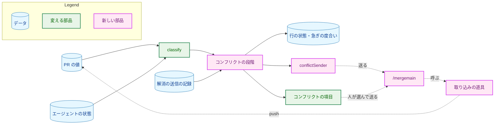
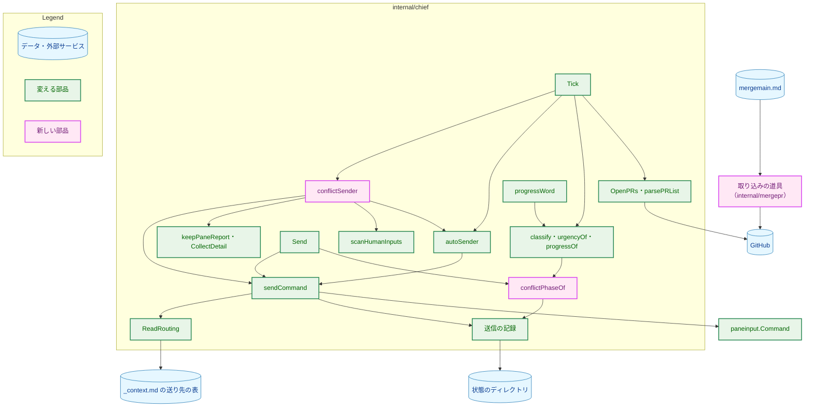
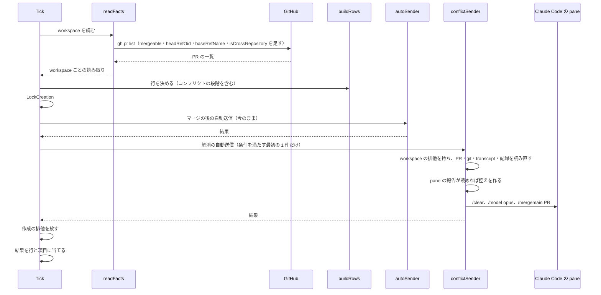
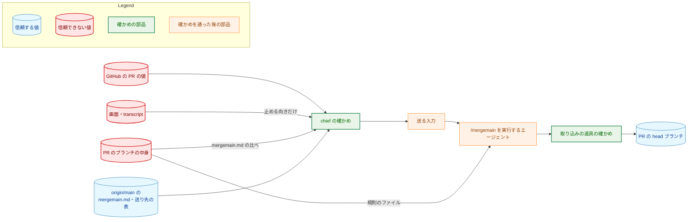
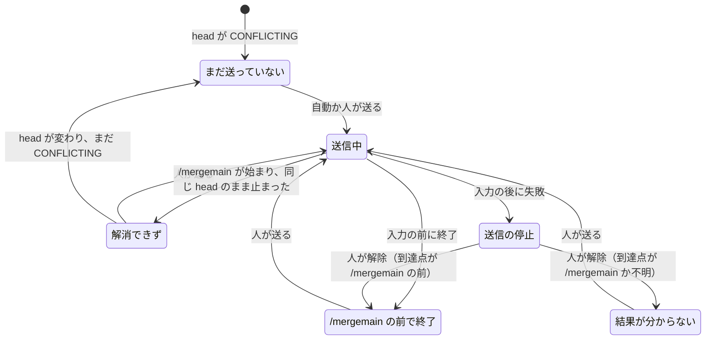
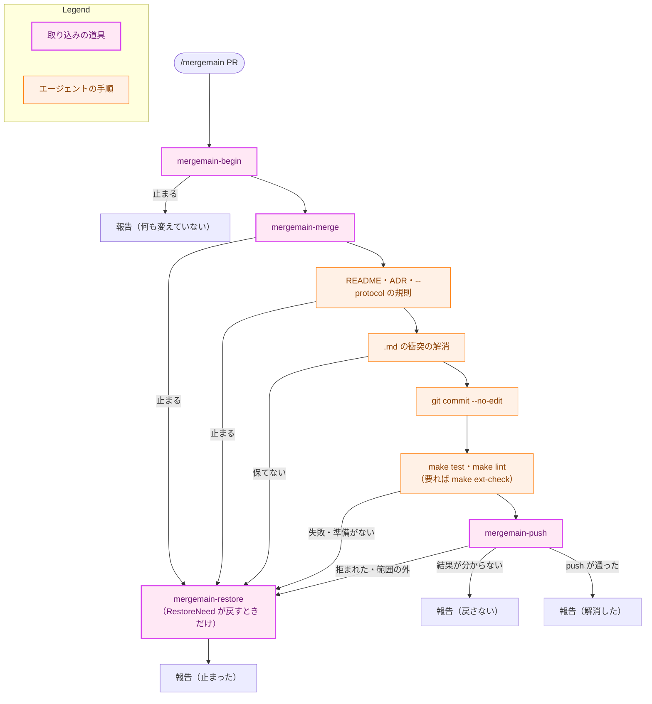

# 設計書：chief は PR のマージコンフリクトを見つけて `/mergemain` で解消させ、解消できなければ人の判断を求める

## Document Status

| Item | Value |
|---|---|
| Status | `approved` |
| Created | 2026-11-19 |
| Review date | 2026-11-23 |
| Reviewer | isseis |
| Comments | - |

## 1. 設計の全体像

本書は [01_requirements.md](01_requirements.md)（以下、要件定義書）の F-001〜F-007 を実現する設計である。対象は次のとおりである。

-   chief（`internal/chief`・`cmd/chief`）。送る入力の型（`internal/chief/paneinput`）を含む。
-   `mergepr`（`internal/mergepr`・`cmd/mergepr`）。`/mergemain` の決定的な判定と確かめを受け持つサブコマンドを足す。
-   新しいコマンドの定義 `.claude/commands/mergemain.md`。
-   `.claude/commands/_context.md`、`/chief` の定義（`.claude/commands/chief.md`）、`/mergepr` と `/runpr` の定義、`.claude/settings.json`、CLAUDE.md、chief 利用ガイド（`docs/dev/guides/chief_guide.md`）、mergepr 利用ガイド（`docs/dev/guides/mergepr_guide.md`）。
-   ADR-0046 と ADR-0014。

既存のコードについての記述は、コミット `bb02c51c`（`origin/main`）で確かめた。

語は要件定義書 3.1 の定義に従う（「マージコンフリクト（コンフリクト）」「衝突」「内容の衝突」「PR の head」「コンフリクトの行」）。本書では次の語を足す。

-   **解消の送信**：chief が `/mergemain <PR>` を送る 1 回の送信。自動の送信と、人が選んだ送信の両方を指す。
-   **解消の送信の記録**：今の送信の記録（`send-<ID>-start.json` と `send-<ID>-end.json`）のうち、コマンドが `/mergemain` のもの。PR と PR の head を持ち、worktree のライフサイクルと切り離して残す（3.3）。
-   **送信の到達点**：1 回の送信で、最後に打った入力が何だったか。何も打っていない、`/clear`、`/model`、コマンド、のいずれかである（3.3）。
-   **コンフリクトの段階**：コンフリクトの行の細分。今の head の解消の送信の記録から決まる（3.2）。
-   **取り込みの道具**：`mergepr` に足す 4 つのサブコマンド（`mergemain-begin`・`mergemain-merge`・`mergemain-restore`・`mergemain-push`）の総称（3.8）。
-   **基準の head**：`/mergemain` が始めたときの PR の head のコミット。戻す先であり、merge コミットの第 1 の親である。
-   **取り込む `main`**：`mergemain-begin` が取得し、`refs/mergemain/<PR>/main` に記録したコミット。merge コミットの第 2 の親である。
-   **衝突の分類**：取り込みの道具が、衝突したパスごとに決める種類（3.8.2）。
-   **項目 ID**：`snapshot`・`tick` の出力が、人の判断を待つ項目ごとに示す `id`（`ItemID`、`internal/chief/pending.go:108-110` の `itemID`）。中身はハッシュで、どの値から作ったかは呼ぶ側に見せない。
-   **H-NN**：設計への申し送り（[design_handoff.md](design_handoff.md)）の項目番号。各項目の扱いは付録 A にある。

### 1.1. 設計原則

-   引き金は GitHub と git の状態に置く。 自動の解消の送信は、GitHub の PR の値（`mergeable`、head、base、別のリポジトリかどうか）と、worktree の git の状態で決める。画面と transcript は、送ることを止める向きにだけ使う（AC-11）。
-   PR の値は型で受け取る。 `mergeable` は 3 つの値の列挙型、PR の head は 40 文字の小文字の 16 進数だけを受け付ける型にする。base が `main` かどうかは、読み取りの 1 か所で真偽値にする。形に合わない値は、その workspace の PR の一覧全体を読めないものとする（AC-04）。以降の判定は型だけで分かれる（CLAUDE.md の「Declare, don't infer」）。
-   ゼロ値は送らない側にする。 新しく足す列挙型（コンフリクトの段階、取り込みの道具の止まる理由など）のゼロ値は、送らない値か、戻さずに報告する値にする（CLAUDE.md の「Declare, don't infer」）。
-   決定的な判定と確かめは Go に置く。 衝突の分類、push する merge コミットが変えてよい範囲、push の先、戻す前の確かめは、`mergepr` のサブコマンドが行う（ADR-0014）。エージェントに残すのは次のものだけである。
    -   `.md` の両側の変更を保てるかの判断と、その解消。
    -   README・ADR の規則の当てはめと、文書の `--protocol` の書き換え。
    -   merge コミットの作成、検査（`make test`・`make lint`・`make ext-check`）の実行、報告の作成。
-   既存の部品を使う。 送信（`sendCommand`）、送信の記録と停止、自動送信の確かめ直し（`autoSender` の `recheck`・`ownerStill`・`checkRemote`）、エージェントの静かさの判定（`quietness`）、報告の読み取り（`readReport`）、送り先の表（`ReadRouting`）、プロトコル番号の行の読み方（`internal/mergepr` の `acceptedLine`）は作り直さない。
-   送った記録は作るだけで上書きしない。 解消の送信の記録は、今の送信の記録そのものなので、同名のものがあれば作らない（ADR-0046 の「記録」）。
-   分からなければ送らない。 記録が読めない、transcript が読めない、PR の値が形に合わない、のどれでも自動では送らない（AC-04・AC-05・AC-08）。

### 1.2. 設計の際に決めたこと（2026-11-19）

人に尋ねて決めたことは、最後に「人の答え」を書く。それ以外は本書の作成者が決めたことで、レビューで異論があれば直す。

-   決定的な判定と確かめを、`mergepr` のサブコマンドに置く（H-04・H-06、3.8）。 足すのは `mergemain-begin`・`mergemain-merge`・`mergemain-restore`・`mergemain-push` の 4 つである。名前は、取り消せない `merge` と見分けられるよう、コマンドの名前を頭に付ける。
    -   今の Go の道具には、merge の途中の状態を読むものがない。プロトコル番号の行の読み方は `mergepr` にある（`internal/mergepr/protocolcheck.go:392` の `acceptedLine`）。同じパッケージの中で再利用できる。
    -   基準の head と取り込む `main` は、`mergemain-begin` の出力をセッションが次の呼び出しの引数で渡す。道具は状態のファイルを判定に読み返さない（ADR-0014 の「基準値を状態のファイルから読み返さない」）。渡された値は、どのサブコマンドも GitHub と手元の git で確かめ直す（3.8.1）。
    -   `mergepr` の口の形が変わるので、プロトコル番号を `main` の値 + 1 にし、`/mergepr` と `/runpr` の定義の `--protocol` も直す。
    -   人に尋ねずに送った `/mergemain` が許可の確認で止まらないよう、`.claude/settings.json` の allow に `mergemain-begin`・`mergemain-merge`・`mergemain-push` の 3 つだけを足す。`mergemain-restore` と、`prepare`・`merge` など、ほかのサブコマンドは今のとおり確認を出す（下の項）。
    -   **費用。** `mergepr` に置く費用は次の 2 つで、ADR の「結果」に書く。
        -   `mergemain-*` を変えるたびに `mergepr` のプロトコル番号が上がり、`/mergepr`・`/runpr` の定義を直して入れ直すことになる。入れ直すまで、マージも止まる。
        -   確認なしに許すサブコマンドが、取り消せない `merge` と同じバイナリに入る。
    -   **採らなかった案。** 次の 4 つである。
        -   **新しい道具を作る案。** 入れる手順、利用ガイド、プロトコル番号、allow の規則がすべて新しく要る。プロトコル番号の行の読み方も、パッケージをまたいで共有する形に切り出すことになる。
        -   **`fixprguard` の push を広げる案。** `fixprguard` の push は、`/fixpr` の修正のコミットが基準の head だけを親とすることを確かめる（`internal/fixprguard/worktree.go:620-625`）。これを 2 つの親の merge コミットに広げると、`/fixpr` の保証が弱まる。
        -   **共通の部分を別のパッケージに切り出す案。** 基準の記録、手元の確かめ、push の結果の読み直しは `fixprguard` にもある。ただし、`fixprguard` の型は判定した集合とフェーズの規則に結び付いている。push の形（明示した refspec、タグとサブモジュールを送らない）は `fixprguard` に合わせる。コードを共有するかは計画書で決める。
        -   **手順を `mergemain.md` に書いてエージェントに判定させる案。** ADR-0014 の「決定的な判定は Go に置く」の例外になる。人に尋ねずに送るコマンドで、手順の読み違いにより範囲の外の衝突を解消しうる。
    -   人の答え：`mergepr` に足す。
    -   ADR：[ADR-0014](../../dev/adr/0014-deterministic-checks-in-go.md) を更新する（`mergepr` が受け持つ判定に、`main` の取り込みの判定を足す）。[ADR-0046](../../dev/adr/0046-chief-of-staff.md) も更新する（「マージコンフリクトの解消の自動送信」に、決定的な判定を `mergepr` が行うことを足す）。道具の責務と、開発の手順の判定の置き場所を決めるので、主要な決定に当たる。
-   `mergemain-push` は、push の先と merge コミットの中身を確かめてから push する（3.8.3）。 確かめるのは次の 4 つである。
    -   **push の先。** 送る直前に PR を読み直し（`gh pr view`）、今のブランチが PR の head ブランチであること、base が `main` であること、別のリポジトリのブランチでないことを確かめる。
    -   **merge コミットの親。** 第 1 の親が基準の head で GitHub の PR の head でもあり、第 2 の親が取り込む `main` で、その値が `mergemain-begin` が取得した値（`refs/mergemain/<PR>/main`）と一致し、push のときに `origin` から取り直した `main` の祖先であることを確かめる。ref はエージェントが書き換えられるので、ref との一致だけでは、`origin/main` の履歴の外のコミットを第 2 の親にした merge コミットが通るためである。
    -   **merge コミットが変えた範囲。** merge コミットの木を、2 つの親を git が自動で合わせた結果と比べる。違うパスは、`.md` のファイルと、3.8.2 が番号を変えると決めた道具（ブランチが merge base から番号を変えた道具と、プロトコル番号の行が衝突した道具）のプロトコル番号の宣言の行だけが違う Go のファイルに限る。`internal/` の下のほかの違いは止まる。
    -   **プロトコル番号の値。** 番号を変えたすべての道具について、merge コミットの版の宣言の行の値が取り込む `main` の値 + 1 であることを確かめる（AC-22）。宣言の形だけを比べると、エージェントが値だけを別の整数に変えた merge コミットが通る。自動の合わせの結果と違うパスだけを見ると、自動の合わせと同じ値のまま残った誤った整数が通る。
    -   引数だけを確かめる形では、セッションが `main` を push の先に渡すか、`.md` 以外のファイルを書き換えてから commit すると、範囲の外の変更を push しうる。それを防ぐためである。
    -   ADR：ADR-0046 と ADR-0014 の同じ更新に含める。
-   取り込む `main` は、`mergemain-begin` が取得した値と一致することを `mergemain-merge` と `mergemain-push` で求める（3.8.1・3.8.3）。 `mergemain-begin` は取得した `main` を `refs/mergemain/<PR>/main` に記録し、後のサブコマンドが引数とこの ref を照合する。祖先であることだけを求めると、取得した `main` の前のコミットを渡した取り込みが、push の前の確かめをすべて通ってしまう。`mergemain-push` は、`origin` から `main` を取り直し、記録した値がその祖先であることも求める。ref はエージェントが書き換えられるので、ref との一致だけでは、`origin/main` の履歴の外のコミットを第 2 の親にした merge コミットが通るためである。取り直した `main` が `mergemain-begin` の後に進んでいても、記録した値はその祖先なので止まらない。`origin/main` の今の値との一致を基準にしないのは、chief がラウンドごとに `main` を取り直すので、`mergemain-begin` の後に進んだだけで止まらないようにするためである。
    -   ADR：ADR-0014 の同じ更新に含める（基準の値を引数で渡す形は変えず、取得した値の ref との照合と、push のときに取り直した `main` との祖先の確かめを足す）。
-   `mergemain-restore` は allow に足さず、呼ぶたびに人の許可の確認を出す（3.8.4・3.10）。
    -   `mergemain-restore` は状態を持たないので、`/mergemain` が始めた取り込みと、人が手で始めた取り込みや merge コミットを見分けられない。手順を読み違えたエージェントが、人の手作業の取り込みを戻しうる。
    -   戻すのは `git reset --hard <基準の head>` の形にする。取り込みの取りやめ（`git merge --abort`）は、取り込みが触れていないファイルの変更を残し、取り込みが変えたファイルに追跡していない変更があれば失敗するので、AC-28 の状態に戻らないことがある（本書の Fable の部分レビューの実験）。そのため、戻す操作はより強く、人の確認を挟む。
    -   自動で送った `/mergemain` が止まって戻すときは、確認の画面で止まり、chief はその行を質問で止まった行として示す。止まったときは人の判断が要るので、費用は小さい。
    -   確認なしに許す案は採らなかった。
    -   人の答え：確認を出す。
    -   ADR：ADR-0046 の同じ更新に含める。
-   `/mergemain` の承認に、その PR の head ブランチの `git ls-remote`（読み取り）を足す（AC-31、3.8.3）。`mergemain-push` が、push の前と失敗した後に `origin` のブランチを読み直すのに使う。`git fetch origin` で取り直して remote-tracking の ref を読む案は採らなかった。読むのは 1 つのブランチだけで、ほかの ref を書き換えずに済むためである。本書のレビューで、要件定義書の AC-31 に足した（要件定義書「設計の際に見直したこと（2026-11-20）」）。
    -   人の答え：足す。
    -   ADR：ADR-0046 の同じ更新に含める。
-   AC-14 の「送り終えた後に pane が動いたこと」は、送信が `/mergemain` を打った後に確かめる、エージェントの状態の変化で確かめる（H-08、3.3）。
    -   今の送信は、コマンドを打った後に、エージェントの状態が `working` か `blocked` になったのを見て初めて、その段を終えたとする（`internal/chief/send.go:579-582`）。`state_change_seq` の変化だけは信じない。
    -   その前の段の後では、エージェントが入力を待つ状態に戻ったことを確かめる（`awaitAccepting`）。そのため、前の段の `working` を、コマンドの開始と取り違えることはない。
    -   したがって、結果が `sent` で終わった送信は、`/mergemain` を打った後に pane が動いたことを、Herdr の状態で確かめ済みである。
    -   送り終えたときの `state_change_seq` を記録し、後のラウンドで進んだことを見る案は採らなかった。記録の項目と比べる処理が増え、確かめる中身は同じだからである。
    -   人の答え：送信の確かめを使う。
    -   ADR：なし。AC-14 の実現の細部で、このタスクの中で閉じる。
-   `/clear` の後、`/mergemain` を打つ前に失敗した送信は、今の送信の規則のとおり、まず送信の停止として示す（3.2.2）。
    -   今の送信は、最初の入力の後の失敗をすべて `sent_then_failed` とし、workspace の送信を止める（`internal/chief/send.go:548-560`）。モデルの切り替えを確かめられなかったときも含む。
    -   そのため、AC-14 の「最後の送信が `/mergemain` を打つ前に終わったとき」は、まず停止（すぐ 🛑）として示される。人が `chief release` で解除した後に、「`/mergemain` の前で終了」（あとで 🔶、選択肢あり）になる。
    -   AC-09（送れたかが分からない送信は、今の送信の規則と同じく止める）と合わせた。`/mergemain` だけ停止を外す案は採らなかった。今の送信の規則に例外を足すことになるためである。
    -   人の答え：今の規則のまま。
    -   ADR：なし。今の送信の規則の当てはめである。
-   コンフリクトの行（「解消できず」の行を含む）には `/runpr` の選択肢を示さず、`/mergemain` だけを示す（3.5）。
    -   今の `/runpr` の選択肢は、行がレビュー待ちのときだけ示される（`internal/chief/request.go:470-480` の `offeredRunpr`）。コンフリクトの行はレビュー待ちではないので、`offeredRunpr` は変えない。
    -   コンフリクト中の PR では CI が走らない。そこへ `/runpr` を送っても、CI を待つだけで、解消が先だからである。人が `/runpr` を走らせたいときは pane で打つ。
    -   両方を示す案は採らなかった。
    -   人の答え：`/mergemain` だけ。
    -   ADR：ADR-0046 を更新する（「マージコンフリクトの解消の自動送信」に書く）。人が選べる入力を決める。
-   解消の自動送信は、1 ラウンドに 1 件までとし、`/mergemain` を実行中のエージェントがあるときは送らない（3.4.1）。 本書のレビューで、要件定義書の AC-05 に (10) として足した（要件定義書「設計の際に見直したこと（2026-11-20）」）。
    -   ADR：ADR-0046 を更新する。
-   一覧の呼び出しが返す `mergeable` は、実物で確かめられなかった。そのため、未確認の危険として記し、実装の PR で確かめる（H-01、3.1）。
    -   手元の `gh` で、`gh pr list --json` が `mergeable`・`headRefOid`・`baseRefName`・`isCrossRepository` をどれも受け付けることは確かめた（フィールドの一覧を出力させた）。
    -   人の承認を得て、`gh pr list --state open --json number,mergeable,headRefOid,baseRefName,isCrossRepository,headRefName` を 1 回だけ実行した。しかし開いている PR が 1 つもなく、`[]` が返った。そのため、一覧の呼び出しで GitHub が `mergeable` を計算するか、`UNKNOWN` が続きやすいかは確かめられていない。
    -   外れても安全な側に倒れる。`UNKNOWN` はコンフリクトとして扱わず（AC-03）、送らないので、外れたときの影響は気づくのが遅れることだけである。
    -   実装の PR で、開いている PR とコンフリクトの PR に対して、一覧の呼び出しと `gh pr view` の値を比べ、結果を計画書に記録する（8 章）。`UNKNOWN` が続くと分かれば、そのときに人に確かめる。
    -   人の答え：今確かめる（確かめられなかったので、本項のとおり扱う）。
    -   ADR：ADR-0046 の「結果」に書く。
-   PR の値は、今のラウンドの `gh pr list` の `--json` に足して読む。新しい呼び出しは足さない（H-01、3.1）。
    -   足すのは `mergeable`・`headRefOid`・`baseRefName`・`isCrossRepository` の 4 つである。workspace ごとに 1 回という今の呼び出しの数は変わらない（要件定義書 4.1）。
    -   PR ごとに `gh pr view` を足す案は採らなかった。呼び出しが開いている PR の数だけ増え、応答の時間も延びるためである。
    -   ADR：なし。読み取りの細部で、このタスクの中で閉じる。
-   早く気づく仕組みは足さず、今のラウンドの間隔のままにする（H-02）。
    -   コンフリクトに気づくのは、最長で `chief wait` の制限時間（既定 10 分）の後のラウンドになる。`UNKNOWN` が続けば、さらにラウンドを重ねる。
    -   要件定義書 2.3 がスコープ外とした。
    -   ADR：なし。ADR-0046 の「結果」がすでにこの遅れを書いている。
-   解消の送信の記録は、今の送信の記録に PR・PR の head・送信の到達点を持たせ、コマンドが `/mergemain` のものは期間でも worktree のライフサイクルでも消さず、状態のディレクトリを消すまで残す（H-03、3.3）。別の種類の記録は作らない。
    -   今の送信の記録は 25 分で消える（`internal/chief/records.go:942` の `sendKeepAge`）。今の自動送信の記録（`autosend-<PR>.json`）は PR ごとに 1 件で、head を持たない。そのため、どちらもそのままでは、head ごとに 1 回の判定と「解消できず」の判定に使えない。
    -   送信の記録と同じ時点で、別の記録を書く案は採らなかった。2 つの記録の書き込みの間で失敗すると、互いに食い違い、行が「送信中」のまま残りうるためである。今の送信の記録は、始まりと終わりの順、送れたかが分からない送信の停止、人の解除まで、すでに扱っている（`internal/chief/records.go:739-851`）。
    -   期間（例えば 14 日）で消す案は採らなかった。同じ head のままコンフリクトが続くと、記録が消えた後に自動でもう一度送り、AC-08 の「head ごとに 1 回」を破るためである。PR が閉じたかマージされた後に消す案も採らなかった。chief は開いている PR しか読まないので、閉じたことを確かめるための GitHub の呼び出しが増えるためである。記録は 1 回の送信で 2 つのファイルなので、残しても量は小さい。今の `ClearRecords`（`internal/chief/records.go:1456-1477`）は worktree を作り直す前と workspace を消し終えた後に走るが、この組は消さない。worktree を作り直しても、workspace を消した後に同じパスへ作り直しても、同じ PR の同じ head がまた `CONFLICTING` になれば記録が要るためである。消えるのは、人が状態のディレクトリを消したときだけにする。
    -   ADR：ADR-0046 を更新する（「記録」に解消の送信の記録の使い道と消し方を足す）。ADR-0014 も更新する（chief が判定に読み返す記録の説明）。記録の決定を変えるので、主要な決定に当たる。
-   コンフリクトの項目は、PR の head ごとに「送る必要がある」と「解消できず」の 2 つの種類に分け、それぞれ新しい項目として通知する（H-12、3.5）。
    -   今の通知の記録は、項目 ID ごとに 1 回である（`internal/chief/records.go:403-457`）。[0088 要件定義書](../0088_chief_of_staff/01_requirements.md) の AC-58 は「同じ PR を 1 つのセッションで 2 回通知しない」と書くが、コードは項目 ID で数える。レビュー待ちの項目の ID は `("review", workspace, PR)` から作る（`internal/chief/pending.go:153`）。
    -   コンフリクトの項目の ID は、種類、workspace、PR、head、2 つの種類のどちらかから作る。「まだ送っていない」「`/mergemain` の前で終了」「結果が分からない」「記録を読めない」は「送る必要がある」にまとめ、段階が移っても通知を重ねない。「解消できず」は別の種類にし、自動の解消が失敗したことを人が知るよう、もう一度通知する（H-12 の候補の 1 つ目）。そのため、1 つの PR は、レビュー待ちに加えて、head ごとに最大 2 回通知されうる。これは 0088 AC-58 の例外で、要件定義書の 5 章に足した（要件定義書「設計の際に見直したこと（2026-11-20）」）。
    -   待ち受けのラウンドで自動で送れた行は実行中になり、項目を作らないので通知しない（`internal/chief/tick.go:121-161` の `applyAutoSends` と同じ扱い）。
    -   段階ごとに通知する案は採らなかった。同じ head で段階が移るたびに通知が重なるためである。「解消できず」を通知しない案も採らなかった。自動の解消が失敗したことを人が知らないまま、PR が止まるためである。
    -   ADR：なし。通知の項目の分け方で、このタスクの中で閉じる。
-   送る前の報告の控えは、pane の報告が読めたときだけ作り、PR の説明の控えは作らない。GitHub の呼び出しは足さない（H-07、3.7）。 今の `keptReport`（`internal/chief/detail.go:531-565`）は、`gh pr view` の値を受け取り、pane の報告が読めなければ PR の説明の控えを作る。AC-12 は「読めなければ控えを作らずに送る」なので、pane の報告の控えだけを作る入口を足す。
    -   ADR：なし。ADR-0046 の「送る前に PR を作ったコマンドの報告を読めれば控えを作る」の実現の細部である。
-   報告の控えの引き継ぎは、`chief detail` で PR の詳細を読むときに merge コミットの親をたどって行い、新しい記録は作らない（H-07、3.7）。
    -   リセットの確かめと、レビューを省けるかの表示は、今のとおり、ちょうどその head の控えだけを読む。
    -   AC-12 が求める引き継ぎは 1 回だけだが、`/mergemain` が続けて解消した場合に備え、親を上限の回数までたどるよう、設計で広げた。
    -   新しい head が手元にないときは、AC-12 が例外を置いていないので、PR の head ブランチを `git fetch origin` で取得してから親をたどる（3.7）。`gh` の呼び出しは足さず、取得は `main` を取り直す今の読み取りと同じで、`/chief` の起動が承認する読み取りと、AC-31 の `git fetch origin` の範囲に入る。取得に失敗したときだけ、今のとおり PR の説明から要約する。
    -   引き継ぐ記録を作る案は採らなかった。`snapshot` は通知の記録のほかに記録を作らない（`internal/chief/snapshot.go:104-108`）ので、作る時点を `tick` か `detail` に限ることになるためである。
    -   ADR：なし。ADR-0046 の「`/mergemain` の merge コミットで head が変わったときは、控えを新しい head に引き継ぐ」の実現の細部である。
-   PR のブランチの `mergemain.md` は、`git show` で `HEAD` のコミットの中身を読み、`origin/main` のものとバイト列で比べる（H-09、3.4）。 作業ツリーのファイルは読まない。AC-05 の (3) で、HEAD が PR の head と同じで、作業ツリーに変更がないことを、同じ確かめの中で確かめているためである。
    -   ADR：なし。読み取りの細部で、このタスクの中で閉じる。
-   `/mergemain` をタスクのコマンドとして数え、実行中の表示は「解消中」にする（H-09、3.6）。
    -   送る入力の型（`paneinput.CommandKind`）に `/mergemain` を足すと、transcript の人の最後のタスクのコマンドの読み取りも `/mergemain` を数える。
    -   今の進行の表示（`internal/chief/position.go:279-303` の `progressOf`）は、`/runpr` 以外の実行中のコマンドを「作成中」とする。`/mergemain` は文書も PR も作らないので、「解消中」を足す。
    -   ADR：なし。要件定義書 1 章の作成者が決めた事項の実現である。
-   送らなかった理由と段階の理由は、今の自動送信の理由と同じく、英語の理由の種類として出力する。表に示す日本語は、状態の文字列だけにする（3.2.2・3.4.3）。 CLAUDE.md の「Go Idioms」の状況の表の例外は、状態の文字列を範囲に含むが、送らなかった理由を含まない。今のマージの後の自動送信の理由も、英語のまま出力に出し、`/chief` の定義が示す（`internal/chief/output.go:698-716`）。
    -   ADR：なし。表の語の置き場所の細部である。
-   `/mergemain` の merge コミットのメッセージは、git の既定のメッセージにする（H-11、3.8）。
    -   `mergemain-merge` が `--no-ff --no-commit` で取り込み、`/mergemain` が `git commit --no-edit` で merge コミットを作る。
    -   取り込む `main` をコミットの ID で渡すので、件名は `Merge commit '<ID>' into <ブランチ>` の形になる。衝突を解消した取り込みでは、エディタを開かないので、git が足す `# Conflicts:` と衝突したパスの注釈の行もメッセージに残る（本書の Fable の部分レビューの実験）。どの行も `Editorial correction: ` で始まらないので、`mergepr` の訂正の行の読み取り（`internal/mergepr/corrections.go:84-101`）は変わらない。
    -   ADR：なし。`/mergemain` の手順の中で閉じる。
-   PR レビューの再依頼の判定と、ローカルのレビューの記録の判定は変えない（H-05、付録 B）。
    -   merge コミットは、今の判定でいつも「見ていない」に数えられ、マージの質問で尋ねる形になる。これは要件定義書が受け入れた費用の範囲である。
    -   付録 B の結論は、コードを読んで得たもので、一部は走らせて確かめていない。実装の PR で、`/mergemain` の merge コミットに対して `review-records.sh` の `coverage` を走らせ、結果を計画書に記録する（8 章）。
    -   ADR：なし。ADR-0046 の「結果」がすでにこの費用を書いている。
-   CLAUDE.md の「Declare, don't infer」に、取り込みの道具の読み取りの例外を足す（3.8.5）。
    -   取り込みの道具は、パスの名前、git のインデックスのステージの項目、Go のファイルのプロトコル番号の行の中身を読んで、分類と確かめを決める。
    -   今の `mergepr` の例外は、コミットのメッセージの読み取りだけを範囲にしている。そこで、範囲と境界を決めた例外として書き足す。
    -   ADR：なし。CLAUDE.md の規則の例外の一覧で、ADR ではない（CLAUDE.md の「Design decisions (ADR)」）。

### 1.3. 実装の際に決めたこと（2026-11-24）

-   `mergemain-push` の push の送り先の確かめのうち「GitHub で確かめた PR のリポジトリを指す」は、push の URL と取得の URL が同じことに加えて、git の remote が `origin` だけであることと、環境変数 `GH_REPO` がないことで確かめる（3.8.3）。`mergemain-begin` も、PR を読む前に同じことを確かめる。 PR から読むのは AC-30 の 5 つの値だけで、PR のリポジトリの URL は読めない。`gh` は、PR を読むリポジトリを git の remote と `GH_REPO` から選ぶ。そのため、remote が `origin` だけで `GH_REPO` がなければ、`gh` が読んだ PR は `origin` のリポジトリのものである。URL が同じことだけを確かめ、PR のリポジトリとの対応を残る危険とする案は採らなかった。 人の答え：URL が同じことに、remote が `origin` だけであることと `GH_REPO` がないことを足す。
    -   ADR：なし。`mergemain-push` の確かめの細部で、このタスクの中で閉じる。
-   取り込みの道具は、git がテキストの合わせ以外で衝突を解消する設定を、止まる条件にする（3.8.1・3.8.2・3.8.3・4.1）。 マージドライバ（`.gitattributes` の `merge=union` などや設定したドライバ）、`branch.<ブランチ>.mergeOptions` の `-Xours` などは、Go の衝突でも git に黙って解消させ、`mergemain-push` の確かめも通してしまう（本書の実装の際の Fable の部分レビューの実験）。そこで次のようにする。
    -   取り込みと `merge-tree` と属性の読み取りは、属性を基準の head の木からだけ読む（`attr.tree`）。作業ツリーの、追跡していないか無視された `.gitattributes` と、利用者の属性のファイルは読まない。`branch.<ブランチ>.mergeOptions` は空にして取り込む。
    -   両側が変えたパスと、名前の変更の元と先の `merge` 属性が、基準の head と `main` のどちらでもテキストの合わせ（指定なしか `set`）でなければ、止まる（対象外の衝突）。`$GIT_DIR/info/attributes` があるときと、`merge.default` が設定されているときも止まる（前提が合わない）。
    -   `mergemain-merge` が取り込みの前にこの確かめで止まったときは、何も変えていないので、戻すかどうかを「戻さない」と出力する。4.1 の表の「対象外の衝突」は、これに合わせて道具の出力に従う形にする。
    -   `gh` が PR を読むリポジトリの確かめ（上の項）に、`gh repo set-default` の記録（`remote.<名前>.gh-resolved`）が `origin` 自身（`base`）以外を指していないことを足す。
    -   そのほか、`git merge` は `--no-overwrite-ignore` を付けても無視されたファイルを上書きするので、上書きしないことは取り込みの前の確かめだけで守り、その比べは大文字と小文字を区別しない。push の前に PR の head がすでに HEAD（push した merge コミット）なら、戻さずに止まる。`mergemain-restore` の止まる理由は、引数の形が合わないときも「ほかの変更があり戻さなかった」にする。
    -   人の答え：決定として記録する。マージの前に止まるときは対象外の衝突・戻さないとし、4.1 の表を道具の出力に従う形に直す。
    -   ADR：なし。取り込みの道具の確かめの細部で、このタスクの中で閉じる。

### 1.4. 実装の際に決めたこと（2026-11-25）

-   1.2 の「一覧の呼び出しが返す `mergeable`」の確かめは、実装の PR（計画書の PR-4）では開いている PR だけで行い、コンフリクトの PR での確かめは、PR-4 のマージの後の PR-5 の `hold` の点検で行う。 確かめた時点でコンフリクト中の PR がなく、確かめるために一時的な PR を作ると、GitHub への書き込み（ブランチの push、PR の作成と close、ブランチの削除）が要るためである。外れても安全な側に倒れることは 1.2 のとおりで、変わらない。結果は計画書の 5 章に記録した。 人の答え：今回は確かめない。
    -   ADR：なし。確かめの段取りで、このタスクの中で閉じる。

## 2. システム構成

### 2.1. 概念モデル

コンフリクトの行は、GitHub の PR の値と、解消の送信の記録から決まる。図の実線の矢印 A → B は「A の値から B を決める」、点線の矢印は「送る・呼ぶ・push する」を表す。



`/mergemain` が解消して push すると、PR の head が変わる。次のラウンドで GitHub が `MERGEABLE` を返せば、行はレビュー待ちに戻る（AC-16）。同じ head のまま `CONFLICTING` なら「解消できず」になる（AC-14）。

### 2.2. コンポーネント配置

図の矢印 A → B は「A が B を呼ぶか読む」を表す。



-   **`conflictSender` と `autoSender`。** `conflictSender` は、同じラウンドの `autoSender` が持つ状態（作成の排他の結果、`origin` の `main` の読み取りの控え、持ち主の確かめ）を使い、その確かめ直しと送信の手順（`recheck`・`ownerStill`・`send`）に、解消の送信の条件を当てる形にする（3.4）。マージの後の自動送信の条件と結果は変えない。
-   **`mergemain.md` から取り込みの道具への矢印。** `/mergemain` を実行するエージェントが、定義に従って道具を呼ぶことを表す。

### 2.3. データの流れ（`tick` の 1 ラウンド）

図の矢印は、呼び出しと応答を表す。今のラウンドとの違いは、PR の一覧で `mergeable` などを読むことと、マージの後の自動送信の後に、解消の自動送信を走らせることである。作成の排他は、今のとおり自動送信の間だけ持つ。



## 3. コンポーネント設計

### 3.1. PR の値の読み取り（F-001、H-01）

ラウンドごとの `gh pr list`（`internal/chief/workspace.go:142-148` の `OpenPRs`）の `--json` に、`mergeable`・`headRefOid`・`baseRefName`・`isCrossRepository` を足す。読み取り（`parsePRList`、`internal/chief/workspace.go:35-72`）は、今の `strictjson` の `Collect` に 4 つのメンバーを足し、すべて必須にする。

```go
// Mergeable is GitHub's mergeable value of an open PR. The zero value is
// MergeableUnknown, the value that sends nothing.
type Mergeable int

const (
	MergeableUnknown Mergeable = iota
	MergeableNoConflict
	MergeableConflicting
)

// CommitID is a full commit ID: 40 lowercase hexadecimal digits. Only its
// constructor makes one; the zero value names no commit and is never read
// from a parsed PR.
type CommitID struct{ hex string }

// OpenPR is an open PR of a workspace's branch.
type OpenPR struct {
	Number          int
	Title           string
	URL             string
	Mergeable       Mergeable
	Head            CommitID
	BaseIsMain      bool
	CrossRepository bool
}
```

-   **受け付ける形。** AC-04 のとおりである。
    -   `mergeable` は、`MERGEABLE`・`CONFLICTING`・`UNKNOWN` のどれかとバイト単位で一致する文字列に限る。
    -   `headRefOid` は、40 文字の小文字の 16 進数の文字列に限る。
    -   `baseRefName` は、空でない文字列に限る。読み取りの 1 か所で、`main` とバイト単位で等しいかを `BaseIsMain` にし、以降は文字列を比べない。
    -   `isCrossRepository` は、真偽値に限る。
-   **重なったメンバー。** 今の `Collect` は、列挙したメンバーが 2 回あれば拒む（`internal/strictjson/strictjson.go:92-105`）。4 つを列挙に足すので、重なりも拒まれる。
-   **拒んだとき。** 1 つの要素でも拒めば、今の `errPRList` と同じく、その workspace の一覧全体を読めないものとする。`readWorkspace`（`internal/chief/snapshot.go:404-412`）は今のとおり「要確認」にする。
-   **head の型。** 今は 40 文字の 16 進数の確かめが、正規表現 `commitID`（`internal/chief/detail.go:44`）として 3 か所にある（`internal/chief/detail.go:129`、`internal/chief/workspace.go:134`、`internal/chief/create.go:483`）。`CommitID` はこの正規表現を使って作る。既存の 3 か所を `CommitID` に移すかは計画書で決める。
-   **呼び出しの数。** 送る直前の読み直し（自動送信の `recheck`、人が選んだ送信の `Send`）は、今の `readWorkspace` を呼ぶので、同じ `gh pr list` で 4 つの値を読み直す。新しい GitHub の呼び出しはない（要件定義書 4.1）。

### 3.2. 行の状態とコンフリクトの段階（F-001・F-003、H-10）

#### 3.2.1. 行の状態

行の状態（`WorkspaceState`、`internal/chief/state.go:13-28`）に `StateConflict` を足す。`classify`（`internal/chief/state.go:496-552`）は、今の順のまま、実行中の判定の後、レビュー待ちの判定の前に、次の分岐を足す。

-   開いている PR があり、その `Mergeable` が `MergeableConflicting` なら、`StateConflict` とする。
-   読めないもの、質問、実行中のエージェントがあれば、今のとおりそちらが先に決まる（AC-02 の「実行中と質問の行の扱いは今のまま」）。
-   `MergeableNoConflict` と `MergeableUnknown` は、今のとおりレビュー待ちになる（AC-03・AC-16）。

**ほかのタスクの表を変える。** `classify` と `urgencyOf`（`internal/chief/position.go:207-226`）は、[0088 設計書](../0088_chief_of_staff/02_architecture.md) の 3.1.4 と 3.2 の状態と急ぎの度合いの表に従う。本書は、その表に `StateConflict` の行を足す。今の表を確かめるテスト（`internal/chief/position_test.go` と `classify` のテスト）は、計画書で一つずつ当たる。

`classify` は workspace の読み取りだけを見る純粋な判定なので、コンフリクトの段階は決めない。段階は、記録を読む今の `addRecords`（`internal/chief/snapshot.go:287`）と同じ場所で決める（3.2.2）。

#### 3.2.2. コンフリクトの段階

コンフリクトの行には、段階を型で持たせる。段階は、PR とその今の head についての解消の送信の記録（3.3）から決める。

```go
// ConflictPhase is how far the resolution of a conflict row has gone for the
// PR's current head. The zero value is ConflictRecordsUnreadable, which never
// sends automatically.
type ConflictPhase int

const (
	ConflictRecordsUnreadable  ConflictPhase = iota // the send records cannot be read
	ConflictUnsent                                  // no resolution send for this head
	ConflictSending                                 // a send has started and has no end yet
	ConflictEndedBeforeCommand                      // the last send ended before /mergemain was typed
	ConflictOutcomeUnknown                          // whether the last send's /mergemain started cannot be told
	ConflictUnresolved                              // the last send started /mergemain and every agent waits
)
```

| 段階 | 決まる条件 | 状態の文字列 | 急ぎの度合い・番 | 項目 |
|---|---|---|---|---|
| 記録を読めない | その worktree の送信の記録を読めない | コンフリクト | あとで 🔶・人 | 作る（送る必要がある。理由 `record_unreadable`） |
| まだ送っていない | その head の解消の送信の記録がない | コンフリクト | あとで 🔶・人 | 作る（送る必要がある） |
| 送信中 | 最後の解消の送信に、終わりの記録がない | コンフリクト | 待つ 🟢・AI | 作らない |
| `/mergemain` の前で終了 | 最後の解消の送信の到達点が、`/mergemain` より前 | コンフリクト | あとで 🔶・人 | 作る（送る必要がある。理由に到達点） |
| 結果が分からない | 最後の解消の送信が、`/mergemain` を打った後に失敗したか、人が解除した | コンフリクト | あとで 🔶・人 | 作る（送る必要がある） |
| 解消できず | 最後の解消の送信が `/mergemain` を始めたのを確かめて終わり、今エージェントがすべて入力を待っている | 解消できず | あとで 🔶・人 | 作る（解消できず） |

-   **「解消できず」の条件（AC-14）。** AC-14 の 3 つの条件は、それぞれ次のように満たされる。
    -   「`/mergemain` まで打って送り終えた記録」：送信の到達点がコマンドで、結果が `sent` の記録が満たす。
    -   「送り終えた後に pane が動いたこと」：その送信が `/mergemain` を打った後に、エージェントの状態が `working` か `blocked` になったのを確かめたことで満たす（1.2）。
    -   「その後、エージェントがすべて入力を待っている」と「同じ head のまま `CONFLICTING`」：このラウンドの読み取りが満たす。エージェントが動いていれば、`classify` が実行中にするので、コンフリクトの行にはならない。
-   **push の直後。** `/mergemain` が push した直後は、GitHub がまだ古い head と `CONFLICTING` を返すことがある。そのとき、行は 1 ラウンドだけ「解消できず」になり、通知されうる。次のラウンドで GitHub が新しい head を返せば、行は戻る。手元の HEAD が push した merge コミットかどうかで、待つ段階を別に分ける案は採らなかった。push の結果が分からないときや、人が手元でコミットしたときに、人に尋ねないまま待ち続けうるためである。これを残る危険として受け入れる（5.3）。
-   **送信中（AC-14 の「待つ 🟢」と AC-17）。** 終わりの記録のない送信は、今の送信の規則で、chief の起動時に送信の停止に変わる（`internal/chief/records.go:808-824` の `SettleUnfinished`）。`tick` は自動送信を終えてから行を出力するので、この段階は、ほかの chief の呼び出しと排他が重なったときにだけ出力に現れる。この段階が続くのは送信の排他を持つ間だけで、AC-18 の (4) を満たさないので、送れない。そのため、項目を作らない。要件定義書の AC-17 も、この行に選択肢を求めない形に改めた（要件定義書「設計の際に見直したこと（2026-11-20）」）。停止に変わった後は、今のとおり停止を先に示す（すぐ 🛑）。
-   **worktree を作り直した後（3.3.1）。** 解消の送信の記録は worktree のパスと PR・head に付くので、worktree を作り直しても、workspace を消して同じパスに作り直しても、同じ PR の同じ head の行は、作り直す前と同じ段階になる。終わりの記録のない送信は、次の chief の起動の `SettleUnfinished` がそのパスの workspace の送信の停止に変えるので、行はその停止を先に示す（すぐ 🛑）。人が `chief release` で解除すると、到達点に応じた段階に戻る。記録が名指す pane は、作り直すと存在しないので、段階にも停止にも使わない。
-   **`/mergemain` の前で終了（AC-14 と AC-17）。** 最初の入力の前に終わった送信（`not_sent`）は、すぐこの段階になる。`/clear` か `/model` の後に失敗した送信は、今の送信の規則で、まず送信の停止になる。人が解除した後にこの段階になる（1.2）。
-   **停止を先に示す。** 送信が止まった workspace の行は、段階にかかわらず、今のとおり停止を示す（`internal/chief/position.go:207-226` の `urgencyOf`、すぐ 🛑）。
-   **表の語。** 状態の文字列「コンフリクト」と「解消できず」は、`internal/chief/table.go` の `progressWord` に足す。CLAUDE.md の「Go Idioms」の状況の表の例外（状態の文字列）の範囲に入る。内容の列は、今のレビュー待ちと同じく PR の題名を示す。段階と理由は、出力の英語の値で示し、`/chief` の定義が人に示す（1.2）。
-   **進行の表示。** `Progress`（`internal/chief/position.go:58-78`）に「コンフリクト」「解消できず」「解消中」（`/mergemain` の実行中、3.6）を足し、`progressOf`・`progressName`（`internal/chief/output.go:446`）を合わせる。

#### 3.2.3. 出力

-   **行の出力（`RowOutput`、`internal/chief/output.go:38-62`）。** `state` の値に `conflict` が増える。コンフリクトの行には、段階の名前と送れない条件の一覧を持つメンバー `conflict` も増える。`pr` に `head` を足す。
-   **解消の自動送信の結果。** 今の `auto_sends`（`internal/chief/output.go:698-716`）は、マージした PR とその次のコマンドの形をしている。そのため、それとは別に `conflict_sends` を足し、1 件ごとに workspace、PR、head、送信の結果、送らなかった理由を出す。
-   **プロトコル番号。** 出力と `chief send` の口の形が変わるので、chief のプロトコル番号（`internal/chief/records.go:29`）を `main` の値 + 1 にし、`/chief` の定義の `--protocol` を直す（H-10）。番号は、出力か送り先の表を最初に変える PR で上げる（8 章）。

### 3.3. 解消の送信の記録（F-002・F-003・F-004、H-03）

#### 3.3.1. 記録の形

解消の送信の記録は、今の送信の記録（`internal/chief/records.go:680-704`）である。別の種類の記録は作らない。次の 3 つを変える。

-   **始まりの記録（`SendRecord`）。** コマンドが `/mergemain` の送信では、PR の番号と PR の head を必ず持たせる。それ以外のコマンドでは持たせない。
-   **終わりの記録（`sendEnd`）。** 送信の到達点を、今の `SentStep`（`internal/chief/send.go:185-197`）の値として持たせる。今は、到達点が理由の文の中にしかない（`internal/chief/send.go:548-560`）。そのため、文から推し量らずに読めるよう、値として書く（CLAUDE.md の「Declare, don't infer」）。
-   **消し方。** コマンドが `/mergemain` の始まりと終わりの組は、今の 25 分（`sendKeepAge`）でも、worktree のライフサイクル（worktree を作り直す前と、workspace を消し終えた後の `ClearRecords`）でも消さない。`ClearRecords` は、始まりの記録の `Kind` が `mergemain` の組を見分けて残す。消すのは、人が状態のディレクトリを消したときだけにする（1.2）。worktree を作り直しても、workspace を消した後に同じパスへ作り直しても、同じ PR の同じ head がまた `CONFLICTING` になったときは、記録があることで自動でもう一度送らない（AC-08）。読めない始まりの記録は、コマンドが分からないので、今の `cleanup`（`internal/chief/records.go:947-973`）でも消さず、読めない記録として残す（3.3.3）。
-   **作り直した worktree と消した workspace。** 解消の送信の記録は、workspace ではなく worktree のパス（記録のディレクトリ）と PR・head に付く。段階と停止は、そのパスと PR・head で記録を探すので、消した workspace や、作り直して変わった pane の ID を手がかりにしない。同じパスに worktree がなければ、その記録を読む行はない。同じパスに同じ PR の同じ head の worktree を作り直すと、行は作り直す前と同じ段階になり（3.2.2）、終わりの記録のない送信は、次の chief の起動の `SettleUnfinished` がそのパスの workspace の送信の停止に変えるので、行はその停止を先に示す。

今の `SentStep` は、`StepUnknown`（ゼロ値、何も打っていない）、`StepClear`、`StepModel`、`StepNew`、`StepCommand` を持つ。終わりの記録には、到達点を必ず書くメンバーとして足す。メンバーがない終わりの記録（人の解除が書くもの、3.3.1 の「人の解除」）は、到達点が分からないものとして読み、`/mergemain` を打ったかもしれないものとして扱う。今の型のゼロ値は「何も打っていない」なので、終わりの記録のメンバーがないことをゼロ値で表さない。

-   **書く順。** 今のとおり、始まりの記録は最初の入力の前に作り、終わりの記録は送信が終わったときに作る（`internal/chief/records.go:739-750`）。終わりの記録を書けなければ、今のとおり workspace の送信を止める（`internal/chief/send.go:519-524`）。
-   **人の解除。** 今の `Release`（`internal/chief/records.go:830-851`）は、終わりのない送信に、結果が分からない終わりの記録を書く。到達点のメンバーは書かず、分からないものとして読む。
-   **最後の解消の送信。** その PR とその head を持つ `/mergemain` の送信のうち、送信の ID が最も大きいもの。ID は時刻の数字で始まるので、並べると送った順になる。時計が戻ると順が入れ替わりうるが、同じ head に 2 回送るのは人が選んだときだけなので、影響は段階の表示に限られる。

#### 3.3.2. 送信の到達点からコンフリクトの段階へ

| 終わりの記録の結果 | 到達点 | 段階 |
|---|---|---|
| ない | — | 送信中 |
| `not_sent` | `StepUnknown`（何も打っていない） | `/mergemain` の前で終了 |
| `sent` | `StepCommand` | 解消できず（エージェントがすべて入力を待つとき） |
| `sent_then_failed` | `StepClear`・`StepModel` | `/mergemain` の前で終了（停止の解除の後） |
| `sent_then_failed` | `StepCommand` | 結果が分からない（停止の解除の後） |
| 結果が分からない（解除） | メンバーなし | 結果が分からない |
| 上のどれでもない組 | — | 結果が分からない |

#### 3.3.3. 記録の使い道

-   **AC-08（自動では head ごとに 1 回）。** その PR とその head の解消の送信の記録が 1 件でもあれば、自動では送らない。記録のディレクトリを読めないとき、または送信の記録の 1 件でも読めないときは、送ったものとして扱う（段階「記録を読めない」）。
-   **AC-19（人が選んだ送信も記録する）。** 人が選んだ送信も、同じく送信の記録を作る。人が選んだ送信の後は、その head に自動では送らない。
-   **AC-14（「解消できず」の判定）。** 最後の解消の送信の段階で決める（3.3.2）。
-   **送る中身は左右しない。** 記録は、送ることを止める条件と、行の段階の表示にだけ使う。何を送るかは、PR の番号と型から決まる（ADR-0046 の「記録」）。

### 3.4. 解消の自動送信（F-002）

#### 3.4.1. 置き場所と順

`tick` の中で、マージの後の自動送信（`autoSender.run`、`internal/chief/tick.go:80-81`）の後、作成の排他を持ったまま、解消の自動送信（`conflictSender`）を走らせる。`snapshot` では走らせない（AC-06）。

-   **対象。** このラウンドで、コンフリクトの段階が「まだ送っていない」と決まったコンフリクトの行だけである。前のラウンドの状態は見ない（AC-07）。
-   **1 ラウンドに 1 件（AC-05 の (10)）。** 対象の行を workspace の名前の順に試す。入力を 1 つでも打ったかもしれない送信（結果が `not_sent` でも、記録だけ作って打たなかったものでもない送信）があれば、その結果にかかわらず、そのラウンドの解消の自動送信をやめる。`/mergemain` を打った後に開始を確かめられなかった送信でも、`/mergemain` が走っているかもしれないためである。何も打たずに終わった行は、理由を示して次の行を試す。
-   **実行中の `/mergemain`（AC-05 の (10)）。** 行の状態ではなく、このラウンドで読んだ各 workspace のエージェントの状態から決める。行の状態は、読めない画面や質問を実行中より先に決めるので、実行中の pane を見落としうるためである。状態が `working` か `blocked` の Claude Code の pane があり、その実行中のコマンドが `/mergemain` なら、送らない。実行中のコマンドが決まらないときも送らない。決まらないのは、transcript が読めないときなどである（`RunningUnknown`、`internal/chief/running.go:92-121`）。OpenCode の pane は `/mergemain` を走らせないので、数えない。(10) は、送る直前の読み直しの対象にしない。ほかの workspace を読み直すことになり、そのラウンドの後に `/mergemain` を始めうるのは pane で打つ人だけだからである。
-   **マージの後の自動送信との関係。** 同じラウンドで、マージの後の自動送信が入力を送った workspace には送らない。今の自動送信が送った workspace を、`applyAutoSends`（`internal/chief/tick.go:121-161`）と同じく結果から引く。
-   **作成の排他を取れなかったラウンド。** 何も送らず、行に理由を示す（今の自動送信と同じ）。
-   **排他を持つ時間。** 1 件の送信は、今の送信の待ち（1 回 500 ms を最大 30 回、`internal/chief/send.go:251-254`）が段ごとにかかり、合わせて最大で 1 分ほどになる。1 ラウンドに 1 件に限るので、作成の排他を持つ時間は、今のマージの後の自動送信に、この 1 件分が足されるだけである。

#### 3.4.2. 条件

AC-05 の条件と、使う既存の部品の対応は次のとおりである。ラウンドの読み取りで 1 度判定し、送るときは workspace の排他を持って、(10) のほかをすべて読み直す。読み直しでは、今の自動送信の確かめ直し（`recheck`、`internal/chief/autosend.go:781-828`）と同じく、次のことも確かめる。

-   chief の持ち主のままであること（`checkOwner`・`ownerStill`）。
-   worktree の workspace がまだちょうど 1 つであること（`locate`）。
-   このラウンドの後に、人がその workspace へ送っていないこと（`SentSince`）。

| AC-05 | 確かめ | 使う部品 |
|---|---|---|
| (1) | 開いている、base が `main`、head がこのリポジトリのブランチ、`CONFLICTING`。読み直しでも同じで、head が変わっていない | 3.1 の `OpenPR`。読み直しは `readWorkspace` |
| (2) | Claude Code の pane がちょうど 1 つ | `targetPane`（`internal/chief/send.go:366-379`） |
| (3) | 今のブランチが PR の head ブランチ、HEAD が PR の head、作業ツリーに変更がない。`main` の取得が成功し、`origin/main` が `origin` の `main` と同じ | `GitReader.Branch`・`Head`・`Clean`、`checkRemote`（`internal/chief/autosend.go:318-332`）、`fetchFailed` |
| (4) | エージェントがすべて入力を待っている | `quietness`（`internal/chief/autosend.go:430-447`） |
| (5) | 送信が止まっていない | `existingRecords` と `Stopped` |
| (6) | transcript を読め、人の最後のタスクのコマンドの後に人の入力がない | 3.6 の人の後の入力の読み取り |
| (7) | その PR とその head の解消の送信の記録がない | 3.3 |
| (8) | PR のブランチの `mergemain.md` が `origin/main` のものとバイト単位で同じ | 今の `Tasks` の `git show`（`internal/chief/task.go:1059`）で、`HEAD:` と `origin/main:` の `.claude/commands/mergemain.md` を読む |
| (9) | 送り先の表の `mergemain` の行が Claude Code。入力欄が空で、モデルが切り替わった | `ReadRouting`、`sendCommand` の今の確かめ（`checkPane`・`awaitModel`） |
| (10) | このラウンドでほかに送っていない。`/mergemain` を実行中のエージェントがない | 3.4.1 |

-   **(3) のブランチの比べ方。** 今のマージの後の自動送信の git の条件（`gitConditions`、`internal/chief/autosend.go:141-162`）は、HEAD が `origin/main` を指すことを求める。そのため、そのままは使えない。読み取りの関数（`readGitState`、`checkRemote`）を使い、PR の head ブランチと PR の head を比べる条件を新しく組む。
-   **(8) の読み取り。** どちらかが読めなければ満たさない。
-   **(9) の送り先。** 送り先の表の `mergemain` の行のエージェントが OpenCode なら、送らず、そのことを示す（AC-34）。
-   **報告の控え（AC-12）。** 条件がすべて通った後、最初の入力の前に、3.7 の控えを作れれば作る。作れなくても送る。

#### 3.4.3. 送らなかったときの示し方

満たさない条件があれば、送らずに、その条件を行の状態の詳細に示す。条件は、今のマージの後の自動送信の理由（`AutoSendResult.Reasons`）と同じく、英語の理由の種類の列で出力し、`/chief` の定義が人に示す。

| 理由の種類（例） | AC-05 |
|---|---|
| `pr_changed` | (1) の読み直しで、閉じた、base が変わった、`CONFLICTING` でなくなった、head が変わった |
| `pr_not_main_base` | (1) base が `main` でない |
| `pr_cross_repository` | (1) head が別のリポジトリのブランチ |
| `no_single_claude_pane` | (2) |
| `branch_mismatch`・`head_mismatch`・`dirty`・`fetch_failed`・`remote_mismatch` | (3) |
| `agents_not_waiting` | (4) |
| `stopped` | (5) |
| `later_input`・`no_transcript`・`transcript_unreadable` | (6) |
| `already_sent`・`record_unreadable` | (7) |
| `definition_missing`・`definition_differs` | (8) |
| `route_not_claude`・`route_unreadable` | (9) と AC-34 |
| `another_sent`・`mergemain_running` | (10) |
| `owner_changed`・`workspace_changed`・`sent_since` | 確かめ直しの持ち主・workspace・人の送信 |

-   **送信の結果。** 送ったときの結果は、今の送信の結果（`OutcomeSent` など）で返す。行には、今の `applyAutoSends` と同じ規則で当てる。送れた行は実行中になり、入力の後で失敗した行は要確認になる。
-   **理由の名前。** 名前は計画書で確定する。本書は、AC-05 の各条件と確かめ直しを区別できる種類を持つことを決める。

### 3.5. 人が選ぶ解消の送信（F-004）

-   **項目。** 待っている項目の種類（`PendingKind`、`internal/chief/pending.go:36-54`）に `PendingConflict` を足す。コンフリクトの行のうち、3.2.2 の表で「作る」の段階の行に 1 つ作る。項目 ID は、種類、workspace、PR の番号、PR の head、「送る必要がある」か「解消できず」か（1.2）から作る。そのため、head が変わるか、「解消できず」になれば、ID も変わる。
-   **選択肢を示す条件（AC-17）。** AC-18 の条件（PR の条件と、AC-05 の (2)・(3)・(4)・(5)・(8)・(9)）を満たすときだけ、送る選択肢を示す。満たさないときは選択肢を示さず、満たさない条件を項目の理由に示す。
-   **会話が消える印（AC-17）。** 人の最後のタスクのコマンドの後に人の入力があれば、送ると `/clear` でその会話が消えることを、項目に印として添える。
-   **送り方（AC-18）。** `chief send --command mergemain --item <項目 ID>` で送る。`--item` は必須で、`--pr` は受け付けない。
    -   道具は workspace の排他を持って行を作り直し、作り直した行の項目 ID が `--item` と等しく、AC-18 の条件をすべて満たすときだけ送る。
    -   項目 ID は PR の番号と head を含むので、人が選んだ項目と同じ PR・同じ head にだけ送る。
    -   AC-05 の (6)・(7)・(10) は条件にしない。
-   **`/runpr` を示さない。** コンフリクトの行は `StateAwaitingReview` ではないので、今の `offeredRunpr` は `/runpr` を示さない（1.2）。
-   **記録。** 人が選んだ送信も、送信の記録を作る（3.3、AC-19）。

### 3.6. transcript の読み取り（H-09）

-   **送る入力の型。** `paneinput.CommandKind`（`internal/chief/paneinput/paneinput.go:92-141`）に `CommandMergemain`（名前 `mergemain`）を足し、PR の番号を引数に取るコンストラクタを足す。番号の型は、`/runpr` と同じ `fixprguard.PRNumber` にする（`internal/chief/paneinput/paneinput.go:360-365` の `NewRunpr` と同じ形）。送り先の行の鍵（`RouteKey`）に `mergemain` を足す。
-   **実行中のコマンド。** `taskCommandOf`（`internal/chief/screen_transcript.go:332-345`）は `ParseCommandKind` を使うので、`/mergemain` もタスクのコマンドとして数える。実行中のコマンドの引数の確かめ（`validRunningArg`、`internal/chief/running.go:50-63`）に、`/mergemain` の PR の番号の形を足す。`/mergemain` を走らせた pane の実行中のコマンドは `/mergemain <PR>` と示し、進行は「解消中」にする。
-   **人の後の入力の読み取り（AC-05 の (6)）。** 今の `readRunningCommand`（`internal/chief/screen_transcript.go:299-345`）は、タスクのコマンドの後の人の入力の有無（`later`）を返す。しかし、タスクのコマンドがないセッションでは「決まらない」と返し、人の入力がまったくないかどうかを区別しない。そこで、人の入力の走査（`scanHumanInputs`）を 1 回だけ行い、実行中のコマンドと次の値を一緒に返す形にする。「人の後の入力」の定義が 2 つに分かれないようにするためである。

```go
// LaterInput is whether the human typed anything after the last task
// command of a Claude Code session. The zero value is LaterInputUnreadable.
type LaterInput int

const (
	LaterInputUnreadable   LaterInput = iota // the transcript cannot be read, or ends in a partial line
	LaterInputNoTranscript                   // the transcript file does not exist yet
	LaterInputNone                           // no human input after the last task command
	LaterInputAfter                          // a human input after the last task command
	LaterInputNoTaskEmpty                    // no task command and no human input at all
	LaterInputNoTaskInput                    // no task command but some human input
)
```

-   **満たす値。** AC-05 の (6) を満たすのは `LaterInputNone` と `LaterInputNoTaskEmpty` だけである。`LaterInputNoTranscript` は満たさない（要件定義書「要件定義の際に決めたこと」）。今の報告の読み取り（`readClaudeReport`、`internal/chief/transcript.go:186-218`）は、ファイルがないことを報告がないものとして読む。ただしこの読み取りでは、ファイルがないことは条件を満たさないものとする。
-   **人が選ぶ送信の印。** `LaterInputAfter` と `LaterInputNoTaskInput` のとき、項目に会話が消える印を添える（AC-17）。
-   **今の振る舞いへの影響。** `/mergemain` を走らせた pane では、人の最後の入力が `/mergemain` になる。そのため、`/runpr` の後のリセット（`internal/chief/reset.go:55-65` の `lastInputMadePR`）は `NotSentOtherInput` で見送られる。ADR-0046 の「結果」がすでにそう書いている。
-   **コマンドの種類を分ける箇所。** 種類を足すと、種類で分ける次の箇所に及ぶ。それぞれの扱いは次のとおりである。
    -   `progressOf`（`internal/chief/position.go:279-303`）：`/mergemain` を「解消中」にする（1.2）。
    -   `documentOf`（`internal/chief/position.go`）：`/mergemain` は作業項目の文書を変えない。
    -   `validRunningArg`（`internal/chief/running.go:50-63`）：PR の番号の形を足す。
    -   `commandKinds` と種類の確かめ（`internal/chief/skiprecord.go:84-90`、`internal/chief/skiprecord.go:112-136`）：リセットの見送りの記録は、PR を作ったコマンドだけを記録する。`/mergemain` は PR を作らないので、記録の種類には足さない。足さないことは計画書でテストで確かめる。
    -   `SendRecord.Kind` の説明（`internal/chief/records.go:689-694`）：`mergemain` を足す。
    -   `routingRows`（`internal/chief/routing.go:27-34`）：`mergemain` を足す。
    -   `internal/chief/output.go` と `internal/chief/table.go` の種類の `switch`：`mergemain` を足す。
    -   計画書で、`CommandKind` で分ける箇所を検索し、漏れがないことを確かめる。

### 3.7. 報告の控えと引き継ぎ（AC-12、H-07）

-   **送る前の控え。** 解消の送信の直前（条件がすべて通った後、最初の入力の前）に、pane の報告の控えだけを作る入口（`keepPaneReport`）を足す。受け取るのは、PR の番号、URL、head（3.1 の `OpenPR`）だけで、`gh pr view` は呼ばない。
    -   今の `readReport`（`internal/chief/detail.go:590-631`）で、Claude Code の pane の最後の報告が、transcript の PR の記録でその PR を名指すときだけ、報告の控え（`report-<PR>-<head>.json`）を作る。AC-05 の (2) で Claude Code の pane はちょうど 1 つなので、読めれば候補は 1 つになる。
    -   読めなければ、控えを作らずに送る（AC-12）。PR の説明の控えは作らない。控えの作成に失敗しても送り、失敗はラウンドの問題に示す。
-   **リセットとの関係。** 今の `ensureDetail`（`internal/chief/request.go:481-497`）は、`/runpr` を送る直前には報告の控えを作らない。PR を作った pane のリセットの確かめが、人がその後 pane でしたことを見落とさないようにするためである。`/mergemain` の前に報告の控えを作っても、この確かめは崩れない。`/mergemain` を送った pane では、人の最後の入力が `/mergemain` になり、リセットは `NotSentOtherInput` で必ず見送られるからである（3.6）。
-   **引き継ぎ（`chief detail` で PR の詳細を読むとき）。** `chief detail`（`CollectDetail`、`internal/chief/detail.go:452-496`）で、PR の今の head に pane の報告の控え（報告の控えか、報告から作った PR の詳細の控え）がないときは、次をすべて満たす間、親をたどって pane の報告の控えを探す。今の head の PR の説明から作った控えは、引き継ぎを妨げない。見つかれば、PR の説明の控えより先に示す。
    -   今の head が、ちょうど 2 つの親を持つ merge コミットである。
    -   第 2 の親が、そのラウンドが取得した `origin/main` の履歴にある（今の `IsAncestor`、`internal/chief/workspace.go:317-329`）。この確かめは、ラウンドの読み取りが、この確かめより前に `git fetch origin` で取った `origin/main` を使う。3.7 の PR の head ブランチの取得は、そのブランチの `refs/remotes/origin/<ブランチ>` だけを書き換え、この `origin/main` を変えない。
    -   第 1 の親の控えがある。なければ、第 1 の親について同じ確かめを繰り返す。たどる回数には上限を設ける（値は計画書で決める）。

    `CollectDetail` は `chief detail`（`ReportRecordAllowed`）と `/runpr` の前の `ensureDetail`（`ReportRecordNone`、`internal/chief/request.go:488-497`）の両方から呼ばれる。親をたどる引き継ぎは、`ReportRecordAllowed` のときの表示用の項目（`d.Report`・`d.ReportText`・`d.ReportTruncated`）だけに当て、`d.record` には親の控えを入れず、新しい head の控えのファイルも親の控えからは作らない。
-   **親を読む git の呼び出しと、手元にない head の取得。** 今の chief には、コミットの親を読む呼び出しがない。親を読む呼び出し（`git rev-list --parents -n 1 <commit>` の形）を `GitReader` に足す。AC-12 は新しい head が手元にあることを条件にしないので、親を読む前に、その head が手元になければ、PR の head ブランチを `git fetch origin` で取得してから、もう一度読む。
    -   取得は、取り込む先の ref を明示した refspec（3.8.1 の `mergemain-begin` と同じ形）で、その head のブランチだけを `refs/remotes/origin/<ブランチ>` に取る。この取得は表示のためだけなので、`--no-tags`・`--no-prune`・`--no-write-fetch-head`・空の `--refmap=` を付ける。タグの自動の取得と pruning と、`remote.origin.fetch` の追加の対応づけを止めないと、ほかの ref（`origin/main` を含む）を書き換えうるためである。`--no-write-fetch-head` は、人が先に `git fetch origin main` して `git merge FETCH_HEAD` を打つ手順の `FETCH_HEAD` を、この取得が PR のブランチで上書きしないためである。大文字小文字を区別しないファイルシステムで `origin/main` と同じファイルになる `Main` などの名前のブランチと `HEAD` は取らない。そのため、引き継ぎの親をたどる間、第 2 の親の確かめに使う `origin/main` は、そのラウンドの読み取りが取った値のままである。
    -   GitHub の呼び出しは足さない（H-07）。取得は、`main` を取り直す今のラウンドの読み取りと同じ `git fetch origin` で、`/chief` の起動が承認する道具の読み取りの範囲に入る。`/mergemain` について AC-31 が承認する `git fetch origin` と同じ形なので、新しい承認は要らない。取得は表示のための引き継ぎのとき（`ReportRecordAllowed`）だけ行い、取得したコミットが手元にあれば次の表示では行わない。
    -   取得に失敗したとき、AC-12 の条件を満たさないとき、第 1 の親の控えがないときは、引き継がず、今のとおり PR の説明から要約する。
-   **使い道を `chief detail` の表示に限る。** 次のものは、今のとおり、ちょうどその head の記録だけを読み、引き継ぎを使わない（1.2）。
    -   リセットの確かめ（`resetAfterRunpr`、`internal/chief/reset.go:175-241`）。
    -   `/runpr` の前の `ensureDetail`（`CollectDetail` に `ReportRecordNone` を渡して `d.record` だけを読む）。
    -   `snapshot` のレビューを省けるかの表示（`internal/chief/snapshot.go:309-314`）。

### 3.8. 取り込みの道具（`mergepr`、F-005、H-04・H-06・H-11）

#### 3.8.1. サブコマンド

`/mergemain` は、次の順にサブコマンドを呼ぶ。どのサブコマンドも `--protocol` と PR の番号を必須とし、今の `mergepr` と同じく、番号が違えば何も読まずに止まる。

| サブコマンド | 受け取るもの | 行うこと |
|---|---|---|
| `mergemain-begin` | PR の番号 | PR の値の確かめ（AC-21）、`main` と PR の head ブランチの取得、手元の状態の確かめ。基準の head、PR の head ブランチ、取り込む `main` を出力し、取り込む `main` を `refs/mergemain/<PR>/main` に記録する |
| `mergemain-merge` | PR の番号、PR の head ブランチ、基準の head、取り込む `main` | 手元が基準のままで、取り込む `main` が `refs/mergemain/<PR>/main` の値と一致することを確かめる。`--no-ff --no-commit` で取り込み、衝突を分類する。ブランチが変えたプロトコル番号を、取り込む `main` の値 + 1 にする |
| `mergemain-restore` | PR の番号、PR の head ブランチ、基準の head、取り込む `main` | 戻してよい形の状態であることを確かめて、基準の head へ戻す。呼ぶたびに人の許可の確認を出す（3.10） |
| `mergemain-push` | PR の番号、基準の head、取り込む `main` | PR を読み直し、push の先、merge コミットの親（取り込む `main` が `refs/mergemain/<PR>/main` と一致し、`origin` から取り直した `main` の祖先であることを含む）、merge コミットが変えた範囲とプロトコル番号の値、`origin` のブランチを確かめて push する |

-   **基準値の渡し方。** 基準の head と取り込む `main` は、`mergemain-begin` の出力をセッションが引数で渡す。道具は状態のファイルを判定に読み返さない（ADR-0014）。例外として、取り込む `main` は `mergemain-begin` が取得した値を git の ref `refs/mergemain/<PR>/main` に残し、後のサブコマンドが引数とこの ref を照合する。ref はブランチではなく、状態のファイルでもない。渡された値は、40 文字の小文字の 16 進数であることを確かめ、さらに次のように確かめ直す。
    -   `mergemain-begin` と `mergemain-push` は、PR の head ブランチを GitHub の PR から読む。`mergemain-merge` と `mergemain-restore` は、ネットワークを使わずに動くよう、`mergemain-begin` が出力した head ブランチを引数で受け取る。どのサブコマンドも、今のブランチがその head ブランチで、`main` でないことを確かめる。push の先は `mergemain-push` が GitHub で確かめ直す（3.8.3）。
    -   取り込む `main` は、`refs/mergemain/<PR>/main` の値と一致することを確かめる。`mergemain-begin` は、取得した `main` をこの ref に記録し、出力する。`mergemain-merge` と `mergemain-push` は、引数の `main` がこの ref と違えば、手元の `origin/main` の祖先であっても止まる。`mergemain-push` は、これに加えて `main` を `origin` から取り直し、取り直した値を同じ呼び出しの中で `FETCH_HEAD` から読んで、`refs/mergemain/<PR>/main` の値がその祖先であることを確かめる。取り直した値を ref に残さず、同じ呼び出しの中で読むのは、ref もファイルもエージェントが書き換えられるので、残した値を後の読み取りに使うと、確かめが書き換えに負けるためである。ref はエージェントが書き換えられるので、ref との一致だけでは、`origin/main` の履歴の外のコミットを第 2 の親にした merge コミットが通るためである。`mergemain-merge` はネットワークを使わないので、この確かめは `mergemain-push` だけが行う。`refs/mergemain/<PR>/main` は `mergemain-begin` が呼ばれるたびに書き換え、ほかの取得はこの ref を書き換えず、push もしない。`mergemain-push` と `mergemain-restore` はこの ref を消さない。そのため、`mergemain-begin` の後に `origin/main` が進んでも、この ref は変わらず、取り込みは止まらない（取り直した `main` は記録した値と同じかその子孫になる）。chief はラウンドごとに `main` を取り直すので、`origin/main` の今の値との一致を基準にすると、`mergemain-begin` の後に進んだだけで止まってしまうためである。プロトコル番号の値は、取り込む `main` の値から決める。その後 `main` が番号を上げれば、マージの前の確かめ（`mergepr` の `prepare`）が止める。
-   **PR の読み取り（AC-21・AC-30）。** PR を読むのは `mergemain-begin` と `mergemain-push` だけである。どちらも、`gh pr view <PR> --json` で、状態、base ブランチ、head ブランチ、head のコミット、別のリポジトリかどうかだけを読む。本文、コメント、レビューは読まない。読み取りは、今の `mergepr` の PR の読み取り（`internal/mergepr/mergepr.go` の `prViewFields`、本文を含む）とは別の、狭いメンバーの組にする。
-   **取得。** `mergemain-begin` は、`main` と PR の head ブランチを、取り込む先の ref を明示した refspec で取得する。`main` の取り込み先は `refs/mergemain/<PR>/main`、PR の head ブランチの取り込み先は `refs/remotes/origin/<ブランチ>` とする。形は今の `prepare` が `main` を取得する形（`internal/mergepr/mergepr.go` の `mainRefspec`）と同じである。`mergemain-push` も、push の前に `main` だけを同じ形の refspec で取り直し（PR の head ブランチは取らない）、取り直した値を同じ呼び出しの中で `FETCH_HEAD` から読む。取り直した値を永続する ref に残さないのは、残した値を後の読み取りに使うと、エージェントの書き換えに負けるためである。取得に失敗すれば、前提が合わないとして止まる。取得の後、手元の `refs/remotes/origin/<PR の head ブランチ>` が PR の head（および手元の HEAD）と一致することも確かめる。一致しなければ、`gh pr view` の後に `origin` が動いたか指す先が違うので、前提が合わないとして止まる（`mergemain-restore` が `refs/remotes/origin/<ブランチ>` と基準の head の一致を求める前提もここで揃える、3.8.4）。
-   **取り込むものがない（AC-21）。** 取り込む `main` が基準の head の祖先なら、`mergemain-begin` は「取り込むものがない」で止まる。
-   **無視されたファイルを上書きしない。** 取り込む `main` が、作業ツリーにある無視されたファイルと同じパスを追跡し始めるときは、`mergemain-merge` は取り込まずに止まる（前提が合わない）。git の取り込みは、無視されたファイルを上書きしうるためである（AC-28）。
-   **早送りにしない。** `--no-ff` で、基準の head が取り込む `main` の祖先のときも merge コミットを作る。そのときは上の「取り込むものがない」に当たらないので、取り込む。

#### 3.8.2. 衝突の分類（AC-23）

`mergemain-merge` は、取り込みの後に残った衝突を、パスごとに次のどれか 1 つに分類する。分類は、git のインデックスのステージの項目、パスの名前、衝突した Go のファイルの中身、`merge` 属性、名前の変更の判定だけから決める。エージェントは分類を変えられない。取り込みの前に、テキストの合わせ以外で衝突を解消する設定がないことも確かめる（1.3）。

```go
// PathConflictClass is the class of one conflicted path. The zero value is
// PathConflictOutOfScope, the class that stops the run.
type PathConflictClass int

const (
	PathConflictOutOfScope   PathConflictClass = iota // any conflict the rules do not allow
	PathConflictMarkdown                              // a content conflict of a .md file
	PathConflictProtocolOnly                          // a content conflict of a protocol declaration line only
)
```

-   **対象内の衝突に共通する条件。** 下の 2 つ（`.md` の内容の衝突と、プロトコル番号の行だけの衝突）のどちらでも、次をすべて満たさなければならない。
    -   すべてのステージが通常のファイルである。
    -   git がどのステージもバイナリと判定しない。git はバイナリのファイルの衝突も、テキストと同じ 3 つのステージの形で残すので、ステージの形だけでは見分けられない（本書の Fable の部分レビューの実験）。
    -   そのパスが、merge base からどちらかの側への変更で、名前の変更の元でも先でもない。git は、両側が別のパスを同じパスに名前を変えた衝突と、名前の変更と追加の衝突を、「両側の追加」と同じステージの形で残す。片側が名前を変えて中身も変え、他方が元のパスを変えた衝突は、名前の変更の先に 3 つのステージを残す（同じ実験）。名前の変更の判定は、git の取り込みと同じ設定で、merge base とそれぞれの親を比べて決める。
-   **`.md` の内容の衝突。** 上の共通条件を満たし、パスが `.md` で終わり、次のどちらかに当たる衝突である。
    -   3 つのステージ（共通の祖先、ブランチ、`main`）がそろっている。
    -   両側が同じパスにファイルを足した（共通の祖先のステージがない）。
-   **プロトコル番号の行だけの衝突。** 上の共通条件を満たし、次をすべて満たす衝突である。
    -   パスが `internal/<name>/` の直下の、`_test.go` でない Go のファイルである。
    -   3 つのステージのそれぞれに、`acceptedLine` の形の宣言の行がちょうど 1 つある。
    -   その行を除けば、3 つの版の衝突がない。
-   **対象外の衝突。** 上のどちらでもない衝突は、すべて対象外である。次のものがこれに当たる。
    -   modify/delete（どちらかのステージがない）。
    -   名前の変更による衝突。ステージの形が上の形に合うものも、名前の変更の判定で対象外にする。
    -   通常のファイルでないステージ（シンボリックリンク、サブモジュール）。
    -   バイナリのファイル。
    -   `.md` 以外のファイルの衝突。
-   **止まる。** 対象外が 1 つでもあれば、`mergemain-merge` は解消に進まずに止まり、一覧を出力する（AC-23）。`/mergemain` は `mergemain-restore` で戻す。
-   **プロトコル番号。** `mergemain-merge` は、次の 2 つの場合に、番号を、取り込む `main` の値 + 1 にする（AC-22）。
    -   プロトコル番号の行だけの衝突。
    -   衝突しなかったが、基準の head が merge base から番号を変えた道具。

    番号を変えたかの判定は、今のマージの前の確かめと同じ規則（`internal/mergepr/protocolcheck.go:851-871` の `commitChange`）に合わせる。文書の `--protocol` を合わせるのは `.md` の変更なので、エージェントが行う。
-   **規則が要る事柄。** `mergemain-merge` は、分類に加えて次の事実を出力する。エージェントはこれを見て、AC-22 の規則を当てる。
    -   `README.md` か `README.en.md` が、取り込みで変わったか、衝突したか。
    -   `docs/dev/adr/` が、merge base の後に `main` で変わったか。ブランチが足した ADR の番号のうち、`main` の ADR と重なる番号。
    -   取り込みで、`extension/` の下か、`README.md`・`README.en.md`・`docs/dev/guides/development.md` が変わったか（AC-26 の `make ext-check` の要否の見込み）。規則を当てた後に変わることもあるので、要否は merge コミットを作った後に、基準の head と merge コミットの差で決め直す（3.9）。
    -   番号を変えた道具と、その新しい値（AC-29 の「入れ直す必要がある」）。
-   **検査の準備。** `make ext-check` の準備があるか（Node の版と、`make ext-install` が入れる依存）は、`mergepr` では判定しない。拡張の検査の準備は Makefile の責務なので、`mergemain.md` が Makefile の確かめを走らせて判定する。今の `ext-*` のターゲットは、Node の版が合わなければ走るのを拒む。確かめの形は計画書で決める。

#### 3.8.3. push（AC-27）

`mergemain-push` は、次をすべて確かめてから push する。

-   **push の先。** PR を読み直し、開いていて、base が `main` で、別のリポジトリのブランチでなく、今のブランチがその head ブランチであることを確かめる。head ブランチが `main` なら止まる。
-   **merge コミットの親。** HEAD が、ちょうど 2 つの親を持つ merge コミットである。第 1 の親は、基準の head であり、読み直した PR の head でもある。第 2 の親は、取り込む `main` であり、その値が `refs/mergemain/<PR>/main` と一致し、push のときに `origin` から取り直した `main` の祖先である（3.8.1）。`mergemain-begin` の後に `origin/main` が進んでいても、記録した `main` はその祖先なので、この確かめは止まらない。
-   **merge コミットが変えた範囲とプロトコル番号の値。** 2 つの親を git が自動で合わせた結果に対して、次の 3 つをどれも確かめる。
    1.  **2 つの親の間の衝突の分類。** 2 つの親を自動で合わせたときに生じる衝突を、`mergemain-merge`（3.8.2）と同じ規則で分類する。対象外の衝突（`PathConflictOutOfScope`）が 1 つでもあれば止まる。木どうしの差分だけを比べる形では、対象外の衝突（modify/delete で変更側を残した衝突や、`.md` 以外のファイルで衝突の印を残したままステージした衝突）が自動の合わせの木と一致して素通りしうるため、衝突の一覧そのものも確かめる。
    2.  **merge コミットの木との差分。** merge コミットの木を、2 つの親を git が自動で合わせた結果の木と比べる。違うパスは、次のどちらかに限る。
        -   `.md` のファイルで、merge コミットでも通常のファイルのもの。
        -   `internal/<name>/` の直下の、`_test.go` でない Go のファイルで、3.8.2 が番号を変えると決めた道具のもの。3.8.2 が番号を変えると決めたのは、プロトコル番号の行が衝突したファイルと、衝突しなかったが基準の head が merge base から番号を変えた道具のファイルである。そのファイルでは、merge base と 2 つの親の 3 つの版の宣言の行を同じ値に置き換えると、git が衝突なく合わせられる。その結果と merge コミットの版は、`acceptedLine` の形の宣言の行だけが違う。プロトコル番号の行が衝突した場合、自動で合わせた結果には衝突の印が入るので、その結果とそのまま比べず、この形で比べる。

        `internal/` の下の、`.md` のファイルでも、3.8.2 が番号を変えると決めた道具のファイルでもない違いは、`.md` 以外の変更として止まる。3.8.2 が番号を変えると決めなかった道具のファイルの違いも、ここで止まる。merge コミットがプロトコル番号の行を変えられるのは、ブランチが merge base から番号を変えた道具だけである。
    3.  **プロトコル番号の値。** 基準の head が merge base から番号を変えた道具すべて（3.8.2 が番号を変えると決めた集合）について、merge コミットの版の宣言の行の値が、取り込む `main` の値 + 1 であることを確かめる（AC-22）。この確かめは、自動の合わせの結果と違うパスだけでなく、番号を変えた道具すべてに当てる。自動の合わせの結果と同じ値のまま誤った整数が残る取り込みは、木の差分では見つからないためである。

    どれかに外れれば、範囲の外として止まる（AC-23 の対象外の衝突と同じ理由の種類）。エージェントが解消の途中で `.md` と、番号を変えた道具の宣言の行のほかを書き換えても、番号を変えた道具の値を `main` の値 + 1 以外にしても、番号を変えていない道具のプロトコル番号の行を変えても、対象外の衝突をそのままコミットしても、push されない。
-   **作業ツリー。** 追跡しているファイルの変更がない。
-   **`origin` のブランチ。** `git ls-remote` で読み直し、基準の head のままである。
-   **push の送り先。** `origin` の push の URL（`pushurl` や `insteadOf` の設定を当てた後のもの）が、取得の URL と同じである。違えば止まる。`git ls-remote` が読む先と、`git push` が送る先を同じにするためである。さらに、GitHub で確かめた PR が `origin` のリポジトリのものであることを、`gh` が PR を読む先で確かめる。PR を読む前に、git の remote が `origin` だけで、環境変数 `GH_REPO` がないことを確かめ、そうでなければ前提が合わないとして止まる。`gh` は、PR を読むリポジトリを git の remote と `GH_REPO` から選ぶためである（1.3）。`mergemain-begin` も、PR を読む前に同じことを確かめる。

push は、確かめた merge コミットの ID を `<ID>:refs/heads/<ブランチ>` の形で、force なしで送る。タグとサブモジュールは送らない。形は `fixprguard` の push に合わせる。push が失敗したときは、`origin` のブランチを `git ls-remote` でもう一度読む。

-   push した ID なら、push が通ったとする。
-   基準の head のままなら、push が拒まれたとする。`/mergemain` は `mergemain-restore` で戻して止まる。
-   読めないか、ほかの値なら、結果が分からないとする。手元を戻さずに止まる（AC-27）。

#### 3.8.4. 戻す（AC-28、H-06）

-   **戻してよい状態。** `mergemain-restore` が戻すのは、次のどちらかのときだけである。
    -   **取り込みの途中。** HEAD が基準の head で、`MERGE_HEAD` が取り込む `main` である。
    -   **push していない merge コミット。** HEAD が、基準の head と取り込む `main` をこの順の親とする merge コミットで、手元の remote-tracking の ref（`refs/remotes/origin/<ブランチ>`）が基準の head のままである。`mergemain-restore` はネットワークを使わない。

    どちらのときも、`git reset --hard <基準の head>` の形で、HEAD と追跡しているファイルを基準の head に戻す。取り込みの取りやめ（`git merge --abort`）は使わない。取り込みが触れていないファイルの変更を残し、取り込みが変えたファイルに追跡していない変更があれば失敗するためである（1.2）。
-   **戻さない状態。** 次のどれかが分かれば、戻さずに止まり、そのことを出力する（理由の種類「ほかの変更があり戻さなかった」）。
    -   今のブランチが、PR の head ブランチでない。
    -   HEAD が、上の 2 つのどちらでもない。
    -   merge コミットの後に、追跡しているファイルの変更がある。
    -   取り込みの途中で、取り込みが作った状態（git が自動で合わせてインデックスに入れた内容）と比べて、`.md` でもプロトコル番号の宣言の行でもない違いがある。取り込みの手順はそれ以外を変えないので、ほかの誰かが変えたものである。取り込みが衝突なく変えたファイルは、この比べ方では違いにならない。
    -   基準の head が追跡するパスを、無視されたファイルがふさいでいる。`git reset --hard` はそのファイルを消すためである。
    -   無視されていない、追跡していないファイルがある。`mergemain-begin` で作業ツリーに追跡していないファイルがないことを確かめているので、このファイルは始めた後に作られたものである。`/mergemain` が作ったものかを見分けられないので、消さない。
-   **作業用のファイル。** `mergemain.md` は、手順の中で作る一時的なファイルを作業ツリーの外に置く。検査（`make test`・`make lint`・`make ext-check`）と `git commit` の pre-commit の hooks が、無視されていない、追跡していないファイルを残さないことは、計画書で確かめる（8 章）。
-   **消さないもの。** 無視されたファイルには触れない。追跡していないファイルを消す操作（`git clean`）は使わない。
-   **人の確認。** `mergemain-restore` は allow に足さないので、呼ぶたびに人の許可の確認が出る（1.2）。上の確かめは、人の手作業の取り込みと `/mergemain` の取り込みを見分けられない。人が確認の画面で、その pane で何をしていたかを見て決める。
-   **戻した後に確かめが合わないとき。** 戻した後の確かめ（下）が合わなければ、止まる理由を「ほかの変更があり戻さなかった」にし、その状態を出力する。
-   **戻した後の確かめ。** 戻した後、HEAD が基準の head で、取り込みの途中の状態がなく、追跡しているファイルの変更がないことを確かめて出力する。

#### 3.8.5. 読み取りの例外

取り込みの道具は、次のものの中身を読んで分類と確かめを決める。

-   パスの名前。`.md` で終わるか、`internal/<name>/` の直下の `_test.go` でない Go のファイルか。
-   git のインデックスのステージの項目（ステージの番号、モード、オブジェクト）。
-   Go のファイルのプロトコル番号の行（衝突の分類と、merge コミットが変えた範囲の確かめ）。
-   `MERGE_HEAD`、親の一覧、`origin` の ref の値。
-   `merge` 属性、名前の変更の元と先、ブロブの先頭の NUL、`info/attributes` と `merge.default` の有無、remote の一覧と URL、`gh-resolved` の値（1.3）。

これらは git と、CLAUDE.md の「Protocol numbers」が定める宣言の形である。CLAUDE.md の「Declare, don't infer」の `mergepr` の例外は、今はコミットのメッセージの読み取りだけを範囲にしている。そのため、取り込みの道具の読み取りを、範囲と境界を決めた例外として書き足す。

-   **範囲。** 上の読み取りだけ。範囲の一覧は CLAUDE.md の例外が持つ。
-   **境界。** 受け付ける形に合わない項目は、対象外の衝突か止まる理由として扱い、広く解釈しない。

### 3.9. コマンドの定義 `mergemain.md`（F-005）

定義は英語で書く（CLAUDE.md の「Document language」(b)）。手順の骨組みは次のとおりである。細部は計画書と定義が持つ。

1.  **引数。** 引数が 10 進の数字だけの 1 つでなければ、何も変えずに止まる（AC-20）。
2.  **始める。** `mergepr mergemain-begin` を呼ぶ。止まれば、その理由で報告して終わる（AC-21）。
3.  **取り込む。** `mergepr mergemain-merge` を呼ぶ。止まれば、出力の戻すかどうかに従う（4.1）。
4.  **規則を当てる。** 次の 3 つを当てる。
    -   README の同期（`mktrans.md` の「Taking in `main`」と「When a caller runs it」）。
    -   ADR の確かめ（`docs/dev/conventions/adr.md` の「Taking in `main`」）。番号か主題がぶつかるとき、または食い違いの記述を足しているときは止まる（AC-25）。
    -   文書の `--protocol`。
5.  **`.md` の衝突を解消する。** 両側の変更を保てると判断したときだけ解消し、保てなければ止まる（AC-22）。
6.  **merge コミットを作る。** `git commit --no-edit` で作る（H-11）。
7.  **検査する。** `make test` と `make lint` を走らせる。基準の head と merge コミットの差に、`extension/` の下か、`README.md`・`README.en.md`・`docs/dev/guides/development.md` があれば、`make ext-check` も走らせる。準備がなければ「検査の準備がない」で止まる（AC-26）。
8.  **push する。** `mergepr mergemain-push` を呼ぶ（AC-27）。
9.  **止まったとき。** `mergemain-merge` か `mergemain-push` の出力が戻すことを求めるときと、取り込みを始めた後にエージェントの判断で止まるときだけ、`mergepr mergemain-restore` で戻す（AC-28）。`mergemain-begin` で止まったときは、何も戻さない。
10. **報告する。** AC-29 の項目を日本語で書く。

-   **承認の段落（AC-31）。** 定義に、`/mergemain` を実行することが、その PR についてだけ `gh pr view`・`git fetch origin`・PR の head ブランチの `git ls-remote`・PR の head ブランチへの push を承認することを書く。CLAUDE.md の「Tool Execution Safety」にも同じ承認を書く。
-   **しないこと（AC-30）。** 定義に、AC-30 の 8 つを書く。取り込み、戻し、push は、`git merge`・`git reset`・`git push` を直接使わず、取り込みの道具だけで行うことも書く。
-   **理由の種類（AC-29）。** 報告の理由の種類は、AC-29 の 11 個から選ぶ。`mergepr` の止まる理由との対応は、4.1 の表のとおりである。
-   **許可の確認。** `.claude/settings.json` の allow に足すのは、`mergemain-restore` を除く 3 つのサブコマンドだけである（3.10）。手順のほかのコマンド（ファイルの編集、`git add`・`git commit`、`make test`・`make lint`・`make ext-check`）が確認なしに走るかは、利用者の設定（Claude Code の auto モードか、利用者の settings）による。確認が出れば、`/mergemain` は確認の画面で止まり、chief はその行を質問で止まった行として示す。人がその pane で答える。

### 3.10. 送り先の表とガード

-   **送り先の表（AC-32）。** `_context.md` の「Command routing」の表に、行 `mergemain` を足す。コマンドは `/mergemain`、エージェントは Claude Code、モデルは `opus` である。
    -   表の下の「6 行」の記述を「7 行」にし、`mergemain` の行のエージェントは Claude Code に限ることを書く。
    -   これは `_context.md` の「行を直せばほかは変わらない」の例外になる（要件定義書 1 章）。
-   **読み取り（AC-32・AC-34）。** chief の `routingRows`（`internal/chief/routing.go:27-34`）と `RouteKeys` に `mergemain` を足す。
    -   表に行がなければ、今のとおり表全体を拒んで何も送らない。
    -   行のエージェントが OpenCode でも、表としては受け付け、解消の送信だけを送らない（3.4.3）。
-   **互換。** 表の行と chief の読み取りは、同じ PR で変える（要件定義書 4.4）。その PR のマージの後は、入れ直す前の古い chief は `origin/main` の表を拒み、マージの後の自動送信を含め、何も送らなくなる。`make install-chief` で入れ直すまでである。これを `chief_guide.md` に書く。
-   **settings。** `.claude/settings.json` の allow に、`mergemain-begin`・`mergemain-merge`・`mergemain-push` の呼び出しの形を足す（1.2）。`mergemain-restore` は足さない。この規則はリポジトリの設定なので、`/mergemain` の中だけでなく、このリポジトリのすべてのセッションに当たる。3 つのサブコマンドは、確かめ（3.8）を道具の中で行うので、どのセッションから呼ばれても、PR の head ブランチ以外へは push しない。

### 3.11. コンポーネントの責務

| ファイル | 変更 | 責務 |
|---|---|---|
| `internal/chief/workspace.go` | 変える | `gh pr list` の `--json` と `parsePRList` に 4 つの値を足す。`OpenPR`、`Mergeable`、`CommitID`。コミットの親を読む呼び出しと、PR の head ブランチの取得 |
| `internal/chief/state.go` | 変える | `StateConflict` と `classify` の分岐 |
| `internal/chief/position.go` | 変える | `Progress` に 3 つ、`urgencyOf`、`progressOf`、`documentOf` |
| `internal/chief/conflict.go`（新しいファイル） | 足す | コンフリクトの段階を決める（`conflictPhaseOf`）。解消の自動送信の条件と `conflictSender` |
| `internal/chief/autosend.go` | 変える | `conflictSender` が確かめ直しと送信の手順を使えるよう、条件の組を差し替えられる形にする |
| `internal/chief/records.go` | 変える | 送信の記録に PR・head・到達点を足し、`/mergemain` の記録を期間でも `ClearRecords` でも消さない |
| `internal/chief/send.go` | 変える | 終わりの記録に到達点を書く |
| `internal/chief/tick.go` | 変える | 解消の自動送信を走らせ、結果を行と項目に当てる |
| `internal/chief/snapshot.go` | 変える | コンフリクトの段階を `addRecords` で決める |
| `internal/chief/pending.go` | 変える | `PendingConflict` と項目 ID |
| `internal/chief/request.go` | 変える | `chief send --command mergemain --item`、AC-18 の確かめ |
| `internal/chief/screen_transcript.go` | 変える | 人の入力の走査から、実行中のコマンドと `LaterInput` を一緒に返す |
| `internal/chief/running.go` | 変える | `/mergemain` の引数の確かめ |
| `internal/chief/detail.go` | 変える | `keepPaneReport`、`chief detail` の親をたどる引き継ぎ |
| `internal/chief/routing.go` | 変える | `mergemain` の行 |
| `internal/chief/table.go` | 変える | 状態の文字列「コンフリクト」「解消できず」「解消中」 |
| `internal/chief/output.go` | 変える | 行の `conflict`、`pr.head`、`conflict_sends`、項目の種類 |
| `internal/chief/records.go`（`Protocol`） | 変える | プロトコル番号を `main` の値 + 1 |
| `internal/chief/test_helpers.go` | 変える | テストの偽の `gh` が受け付ける `--json` の項目 |
| `internal/chief/paneinput/paneinput.go` | 変える | `CommandMergemain`、コンストラクタ、`RouteKey` |
| `internal/chief/skiprecord.go` | 確かめる | `/mergemain` を記録の種類に足さないこと（3.6） |
| `cmd/chief/main.go` | 変える | `send --command mergemain` の受け付け |
| `internal/mergepr/`（新しいファイル） | 足す | 取り込みの道具の 4 つのサブコマンド。取得した `main` を `refs/mergemain/<PR>/main` に記録して merge と push で引数と照合し、push では `origin` から取り直した `main` との祖先も確かめる |
| `internal/mergepr/mergepr.go`（`Protocol`） | 変える | プロトコル番号を `main` の値 + 1 |
| `cmd/mergepr/main.go` | 変える | 4 つのサブコマンドの口 |
| `.claude/commands/mergemain.md` | 足す | コマンドの定義（3.9） |
| `.claude/commands/_context.md` | 変える | 送り先の表の行と記述 |
| `.claude/commands/chief.md` | 変える | コンフリクトの項目の示し方、`send --command mergemain`、`--protocol` |
| `.claude/commands/mergepr.md`・`.claude/commands/runpr.md` | 変える | `mergepr` の `--protocol` |
| `.claude/settings.json` | 変える | 3 つのサブコマンドの allow |
| `Makefile` | 変えるかもしれない | 拡張の検査の準備の確かめ（3.8.2、計画書で決める） |
| `CLAUDE.md` | 変える | 「Claude Commands」の `/mergemain` と `/chief`、「Tool Execution Safety」（`git ls-remote` を含む）、「Declare, don't infer」の `mergepr` の例外 |
| `docs/dev/guides/chief_guide.md` | 変える | AC-35 の 4 つ、入れ直すまで自動送信が止まること |
| `docs/dev/guides/mergepr_guide.md` | 変える | 取り込みの道具の使い方、保証すること、プロトコル番号 |
| `docs/dev/adr/0046-chief-of-staff.md` | 変える | 1.2 の ADR の項 |
| `docs/dev/adr/0014-deterministic-checks-in-go.md` | 変える | 1.2 の ADR の項 |

**更新が要る今のテスト。** 次のテストは今の振る舞いを確かめているので、計画書で一つずつ当たる。

-   **送り先の表の行の数。** `internal/chief/routing_test.go`。
-   **PR の一覧の形。** `internal/chief/workspace_test.go`。
-   **状態と急ぎの度合いの表。** `internal/chief/position_test.go` と `classify` のテスト。
-   **コマンドの種類の数。** `internal/chief/paneinput/paneinput_test.go`、`internal/chief/construction_test.go`、`internal/chief/markers_parity_test.go`。
-   **送信の記録の形と保持。** `internal/chief/records_test.go`、`internal/chief/send_test.go`。
-   **出力の形とプロトコル番号。** `internal/chief/output_test.go`、`cmd/chief/docs_test.go`、`cmd/mergepr/docs_test.go`。
-   **実行中のコマンドの読み取り。** `internal/chief/running_test.go`。

## 4. エラーハンドリング設計

### 4.1. 取り込みの道具の止まる理由

取り込みの道具は、止まる理由と、戻すべきかを、型の値で出力する。エージェントは、それを AC-29 の理由の種類に写し、戻すべきときだけ `mergemain-restore` を呼ぶ。

```go
// MergemainStop is why a take-in subcommand stopped. The zero value is
// MergemainStopUnknown, which asks for no restore and is reported as is.
type MergemainStop int

const (
	MergemainStopUnknown         MergemainStop = iota // a stop of no declared kind
	MergemainStopPremise                              // the PR or the work tree does not meet the premise
	MergemainStopNothingToTakeIn                      // origin/main is already an ancestor of the head
	MergemainStopOutOfScope                           // a conflict or a change the rules do not allow
	MergemainStopPushRejected                         // origin rejected the push and the branch is unchanged
	MergemainStopPushUnknown                          // whether the push landed cannot be told
	MergemainStopOtherChanges                         // something else changed the branch or the work tree
)

// RestoreNeed is whether the agent must call mergemain-restore after a stop.
// The zero value is RestoreUnknown, which restores nothing.
type RestoreNeed int

const (
	RestoreUnknown RestoreNeed = iota
	RestoreNotNeeded
	RestoreNeeded
)
```

| 道具の理由 | AC-29 の理由の種類 | 戻すか |
|---|---|---|
| `MergemainStopPremise`（`mergemain-begin`） | 前提が合わない | 戻さない（何も変えていない） |
| `MergemainStopPremise`（`mergemain-merge`・`mergemain-push`） | 前提が合わない | 道具の出力の `RestoreNeed` に従う |
| `MergemainStopNothingToTakeIn` | 取り込むものがない | 戻さない（何も変えていない） |
| `MergemainStopOutOfScope` | 対象外の衝突 | 道具の出力の `RestoreNeed` に従う（取り込みの後は戻す。マージの前に止まったときは戻さない、1.3） |
| `MergemainStopPushRejected` | push の失敗 | 戻す |
| `MergemainStopPushUnknown` | push の結果が分からない | 戻さない |
| `MergemainStopOtherChanges` | ほかの変更があり戻さなかった | 戻さない |
| `MergemainStopUnknown` | ほかの変更があり戻さなかった | 戻さない |

-   **出力の形。** 1 行目に止まる理由の種類と戻すべきかを決まった語で書き、2 行目から詳細（衝突したパスと分類、確かめが合わなかった値）を 1 行ずつ書く。形は今の `mergepr` の行の出力（`mergepr_guide.md` の `prepare` の出力例）に合わせ、計画書で確定する。
-   **分からない理由。** 道具は、決めた手順の上では `MergemainStopUnknown` を出さない。出たときは、取り込みの途中か merge コミットが残っていることがあるので、作業ツリーを戻さなかったことが人に伝わる「ほかの変更があり戻さなかった」で報告し、道具の出力をそのまま添える。
-   **戻すかどうかの決め方。** 戻すかどうかは、理由の種類だけでなく、どのサブコマンドが止まったかによる。そのため、道具が `RestoreNeed` を出力し、エージェントは推し量らない。
-   **エージェントが判断する理由。** 次の 5 つは、道具ではなくエージェントの手順で決まる。どれも `mergemain-restore` で戻してから報告する。
    -   保てない文書の衝突。
    -   ADR の衝突。
    -   README の同期の失敗。
    -   検査の失敗。
    -   検査の準備がない。
-   **道具の版が合わない。** `--protocol` が合わなければ、道具は何も読まずに止まる。`/mergemain` は「前提が合わない」として報告し、`main` から `mergepr` を入れ直すよう人に示す。

### 4.2. 失敗の向き

| 失敗 | 振る舞い | 向き |
|---|---|---|
| PR の値が形に合わない | その workspace の行を要確認にし、送らない | 送らない側 |
| `mergeable` が `UNKNOWN` | コンフリクトとして扱わない | 送らない側 |
| 送信の記録が読めない | 段階「記録を読めない」にし、自動では送らない | 送らない側 |
| transcript が読めない、ファイルがない | AC-05 の (6) を満たさない | 送らない側 |
| 実行中のコマンドが決まらない Claude Code の pane がある | AC-05 の (10) を満たさない | 送らない側 |
| `mergemain.md` が読めない | AC-05 の (8) を満たさない | 送らない側 |
| 送り先の表が読めない | 今のとおり何も送らない | 送らない側 |
| 送れたかが分からない | 今のとおり workspace の送信を止める | 送らない側 |
| 終わりの記録を書けない | 今のとおり workspace の送信を止める | 送らない側 |
| 報告の控えを作れない | 控えなしで送る（AC-12） | 送る側（要件の決定） |
| 親をたどれない（head の取得に失敗したときを含む） | 引き継がず、PR の説明から要約する | 表示だけ |
| `mergemain-push` の確かめが合わない | push しない | 送らない側 |
| push の結果が分からない | 戻さずに止まる | 人の作業を消さない側 |
| 戻す前の確かめで、ほかの変更を見つけた | 戻さずに止まる | 人の作業を消さない側 |
| 道具の止まる理由が分からない | 戻さずに報告する | 人の作業を消さない側 |

## 5. セキュリティ考慮事項

`docs/dev/security.md` の条件付きの指針は、要件定義書 4.2 のとおり N/A である。chief は開発の道具の信頼の境界なので（ADR-0046 の「背景」、security.md §6）、その観点を書く。

### 5.1. 脅威モデル

図の矢印 A → B は「A の値が B に入る」を表す。



### 5.2. 守ること

-   **送る入力。** 送る入力は、`paneinput.Command` の型と、GitHub から読んで型で受け取った PR の番号だけから組み立てる。画面、transcript、PR の題名、PR の説明の文字列は、送る入力に入らない（AC-13・AC-33）。
-   **引き金。** 自動の解消の送信の引き金は、型で受け取った `mergeable` と git の状態だけである。画面と transcript は、(4)・(6)・(9)・(10) で送ることを止める向きにだけ使う（AC-11）。
-   **偽られた PR の値。** GitHub の応答は `gh` を通して読み、形に合わない値は拒む（AC-04）。別のリポジトリのブランチの PR には送らない。同じ名前のこのリポジトリのブランチを動かさないためである。
-   **コマンドの定義。** `mergemain.md` は、`origin/main` のものと同じときだけ送る（AC-05 の (8)）。
-   **取り込みの道具の版。** `mergepr` は利用者が `main` から入れる。PR のブランチが `internal/mergepr` を変えても、走るのは入れた版である（ADR-0014）。
-   **push の先と中身。** `mergemain-push` は、GitHub から読み直した PR の head ブランチへだけ、force なしで送る。送る merge コミットは、基準の head と、`mergemain-begin` が取得して `refs/mergemain/<PR>/main` に記録した `main` を親とし、自動の合わせの結果と違うのは `.md` と、3.8.2 が番号を変えたと決めた道具のプロトコル番号の行だけであり、番号を変えたすべての道具の行の値は取り込む `main` の値 + 1 である（3.8.3）。`mergemain-push` は、push の前に `main` を `origin` から取り直し、取り直した値を同じ呼び出しの中で読んで、記録した値がその祖先であることも確かめる。書き換えた ref が `origin/main` の履歴の外のコミットを名指しても、その取り込みは push されない（5.3）。`mergemain-push` を通す限り、セッションが引数に別の `main` を渡しても、エージェントが範囲の外のファイルを書き換えても、番号を変えていない道具のプロトコル番号の行を変えても、番号を変えた道具の値を別の整数にしても、push されない。エージェントが道具を通さずに `git push` を打つことは、道具では防げない（5.3）。
-   **人の作業。** `mergemain-restore` は、戻してよい形の状態（取り込みの途中か、push していない merge コミット）のときだけ戻し、呼ぶたびに人の許可の確認を出す。追跡していないファイルは消さない（AC-28）。
-   **信頼できない文字列を読まない。** `mergemain-begin` と `mergemain-push` は、PR の本文、コメント、レビューを読まない（AC-30、ADR-0015）。
-   **allow の範囲。** `.claude/settings.json` の allow に足すのは、`mergemain-restore` を除く 3 つのサブコマンドだけで、リポジトリのすべてのセッションに当たる。3 つは、どのセッションから呼ばれても、上の確かめを通らなければ push しない。`prepare`・`merge` などのマージに関わるサブコマンドは、今のとおり許可の確認を出す。

### 5.3. 残る危険

-   **規則のファイル。** `/mergemain` がたどる規則のファイル（`mktrans.md`・`docs/dev/conventions/adr.md`・CLAUDE.md・`.claude/settings.json`、同じ名前の skill）は、PR のブランチから読まれる。ブランチがそれらを変えていれば、`main` でレビューされていない規則で動く（要件定義書 4.2）。ただし、push する中身は取り込みの道具が限る。
-   **無視された設定のファイル。** worktree ごとの `.claude/settings.local.json` は git が無視するので、AC-05 の (3) の「変更がない」に入らない。その worktree で許可や hooks を足していれば、自動で送った `/mergemain` に当たる。
-   **取り込みの途中の人の変更。** 取り込みの途中で人が `.md` かプロトコル番号の宣言のある Go のファイルを変えると、エージェントの解消と見分けられない。戻すときは、その変更も消える。戻す前には人の許可の確認が出る（3.8.4）。
-   **道具を通さない操作。** CLAUDE.md は `git push` を承認なしに許すので、手順を読み違えたエージェントが道具を通さずに push や `git reset` をすることは、道具では防げない。`mergemain.md` は、これらを直接使わないことを書き、文書のガードで確かめる（7.4）。
-   **記録の偽り。** 送信の記録は、同じ利用者のプロセスが書ける。偽りの記録で起きうるのは、送らないことか、段階の表示が変わることだけで、送る中身は変わらない。
-   **取り込みの ref とファイルの書き換え。** `refs/mergemain/<PR>/main` は、エージェントが `git update-ref` などで書き換えられる。`mergemain-push` は、記録した値が `origin` から取り直した `main` の祖先であることを、取り直した値を同じ呼び出しの中で読んで確かめるので、`origin/main` の履歴の外のコミットを第 2 の親にはできない。それでも、その履歴にある古い `main` に書き換えれば、その取り込みは通る。取り直した値を読む前の、同じ呼び出しの中の書き込みも、道具では防げない。道具を通さずに `git push` を打つことと同じく、エージェントが ref やファイルを書き換えること自体は、道具では防げない。
-   **`mergeable` の未確認。** 一覧の呼び出しの `mergeable` の振る舞いは確かめていない（1.2）。外れても送らない側に倒れる。
-   **push の直後の「解消できず」。** GitHub が新しい head を返す前のラウンドでは、解消できた PR が 1 ラウンドだけ「解消できず」と示され、通知されうる（3.2.2）。
-   **検査の不安定さ。** 時間に敏感なテストが落ちると、その head では自動で送り直さないので「解消できず」になる。1 ラウンドに 1 件に限ることで、同時に走る検査による落ちやすさは抑える（3.4.1）。

## 6. 処理フローの詳細

### 6.1. コンフリクトの段階

コンフリクトの段階は、ラウンドごとに、今の head の記録から決め直す。図の矢印 A → B は「A の後に、送信か GitHub の変化で B になる」を表す。どの段階からも、PR が `CONFLICTING` でなくなれば、コンフリクトの行でなくなる（AC-16）。



記録を読めない段階は、どの段階からも、記録の読み取りに失敗したラウンドで現れる。図には描かない。`/mergemain` が解消して push すれば head が変わり、GitHub が `MERGEABLE` を返した時点でコンフリクトの行でなくなる。

### 6.2. `/mergemain` の流れ

図の矢印は、手順の順を表す。



`mergemain-restore` が戻さずに止まったときは、報告の理由の種類を「ほかの変更があり戻さなかった」にする。

## 7. テスト戦略

### 7.1. 単体テスト

-   **PR の一覧の読み取り。** AC-04 の受け付ける形と拒む形を表で確かめる。拒む形は次のとおりである。
    -   メンバーがない、`null`、型が違う。
    -   大文字と小文字だけが違う、前後に空白がある。
    -   40 文字でない head、大文字を含む head。
    -   重なったメンバー。

    1 つの要素を拒めば一覧全体を拒むことも確かめる。
-   **行の状態と段階。** `classify` で、実行中・質問・読めないものがあればコンフリクトにならないこと、`UNKNOWN`・`MERGEABLE` ではレビュー待ちになることを確かめる。`conflictPhaseOf` で、3.3.2 の表の組ごとに段階と急ぎの度合いを確かめる。ゼロ値が自動で送らないことも確かめる。
-   **自動送信の条件。** AC-05 の (1)〜(10) と確かめ直しの項目を 1 つずつ外して、送らないことと理由の種類を確かめる。今の自動送信のテストの偽の Herdr・git・GitHub（`internal/chief/test_helpers.go`）を使う。次のことも確かめる。
    -   マージの後の自動送信が送った workspace へは送らないこと。
    -   1 ラウンドに 1 件だけ送ること。入力を打った後に失敗した送信の後も、次の行へ送らないこと。
    -   実行中の `/mergemain` を、行の状態でなくエージェントの状態から見つけること。
    -   (6) をラウンドの後に変えれば、読み直しで送らないこと。
-   **記録。** 次のことを確かめる。
    -   `/mergemain` の送信の記録が期間でも `ClearRecords` でも消えず、ほかのコマンドの記録は今のとおり 25 分で消え、`ClearRecords` で消えること。
    -   到達点が終わりの記録に書かれること。
    -   読めない記録で自動では送らないこと。
    -   `release` の後の段階。
-   **人が選ぶ送信。** 項目 ID が head か段階で変わると送らないこと、AC-18 の条件、`/runpr` を示さないことを確かめる。
-   **人の後の入力。** `LaterInput` の 6 つの値を、transcript のサンプル（`internal/chief/testdata/transcript/`）で確かめる。`/mergemain` をタスクのコマンドとして数えることと、実行中の進行が「解消中」になることも確かめる。
-   **控え。** 送る前の控えが pane の報告からだけ作られ、PR の説明の控えを作らないことを確かめる。一時的な git のリポジトリで、引き継ぎについて次のことを確かめる。
    -   merge コミットの第 1 の親の控えを引き継ぐこと。
    -   第 2 の親が `origin/main` にないときと、親が 1 つのときは引き継がないこと。
    -   手元にない head を取得できたときは引き継ぎ、取得に失敗したときは引き継がないこと。
    -   たどる回数の上限。
    -   リセットの確かめが引き継ぎを使わないこと。
-   **取り込みの道具。** 一時的な git のリポジトリで、次のことを確かめる。
    -   **衝突の分類。** `.md` の衝突、両側の追加、modify/delete、シンボリックリンク、プロトコル番号の行だけの衝突、ほかの行も衝突した Go のファイル、`_test.go`。名前の変更では、両側が別のパスを同じパスに変えたもの、名前の変更と追加、名前の変更と中身の変更を、`.md` とプロトコル番号の行を持つ Go のファイルで確かめる。バイナリは、`.md` のパスのバイナリで確かめる。
    -   **プロトコル番号。** 取り込む `main` の値 + 1 にすること。
    -   **早送りにしないこと。**
    -   **戻す。** 戻してよい状態と戻さない状態。取り込みが触れていないファイルと触れたファイルに追跡している変更があるときは、戻した後に基準の head の状態になること。無視されていない、追跡していないファイルがあるときは、戻さずに止まり、そのファイルを残すこと。
    -   **push。** 確かめのそれぞれ（PR の head ブランチでない、`main` を指す、親が違う、取り込む `main` が `mergemain-begin` の値と違う、取り込む `main` が push のときに取り直した `origin/main` の祖先でない、2 つの親の間に対象外の衝突があり merge コミットの木が自動の合わせの木と一致する、`.md` 以外のパスが自動の合わせと違う、`internal/` の、番号を変えた道具のファイル以外のパスが自動の合わせと違う、プロトコル番号の行の値が取り込む `main` の値 + 1 でない、番号を変えた道具の値が、自動の合わせと同じ値でも取り込む `main` の値 + 1 でない、`origin` が動いた、push の URL が取得の URL と違う、remote が `origin` のほかにもある、`GH_REPO` がある）と、3 つの結果。
    -   **前提の取得。** `mergemain-begin` で、取得した `refs/remotes/origin/<ブランチ>` が PR の head と違うときに止まること。
    -   **無視されたファイル。** 取り込む `main` が無視されたファイルのパスを追跡し始めるときに `mergemain-merge` が止まること、戻す先のパスを無視されたファイルがふさぐときに `mergemain-restore` が戻さないこと。
    -   **ゼロ値。** 止まる理由と `RestoreNeed` のゼロ値が戻さないこと。

それぞれのテストは、確かめる部品を壊して失敗することを確かめる（CLAUDE.md の「Testing Strategy」）。

### 7.2. 結合テスト

-   **`tick` の 1 ラウンド。** 今の `sim_test.go` と同じ形で、次のことを確かめる。
    -   コンフリクトの PR に `/clear`・`/model opus`・`/mergemain <PR>` だけを送ること（AC-13）。
    -   次のラウンドで同じ head に送らないこと（AC-08）。
    -   head が変わればまた送ること（AC-15）。
-   **`/mergemain` の流れ。** 取り込みの道具のサブコマンドを順に呼ぶテストで、解消して push する道筋と、止まって基準の head に戻る道筋を確かめる。

### 7.3. セキュリティのテスト

-   **送る入力の範囲。** 送る入力が、`paneinput` の型から組み立てたものだけで、PR の題名や transcript の文字列を含まないことを確かめる（AC-33）。
-   **送り先。** 送り先の表の `mergemain` の行が OpenCode なら送らないことを確かめる（AC-34）。
-   **別のリポジトリのブランチ。** `isCrossRepository` が真の PR に送らないこと、`mergemain-begin` と `mergemain-push` が止まることを確かめる。
-   **push の先と中身。** 次のときに `mergemain-push` が送らないことを確かめる。force の push を使わないことも確かめる。
    -   偽りの引数で `main` を push の先に向けたとき。
    -   取り込む `main` に別のコミットを渡したとき。
    -   `refs/mergemain/<PR>/main` を、`origin/main` の履歴の外のコミットに書き換えたとき。
    -   プロトコル番号の行の値だけを変えた merge コミットのとき。
    -   番号を変えた道具の値を、自動の合わせと同じ値のまま誤った整数にしたとき。
    -   `.md` 以外を書き換えた merge コミットのとき。番号を変えていない道具のプロトコル番号の行を書き換えたときも含む。

### 7.4. 文書のテスト

-   **送り先の表。** 今の chief の文書のガードが、表の 7 行を読むことを確かめる。
-   **プロトコル番号。** `chief.md`・`mergepr.md`・`runpr.md`・`mergemain.md` の `--protocol` が、道具の番号と合うことを、今の文書のガードで確かめる。`mergemain.md` の `mergepr` の呼び出しをガードの対象に足す。
-   **allow の規則。** `.claude/settings.json` の allow に、`mergepr` について `mergemain-restore` を除く 3 つのサブコマンドの形だけがあることを確かめる。信頼の境界にあるコマンドの許可の規則なので、`numreserve` の許可の規則のガードと同じく、文書のテストの例外として持つ（CLAUDE.md の「Testing Strategy」）。
-   **道具を通さない呼び出し。** `mergemain.md` が、`git merge`・`git reset`・`git push` を直接呼ばないことを確かめる。`/fixpr` が `fixprguard` を迂回する呼び出しを持たないことのガードと同じく、信頼の境界のコマンドとして持つ。
-   **散文。** `mergemain.md` の手順、承認の段落、AC-30 の「しないこと」は、PR のレビューで読んで確かめる（`manual`、CLAUDE.md の「Testing Strategy」）。

## 8. 実装の優先順位

`mergemain.md` は、`main` の `mergepr` に取り込みの道具があることを前提にする。送り先の表と chief の読み取りは、同じ PR で変える（要件定義書 4.4）。そのため、次の順にする。PR の境界は計画書で決める。

1.  **取り込みの道具。** 次のものを入れる。
    -   `mergepr` の 4 つのサブコマンドと、プロトコル番号。
    -   `mergepr_guide.md`、`/mergepr`・`/runpr` の `--protocol`。
    -   CLAUDE.md の「Declare, don't infer」の例外。
2.  **コマンドの定義。** 次のものを入れる。ここから、人が打つ `/mergemain` が使える。
    -   `mergemain.md`。
    -   CLAUDE.md の「Claude Commands」と「Tool Execution Safety」。
    -   `.claude/settings.json` の allow とそのガード、道具を通さない呼び出しのガード。
    -   検査と hooks が追跡していないファイルを残さないことの確かめ（3.8.4）。
    -   `/mergemain` の merge コミットに対する `review-records.sh` の `coverage` の確かめ（付録 B）。
3.  **chief の検出と表示。** 次のものを入れる。
    -   PR の値の読み取り、コンフリクトの行と段階、表、出力。
    -   送り先の表の行、`paneinput` の種類、人の後の入力の読み取り。
    -   chief のプロトコル番号。出力と送り先の表を変えるので、この PR で上げる。
    -   入れ直すまで自動送信が止まることの `chief_guide.md` への記述（3.10）。
    -   実物の PR で、一覧の呼び出しの `mergeable` を確かめ、結果を計画書に記録する（1.2）。
4.  **chief の送信。** 次のものを入れる。
    -   送信の記録の変更、自動の送信、人が選ぶ送信、控えと引き継ぎ。
    -   `chief.md`、`chief_guide.md`。
    -   chief のプロトコル番号。3 と別の PR なら、もう一度上げる。

3 と 4 は同じ PR にしてもよい。3 だけが先に入ると、コンフリクトの行は示されるが送られない。示すだけでも害はない。

## 9. 将来の拡張性

-   **解消してよい衝突を広げる。** 種類は、`mergepr` の分類（3.8.2）、push の範囲の確かめ（3.8.3）、`mergemain.md` の 3 か所にある。分類の型に値を足し、確かめの範囲と定義の手順を足せば広げられる。広げるときは、3 か所を同じ PR で変え、`mergepr` のプロトコル番号を上げる。要件定義書 4.5 は、決定的な判定を `mergepr` に置く決定（1.2）に合わせて改めた（要件定義書「設計の際に見直したこと（2026-11-20）」）。
-   **早く気づく仕組み。** マージを見たラウンドの後に、ほかの開いている PR を読み直す仕組みは、今のラウンドの読み取りに足せる（H-02）。
-   **失敗の理由の表示。** `/mergemain` の止まった理由を chief が示すには、transcript の読み取りの例外を広げるか、`/mergemain` が理由を表示だけに使う記録へ書く決定が要る（要件定義書 2.3）。

## 付録 A. 申し送りの扱い

| 項目 | 扱い |
|---|---|
| H-01 | 今の `gh pr list` の `--json` に 4 つを足す。新しい呼び出しは足さない（3.1）。一覧の `mergeable` の振る舞いは、開いている PR がなく確かめられなかった。実装の PR で確かめる（1.2） |
| H-02 | 今のラウンドの間隔のままにする（1.2）。遅れは ADR-0046 の「結果」にある |
| H-03 | 今の送信の記録に PR・head・到達点を持たせ、`/mergemain` のものは期間でも worktree のライフサイクルでも消さず、状態のディレクトリを消すまで残す。別の記録は作らない（3.3） |
| H-04 | 衝突の分類を `mergepr` の `mergemain-merge` で決定的に行い、push の前に `mergemain-push` が変えた範囲を確かめる。エージェントは `.md` の両側を保てるかを判断する（3.8.2・3.8.3） |
| H-05 | 判定は変えない。merge コミットはいつも「見ていない」になり、マージの質問で尋ねる形になる。実装の PR で走らせて確かめる（付録 B、8 章） |
| H-06 | `mergemain-restore` が、取り込みの途中か push していない merge コミットのときだけ、`git reset --hard` の形で戻す。ほかの変更があれば戻さない。呼ぶたびに人の許可の確認を出す（3.8.4） |
| H-07 | 送る前に pane の報告の控えだけを作る。引き継ぎは `chief detail` で親をたどり、表示にだけ使う。リセットは今のとおり見送られる（3.7） |
| H-08 | 送信が `/mergemain` を打った後に `working` か `blocked` を確かめたことで、pane が動いたとする（1.2・3.2.2） |
| H-09 | `git show HEAD:` と `git show origin/main:` のバイト列を比べる（3.4.2）。`/mergemain` を `paneinput` の種類に足し、進行を「解消中」にする（3.6） |
| H-10 | 状態の文字列は `table.go` に足し、理由は英語の値で出す。chief と `mergepr` のプロトコル番号を、それぞれ `main` の値 + 1 にする（3.2・3.8・8 章） |
| H-11 | git の既定の merge のメッセージにする。`mergepr` の訂正の行の読み取りとプロトコル番号の確かめに影響しない（1.2、付録 B） |
| H-12 | コンフリクトの項目を、head ごとに「送る必要がある」と「解消できず」に分け、それぞれ 1 回通知する。0088 AC-58 の例外として要件定義書に足した。「送信中」は項目を作らず、通知しない（1.2・3.2.2） |

## 付録 B. merge コミットと今のレビューの判定（H-05・H-11）

`/mergemain` の merge コミットが、今の判定でどう扱われるかを、コミット `bb02c51c` のコードと定義を読んで確かめた。走らせての確かめは、8 章のとおり実装の PR で行う。

-   **PR レビューの再依頼の判定。** 判定は、`LAST_REVIEWED..HEAD` の `git log` と `git diff` を、Opus のサブエージェントに読ませる（`.claude/commands/_lib/pr-review-escalation.md:79-88`）。merge コミットの後では、この差分は `main` が持ち込んだ変更を含む。
    -   その間に `main` でレビューの関門が変わっていれば、基準 4（`.claude/commands/_lib/pr-review-escalation.md:48-64`）に当たり、PR レビューの再依頼になりうる。レビューの関門とは、このファイル、`runpr.md` の step 3、`review-records.sh`、`fixprguard` などである。
    -   それ以外の基準では、下の COVERAGE が `PARTIAL` になるので、マージの質問で尋ねる形になる（`.claude/commands/runpr.md:897-905`）。
-   **ローカルのレビューの記録の判定。** `review-records.sh` の coverage は、`origin/main` から届かないコミットだけを判定する（`.claude/commands/_lib/review-records.sh:444-449`）。`main` のコミットは除かれ、merge コミットだけが残る。親が 1 つのコミットだけが「見た」になれるので、merge コミットはいつも「見ていない」になる（同 `:464-476`）。
    -   merge の後は merge base が動く。そのため、始まりが古い merge base だった `Local CLI reviewed:` の行は数えられなくなり（同 `:409-423`）、ほかのコミットも「見ていない」になりうる。これはコードを読んだ推論で、走らせて確かめてはいない。
    -   `runpr.md` は、`PARTIAL` のコミットごとに差分を示し、merge コミットでは取り込んだ側が何を持ち込んだかを書くよう求めている（`.claude/commands/runpr.md:914-918`）。merge コミットは想定済みの扱いである。
-   **`mergepr` の訂正の行。** 範囲は `git rev-list <head> ^origin/<base>` で、merge コミットを含み、`main` のコミットは除く（`internal/mergepr/protocolcheck.go:533-547`）。既定の merge のメッセージには `Editorial correction: ` の行がないので、変わらない。
-   **`mergepr` のプロトコル番号の確かめ。** merge コミットが番号を変えたとみなすのは、すべての親と値が違うときだけである（`internal/mergepr/protocolcheck.go:851-871`）。両側が N から N+1 に上げた場合は、次のようになる。
    -   `/mergemain` が N+2 にすれば、merge コミットが変えたことになり、head は `origin/main` の値 + 1 になるので通る。
    -   N+1 のままなら、ブランチの前のコミットが変えたことになる。head の N+1 が、`origin/main` の値 + 1 の N+2 と違うので止まる。

    AC-22 の規則（`origin/main` の値 + 1 にする）は、この確かめと合う。
-   **結論。** 今の判定を変えずに、merge コミットはマージの質問で人が確かめる形になる。要件定義書が受け入れた費用（「Codex の PR レビューの再依頼か、マージの質問での確認が増えうる」）の範囲である。判定を変えることは要件の範囲（`/runpr` を変えない）を越えるので、本タスクでは行わない。

## 変更履歴

- 2026-11-23 承認（isseis、#1051）
- 2026-11-24 セッション中の再承認：`mergemain-push` の push の送り先の確かめに、remote が `origin` だけであることと `GH_REPO` がないことを足した（isseis、#1114）
- 2026-11-24 セッション中の再承認：テキストの合わせ以外で衝突を解消する設定（マージドライバ・`mergeOptions`・属性の置き場所）を止まる条件にし、4.1 の表の対象外の衝突を道具の出力に従う形にした（isseis、#1114）
- 2026-11-25 セッション中の再承認：一覧の呼び出しの `mergeable` を、実装の PR では開いている PR だけで確かめ、コンフリクトの PR での確かめを PR-5 の `hold` の点検に回した（isseis、#1155）
