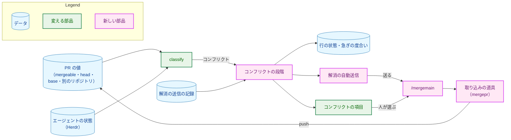
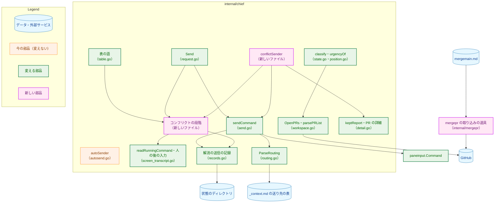
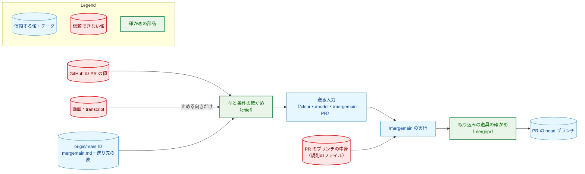
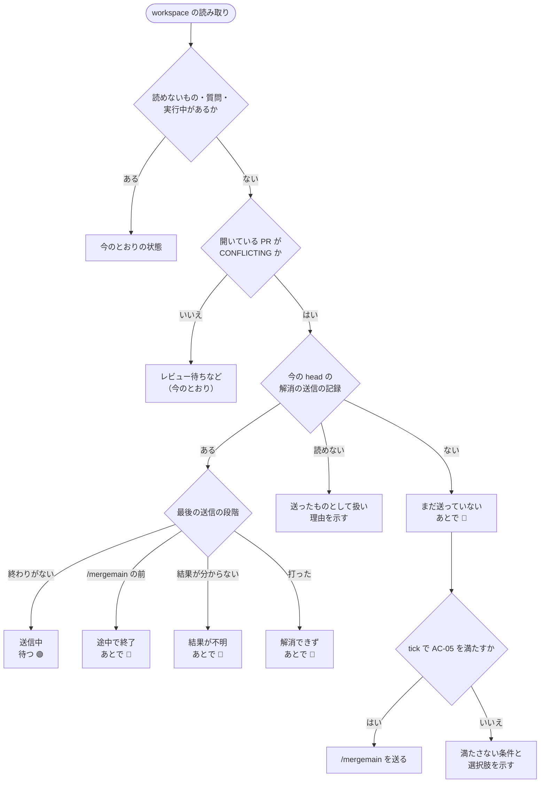
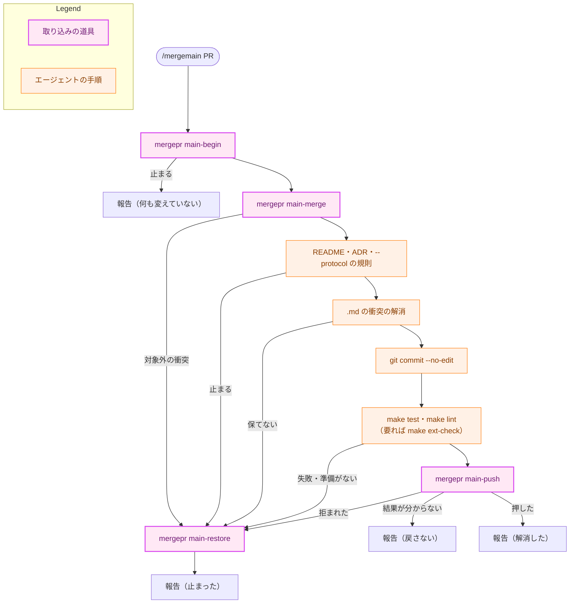

# 設計書：chief は PR のマージコンフリクトを見つけて `/mergemain` で解消させ、解消できなければ人の判断を求める

## Document Status

| Item | Value |
|---|---|
| Status | `draft` |
| Created | 2026-11-19 |
| Review date | - |
| Reviewer | - |
| Comments | - |

## 1. 設計の全体像

本書は [01_requirements.md](01_requirements.md)（以下、要件定義書）の F-001〜F-007 を実現する設計である。対象は次のとおりである。

-   chief（`internal/chief`・`cmd/chief`）。送る入力の型（`internal/chief/paneinput`）を含む。
-   `mergepr`（`internal/mergepr`・`cmd/mergepr`）。`/mergemain` の決定的な判定を受け持つサブコマンドを足す。
-   新しいコマンドの定義 `.claude/commands/mergemain.md`。
-   `.claude/commands/_context.md`、`/chief` の定義（`.claude/commands/chief.md`）、`/mergepr` と `/runpr` の定義、`.claude/settings.json`、CLAUDE.md、chief 利用ガイド（`docs/dev/guides/chief_guide.md`）、mergepr 利用ガイド（`docs/dev/guides/mergepr_guide.md`）。
-   ADR-0046 と ADR-0014。

既存のコードについての記述は、コミット `bb02c51c`（`origin/main`）で確かめた。

語は要件定義書 3.1 の定義に従う（「マージコンフリクト（コンフリクト）」「衝突」「内容の衝突」「PR の head」「コンフリクトの行」）。本書では次の語を足す。

-   **解消の送信**：chief が `/mergemain <PR>` を送る 1 回の送信。自動の送信と、人が選んだ送信の両方を指す。
-   **解消の送信の記録**：解消の送信ごとに、PR と PR の head を名前に持って残す記録（3.3）。
-   **送信の段階**：解消の送信がどこまで進んだか。`/mergemain` を打つ前に終わった、`/mergemain` を打ってエージェントが動き出したのを確かめた、結果が分からない、のいずれかである（3.3）。
-   **コンフリクトの段階**：コンフリクトの行の細分。まだ送っていない、送信中、`/mergemain` の前で終わった、結果が分からない、解消できず、の 5 つである（3.2）。
-   **取り込みの道具**：`mergepr` に足す 4 つのサブコマンド（`main-begin`・`main-merge`・`main-restore`・`main-push`）の総称（3.8）。
-   **基準の head**：`/mergemain` が始めたときの PR の head のコミット。戻す先であり、push の前に確かめる親である。
-   **項目 ID**：`snapshot`・`tick` の出力が、人の判断を待つ項目ごとに示す `id`（`ItemID`、`internal/chief/pending.go:108-110` の `itemID`）。
-   **H-NN**：設計への申し送り（[design_handoff.md](design_handoff.md)）の項目番号。各項目の扱いは付録 A にある。

### 1.1. 設計原則

-   **引き金は GitHub と git の状態に置く。** 自動の解消の送信は、GitHub の PR の値（`mergeable`、head、base、別のリポジトリかどうか）と、worktree の git の状態で決める。画面と transcript は、送ることを止める向きにだけ使う（AC-11）。
-   **PR の値は型で受け取る。** `mergeable` は 3 つの値の列挙型、PR の head は 40 文字の小文字の 16 進数だけを受け付ける型にする。形に合わない値は、その workspace の PR の一覧全体を読めないものとする（AC-04）。以降の判定は型だけで分かれる（CLAUDE.md の「Declare, don't infer」）。
-   **決定的な判定は Go に置く。** 衝突の分類、戻す前の確かめ、push の前の確かめは `mergepr` のサブコマンドが行う。エージェントに残すのは、`.md` の両側の変更を保てるかの判断と、README・ADR の規則の当てはめ、報告の作成だけである（ADR-0014）。
-   **既存の部品を使う。** 送信（`sendCommand`）、エージェントの静かさの判定（`quietness`）、送信の停止、報告の控え（`keepRecord`）、送り先の表（`ReadRouting`）、プロトコル番号の行の読み方（`internal/mergepr` の `acceptedLine`）は作り直さない。
-   **送った記録は作るだけで上書きしない。** 解消の送信の記録は、今の記録と同じく、同名のものがあれば作らない（ADR-0046 の「記録」）。
-   **分からなければ送らない。** 記録が読めない、transcript が読めない、PR の値が形に合わない、のどれでも送らない（AC-04・AC-05・AC-08）。

### 1.2. 設計の際に決めたこと（2026-11-19）

人に尋ねて決めたことは、最後に「人の答え」を書く。それ以外は本書の作成者が決めたことで、レビューで異論があれば直す。

-   **衝突の分類、戻す前の確かめ、push の前の確かめを、`mergepr` のサブコマンドに置く（H-04・H-06、3.8）。** 足すのは `main-begin`・`main-merge`・`main-restore`・`main-push` の 4 つである。
    -   今の Go の道具には、merge の途中の状態を読むものがない。`fixprguard` の push は merge コミットを拒む（`internal/fixprguard/worktree.go:620-625`）ので、`/mergemain` には使えない。
    -   プロトコル番号の行の読み方は、すでに `mergepr` にある（`internal/mergepr/protocolcheck.go:392` の `acceptedLine`）。同じパッケージの中で再利用できる。
    -   基準の head と `origin/main` のコミットは、`main-begin` の出力をセッションが次の呼び出しの引数で渡す。道具は状態のファイルを判定に読み返さない（ADR-0014 の「基準値を状態のファイルから読み返さない」）。
    -   `mergepr` の口の形が変わるので、プロトコル番号を `main` の値 + 1 にし、`/mergepr` と `/runpr` の定義の `--protocol` も直す。
    -   人に尋ねずに送った `/mergemain` が許可の確認で止まらないよう、`.claude/settings.json` の allow に 4 つのサブコマンドだけを足す。`prepare`・`merge` など、ほかのサブコマンドは今のとおり確認を出す。
    -   新しい道具を作る案は採らなかった。責務は明確になるが、入れる手順、利用ガイド、プロトコル番号、allow の規則がすべて新しく要るためである。手順を `mergemain.md` に書いてエージェントに判定させる案も採らなかった。ADR-0014 の「決定的な判定は Go に置く」の例外になり、人に尋ねずに送るコマンドで、手順の読み違いにより範囲の外の衝突を解消しうるためである。人の答え：`mergepr` に足す。
    -   ADR：[ADR-0014](../../dev/adr/0014-deterministic-checks-in-go.md) を更新する（`mergepr` が受け持つ判定に、`main` の取り込みの判定を足す）。[ADR-0046](../../dev/adr/0046-chief-of-staff.md) も更新する（「マージコンフリクトの解消の自動送信」に、決定的な判定を `mergepr` が行うことを足す）。道具の責務と、開発の手順の判定の置き場所を決めるので、主要な決定に当たる。
-   **AC-14 の「送り終えた後に pane が動いたこと」は、送信が `/mergemain` を打った後に確かめる、エージェントの状態の変化で確かめる（H-08、3.3）。**
    -   今の送信は、コマンドを打った後に、エージェントの状態が `working` か `blocked` になったのを見て初めて、その段を終えたとする（`internal/chief/send.go:579-582`）。`state_change_seq` の変化だけは信じない。
    -   そのため、結果が `sent` で終わった送信は、`/mergemain` を打った後に pane が動いたことを、Herdr の状態で確かめ済みである。
    -   送り終えたときの `state_change_seq` を記録し、後のラウンドで進んだことを見る案は採らなかった。記録の項目と比べる処理が増え、確かめる中身は同じだからである。人の答え：送信の確かめを使う。
    -   ADR：なし。AC-14 の実現の細部で、このタスクの中で閉じる。
-   **コンフリクトの行（「解消できず」の行を含む）には `/runpr` の選択肢を示さず、`/mergemain` だけを示す（3.5）。**
    -   今の `/runpr` の選択肢は、行がレビュー待ちのときだけ示される（`internal/chief/request.go:470-480` の `offeredRunpr`）。コンフリクトの行はレビュー待ちではないので、`offeredRunpr` は変えない。
    -   コンフリクト中の PR では CI が走らない。そこへ `/runpr` を送っても、CI を待つだけで、解消が先だからである。人が `/runpr` を走らせたいときは pane で打つ。
    -   両方を示す案は採らなかった。人の答え：`/mergemain` だけ。
    -   ADR：ADR-0046 を更新する（「マージコンフリクトの解消の自動送信」に書く）。人が選べる入力を決める。
-   **一覧の呼び出しが返す `mergeable` は、実物で確かめられなかった。そのため、未確認の危険として記し、実装の PR で確かめる（H-01、3.1）。**
    -   手元の `gh` で、`gh pr list --json` が `mergeable`・`headRefOid`・`baseRefName`・`isCrossRepository` をどれも受け付けることは確かめた（フィールドの一覧を出力させた）。
    -   人の承認を得て、`gh pr list --state open --json number,mergeable,headRefOid,baseRefName,isCrossRepository,headRefName` を 1 回だけ実行した。しかし開いている PR が 1 つもなく、`[]` が返った。そのため、一覧の呼び出しで GitHub が `mergeable` を計算するか、`UNKNOWN` が続きやすいかは確かめられていない。
    -   外れても安全な側に倒れる。`UNKNOWN` はコンフリクトとして扱わず（AC-03）、送らないので、外れたときの影響は気づくのが遅れることだけである。
    -   実装の PR で、開いている PR とコンフリクトの PR に対して、一覧の呼び出しと `gh pr view` の値を比べ、結果を計画書に記録する（8 章）。`UNKNOWN` が続くと分かれば、そのときに人に確かめる。人の答え：今確かめる（確かめられなかったので、本項のとおり扱う）。
    -   ADR：ADR-0046 の「結果」に書く。
-   **PR の値は、今のラウンドの `gh pr list` の `--json` に足して読む。新しい呼び出しは足さない（H-01、3.1）。**
    -   足すのは `mergeable`・`headRefOid`・`baseRefName`・`isCrossRepository` の 4 つである。workspace ごとに 1 回という今の呼び出しの数は変わらない（要件定義書 4.1）。
    -   PR ごとに `gh pr view` を足す案は採らなかった。呼び出しが開いている PR の数だけ増え、応答の時間も延びるためである。
    -   ADR：なし。読み取りの細部で、このタスクの中で閉じる。
-   **早く気づく仕組みは足さず、今のラウンドの間隔のままにする（H-02）。** コンフリクトに気づくのは、最長で `chief wait` の制限時間（既定 10 分）の後のラウンドになる。`UNKNOWN` が続けば、さらにラウンドを重ねる。要件定義書 2.3 がスコープ外とした。
    -   ADR：なし。ADR-0046 の「結果」がすでにこの遅れを書いている。
-   **解消の送信の記録は、送信ごとに、PR と PR の head と送信の ID を名前に持つ、作るだけの記録とする（H-03、3.3）。** worktree ごとの記録のディレクトリに置き、14 日で消す。
    -   今の送信の記録（`send-*`）は 25 分で消える（`internal/chief/records.go:942` の `sendKeepAge`）。そのため、「最後の解消の送信の段階」を後のラウンドで引けない。
    -   今の自動送信の記録（`autosend-<PR>.json`）は PR ごとに 1 件で、head を持たない。
    -   14 日は、今の PR の詳細の控えの保持の期間（`detailMaxAge`、`internal/chief/records.go:616`）と同じである。同じ head のまま 14 日コンフリクトが続けば、記録が消えて自動でもう一度送りうる。これを残る危険として受け入れる。
    -   ADR：ADR-0046 を更新する（「記録」に解消の送信の記録を足す）。ADR-0014 も更新する（chief が判定に読み返す記録の一覧に足す）。記録の種類の決定を変えるので、主要な決定に当たる。
-   **コンフリクトの項目と「解消できず」の項目は、新しい項目として今の通知の規則のまま通知する（H-12、3.5）。**
    -   今の通知の記録は、項目 ID ごとに 1 回である（`internal/chief/records.go:403-457`）。レビュー待ちの項目の ID は `("review", workspace, PR)` から作る（`internal/chief/pending.go:153`）。コンフリクトの項目は、種類、PR、head、コンフリクトの段階から作るので、レビュー待ちとして通知した PR でも、コンフリクトになれば新しく通知する。「解消できず」になったときも、段階が変わって ID が変わるので、もう一度通知する。
    -   待ち受けのラウンドで自動で送れた行は実行中になり、項目を作らないので通知しない（`internal/chief/tick.go:121-161` の `applyAutoSends` と同じ扱い）。
    -   通知の規則は変えない。要件定義書 AC-14 の「今の通知の規則に従う」のとおりである。
    -   ADR：なし。今の通知の規則の当てはめである。
-   **報告の控えの引き継ぎは、PR の詳細を読むときに merge コミットの親をたどって行い、新しい記録は作らない（H-07、3.7）。** リセットの確かめは、今のとおり、ちょうどその head の控えだけを読む。
    -   新しい head の控えがなく、新しい head が 2 つの親を持つ merge コミットで、第 1 の親に控えがあり、第 2 の親が `origin/main` の履歴にあれば、第 1 の親の控えを使う。続けて `/mergemain` が解消した場合に備え、たどる回数に上限を設ける。
    -   引き継ぐ記録を作る案は採らなかった。`snapshot` は通知の記録のほかに記録を作らない（`internal/chief/snapshot.go:104-108`）ので、作る時点を `tick` か `detail` に限ることになり、表と詳細で見え方が分かれるためである。
    -   リセットに引き継いだ控えを使わないのは、`/mergemain` を送った pane では、人の最後の入力が `/mergemain` になり、リセットの確かめ（`internal/chief/reset.go:55-65` の `lastInputMadePR`）が通らないことが分かっているからである。ADR-0046 の「結果」がすでにそう書いている。
    -   ADR：なし。ADR-0046 の「送る前に PR を作ったコマンドの報告を読めれば控えを作り、新しい head に引き継ぐ」の実現の細部である。
-   **PR のブランチの `mergemain.md` は、`git show` で `HEAD` のコミットの中身を読み、`origin/main` のものとバイト列で比べる（H-09、3.4）。** 作業ツリーのファイルは読まない。AC-05 の (3) で、HEAD が PR の head と同じで、作業ツリーに変更がないことを、同じラウンドで確かめているためである。
    -   ADR：なし。読み取りの細部で、このタスクの中で閉じる。
-   **`/mergemain` をタスクのコマンドとして数える（H-09、3.6）。** 送る入力の型（`paneinput.CommandKind`）に `/mergemain` を足すと、transcript の人の最後のタスクのコマンドの読み取り（`internal/chief/screen_transcript.go:332-345` の `taskCommandOf`）も `/mergemain` を数える。表の実行中のコマンドにも `/mergemain` が出る。
    -   ADR：なし。要件定義書 1 章の作成者が決めた事項の実現である。
-   **`/mergemain` の merge コミットのメッセージは、git の既定のメッセージにする（H-11、3.8）。** `main-merge` が `--no-commit` で取り込み、`/mergemain` が `git commit --no-edit` で merge コミットを作る。既定のメッセージには `Editorial correction: ` の行がないので、`mergepr` の訂正の行の読み取り（`internal/mergepr/corrections.go:84-101`）は変わらない。
    -   ADR：なし。`/mergemain` の手順の中で閉じる。
-   **PR レビューの再依頼の判定と、ローカルのレビューの記録の判定は変えない（H-05、付録 B）。** merge コミットは、今の判定でいつも「見ていない」に数えられ、マージの質問で尋ねる形になる。これは要件定義書が受け入れた費用の範囲である。
    -   ADR：なし。ADR-0046 の「結果」がすでにこの費用を書いている。本書は、確かめた結果を付録 B に書く。
-   **CLAUDE.md の「Declare, don't infer」に、取り込みの道具の読み取りの例外を足す（3.8.4）。** 取り込みの道具は、衝突したパスの名前（`.md` で終わるか）、git の段（stage）の項目、衝突した Go のファイルのプロトコル番号の行の中身を読んで分類を決める。今の `mergepr` の例外は、コミットのメッセージの読み取りだけを範囲にしている。範囲を明示するため、読み取りの例外として書き足す。
    -   ADR：なし。CLAUDE.md の規則の例外の一覧で、ADR ではない（CLAUDE.md の「Design decisions (ADR)」）。

## 2. システム構成

### 2.1. 概念モデル

コンフリクトの行は、GitHub の PR の値と、解消の送信の記録から決まる。図の矢印 A → B は「A から B を決める」を表す。



`/mergemain` が解消して push すると、PR の head が変わる。次のラウンドで GitHub が `MERGEABLE` を返せば、行はレビュー待ちに戻る（AC-16）。同じ head のまま `CONFLICTING` なら「解消できず」になる（AC-14）。

### 2.2. コンポーネント配置

図の矢印 A → B は「A が B を呼ぶか読む」を表す。



`autoSender`（マージの後の自動送信）の条件と結果は変えない。同じラウンドでマージの後の自動送信が入力を送った workspace へは、解消の自動送信は送らない（3.4）。`mergemain.md` から `mergepr` への矢印は、`/mergemain` を実行するエージェントが、定義に従って道具を呼ぶことを表す。

### 2.3. データの流れ（`tick` の 1 ラウンド）

図の矢印は、呼び出しと応答を表す。今のラウンドとの違いは、PR の一覧で `mergeable` などを読むことと、マージの後の自動送信の後に、解消の自動送信を走らせることである。作成の排他は、今のとおり自動送信の間だけ持つ。


## 3. コンポーネント設計

### 3.1. PR の値の読み取り（F-001、H-01）

ラウンドごとの `gh pr list`（`internal/chief/workspace.go:142-148` の `OpenPRs`）の `--json` に、`mergeable`・`headRefOid`・`baseRefName`・`isCrossRepository` を足す。読み取り（`parsePRList`、`internal/chief/workspace.go:35-72`）は、今の `strictjson` の `Collect` に 4 つのメンバーを足し、すべて必須にする。

```go
// Mergeable is GitHub's mergeable value of an open PR. The zero value is
// MergeableUnknown, the value that sends nothing.
type Mergeable int

const (
	MergeableUnknown Mergeable = iota
	MergeableMergeable
	MergeableConflicting
)

// CommitID is a full commit ID: 40 lowercase hexadecimal digits. Only its
// constructor makes one.
type CommitID struct{ hex string }

// OpenPR is an open PR of a workspace's branch.
type OpenPR struct {
	Number          int
	Title           string
	URL             string
	Mergeable       Mergeable
	Head            CommitID
	Base            string
	CrossRepository bool
}
```

-   **受け付ける形。** AC-04 のとおりである。`mergeable` は `MERGEABLE`・`CONFLICTING`・`UNKNOWN` のどれかとバイト単位で一致する文字列、`headRefOid` は 40 文字の小文字の 16 進数の文字列、`baseRefName` は空でない文字列、`isCrossRepository` は真偽値に限る。
-   **重なったメンバー。** 今の `Collect` は、列挙したメンバーが 2 回あれば拒む（`internal/strictjson/strictjson.go:92-105`）。4 つを列挙に足すので、重なりも拒まれる。
-   **拒んだとき。** 1 つの要素でも拒めば、今の `errPRList` と同じく、その workspace の一覧全体を読めないものとする。`readWorkspace`（`internal/chief/snapshot.go:404-412`）は今のとおり「要確認」にする。
-   **head の型。** 今は 40 文字の 16 進数の確かめが、正規表現 `commitID`（`internal/chief/detail.go:44`）として 3 か所にある（`internal/chief/detail.go:129`、`internal/chief/workspace.go:134`、`internal/chief/create.go:483`）。`CommitID` はこの正規表現を使って作る。既存の 3 か所を `CommitID` に移すかは計画書で決める。
-   **PR の詳細の head。** PR の詳細の取得（`gh pr view`、`internal/chief/detail.go:463`）は今のまま `headRefOid` を読む。
-   **呼び出しの数。** 送る直前の読み直し（自動送信の `recheck`、人が選んだ送信の `Send`）は、今の `readWorkspace` を呼ぶので、同じ `gh pr list` で 4 つの値を読み直す。新しい GitHub の呼び出しはない（要件定義書 4.1）。

### 3.2. 行の状態とコンフリクトの段階（F-001・F-003、H-10）

#### 3.2.1. 行の状態

行の状態（`WorkspaceState`、`internal/chief/state.go:13-28`）に `StateConflict` を足す。`classify`（`internal/chief/state.go:496-552`）は、今の順のまま、実行中の判定の後、レビュー待ちの判定の前に、次の分岐を足す。

-   開いている PR があり、その `Mergeable` が `MergeableConflicting` なら、`StateConflict` とする。
-   読めないもの、質問、実行中のエージェントがあれば、今のとおりそちらが先に決まる（AC-02 の「実行中と質問の行の扱いは今のまま」）。
-   `MergeableMergeable` と `MergeableUnknown` は、今のとおりレビュー待ちになる（AC-03・AC-16）。

`classify` は workspace の読み取りだけを見る純粋な判定なので、コンフリクトの段階は決めない。段階は、記録と transcript を読む今の `addRecords`（`internal/chief/snapshot.go:287`）と同じ場所で決める（3.2.2）。

#### 3.2.2. コンフリクトの段階

コンフリクトの行には、段階を型で持たせる。段階は、PR とその今の head についての解消の送信の記録（3.3）と、エージェントの状態から決める。

```go
// ConflictPhase is how far the resolution of a conflict row has gone for the
// PR's current head. The zero value is ConflictUnsent.
type ConflictPhase int

const (
	ConflictUnsent             ConflictPhase = iota // no resolution send for this head
	ConflictSending                                 // a send has started and has no end yet
	ConflictEndedBeforeCommand                      // the last send ended before /mergemain was typed
	ConflictOutcomeUnknown                          // the last send's end says its outcome is unknown
	ConflictUnresolved                              // the last send was sent, every agent waits, the head is the same
)
```

| 段階 | 決まる条件 | 表の語 | 急ぎの度合い・番 |
|---|---|---|---|
| まだ送っていない | その head の解消の送信の記録がない | コンフリクト | あとで 🔶・人 |
| 送信中 | 最後の解消の送信に、終わりの記録がない | コンフリクト（送信中） | 待つ 🟢・AI |
| `/mergemain` の前で終わった | 最後の解消の送信の段階が、`/mergemain` を打つ前に終わったことを示す | コンフリクト（送信は途中で終了） | あとで 🔶・人 |
| 結果が分からない | 最後の解消の送信の終わりが、結果が分からないことを示す（人が送信の停止を解除したとき） | コンフリクト（送信の結果が不明） | あとで 🔶・人 |
| 解消できず | 最後の解消の送信が `/mergemain` を打ってエージェントが動き出したのを確かめて終わり、今エージェントがすべて入力を待っている | 解消できず | あとで 🔶・人 |

-   **「解消できず」の条件（AC-14）。** 3 つの条件はそれぞれ次のように満たされる。
    -   「`/mergemain` まで打って送り終えた記録」は、送信の段階が「打った」である記録が満たす。
    -   「送り終えた後に pane が動いたこと」は、その送信が `/mergemain` を打った後にエージェントの状態が `working` か `blocked` になったのを確かめたことで満たす（1.2）。
    -   「その後、エージェントがすべて入力を待っている」と「同じ head のまま `CONFLICTING`」は、このラウンドの読み取りが満たす。エージェントが動いていれば `classify` が実行中にするので、コンフリクトの行にはならない。
-   **送信中（AC-14 の「待つ 🟢」）。** 終わりの記録がない送信は、今の送信の規則で、chief の起動時に送信の停止に変わる（`internal/chief/records.go:808-824` の `SettleUnfinished`）。そのため、この段階は、ほかの送信と同じ排他の間にだけ現れる。停止された workspace の行は、今のとおり停止を先に示す（`internal/chief/position.go:207-226` の `urgencyOf`、すぐ 🛑）。
-   **`/mergemain` を打った後に失敗した送信。** 今の送信の規則で送信の停止になる（`sent_then_failed`、`internal/chief/send.go:548-560`）。行は停止を示し、段階は表に出ない。
-   **表の語。** 状態の文字列「コンフリクト」と「解消できず」、段階の詳細の語は、`internal/chief/table.go` の固定の語（`progressWord` と内容の列）に足す。CLAUDE.md の「Go Idioms」の状況の表の例外の範囲に入る。内容の列は、今のレビュー待ちと同じく PR の題名を示し、その前に段階の語を置く。
-   **進行の表示。** `Progress`（`internal/chief/position.go:58-78`）に「コンフリクト」と「解消できず」を足し、`progressOf`・`progressName`（`internal/chief/output.go:446`）を合わせる。
-   **送れない条件。** まだ送っていない行で、AC-05 の条件のうち満たさないものがあれば、その条件を状態の詳細で示す（3.4.3）。

#### 3.2.3. 出力

-   **行の出力（`RowOutput`、`internal/chief/output.go:38-62`）。** `state` に `conflict` が増え、コンフリクトの行に `conflict` の項目（段階の名前、PR の head、送れない条件の一覧）が増える。`pr` に `head` を足す。
-   **自動送信の結果（`auto_sends`、`internal/chief/output.go:698-716`）。** 1 件ごとに、マージの後の送信か解消の送信かを示す `kind` を足す。
-   **プロトコル番号。** 出力と `chief send` の口の形が変わるので、chief のプロトコル番号を `main` の値 + 1 にし、`/chief` の定義の `--protocol` を直す（H-10）。

### 3.3. 解消の送信の記録（F-002・F-003・F-004、H-03）

#### 3.3.1. 記録の形

解消の送信ごとに、worktree ごとの記録のディレクトリに 2 つの記録を作る。

| 記録 | 名前 | 作る時 | 中身 |
|---|---|---|---|
| 始まり | `mergemain-<PR>-<head>-<送信の ID>-start.json` | 最初の入力（`/clear`）を送る前 | PR、head、送信の ID、自動か人か、時刻 |
| 終わり | `mergemain-<PR>-<head>-<送信の ID>-end.json` | 送信が終わったとき | 送信の段階、理由の種類、時刻 |

```go
// ResolutionStage is how far a resolution send went. The zero value is
// StageUnknown, the stage that assumes nothing was confirmed.
type ResolutionStage int

const (
	StageUnknown       ResolutionStage = iota // released by the human without an end
	StageBeforeCommand                        // ended before /mergemain was typed
	StageCommandStarted                       // /mergemain was typed and the agent started it
)

// ResolutionTrigger is who decided a resolution send.
type ResolutionTrigger int

const (
	TriggerAuto ResolutionTrigger = iota + 1
	TriggerHuman
)
```

-   **送信の ID。** 今の送信の記録（`send-<id>-start.json`、`internal/chief/records.go:602`）の ID をそのまま使う。ID は時刻の数字で始まり、並べると送った順になるので、「最後の解消の送信」は ID の最も大きいものとする。
-   **作るだけ。** どちらの記録も、今の記録と同じく、同名のものがあれば作らず、上書きしない（`privatefile.Create`）。
-   **終わりの記録と今の送信の記録。** 終わりの記録は、今の送信の終わりの記録（`send-<id>-end.json`）を書くのと同じ時点で書く。送信の段階は、今の送信の結果から決まる。結果が `sent` なら `StageCommandStarted`、入力の前か `/mergemain` の前で終わったら `StageBeforeCommand` である。`sent_then_failed` は送信の停止になるので、段階は表に出ない。
-   **結果が分からない送信。** 終わりの記録のない送信は、今の規則で送信の停止になる。人がその停止を解除する（`chief release`、`internal/chief/records.go:830-851`）と、終わりのない解消の送信に、段階 `StageUnknown` の終わりの記録を書く。
-   **消す規則。** 始まりの記録の時刻から 14 日の後、今の `cleanup` が消す。worktree を作り直す前と workspace を消し終えた後には、今の `ClearRecords`（`internal/chief/records.go:1456-1477`）が、ほかの記録と一緒に消す。終わりのない始まりの記録も、14 日の後に消す。今の送信の記録の「終わりのない始まりは消さない」の規則（`internal/chief/records.go:947-973`）は、送信の停止を残すためのもので、解消の送信の記録には当てない。停止は `stop.json` が持つからである。

#### 3.3.2. 記録の使い道

-   **AC-08（自動では head ごとに 1 回）。** その PR とその head の解消の送信の記録が 1 件でもあれば、自動では送らない。記録のディレクトリを読めないとき、またはその PR とその head の記録の 1 件でも読めないときは、送ったものとして扱う。
-   **AC-19（人が選んだ送信も記録する）。** 人が選んだ送信も同じ記録を作る。人が選んだ送信の後は、その head に自動では送らない。
-   **AC-14（「解消できず」の判定）。** 最後の解消の送信の段階で決める（3.2.2）。
-   **送る中身は左右しない。** 記録は、送ることを止める条件と、行の段階の表示にだけ使う。何を送るかは、PR の番号と型から決まる（ADR-0046 の「記録」）。

### 3.4. 解消の自動送信（F-002）

#### 3.4.1. 置き場所と順

`tick` の中で、マージの後の自動送信（`autoSender.run`、`internal/chief/tick.go:80-81`）の後、作成の排他を持ったまま、解消の自動送信（`conflictSender`）を走らせる。`snapshot` では走らせない（AC-06）。

-   **対象。** このラウンドで、コンフリクトの段階が「まだ送っていない」と決まったコンフリクトの行だけである。前のラウンドの状態は見ない（AC-07）。
-   **マージの後の自動送信との関係。** 同じラウンドで、マージの後の自動送信が入力を送った workspace には送らない。今の自動送信が送った workspace を、`applyAutoSends`（`internal/chief/tick.go:121-161`）と同じく結果から引く。
-   **作成の排他を取れなかったラウンド。** 何も送らず、行に理由を示す（今の自動送信と同じ）。

#### 3.4.2. 条件

AC-05 の条件と、使う既存の部品の対応は次のとおりである。ラウンドの読み取りで 1 度判定し、送るときは workspace の排他を持って、(1)・(3)・(4)・(5)・(7)・(8) を読み直してから送る。

| AC-05 | 確かめ | 使う部品 |
|---|---|---|
| (1) | 開いている、base が `main`、head がこのリポジトリのブランチ、`CONFLICTING`。読み直しでも同じで、head が変わっていない | 3.1 の `OpenPR`。読み直しは `readWorkspace` |
| (2) | Claude Code の pane がちょうど 1 つ | `targetPane`（`internal/chief/send.go:366-379`） |
| (3) | 今のブランチが PR の head ブランチ、HEAD が PR の head、作業ツリーに変更がない。`main` の取得が成功し、`origin/main` が `origin` の `main` と同じ | `GitReader.Branch`・`Head`・`Clean`、`checkRemote`（`internal/chief/autosend.go:318-332`）、`fetchFailed` |
| (4) | エージェントがすべて入力を待っている | `quietness`（`internal/chief/autosend.go:430-447`） |
| (5) | 送信が止まっていない | `existingRecords` と `Stopped` |
| (6) | transcript を読め、人の最後のタスクのコマンドの後に人の入力がない | 3.6 の人の後の入力の読み取り |
| (7) | その PR とその head の解消の送信の記録がない | 3.3 |
| (8) | PR のブランチの `mergemain.md` が `origin/main` のものとバイト単位で同じ | `git show HEAD:.claude/commands/mergemain.md` と `git show origin/main:.claude/commands/mergemain.md` |
| (9) | 送り先の表の `mergemain` の行が Claude Code。入力欄が空で、モデルが切り替わった | `ReadRouting`、`sendCommand` の今の確かめ（`checkPane`・`awaitModel`） |

-   **(3) のブランチの比べ方。** 今のマージの後の自動送信の git の条件（`gitConditions`、`internal/chief/autosend.go:141-162`）は、HEAD が `origin/main` を指すことを求める。そのため、そのままは使えない。読み取りの関数（`readGitState`、`checkRemote`）を使い、PR の head ブランチと PR の head を比べる条件を新しく組む。
-   **(8) の読み取り。** `git show` は今の `Tasks` の読み取り（`internal/chief/task.go:1059`）と同じ形で、worktree の中で行う。どちらかが読めなければ満たさない。
-   **(9) の送り先。** 送り先の表の `mergemain` の行のエージェントが OpenCode なら、送らず、そのことを示す（AC-34）。
-   **報告の控え（AC-12）。** 条件がすべて通った後、最初の入力の前に、3.7 の控えを作れれば作る。作れなくても送る。

#### 3.4.3. 送らなかったときの示し方

満たさない条件があれば、送らずに、その条件を行の状態の詳細に示す。条件は、今のマージの後の自動送信の理由（`AutoSendResult.Reasons`）と同じく、英語の理由の種類の列で出力し、表には `table.go` の固定の語で示す。

| 理由の種類 | AC-05 |
|---|---|
| `pr_changed` | (1) の読み直しで、閉じた、base が変わった、`CONFLICTING` でなくなった、head が変わった |
| `pr_not_main_base` | (1) base が `main` でない |
| `pr_cross_repository` | (1) head が別のリポジトリのブランチ |
| `no_single_claude_pane` | (2) |
| `branch_mismatch` / `head_mismatch` / `dirty` / `fetch_failed` / `remote_mismatch` | (3) |
| `agents_not_waiting` | (4) |
| `stopped` | (5) |
| `later_input` / `no_transcript` / `transcript_unreadable` | (6) |
| `already_sent` / `record_unreadable` | (7) |
| `definition_missing` / `definition_differs` | (8) |
| `route_not_claude` / `route_unreadable` | (9) と AC-34 |

-   **送信の結果。** 送ったときの結果は、今の送信の結果（`OutcomeSent` など）で返す。行には、今の `applyAutoSends` と同じ規則で当てる。送れた行は実行中になり、入力の後で失敗した行は要確認になる。
-   **理由の名前。** 名前は計画書で確定する。本書は、AC-05 の各条件を区別できる種類を持つことを決める。

### 3.5. 人が選ぶ解消の送信（F-004）

-   **項目。** 待っている項目の種類（`PendingKind`、`internal/chief/pending.go:36-54`）に `PendingConflict` を足す。コンフリクトの行のうち、段階が「送信中」以外のものに 1 つ作る。項目 ID は、種類、workspace、PR の番号、PR の head、コンフリクトの段階から作る。そのため、head か段階が変われば ID も変わる。
-   **選択肢を示す条件（AC-17）。** AC-18 の条件（AC-05 の (2)・(3)・(4)・(5)・(8)・(9) と、PR の条件）を満たすときだけ、送る選択肢を示す。満たさないときは選択肢を示さず、満たさない条件を項目の理由に示す。人の最後のタスクのコマンドの後に人の入力があれば、送ると `/clear` でその会話が消えることを、項目に印として添える。
-   **送信中の行（AC-17）。** 段階が「送信中」の行には選択肢を示さない。送信中は送信の排他を持つ間だけで、その間は AC-18 の (4) を満たさないためである。
-   **送り方（AC-18）。** `chief send --command mergemain --item <項目 ID>` で送る。`--item` は必須で、`--pr` は受け付けない。道具は workspace の排他を持って行を作り直し、作り直した行の項目 ID が `--item` と等しく、AC-18 の条件をすべて満たすときだけ送る。項目 ID は PR の番号と head を含むので、人が選んだ項目と同じ PR・同じ head にだけ送る。
-   **`/runpr` を示さない。** コンフリクトの行は `StateAwaitingReview` ではないので、今の `offeredRunpr` は `/runpr` を示さない（1.2）。
-   **記録。** 人が選んだ送信も、送る前に解消の送信の記録を作る（3.3、AC-19）。

### 3.6. transcript の読み取り（H-09）

-   **送る入力の型。** `paneinput.CommandKind`（`internal/chief/paneinput/paneinput.go:92-141`）に `CommandMergemain`（名前 `mergemain`）を足し、PR の番号を引数に取るコンストラクタを足す。番号の型は、`/runpr` と同じ `fixprguard.PRNumber` にする（`internal/chief/paneinput/paneinput.go:360-365` の `NewRunpr` と同じ形）。送り先の行の鍵（`RouteKey`）に `mergemain` を足す。
-   **実行中のコマンド。** `taskCommandOf` は `ParseCommandKind` を使うので、`/mergemain` もタスクのコマンドとして数える。実行中のコマンドの引数の確かめ（`validRunningArg`、`internal/chief/running.go:50-63`）に、`/mergemain` の PR の番号の形を足す。`/mergemain` を走らせた pane の実行中のコマンドは `/mergemain <PR>` と示され、その前の `/runpr` などの後の入力の印（`＋指示`）は付かない。
-   **人の後の入力の読み取り（AC-05 の (6)）。** 今の `readRunningCommand`（`internal/chief/screen_transcript.go:299-345`）は、タスクのコマンドがないセッションを「決まらない」と返し、人の入力の有無を区別しない。そこで、同じ人の入力の走査（`scanHumanInputs`）から、次の型を返す読み取りを足す。

```go
// LaterInput is whether the human typed anything after the last task
// command of a Claude Code session. The zero value is LaterInputUnreadable.
type LaterInput int

const (
	LaterInputUnreadable  LaterInput = iota // the transcript cannot be read
	LaterInputAbsent                        // the transcript file does not exist yet
	LaterInputNone                          // no human input after the last task command
	LaterInputAfter                         // a human input after the last task command
	LaterInputNoTaskEmpty                   // no task command and no human input at all
	LaterInputNoTaskInput                   // no task command but some human input
)
```

-   **満たす値。** AC-05 の (6) を満たすのは `LaterInputNone` と `LaterInputNoTaskEmpty` だけである。`LaterInputAbsent` は満たさない（要件定義書「要件定義の際に決めたこと」）。今の報告の読み取り（`readClaudeReport`、`internal/chief/transcript.go:186-218`）は、ファイルがないことを報告がないものとして読む。この読み取りは、それと違ってファイルがないことを満たさないものとする。
-   **人が選ぶ送信の印。** `LaterInputAfter` と `LaterInputNoTaskInput` のとき、項目に会話が消える印を添える（AC-17）。人が選ぶ送信は (6) を条件にしない（AC-18）。
-   **今の振る舞いへの影響。** 次の 2 つは今の振る舞いを変える。どちらも ADR-0046 の「結果」がすでに書いている。
    -   `/mergemain` を走らせた pane では、人の最後の入力が `/mergemain` になる。そのため、`/runpr` の後のリセット（`internal/chief/reset.go:55-65` の `lastInputMadePR`）は `NotSentOtherInput` で見送られる。
    -   タスクのコマンドの種類を列挙している箇所は、`/mergemain` を足すか、足さない理由を書く。列挙の箇所は、`internal/chief/skiprecord.go:84-90` の `commandKinds`、`internal/chief/records.go:689-694` の `SendRecord.Kind` の説明、`internal/chief/routing.go:27-34` の `routingRows`、`internal/chief/output.go` と `internal/chief/table.go` の種類の `switch` である。計画書でこれらを一つずつ当たる。リセットの見送りの記録（`skiprecord`）は、PR を作ったコマンドだけを記録するので、`/mergemain` は記録の対象に入らない。

### 3.7. 報告の控えと引き継ぎ（AC-12、H-07）

-   **送る前の控え。** 解消の送信の直前（条件がすべて通った後、最初の入力の前）に、今の `keptReport`（`internal/chief/detail.go:531-565`）を、報告の控えを作ってよい形（`ReportRecordAllowed`）で、PR の head を 3.1 の `OpenPR.Head` として呼ぶ。
    -   今の `readReport`（`internal/chief/detail.go:590-631`）は、Claude Code の pane の最後の報告が、transcript の PR の記録でその PR を名指すときだけ、報告として読む。AC-05 の (2) で Claude Code の pane はちょうど 1 つなので、読めれば候補は 1 つになる。
    -   読めなければ、今のとおり PR の説明の控えになる。控えを作れないか、作るのに失敗しても送る。控えの失敗はラウンドの問題に示す。
-   **引き継ぎ（PR の詳細を読むとき）。** `chief detail` と、`snapshot` の詳細の読み取りで、PR の今の head の控えがないときは、次をすべて満たす間、親をたどって控えを探す。
    -   今の head が、ちょうど 2 つの親を持つ merge コミットである。
    -   第 2 の親が `origin/main` の履歴にある（今の `IsAncestor`、`internal/chief/workspace.go:317-329`）。
    -   第 1 の親の控えがある。なければ、第 1 の親について同じ確かめを繰り返す。たどる回数には上限を設ける（値は計画書で決める）。
-   **親を読む git の呼び出し。** 今の chief には、コミットの親を読む呼び出しがない。親を読む呼び出し（`git rev-list --parents -n 1 <commit>` の形）を `GitReader` に足す。手元にそのコミットがなければ、引き継がず、PR の説明から要約する。
-   **使い道を表示に限る。** 引き継いだ控えは、PR の詳細の表示にだけ使う。リセットの確かめ（`resetAfterRunpr`、`internal/chief/reset.go:175-241`）、`/runpr` の前の `ensureDetail`（`internal/chief/request.go:488-497`）、レビューを省けるかの表示（`internal/chief/snapshot.go:309-314`）は、今のとおり、ちょうどその head の記録だけを読む（1.2）。

### 3.8. 取り込みの道具（`mergepr`、F-005、H-04・H-06・H-11）

#### 3.8.1. サブコマンド

`/mergemain` は、次の順にサブコマンドを呼ぶ。どのサブコマンドも `--protocol` を必須とし、今の `mergepr` と同じく番号が違えば何も読まずに止まる。

| サブコマンド | 受け取るもの | 行うこと | 出力 |
|---|---|---|---|
| `main-begin <PR>` | PR の番号 | PR の値の確かめ（AC-21）、`git fetch origin`、手元の状態の確かめ | 基準の head、PR の head ブランチ、取り込む `origin/main` のコミット。または止まる理由 |
| `main-merge` | 基準の head、ブランチ、`origin/main` のコミット | 手元が基準のままであることを確かめ、`--no-commit` で取り込み、衝突を分類し、ブランチが変えたプロトコル番号を `origin/main` の値 + 1 にする | 衝突の一覧と分類、規則が要る事柄（3.8.2）。または止まる理由 |
| `main-restore` | 基準の head、ブランチ、`origin/main` のコミット | 自分が作ったものだけがあることを確かめて、基準の head へ戻す | 戻した後の状態。または戻さなかった理由 |
| `main-push` | 基準の head、ブランチ、`origin/main` のコミット | HEAD が基準の head と `origin/main` のコミットを親とする merge コミットで、作業ツリーに変更がなく、`origin` のブランチが基準の head のままであることを確かめて push する | 押した head。または止まる理由、結果が分からないこと |

-   **基準値の渡し方。** 基準の head と `origin/main` のコミットは、`main-begin` の出力をセッションが引数で渡す。道具は状態のファイルを判定に読み返さない（ADR-0014）。`main-merge`・`main-restore`・`main-push` は、受け取った値が 40 文字の小文字の 16 進数であることを確かめ、手元の git でも確かめ直す。
-   **PR の読み取り（AC-21・AC-30）。** `main-begin` は `gh pr view <PR> --json` で、状態、base ブランチ、head ブランチ、head のコミット、別のリポジトリかどうかだけを読む。本文、コメント、レビューは読まない。読み取りは今の `mergepr` の PR の読み取り（`internal/mergepr/mergepr.go` の `prViewFields`）とは別の、狭いメンバーの組にする。
-   **取得。** `main-begin` は `main` と PR の head ブランチを、取り込む先の ref を明示した refspec で取得する。今の `prepare` が `main` を取得する形（`internal/mergepr/mergepr.go` の `mainRefspec`）と同じである。
-   **取り込むものがない（AC-21）。** `origin/main` のコミットが基準の head の祖先なら、`main-begin` は「取り込むものがない」で止まる。

#### 3.8.2. 衝突の分類（AC-23）

`main-merge` は、取り込みの後に残った衝突を、パスごとに次のどれか 1 つに分類する。分類は git の段（stage）の項目、パスの名前、衝突した Go のファイルの中身だけから決め、エージェントは分類を変えられない。

```go
// ConflictKind is the class of one conflicted path. The zero value is
// ConflictOutOfScope, the class that stops the run.
type ConflictKind int

const (
	ConflictOutOfScope     ConflictKind = iota // any conflict the rules do not allow
	ConflictMarkdown                           // a content conflict of a .md file
	ConflictProtocolOnly                       // a content conflict of a protocol declaration line only
)
```

-   **`.md` の内容の衝突。** パスが `.md` で終わり、3 つの段（共通の祖先、ブランチ、`main`）がそろった衝突か、両側が同じパスにファイルを足した衝突（共通の祖先の段がない）で、どの段も通常のファイルである。
-   **プロトコル番号の行だけの衝突。** パスが `internal/<name>/` の直下の、`_test.go` でない Go のファイルである。3 つの段のそれぞれに、`acceptedLine` の形の宣言の行がちょうど 1 つある。その行を除けば、3 つの版の衝突がない。
-   **対象外の衝突。** 上のどちらでもない衝突は、すべて対象外である。modify/delete（どちらかの段がない）、名前の変更による衝突、通常のファイルでない段（シンボリックリンク、サブモジュール）、バイナリ、`.md` 以外のファイルの衝突がこれに当たる。名前の変更による衝突は、段の組が上の 2 つの形に合わないので、対象外に分類される。
-   **止まる。** 対象外が 1 つでもあれば、`main-merge` は解消に進まずに止まり、一覧を出力する（AC-23）。`/mergemain` は `main-restore` で戻す。
-   **プロトコル番号。** `main-merge` は、プロトコル番号の行だけの衝突と、衝突しなかったが基準の head が merge base から番号を変えた道具の両方で、番号を `origin/main` の値 + 1 にする（AC-22）。番号を変えたかの判定は、今のマージの前の確かめと同じ規則（`internal/mergepr/protocolcheck.go:851-871` の `commitChange`）に合わせる。文書の `--protocol` を合わせるのは `.md` の変更なので、エージェントが行う。
-   **規則が要る事柄。** `main-merge` は、分類に加えて次の事実を出力する。エージェントはこれを見て、AC-22 の規則を当てる。
    -   `README.md` か `README.en.md` が取り込みで変わったか、衝突したか。
    -   `docs/dev/adr/` が merge base の後に `main` で変わったか。ブランチが足した ADR の番号のうち、`main` の ADR と重なる番号。
    -   取り込みで `extension/` の下、`README.md`・`README.en.md`・`docs/dev/guides/development.md` が変わったか（AC-26 の `make ext-check` の要否）。
    -   `make ext-check` の準備があるか（Node の版と、`make ext-install` が入れる依存）。判定の方法は計画書で決める。
    -   番号を変えた道具とその新しい値（AC-29 の「入れ直す必要がある」）。

#### 3.8.3. 戻す（AC-28、H-06）と push（AC-27）

-   **戻してよい状態。** `main-restore` が戻すのは、次のどちらかのときだけである。
    -   HEAD が基準の head で、取り込みの途中（`MERGE_HEAD` が `origin/main` のコミット）である。このときは取り込みを取りやめる。
    -   HEAD が、基準の head と `origin/main` のコミットをこの順の親とする merge コミットで、まだ push していない（`origin` のブランチが基準の head のまま）。このときは、HEAD を基準の head に戻し、追跡しているファイルを基準の head の中身に戻す。
-   **戻さない状態。** 次のどれかが分かれば、戻さずに止まり、そのことを出力する（理由の種類「ほかの変更があり戻さなかった」）。
    -   今のブランチが PR の head ブランチでない。
    -   HEAD が上の 2 つのどちらでもない。
    -   merge コミットの後に、追跡しているファイルの変更がある。
    -   無視されていない、追跡していないファイルがある。`main-begin` で作業ツリーに追跡していないファイルがないことを確かめているので、このファイルは始めた後に作られたものである。`/mergemain` が作ったものかを見分けられないので、消さない。
-   **消さないもの。** 無視されたファイルには触れない。追跡していないファイルを消す操作（`git clean`）は使わない。
-   **戻した後の確かめ。** 戻した後、HEAD が基準の head で、取り込みの途中の状態がなく、追跡しているファイルの変更がないことを確かめて出力する。
-   **push。** `main-push` は、確かめた merge コミットの ID を、`<ID>:refs/heads/<ブランチ>` の形で、force なしで `origin` に push する。push の前に、`origin` のブランチを読み直し、基準の head のままであることを確かめる。push が失敗したときは、`origin` のブランチをもう一度読む。
    -   押した ID なら、押したとする。
    -   基準の head のままなら、拒まれたとする。`/mergemain` は `main-restore` で戻して止まる。
    -   読めないか、ほかの値なら、結果が分からないとする。手元を戻さずに止まる（AC-27）。

#### 3.8.4. 読み取りの例外

取り込みの道具は、次のものの中身を読んで分類と確かめを決める。

-   衝突したパスの名前（`.md` で終わるか、`internal/<name>/` の直下の `_test.go` でない Go のファイルか）。
-   git の段の項目（段の番号、モード、オブジェクト）。
-   衝突した Go のファイルのプロトコル番号の行。
-   `MERGE_HEAD`、親の一覧、`origin` の ref の値。

これらは git と、CLAUDE.md の「Protocol numbers」が定める宣言の形である。CLAUDE.md の「Declare, don't infer」の `mergepr` の例外は、今はコミットのメッセージの読み取りだけを範囲にしている。そのため、取り込みの道具の読み取りを、範囲と境界を決めた例外として書き足す。

-   **範囲。** 上の 4 つの読み取りだけ。
-   **境界。** 受け付ける形に合わない項目は、対象外の衝突か止まる理由として扱い、広く解釈しない。

### 3.9. コマンドの定義 `mergemain.md`（F-005）

定義は英語で書く（CLAUDE.md の「Document language」(b)）。手順の骨組みは次のとおりである。細部は計画書と定義が持つ。

1.  **引数。** 引数が 10 進の数字だけの 1 つでなければ、何も変えずに止まる（AC-20）。
2.  **始める。** `mergepr main-begin` を呼ぶ。止まれば、その理由で報告して終わる（AC-21）。
3.  **取り込む。** `mergepr main-merge` を呼ぶ。止まれば、戻して報告する（AC-23）。
4.  **規則を当てる。** README の同期（`mktrans.md` の「Taking in `main`」と「When a caller runs it」）、ADR の確かめ（`docs/dev/conventions/adr.md` の「Taking in `main`」。番号か主題がぶつかるとき、または食い違いの記述を足しているときは止まる、AC-25）、文書の `--protocol` を当てる。
5.  **`.md` の衝突を解消する。** 両側の変更を保てると判断したときだけ解消し、保てなければ止まる（AC-22）。
6.  **merge コミットを作る。** `git commit --no-edit` で作る（H-11）。
7.  **検査する。** `make test` と `make lint` を走らせる。`main-merge` の出力が求めれば `make ext-check` も走らせる。準備がなければ「検査の準備がない」で止まる（AC-26）。
8.  **push する。** `mergepr main-push` を呼ぶ（AC-27）。
9.  **止まったとき。** 結果が分からない場合を除き、`mergepr main-restore` で戻す（AC-28）。
10. **報告する。** AC-29 の項目を日本語で書く。

-   **承認の段落（AC-31）。** 定義に、`/mergemain` を実行することが、その PR についてだけ `gh pr view`・`git fetch origin`・PR の head ブランチへの push を承認することを書く。CLAUDE.md の「Tool Execution Safety」にも同じ承認を書く。
-   **しないこと（AC-30）。** 定義に、AC-30 の 8 つを書く。
-   **理由の種類（AC-29）。** 報告の理由の種類は、AC-29 の 11 個から選ぶ。`mergepr` の止まる理由との対応は、4.1 の表のとおりである。

### 3.10. 送り先の表とガード

-   **送り先の表（AC-32）。** `_context.md` の「Command routing」の表に、行 `mergemain`（コマンド `/mergemain`、エージェント Claude Code、モデル `opus`）を足す。表の下の「6 行」の記述を「7 行」にし、`mergemain` の行のエージェントは Claude Code に限ることを書く。`_context.md` の「行を直せばほかは変わらない」の例外になる（要件定義書 1 章）。
-   **読み取り（AC-32・AC-34）。** chief の `routingRows`（`internal/chief/routing.go:27-34`）と `RouteKeys` に `mergemain` を足す。表に行がなければ、今のとおり表全体を拒んで何も送らない。行のエージェントが OpenCode でも表としては受け付け、解消の送信だけを送らない（3.4.3）。
-   **互換。** 表の行と chief の読み取りは同じ PR で変える（要件定義書 4.4）。
-   **settings。** `.claude/settings.json` の allow に、`mergepr` の 4 つのサブコマンドの呼び出しの形を足す（1.2）。

### 3.11. コンポーネントの責務

| ファイル | 変更 | 責務 |
|---|---|---|
| `internal/chief/workspace.go` | 変える | `gh pr list` の `--json` と `parsePRList` に 4 つの値を足す。`OpenPR`、`Mergeable`、`CommitID`。コミットの親を読む呼び出し |
| `internal/chief/state.go` | 変える | `StateConflict` と `classify` の分岐 |
| `internal/chief/position.go` | 変える | `Progress`、`urgencyOf`、`progressOf` |
| `internal/chief/conflict.go`（新しいファイル） | 足す | コンフリクトの段階を決める。解消の自動送信の条件と `conflictSender` |
| `internal/chief/records.go` | 変える | 解消の送信の記録の作成・読み取り・消す規則。`release` での終わりの記録 |
| `internal/chief/send.go` | 変える | 解消の送信で、始まりと終わりの記録を書く |
| `internal/chief/tick.go` | 変える | 解消の自動送信を走らせ、結果を行と項目に当てる |
| `internal/chief/snapshot.go` | 変える | コンフリクトの段階を `addRecords` で決める |
| `internal/chief/pending.go` | 変える | `PendingConflict` と項目 ID |
| `internal/chief/request.go` | 変える | `chief send --command mergemain --item`、AC-18 の確かめ |
| `internal/chief/screen_transcript.go` | 変える | 人の後の入力の読み取り（`LaterInput`） |
| `internal/chief/running.go` | 変える | `/mergemain` の引数の確かめ |
| `internal/chief/detail.go` | 変える | 送る前の控えの呼び出し、親をたどる引き継ぎ |
| `internal/chief/routing.go` | 変える | `mergemain` の行 |
| `internal/chief/table.go` | 変える | 状態の文字列と段階の語、送らなかった理由の語 |
| `internal/chief/output.go` | 変える | 行の `conflict`、`pr.head`、`auto_sends` の `kind`、項目の種類 |
| `internal/chief/records.go`（`Protocol`） | 変える | プロトコル番号を `main` の値 + 1 |
| `internal/chief/paneinput/paneinput.go` | 変える | `CommandMergemain`、コンストラクタ、`RouteKey` |
| `internal/chief/skiprecord.go` | 確かめる | 種類の列挙に `/mergemain` を足すかを計画書で決める |
| `cmd/chief/main.go` | 変える | `send --command mergemain` の受け付け |
| `internal/mergepr/`（新しいファイル） | 足す | 取り込みの道具の 4 つのサブコマンド |
| `internal/mergepr/mergepr.go`（`Protocol`） | 変える | プロトコル番号を `main` の値 + 1 |
| `cmd/mergepr/main.go` | 変える | 4 つのサブコマンドの口 |
| `.claude/commands/mergemain.md` | 足す | コマンドの定義（3.9） |
| `.claude/commands/_context.md` | 変える | 送り先の表の行と記述 |
| `.claude/commands/chief.md` | 変える | コンフリクトの項目の示し方と `send --command mergemain`、`--protocol` |
| `.claude/commands/mergepr.md`・`.claude/commands/runpr.md` | 変える | `mergepr` の `--protocol` |
| `.claude/settings.json` | 変える | 4 つのサブコマンドの allow |
| `CLAUDE.md` | 変える | 「Claude Commands」の `/mergemain` と `/chief`、「Tool Execution Safety」、「Declare, don't infer」の `mergepr` の例外 |
| `docs/dev/guides/chief_guide.md` | 変える | AC-35 の 4 つ |
| `docs/dev/guides/mergepr_guide.md` | 変える | 取り込みの道具の使い方、保証すること、プロトコル番号 |
| `docs/dev/adr/0046-chief-of-staff.md` | 変える | 1.2 の ADR の項 |
| `docs/dev/adr/0014-deterministic-checks-in-go.md` | 変える | 1.2 の ADR の項 |

**更新が要る今のテスト。** 次のテストは今の振る舞いを確かめているので、計画書で一つずつ当たる。

-   **送り先の表の行の数。** `internal/chief/routing_test.go`。
-   **PR の一覧の形。** `internal/chief/workspace_test.go`。`--json` の項目とテストの許可の一覧（`internal/chief/test_helpers.go:220`）を含む。
-   **コマンドの種類の数。** `internal/chief/paneinput` のテスト、`internal/chief/construction_test.go`、`internal/chief/markers_parity_test.go`。
-   **出力の形とプロトコル番号。** `internal/chief/output_test.go`、`cmd/chief` の文書のガード（`cmd/chief/docs_test.go`）、`cmd/mergepr` の文書のガード（`cmd/mergepr/docs_test.go`）。
-   **実行中のコマンドの読み取り。** `internal/chief/running_test.go`。

## 4. エラーハンドリング設計

### 4.1. 取り込みの道具の止まる理由

取り込みの道具は、止まる理由を型の値で出力し、エージェントはそれを AC-29 の理由の種類に写す。

```go
// TakeInStop is why a take-in subcommand stopped. The zero value is
// StopPremise, the stop that changes nothing.
type TakeInStop int

const (
	StopPremise         TakeInStop = iota // the PR or the work tree does not meet the premise
	StopNothingToTakeIn                   // origin/main is already an ancestor of the head
	StopOutOfScope                        // a conflict the rules do not allow
	StopPushRejected                      // origin rejected the push and the branch is unchanged
	StopPushUnknown                       // whether the push landed cannot be told
	StopOtherChanges                      // something else changed the branch or the work tree
)
```

| 道具の理由 | AC-29 の理由の種類 | 戻すか |
|---|---|---|
| `StopPremise` | 前提が合わない | 何も変えていない |
| `StopNothingToTakeIn` | 取り込むものがない | 何も変えていない |
| `StopOutOfScope` | 対象外の衝突 | 戻す |
| `StopPushRejected` | push の失敗 | 戻す |
| `StopPushUnknown` | push の結果が分からない | 戻さない |
| `StopOtherChanges` | ほかの変更があり戻さなかった | 戻さない |

-   **エージェントが判断する理由。** 保てない文書の衝突、ADR の衝突、README の同期の失敗、検査の失敗、検査の準備がない、の 5 つは、道具ではなくエージェントの手順で決まる。どれも `main-restore` で戻してから報告する。
-   **道具の版が合わない。** `--protocol` が合わなければ、道具は何も読まずに止まる。`/mergemain` は「前提が合わない」として報告し、`main` から `mergepr` を入れ直すよう人に示す。

### 4.2. 失敗の向き

| 失敗 | 振る舞い | 向き |
|---|---|---|
| PR の値が形に合わない | その workspace の行を要確認にし、送らない | 送らない側 |
| `mergeable` が `UNKNOWN` | コンフリクトとして扱わない | 送らない側 |
| 解消の送信の記録が読めない | 送ったものとして扱う | 送らない側 |
| transcript が読めない、ファイルがない | AC-05 の (6) を満たさない | 送らない側 |
| `mergemain.md` が読めない | AC-05 の (8) を満たさない | 送らない側 |
| 送り先の表が読めない | 今のとおり何も送らない | 送らない側 |
| 送れたかが分からない | 今のとおり workspace の送信を止める | 送らない側 |
| 報告の控えを作れない | 控えなしで送る（AC-12） | 送る側（要件の決定） |
| 親をたどれない | 引き継がず、PR の説明から要約する | 表示だけ |
| `/mergemain` の push の結果が分からない | 戻さずに止まる | 人の作業を消さない側 |
| `/mergemain` の途中で、ほかの変更を見つけた | 戻さずに止まる | 人の作業を消さない側 |

## 5. セキュリティ考慮事項

`docs/dev/security.md` の条件付きの指針は、要件定義書 4.2 のとおり N/A である。chief は開発の道具の信頼の境界なので（ADR-0046 の「背景」、security.md §6）、その観点を書く。

### 5.1. 脅威モデル

図の矢印 A → B は「A の値が B に入る」を表す。赤は信頼できない値、緑は確かめの部品である。



### 5.2. 守ること

-   **送る入力。** 送る入力は、`paneinput.Command` の型と、GitHub から読んで型で受け取った PR の番号だけから組み立てる。画面、transcript、PR の題名、PR の説明の文字列は、送る入力に入らない（AC-13・AC-33）。
-   **引き金。** 自動の解消の送信の引き金は、型で受け取った `mergeable` と git の状態だけである。画面と transcript は、(4)・(6)・(9) で送ることを止める向きにだけ使う（AC-11）。
-   **偽られた PR の値。** GitHub の応答は `gh` を通して読み、形に合わない値は拒む（AC-04）。別のリポジトリのブランチの PR には送らない。同じ名前のこのリポジトリのブランチを動かさないためである。
-   **コマンドの定義。** `mergemain.md` は `origin/main` のものと同じときだけ送る（AC-05 の (8)）。`/mergemain` がたどる規則のファイル（`mktrans.md`・`docs/dev/conventions/adr.md`・CLAUDE.md・`.claude/settings.json`、同じ名前の skill）は PR のブランチから読まれる。これは要件定義書 4.2 が受け入れた残る危険である。
-   **取り込みの道具の版。** `mergepr` は利用者が `main` から入れる。PR のブランチが `internal/mergepr` を変えても、走るのは入れた版である（ADR-0014）。
-   **push の範囲。** `main-push` は、確かめた merge コミットの ID を、PR の head ブランチへだけ、force なしで送る。`origin` のブランチが基準の head から動いていれば送らない。
-   **人の作業。** `main-restore` は、自分が作った状態（取り込みの途中か、push していない merge コミット）だけを戻す。追跡していないファイルは消さない（AC-28）。
-   **信頼できない文字列を読まない。** `main-begin` は PR の本文、コメント、レビューを読まない（AC-30、ADR-0015）。
-   **allow の範囲。** `.claude/settings.json` の allow に足すのは、`mergepr` の 4 つのサブコマンドだけである。`prepare`・`merge` などのマージに関わるサブコマンドは、今のとおり許可の確認を出す。

### 5.3. 残る危険

-   **規則のファイル。** 5.2 の「コマンドの定義」のとおり、PR のブランチが変えた規則のファイルで `/mergemain` が動きうる。
-   **記録の偽り。** 解消の送信の記録は、同じ利用者のプロセスが書ける。偽りの記録で起きうるのは、送らないことか、段階の表示が変わることだけで、送る中身は変わらない。
-   **14 日の後の送り直し。** 同じ head のまま 14 日コンフリクトが続くと、記録が消えて、自動でもう一度送りうる（1.2）。
-   **`mergeable` の未確認。** 一覧の呼び出しの `mergeable` の振る舞いは確かめていない（1.2）。外れても送らない側に倒れる。

## 6. 処理フローの詳細

### 6.1. コンフリクトの行の判定

図の矢印は、判定の順を表す。



`Unread` の行は、自動では送らない（AC-08）。人が選ぶ選択肢は、AC-18 の条件で示す。

### 6.2. `/mergemain` の流れ

図の矢印は、手順の順を表す。紫は取り込みの道具の呼び出しである。



`main-restore` が戻さずに止まったときは、報告の理由の種類を「ほかの変更があり戻さなかった」にする。

## 7. テスト戦略

### 7.1. 単体テスト

-   **PR の一覧の読み取り。** AC-04 の受け付ける形と拒む形を表で確かめる。メンバーがない、`null`、型が違う、大文字と小文字だけが違う、前後の空白、40 文字でない head、大文字の head、重なったメンバーである。1 つの要素を拒めば一覧全体を拒むことも確かめる。
-   **行の状態と段階。** `classify` で、実行中・質問・読めないものがあればコンフリクトにならないこと、`UNKNOWN`・`MERGEABLE` ではレビュー待ちになることを確かめる。段階を決める部品で、記録の組ごとに 5 つの段階と急ぎの度合いを確かめる。
-   **自動送信の条件。** AC-05 の (1)〜(9) を 1 つずつ外して、送らないことと理由の種類を確かめる。今の自動送信のテストの偽の Herdr・git・GitHub（`internal/chief/test_helpers.go`）を使う。マージの後の自動送信が送った workspace へ送らないことも確かめる。
-   **記録。** 作るだけであること、読めない記録で送らないこと、14 日で消えること、`release` で終わりの記録を書くことを確かめる。
-   **人が選ぶ送信。** 項目 ID が head か段階で変わると送らないこと、AC-18 の条件、`/runpr` を示さないことを確かめる。
-   **人の後の入力。** `LaterInput` の 6 つの値を、transcript のサンプル（`internal/chief/testdata/transcript/`）で確かめる。`/mergemain` をタスクのコマンドとして数えることも確かめる。
-   **控えの引き継ぎ。** 一時的な git のリポジトリで、merge コミットの第 1 の親の控えを引き継ぐこと、第 2 の親が `origin/main` にないときと親が 1 つのときは引き継がないこと、たどる回数の上限を確かめる。
-   **取り込みの道具。** 一時的な git のリポジトリで、衝突の分類を確かめる。`.md` の衝突、両側の追加、modify/delete、名前の変更、シンボリックリンク、バイナリ、プロトコル番号の行だけの衝突、ほかの行も衝突した Go のファイル、`_test.go` である。プロトコル番号を `origin/main` の値 + 1 にすることも確かめる。戻してよい状態と戻さない状態、push の 3 つの結果も確かめる。

それぞれのテストは、確かめる部品を壊して失敗することを確かめる（CLAUDE.md の「Testing Strategy」）。

### 7.2. 結合テスト

-   **`tick` の 1 ラウンド。** 今の `sim_test.go` と同じ形で、コンフリクトの PR に `/clear`・`/model opus`・`/mergemain <PR>` だけを送ることを確かめる（AC-13）。次のラウンドで同じ head に送らないこと（AC-08）、head が変わればまた送ること（AC-15）も確かめる。
-   **`/mergemain` の流れ。** 取り込みの道具のサブコマンドを順に呼ぶテストで、解消して push する道筋と、止まって基準の head に戻る道筋を確かめる。

### 7.3. セキュリティのテスト

-   **送る入力の範囲。** 送る入力が、`paneinput` の型から組み立てたものだけで、PR の題名や transcript の文字列を含まないことを確かめる（AC-33）。
-   **送り先。** 送り先の表の `mergemain` の行が OpenCode なら送らないことを確かめる（AC-34）。
-   **別のリポジトリのブランチ。** `isCrossRepository` が真の PR に送らないこと、`main-begin` が止まることを確かめる。
-   **push。** `origin` のブランチが基準の head から動いていれば `main-push` が送らないことを確かめる。force の push を使わないことも確かめる。

### 7.4. 文書のテスト

-   **送り先の表。** 今の chief の文書のガードが、表の 7 行を読むことを確かめる。
-   **プロトコル番号。** `chief.md`・`mergepr.md`・`runpr.md`・`mergemain.md` の `--protocol` が道具の番号と合うことを、今の文書のガードで確かめる。`mergemain.md` の `mergepr` の呼び出しをガードの対象に足す。
-   **散文。** `mergemain.md` の手順、承認の段落、AC-30 の「しないこと」は、PR のレビューで読んで確かめる（`manual`、CLAUDE.md の「Testing Strategy」）。

## 8. 実装の優先順位

送り先の表と chief の読み取りは同じ PR で変える（要件定義書 4.4）。`mergemain.md` は `main` の `mergepr` に取り込みの道具があることを前提にする。そのため、次の順にする。PR の境界は計画書で決める。

1.  **取り込みの道具。** `mergepr` の 4 つのサブコマンド、プロトコル番号、`mergepr_guide.md`、`/mergepr`・`/runpr` の `--protocol`、CLAUDE.md の例外。
2.  **コマンドの定義。** `mergemain.md`、CLAUDE.md の「Claude Commands」と「Tool Execution Safety」、`.claude/settings.json` の allow。人が打つ `/mergemain` は、ここから使える。
3.  **chief の検出と表示。** PR の値の読み取り、コンフリクトの行、段階、表、出力、送り先の表の行、`paneinput` の種類、人の後の入力の読み取り。実物の PR で、一覧の呼び出しの `mergeable` を確かめ、結果を計画書に記録する（1.2）。
4.  **chief の送信。** 解消の送信の記録、自動の送信、人が選ぶ送信、控えと引き継ぎ、`chief.md`、`chief_guide.md`、chief のプロトコル番号。

3 と 4 は同じ PR にしてもよい。3 だけが先に入ると、コンフリクトの行は示されるが送られない。示すだけでも害はない。

## 9. 将来の拡張性

-   **解消してよい衝突を広げる。** 種類は `mergepr` の分類（3.8.2）と `mergemain.md` の 2 か所にある。分類の型に値を足し、定義の手順を足せば広げられる（要件定義書 4.5）。分類は道具にあり、定義は道具が許した種類だけを扱うので、広げるときは両方を同じ PR で変える。
-   **早く気づく仕組み。** マージを見たラウンドの後に、ほかの開いている PR を読み直す仕組みは、今のラウンドの読み取りに足せる（H-02）。
-   **失敗の理由の表示。** `/mergemain` の報告を chief が読むようにするには、transcript の読み取りの例外を広げる決定が要る（要件定義書 2.3）。

## 付録 A. 申し送りの扱い

| 項目 | 扱い |
|---|---|
| H-01 | 今の `gh pr list` の `--json` に 4 つを足す。新しい呼び出しは足さない（3.1）。一覧の `mergeable` の振る舞いは開いている PR がなく確かめられなかった。実装の PR で確かめる（1.2） |
| H-02 | 今のラウンドの間隔のままにする（1.2）。遅れは ADR-0046 の「結果」にある |
| H-03 | 送信ごとの始まりと終わりの記録を、PR・head・送信の ID の名前で作る。14 日で消す（3.3） |
| H-04 | 衝突の分類を `mergepr` の `main-merge` で決定的に行う。エージェントは `.md` の両側を保てるかだけを判断する（3.8.2） |
| H-05 | 判定は変えない。merge コミットはいつも「見ていない」になり、マージの質問で尋ねる形になる（付録 B） |
| H-06 | `main-restore` が、取り込みの途中か push していない merge コミットのときだけ戻す。ほかの変更があれば戻さない（3.8.3） |
| H-07 | 送る前に今の `keptReport` で控えを作る。引き継ぎは読むときに親をたどり、表示にだけ使う。リセットは今のとおり見送られる（3.7） |
| H-08 | 送信が `/mergemain` を打った後に `working` か `blocked` を確かめたことで、pane が動いたとする（1.2・3.2.2） |
| H-09 | `git show HEAD:` と `git show origin/main:` のバイト列を比べる（3.4.2）。`/mergemain` を `paneinput` の種類に足す（3.6） |
| H-10 | 状態の文字列と段階の語は `table.go` に足す。chief と `mergepr` のプロトコル番号を、それぞれ `main` の値 + 1 にする（3.2・3.8） |
| H-11 | git の既定の merge のメッセージにする。`mergepr` の訂正の行の読み取りとプロトコル番号の確かめに影響しない（1.2、付録 B） |
| H-12 | コンフリクトの項目と「解消できず」の項目は、項目 ID が違うので、今の規則のまま新しく通知する（1.2） |

## 付録 B. merge コミットと今のレビューの判定（H-05・H-11）

`/mergemain` の merge コミットが、今の判定でどう扱われるかを、コミット `bb02c51c` のコードと定義で確かめた。

-   **PR レビューの再依頼の判定。** 判定は `LAST_REVIEWED..HEAD` の `git log` と `git diff` を Opus のサブエージェントに読ませる（`.claude/commands/_lib/pr-review-escalation.md:79-88`）。merge コミットの後では、この差分は `main` が持ち込んだ変更を含む。
    -   その間に `main` でレビューの関門（このファイル、`runpr.md` の step 3、`review-records.sh`、`fixprguard` など）が変わっていれば、基準 4（`.claude/commands/_lib/pr-review-escalation.md:48-64`）に当たり、PR レビューの再依頼になりうる。
    -   それ以外の基準では、下の COVERAGE が `PARTIAL` になるので、マージの質問で尋ねる形になる（`.claude/commands/runpr.md:897-905`）。
-   **ローカルのレビューの記録の判定。** `review-records.sh` の coverage は、`origin/main` から届かないコミットだけを判定する（`.claude/commands/_lib/review-records.sh:444-449`）。`main` のコミットは除かれ、merge コミットだけが残る。親が 1 つのコミットだけが「見た」になれるので、merge コミットはいつも「見ていない」になる（同 `:464-476`）。
    -   merge の後は merge base が動くので、始まりが古い merge base だった `Local CLI reviewed:` の行は数えられなくなる（同 `:409-423`）。そのため、ほかのコミットも「見ていない」になりうる。これはコードを読んだ推論で、走らせて確かめてはいない。
    -   `runpr.md` は、`PARTIAL` のコミットごとに差分を示し、merge コミットでは取り込んだ側が何を持ち込んだかを書くよう求めている（`.claude/commands/runpr.md:914-918`）。merge コミットは想定済みの扱いである。
-   **`mergepr` の訂正の行。** 範囲は `git rev-list <head> ^origin/<base>` で、merge コミットを含み、`main` のコミットは除く（`internal/mergepr/protocolcheck.go:533-547`）。既定の merge のメッセージには `Editorial correction: ` の行がないので、変わらない。
-   **`mergepr` のプロトコル番号の確かめ。** merge コミットが番号を変えたとみなすのは、すべての親と値が違うときだけである（`internal/mergepr/protocolcheck.go:851-871`）。両側が N から N+1 に上げた取り込みで、`/mergemain` が N+2 にすれば、merge コミットが変えたことになり、head は `origin/main` の値 + 1 になるので通る。N+1 のままなら、ブランチの前のコミットが変えたことになり、head が N+1 で `origin/main` + 1 の N+2 と違うので止まる。AC-22 の規則（`origin/main` の値 + 1 にする）は、この確かめと合う。
-   **結論。** 今の判定を変えずに、merge コミットはマージの質問で人が確かめる形になる。要件定義書が受け入れた費用（「Codex の PR レビューの再依頼か、マージの質問での確認が増えうる」）の範囲である。判定を変えることは要件の範囲（`/runpr` を変えない）を越えるので、本タスクでは行わない。
