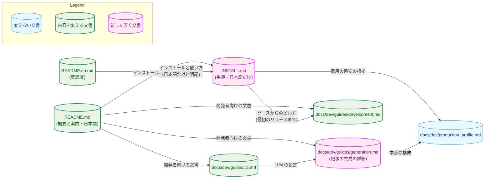
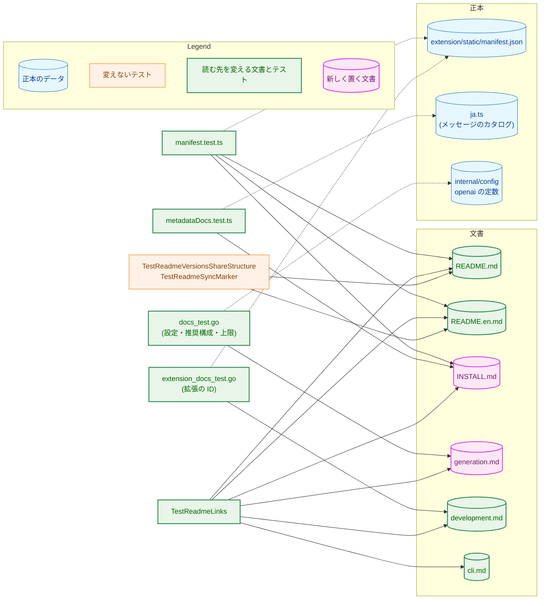
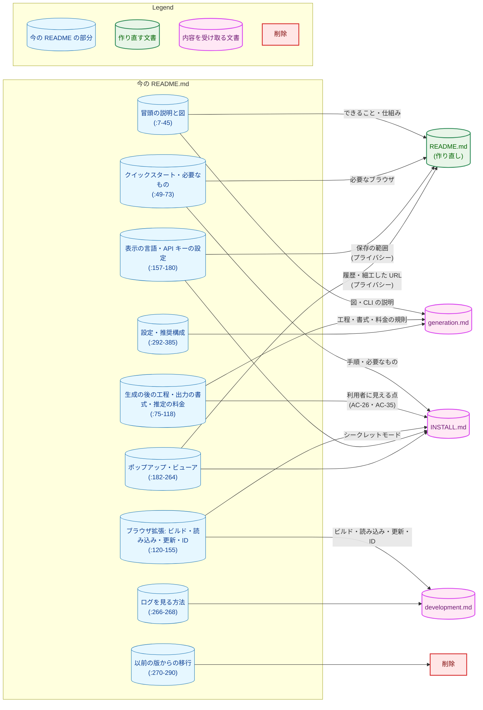
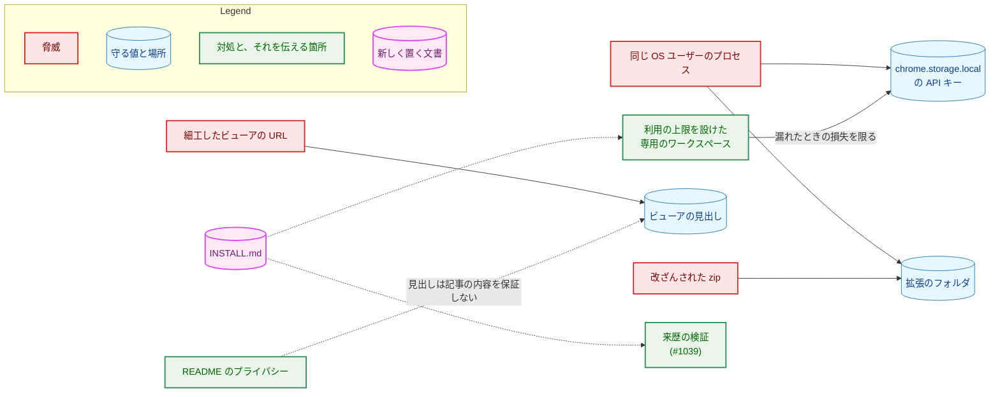
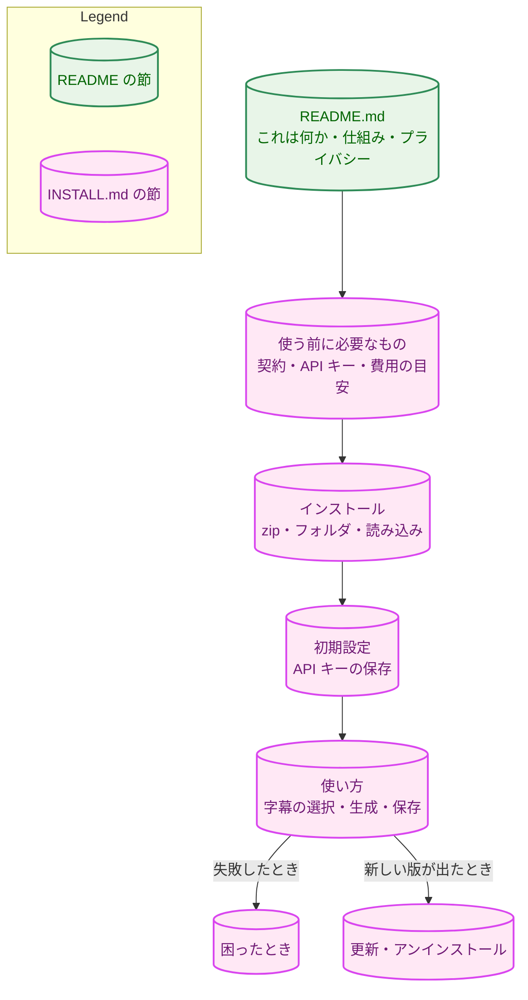

# 設計書：利用者向けの README と INSTALL 文書

## Document Status

| Item | Value |
|---|---|
| Status | `draft` |
| Created | 2026-11-19 |
| Review date | - |
| Reviewer | - |
| Comments | - |

本書は [01_requirements.md](01_requirements.md) の設計である。要件定義から申し送られた設計事項は [design_handoff.md](design_handoff.md) にあり、各項目への対応は 10 章にまとめる。本書が引用するファイルの行番号は、特に断らない限り、コミット `417d2ddf`（本書の作成時の `main`）のものである。

本書で「今の README」とは、このコミットの `README.md` を指す。

## 1. 設計の全体像 (Design Overview)

### 1.1. 設計原則

-   **読み手ごとに文書を 1 つ決める。** 利用者向けの概要と案内は README、利用者の手順は `INSTALL.md`、開発者向けの内容は `docs/dev/guides/` の手引きに置く（ADR-0035）。同じ内容を 2 つの文書に書かず、ほかの文書からはリンクで案内する。
-   **移す内容は書き換えない。** 開発者向けの手引きに移す文は、今の README の文と、AC-04 が認める 4 種類の差分（見出しの階層、リンクの先、重複の削除、書式の規約による組み直し）しか違わない。移した文が述べる挙動を変えないためである。差分は `_checks/` のスクリプトで確かめる（7.3 節）。
-   **値の検査は、値を述べる文書で続ける。** 今のテストが README から読む値は、値が移った先の文書から読み、同じ正本（コード、manifest、メッセージのカタログ）と照合する（AC-39、3.3 節）。どの文書も述べなくなった値の検査だけを外し、外したことを理由とともに 3.3 節の表に書く。
-   **利用者向けの手順は、拡張の画面とカタログに合わせる。** `INSTALL.md` が引用する画面の名前・工程の名前・メッセージは、日本語のメッセージのカタログ（`extension/src/core/i18n/ja.ts`）の文と一致させ、テストで照合する（AC-25、AC-33）。
-   **値と構造はテストで、文の意味は読み合わせで確かめる。** テストは、値（版の番号、カタログの文、設定の値）と構造（見出しの並び、リンクの先）だけを確かめる。手順の説明や挙動の記述の正しさは、PR のレビューの読み合わせ（`manual`）で確かめる（要件 §5、ADR-0016）。
-   **既存の仕組みを使う。** 新しいテストの仕組みは作らない。Go のガードテスト（`cmd/yt2column/docs_test.go` など）と拡張のテスト（`extension/test/metadataDocs.test.ts`、`manifest.test.ts`）の読む先を変え、CI の判定（`extension/scripts/has-extension-changes.sh`）に 1 行を足す。

### 1.2. 概念モデル

図 1-1 は、本タスクの後の文書と、その読み手を示す。矢印 A → B は「A の読み手が B へ案内される（リンクで移る）」を表す。



各文書の読み手と持つ内容は次のとおりである。

| 文書 | 読み手 | 持つ内容 | 言語 |
|---|---|---|---|
| `README.md` | 拡張を初めて知る人 | これは何か、仕組みの概要、必要なもの、プライバシー、`INSTALL.md` と開発者向けの文書への案内（AC-01） | 日本語（正本） |
| `README.en.md` | 同上（英語を読む人） | `README.md` の翻訳（AC-07、AC-37） | 英語 |
| `INSTALL.md` | 拡張を使う人 | 使う前に必要なものから困ったときまでの手順、参考の節（AC-03） | 日本語だけ（期限付きの例外。ADR-0035） |
| `docs/dev/guides/generation.md` | 開発者 | CLI と拡張に共通する記事の生成の詳細と、LLM の設定（2.3 節） | 日本語 |
| `docs/dev/guides/cli.md` | 開発者 | CLI だけが使うもの（フラグ、CLI だけが読む変数、yt-dlp）（2.3 節） | 日本語 |
| `docs/dev/guides/development.md` | 開発者 | 開発の手順に、拡張のビルドと読み込み、拡張の ID、ログを加える（2.3 節） | 日本語 |

### 1.3. 設計の際に決めたこと（2026-11-19）

1. **README から移す開発者向けの内容は、新しい手引き `docs/dev/guides/generation.md`（記事の生成の詳細）と、既存の `cli.md`・`development.md` に分けて置く。** 分け方は 2.3 節の表のとおりである。
   - **`generation.md` が持つもの:** 構成の図、生成の後の工程、出力の書式、料金の推定の規則、LLM の設定（変数の表・値の文法・effort の表・OpenAI の使い方）、推奨構成。
   - **`cli.md` に残すもの:** CLI だけが使う内容（フラグ、CLI だけが読む変数、yt-dlp）。
   - **`development.md` に足すもの:** ソースからのビルド・読み込み・更新、拡張の ID、ログを見る方法。
   - **理由:** 生成の工程・書式・料金の規則は CLI と拡張に共通する内容で、CLI だけの手引きに入れると、`cli.md` の「CLI だけが使うものを説明する」という範囲（`docs/dev/guides/cli.md:6`）が崩れる。LLM の設定と推奨構成も、本番の構成とあわせて 1 つの文書で読めるよう、`generation.md` にまとめる。
   - **採らなかった案:** 共通の内容を `cli.md` の同名の節に合わせて入れる案。新しい文書を増やさずに済むが、`cli.md` の範囲が CLI だけでなくなる。設定と推奨構成だけを `cli.md` に置く案。CLI だけが読む変数の表とは同じ文書に並ぶが、LLM の構成の説明が 2 つの文書に分かれる。
   - **ADR:** [ADR-0004](../../dev/adr/0004-production-profile.md) を更新する。推奨構成の移る先を `generation.md` と名指しする。手引きの選び方そのものは、このタスクの中で閉じる（「開発者向けの内容は `docs/dev/guides/` に置く」という方針は [ADR-0035](../../dev/adr/0035-language-policy.md) がすでに定める）。
2. **移した内容の確かめ方（AC-04・AC-05・AC-24）は、`_checks/` のシェルのスクリプトを主にする。** スクリプトは、マージベースの README の各ブロックと、移った先の節を取り出し、見出しの階層とリンクの先だけを正規化して比べ、残った差分を出力する。残った差分の各行が「重複の削除」か「書式の規約による組み直し」かは、レビュアーが記録した出力を読んで判断する。AC-05 は、移行の節に固有の行がリポジトリのどの `.md` にも残っていないことをスクリプトで確かめる。AC-24 は、今の README の文ごとに `INSTALL.md` のどこで述べたかの対応表を作り、それを読んで確かめる（`manual`）。詳細は 7.3 節にある。
   - **理由:** 文がファイルをまたいで移るので、そのままの `git diff` では、旧い文の削除と新しい文の追加が別のファイルに分かれて出る。記録した差分を読む方法（`requirements_process.md` §4「`diff` verification」）は使えない。正規化すれば、AC-04 が認める差分のうち機械で除ける 2 種類（見出しの階層、リンクの先）を除いた残りだけを読めばよい。
   - **採らなかった案:** 正規化をせず、移した節を並べた `diff` の出力だけを記録して読む案。スクリプトは単純になるが、見出しとリンクだけの違いも読むことになり、読む量が増える。
   - **ADR:** なし。このタスクの確かめ方で、タスクの中で閉じる。
3. **`INSTALL.md` には、Max・Ultra・Team の契約に付くクレジットの額を写さない。** 契約の名前と仕組みだけを書き、額は公式のページ（[API credits for Max, Ultra, and Team plans](https://platform.claude.com/docs/en/about-claude/api-credits-for-subscribers)）へのリンクで示して、確かめた日付（2026-11-19）を添える（H-05）。
   - **理由:** 額は Anthropic が変えうる。写した額を公式の値と照合する仕組みはなく、古くなっても気づけない。
   - **ADR:** なし。文書に書く内容の選択で、タスクの中で閉じる。
4. **`INSTALL.md` を、書式の規約（`docs/dev/conventions/document_formatting.md` の「Target documents」）と、`japrose` の太字の確認項目の対象から外す。** README と同じ扱いにする（H-06）。
   - **理由:** `INSTALL.md` は、画面の名前を太字で引用する（要件の決定 8）。太字を項目の頭のラベルと読み落としやすい語句に限る規約（`docs/dev/conventions/document_formatting.md:18-19` が README を外している規則）とぶつかる。
   - **ADR:** なし。README に当てている今の扱いを、もう 1 つの利用者向けの文書に広げるだけで、変える場所は規約と `.claude/commands/japrose.md:147` の 2 つである。
5. **`INSTALL.md` も必要なブラウザの版を述べ、`manifest.test.ts` が manifest の値と照合する（AC-08、要件 §4.5）。これを ADR-0030 に記録する。**
   - **理由:** ADR-0030 の決定と結果は、版を述べる文書と、値を変えるときに直す箇所を挙げている（`docs/dev/adr/0030-minimum-chrome-version.md:23`、`:37`）。`INSTALL.md` が加わると直す箇所が 1 つ増えるので、ADR が古くなる。要件定義で「ADR-0030 は変えない」としたのは、必要なブラウザを README が引き続き書くという意味で、この点を扱っていなかった。
   - **ADR:** [ADR-0030](../../dev/adr/0030-minimum-chrome-version.md) を更新する。`INSTALL.md` は実装の PR で置くので、まだないことを示す一文を添える。
6. **`README.en.md` の文を英語のカタログと照合していた検査（`metadataDocs.test.ts`）は外す。** `INSTALL.md` の英語版を足すとき（[#1044](https://github.com/isseis/yt2column/issues/1044)）に戻す。戻すことを 9 章に書き、#1044 にも 2026-11-19 にコメントで書き添えた（[コメント](https://github.com/isseis/yt2column/issues/1044#issuecomment-7011292079)）。
   - **理由:** 画面の名前と工程の名前を述べる文書は `INSTALL.md`（日本語だけ）に移り、英語で述べる文書がなくなる（3.3 節）。戻す作業を忘れないよう、作業を持つ issue に書いておく。
   - **ADR:** なし。テストの対象の一時的な変化で、#1044 で閉じる。
7. **未リリースの注記は、README と `INSTALL.md` に 1 つずつ置く（H-07）。**
   - **置き場所:** README は冒頭の「状態」の注記（今の `README.md:47`）を直して使う。`INSTALL.md` は「インストール」の節の「zip を入手する」の小節に置く。
   - **#1039 が直す箇所:** この 2 つの注記を外す。来歴の検証（`gh attestation verify`）の手順は、「zip を入手する」と「拡張のフォルダを作る」の間に「zip を確かめる」の小節として足す（4.3 節の表）。
   - **理由:** 利用者は README と `INSTALL.md` のどちらからでも読み始めうる。注記を 1 つの文書の 1 か所に限れば、#1039 が外す箇所を取り違えない。
   - **ADR:** なし。#1039 との作業の分け方で、2 つのタスクの中で閉じる。

## 2. システム構成 (System Structure)

### 2.1. 全体の構成

本タスクが変えるのは文書と、文書を読むテストである。実行時のコードは変えない。図 2-1 は、本タスクの後に、テストがどの文書から何を読み、何と照合するかを示す。矢印 A → B は「テスト A が文書 B を読む」、点線の矢印 A -.-> C は「テスト A が読んだ値を正本 C と照合する」を表す。



`docs_test.go` は、ほかに `docs/dev/project_overview.md` と `docs/dev/production_profile.md` も読む。この 2 つの読み方は変えないので、図から省いた。

### 2.2. コンポーネントの配置

| 置き場所 | 変更 |
|---|---|
| リポジトリのルート | `README.md`・`README.en.md` を作り直し、`INSTALL.md` を新しく置く |
| `docs/dev/guides/` | `generation.md` を新しく置き、`cli.md`・`development.md` を変える |
| `docs/dev/`、`docs/dev/conventions/`、`docs/dev/adr/`、`docs/translation_glossary.md` | 今の README の節を指す箇所を付け替え、規約と ADR の記述を新しい構成に合わせる（4.2 節） |
| `CLAUDE.md`、`.claude/commands/japrose.md` | 文書の構成と例外の記述を合わせる（3.4 節） |
| `cmd/yt2column/`、`internal/doctestutil/` | Go のガードテストの読む先を変える（3.3 節） |
| `extension/test/`、`extension/scripts/` | 拡張のテストの読む先と CI の判定を変える（3.3 節） |
| `docs/tasks/0116_user_readme/_checks/` | 移した内容を確かめるスクリプト（7.3 節） |

### 2.3. 今の README の振り分け

図 2-2 は、今の README の各部分の行き先を示す。矢印 A → B は「A の内容が B に移る」を表す。行き先のない部分は削除する。



`development.md` は既存の文書だが、移った内容を受け取る先として `newpkg` の色で示した。

行き先の詳細は次の表のとおりである。「移す」は AC-04 の規則で文を変えずに移すこと（7.3 節のスクリプトで確かめる）、「書き直す」は利用者向けに言い回しを書き直してよいこと（AC-24）を表す。

| 今の README（行） | 内容 | 行き先 | 扱い |
|---|---|---|---|
| `:7-9`、`:39-45` | 主経路と CLI の説明、プロバイダ | README「仕組み」（拡張の部分）、`generation.md` の冒頭（CLI と構成の部分。`cli.md:3-4` に同じ内容がある文は重ねない） | README は書き直す。`generation.md` は移す |
| `:11-37` | 構成要素の図 | `generation.md`「構成」 | 移す |
| `:47` | 状態の注記 | README の冒頭の注記（決定 7） | 書き直す |
| `:49-61` | クイックスタート | `INSTALL.md`「使い方」の流れ（AC-23）。`:61` の移行の案内は削除（AC-05） | 書き直す |
| `:63-70` | 必要なもの（Go・Node.js・ブラウザ・API キー・ZDR） | ブラウザは README と `INSTALL.md`。Go と Node.js は `development.md`「拡張のビルドと読み込み」。ZDR は `INSTALL.md`（AC-13） | ブラウザと ZDR は書き直す。Go と Node.js は移す |
| `:72-73` | CLI に必要なもの | `cli.md:9-16` に同じ内容があるので重ねない | 削除（重複） |
| `:75-86` | 生成の後の工程 | `generation.md`「生成の後の工程」。利用者に見える 2 点は `INSTALL.md`（AC-26） | 移す（`INSTALL.md` は書き直す） |
| `:88-93` | 出力の書式 | `generation.md`「出力の書式」 | 移す |
| `:95-118` | 推定の料金 | `generation.md`「推定の料金」。失敗した生成の料金は `INSTALL.md`（AC-35） | 移す（`INSTALL.md` は書き直す） |
| `:120-155` | ビルド・読み込み・更新・拡張の ID・シークレットモード | `development.md`「拡張のビルドと読み込み」。シークレットモードは `INSTALL.md`（AC-19） | 移す（`INSTALL.md` は書き直す） |
| `:157-158` | 表示の言語 | `INSTALL.md`「使い方」の「画面の言語」（AC-27、ADR-0029） | 書き直す |
| `:160-178` | API キーの設定 | `INSTALL.md`「初期設定」（AC-20〜AC-22） | 書き直す |
| `:180` | API キーの保存の範囲、ワークスペースの勧め | 保存の範囲は README「プライバシー」（AC-36）、ワークスペースの勧めは `INSTALL.md`（AC-11） | 書き直す |
| `:182-264` | ポップアップ・ビューア | `INSTALL.md`「使い方」と「参考」（AC-24）。`:256-260` の記録・履歴・細工した URL は README「プライバシー」にも（AC-36） | 書き直す |
| `:266-268` | ログを見る方法 | `development.md`「拡張のログ」 | 移す |
| `:270-290` | 以前の版からの移行 | どこにも移さない（AC-05） | 削除 |
| `:292-366` | 設定 | `generation.md`「設定」 | 移す |
| `:368-385` | 推奨構成 | `generation.md`「設定」の下の「推奨構成」 | 移す |

`README.en.md` は、`README.md` を作り直した後に `/mktrans` で同期する。英語版の今の内容を移す先はない。移す内容は日本語の版だけを元にし、移した先の手引きも日本語だけで持つ（ADR-0035 の原則 (a)）。

### 2.4. 各文書の節の構成

見出しの文言は実装の時に決めてよい。ただし、テストが見出しで節や表を探す箇所（3.3 節）は、そこに書いた見出しと列名にそろえる。同じ文書の中で、アンカーが重なる見出しを置かない（`TestReadmeLinks` が重なりを失敗にする。`cmd/yt2column/docs_test.go:103-116`）。

**`README.md`**（`README.en.md` は同じ構造の英語版）:

```text
[English](README.en.md)
開発者向けの文書: generation.md・cli.md・development.md へのリンク
# yt2column
  これは何か（できること）
  > 状態: 未リリースの注記（決定 7）
## 仕組み            ブラウザの中だけで動く、サーバもホストも要らない、送り先は https://api.anthropic.com だけ
## 必要なもの        ブラウザ（AC-08 と同じ値）と Anthropic の API キー。詳しくは INSTALL.md
## インストールと使い方   INSTALL.md へのリンク。INSTALL.md が今は日本語だけであること（AC-07）
## プライバシー      F-009 の 6 項目
## 開発者向けの文書  開発者向けの CLI があることを 1 文で述べ、3 つの手引きへリンク
```

**`INSTALL.md`**:

```text
# インストールと使い方
  本書の範囲。画面の文言は日本語の版を引用すること（AC-27）
## 使う前に必要なもの
### ブラウザ                 AC-08
### Claude API を使える契約   AC-09（額は写さない。決定 3）
### API キーを用意する        AC-10・AC-11
### 費用の目安                AC-12
### 使えない API キー          AC-13
## インストール
### zip を入手する            AC-14（未リリースの注記。決定 7）
  （#1039 がここに「zip を確かめる」を足す）
### 拡張のフォルダを作る      AC-15
### 拡張を読み込む            AC-16
### ツールバーに固定する      AC-17
### ブラウザの警告とシークレットモード   AC-18・AC-19
## 初期設定
### オプションページを開く    AC-20
### API キーとワークスペース ID   AC-21
### 保存の結果                AC-22
## 使い方
### 記事を生成する            AC-23・AC-26
### 画面の言語                AC-27
### ポップアップ              AC-24・AC-25
### ビューア                  AC-24・AC-25
### 記事の生成と記録          AC-24
## 更新                       AC-28〜AC-30
## アンインストール           AC-31・AC-32
## 困ったとき                 AC-33〜AC-35
## 参考                       AC-24 の細部（記録の上限の値、ビューアの URL が持つ値、同じ動画の照会の限界、選択範囲の行の扱い）
```

**`docs/dev/guides/generation.md`**（新しい手引き）:

```text
# 記事の生成の詳細
  本書の範囲（CLI と拡張に共通する生成の詳細と LLM の設定）。利用者の手順は INSTALL.md、CLI だけのものは cli.md
## 構成                 今の README:7-45 の図と経路の説明
## 生成の後の工程        :75-86
## 出力の書式            :88-93
## 推定の料金            :95-118
## 設定                  :292-366
### 推奨構成             :368-385
```

**`docs/dev/guides/cli.md`**（変える箇所だけ）: 冒頭（`:3-7`）と各節のリンク（`:16`、`:58`、`:189`、`:234`）を `generation.md` と `INSTALL.md` に付け替える（4.2 節）。節の構成は変えない。

**`docs/dev/guides/development.md`**（足す節）:

```text
## 拡張のビルドと読み込み   今の README:63-68 の Go と Node.js、:120-155（シークレットモードの文を除く）
## 拡張のログ               :266-268
```

`development.md:96-99` の「拡張の検査」の節は、今の README へのリンクを、同じ文書の「拡張のビルドと読み込み」へのリンクに付け替える。

## 3. コンポーネント設計 (Component Design)

### 3.1. コンポーネントの責務

| ファイル | 種別 | 責務と変更 |
|---|---|---|
| `README.md` | 変更 | 2.4 節の構成に作り直す。AC-01、AC-02、AC-05、AC-07、AC-36 |
| `README.en.md` | 変更 | `/mktrans` で `README.md` に同期する。AC-37 |
| `INSTALL.md` | 新規 | 2.4 節の構成の手順。AC-03、AC-08〜AC-35 |
| `docs/dev/guides/generation.md` | 新規 | 2.4 節の構成。今の README から移した内容。AC-04 |
| `docs/dev/guides/cli.md` | 変更 | リンクの付け替え。AC-06 |
| `docs/dev/guides/development.md` | 変更 | 「拡張のビルドと読み込み」「拡張のログ」を足し、リンクを付け替える。AC-04、AC-06 |
| `extension/test/helpers/readmeVersions.ts` | 変更 | 版を述べる文書の一覧に `INSTALL.md` を加え、`INSTALL.md` の言語（`ja`）を持つ。`browserExtensionHeading` は読む節がなくなるので除く（3.3 節） |
| `extension/test/metadataDocs.test.ts` | 変更 | `INSTALL.md` 全体を日本語のカタログと照合する。AC-33 のメッセージも照合する。`README.en.md` の英語のカタログとの照合は外す（テストの削除。3.3 節） |
| `extension/test/manifest.test.ts` | 変更 | `INSTALL.md` の版も manifest と照合する。AC-08、AC-39 |
| `extension/scripts/has-extension-changes.sh` | 変更 | 冒頭の説明と判定に `INSTALL.md` を加え、README の説明を「最低の Chrome の版」だけにする。AC-42 |
| `extension/test/ciChanges.test.ts` | 変更 | `INSTALL.md` が拡張のジョブを走らせ、似た名前（`docs/INSTALL.md`、`INSTALL.md.bak`）が走らせないことを確かめる行を加える。AC-42 |
| `cmd/yt2column/docs_test.go` | 変更 | `TestOpenAIDocsContract`・`TestLLMDefaultsDocsContract`・`TestEffortValuesDocsContract`・`TestProductionProfileDocsContract` の読む先を、2 つの README から `generation.md` に変える。`TestReadmeLinks` が `INSTALL.md` と `generation.md` も読む。AC-39 |
| `cmd/yt2column/extension_docs_test.go` | 変更 | 拡張の ID を、2 つの README の代わりに `development.md` から読む。AC-39 |
| `cmd/yt2column/docpaths_test.go` | 変更 | `TestReadmeLinks` が見る手引きの一覧（`readmeGuides`、`:91-100`）に `generation.md` を加える。`TestInstructionDocPaths` はこの一覧の手引きを見ない |
| `internal/doctestutil/guides.go` | 変更 | `generation.md` の見出しと列名のロケータを加える（推奨構成の見出し、変数の表の列名、effort の表の列名） |
| `internal/doctestutil/readme.go` | 変更 | README のロケータ（`:78-92`）と、それだけが使う `Locator` 型（`:46-76`）を除く。`ReadmeVersion` と `ReadmeVersions` は、構造・同期・リンクのテストが使うので残す |
| `internal/doctestutil/readme_test.go` | 変更 | `Locator` の単体テストを除く（テストの削除。3.3 節） |
| `docs/tasks/0116_user_readme/_checks/` | 新規 | 7.3 節のスクリプト |
| `CLAUDE.md` | 変更 | 3.4 節の表。AC-38、AC-40、AC-42 |
| `docs/dev/conventions/document_formatting.md`、`.claude/commands/japrose.md` | 変更 | `INSTALL.md` を対象から外す（決定 4） |
| `docs/dev/production_profile.md`、`docs/dev/guides/pricing_update.md` | 変更 | 値を繰り返す箇所の一覧を新しい置き場所にする。AC-41 |
| `docs/dev/security.md` | 変更 | `:142` の参照先を `INSTALL.md` にする（4.2 節、要件 §4.2） |
| `docs/translation_glossary.md` | 変更 | 古くなる項目を直し、新しい語を足す（4.2 節、AC-43） |
| ADR（0004・0025・0029・0030・0035・0044） | 変更 | 実装の PR で、ずれを示す一文を除き、README の節の名指しを付け替える（4.2 節） |

### 3.2. 先のタスクの方針との関係

本タスクは、先のタスクの方針に次の例外を設けるか、方針を改める。

| 元の方針と、その場所 | 本タスクでの扱いと理由 | 古い挙動を確かめている既存のテスト |
|---|---|---|
| 利用者向けの文書は日本語を正本とし英語版を同期する（CLAUDE.md「Document language」の原則 (c)、[0048 設計書](../0048_doc_language_policy/02_architecture.md)） | `INSTALL.md` を日本語だけで持つ期限付きの例外とする（要件の決定 2・3、ADR-0035）。初期の利用者は日本語の話者に限られるため | なし（`INSTALL.md` を対象にするテストはまだない） |
| 文書は `docs` の下に置き、例外は 2 つの README（CLAUDE.md「Documents」） | `INSTALL.md` をルートに置く例外を加える（要件の決定 2） | なし |
| README は画面の名前・工程の名前・概要欄のメッセージを、2 つの版でそれぞれの言語のカタログから引用する（[0048 設計書](../0048_doc_language_policy/02_architecture.md) §3.5、`.claude/commands/mktrans.md:140-145`） | 引用は `INSTALL.md`（日本語）に移る。英語のカタログからの引用は、英語版の `INSTALL.md` を足すまでなくなる（決定 6）。`mktrans.md` の規則は、README が画面の文言を引用するときの規則として残す（3.4 節） | `extension/test/metadataDocs.test.ts` の 3 つの `it`（2 つの版について）。3.3 節で読む先を変え、英語の版の分を外す |
| README の設定の表・effort の表・推奨構成・出力の上限を、2 つの版で確かめる（[0048 設計書](../0048_doc_language_policy/02_architecture.md) §3.7） | 値を述べる文書が `generation.md`（日本語だけ）になる。日本語の 1 つの文書で、同じ正本と照合する | `cmd/yt2column/docs_test.go` の `TestOpenAIDocsContract`（`:208-212`）、`TestLLMDefaultsDocsContract`（`:287-292`）、`TestEffortValuesDocsContract`（`:336-342`）、`TestProductionProfileDocsContract`（`:710-718`）。3.3 節で読む先を変える |
| 拡張の ID を 2 つの README に書く（`cmd/yt2column/extension_docs_test.go:60-69`） | ID の記述は `development.md` に移る（AC-04） | `TestExtensionDocumentation` の該当の部分テスト。3.3 節で読む先を変える |

### 3.3. テストの読む先（AC-39、H-01）

今のテストが README から読む値ごとに、変更の後に読む文書を示す。「照合する正本」は今と同じである。

| 値 | テスト | 今読む文書 | 変更の後に読む文書 | 照合する正本 |
|---|---|---|---|---|
| 最低の Chrome の版 | `manifest.test.ts`（`:141-150`） | `README.md`、`README.en.md` | `README.md`、`README.en.md`、`INSTALL.md` | `manifest.json` の `minimum_chrome_version` |
| 概要欄のメッセージと手順 | `metadataDocs.test.ts` | 2 つの README の `## ブラウザ拡張`（`## Browser extension`）の節 | `INSTALL.md` 全体 | 日本語のカタログ（`expandPromptMessage("ja")`） |
| 工程の名前 | 同上 | 同上 | `INSTALL.md` 全体 | 日本語のカタログの `stepNames` |
| ポップアップとビューアの画面の名前 | 同上 | 同上 | `INSTALL.md` 全体 | 日本語のカタログ（今と同じ 7 種類の名前） |
| 困ったときのメッセージ（AC-33） | 同上（新しい `it`） | なし | `INSTALL.md` 全体 | 日本語のカタログの、AC-33 の各場合のメッセージ。どの項目かは実装計画で決める |
| 拡張の ID | `extension_docs_test.go`（`:60-69`） | `README.md`、`README.en.md`、`security.md` | `development.md`、`security.md` | manifest の `key` から求めた ID |
| 推奨構成の設定のブロック | `TestProductionProfileDocsContract` | 2 つの README の `### 推奨構成`（`### Recommended configuration`） | `generation.md` の `### 推奨構成` | 本番の構成の変数とコードの既定 |
| LLM の既定 | `TestLLMDefaultsDocsContract` | 2 つの README の設定の表、`project_overview.md` | `generation.md` の設定の表、`project_overview.md` | `internal/config` の既定 |
| effort の値 | `TestEffortValuesDocsContract` | 2 つの README の effort の表、`project_overview.md` | `generation.md` の effort の表、`project_overview.md` | `internal/config` の受理する値 |
| OpenAI の出力の上限 | `TestOpenAIDocsContract` | 2 つの README、`project_overview.md` | `generation.md`、`project_overview.md` | `openai` の既定の上限 |
| リンク | `TestReadmeLinks` | 2 つの README、`cli.md`、`development.md` | 2 つの README、`INSTALL.md`、`generation.md`、`cli.md`、`development.md` | リンク先のファイルと見出し |

`metadataDocs.test.ts` は、`INSTALL.md` の節ではなく文書全体を読む。画面の名前が「初期設定」「使い方」「困ったとき」のどの節にも出るためである。節を限らないので、見出しの文言を変えても検査は崩れない。

`generation.md` の設定の表は、文書の中で列名「変数」を持つ最初の表でなければならない。`TestLLMDefaultsDocsContract` は `doctestutil.FindTable` で、その列名を持つ最初の表を使うためである（`internal/doctestutil/tables.go:63-75`）。

**外す検査。** 次の検査は、値を述べる文書がなくなるので外す。

| 外す検査 | 理由 |
|---|---|
| `metadataDocs.test.ts` の、`README.en.md` の文を英語のカタログと照合する 3 つの検査（概要欄のメッセージ、工程の名前、画面の名前） | `README.en.md` はこれらを述べなくなり、英語で述べる文書もない（`INSTALL.md` は日本語だけ）。#1044 で `INSTALL.md` の英語版を足すときに戻す（決定 6） |
| Go の 4 つのテストと拡張の ID の検査の、`README.en.md` の部分テスト | 値は日本語だけの手引き（`generation.md`、`development.md`）に移る。同じ値は、日本語の手引きで同じ正本と照合し続ける |
| `internal/doctestutil/readme_test.go` の `Locator` の単体テスト | `Locator` 型は、README の日英の 2 つの見出しと列名を持つためのもので、README のロケータを除くと使う箇所がなくなる。`make deadcode` が使われない関数を報告するので、型ごと除く |

外す検査はどれも、CLAUDE.md の「Deleting a test is a claim that must be checked」に従う。

- **コミット:** 外すだけのコミットにする。
- **比べ方:** 拡張のテストは `make ext-coverage-compare`、Go のテストは `make coverage-compare` で、そのコミットの親と比べる。
- **記録:** 結果の最後の行までをコミットのメッセージと PR の説明に書く。

読む先を変えるだけの変更（`README.md` から `generation.md` へ、など）は、検査を外さないので、テストの削除として扱わない。

### 3.4. CLAUDE.md とコマンドの記述（H-06）

実装の前に、`README` を名指しする文をリポジトリ全体から探し直す。本書を書いた時点で見つけた箇所は次のとおりである。

| 箇所 | 今の記述 | 変更 |
|---|---|---|
| `CLAUDE.md:29-31`「Documents」 | ルートに置く例外は 2 つの README | `INSTALL.md` を加え、理由（README の隣で見つけられ、Releases や zip から指せる）を書く。AC-38 |
| `CLAUDE.md:61-85`「Document language」 | 原則 (c) と、2 言語の README の例外 | 原則 (c) の文書に `INSTALL.md` を加え、日本語だけで持つ期限付きの例外（期限は Chrome Web Store に申請する前、記録した issue は #1044）を例外の一覧に足す。AC-38 |
| `CLAUDE.md:379-381`「Architecture Overview」 | 拡張は README（と英語版）が説明する | 拡張の概要は README、手順は `INSTALL.md`、ビルドは `development.md` が説明する、と直す |
| `CLAUDE.md:791-797`「Development Notes」 | `make ext-test` が要る文書は 2 つの README と `development.md`。README の「ブラウザ拡張」の節を読む | `INSTALL.md` を加え、読む内容を「`INSTALL.md` の概要欄のメッセージ・画面の名前・工程の名前・困ったときのメッセージ（`metadataDocs.test.ts`）、3 つの文書の最低の Chrome の版（`manifest.test.ts`）」に直す。AC-40、AC-42 |
| `CLAUDE.md:799-806`「Development Notes」 | Go のガードの一覧に「the extension ID」「the configuration block of both READMEs」「the values `cli.md` and `development.md` hold」 | 「both READMEs」を `generation.md` に直し、値を持つ手引きに `generation.md` を加える。AC-40 |
| `CLAUDE.md:98-110`「Translation Guidelines」、`:219`（`/mktrans`） | 翻訳の対は README だけ | 変えない。`INSTALL.md` は翻訳の対にしない（#1044 まで） |
| `.claude/commands/mktrans.md:140-145` | README が引用するポップアップの文言は英語のカタログから写す | 変えない。README が画面の文言を引用するときの規則としてそのまま正しく、#1044 で `INSTALL.md` の英語版を足すときにも使う |
| `docs/dev/conventions/document_formatting.md:18-19`、`.claude/commands/japrose.md:147` | 書式の規約と太字の確認の対象から README を外す | `INSTALL.md` も外す（決定 4） |

ADR-0035 の決定は、文書の言語の原則と例外の正本として CLAUDE.md の「Document language」と「Documents」を指し、CLAUDE.md がまだ `INSTALL.md` を挙げていないずれを一文で示している（`docs/dev/adr/0035-language-policy.md:24`）。上の表の変更で、ADR-0035 の決定と CLAUDE.md が一致する。同じ PR でその一文を除く（4.2 節）。

### 3.5. 型とインターフェース

新しい型やインターフェースはない。テストの補助の形だけを示す。

拡張のテストの補助（`extension/test/helpers/readmeVersions.ts`）は、最低の Chrome の版を述べる文書の一覧を持つ。各文書の言語は、版の書き方の正規表現（`minimumChromePhrase`）を選ぶために使う。

```ts
/** A user-facing document that states the minimum browser version, with the
 * language whose phrase it uses. */
export const minimumChromeDocs: readonly { path: string; locale: Locale }[];

/** The install guide: Japanese only until its English version is added. */
export const installGuide: { path: string; locale: Locale };
```

Go のロケータ（`internal/doctestutil/guides.go`）は、`generation.md` の見出しと列名を、ほかの手引きのロケータと同じく日本語の 1 つの文字列の定数で持つ。

## 4. エラーハンドリング設計 (Error Handling Design)

### 4.1. テストの失敗の示し方

新しいエラー型はない。テストの失敗の示し方は、今のテストの形に従う。

- **文書や節がない:** テストは飛ばさずに失敗し、文書のパスと探した見出しを示す（今の `t.Fatalf("%s has no %q section", ...)` と `assert.notEqual(text.trim(), "", ...)` の形）。`INSTALL.md` を消すか改名すると、`manifest.test.ts`、`metadataDocs.test.ts`、`TestReadmeLinks` が失敗する。
- **値が正本と違う:** テストは、文書のパスと、見つからない値か食い違った値を示す。カタログの文の照合は、最初に見つからない文を示す（`metadataDocs.test.ts` の `expectPhrases`）。
- **版を述べる箇所がない:** `manifest.test.ts` は、版を 1 つも述べない文書を失敗にする（今の `assert.notEqual(stated.length, 0, ...)`）。`INSTALL.md` の版の書き方がずれて正規表現に合わなくなっても、黙って通らない。

### 4.2. 参照の付け替え（AC-06、AC-41、H-03、H-04）

今の README の節を名指しする箇所は、内容が移った先を指すように付け替える。本書を書いた時点で見つけた箇所は次のとおりで、実装の前にリポジトリ全体を探し直す（`git grep -n 'README'`。`docs/tasks/` の過去の記録は対象外）。

| 箇所 | 今指すもの | 付け替える先 |
|---|---|---|
| `docs/dev/guides/cli.md:4` | README「クイックスタート」 | `INSTALL.md`（主経路の手順） |
| `docs/dev/guides/cli.md:7`、`:234` | README「設定」 | `generation.md`「設定」 |
| `docs/dev/guides/cli.md:16` | README「必要なもの」 | `generation.md`「設定」（API キー）と `development.md`「拡張のビルドと読み込み」（Go） |
| `docs/dev/guides/cli.md:58` | README「生成の後の工程」 | `generation.md`「生成の後の工程」 |
| `docs/dev/guides/cli.md:189` | README「推定の料金」 | `generation.md`「推定の料金」 |
| `docs/dev/guides/development.md:3` | README（拡張の使い方） | `INSTALL.md` と README |
| `docs/dev/guides/development.md:99` | README「ブラウザ拡張」 | 同じ文書の「拡張のビルドと読み込み」 |
| `docs/dev/conventions/package_reference.md:103` | README「設定」 | `generation.md`「設定」 |
| `docs/dev/production_profile.md:5` | README「推奨構成」 | `generation.md`「推奨構成」と、`INSTALL.md` の費用の目安（AC-41） |
| `docs/dev/guides/pricing_update.md:38` | README「推定の料金」 | `generation.md`「推定の料金」。あわせて、料金が変わったときに見直す箇所として `INSTALL.md` の費用の目安を加える（AC-41） |
| `docs/dev/guides/pricing_update.md:40` | README「設定」 | `generation.md`「設定」 |
| `docs/dev/project_overview.md:89` | README の表 | `generation.md` の表 |
| `docs/dev/project_overview.md:161` | README「設定」 | `generation.md`「設定」 |
| `docs/dev/guides/claude_output_limit.md:60` | README「設定」 | `generation.md`「設定」 |
| `docs/dev/guides/openai_output_limit.md:59` | README「設定」（`/mktrans` で英語版もそろえる） | `generation.md`「設定」（日本語だけなので `/mktrans` の手順を除く） |
| `docs/dev/security.md:131` | README（細工した URL の注意） | 変えない。README「プライバシー」が述べる（AC-36） |
| `docs/dev/security.md:142` | README（ワークスペースの勧め） | `INSTALL.md`（AC-11） |
| `docs/translation_glossary.md:55` | 「推奨構成」の定義が README の小節を指す | `generation.md` の小節を指す |
| `docs/translation_glossary.md:61`、`:168`、`:179` | 移行の手順で使う語、移行の節の見出し | 移行の節がなくなるので、`:179` を除き、`:61`・`:168` の備考から移行の手順を除く |
| `docs/translation_glossary.md:175`、`:180`、`:181` | README の見出し（クイックスタート、API キーの設定、ブラウザ拡張） | README の見出しでなくなるので、備考を直すか項目を除く。新しい見出しの語は AC-43 で足す |
| `docs/dev/adr/0025-claude-output-limit.md:18`、`:20`、`:34` | README（上限の案内、「設定」） | `generation.md`（「設定」） |
| `docs/dev/adr/0044-package-reference-row-granularity.md:27` | 詳細の行き先に README | 行き先に `generation.md` を加える |
| `docs/dev/adr/0004-production-profile.md:22` | ずれを示す一文 | 推奨構成を移した PR で除く |
| `docs/dev/adr/0029-extension-ui-languages.md:24` | ずれを示す一文 | `INSTALL.md` の「画面の言語」を置いた PR で除く |
| `docs/dev/adr/0030-minimum-chrome-version.md:23` | ずれを示す一文 | `INSTALL.md` を置いた PR で除く |
| `docs/dev/adr/0035-language-policy.md:24` | ずれを示す一文 | CLAUDE.md を直した PR で除く |

ADR の名指しの付け替えは、決定を変えない編集上の訂正として扱う。ADR-0044 の行き先に `generation.md` を加えるのも、README から詳細を移しただけで、詳細の行き先を手引きと README などに限るという決定は変えない。

リポジトリの外からのリンク（GitHub の README の表示のアンカー）は保たない（要件 §4.4）。

### 4.3. #1039 との境界（H-07）

| 箇所 | このタスクで置くもの | #1039 が直すこと |
|---|---|---|
| `README.md`（と英語版）の冒頭の注記 | 開発の初期段階で、まだリリースしていないこと | 外すか、リリース済みの記述に変える |
| `INSTALL.md`「zip を入手する」 | まだリリースしていないこと。ソースからのビルドは `development.md`「拡張のビルドと読み込み」にあること | 注記を外す |
| `INSTALL.md`「zip を入手する」と「拡張のフォルダを作る」の間 | なし | 「zip を確かめる」の小節（`gh attestation verify` の手順）を足す |

## 5. セキュリティ考慮事項 (Security Considerations)

本タスクは `docs/dev/security.md` の規則と前提を変えない。利用者向けの文書が、security.md §8 の受け入れた危険を利用者に伝える箇所を保つ（要件 §4.2）。

図 5-1 は、利用者向けの文書が伝える危険と、その対処を示す。矢印 A → B は「A が B に影響する」、点線の矢印 A -.-> B は「文書 A が対処 B を利用者に伝える」を表す。



- **API キーの漏れ:** `INSTALL.md` は、月ごとの利用の上限を設けた専用のワークスペースで API キーを作ることを勧める（AC-11）。security.md §8 の残余のリスク（`docs/dev/security.md:142`）の参照先を `INSTALL.md` に直す（4.2 節）。
- **細工したビューアの URL:** README の「プライバシー」は、見出しが記事の内容を保証しないことを述べる（AC-36）。`docs/dev/security.md:131` の「README に書く」は、そのまま正しい。
- **拡張のフォルダ:** 展開したフォルダは、同じ OS ユーザーとして動くプロセスが書き換えうる。security.md §8 が `chrome.storage.local` について受け入れている危険と同じ種類のもので、新しい規則は設けない（要件 §4.2）。
- **改ざんされた zip:** 来歴の検証の手順は #1039 で足す（決定 7、4.3 節）。このタスクの時点では zip を配っていない。
- **文書の例:** 実際の API キーを含めない。API キーの欄の例は、値の形を示さずに欄の名前で示す。
- **信頼できない入力:** N/A。文書とテストだけの変更で、新しく受け取る信頼できない入力はないため。

## 6. 処理フローの詳細 (Processing Flow Details)

### 6.1. 利用者が読む順

図 6-1 は、初めて使う利用者が文書を読み進める順を示す。矢印 A → B は「A を読み終えた利用者が B に進む」を表す。`INSTALL.md` の節の順は AC-03 の順である。



### 6.2. README を変えるときの同期

README を変えるコミットの流れは今と同じである。`README.md` を先に変え、`/mktrans README.md` で `README.en.md` に反映し、両方を 1 つのコミットに入れる（ADR-0035）。`INSTALL.md` は翻訳の対にしないので、`INSTALL.md` だけを変えるコミットは同期を要らない。

## 7. テスト戦略 (Test Strategy)

### 7.1. 単体テスト（ガードテスト）

3.3 節の表のとおり、値の検査の読む先を変える。新しく加える検査は次の 2 つである。

- `manifest.test.ts` が `INSTALL.md` の版も manifest と照合する（AC-08）。
- `metadataDocs.test.ts` が、`INSTALL.md` が引用する困ったときのメッセージを日本語のカタログと照合する（AC-33）。

どちらも、CLAUDE.md の「Every test must be able to fail for its stated reason」に従い、壊して失敗することを確かめてからコミットする（例: `INSTALL.md` の版を 141 にする、引用したメッセージの 1 文字を変える）。

`ciChanges.test.ts` は、`INSTALL.md` が拡張のジョブを走らせることと、似た名前のパスが走らせないことを確かめる（AC-42）。

### 7.2. 統合テスト

N/A。実行時の処理を変えないため。`make test`、`make lint`、`make ext-check`、`make deadcode` が通ることを、各 PR で確かめる。

### 7.3. 差分の検査（`_checks/`、決定 2）

`diff` 検証（`requirements_process.md` §4「`diff` verification」）はシェルのスクリプトで行う。スクリプトは `docs/tasks/0116_user_readme/_checks/` に置き、マージベースと PR の比べるコミットを引数に取る。

| AC | スクリプトが確かめること | 読む人の判断 |
|---|---|---|
| AC-04 | 移すブロックごとに、マージベースの README の行の範囲と、移った先の文書の節を取り出す。両方から見出しの `#` の数とリンクの先（`](...)` の中）を同じ印に置き換え、行ごとに比べて、残った差分を出力する。対応（行の範囲と移った先の見出し）はスクリプトの中の表に持つ | 残った差分の各行が、重複の削除か、書式の規約による組み直しかを読む。それ以外の変化があれば、AC-04 を満たさない |
| AC-05 | マージベースの移行の節（`README.md:270-290`）に固有の行（`yt2column-nmhost uninstall`、`NativeMessagingHosts`、`config.env`、`sharedToken` を含む行）が、比べるコミットのどの `.md`（`docs/tasks/` を除く）にもないことを確かめる。クイックスタートの移行の案内（`:61`）も同じく確かめる | なし（スクリプトが合否を出す） |
| AC-24 | なし | 今の README の `:182-264` の文ごとに、`INSTALL.md` のどの節で述べたかの対応表を作り、それを読んで、挙動が漏れていないかを確かめる（`manual`）。対応表の置き場所は実装計画で決める |

スクリプトは、CLAUDE.md の規則どおり、各検査が少なくとも 1 つの壊し方で失敗することを確かめてから記録する（例: 移した文の 1 語を変える、移行の節の 1 行を `generation.md` に残す）。

AC-02（README に含めないもの）は、作り直した README が短いので、PR のレビューで読んで確かめる（`manual`）。語の有無を `grep` で確かめるだけの `static` の検査は、文書の語の有無には使わない（`requirements_process.md` §4）。

### 7.4. セキュリティのテスト

N/A。セキュリティの規則と挙動を変えないため。5 章の記述は、PR のレビューで読んで確かめる。

## 8. 実装の優先順位 (Implementation Priorities)

各フェーズの終わりで、`make test`、`make lint`、`make ext-check`、`make deadcode` が通り、リンクが切れない状態にする。PR の区切りは実装計画で決める。

| フェーズ | 内容 | 主な AC |
|---|---|---|
| 1 | `generation.md` を置き、今の README から開発者向けの内容（構成の図、工程、書式、料金の規則、設定、推奨構成）を移す。ビルド・読み込み・更新・ID・ログを `development.md` に移す。Go のテストの読む先を変える。`README.en.md` の部分テストを外すコミットと `Locator` を除くコミットは、それぞれ単独にして、カバレッジを比べる | AC-04、AC-39 |
| 2 | `INSTALL.md` を置く。拡張のテスト（`manifest.test.ts`、`metadataDocs.test.ts`）と CI の判定を変える。英語のカタログとの照合を外すコミットは単独にして、カバレッジを比べる | AC-03、AC-08〜AC-35、AC-39、AC-42 |
| 3 | README を利用者向けの概要と案内に作り直し、移行の節を削除する。`README.en.md` を同期する | AC-01、AC-02、AC-05、AC-07、AC-36、AC-37 |
| 4 | 参照の付け替え（4.2 節）、CLAUDE.md と規約（3.4 節）、用語集、ADR のずれを示す一文の削除 | AC-06、AC-38、AC-40、AC-41、AC-43 |
| 5 | `_checks/` のスクリプトを置き、`diff` 検証の結果を記録する | AC-04、AC-05、AC-24 |

フェーズ 1 では、README から内容を削る前に、移った先を読むようにテストを変える。テストと文書を同じコミットで変え、どのコミットでもテストが通るようにする。

## 9. 将来の拡張 (Future Extensibility)

- **`INSTALL.md` の英語版（#1044）:** `INSTALL.en.md` を足すときは、次を戻すか一般化する。
  - `metadataDocs.test.ts` の、英語版の文を英語のカタログと照合する検査（決定 6）。
  - `manifest.test.ts` が版を照合する文書の一覧（`minimumChromeDocs`）への英語版の追加。
  - `/mktrans` と同期の検査（`TestReadmeSyncMarker`、`TestReadmeVersionsShareStructure`）の、翻訳の対ごとの一般化（ADR-0035）。
  - `.claude/commands/mktrans.md:140-145` の、画面の文言を英語のカタログから写す規則は、そのまま使える。
- **Chrome Web Store の版:** 拡張の ID が変わりうるので、`INSTALL.md` の更新の節（AC-29）は Web Store に申請する issue で直す。
- **画面の画像:** 入れない（要件の決定 8）。入れるときは、日本語と英語の 2 つの画面と、撮り直しの手順を決める必要がある。

## 10. 設計への申し送りへの対応 (Design Handoff)

| 項目 | 対応 |
|---|---|
| H-01 テストの読む先 | 3.3 節の表に値ごとの読む先を書いた。英語のカタログとの照合は外し、テストの削除として扱い、#1044 に書き添えた（決定 6）。`INSTALL.md` の版も照合する（決定 5）。CI の判定に `INSTALL.md` を加える（3.1 節） |
| H-02 `diff` 検証 | `_checks/` の正規化のスクリプトで確かめ、残った差分をレビュアーが読む。AC-05 はスクリプトの合否、AC-24 は対応表を読む（決定 2、7.3 節） |
| H-03 リンクの付け替え | 4.2 節の表に付け替える先を書いた。要件定義の一覧に、ADR-0025・ADR-0044・用語集の箇所を加えた。`TestReadmeLinks` が `INSTALL.md` と `generation.md` も見る（3.3 節） |
| H-04 `security.md` の参照先 | `:142` を `INSTALL.md` に直し、`:131` は README のままにする（4.2 節、5 章） |
| H-05 クレジットの額 | 額は写さず、公式のページへのリンクと確かめた日付で示す（決定 3） |
| H-06 CLAUDE.md の記述 | 3.4 節の表に変える文を書いた。`mktrans.md` の規則は変えない。`INSTALL.md` を書式の規約と `japrose` の太字の確認の対象から外す（決定 4） |
| H-07 未リリースの注記 | README と `INSTALL.md` に 1 つずつ置き、#1039 が直す箇所を 4.3 節に書いた（決定 7） |

## 11. 受け入れ基準と設計の対応 (AC Traceability)

| AC | 設計の箇所 |
|---|---|
| AC-01、AC-02 | 2.3 節、2.4 節（README の構成）、7.3 節（AC-02 は `manual`） |
| AC-03 | 2.4 節（`INSTALL.md` の構成） |
| AC-04 | 1.3 節の決定 1、2.3 節、2.4 節、7.3 節 |
| AC-05 | 2.3 節、7.3 節 |
| AC-06 | 4.2 節、3.3 節（`TestReadmeLinks`） |
| AC-07 | 2.4 節（README「インストールと使い方」） |
| AC-08 | 2.4 節、3.3 節、決定 5 |
| AC-09〜AC-13 | 2.4 節（「使う前に必要なもの」）、決定 3 |
| AC-14〜AC-19 | 2.4 節（「インストール」）、4.3 節、決定 7 |
| AC-20〜AC-22 | 2.4 節（「初期設定」） |
| AC-23〜AC-27 | 2.3 節、2.4 節（「使い方」「参考」）、3.3 節（AC-25）、7.3 節（AC-24） |
| AC-28〜AC-30 | 2.4 節（「更新」） |
| AC-31、AC-32 | 2.4 節（「アンインストール」） |
| AC-33〜AC-35 | 2.4 節（「困ったとき」）、3.3 節（AC-33 のメッセージの照合） |
| AC-36 | 2.3 節、2.4 節（README「プライバシー」）、5 章 |
| AC-37 | 6.2 節、3.3 節 |
| AC-38 | 3.4 節 |
| AC-39 | 3.3 節 |
| AC-40 | 3.4 節 |
| AC-41 | 4.2 節 |
| AC-42 | 3.1 節（`has-extension-changes.sh`、`ciChanges.test.ts`）、3.4 節 |
| AC-43 | 4.2 節（用語集） |
