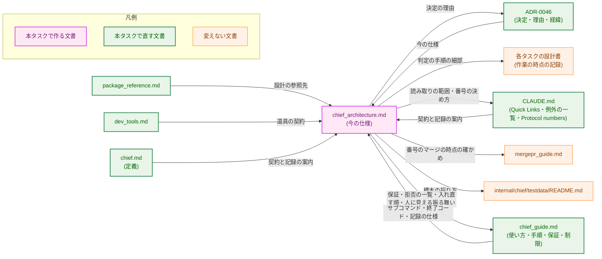
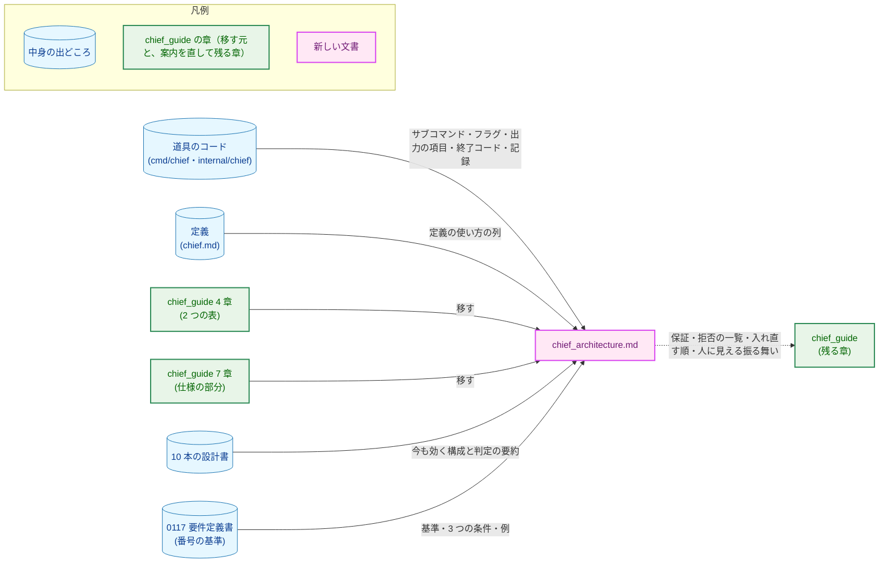
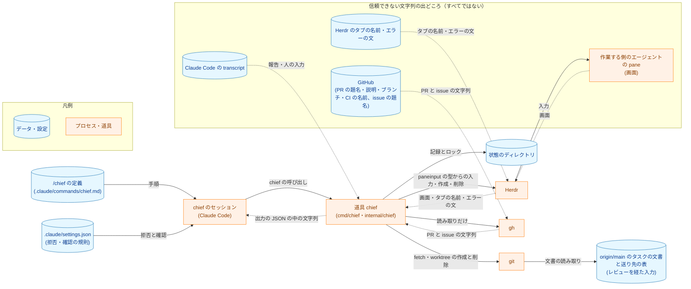
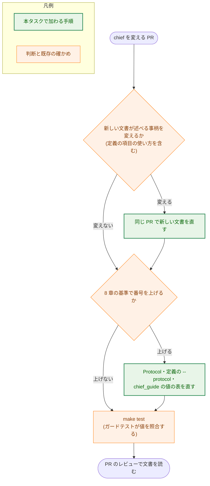
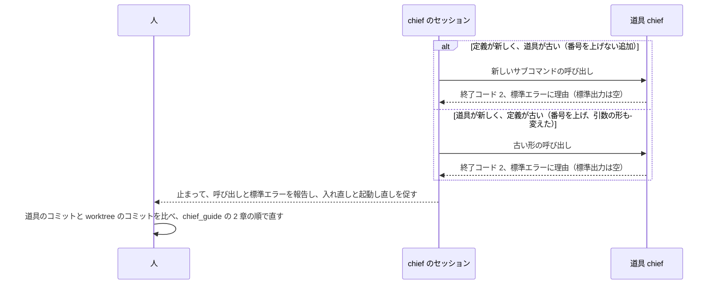

# 設計書：chief の今の仕様を持つ文書 chief_architecture.md と、プロトコル番号を上げる基準

## Document Status

| Item | Value |
|---|---|
| Status | `approved` |
| Created | 2026-11-20 |
| Review date | 2026-11-24 |
| Reviewer | isseis |
| Comments | - |

本書は [01_requirements.md](01_requirements.md) の設計である。要件定義から申し送られた設計事項は [design_handoff.md](design_handoff.md) にあり、各項目への対応は本書の 10 章にまとめる。本書が引用するファイルの行番号は、特に断らない限り、コミット `f9d27314`（本書の作成時の `main`）のものである。要件定義書が引く chief_guide の行番号のうち、`:40`（古い版に戻すとき）と `:42`（番号を変えずに欄が増える文）は、このコミットではそれぞれ `:42` と `:44` にある。本書は、このコミットでの行番号で書く。

本書では、要件定義書と同じく、`/chief` のコマンドの定義（`.claude/commands/chief.md`）を「定義」、Go の開発用の道具 `chief`（`cmd/chief`・`internal/chief`）を「道具」と呼ぶ。新しく作る `docs/dev/chief_architecture.md` を「新しい文書」と呼ぶ。章の番号は、文書の名前を付けずに「N 章」と書けば、2.3 節の表の新しい文書の章（設計の時点の章立て）を指す。その中身が今の新しい文書のどこにあるかは、同じ表の「今の場所」の列にある（1.4 節の決定 17）。本書の章は「本書の N 章」と書く。chief_guide の章は「chief_guide の N 章」と書くが、chief_guide の箇所を並べる表（本書の 2.4 節）と、chief_guide の章を続けて挙げる文では、最初の章にだけ「chief_guide の」を付ける。

## 1. 設計の全体像 (Design Overview)

このタスクは、道具の振る舞いを変えない。作るのは新しい文書 1 本である。変えるのは次のものである。

-   ほかの文書の案内と表の置き場所
-   文書のガードテスト 1 つ
-   定義の 2 か所の文
-   ADR-0046 の仕様の置き場所を指す文と、決定の話題の一覧の 1 項目

### 1.1. 設計原則

-   **書く範囲。** 今の振る舞いだけを書く。新しい文書は、実装の時点の `origin/main` の道具と定義が今どう動くかを書く。タスクごとの変化の経緯は書かず、決定の理由は ADR-0046 へ、判定の手順の細部は設計書の節へリンクする（AC-03・AC-04）。
-   **置き場所。** 1 つの事柄は 1 か所に書く。置き場所は次のとおりに分ける（F-004、1.3 節の決定 1・決定 10）。
    -   新しい文書は、F-002 の話題の仕様（値、記録の中身、消えるとき）と、判定と副作用の条件の要約を持つ。
    -   chief_guide は、人の手順（停止を解く、記録を手で消す、入れ直す）と、使う人が知るべき振る舞い・保証・制限を持つ。
    -   ほかの文書は、持たない事柄を持つ文書へリンクする。
-   **値の出どころ。** 値は道具のコードから写す。サブコマンド、フラグ、出力の項目、終了コード、記録のファイルの名前は、`cmd/chief/main.go` と `internal/chief` の定義から写す。テストで照合するのは、今 chief_guide と道具で照合している 3 つの値（サブコマンド、終了コード、状態のディレクトリ）だけで、照合先を新しい文書へ移す（F-005）。そのほかの値と文の正しさは、PR のレビューで読んで確かめる（AC-03、ADR-0016）。
-   **テストの仕組み。** 既存の仕組みを使う。新しいテストの仕組みは作らない。今のガードテスト（`cmd/chief/docs_test.go:503`）を 2 つに分け、`internal/doctestutil` の `SectionOutsideBlocks` と `FindTable` で表を読む（1.3 節の決定 4）。

### 1.2. 概念モデル

図 1-1 は、本タスクの後の文書どうしの関係を示す。矢印 A → B は「A が B へリンクし、その事柄の細部を B に任せる」を表す。

`security.md` との関係は本書の 5 章にある。新しい文書は、`security.md` の §8.2（所有者だけが読めるファイル）へリンクする。

### 1.3. 設計の際に決めたこと（2026-11-20）

決定は、決め方によって次の 3 つに分けて示す。決定 10 と決定 14 は、人に確かめた決定でも、ADR を変える決定でもある。

-   **人に確かめた決定:** 決定 1〜4 は申し送りの H-01〜H-04 について、決定 10〜13 はレビューの指摘を受けて、人に確かめた。決定 5 の 0115 との順序と決定 14 の定義だけを変える PR の扱いは、Fable の部分レビューの指摘を受けて人に確かめた。
-   **要件や既存の文書から決まる決定:** 決定 5〜9 と 14〜16 のうち人に確かめた部分を除くものは、要件と既存の文書から決まるか、このタスクの中で閉じる選択で、人に確かめずに決めた。
-   **ADR を変える決定:** 決定 10 と決定 14 だけが [ADR-0046](../../dev/adr/0046-chief-of-staff.md) の決定を変える。そのほかの決定は、要件定義の時点で ADR-0046 に入った決定（`docs/dev/adr/0046-chief-of-staff.md:177-183`）を当てはめるもので、ADR の決定を変えない。

1.  chief_guide から移すのは仕様だけにする（H-01）。移すものと残すものは次のとおりである。
    -   **移すもの:** chief_guide の 4 章のサブコマンドの表と終了コードの表。chief_guide の 7 章のうち仕様にあたる部分（状態のディレクトリの場所の決め方、記録の表、「片付け」、「作るときと消すときの記録」、見送りの記録が消えるとき）。
    -   **残すもの:** 人の手順（「送信の停止を解く」、見送りの記録を手で消してよいこと、「すべてを消す」）と、chief_guide の 3 章の使い方、5 章の保証すること・しないこと、6 章の拒否の一覧、8 章の既知の制限。
    -   **リンク:** 新しい文書は、保証の一覧を chief_guide の 5 章へ、拒む呼び出しの一覧を chief_guide の 6 章へリンクする。
    -   理由: AC-17 は chief_guide の差分を限っていて、5 章を移すには要件を変える必要がある。手順は使う人が chief_guide で読むものである。保証の一覧を新しい文書が繰り返さずにリンクすれば、同じ文が 2 か所に残らない。
    -   ADR: なし。ADR-0046 の `:179` が、新しい文書が持つ話題と、chief_guide と ADR が新しい文書へリンクすることをすでに定めていて、この決定はそれを章の単位に当てはめるだけである。
2.  出力の JSON の表は、JSON のオブジェクトの型ごとに 1 つ置く（H-02）。各表は、項目の名前、値の型、意味、定義の使い方の 4 列を持つ。`RowOutput` など、複数のサブコマンドの出力に現れる型も、表は 1 つだけ置く。サブコマンドの表の「出力」の列が、そのサブコマンドが返す最上位の型を名指す。形は 3.2 節にある。
    -   理由: 同じ型が `snapshot`・`tick` などに入れ子で現れるので、サブコマンドごとの表では同じ項目が何度も現れ、出力を変える PR が直す場所が増える。「定義の使い方」の列は、番号の基準（F-003）が約束に含める「定義が読む項目」と「定義が分岐に使う値」を、表から読めるようにする。
    -   ADR: なし。列は ADR-0046 の `:182` が使う語（定義との約束）を表に表すだけで、基準を変えない。
3.  CLAUDE.md の Quick Links に新しい行を足さない（H-03）。AC-19a で直す chief_guide の行（`CLAUDE.md:24`）が、サブコマンドと状態のディレクトリなどの案内先として新しい文書を名指す。`docs/dev/project_overview.md` からもリンクしない。
    -   理由: 要件の範囲（AC-19a の差分の制限）のまま、chief を扱う開発者が Quick Links から新しい文書に行き着ける。CLAUDE.md は毎回のセッションで読まれるので、行を増やさない。
    -   ADR: なし（索引の行の選択で、このタスクの中で閉じるため）。
4.  ガードテストを 2 つに分け、値は見出しの節の中で探す（H-04）。chief_guide のプロトコル番号を照合するテストと、新しい文書のサブコマンド・終了コード・状態のディレクトリを照合するテストに分ける。新しい文書の 3 つの値は、それぞれの見出しの節を `doctestutil.SectionOutsideBlocks` で切り出し、その中で探す。形は 3.5 節にある。
    -   理由: 新しい文書には、出力の型の表など `サブコマンド` の列を持ちうる表や、状態のディレクトリの名前を述べる文がほかにもある。文書の全体で探す今の探し方では、別の表や別の章の文を読みうる。テストを分けると、失敗したときにどちらの文書の誤りかが名前で分かる。
    -   ADR: なし（ADR-0016 を当てはめるだけで、このタスクの中で閉じるため）。
5.  並行するタスクの変更は、実装の時点の `origin/main` で書き、マージの前に確かめ直す（H-05）。新しい文書は、実装の PR を作る時点の `origin/main` の道具と定義を書く。
    -   **本書の作成時の 0115.** タスク 0115（マージコンフリクトの解消）は、`main` に要件定義書だけがあり、道具に `/mergemain` の送信はない（`internal/chief` と `cmd/chief` に `mergemain` の語がない）。そのため新しい文書は、0115 の振る舞いを書かない。0115 の設計書はブランチ `isseis/0115-chief-conflict-resolution-02` にあり、直す文書の一覧に chief_guide を挙げるが、新しい文書を挙げていない（そのブランチの `docs/tasks/0115_chief_conflict_resolution/02_architecture.md:20`・`:772`）。
    -   **マージの前の確かめ直し.** 実装の PR は、マージの前に、PR の base から `origin/main` までの次のパスの差分を読み、ある変更を新しい文書に反映する。確かめた範囲は PR に書く。
        -   `internal/chief`
        -   `cmd/chief`
        -   `.claude/commands/chief.md`
        -   `.claude/commands/_context.md` の「Command routing」
    -   **0117 の後に 0115 がマージされる場合.** 実装の PR は、マージの前に 0115 の文書と PR を確かめる。0115 がまだマージされていなければ、PR の説明と `/runpr` の報告で、0115 の実装は新しい文書を直す必要があることを人に示す。人が 0115 の計画か PR に伝える。GitHub への書き込みはしない。人に確かめた。
    -   理由: 要件の制約（要件定義書の 5 章）がそう定めている。ガードテストが照合するのはサブコマンド・終了コード・状態のディレクトリだけなので、ほかの変更は読んで見つける必要がある。0115 の設計は新しい文書の決まりより前に書かれ、決まりは 0117 の実装の PR のマージの時から効く（要件定義書の「要件定義の際に決めたこと」の保守の項）ので、0115 の設計からは決まりが読めない。
    -   ADR: なし（要件の制約を当てはめるだけのため）。
6.  ADR-0046 の、仕様の置き場所を指す文の直し方（AC-16）。次の規則で分ける。対象の文の一覧は 3.6 節にある。
    -   **仕様の置き場所を指す文:** 「仕様は X にある」「構成は X にある」「一覧は X が持つ」のように、今の仕様の置き場所として要件定義書・設計書・計画書を指す文は、今の仕様を持つ文書の節を指す文に直す。指す先は、新しい文書の該当する節（拒む呼び出しの一覧は chief_guide の 6 章、読み取りの範囲は CLAUDE.md の例外の一覧）である。もとの文書は、決定の出典として同じ文に残す。
    -   **出典の参照:** 「理由」の項の括弧の中で要件定義書や設計書を指す参照（「（0088 要件定義書の F-005）」など）は、決定の出典なので変えない。
    -   **番号だけの機能要件:** `:23` の文を直した後も、番号だけで書いた機能要件（F-004 など）がどの要件定義書のものかが分かるように、その文に 0088 要件定義書を出典として残す。
    -   **リンクにする文:** `:179` と `:182` が平文で名指す chief_architecture.md は、Markdown のリンクにする。
    -   理由: AC-16 が、どの文を今の仕様の置き場所に直し、どの文を出典の書き方にするかを設計に任せた。出典を消すと、ADR の理由の根拠が読めなくなる。
    -   ADR: ADR-0046 を直すのは要件の AC-16 が決めたことで、ADR の決定は変えない。
7.  新しい文書の章立てを 2.3 節のとおりにする。issue #1055 の 7 章の案に要件の F-002 の話題を当てはめ、「道具が書き出すもの」（AC-08）、「判定と副作用の条件」（決定 10）、プロトコル番号の章を置いて、9 章にする。
    -   理由: 要件の話題（AC-05〜AC-14b）が、それぞれ 1 つの章に収まり、要件の AC から章を引けるようにするためである。
    -   ADR: なし。
8.  構成図は、信頼できない文字列の出どころを 1 つの囲みにまとめ、道具に入ってくる線を点線で描く（AC-05）。`origin/main` のタスクの文書と送り先の表は、レビューを経た信頼する入力として、囲みの外に描く。図の下書きは 2.5 節にある。
    -   理由: 標準の配色（`mermaid_reference.md` の 2 章）に信頼の境界を表す色がない。色を足さずに、囲みと線の種類で境界を示せる。信頼する入力を描くのは、後の変更が計画書を worktree から読むように変えるなどして、境界が黙って弱まることを防ぐためである。
    -   ADR: なし。
9.  道具と定義の組み合わせの誤りの見分け方は、人に向けて新しい文書に書き、定義は標準エラーの文で振る舞いを選ばない（AC-14a・AC-14b）。
    -   **定義の案内.** 定義の終了コード `2` の行は、標準エラーの中身によらず、次の 2 つを案内する。
        -   道具と定義が違うコミットのものでありうること。
        -   そのときは chief_guide の 2 章の順（`/chief` を止める、chief の worktree を `main` に更新する、`main` から入れ直す、`/chief` を起動し直す）で直すこと。
    -   **新しい文書の手がかり.** 新しい文書は、人が見分ける手がかりを書き、標準エラーの文は約束に含めないと述べる。手がかりは次のとおりである。
        -   入れてある道具の作られたコミット（`go version -m` の `vcs.revision`。`docs/dev/guides/chief_guide.md:24`）と、chief の worktree のコミットを比べる。
        -   標準エラーが、定義の呼び出しにあるサブコマンド・フラグ・フラグの値を道具が知らないと述べている（`cmd/chief/main.go:134-136`・`:145-147`・`:153-155`・`:182-185`）。
        -   Go の実行時のパニックも終了コード `2` で、標準エラーにスタックトレースを書く（`cmd/chief/main.go:32-33`）。
    -   理由: 終了コード `2` には、使い方の誤り、値の形の誤り、パニックが混ざる。番号を上げる PR が引数の形も変えたときは、新しい道具が古い定義の呼び出しを番号の照合より前に拒むので、道具が古いとは限らない（6.2 節）。標準エラーの文で案内を変えると、その文言が事実上の約束になる（CLAUDE.md の「Declare, don't infer」「Keep internals unobservable」）。
    -   ADR: なし（文書と定義の案内の中身で、約束を変えないため）。
10. 新しい文書に「判定と副作用の条件」の章を置く。状況の表、タスクの文書と送り先の表の読み方、マージの後の自動送信の条件、pane へ送る条件、workspace の作成と削除の条件を、判定の領域ごとの表で要約する。表は、何を決めるか、何を読むか、副作用の条件にあたるか、細部の置き場所（chief_guide の 3 章、設計書の節、ADR-0046 の節）を持つ。ADR-0046 の `:69`・`:196`・`:208` と package_reference の `[0093 design]` は、この章を今の仕様の置き場所として指す。
    -   理由: これらの今の仕様を指す文を、AC-16・AC-19 が新しい文書へ向けることを求める。また、8 章の番号の基準が使う「副作用の条件」がどの判定にあたるかを、新しい文書から引けるようにする必要がある。手順の細部まで集めると保守できないので、要約と案内にとどめる（要件の「要件定義の際に決めたこと」の、文書が持つ範囲の項）。
    -   ADR: [ADR-0046](../../dev/adr/0046-chief-of-staff.md) を更新する（本 PR で直した）。`:179` の「持つのは」の一覧に「判定と副作用の条件の要約」を足し、経緯に 1 行を足す。新しい文書の持つ話題が増え、F-006 の決まりで直す PR の範囲が広がるためである。
11. 既存のフラグに新しい値を足す変更は、フラグを足す変更と同じに扱う。約束の変更である。古い道具がその値を使い方の誤り（終了コード `2`）として拒み、ほかの 2 つの条件も成り立てば、上げなくてよい（3 つの条件は 3.4 節の 3 で述べる）。古い道具は、この誤りを番号の照合の後に返す（`cmd/chief/main.go:182-185`）。8 章の例の表に入れる。
    -   理由: 古い道具は、その値を使う呼び出しを、何も読まず何も送らずに拒む。この点は、新しいフラグを拒むのと同じである。人に確かめた。
    -   ADR: なし。ADR-0046 の `:182` の要約（「古い道具が新しい呼び出しを使い方の誤りとして拒み」）に収まる。
12. `paneinput` の検証と、送るかを決める読み取りの変更は「pane へ送る条件」の変更として上げる。無害化と読む量の上限の修正は上げない。
    -   **新しい文書に書くこと.** 8 章に、上げない修正はマージの後の入れ直し（`docs/dev/guides/chief_guide.md:18`）だけに頼る、と書く。
    -   **送るかを決める読み取り.** 例は、中継の直前の照合、NEXT の照合、人の後の入力の確かめである。
    -   理由: `paneinput` の検証は、pane へ送る入力そのものを決めるので、副作用の条件にあたる。`Sanitize`・`CapHead` は、人とセッションに示す文字列だけを変え、送る条件を変えない。そのため、承認した基準では上げない。上げないことの帰結を、文書に書いて隠さない。人に確かめた。
    -   ADR: なし（承認した基準の当てはめで、基準を変えないため）。
13. `docs/dev/conventions/dev_tools.md` の Rule 4 の chief の箇所（`:60-66`）を、新しい文書へのリンクに直す。
    -   **直す理由.** この文は、道具の契約（引数・出力・終了コード）の置き場所として chief_guide を挙げている。本タスクの後、契約は新しい文書にある。
    -   **範囲.** 要件 2.2 の一覧にない文書だが、F-004（細部は新しい文書が持ち、ほかの文書はリンクする）の当てはめとして直す。差分は、chief の 1 か所のリンクに限る。
    -   理由: 直さないと、規約の文書が契約の置き場所を誤って示し続ける。人に確かめた。
    -   ADR: なし。
14. 「定義の使い方」の列の値の決め方と、定義だけを変える PR の扱いを定める。規則は 3.2 節にある。
    -   **定義だけを変える PR.** 定義が、読まなかった項目を読み始めるか、示すだけだった項目で分岐し始める PR は、番号を上げる。使い方を狭める PR と、文の直しだけの PR は上げない。人に確かめた。
    -   理由: 番号の基準は、この列が示す「定義が読む項目」と「分岐に使う項目」を使う。列の値が古いと、上げるべき PR が、上げずに済んでしまいうる（fail open）。また、定義が読まない項目の意味は、番号を上げずに変えてよい。そのため、定義がその項目を読み始めるときに番号を上げないと、古い道具を入れたままの利用者では、番号の照合が通り、新しい定義が古い意味の値で黙って振る舞いを選ぶ。
    -   ADR: [ADR-0046](../../dev/adr/0046-chief-of-staff.md) を更新する（本 PR で直した）。`:182` の基準の要約に、定義が項目の使い方を広げる PR も上げる、という 1 文を足す。基準が扱う PR の種類が増えるためである。
15. 新しい文書は、今のプロトコル番号の値と、具体的な `--protocol N` の例を書かない。番号の値は chief_guide の 2 章だけが持つ。
    -   理由: `TestDocumentedProtocolMatches` は `.claude/commands` だけを読む（`internal/doctestutil/protocol.go:112`）。新しい文書に値を書くと、番号を上げたときに、テストに守られない古い値が残る。
    -   ADR: なし。
16. ADR-0046 の食い違いの記述（`:181`）は、新しい文書の冒頭と 8 章を持つ PR で消す。実装を複数の PR に分けるなら、それより前の PR は、新しい文書を作る PR で、食い違いの記述を、まだ残っていること（冒頭と 8 章がまだないこと）を述べる文に書き換える（`docs/dev/conventions/adr.md` の「Discrepancy statements」）。
    -   理由: `:182` が新しい文書のプロトコル番号の章（8 章）を指すので、8 章がないうちに食い違いの記述を消すと、ADR が存在しない節を指す。
    -   ADR: なし。

### 1.4. 実装の後に決めたこと（2026-11-24）

タスク 0123 の再レビューで、実装の PR（#1069）が次の 2 点を設計書から変えたまま、決定の変更として記録していなかったことが分かった。本節は、その 2 点を決定として記録する。

17. 新しい文書の章立ては、設計の時点の 9 つの章ではなく、2 部 6 章とする。第 1 部「アーキテクチャ解説」が 1〜4 章、第 2 部「仕様リファレンス」が 5・6 章である。設計の時点の各章の中身は、2.3 節の表の「今の場所」の列のとおりに置く。あわせて、設計の時点の表にない 2 つの節、1.3（`/chief` の定義の概要）と 1.4（`/chief` のセッションと作業側のセッションの間の通信）を持つ。
    -   理由: #1069 のブランチで、PR を作った後のコミットがこの形に組み替え、そのまま `main` に入った。組み替えの理由はコミットに書かれていない。各章の中身（AC-02〜AC-14a が求めるもの）は、どの章にも残っている。いまから設計の時点の章立てに戻すと、chief_guide・ADR-0046・package_reference などのリンクとガードテストの見出しを、もう一度直すことになる。そのため、マージされた形を今の章立てとし、設計書と計画書をそれに合わせる。
    -   squash コミット（`7bf8f68b`）の `Editorial correction:` の行のうち 3 つは、組み替えの前の章番号で書かれている。構成を述べる文の「chapter 2」は今の 1 章と 2 章を、transcript の読み取りの「chapter 6」は今の 3 章を、作成と状況の表の「chapter 7」は今の 3.5 を指す。コミットメッセージは直せないので、ここに対応を記録する。
    -   ADR: なし（ADR-0046 の決定は、新しい文書が持つ話題を定め、章の番号を定めない）。
18. ADR-0046 の「chief の今の仕様は chief_architecture.md が持つ」の決定の、持つ話題の一覧に「テストのしかた」を加える。
    -   理由: 2.3 節の章立ては、設計の時点から「テストのしかた」の章（今の 4.9）を持ち、AC-10 がそれを求めている。ところが、ADR-0046 の一覧にはこの話題がなかった。#1069 はこの項目を一覧に加えたが、編集上の訂正として記録した。一覧に話題を加えると、F-006 の決まりで新しい文書を同じ PR で直す PR の範囲が広がるので、決定 10 と同じく決定の変更として扱う。
    -   ADR: [ADR-0046](../../dev/adr/0046-chief-of-staff.md) を更新する（経緯に 1 行を足す。決定の文は #1069 で直してある）。

## 2. システム構成 (System Structure)

### 2.1. 全体の構成

図 2-1 は、新しい文書の中身がどこから来るかを示す。矢印 A → B は「A の中身を B が持つ（写すか移す）」を表す。点線の矢印は、中身を写さずにリンクで案内することを表す。

設計書から写すのは、今も効いている構成と判定の要約だけである。後のタスクが上書きした記述は、今のコードと照合して今の振る舞いを書き、設計書へのリンクは理由を読むためのものと分かるように書く（AC-04）。

### 2.2. コンポーネントの配置

| ファイル | 変更 |
|---|---|
| `docs/dev/chief_architecture.md` | 新しく作る（2.3 節） |
| `docs/dev/guides/chief_guide.md` | chief_guide の 4 章の 2 つの表と 7 章の仕様の部分を消してリンクに置き換え、番号の記述を直す（2.4 節） |
| `docs/dev/adr/0046-chief-of-staff.md` | 本 PR（設計の PR）で、決定の話題の一覧に 1 項目と、基準の要約に 1 文を足し、経緯に 1 行を足した（決定 10・決定 14）。実装の PR で、食い違いの記述を消し、仕様の置き場所を指す文を直す（3.6 節） |
| `docs/dev/conventions/package_reference.md` | `cmd/chief`・`internal/chief`・`internal/chief/paneinput` の行の、仕様の置き場所としての設計書の参照を、新しい文書へのリンクにする（AC-19） |
| `docs/dev/conventions/dev_tools.md` | Rule 4 の chief の箇所を新しい文書へのリンクにする（決定 13） |
| `CLAUDE.md` | Quick Links の chief_guide の行（`:24`）の案内を直す（AC-19a） |
| `.claude/commands/chief.md` | chief_guide を案内する文（`:17-18`）と、終了コード `2` の行（`:85`）を直す（AC-19a・AC-14b） |
| `cmd/chief/docs_test.go` | `TestGuideValuesMatchTool`（`:503`）を 2 つのテストに分ける（3.5 節） |

`docs/dev/adr/README.md` の索引の行は変えない。ADR-0046 の題と状態が変わらないためである。

### 2.3. 新しい文書の章立て

新しい文書は、冒頭の段落と 2 部 6 章からなる（1.4 節の決定 17）。下の表は、設計の時点の 9 つの章ごとに、持つ中身と、それが満たす AC と、その中身の今の場所を示す。章の名前は実装で整えてよい。ただし、3.5 節のテストが探す 3 つの見出し（3 章のサブコマンドの節、3 章の終了コードの節、4 章の状態のディレクトリの場所の節）は、テストと同じ PR で決める。

| 章 | 持つ中身 | AC | 今の場所 |
|---|---|---|---|
| 冒頭 | 今の仕様を持つ文書であること。決定の理由と経緯は ADR-0046 にあること（リンク）。この文書が述べる事柄を変える PR は、同じ PR でこの文書を直すこと | AC-01・AC-23 | 冒頭 |
| 1. 目的と範囲 | chief がすることとしないこと。理由は ADR-0046 の節へのリンク | AC-02 | 1.1 |
| 2. 構成要素と信頼の境界 | 構成図 1 つ（2.5 節）。信頼できない文字列と信頼する入力。pane へ送る入力が `internal/chief/paneinput` の型だけから組み立てられること。`.claude/settings.json` の拒否・確認の規則の役割。保証の一覧は chief_guide の 5 章へ、拒む呼び出しの一覧は 6 章へリンク | AC-05 | 1.2 と 2 章 |
| 3. 定義と道具の契約 | サブコマンドの表（フラグと出力の型の列を持つ）、終了コードの表、引数の確かめの順と `--protocol` の照合、使い方の誤りの扱い、出力の型ごとの表（3.2 節） | AC-06 | 5 章 |
| 4. 状態のディレクトリ・ロック・記録 | 場所とその決め方、ロック、作成の排他、記録の表（3.3 節）、片付けと、作るとき・消すときの記録 | AC-07 | 6.1〜6.6 |
| 5. 道具が書き出すもの | 出力の先ごとの表（標準出力、標準エラー、状態のディレクトリ、状態のディレクトリの外）。ログのファイルがないこと。出力の文字列の出どころと扱い | AC-08 | 6.7 |
| 6. 画面と transcript の読み取り | 読み取りを行う構成要素（`internal/chief` の `screen` で始まるファイル）と、ほかの部分が受け取る型。読めない画面と行の扱い。標本の置き場所。読み取りの範囲は CLAUDE.md の例外へリンク | AC-09 | 3.1〜3.4 |
| 7. 判定と副作用の条件 | 判定の領域ごとの要約の表（決定 10）。どれが副作用の条件かを示し、8 章の基準がここを使う | AC-12・AC-16・AC-19（決定 10） | 3.5 |
| 8. プロトコル番号 | 約束、上げる基準、3 つの条件、判定の変更、記録の形式、例、上げる PR が変える場所、組み合わせの誤りに当たったとき（3.4 節） | AC-11〜AC-14a | 4.1〜4.8 |
| 9. テストのしかた | 標本の足し方と採り直し方の要約（標本を採る場面、採る人、置く場所、採った日と版を書くこと）と、手順の細部を持つ `internal/chief/testdata/README.md` へのリンク、ガードテストが照合するもの、`make test` に要るもの（CLAUDE.md の「Development Notes」へリンク） | AC-10 | 4.9 |
| （設計の時点の表になかった節） | `/chief` の定義の概要、`/chief` のセッションと作業側のセッションの間の通信 | - | 1.3、1.4 |

章の順は次の考えで決めた。

-   **読む順:** 全体（1・2 章）、外から見える契約（3〜5 章）、内部の読み取りと判定（6・7 章）、変えるときの規則（8・9 章）の順にした。
-   **冒頭:** 保守の決まりは、文書を変える人が最初に読む場所に置く。

**7 章の表の形。** 1 行に 1 つの判定の領域を書き、列は次の 5 つである。

| 列 | 中身 |
|---|---|
| `判定` | 判定の領域（状況の表の行の状態と急ぎの度合い、次のコマンド、自動送信、中継、リセット、作成、削除など） |
| `読むもの` | 判定が読む入力（GitHub と git の状態、`origin/main` の文書、画面、transcript、記録） |
| `副作用の条件` | この判定が、pane へ送る・自動で送る・作る・消す条件にあたるか |
| `人に見える振る舞い` | chief_guide の該当する節へのリンク |
| `細部と理由` | 設計書の節と ADR-0046 の節へのリンク |

手順の細部は書かない。

### 2.4. chief_guide の振り分け

下の表は、chief_guide のうち本タスクが触れる部分と、その行き先を示す（決定 1）。表にない章（1・3・5・6・9 章）と、表にない行は変えない。5 章の「設計書 5.2」（`:209`）と 8 章の「設計書 1.3」（`:255`）は、理由の出典としての参照なので変えない。

| chief_guide の箇所 | 中身 | 行き先 |
|---|---|---|
| 冒頭の段落の最後の文（`:3`） | 要件と設計の置き場所として 0088 と 0092 の文書を指す | 今の仕様の置き場所として新しい文書を指す文に直す（AC-17 の 2 つ目） |
| 2 章 `:26-30` | プロトコル番号の値の表 | 残す（AC-21） |
| 2 章 `:32` | 番号が合わないと `protocol_mismatch` で拒む、という文 | 引数の形が合わない呼び出しは、番号の照合より前に使い方の誤りになることを添えるか、新しい文書の 8 章へのリンクに置き換える（AC-17 の 4 つ目。6.2 節） |
| 2 章 `:34` | 入れ直す順 | 残す。新しい文書の 8 章と定義の終了コード `2` の行がここへ案内する（AC-14） |
| 2 章 `:36-42` | 0092 の版への入れ替えと、古い版に戻すとき | 残す。新しい文書の 8 章（記録の形式）がここへリンクする（AC-12a）。`:42` の「7 章の『片付け』」は新しい文書の 4 章を指すように直す |
| 2 章 `:44` | 番号を変えずにサブコマンドや出力の欄が増えることがある、という文 | 新しい基準と食い違うので、新しい文書の 8 章へのリンクに置き換え、入れ直した後に `/chief` を起動し直すことだけを残す（AC-17 の 4 つ目） |
| 4 章 `:169` | サブコマンドの細部の置き場所として 0088・0092 の設計書を指す | 新しい文書の 3 章へのリンクに置き換える |
| 4 章 `:171-191` | サブコマンドの表と終了コードの表 | 新しい文書の 3 章へ移す（AC-17 の 1 つ目） |
| 7 章 `:236` | 場所の決め方、ファイルの権限、同名の記録を作らないこと | 新しい文書の 4 章へ移す |
| 7 章 `:238-245` | 記録の表 | 新しい文書の 4 章へ移し、3.3 節の列にする |
| 7 章 `:247` | 送信の停止を解く手順 | 残す |
| 7 章 `:248` | 見送りの記録が消えるときと、人が手で消してよいこと | 消えるときは新しい文書の 4 章へ移し、手で消してよいことは残す |
| 7 章 `:249`・`:250` | 片付けと、作るとき・消すときの記録 | 新しい文書の 4 章へ移す |
| 7 章 `:251` | すべてを消す手順 | 残す |
| 8 章 `:275` | 「7 章の『片付け』」を指す | 新しい文書の 4 章を指すように直す |

7 章には、残す手順と、新しい文書の 4 章へのリンクが残る。`:42` と `:275` の直しは、AC-17 の 3 つ目（状態のディレクトリの章のうち移す部分をリンクに置き換える）に含める。

### 2.5. 構成図の描き方

図 2-2 は、新しい文書の 2 章に置く構成図の下書きである。実装は、この下書きを今のコードと照合して仕上げる。線の意味は次のとおりである。

-   **実線の矢印 A → B:** A が B を呼ぶか、B に書くか、B の振る舞いを決める。
-   **点線の矢印 A -.-> B:** A の信頼できない文字列が B に入る。

下書きの線は、次のコードで確かめた。

-   定義が道具を `chief` の語だけで呼ぶ（`.claude/commands/chief.md:56-60`）。
-   道具が Herdr・git・gh を子のプロセスとして呼ぶ（`internal/chief/runner.go:75`・`:91`・`:107`）。
-   道具が状態のディレクトリを作って開く（`internal/chief/records.go:131-139`）。
-   道具がタスクの文書と送り先の表を、worktree ではなく `refs/remotes/origin/main` から読む（`internal/chief/task.go:31-32`）。
-   道具が画面を Herdr から読む（`internal/chief/herdr.go:232`）。
-   道具がtranscript のファイルを直に読む（`internal/chief/transcript.go:149`）。
-   道具がPR を `gh pr view` で読む（`internal/chief/detail.go:463`、`internal/chief/workspace.go:391`）。
-   道具がissue を `gh api graphql` で読む（`internal/chief/issue.go:79`）。

-   **囲み.** 囲みは、chief が信頼できないとして扱う文字列の主な出どころである。新しい文書は、その根拠として次の 3 つを挙げる。囲みがすべての出どころの一覧ではないことも述べる。
    -   定義の規則 2（`.claude/commands/chief.md:30-37`）
    -   ADR-0046 の「道具と実行の枠組み」
    -   CLAUDE.md の「Declare, don't infer」の chief の例外
-   **信頼する入力.** `origin/main` のタスクの文書と送り先の表は、レビューとマージを経た入力として、囲みの外に描く。新しい文書は、道具がこれらを worktree から読まないことを述べる。
-   **道具の出力の点線.** 道具の出力の JSON は、出どころの文字列を含む。文字列ごとの扱い（無害化、上限で切るか）は一様ではないので、新しい文書の 5 章が出力の項目の出どころごとに書く。たとえば、終了コード `1` の `message` は、子のプロセスの標準エラーを `Sanitize` で無害化して含む（`cmd/chief/main.go:173-175`）。定義の規則 2 は、従わずに示すだけとする項目を名指すが、`message` は名指していない。新しい文書は、この食い違いを今の振る舞いとして書く。定義を直すことは本タスクの範囲の外なので、別の issue に記録する（3.6 節）。
-   **書かないもの.** 人とセッションのやり取りは図に描かない。

## 3. コンポーネント設計 (Component Design)

### 3.1. コンポーネントの責務

| ファイル | 責務 | 新規／変更 |
|---|---|---|
| `docs/dev/chief_architecture.md` | chief の今の仕様（2.3 節の 9 章） | 新規 |
| `docs/dev/guides/chief_guide.md` | 使い方、人の手順、保証、拒否の一覧、既知の制限、プロトコル番号の値と入れ直す順 | 変更 |
| `docs/dev/adr/0046-chief-of-staff.md` | 決定、理由、採らなかった案、経緯。今の仕様は新しい文書へリンク | 変更 |
| `docs/dev/conventions/package_reference.md` | パッケージの 1 行の要約。設計の参照先を新しい文書にする | 変更 |
| `docs/dev/conventions/dev_tools.md` | 道具の契約の置き場所の一覧 | 変更 |
| `CLAUDE.md` | Quick Links の chief_guide の行の案内 | 変更 |
| `.claude/commands/chief.md` | chief_guide の案内の文と、終了コード `2` の行の案内 | 変更 |
| `cmd/chief/docs_test.go` | 2 つのガードテスト（3.5 節） | 変更 |

**今の振る舞いを確かめている既存のテスト。**

-   **置き換えるテスト.** `TestGuideValuesMatchTool`（`cmd/chief/docs_test.go:503-542`）は、chief_guide のサブコマンドの表・終了コードの表・プロトコル番号・状態のディレクトリを照合している。表を移すと、このテストはサブコマンドと終了コードの表を見つけられずに失敗する。そのため、表を移すコミットと同じコミットで、3.5 節の 2 つのテストに置き換える。
-   **定義の呼び出しを照合するテスト.** `TestDocumentedProtocolMatches`（同 `:205`）と `TestDocumentedInvocationsParse`（同 `:269`）は、定義の `--protocol` と呼び出しを照合する。`doctestutil.Invocations` は、`chief` の語で始まり空白を含むコードの部分を呼び出しとして読む。そのため、本タスクが定義に足す文は、そのようなコードの部分を含まないこととする（含めるなら、正しい呼び出しの形にする）。

### 3.2. 出力の JSON の表の形（決定 2・決定 14）

新しい文書の 3 章は、次の 3 種類の表を持つ。

-   **サブコマンドの表.** 1 行に 1 つのサブコマンドを書き、列は次の 5 つである。テストは 1 列目だけを読む。
    -   `サブコマンド`
    -   `何をするか`
    -   `必須のフラグ`（受け付ける値の集合を持つフラグは、その集合も書く。`send` の `--command` など）
    -   `任意のフラグ`
    -   `出力`（終了コード `0` のときの最上位の型の名前と、その型の表へのリンク）
-   **終了コードの表.** 列は `終了コード` と `意味` の 2 つで、終了コードごとに標準出力に何を書くかも書く。`1` と `3` は、どのサブコマンドでも標準出力に `result` の型の JSON を書く（`cmd/chief/main.go:170-175`）。ただし、結果を書き出せなかったときの `1` は、標準出力が空か途中までで、標準エラーに理由を書く（`cmd/chief/main.go:347-357`）。`2` は何も書かない。
-   **出力の型ごとの表.** 型ごとに小見出しを 1 つ置き、その下に表を 1 つ置く。列は次の 4 つである。

| 列 | 中身 |
|---|---|
| `項目` | JSON の名前（`json` のタグの名前）。`omitempty` の項目は、そのことを書く |
| `型` | JSON の値の型（文字列、数、真偽、配列、ほかの型の名前） |
| `意味` | 項目が何を表すか。決まった値の集合を持つ項目は、値ごとの意味を書く。中身を約束しない値（下の「中身を約束しない値」）は、そのことを書く |
| `定義の使い方` | `分岐`・`渡す`・`示す`・`読まない` のどれか 1 つ（下の「列の値の決め方」） |

-   **型の名前.** 小見出しの型の名前は Go の型の名前にする。`internal/chief/output.go` の型（`SnapshotOutput`・`RowOutput`・`ActionOutput` など）と、`cmd/chief/main.go:109` の `result` である。開発者がコードの型と表を結び付けられるためである。
-   **埋め込み.** 別の型を埋め込んだ型は、埋め込まれた型の項目を繰り返さない。その型の表の先頭で、埋め込みの項目が同じ階層に並ぶことを述べ、埋め込まれた型の表へリンクする（`TickOutput` が `SnapshotOutput` を埋め込むなど。`internal/chief/output.go:700-703`）。
-   **共通の項目.** どの最上位の型にもある `protocol` は、3 章の初めに 1 回だけ意味を書き、各表は「共通の項目」とだけ書く。
-   **値の集合の置き場所.** 決まった値の集合（`outcome`・`reason`・`urgency` など）の値ごとの意味は、その項目の行に書く。値が多い項目は、その型の表の下に値の表を 1 つ置く。
-   **中身を約束しない値.** 定義がそのまま道具へ返す値（`ItemID`・`CheckValue`・`WaitBaseline`。`internal/chief/pending.go:17`・`internal/chief/relay.go:21`・`internal/chief/wait.go:19`）と、`table_unreadable` の文言（`internal/chief/output.go:29-33`）は、中身の形を書かない。「中身を約束しない」と書き、定義はこれらの中身を読んで振る舞いを選ばない、と述べる。番号の基準では、形を変えても約束の変更にあたらない。
    -   **古い道具の値を受け取るとき.** 古い道具が出した値を新しい道具が受け取りうる値（`wait --since` の `baseline` など）の形を変えるときは、新しい道具が古い形を受け付けるかを、条件 (2) で確かめる。
-   **出力の項目のテスト.** 出力の項目を照合するテストは足さない（AC-22）。表と道具の食い違いは、出力を変える PR が F-006 の決まりで直し、そのレビューで読んで確かめる。

**列の値の決め方（決定 14）。**

-   **値の選び方.** 値は、実装の時点の定義（`.claude/commands/chief.md`）を読んで決める。項目に複数の使い方があれば、`分岐` > `渡す` > `示す` > `読まない` の順で強いものを書く。
-   **迷うとき.** どちらか迷うときは、強いほうを書く。読むか分からなければ `示す`、分岐に使うか分からなければ `分岐` にする。番号の判断が上げる向きに倒れるようにするためである。
-   **基準との関係.** 8 章の番号の基準は、列が `読まない` でない項目を「定義が読む項目」、`分岐` の項目を「定義が分岐に使う項目」として参照する。ただし、列は判断の助けで、判断の拠り所は今の定義である。番号を判断する PR は、変える項目について定義を読んで確かめる。
-   **定義だけを変える PR.** 定義の項目の使い方を変える PR は、F-006 の決まりで、同じ PR でこの列を直す。列の値を強くする（`読まない` から読む値へ、`示す` か `渡す` から `分岐` へ）PR は、道具を変えなくても番号を上げる（決定 14）。列の値を弱くする PR は上げない。

### 3.3. 記録の表の形（AC-07・AC-08）

新しい文書の 4 章の記録の表は、1 行に 1 種類の記録を書き、次の列を持つ。

| 列 | 中身 |
|---|---|
| `記録` | 記録の名前（ロック、通知の記録、送信の記録など） |
| `ファイル` | 状態のディレクトリからのパス（`lock.json`、`<worktree のハッシュ>/send-*.json` など） |
| `中身` | 記録が持つ値の要約。項目ごとの表は置かない（記録の形式は約束に含めないため。AC-12a） |
| `何のために読むか` | 道具がこの記録を読む判断 |
| `書くとき` | 道具がこの記録を作るか書き足すとき |
| `消えるとき` | 道具が消すとき（`start` の片付け、`remove` の後など）。人が消してよい記録は「人が消してよい（手順は chief_guide の 7 章）」と書いてリンクし、手順は繰り返さない |
| `信頼できない文字列` | 含まないか、含むならどの文字列を、どう扱って書くか（無害化、上限で切るなど） |

-   **書き出すものの表.** 5 章の表は、出力の先ごとに、書く中身、書き出す先、残る期間、信頼できない文字列を含むかを持つ。出力の先と表の扱いは次のとおりである。
    -   **標準出力・標準エラー:** その行に書く。
    -   **状態のディレクトリ:** 項目を繰り返さずに、4 章の記録の表へリンクする（AC-08 の「同じ表を 2 つ置かない」）。
    -   **状態のディレクトリの外:** 次の変化を挙げ、それを述べる節（新しい文書の 7 章の作成と削除の行など）へ案内する。
        -   worktree の作成と削除（`git worktree add`・`remove`）
        -   Herdr の workspace・タブ・pane の作成とエージェントの起動、workspace を閉じること
        -   pane への入力
        -   `git fetch origin main` による `refs/remotes/origin/main` の更新（すべての worktree が共有する参照である）
-   **使い方の誤りの書き出し.** 使い方の誤りのときに標準出力に何も書かず標準エラーに理由を書くことは、3 章（AC-06）が持ち、5 章はそこへリンクする。5 章の標準エラーの行は、Go の実行時のパニックがスタックトレースを書くことも述べる。
-   **同じ値は 1 か所に.** 記録のファイルの名前と消えるときは 4 章だけが持つ。
-   **ログのファイル.** 5 章は、道具がログのファイルを書かないことを述べる。

### 3.4. プロトコル番号の章の形（AC-11〜AC-14a）

新しい文書の 8 章は、次の節からなる。節の中の規則の文は、要件定義書の「要件定義の際に決めたこと（2026-11-20）」と F-003 の文に合わせ、意味を変えない。

1.  **約束.** 約束に含めるものと含めないものを述べる（AC-11・AC-12a）。
    -   **含めるもの:** サブコマンド、フラグ（受け付ける値を含む。決定 11）、出力の JSON の形、定義が読む出力の項目の意味、定義が分岐に使う出力の値、終了コードの意味。
    -   **含めないもの:** 状態のディレクトリの記録の形式。理由は、記録は道具だけが読み書きし定義は読まないことである。標準エラーの文言も含めない（決定 9）。
    -   **列との関係:** 「定義が読む項目」と「分岐に使う値」は 3 章の表の「定義の使い方」の列で分かり、判断の拠り所は今の定義であることを述べる（決定 14）。
    -   **古い版に戻すとき:** 記録の扱いは chief_guide の 2 章（`:42`）へリンクする。
2.  **上げる基準.** 約束を変える PR は上げる。分岐に使う項目に新しい値を足すことも約束の変更である。人に示すだけの項目でも、意味を変えれば上げる（AC-11）。
3.  **上げなくてよい 3 つの条件.** AC-12 の次の 3 つの条件を述べる。条件 (3) が見るのは、古い定義が行う呼び出しの出力だけであることも述べる（AC-12）。
    1.  古い道具が、新しい定義が新しく足した呼び出しを使い方の誤り（終了コード `2`）として拒む。
    2.  新しい道具が、古い定義の呼び出しを受け付け、同じ形の出力を返す。
    3.  古い定義がする呼び出しについて、出力の形、定義が読む項目の意味、定義が分岐に使う値、終了コードの意味が変わらない。

    条件 (1) の「新しく足した呼び出し」には、既存のフラグに足した値を使う呼び出しを含める（決定 11）。新しいサブコマンドが既存の型に項目を足し、古い呼び出しの出力にもその項目が現れるなら、条件 (3) は成り立たない、と述べる。条件 (3) は、古い呼び出しの実際の出力で判断する（`omitempty` の項目を古い呼び出しが決して書かないなら、出力は変わらない）。
4.  **判定の変更.** 約束を変えずに判定を変える PR は、副作用の条件（pane へ送る、自動で送る、workspace と worktree を作る、消す条件）を変えるときだけ上げる（AC-12）。
    -   **副作用の条件にあたるもの:** 7 章の表で「副作用の条件」とした判定。ほかに、`paneinput` の検証と、送るかを決める読み取りもこれにあたる（決定 12）。
    -   **上げない修正:** 無害化と読む量の上限の修正は上げず、マージの後の入れ直しだけに頼る、と述べる。
5.  **当てはめの例.** 下の表の形で、例を、上げるか上げないかと根拠の節とともに示す。
    -   **含める例:** AC-13 の 5 つの例に加えて、次の例を含める。
        -   既存のフラグに値を足す
        -   送るかを変える画面か transcript の読み取りの変更
        -   新しいサブコマンドが既存の型に項目を足す
        -   無害化の修正
        -   定義だけが項目の使い方を広げる（上げる）と、狭める（上げない）
    -   **過去の判断:** 要件定義書の背景にある過去の判断（0093・0095・0097・0105・0113）は、タスクの番号を書かずに、変更の種類として例に含めてよい。この文書は今の振る舞いを書くもので、経緯は書かないためである。
6.  **判定の流れ図.** 2〜4 と、定義だけを変える PR（3.2 節、決定 14）の判断の順を、`flowchart TD` の分岐の図で示す（mermaid_reference.md の「Decision / Branching Pattern」）。図は規則の文を繰り返すもので、文と図が食い違うときは文を正とする、と添える。
7.  **上げる PR が変える場所.** 変える場所と、リンクだけにするものを述べる（AC-14）。
    -   **変える場所:** 道具の `Protocol` の定数（`internal/chief/records.go:29`）、定義の `--protocol`、chief_guide の 2 章の値の表。新しい文書は番号の値を持たないので、変える場所に入らない（決定 15）。
    -   **リンクだけにするもの:** 番号の値の決め方とマージの時点の確かめは、CLAUDE.md の「Protocol numbers」と `mergepr_guide.md` へリンクする。入れ直す順は chief_guide の 2 章へリンクする。
    -   **引数の形を変える PR:** 番号を上げる PR が引数の形も変える（サブコマンドやフラグを消すか名前を変える、フラグを必須にする）と、新しい道具は古い定義の呼び出しを、番号の照合より前に使い方の誤りとして拒む、と述べる（`cmd/chief/main.go:164-176`）。
8.  **組み合わせの誤りに当たったとき.** 道具と定義の約束が合わないとき、渡した番号が道具の番号と違えば `protocol_mismatch` になり、引数の確かめが呼び出しを拒めば終了コード `2` になる（AC-14a）。道具と定義のコミットが違うことは、誤りの条件ではなく、見分ける手がかりである。次を述べる。
    -   **確かめの順:** 引数の確かめの順（`parse`、`--protocol` の照合、`parseRequests`、Herdr の中か、状態のディレクトリの土台、ロックの持ち主。`cmd/chief/main.go:164-215`）。
    -   **人が見るもの:** 定義は終了コード `2` で止まって報告し、入れ直しを案内する（決定 9）。
    -   **見分ける手がかり:** 決定 9 の手がかりを書く。
    -   **戻し方:** chief の worktree を `main` に更新してから入れ直すことを述べ、chief_guide の 2 章の入れ直しの手順へリンクする。

当てはめの例の表の形（2 行だけを例として示す）:

| 変更 | 上げるか | 根拠 |
|---|---|---|
| 出力の JSON に項目を足す | 上げる | 出力の JSON の形は約束で、条件 (3) が成り立たない |
| 新しいサブコマンドを足し、古い道具がその呼び出しを使い方の誤りとして拒む | 上げない | 3 つの条件がすべて成り立つ |

### 3.5. ガードテストの形（決定 4）

`TestGuideValuesMatchTool` を、次の 2 つのテストに分ける。名前は実装で決めてよい。

| テスト | 読む文書 | 照合する値 | 照合先 |
|---|---|---|---|
| chief_guide の番号のテスト | `docs/dev/guides/chief_guide.md` | 値の表の「プロトコル番号」の行（今の `guideValue` のまま） | `chief.Protocol` |
| 新しい文書の値のテスト | `docs/dev/chief_architecture.md` | 5.1（サブコマンド）の表の 1 列目、5.2（終了コード）の表の 1 列目、6.1（状態のディレクトリの場所）の本文にある状態のディレクトリの名前 | `subcommandFlags` のキー、`exitOK`〜`exitRefused` の 4 つ、`chief.OpenStore` が開くディレクトリ |

-   **節の切り出し.** 新しい文書のテストは、3 つの値を、それぞれの見出しの節の中で探す。
    -   **切り出し方:** 節は `doctestutil.SectionOutsideBlocks(doc, <見出しの行>)` で切り出す（`internal/doctestutil/markdown.go:44`）。この関数は、コードブロックの中の `#` の行を見出しとして読まない。
    -   **見出しの行:** 見出しの行は、`#` と章の番号を含む行の全体で書く。
    -   **表と名前の探し方:** 表は、切り出した節の中で `doctestutil.FindTable` で探す。状態のディレクトリの名前（今と同じく `$XDG_STATE_HOME/<OpenStore の相対パス>/`）は、切り出した節の中にあることを確かめる。
    -   **見つからないとき:** 見出しが見つからないか、節の中に表か名前がないときは、どの見出しを探したかを示して失敗する。
    -   **章の番号を変えるとき:** 章の番号を変えると見出しの行が変わってテストが失敗する。これは安全な側の失敗で、番号を変える PR がテストの見出しも直す。
-   **見出しの文字列.** 見出しの文字列は日本語の文書の見出しと一致する必要があるので、日本語のリテラルにする。CLAUDE.md の「Go Idioms」のガードテストのリテラルの例外の範囲（見出し）に入る。
-   **壊して確かめること.** CLAUDE.md の「Every test must be able to fail for its stated reason」に従い、実装は次のそれぞれを壊して、対応するテストが失敗することを確かめる。
    -   新しい文書の 3 つの値を壊す。
        -   サブコマンドの行を 1 つ消す。
        -   終了コードの行を 1 つ消す。
        -   状態のディレクトリの名前を変える。
    -   状態のディレクトリの名前を 4 章の場所の節から別の章へ移す。
    -   chief_guide の番号を壊す。

    さらに、見出しの節の外に `サブコマンド` の列を持つ別の表を置いても、テストが節の中の表を読むことを確かめる。
-   **テストの削除ではない.** テストは照合先を移すだけで、照合する値は減らさない。そのため、CLAUDE.md の「Deleting a test is a claim that must be checked」の対象のテストの削除にはあたらない。分けた後も、`TestGuideValuesMatchTool` が照合していた 4 つの値をすべて照合する。

### 3.6. ほかの文書の直し

**ADR-0046（AC-15・AC-16・AC-24・決定 6・決定 10・決定 16）。** 直す文は次のとおりである。経緯の節は、決定 10 の 1 行を足すほかは変えない（経緯は、そのときの決定の記録である）。実装は、ADR の中の要件定義書・設計書・計画書へのリンクを grep で洗い出し、下の表にない文がないことを確かめる。表にない文が見つかれば、決定 6 の規則で分ける。

| 箇所 | 今の文 | 直し方 |
|---|---|---|
| `:23` | 以下の決定の仕様は 0088 要件定義書の機能要件が持つ | 今の仕様は新しい文書が持ち、決定の出典は 0088 要件定義書（以下、番号だけで書いた F-NNN はその機能要件）である、と直す |
| `:69` | 受け入れる書き方と読めない条件は、0113 要件定義書の 3 章が持つ | 今の仕様は新しい文書の 7 章（判定と副作用の条件）にあり、決定の出典は 0113 要件定義書である、と直す |
| `:74` | 仕様は 0115 要件定義書の F-001〜F-007 にある | 0115 が実装されていなければ変えない（今の仕様がまだないため。決定 5）。実装されていれば、今の仕様は新しい文書の 7 章にあり、決定の出典は 0115 要件定義書である、と直す |
| `:122` | transcript から読む仕様は 0095 要件定義書に、PR の記録の確かめの結果は 0095 設計書にある | 今の仕様は新しい文書の 6 章にあり、決定の出典は 0095 要件定義書、確かめの結果は 0095 設計書にある、と直す |
| `:128` | 範囲と境界は 0088 要件定義書の 5 章と 0095 要件定義書にある（理由の項） | 範囲は CLAUDE.md の例外の一覧が持つことを添え、0088 と 0095 は出典として残す |
| `:160` | 構成は 0088 設計書の 3.1 にある | 構成は新しい文書の 2 章にある、と直す |
| `:175` | 拒む呼び出しの一覧は 0088 実装計画書と 0092 設計書の 3.8 にある | 一覧は chief_guide の 6 章にあり、決定の出典は 0088 実装計画書と 0092 設計書である、と直す |
| `:179` | 新しい文書が持つ話題と保守の決まり | 判定と副作用の条件の要約は、本 PR で足した（決定 10）。実装の PR で、chief_architecture.md をリンクにする |
| `:181` | 食い違い（文書がまだない） | 消す（決定 16） |
| `:182` | 番号の基準の要約 | 定義が使い方を広げる PR の 1 文は、本 PR で足した（決定 14）。実装の PR で、「chief_architecture.md のプロトコル番号の節」をリンクにする。基準の文は変えない |
| `:196` | 仕様は 0092 要件定義書の F-001〜F-004 にある | 今の仕様は新しい文書の 7 章にあり、決定の出典は 0092 要件定義書である、と直す |
| `:208` | 仕様は 0093 と 0102 の要件定義書にある | 今の仕様は新しい文書の 7 章にあり、決定の出典は 0093 と 0102 の要件定義書である、と直す |
| 経緯の末尾 | 決定 10・決定 14 の 1 行（本 PR で足した） | 実装の PR では足さない |

-   **AC-15・AC-24.** ADR-0046 の決定の基準の要約（`:182`）と保守の決まり（`:179`）は、要件定義の時点で入っている。決定 10 の 1 項目と決定 14 の 1 文は本 PR で足した。実装の PR は、リンクのほかは、基準と決まりの文を変えない。
-   **0115 の追加.** 実装の時点で 0115 の決定が ADR-0046 に増えていれば、同じ規則で直す。

**package_reference（AC-19）。** 3 つの行のうち、仕様の置き場所として設計書を指しているところだけを、新しい文書の該当する章を指すように直す。リンクでない文で指しているところも含める。行のほかの文は変えない。行が並べるサブコマンドの一覧と新しい文書の表の重なりは、AC-19 が行の差分を限るので残す。

| 行 | 今の参照 | 直し方 |
|---|---|---|
| `cmd/chief`（`:116`） | 終了コードの置き場所としての「the 0088 design (3.1.1) and the 0092 design (3.1)」（リンクでない文） | 新しい文書の 3 章へのリンクにする |
| `internal/chief`（`:122`） | `[0088 design]`・`[0093 design]` | 新しい文書の 2 章と 7 章へのリンクにする |
| `internal/chief/paneinput`（`:123`） | `[0088 design §3.1.3]` | 新しい文書の 2 章へのリンクにする |

**dev_tools.md（決定 13）。** `:60-66` の一覧の `chief_guide.md` を、chief の契約の置き場所として新しい文書へのリンクに直す。ほかの道具のリンクは変えない。

**CLAUDE.md（AC-19a・決定 3）。** `:24` の行を、chief_guide の説明（設定、使い方、保証、拒否、既知の制限）と、サブコマンド・状態のディレクトリなどの仕様を新しい文書へ案内する文にする。英語で書く（CLAUDE.md の「Document language」(b)）。

**定義（AC-14b・AC-19a・決定 9）。** 定義の差分は、次の 2 か所に限る。どちらも英語で書く。

-   **案内の文.** `:17-18` の文は、使い方と保証を chief_guide へ、道具の契約と記録の仕様を新しい文書へ案内する文にする。新しい文書は、定義の手順の続きではなく、読む材料として案内する（CLAUDE.md の「Document language」の (b) の、原則 (a) の文書を材料として渡す場合）。定義の手順は、定義だけで完結したままにする。日本語のガイドを手順として渡す例外（`docs/dev/guides/` のガイドに限る）は広げない。
-   **終了コード `2` の行.** `:85` の行の「What you do」に、次の案内を足す。標準エラーの中身によらない案内である。
    -   道具と定義が違うコミットのものでありうること（道具が定義より古いことを含む）。
    -   そのときは chief_guide の 2 章の順で、`/chief` を止め、chief の worktree を `main` に更新し、`main` から入れ直し、`/chief` を起動し直すよう人に促すこと。

**別の issue に記録すること。** 本タスクの範囲の外で見つかった次の 2 つは、実装の PR を作るときに issue にする。

-   定義の規則 2 が `message` を名指していないこと（2.5 節）。
-   要件 AC-03 が照合先に挙げる `docs/dev/security.md` の §6 は、記事の生成の信頼できないテキストを扱い、chief を扱わないこと（5 章）。

### 3.7. 型とインターフェース

Go の型とインターフェースは足さない。テストのヘルパーには、既存の `doctestutil.SectionOutsideBlocks`・`doctestutil.FindTable`・`doctestutil.StripBackticks` を使う。今の `guideValue`（`cmd/chief/docs_test.go:545`）は、chief_guide の番号のテストがそのまま使う。

### 3.8. 先のタスクの方針との関係

-   **0088 の方針.** 0088 の設計は、サブコマンドと記録の説明を chief_guide に置いた（`docs/dev/guides/chief_guide.md:167-191`・`:234-251`）。本タスクは、要件（AC-17）に従って、そのうち仕様の部分を新しい文書へ移す。この方針の変更は、要件定義の時点で ADR-0046 に入っている（`docs/dev/adr/0046-chief-of-staff.md:179`）。
-   **既存のテストへの影響.** 古い置き場所を確かめているテストは `TestGuideValuesMatchTool` だけで、3.5 節のとおりに置き換える。
-   **ほかの方針との関係.** ほかの設計書の方針の例外は作らない。

## 4. エラーハンドリング設計 (Error Handling Design)

道具の実行時のエラーは変えない。本タスクで扱うのは、ガードテストの失敗の示し方と、定義の終了コード `2` の案内だけである。

### 4.1. ガードテストの失敗の示し方

| 失敗 | 示す内容 |
|---|---|
| 見出しが見つからない | 文書のパスと、探した見出し |
| 節の中に表がない | 文書のパス、見出し、探した列の名前 |
| 表の値が道具と違う | 文書のパス、表の名前、文書の値、道具の値（今のテストと同じ形。`cmd/chief/docs_test.go:523`） |
| 節の中に状態のディレクトリの名前がない | 文書のパス、見出し、期待する名前 |
| 番号が違う | chief_guide のパス、文書の値、`chief.Protocol` |

エラーの判定に文言の照合は使わない。失敗は `t.Errorf` で示し、続く値の照合も行う（今のテストと同じ）。

### 4.2. 組み合わせの誤りに当たったときの案内（AC-14a・AC-14b）

-   **定義の止まり方.** 定義は、終了コード `2` で止まって、呼び出しと標準エラーを人に報告する（`.claude/commands/chief.md:85`）。本タスクは、この止まり方を変えない。
-   **定義の案内.** 報告に、道具と定義の組み合わせを疑って入れ直すよう促す案内を足す。案内は標準エラーの中身によらない（決定 9）。定義は、標準エラーの文で振る舞いを選ばない。案内は人に示すだけで、入れ直すかを決めるのは人である。
-   **新しい文書の説明.** 新しい文書の 8 章が、人が見るものと見分け方を述べる。

## 5. セキュリティ考慮事項 (Security Considerations)

N/A。本タスクは文書と、リポジトリの中の文書を読むガードテストだけを変え、外部のコマンドの呼び出し、API キー、キャッシュのディレクトリ、ネットワークへの送信、信頼できない文字列の埋め込みのどれも扱わない（要件 4.2）。道具の信頼の境界、`.claude/settings.json` の規則、定義の規則 1〜6 は変えない。

新しい文書は信頼の境界を説明するので、説明の誤りが、後の変更で境界を弱める誤りにつながりうる。そのため、2 章（構成要素と信頼の境界）と 5 章（道具が書き出すもの）の記述は、次の文書と食い違わないことを PR のレビューで読んで確かめる（AC-03）。

-   定義の規則 1〜6（`.claude/commands/chief.md`）
-   CLAUDE.md の「Tool Execution Safety」の chief の項と、「Declare, don't infer」の chief の例外
-   ADR-0046 の「道具と実行の枠組み」
-   `docs/dev/security.md` の §8.2（所有者だけが読めるファイル。chief の状態のファイルが使う。`docs/dev/security.md:152-154`）
-   `docs/dev/security.md` の §6（要件 AC-03 が挙げる。下の段落を参照）

要件 AC-03 は `docs/dev/security.md` の §6 も照合先に挙げるが、§6 は記事の生成の信頼できないテキストを扱い、chief の文字列を扱わない（`docs/dev/security.md:68-91`）。AC-03 のとおり、レビューは §6 も読み、新しい文書が §6 と食い違わないことを確かめる。ADR-0046 の背景（`docs/dev/adr/0046-chief-of-staff.md:15`）は、画面や PR の説明を信頼できないとする根拠に §6 を挙げている。§6 が chief を扱わないことは別の issue に記録する（3.6 節）。

拒む呼び出しの一覧は新しい文書に写さず、chief_guide の 6 章へリンクする。一覧が 2 か所に分かれて片方だけが古くならないようにするためである。chief_guide の 6 章は、どのテストにも照合されていない。`TestSettingsDeniesPaneInput` などのテスト（`cmd/chief/docs_test.go:416-481`）が照合するのは、`.claude/settings.json` とテストの中の一覧である。

## 6. 処理フローの詳細 (Processing Flow Details)

### 6.1. chief を変える PR の流れ

図 6-1 は、本タスクの後に chief を変える PR が、新しい文書と番号をどう扱うかを示す。矢印は判断の順を表す。

### 6.2. 道具と定義の組み合わせの誤り

図 6-2 は、道具と定義が違うコミットのものだったときの 2 つの場合を示す。矢印は呼び出しと応答を表す。どちらの場合も、道具は引数の形を `--protocol` の照合より前に確かめる（`cmd/chief/main.go:164-176`）。そのため、番号によらず、何も読まず、何も送らない。

## 7. テスト戦略 (Test Strategy)

### 7.1. 単体テスト（ガードテスト）

-   3.5 節の 2 つのテストを、`cmd/chief/docs_test.go` に置く。`make test` と CI の `doc-guard` のジョブ（`./cmd/chief` を含む）が走らせる。
-   壊して確かめる手順は 3.5 節にある。結果はコミットメッセージに書く。
-   出力の JSON の項目とフラグを照合するテストは足さない（AC-22）。

### 7.2. 統合テスト

N/A。道具の振る舞いを変えないためである。

### 7.3. 読んで確かめることと差分の確かめ

-   **読んで確かめること（`manual`）.** 文の中身は、PR のレビューで読んで確かめる。
    -   新しい文書の冒頭（AC-01・AC-23）と 1 章（AC-02）
    -   各章の記述が、実装の時点の道具・定義と食い違わないこと（AC-03）
    -   設計書へのリンクの書き方（AC-04）
    -   話題の中身（AC-05〜AC-10）と 7 章の要約の表
    -   番号の章（AC-11〜AC-14a）
    -   ADR-0046 の要約と決まり（AC-15・AC-24）と、AC-16 の直した文が今の仕様の置き場所を指すこと
    -   移した中身がすべて新しい文書にあること（AC-18）
-   **差分の確かめ（`diff`）.** 差分の範囲を限る AC は、`requirements_process.md` の「`diff` verification」で確かめる。スクリプトにするか、記録した差分を読んで確かめるかは、計画書が決める。本書の見込みは次のとおりである。
    -   **AC-14b・AC-19・AC-19a:** 定義、package_reference、CLAUDE.md の差分は数行なので、記録した差分を読んで確かめることで足りる見込みである。
    -   **AC-17:** chief_guide の差分は 2.4 節の表の箇所に限られ、記録した差分を表と突き合わせて読める見込みである。
    -   **AC-16:** ADR-0046 の差分は 3.6 節の表と突き合わせて読む。
-   **マージの前の確かめ（決定 5）.** 実装の PR は、マージの前に、決定 5 のパスの `origin/main` の差分を読み、結果を PR に書く。

### 7.4. セキュリティのテスト

N/A（本書の 5 章）。`.claude/settings.json` の規則を照合する既存のテスト（`cmd/chief/docs_test.go:416-481`）は変えない。

## 8. 実装の優先順位 (Implementation Priorities)

実装は 1 つの PR にする見込みである（PR の分け方は計画書が決める）。理由は次の 2 つである。

-   **表とテスト:** 表を chief_guide から消すことと、テストの照合先を移すことは、`make test` を通すために同じコミットで行う必要がある。
-   **食い違いの記述:** ADR-0046 の食い違いの記述は、新しい文書の冒頭と 8 章ができる PR で消す必要がある（決定 16）。

1.  新しい文書の 3 章と 4 章を書き、テストを移す。道具のコードから値を写す。同じコミットで、chief_guide の 4 章の表と 7 章の仕様の部分をリンクに置き換え、`TestGuideValuesMatchTool` を 2 つに分ける。
2.  残りの章を書く。新しい文書の冒頭と、1・2・5・6・7・8・9 章を書く。8 章の番号の基準は、要件定義書の文に合わせる。
3.  ほかの文書の案内を直す。次を直す（3.6 節）。
    -   chief_guide の残りの直し（冒頭の段落、2 章の `:32`・`:42`・`:44`、8 章の参照）
    -   ADR-0046
    -   package_reference
    -   dev_tools.md
    -   CLAUDE.md
    -   定義
4.  並行するタスクを確かめる。PR を作る前と、マージの前に、決定 5 のパスの `origin/main` の差分を読み、変更があれば取り込んで新しい文書に反映する。

## 9. 将来の拡張 (Future Extensibility)

-   **4 つの道具の基準をそろえる.** `fixprguard`・`codexreview`・`mergepr`・chief の番号の基準をそろえるときは、新しい文書の 8 章を出発点にできる。そろえることは別の issue で扱う（要件 2.3）。
-   **出力の表をコードから作る.** 出力の型の表をコードから作れば、手で直す手間がなくなる。今は、出力を変える PR の頻度に対して仕組みの費用が見合わないので作らない（要件の F-005 の判断）。
-   **chief の新しい機能.** タスク 0115 の自動送信など、chief の新しい機能は、F-006 の決まりで、その PR が新しい文書の 7 章の表と該当する章を直す。

## 10. 設計への申し送りへの対応 (Design Handoff)

| 項目 | 対応 |
|---|---|
| H-01 章立てと chief_guide との線引き | 新しい文書の章立てを 2.3 節に、chief_guide の振り分けを 2.4 節に書いた。仕様だけを移し、手順と 5 章の保証は chief_guide に残す。AC-17 の差分の範囲は広げない（決定 1・決定 7）。「道具が書き出すもの」は 5 章として、判定の要約は 7 章として置く（決定 10） |
| H-02 出力の JSON の項目の書き方 | JSON の型ごとに表を 1 つ置き、「定義の使い方」の列で、定義が読む項目と分岐に使う項目に印を付ける。列の値の決め方も定める（決定 2・決定 14、3.2 節） |
| H-03 CLAUDE.md の Quick Links | 新しい行を足さず、AC-19a で直す chief_guide の行が新しい文書を案内する。project_overview からもリンクしない（決定 3） |
| H-04 ガードテストの移し方 | 2 つのテストに分け、新しい文書の 3 つの値は見出しの節の中で探す（決定 4、3.5 節） |
| H-05 並行するタスクとの順序 | 実装の時点の `origin/main` を書き、マージの前に chief のパスの差分を確かめ直す。0115 が後にマージされるなら、ADR-0046 の決まりで 0115 の PR が直す（決定 5、本書の 8 章の 4） |

## 11. 受け入れ基準と設計の対応 (AC Traceability)

| AC | 設計の箇所 |
|---|---|
| AC-01 | 2.3 節（冒頭）、7.3 節 |
| AC-02 | 2.3 節（1 章）、7.3 節 |
| AC-03 | 1.1 節、決定 5、5 章、7.3 節 |
| AC-04 | 1.1 節、2.1 節、7.3 節 |
| AC-05 | 2.3 節（2 章）、2.5 節、決定 8、5 章 |
| AC-06 | 2.3 節（3 章）、3.2 節、決定 2・決定 14 |
| AC-07 | 2.3 節（4 章）、2.4 節、3.3 節 |
| AC-08 | 2.3 節（5 章）、2.5 節、3.3 節 |
| AC-09 | 2.3 節（6 章） |
| AC-10 | 2.3 節（9 章） |
| AC-11〜AC-13 | 3.4 節、決定 11・決定 12、2.3 節（7 章） |
| AC-12a | 3.3 節、3.4 節 |
| AC-14 | 3.4 節、2.4 節、決定 15 |
| AC-14a | 3.4 節、決定 9、4.2 節、6.2 節 |
| AC-14b | 3.6 節（定義）、4.2 節、7.3 節 |
| AC-15 | 3.6 節（ADR-0046） |
| AC-16 | 決定 6・決定 10・決定 16、3.6 節 |
| AC-17・AC-18 | 決定 1、2.4 節、7.3 節 |
| AC-19 | 決定 10、3.6 節（package_reference） |
| AC-19a | 決定 3、3.6 節（CLAUDE.md・定義） |
| AC-20・AC-21 | 決定 4、3.5 節、7.1 節 |
| AC-22 | 3.2 節、7.1 節 |
| AC-23 | 2.3 節（冒頭）、6.1 節、7.3 節 |
| AC-24 | 3.6 節（ADR-0046） |

## 変更履歴

- 2026-11-20 承認（isseis、#1063）
- 2026-11-24 draft への戻し：新しい文書の章立てを、実装でできた 2 部 6 章に合わせ、ADR-0046 の持つ話題の一覧に「テストのしかた」を加えた（#1129）
- 2026-11-24 承認（isseis、#1129）
