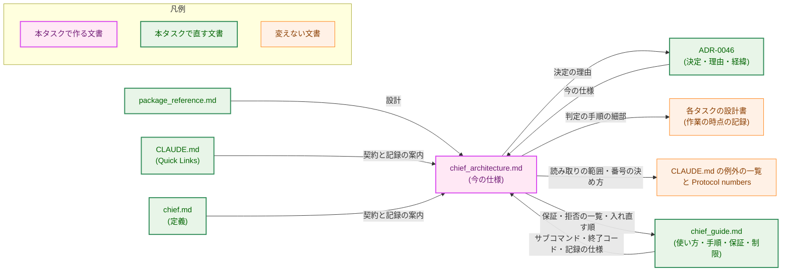
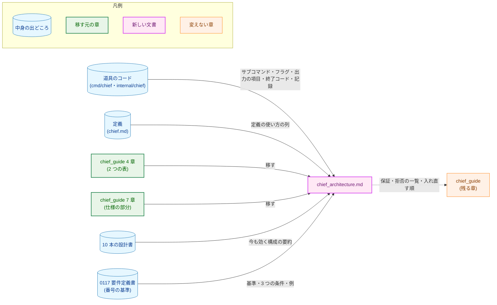
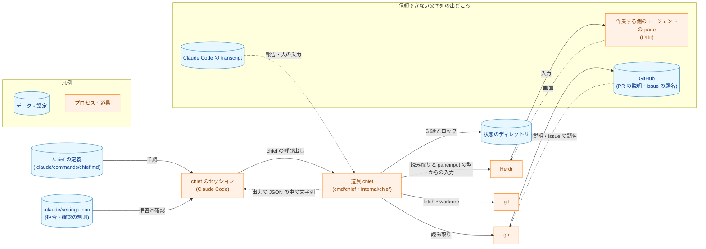
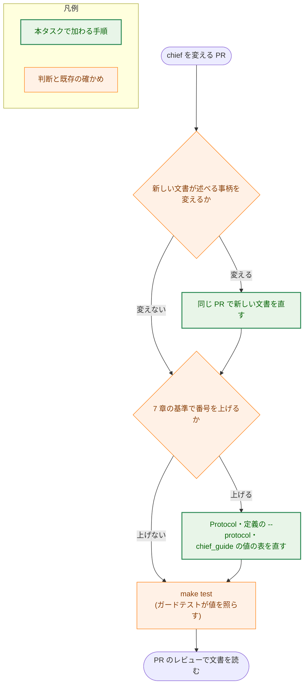
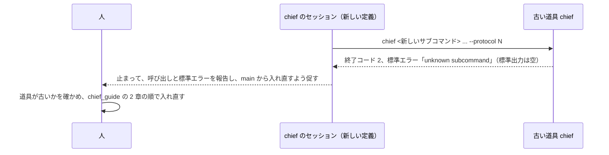

# 設計書：chief の今の仕様を持つ文書 chief_architecture.md と、プロトコル番号を上げる基準

## Document Status

| Item | Value |
|---|---|
| Status | `draft` |
| Created | 2026-11-20 |
| Review date | - |
| Reviewer | - |
| Comments | - |

本書は [01_requirements.md](01_requirements.md) の設計である。要件定義から申し送られた設計事項は [design_handoff.md](design_handoff.md) にあり、各項目への対応は 10 章にまとめる。本書が引用するファイルの行番号は、特に断らない限り、コミット `f9d27314`（本書の作成時の `main`）のものである。

本書では、要件定義書と同じく、`/chief` のコマンドの定義（`.claude/commands/chief.md`）を「定義」、Go の開発用の道具 `chief`（`cmd/chief`・`internal/chief`）を「道具」と呼ぶ。新しく作る `docs/dev/chief_architecture.md` を「新しい文書」と呼ぶ。

## 1. 設計の全体像 (Design Overview)

このタスクは、道具と定義の振る舞いを変えない。作るのは新しい文書 1 本で、変えるのは、ほかの文書の案内と表の置き場所、文書のガードテスト 1 つ、定義の 2 か所の文である。

### 1.1. 設計原則

-   **今の振る舞いだけを書く。** 新しい文書は、実装の時点の `origin/main` の道具と定義が今どう動くかを書く。タスクごとの変化の経緯は書かず、決定の理由は ADR-0046 へ、判定の手順の細部は設計書の節へリンクする（AC-03・AC-04）。
-   **1 つの事柄は 1 か所に書く。** 仕様（値、記録の中身、消えるとき）は新しい文書が持つ。人の手順（停止を解く、記録を手で消す、入れ直す）と、使う人が知るべき保証と制限は chief_guide が持つ。ほかの文書は、持たない事柄を持つ文書へリンクする（F-004、1.3 節の決定 1）。
-   **値は道具のコードから写す。** サブコマンド、フラグ、出力の項目、終了コード、記録のファイルの名前は、`cmd/chief/main.go` と `internal/chief` の定義から写す。テストで照らすのは、今 chief_guide で照らしている 3 つの値（サブコマンド、終了コード、状態のディレクトリ）だけで、照合先を新しい文書へ移す（F-005）。そのほかの値と文の正しさは、PR のレビューで読んで確かめる（AC-03、ADR-0016）。
-   **既存の仕組みを使う。** 新しいテストの仕組みは作らない。今のガードテスト（`cmd/chief/docs_test.go:503`）を 2 つに分け、`internal/doctestutil` の `SectionByHeading` と `FindTable` で表を読む（1.3 節の決定 4）。

### 1.2. 概念モデル

図 1-1 は、本タスクの後の文書どうしの関係を示す。矢印 A → B は「A が B へリンクし、その事柄の細部を B に任せる」を表す。緑のノードは本タスクで作るか直す文書、橙のノードは変えない文書である。

### 1.3. 設計の際に決めたこと（2026-11-20）

決定 1〜4 は、申し送りの H-01〜H-04 について人に確かめた。決定 5〜9 は、要件と既存の文書から決まるか、このタスクの中で閉じる選択で、人に確かめずに決めた。どの決定も、文書の組み方とこのタスクのテストの形の選択でこのタスクの中で閉じるので、ADR を作らず、変えない。今の仕様の文書を置くこと、保守の決まり、番号の基準は、要件定義の時点で ADR-0046 に入っている（`docs/dev/adr/0046-chief-of-staff.md:177-183`）。

1.  **chief_guide から移すのは仕様だけにする（H-01）。** 4 章のサブコマンドの表と終了コードの表、7 章のうち仕様にあたる部分（状態のディレクトリの場所の決め方、記録の表、「片付け」、「作るときと消すときの記録」、見送りの記録が消えるとき）を新しい文書へ移す。人の手順（「送信の停止を解く」、見送りの記録を手で消してよいこと、「すべてを消す」）と、5 章の保証すること・しないこと、6 章の拒否の一覧、8 章の既知の制限は chief_guide に残す。新しい文書は、保証の一覧を 5 章へ、拒む呼び出しの一覧を 6 章へリンクする。
    -   理由: AC-17 は chief_guide の差分を限っていて、5 章を移すには要件を変える必要がある。手順は使う人が chief_guide で読むものである。保証の一覧を新しい文書が繰り返さずにリンクすれば、同じ文が 2 か所に残らない。
    -   ADR: なし（文書の中の置き場所の選択で、このタスクの中で閉じるため）。
2.  **出力の JSON の表は、JSON のオブジェクトの型ごとに 1 つ置く（H-02）。** 各表は、項目の名前、値の型、意味、定義の使い方の 4 列を持つ。`RowOutput` など、複数のサブコマンドの出力に現れる型も、表は 1 つだけ置く。サブコマンドの表の「出力」の列が、そのサブコマンドが返す最上位の型を名指す。形は 3.2 節にある。
    -   理由: 同じ型が `snapshot`・`tick` などに入れ子で現れるので、サブコマンドごとの表では同じ項目が何度も現れ、出力を変える PR が直す場所が増える。「定義の使い方」の列は、番号の基準（F-003）が約束に含める「定義が読む項目」と「定義が分岐に使う値」を、表から読めるようにする。
    -   ADR: なし（文書の表の形の選択で、このタスクの中で閉じるため）。
3.  **CLAUDE.md の Quick Links に新しい行を足さない（H-03）。** AC-19a で直す chief_guide の行（`CLAUDE.md:24`）が、サブコマンドと状態のディレクトリなどの案内先として新しい文書を名指す。`docs/dev/project_overview.md` からもリンクしない。
    -   理由: 要件の範囲（AC-19a の差分の制限）のまま、chief を扱う開発者が Quick Links から新しい文書に行き着ける。CLAUDE.md は毎回のセッションで読まれるので、行を増やさない。
    -   ADR: なし（索引の行の選択で、このタスクの中で閉じるため）。
4.  **ガードテストを 2 つに分け、表は見出しの節の中で探す（H-04）。** chief_guide のプロトコル番号を照らすテストと、新しい文書のサブコマンド・終了コード・状態のディレクトリを照らすテストに分ける。新しい文書の表は、`doctestutil.SectionByHeading` で見出しの節を切り出してから、その中で `doctestutil.FindTable` で探す。形は 3.5 節にある。
    -   理由: 新しい文書には、出力の型の表など `サブコマンド` の列を持ちうる表がほかにもあり、文書の全体で最初の表を読む今の探し方では、別の表を読みうる。テストを分けると、失敗したときにどちらの文書の誤りかが名前で分かる。
    -   ADR: なし（ADR-0016 を当てはめるだけで、このタスクの中で閉じるため）。
5.  **並行するタスクの変更は、実装の時点の `origin/main` で書く（H-05）。** 新しい文書は、実装の PR を作る時点の `origin/main` の道具と定義を書く。本書の作成時、タスク 0115（マージコンフリクトの解消）は要件定義書だけがあり、道具に `/mergemain` の送信はない（`internal/chief` と `cmd/chief` に `mergemain` の語がない）。そのため新しい文書は、0115 の振る舞いを書かない。0115 が 0117 の実装より先にマージされたら、実装の PR で `main` を取り込み、その振る舞いを書く。後にマージされるなら、0115 の PR が F-006 の決まりに従って新しい文書を直す。実装の PR では、0115 の設計書があれば、新しい文書を直す項目を持つかを確かめ、なければ 0115 の PR に申し送る。
    -   理由: 要件の制約（5 章）がそう定めている。
    -   ADR: なし（要件の制約を当てはめるだけのため）。
6.  **ADR-0046 の、仕様の置き場所を指す文の直し方（AC-16）。** 次の規則で分ける。対象の文の一覧は 3.6 節にある。
    -   「仕様は X にある」「構成は X にある」「一覧は X にある」のように、**今の仕様の置き場所**として要件定義書・設計書・計画書を指す文は、新しい文書の該当する節（拒む呼び出しの一覧は chief_guide の 6 章）を指す文に直す。もとの文書は、決定の出典として同じ文に残す。
    -   「理由」の項の括弧の中で要件定義書や設計書を指す参照（「（0088 要件定義書の F-005）」など）は、決定の出典なので変えない。番号だけで書いた機能要件（F-004 など）は、`:23` の文を直した後も、どの要件定義書のものかが分かるように、その文に 0088 要件定義書を出典として残す。
    -   理由: AC-16 が、どちらにするかを設計に任せた。出典を消すと、ADR の理由の根拠が読めなくなる。
    -   ADR: ADR-0046 を直すのは要件の AC-16 が決めたことで、ADR の決定は変えない。
7.  **新しい文書の章立てを 2.3 節のとおりにする。** issue #1055 の 7 章の案に、要件の F-002 の話題を当てはめ、「道具が書き出すもの」（AC-08）の章とプロトコル番号の章を足した 9 章にする。
    -   理由: 要件の話題（AC-05〜AC-14b）が、それぞれ 1 つの章に収まり、要件の AC から章を引けるようにするためである。
    -   ADR: なし。
8.  **構成図は、信頼できない文字列の出どころを 1 つの囲みにまとめ、入ってくる線を点線で描く（AC-05）。** 図の下書きは 2.5 節にある。
    -   理由: 標準の配色（`mermaid_reference.md` の 2 章）に信頼の境界を表す色がない。色を足さずに、囲みと線の種類で境界を示せる。
    -   ADR: なし。
9.  **古い道具を見分ける手がかりは、標準エラーの文で示す（AC-14a）。** 古い道具は、知らないサブコマンドを `unknown subcommand`、知らないフラグを `does not take` の文で、`--protocol` の照合より前に拒む（`cmd/chief/main.go:134-136`・`:145-147`・`:164-167`）。新しい文書は、定義が報告する標準エラーが、定義の呼び出しにあるサブコマンドかフラグを道具が知らないと述べていれば、道具が定義より古いことを疑う、と書く。あわせて、入れてある道具の作られたコミットの確かめ方（`go version -m`。`docs/dev/guides/chief_guide.md:24`）へリンクする。
    -   理由: 値の形の誤り（`parseRequests` の誤り。`cmd/chief/main.go:182-185`）も終了コード `2` になるので、終了コードだけでは見分けられない。
    -   ADR: なし（文書の中身で、約束を変えないため）。

## 2. システム構成 (System Structure)

### 2.1. 全体の構成

図 2-1 は、新しい文書の中身がどこから来るかを示す。矢印 A → B は「A の中身を B が持つ（写すか移す）」を表す。点線の矢印は、中身を写さずにリンクで案内することを表す。

設計書から写すのは、今も効いている構成の要約だけである。後のタスクが上書きした記述は、今のコードと照らして今の振る舞いを書き、設計書へのリンクは理由を読むためのものと分かるように書く（AC-04）。

### 2.2. コンポーネントの配置

| ファイル | 変更 |
|---|---|
| `docs/dev/chief_architecture.md` | 新しく作る（2.3 節） |
| `docs/dev/guides/chief_guide.md` | 4 章の 2 つの表と 7 章の仕様の部分を消してリンクに置き換え、番号の記述を直す（2.4 節） |
| `docs/dev/adr/0046-chief-of-staff.md` | 食い違いの記述を消し、仕様の置き場所を指す文を直す（3.6 節） |
| `docs/dev/conventions/package_reference.md` | `cmd/chief`・`internal/chief`・`internal/chief/paneinput` の行の設計書へのリンクを、新しい文書へのリンクにする（AC-19） |
| `CLAUDE.md` | Quick Links の chief_guide の行（`:24`）の案内を直す（AC-19a） |
| `.claude/commands/chief.md` | chief_guide を案内する文（`:17-18`）と、終了コード `2` の行（`:85`）を直す（AC-19a・AC-14b） |
| `cmd/chief/docs_test.go` | `TestGuideValuesMatchTool`（`:503`）を 2 つのテストに分ける（3.5 節） |

`docs/dev/adr/README.md` の索引の行は変えない。ADR-0046 の題と状態が変わらないためである。

### 2.3. 新しい文書の章立て

新しい文書は、冒頭の段落と 9 つの章からなる。下の表は、章ごとに、持つ中身と、それが満たす AC を示す。章の名前は実装で整えてよいが、3.5 節のテストが探す 3 つの見出し（サブコマンド、終了コード、状態のディレクトリの節）は、テストと同じ PR で決める。

| 章 | 持つ中身 | AC |
|---|---|---|
| 冒頭 | 今の仕様を持つ文書であること。決定の理由と経緯は ADR-0046 にあること（リンク）。この文書が述べる事柄を変える PR は、同じ PR でこの文書を直すこと | AC-01・AC-23 |
| 1. 目的と範囲 | chief がすることとしないこと。理由は ADR-0046 の節へのリンク | AC-02 |
| 2. 構成要素と信頼の境界 | 構成図 1 つ（2.5 節）。pane へ送る入力が `internal/chief/paneinput` の型だけから組み立てられること。`.claude/settings.json` の拒否・確認の規則の役割。保証の一覧は chief_guide の 5 章へ、拒む呼び出しの一覧は 6 章へリンク | AC-05 |
| 3. 定義と道具の契約 | サブコマンドの表（フラグと出力の型の列を持つ）、終了コードの表、`--protocol` の照合、使い方の誤りの扱い、出力の型ごとの表（3.2 節） | AC-06 |
| 4. 状態のディレクトリ・ロック・記録 | 場所とその決め方、ロック、作成の排他、記録の表（3.3 節）、片付けと、作るとき・消すときの記録 | AC-07 |
| 5. 道具が書き出すもの | 出力の先ごとの表（標準出力、標準エラー、状態のディレクトリ）。ログのファイルがないこと。状態のディレクトリの外に作るか変えるもの（worktree、workspace、pane への入力）と、それを述べる節への案内 | AC-08 |
| 6. 画面と transcript の読み取り | 読み取りを行う構成要素（`internal/chief` の `screen` で始まるファイル）と、ほかの部分が受け取る型。読めない画面と行の扱い。標本の置き場所。読み取りの範囲は CLAUDE.md の例外へリンク | AC-09 |
| 7. プロトコル番号 | 約束、上げる基準、3 つの条件、判定の変更、記録の形式、例、上げる PR が変える場所、古い道具に当たったとき（3.4 節） | AC-11〜AC-14a |
| 8. テストのしかた | 標本の足し方と採り直し方（`internal/chief/testdata/README.md` へリンク）、ガードテストが照らすもの、`make test` に要るもの（CLAUDE.md の「Development Notes」へリンク） | AC-10 |

章の順は、全体（1・2 章）、外から見える契約（3〜5 章）、内部の読み取り（6 章）、変えるときの規則（7・8 章）の順にした。冒頭の保守の決まりは、文書を変える人が最初に読む場所に置く。

### 2.4. chief_guide の振り分け

下の表は、chief_guide のうち本タスクが触れる部分と、その行き先を示す（決定 1）。表にない章（1・3・5・6・8・9 章）は変えない。

| chief_guide の箇所 | 中身 | 行き先 |
|---|---|---|
| 冒頭の段落の最後の文（`:3`） | 要件と設計の置き場所として 0088 と 0092 の文書を指す | 今の仕様の置き場所として新しい文書を指す文に直す（AC-17 の 2 つ目） |
| 2 章 `:26-32` | プロトコル番号の値の表と、合わないときの振る舞い | 残す（AC-21）。番号を上げる基準へのリンクを足してよい |
| 2 章 `:34` | 入れ直す順 | 残す。新しい文書の 7 章がここへリンクする（AC-14） |
| 2 章 `:36-42` | 0092 の版への入れ替えと、古い版に戻すとき | 残す。新しい文書の 7 章（記録の形式）がここへリンクする（AC-12a） |
| 2 章 `:44` | 番号を変えずにサブコマンドや出力の欄が増えることがある、という文 | 新しい基準と食い違うので、新しい文書の 7 章へのリンクに置き換え、入れ直した後に `/chief` を起動し直すことだけを残す（AC-17 の 4 つ目） |
| 4 章 `:169` | サブコマンドの細部の置き場所として 0088・0092 の設計書を指す | 新しい文書の 3 章へのリンクに置き換える |
| 4 章 `:171-191` | サブコマンドの表と終了コードの表 | 新しい文書の 3 章へ移す（AC-17 の 1 つ目） |
| 7 章 `:236` | 場所の決め方、ファイルの権限、同名の記録を作らないこと | 新しい文書の 4 章へ移す |
| 7 章 `:238-245` | 記録の表 | 新しい文書の 4 章へ移し、3.3 節の列にする |
| 7 章 `:247` | 送信の停止を解く手順 | 残す |
| 7 章 `:248` | 見送りの記録が消えるときと、人が手で消してよいこと | 消えるときは新しい文書の 4 章へ移し、手で消してよいことは残す |
| 7 章 `:249`・`:250` | 片付けと、作るとき・消すときの記録 | 新しい文書の 4 章へ移す |
| 7 章 `:251` | すべてを消す手順 | 残す |

7 章には、残す手順と、新しい文書の 4 章へのリンクが残る。ほかの章で「7 章の『片付け』」を指す文（2 章 `:42`、8 章 `:275`）は、新しい文書の該当する節を指すように直す。これは AC-17 の 3 つ目（状態のディレクトリの章のうち移す部分をリンクに置き換える）に含める。

### 2.5. 構成図の描き方

図 2-2 は、新しい文書の 2 章に置く構成図の下書きである。実装は、この下書きを今のコードと照らして仕上げる。矢印 A → B は「A が B を呼ぶか、B へ書く」を表し、点線の矢印 A -.-> B は「A の信頼できない文字列が B に入る」を表す。下書きの実線の矢印は、次のコードで確かめた。

-   定義が道具を `chief` の語だけで呼ぶ（`.claude/commands/chief.md:56-60`）。
-   道具が Herdr・git・gh を子のプロセスとして呼ぶ（`internal/chief/runner.go:62`、`internal/chief/herdr.go:232`）。
-   道具が状態のディレクトリを開く（`internal/chief/records.go:88-97`・`:131`）。

点線の矢印は、次のコードで確かめた。

-   画面を Herdr から読む（`internal/chief/herdr.go:232`）。
-   transcript のファイルを直に読む（`internal/chief/transcript.go:68-88`）。
-   PR の説明を `gh pr view` で読む（`internal/chief/detail.go:463`）。
-   issue の題名を `gh api graphql` で読む（`internal/chief/issue.go:79`）。

-   **囲み.** 囲み「信頼できない文字列の出どころ」は、`docs/dev/security.md` §6 が信頼できないとする文字列の出どころである。
-   **道具の出力の点線.** 道具の出力の JSON に入る文字列は、出どころの文字列を無害化して、上限で切ったものである。それでも、定義は従わずに示すだけとする（`.claude/commands/chief.md:30-36` の規則 2）。そのため、道具からセッションへの線も点線にする。
-   **書かないもの.** 人とセッションのやり取りは図に描かない。

## 3. コンポーネント設計 (Component Design)

### 3.1. コンポーネントの責務

| ファイル | 責務 | 新規／変更 |
|---|---|---|
| `docs/dev/chief_architecture.md` | chief の今の仕様（2.3 節の 9 章） | 新規 |
| `docs/dev/guides/chief_guide.md` | 使い方、人の手順、保証、拒否の一覧、既知の制限、プロトコル番号の値と入れ直す順 | 変更 |
| `docs/dev/adr/0046-chief-of-staff.md` | 決定、理由、採らなかった案、経緯。今の仕様は新しい文書へリンク | 変更 |
| `docs/dev/conventions/package_reference.md` | パッケージの 1 行の要約。設計のリンク先を新しい文書にする | 変更 |
| `CLAUDE.md` | Quick Links の chief_guide の行の案内 | 変更 |
| `.claude/commands/chief.md` | chief_guide の案内の文と、終了コード `2` の行の案内 | 変更 |
| `cmd/chief/docs_test.go` | 2 つのガードテスト（3.5 節） | 変更 |

**今の振る舞いを確かめている既存のテスト。** `TestGuideValuesMatchTool`（`cmd/chief/docs_test.go:503-542`）は、chief_guide のサブコマンドの表・終了コードの表・プロトコル番号・状態のディレクトリを照らしている。表を移すと、このテストはサブコマンドと終了コードの表を見つけられずに失敗する。そのため、表を移すコミットと同じコミットで 3.5 節の 2 つのテストに置き換える。`TestDocumentedProtocolMatches`（同 `:205`）と `TestDocumentedInvocationsParse`（同 `:269`）は定義の `--protocol` と呼び出しを照らし、本タスクが定義に足す文は呼び出しを含まないので、影響を受けない。

### 3.2. 出力の JSON の表の形（決定 2）

新しい文書の 3 章は、次の 3 種類の表を持つ。

-   **サブコマンドの表.** 1 行に 1 つのサブコマンドを書き、列は次の 5 つである。テストは 1 列目だけを読む。
    -   `サブコマンド`
    -   `何をするか`
    -   `必須のフラグ`
    -   `任意のフラグ`
    -   `出力`（最上位の型の名前と、その型の表へのリンク）
-   **終了コードの表.** 列は `終了コード` と `意味` の 2 つで、終了コードごとに標準出力に JSON を書くかも書く。
-   **出力の型ごとの表.** 型ごとに小見出しを 1 つ置き、その下に表を 1 つ置く。列は次の 4 つである。

| 列 | 中身 |
|---|---|
| `項目` | JSON の名前（`json` のタグの名前）。`omitempty` の項目は、そのことを書く |
| `型` | JSON の値の型（文字列、数、真偽、配列、ほかの型の名前） |
| `意味` | 項目が何を表すか。決まった値の集合を持つ項目は、値ごとの意味を書く |
| `定義の使い方` | `分岐`（定義が値で振る舞いを選ぶ）、`渡す`（定義が値をそのまま道具の引数に渡す）、`示す`（定義が人に示すだけ）、`読まない` のどれか |

-   **型の名前.** 小見出しの型の名前は Go の型の名前（`SnapshotOutput`・`RowOutput`・`ActionOutput` など、`internal/chief/output.go` の型と `cmd/chief/main.go:109` の `result`）にする。開発者がコードの型と表を結び付けられるためである。
-   **値の集合の置き場所.** 決まった値の集合（`outcome`・`reason`・`urgency` など）の値ごとの意味は、その項目の行に書く。値が多い項目は、その型の表の下に値の表を 1 つ置く。
-   **番号の基準との関係.** 7 章の番号の基準は、「定義の使い方」の列が `読まない` でない項目を「定義が読む項目」、`分岐` の項目を「定義が分岐に使う項目」として参照する。
-   **列の値の決め方.** 列の値は、実装の時点の定義を読んで決める。

出力の項目を照らすテストは足さない（AC-22）。表と道具の食い違いは、出力を変える PR が F-006 の決まりで直し、そのレビューで読んで確かめる。

### 3.3. 記録の表の形（AC-07・AC-08）

新しい文書の 4 章の記録の表は、1 行に 1 種類の記録を書き、次の列を持つ。

| 列 | 中身 |
|---|---|
| `記録` | 記録の名前（ロック、通知の記録、送信の記録など） |
| `ファイル` | 状態のディレクトリからのパス（`lock.json`、`<worktree のハッシュ>/send-*.json` など） |
| `中身` | 記録が持つ値の要約。項目ごとの表は置かない（記録の形式は約束に含めないため。AC-12a） |
| `何のために読むか` | 道具がこの記録を読む判断 |
| `書くとき` | 道具がこの記録を作るか書き足すとき |
| `消えるとき` | 道具が消すとき（`start` の片付け、`remove` の後など）と、人が消してよいとき |
| `信頼できない文字列` | 含まないか、含むならどの文字列を、どう扱って書くか（無害化、上限で切るなど） |

-   **書き出すものの表.** 5 章の表は、出力の先（標準出力、標準エラー、状態のディレクトリ、状態のディレクトリの外）ごとに、書く中身、書き出す先、残る期間、信頼できない文字列を含むかを持つ。状態のディレクトリの行は、項目を繰り返さずに 4 章の記録の表へリンクする（AC-08 の「同じ表を 2 つ置かない」）。
-   **同じ値は 1 か所に.** 記録のファイルの名前と消えるときは 4 章だけが持つ。
-   **ログのファイル.** 5 章は、道具がログのファイルを書かないことを述べる。

### 3.4. プロトコル番号の章の形（AC-11〜AC-14a）

新しい文書の 7 章は、次の節からなる。節の中の規則の文は、要件定義書の「要件定義の際に決めたこと（2026-11-20）」と F-003 の文に合わせ、意味を変えない。

1.  **約束.** 約束に含めるもの（サブコマンド、フラグ、出力の JSON の形、定義が読む出力の項目の意味、定義が分岐に使う出力の値、終了コードの意味）と、含めないもの（状態のディレクトリの記録の形式。理由は、記録は道具だけが読み書きし定義は読まないこと）。「定義が読む項目」と「分岐に使う値」は、3 章の表の「定義の使い方」の列で分かると述べる。古い版に戻すときの記録の扱いは chief_guide の 2 章（`:42`）へリンクする（AC-11・AC-12a）。
2.  **上げる基準.** 約束を変える PR は上げる。分岐に使う項目に新しい値を足すことも約束の変更である。人に示すだけの項目でも、意味を変えれば上げる（AC-11）。
3.  **上げなくてよい 3 つの条件.** AC-12 の 3 つの条件と、条件 (3) が古い定義のする呼び出しの出力だけを見ること（AC-12）。
4.  **判定の変更.** 約束を変えずに判定を変える PR は、副作用の条件（pane へ送る、自動で送る、workspace と worktree を作る、消す条件）を変えるときだけ上げる（AC-12）。
5.  **当てはめの例.** 下の表の形で、少なくとも AC-13 の 5 つの例を、上げるか上げないかと、その根拠の節とともに示す。要件定義書の背景にある過去の判断（0093・0095・0097・0105・0113）は、タスクの番号を書かずに、変更の種類として例に含めてよい。今の振る舞いを書く文書なので、経緯は書かないためである。
6.  **判定の流れ図.** 2〜4 の判断の順を、`flowchart TD` の分岐の図で示す（mermaid_reference.md の「Decision / Branching Pattern」）。図は規則の文を繰り返すもので、文と図が食い違うときは文を正とする、と添える。
7.  **上げる PR が変える場所.** 道具の `Protocol` の定数（`internal/chief/records.go:29`）、定義の `--protocol`、chief_guide の 2 章の値の表。番号の値の決め方とマージの時点の確かめは CLAUDE.md の「Protocol numbers」と `mergepr_guide.md` へ、入れ直す順は chief_guide の 2 章へリンクする（AC-14）。
8.  **上げない追加に古い道具が当たったとき.** 古い道具が新しい呼び出しを使い方の誤りとして `--protocol` の照合より前に拒むこと。定義はそれを終了コード `2` として止まって報告すること。見分ける手がかり（決定 9）。戻し方は chief_guide の 2 章の入れ直しの手順へリンクする（AC-14a）。

当てはめの例の表の形:

| 変更 | 上げるか | 根拠 |
|---|---|---|
| 出力の JSON に項目を足す | 上げる | 出力の JSON の形は約束で、条件 (3) が成り立たない |
| 新しいサブコマンドを足し、古い道具がその呼び出しを使い方の誤りとして拒む | 上げない | 3 つの条件がすべて成り立つ |
| …… | …… | …… |

### 3.5. ガードテストの形（決定 4）

`TestGuideValuesMatchTool` を、次の 2 つのテストに分ける。名前は実装で決めてよい。

| テスト | 読む文書 | 照らす値 | 照らす相手 |
|---|---|---|---|
| chief_guide の番号のテスト | `docs/dev/guides/chief_guide.md` | 値の表の「プロトコル番号」の行（今の `guideValue` のまま） | `chief.Protocol` |
| 新しい文書の値のテスト | `docs/dev/chief_architecture.md` | 3 章のサブコマンドの節の表の 1 列目、終了コードの節の表の 1 列目、4 章の本文の状態のディレクトリの名前 | `subcommandFlags` のキー、`exitOK`〜`exitRefused` の 4 つ、`chief.OpenStore` が開くディレクトリ |

-   **表の探し方.** 新しい文書のテストは、表を `doctestutil.SectionByHeading(doc, <見出し>)` で切り出した節の中で `doctestutil.FindTable` を使って探す。見出しが見つからないか、節の中に表がないときは、どの見出しを探したかを示して失敗する。
-   **見出しの文字列.** 見出しの文字列は日本語の文書の見出しと一致する必要があるので、日本語のリテラルにする。CLAUDE.md の「Go Idioms」のガードテストのリテラルの例外の範囲（見出し）に入る。
-   **状態のディレクトリの名前.** 今と同じく、`$XDG_STATE_HOME/<OpenStore の相対パス>/` の文字列が文書のどこかにあることを確かめる。
-   **壊して確かめること.** 実装は、新しい文書の 3 つの値（サブコマンドの行を 1 つ消す、終了コードの行を 1 つ消す、状態のディレクトリの名前を変える）と chief_guide の番号をそれぞれ壊して、対応するテストが失敗することを確かめる（CLAUDE.md の「Every test must be able to fail for its stated reason」）。さらに、見出しの節の外に `サブコマンド` の列を持つ別の表を置いても、テストが節の中の表を読むことを確かめる。
-   **テストの削除ではない.** テストは照合先を移すだけで、照らす値は減らさない。そのため、CLAUDE.md の「Deleting a test is a claim that must be checked」の対象のテストの削除にはあたらない。分けた後も、`TestGuideValuesMatchTool` が照らしていた 4 つの値をすべて照らす。

### 3.6. ほかの文書の直し

**ADR-0046（AC-16・AC-24・決定 6）。** 直す文は次のとおりである。経緯の節は変えない（経緯は、そのときの決定の記録である）。

| 箇所 | 今の文 | 直し方 |
|---|---|---|
| `:23` | 以下の決定の仕様は 0088 要件定義書の機能要件が持つ | 今の仕様は新しい文書が持ち、決定の出典は 0088 要件定義書（以下、番号だけで書いた F-NNN はその機能要件）である、と直す |
| `:74` | 仕様は 0115 要件定義書の F-001〜F-007 にある | 0115 が実装されていなければ変えない（今の仕様がまだないため。決定 5）。実装されていれば、今の仕様は新しい文書の該当する節にあり、決定の出典は 0115 要件定義書である、と直す |
| `:122` | transcript から読む仕様は 0095 要件定義書に、PR の記録の確かめの結果は 0095 設計書にある | 今の仕様は新しい文書の 6 章にあり、決定の出典は 0095 要件定義書、確かめの結果は 0095 設計書にある、と直す |
| `:160` | 構成は 0088 設計書の 3.1 にある | 構成は新しい文書の 2 章にある、と直す |
| `:175` | 拒む呼び出しの一覧は 0088 実装計画書と 0092 設計書の 3.8 にある | 一覧は chief_guide の 6 章にあり、決定の出典は 0088 実装計画書と 0092 設計書である、と直す |
| `:181` | 食い違い（文書がまだない） | 消す |
| `:208` | 仕様は 0093 と 0102 の要件定義書にある | 今の仕様は新しい文書（状況の表を述べる節）にあり、決定の出典は 0093 と 0102 の要件定義書である、と直す |

-   **AC-15・AC-24.** ADR-0046 の決定の基準の要約（`:182`）と保守の決まり（`:179`）は、要件定義の時点で入っている。実装は、新しい文書の 7 章の節の名前に合わせてリンク先を直すだけで、基準の文は変えない。
-   **0115 の追加.** 実装の時点で 0115 の決定が ADR-0046 に増えていれば、同じ規則で直す。

**package_reference（AC-19）。** `cmd/chief`・`internal/chief`・`internal/chief/paneinput` の行の、仕様の置き場所としての設計書へのリンクを、新しい文書の該当する章へのリンクにする。たとえば、`internal/chief` の行の `[0088 design]`・`[0093 design]`、`internal/chief/paneinput` の行の `[0088 design §3.1.3]` である。行のほかの文は変えない。`cmd/chief` の行に設計書へのリンクがなければ、その行は変えない。

**CLAUDE.md（AC-19a・決定 3）。** `:24` の行を、chief_guide の説明（設定、使い方、保証、拒否、既知の制限）と、サブコマンド・状態のディレクトリなどの仕様を新しい文書へ案内する文にする。英語で書く（CLAUDE.md の「Document language」(b)）。

**定義（AC-14b・AC-19a）。**

-   **案内の文.** `:17-18` の文は、使い方と保証を chief_guide へ、道具の契約と記録の仕様を新しい文書へ案内する文にする。
-   **終了コード `2` の行.** `:85` の行の「What you do」に、道具が定義より古いこともあり、標準エラーが定義の呼び出しにあるサブコマンドかフラグを道具が知らないと述べていれば、`main` から入れ直すよう人に促す、という案内を足す。
-   **書く言葉.** どちらも英語で書く。
-   **差分の範囲.** 定義の差分は、この 2 か所に限る。

### 3.7. 型とインターフェース

Go の型とインターフェースは足さない。テストのヘルパーには、既存の `doctestutil.SectionByHeading`・`doctestutil.FindTable`・`doctestutil.StripBackticks` を使う。今の `guideValue`（`cmd/chief/docs_test.go:545`）は、chief_guide の番号のテストがそのまま使う。

### 3.8. 先のタスクの方針との関係

-   **0088 の方針.** 0088 の設計は、サブコマンドと記録の説明を chief_guide に置いた（`docs/dev/guides/chief_guide.md:167-191`・`:234-251`）。本タスクは、要件（AC-17）に従って、そのうち仕様の部分を新しい文書へ移す。この方針の変更は、要件定義の時点で ADR-0046 に入っている（`docs/dev/adr/0046-chief-of-staff.md:179`）。
-   **既存のテストへの影響.** 古い置き場所を確かめているテストは `TestGuideValuesMatchTool` だけで、3.5 節のとおりに置き換える。
-   **ほかの方針との関係.** ほかの設計書の方針の例外は作らない。

## 4. エラーハンドリング設計 (Error Handling Design)

道具の実行時のエラーは変えない。本タスクで扱うのは、ガードテストの失敗の示し方と、定義の終了コード `2` の案内だけである。

### 4.1. ガードテストの失敗の示し方

| 失敗 | 示す内容 |
|---|---|
| 見出しが見つからない | 文書のパスと、探した見出し |
| 節の中に表がない | 文書のパス、見出し、探した列の名前 |
| 表の値が道具と違う | 文書のパス、表の名前、文書の値、道具の値（今のテストと同じ形。`cmd/chief/docs_test.go:523`） |
| 状態のディレクトリの名前がない | 文書のパスと、期待する名前 |
| 番号が違う | chief_guide のパス、文書の値、`chief.Protocol` |

エラーの判定に文言の照合は使わない。失敗は `t.Errorf` で示し、続く値の照合も行う（今のテストと同じ）。

### 4.2. 古い道具に当たったときの案内（AC-14a・AC-14b）

定義は、終了コード `2` で止まって、呼び出しと標準エラーを人に報告する（`.claude/commands/chief.md:85`）。本タスクは、この止まり方を変えない。報告に入れ直しの案内を足し、新しい文書の 7 章が、人が見るものと見分け方を述べる（決定 9）。定義は、標準エラーの文で振る舞いを選ばない。定義の案内は「このときは入れ直しを促す」と人に示すだけで、入れ直すかを決めるのは人である。

## 5. セキュリティ考慮事項 (Security Considerations)

N/A。本タスクは文書と、リポジトリの中の文書を読むガードテストだけを変え、外部のコマンドの呼び出し、API キー、キャッシュのディレクトリ、ネットワークへの送信、信頼できない文字列の埋め込みのどれも扱わない（要件 4.2）。道具の信頼の境界、`.claude/settings.json` の規則、定義の規則 1〜6 は変えない。

新しい文書は信頼の境界を説明するので、説明の誤りが、後の変更で境界を弱める誤りにつながりうる。そのため、2 章（構成要素と信頼の境界）と 5 章（道具が書き出すもの）の記述は、次の文書と食い違わないことを PR のレビューで読んで確かめる（AC-03）。

-   `docs/dev/security.md` の §6（信頼できないテキストの取り扱い）と §8
-   CLAUDE.md の「Tool Execution Safety」の chief の項
-   ADR-0046 の「道具と実行の枠組み」

拒む呼び出しの一覧は新しい文書に写さず、chief_guide の 6 章へリンクする。一覧が 2 か所に分かれて片方だけが古くならないようにするためである。この一覧は、`TestSettingsDeniesPaneInput` などのテスト（`cmd/chief/docs_test.go:416-481`）が `.claude/settings.json` と照らしている。

## 6. 処理フローの詳細 (Processing Flow Details)

### 6.1. chief を変える PR の流れ

図 6-1 は、本タスクの後に chief を変える PR が、新しい文書と番号をどう扱うかを示す。矢印は判断の順を表す。

### 6.2. 番号を上げない追加に古い道具が当たったとき

図 6-2 は、サブコマンドを足した新しい定義が、入れ直していない古い道具を呼んだときの流れである（AC-14a）。矢印は呼び出しと応答を表す。

古い道具は、`--protocol` を照らす前に使い方の誤りとして拒む（`cmd/chief/main.go:164-167`）。そのため、番号が同じでも、何も読まず、何も送らない。

## 7. テスト戦略 (Test Strategy)

### 7.1. 単体テスト（ガードテスト）

-   3.5 節の 2 つのテストを、`cmd/chief/docs_test.go` に置く。`make test` と CI の `doc-guard` のジョブ（`./cmd/chief` を含む）が走らせる。
-   壊して確かめる手順は 3.5 節にある。結果はコミットメッセージに書く。
-   出力の JSON の項目とフラグを照らすテストは足さない（AC-22）。

### 7.2. 統合テスト

N/A。道具の振る舞いを変えないためである。

### 7.3. 読み合わせと差分の確かめ

-   **読み合わせ（`manual`）.** 文の中身は、PR のレビューで読んで確かめる。
    -   新しい文書の各章の記述が、実装の時点の道具・定義と食い違わないこと（AC-03）
    -   設計書へのリンクの書き方（AC-04）
    -   話題の中身（AC-05〜AC-10）
    -   番号の章（AC-11〜AC-14a）
    -   ADR-0046 の要約（AC-15・AC-24）
    -   移した中身がすべて新しい文書にあること（AC-18）
-   **差分の確かめ（`diff`）.** 差分の範囲を限る AC は、`requirements_process.md` の「`diff` verification」で確かめる。どちらの形にするかは計画書が決める。本書の見込みは次のとおりである。
    -   **AC-14b・AC-19・AC-19a:** 定義、package_reference、CLAUDE.md の差分は数行なので、記録した差分の読み合わせで足りる見込みである。
    -   **AC-17:** chief_guide の差分は 2.4 節の表の箇所に限られ、記録した差分を表と突き合わせて読める見込みである。
    -   **AC-16:** ADR-0046 の差分は 3.6 節の表と突き合わせて読む。

### 7.4. セキュリティのテスト

N/A（5 章）。`.claude/settings.json` の規則を照らす既存のテスト（`cmd/chief/docs_test.go:416-481`）は変えない。

## 8. 実装の優先順位 (Implementation Priorities)

実装は 1 つの PR にする見込みである。表を chief_guide から消すことと、テストの照合先を移すことは、`make test` を通すために同じコミットで行う必要がある。また、ADR-0046 の食い違いの記述は、新しい文書ができる PR で消す必要がある（AC-16）。PR の分け方は計画書が決める。

1.  **新しい文書の 3 章と 4 章を書き、テストを移す.** 道具のコードから値を写す。同じコミットで、chief_guide の 4 章の表と 7 章の仕様の部分をリンクに置き換え、`TestGuideValuesMatchTool` を 2 つに分ける。
2.  **残りの章を書く.** 新しい文書の冒頭と、1・2・5・6・7・8 章を書く。7 章の番号の基準は、要件定義書の文に合わせる。
3.  **ほかの文書の案内を直す.** chief_guide の残りの直し（冒頭の段落、2 章 `:44`、8 章の参照）、ADR-0046、package_reference、CLAUDE.md、定義を直す（3.6 節）。
4.  **並行するタスクを確かめる.** 実装の時点の `origin/main` で、chief を変えた PR がマージされていないかを確かめ、されていれば取り込んで新しい文書に反映する（決定 5）。

## 9. 将来の拡張 (Future Extensibility)

-   **4 つの道具の基準をそろえる.** `fixprguard`・`codexreview`・`mergepr`・chief の番号の基準をそろえるときは、新しい文書の 7 章を出発点にできる。そろえることは別の issue で扱う（要件 2.3）。
-   **出力の表をコードから作る.** 出力の型の表をコードから作れば、手で直す手間がなくなる。今は、出力を変える PR の頻度に対して仕組みの費用が見合わないので作らない（要件の F-005 の判断）。
-   **chief の新しい機能.** タスク 0115 の自動送信など、chief の新しい機能は、F-006 の決まりで、その PR が新しい文書に節を足す。

## 10. 設計への申し送りへの対応 (Design Handoff)

| 項目 | 対応 |
|---|---|
| H-01 章立てと chief_guide との線引き | 新しい文書の章立てを 2.3 節に、chief_guide の振り分けを 2.4 節に書いた。仕様だけを移し、手順と 5 章の保証は chief_guide に残す。AC-17 の差分の範囲は広げない（決定 1・決定 7）。「道具が書き出すもの」は 5 章として置く |
| H-02 出力の JSON の項目の書き方 | JSON の型ごとに表を 1 つ置き、「定義の使い方」の列で、定義が読む項目と分岐に使う項目に印を付ける（決定 2、3.2 節） |
| H-03 CLAUDE.md の Quick Links | 新しい行を足さず、AC-19a で直す chief_guide の行が新しい文書を案内する。project_overview からもリンクしない（決定 3） |
| H-04 ガードテストの移し方 | 2 つのテストに分け、新しい文書の表は見出しの節の中で探す（決定 4、3.5 節） |
| H-05 並行するタスクとの順序 | 実装の時点の `origin/main` を書き、0115 が先なら取り込み、後なら 0115 の PR が直す。実装の PR で 0115 の設計を確かめる（決定 5、8 章の 4） |

## 11. 受け入れ基準と設計の対応 (AC Traceability)

| AC | 設計の箇所 |
|---|---|
| AC-01 | 2.3 節（冒頭） |
| AC-02 | 2.3 節（1 章） |
| AC-03 | 1.1 節、決定 5、5 章、7.3 節 |
| AC-04 | 1.1 節、2.1 節、7.3 節 |
| AC-05 | 2.3 節（2 章）、2.5 節、決定 8、5 章 |
| AC-06 | 2.3 節（3 章）、3.2 節、決定 2 |
| AC-07 | 2.3 節（4 章）、2.4 節、3.3 節 |
| AC-08 | 2.3 節（5 章）、3.3 節 |
| AC-09 | 2.3 節（6 章） |
| AC-10 | 2.3 節（8 章） |
| AC-11〜AC-13 | 3.4 節 |
| AC-12a | 3.3 節、3.4 節 |
| AC-14 | 3.4 節、2.4 節 |
| AC-14a | 3.4 節、決定 9、4.2 節、6.2 節 |
| AC-14b | 3.6 節（定義）、4.2 節、7.3 節 |
| AC-15 | 3.6 節（ADR-0046） |
| AC-16 | 決定 6、3.6 節 |
| AC-17・AC-18 | 決定 1、2.4 節、7.3 節 |
| AC-19 | 3.6 節（package_reference） |
| AC-19a | 決定 3、3.6 節（CLAUDE.md・定義） |
| AC-20・AC-21 | 決定 4、3.5 節、7.1 節 |
| AC-22 | 3.2 節、7.1 節 |
| AC-23 | 2.3 節（冒頭）、6.1 節 |
| AC-24 | 3.6 節（ADR-0046） |
