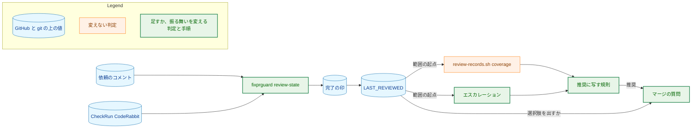
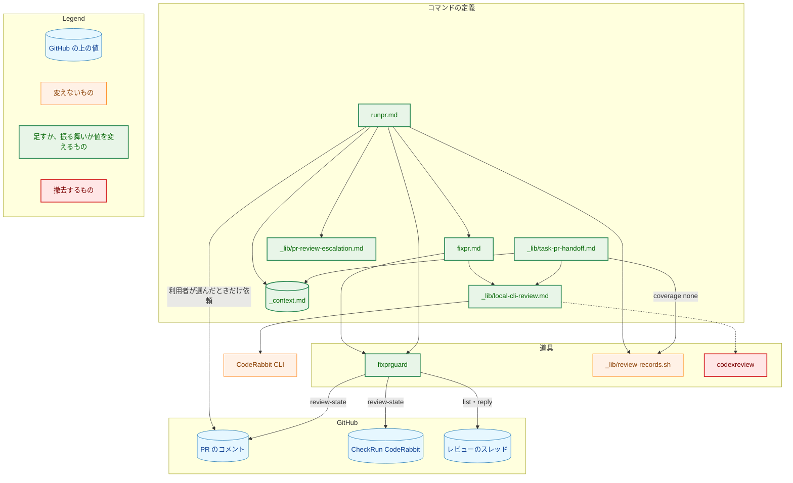
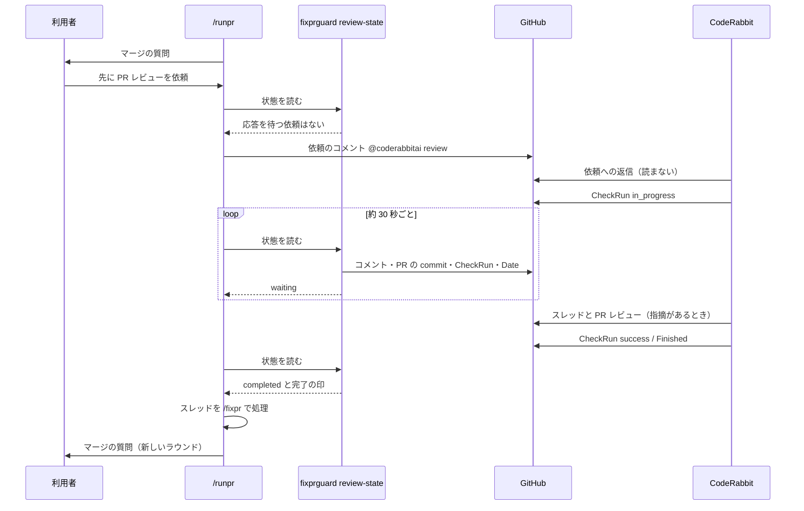
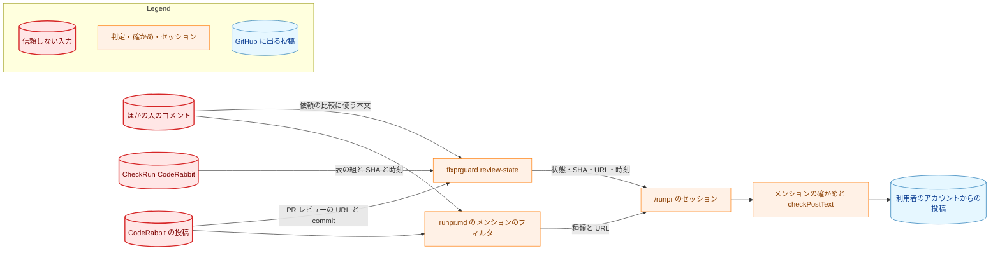
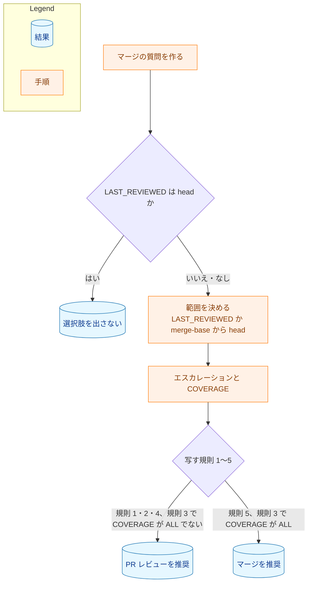
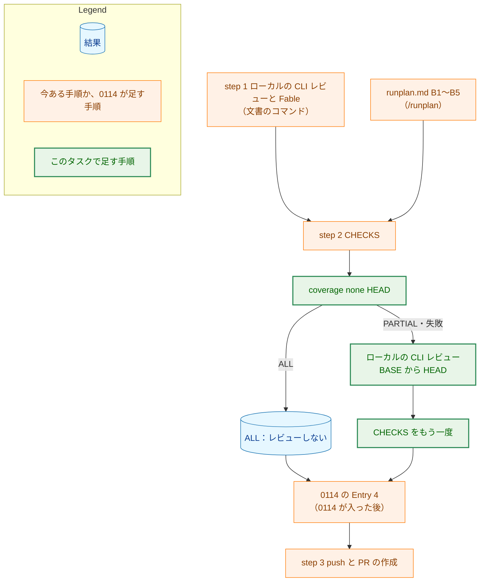

# 設計書：Codex の PR レビューと Codex CLI をレビューの体制から外す

## Document Status

| Item | Value |
|---|---|
| Status | `draft` |
| Created | 2026-11-20 |
| Review date | - |
| Reviewer | - |
| Comments | - |

## 1. 設計の全体像 (Design Overview)

本書は、[01_requirements.md](01_requirements.md)（以下、要件定義書）の F-002〜F-012 を、コマンドの定義・道具・ガードテスト・設定・文書の変更として設計する。

-   **観測の記録:** F-001（AC-01〜AC-04）の観測の記録は [observations.md](observations.md)（以下、観測の記録）にあり、本書と同じ PR で commit する（AC-03）。観測の結果は要件定義書の決定と食い違わなかったので、設計に進んだ（観測の記録 4 節、AC-04）。本書が完了の印や割り当ての知らせとして使う値は、すべて観測の記録にある（AC-05）。
-   **行番号:** 行番号を挙げる記述は、`main` の `e999fa2c` を読んだものである。
-   **語の定義:** 完了の印・LAST_REVIEWED・依頼のコメントなどの語は 1.2 で定義する。H-01〜H-09 は、要件定義書の申し送り（[design_handoff.md](design_handoff.md)）の項目で、扱いは付録 A にまとめる。

### 1.1. 設計原則

-   **手動の PR レビューの状態は、本文でなく CheckRun で決める。** 完了・割り当て切れ・レビューしたコミットを、本文を読まずに示すのは、CodeRabbit の app が作る CheckRun `CodeRabbit` だけである（観測の記録 3.2、3.3）。本文の文言は、完了の判定にも、本文だけの指摘やレビューしなかったファイルの判定にも使わない。
-   **判定は Go の道具に置く。** 手動の PR レビューの状態は、`fixprguard` の新しいサブコマンド `review-state` が、GitHub の応答を厳密な JSON として検査して決める。判定の誤りを Go のテストで壊して確かめられるようにするためである（[ADR-0014](../../dev/adr/0014-deterministic-checks-in-go.md) の 1）。読めないときを、止まる番兵でなく決まった理由を持つ状態で返す点は、interaction limits の判定（`internal/fixprguard/limits.go:113-119`、[ADR-0015](../../dev/adr/0015-untrusted-review-threads.md)）に倣う。
-   **依頼は、利用者が選んだときにだけ投稿する。** `/runpr` が依頼のコメントを投稿するのは、マージの質問で利用者が「先に PR レビューを依頼」を選んだときだけである（AC-13）。エスカレーションの判定は、その選択肢を推奨にするかだけを決める（F-005）。
-   **安全側に倒す。** 形が観測と違う、待つ時間を過ぎた、割り当てやエラーの知らせを受けた、のどれでも、レビュー済みとしない（AC-16、AC-18）。エスカレーションが答えを返せないときは、PR レビューを推奨にする（AC-55）。
-   **古い記録の行は読み続ける。** このタスクの前に作られたブランチの `Codex local review:` の行と `(codex)` の `Local CLI reviewed:` の行は、今と同じ意味で読む（AC-28）。新しく書く行の形だけを変える。
-   **既存の仕組みを使う。**
    -   **まだ見ていない commit:** `review-records.sh` の `coverage` で求める。`LAST_REVIEWED` を `none` として呼ぶと、すでに `origin/main..HEAD` のすべての commit を判定する（`.claude/commands/_lib/review-records.sh:445-446`）。新しい判定のスクリプトは作らない。
    -   **LAST_REVIEWED:** 今と同じく、`/runpr` が git の祖先関係で求める（`runpr.md:740-748`）。

### 1.2. 概念モデル

矢印 A → B は「A の値から B が決まる」を表す。



-   **手動の PR レビュー:** 依頼のコメントで始まる CodeRabbit の PR レビュー（要件定義書 3.1）。
-   **依頼のコメント:** 利用者のアカウント（`User`）が書いた、前後の空白を除いた本文が `_context.md` の「PR review request」の値（`@coderabbitai review`）とちょうど等しいコメント。依頼のコメントは利用者が作り、CheckRun は CodeRabbit の app が作る。
-   **数える CheckRun:** CodeRabbit の app が作る CheckRun `CodeRabbit` のうち、3.3.2 の表で「数えない」でないもの。
-   **応答:** ある依頼のコメントの後に始まり、次の依頼のコメントより前に始まった、数える CheckRun のうち最初のもの。応答の後に始まった CheckRun は、その依頼の応答ではない（3.3.3）。
-   **完了の印:** 応答のうち、`completed`・`success`・`Finished` のもの。それが示すコミットは CheckRun の `head_sha` である。
-   **LAST_REVIEWED:** 完了の印が示すコミットのうち、ほかのすべてがその祖先であるもの。完了の印が head を示せば head である。完了の印がなければ「なし」である。

### 1.3. 設計の際に決めたこと（2026-11-20）

利用者に尋ねて決めたこと:

-   **完了の印は CheckRun だけにする（H-01）:**
    -   **内容:** CheckRun `CodeRabbit` で、app の slug が `coderabbitai`、`completed`・`success`、`output.title` が `Finished`、依頼のコメントの後に始まったものとする。`neutral` で `Review rate limited` のものを割り当ての知らせとし、表にない終わり方をエラーの知らせとする。
    -   **理由:** CheckRun は、レビューしたコミットを本文なしに示し、作れるのはその GitHub App だけである。推奨に従って利用者が選んだ。
    -   **採らなかった案:**
        -   依頼への返信の「Review finished.」も求める案は採らない。返信の本文の形に依存し、形が変わると止まるためである。
        -   返信だけにする案も採らない。返信がコミットを示さないので、AC-17 を満たせないためである。
        -   要約コメントの「between」の行は使えない。割り当て切れのときも書かれるためである（観測の記録 3.3）。
    -   **ADR の判断:** [ADR-0013](../../dev/adr/0013-review-setup.md) の「レビュー済みの判定」を更新する。
-   **判定は `fixprguard` のサブコマンドで行う（H-01）:**
    -   **内容:** 新しいサブコマンド `review-state` が、GitHub の応答を厳密な JSON として検査し、状態・SHA・URL・時刻だけを出す。
    -   **理由:** 推奨に従って利用者が選んだ。`fixprguard` は F-009 でプロトコル番号を上げるので、利用者の入れ直しの手間は増えない。
    -   **採らなかった案:** `--jq` で判定する案は採らない。重複した項目を黙って後勝ちにし（[ADR-0015](../../dev/adr/0015-untrusted-review-threads.md)）、判定の誤りを Go のテストで確かめられないためである。
    -   **ADR の判断:** [ADR-0013](../../dev/adr/0013-review-setup.md) を更新する（上の項目と同じ更新）。質問では ADR-0014 の更新と見込んでいた。しかし、判定を Go に置くこと自体は ADR-0014 の今の決定（1. 判定の置き場所）に従うもので、ADR-0014 の決定は変わらない。
-   **本文だけの指摘とレビューしなかったファイルは、分からないものとして扱う（AC-19、AC-20、AC-52）:**
    -   **内容:** 手動の PR レビューが完了した PR のマージの質問は、いつも、そのレビューの URL と、本文に指摘やレビューしなかったファイルの知らせがありうることを示す。AC-12 の選択肢は、LAST_REVIEWED が head なら出さない。
    -   **理由:** どちらも本文の英語の文言でしか分からず、API の欄にない（観測の記録 3.7、3.8）。本文の文言で分岐すると「Declare, don't infer」に例外を足すことになり、文言が変わると黙って見落とす。推奨に従って利用者が選んだ。
    -   **ADR の判断:** [ADR-0013](../../dev/adr/0013-review-setup.md) を更新する（上の項目と同じ更新）。
-   **まだ見ていない commit のローカルの CLI レビュー（F-007）は、Opus のレビューの後、PR を開く直前に 1 回だけ置く（H-08）:**
    -   **内容:** `_lib/task-pr-handoff.md` Part B の CHECKS の後、push の前に置く（細かな位置は 3.2）。その直しは CodeRabbit CLI の 2 回目の試行が見て、Opus のレビューは見ない。それより後にできた commit は、PR の説明に、どの CLI もレビューしなかった commit として示す。
    -   **理由:** 推奨に従って利用者が選んだ。
    -   **採らなかった案:** Opus のレビューの前に置く案は採らない。Opus の直しと CHECKS の直しがまた見ていない commit になり、F-007 を満たすにはもう 1 回要るためである。
    -   **ADR の判断:** [ADR-0042](../../dev/adr/0042-implementation-model-tiers.md) を更新する。

利用者には尋ねず、要件定義書・申し送り・観測の記録・レビューから導いたこと:

-   **待つ時間の上限は、依頼のコメントの時刻から 15 分とする:** 観測した完了は依頼の 2〜3 分後だった（観測の記録 3.2）。今の Codex の上限（`runpr.md:655`）と同じ値で、余裕がある。大きな PR でこれを超えたときは、遅れて届いた完了の印を、再実行が拾う（3.5）。ADR の判断: ADR なし。定数の値であるためである。
-   **`fixprguard` のプロトコル番号を「`main` の値 + 1」に上げる（H-03）:** 理由は 3.3.5 にある。chief の番号は上げない（F-012、3.7）。ADR の判断: ADR なし。`CLAUDE.md` の「Protocol numbers」の規則を当てはめただけであるためである。
-   **`CLAUDE.md` の「Declare, don't infer」に、`review-state` の CheckRun の照合の例外を足す（3.3.2）:** CheckRun の `output.title` を表と照合するのは、外の値の中身で振る舞いを選ぶことに当たるためである。ADR の判断: ADR なし。`CLAUDE.md` の規則は ADR にしない（`CLAUDE.md` の「Design decisions (ADR)」）。
-   **`AGENTS.md` のガードテストの理由を CodeRabbit に改める（H-09）:** CodeRabbit の PR レビューは `AGENTS.md` を既定で読む（観測の記録 3.11）。ADR の判断: ADR なし。テストのコメントの直しであるためである。
-   **Codex CLI を直接走らせるコマンドがないことのガード（`TestRunsCodex`）は、`cmd/codexreview` とともに外す:** このガードは、`codexreview` を迂回して Codex CLI を走らせることを防ぐものだった。Codex CLI を使わなくなれば、守る対象がない。ADR の判断: ADR なし。F-008 の撤去の範囲の中で閉じるためである。

## 2. システム構成 (System Structure)

### 2.1. 全体の構成

実線の矢印 A → B は「A が B を読むか、B に書くか、B を呼ぶ」を表す。破線の矢印は、このタスクで撤去する呼び出しを表す。



-   **`RR` を「変えないもの」とする理由:** `review-records.sh` は header の説明だけを変え、判定の規則は変えない（3.8）。
-   **`problem` の色:** `mermaid_reference.md` は `problem` を問題のあるコードに使う色としている。本書では、撤去するもの（2.1）と信頼しない入力（5.1）に使い、各図の Legend で意味を示す。
-   **今の振る舞いを示す辺:** `RUNPR → FIXPR`、`FIXPR → LCR`、`FIXPR → FPG`、`LCR → CLI`、`FPG → THREADS`、`RUNPR → RR`、`LCR → CODEXREVIEW` は今あるものである（`runpr.md:837`、`fixpr.md` Phase 4.5、`local-cli-review.md:131`、`local-cli-review.md:170`、`runpr.md:828`、`runpr.md:875`）。
-   **このタスクで足す辺:** `HANDOFF → RR`（F-007）、`FPG → COMMENTS` と `FPG → CHECKRUNS`（`review-state`）。今の `RUNPR → COMMENTS` は Codex への依頼で、このタスクで、CodeRabbit への、利用者が選んだときだけの依頼に変わる。

### 2.2. コンポーネントの配置

-   **`fixprguard review-state`:**
    -   **置き場所:** `internal/fixprguard` の新しいファイルと、`cmd/fixprguard/main.go` のサブコマンドの登録。
    -   **使う仕組み:** GitHub の読み取りは、今の `github.go` の `gh` の呼び出しと `internal/strictjson` を使う。GitHub の時刻は、`limits.go` の `Date` ヘッダの読み方（`parseDateHeader`、`internal/fixprguard/limits.go:281`）を使う。
-   **メンションの拒否:** `internal/fixprguard/write.go` の `checkPostText`（`write.go:76-93`）と `errors.go` の定数を、2 つのメンションに広げる。
-   **手順:** `runpr.md` の step 1・3・4・5、`_lib/task-pr-handoff.md` Part B、`_lib/local-cli-review.md`、`_lib/pr-review-escalation.md`、`fixpr.md`、`runplan.md`。
-   **値:** `_context.md` の「Automated reviewer list」「Awaited PR reviewer」「PR review request」と、新しい行「Rejected mentions」。

### 2.3. データの流れ：手動の PR レビュー

マージの質問で利用者が「先に PR レビューを依頼」を選んだときの流れである。実線の矢印は呼び出しか投稿を、破線の矢印はその応答を表す。



-   **割り当て切れ・エラー・時間切れ:** `review-state` がそれぞれの状態を返し、`/runpr` は止まって報告する（AC-18、3.5）。

## 3. コンポーネント設計 (Component Design)

### 3.1. `_context.md` の値とメンションの確かめ

| 行 | 今 | 変えた後 |
|---|---|---|
| Automated reviewer list | `coderabbitai`、`chatgpt-codex-connector` | `coderabbitai`（AC-43） |
| Awaited PR reviewer | `chatgpt-codex-connector` | `coderabbitai`（AC-46）。REST の形は、今と同じく名前に `[bot]` を付けて作る |
| PR review request | `@codex review` | `@coderabbitai review`（AC-46） |
| Rejected mentions（新しい行） | なし | `@codex` と `@coderabbitai`。利用者のアカウントからの投稿が含んではならないメンション（F-009） |

-   **置き換え名:** コマンドの定義は、値を書き写さず、`_context.md` が定める 2 つの置き換え名だけを書く。今の `<review-mention>`（依頼の本文の最初の語、`runpr.md:40`、`task-pr-handoff.md:23`、`fixpr.md:56` で定義）は、どの文書でも使わない。
    -   **`<mention-check>`:** 投稿の前にメンションを確かめるコマンド全体。「Rejected mentions」の値ごとに `-e` を並べた `grep -qiF -e '@codex' -e '@coderabbitai' --` に展開し、その後ろに確かめるファイルを置く。判定の意味は変えない。終了コード 1 のときだけ投稿し、0 と 2 以上は投稿しない。
    -   **`<rejected-mentions>`:** `runpr.md` step 3 の `--jq` のフィルタで使う、「Rejected mentions」の値の JSON の配列（`["@codex", "@coderabbitai"]`）。
    -   **定義する場所:** `_context.md` は、2 つの置き換え名を、「Rejected mentions」の行の値から作るものとして定め、メンションの文字列そのものは書かない。各コマンドの定義は、今の `<review-mention>` と同じく、冒頭で `_context.md` から読むと書く。
-   **依頼のコメントは例外のまま:** 依頼のコメントは、メンションの確かめを通さない唯一の投稿のまま変えない（AC-40）。
-   **文書が値を書ける場所:** 文書の中でメンションの対象を書いてよいのは、「PR review request」の行と「Rejected mentions」の行だけである（AC-56）。ほかの場所は、`Codex` や `CodeRabbit` と `@` なしで書く。ガードテストは、投稿するすべての経路が `<mention-check>` を名指すことと、`<mention-check>` の展開が「Rejected mentions」のすべての値を含むことを確かめる（7.3）。`gh pr create` と `gh pr comment` の本文には `checkPostText` の二重の確かめがないので、このガードがその経路を守る。

### 3.2. PR を開くコマンド（F-002、F-007）

`_lib/task-pr-handoff.md` Part B を次のように変える。`/runpr` の step 1 が単独の変更の PR を作るときも、同じ手順に従う。

| 手順 | 今 | 変えた後 |
|---|---|---|
| step 2 | CHECKS（`./cmd/codexreview/...` を含む） | CHECKS（`./cmd/codexreview/...` を外す） |
| 新しい手順 | なし | まだ見ていない commit のローカルの CLI レビュー（下） |
| step 3 | push と PR の作成 | 同じ。本文の「Codex CLI が走った回数」を外す |
| step 5 | Codex の開始の印を約 2 分待ち、なければ `@codex review` を投稿する | 撤去する。PR を作ってから報告するまでの間、PR にコメントを投稿しない（AC-06） |
| step 6・7 | 通知と報告 | 同じ。PR レビューを待つ旨は書かない（AC-07） |

**新しい手順の位置:**

-   **CHECKS との順:** step 2 の CHECKS が通った後に走らせる。`/runplan` の CHECKS の規則（step 2 が除外できない commit を作ったら Opus のレビューの判断をやり直す、`runplan.md:106-119`）が終わった後である。
-   **0114 との順:** タスク 0114 の設計（[0114 設計書](../0114_fable_record_after_merge/02_architecture.md) の 3.4）は、Part B に push の直前の Fable の確認（Entry 4、step 2.5）を足す。新しい手順は、その確認より前に置く。理由は 2 つある。
    -   0114 の Entry 4 は、push の直前に HEAD が確認したときと同じかを確かめる。後ろに置くと、新しい手順の commit で HEAD が動く。
    -   0114 の規則 3（印の後の commit）により、チェックポイントの印の後の merge commit でない commit は、Fable の記録を無効にしない。そのため、新しい手順の commit が Entry 4 の救済を引き起こすことはない。
-   **番号:** 0114 の変更が先に入っていれば、新しい手順は step 2 と step 2.5 の間に入る。入っていなければ、step 2 と step 3 の間に入る。手順の番号は計画書で決める。

**新しい手順の中身:**

-   **判定:** `origin/main` から取り出した `review-records.sh` を、`coverage none <HEAD> [<PLAN>]` で呼ぶ。呼び方は `runpr.md` の COVERAGE（`runpr.md:871-876`）と同じく、スクリプトをスクラッチパッドに書き出してから走らせる。`<PLAN>` は、`/runplan` のときはその計画書、ほかのときは渡さない。
-   **見たとみなす commit（AC-31）:** `ALL` なら、このためのレビューは走らない。スクリプトは、空の commit と、計画書の PR の進み具合のチェックボックスだけを変える commit を、見たものとみなす（`review-records.sh` の header の Contract）。記録だけの commit は空の commit なので、ここに入る。
-   **範囲（AC-29）:** `PARTIAL <n>` なら、ローカルの CLI レビューを次の入力で走らせる。
    -   `BASE` = 一覧の最も古い commit の第 1 の親。その親が merge-base でも `origin/main..HEAD` の commit でもないときは、merge-base とする。
    -   `SCOPE` = PR 前の残り。
    -   `RECORD` = `commit`。
    -   範囲は `BASE..HEAD` なので、その範囲にあるすでに見た commit も含む。merge commit はいつも見ていない commit になる（`review-records.sh` の Contract）。そのため、`origin/main` を merge したブランチでは、merge で入った差分も CodeRabbit CLI に渡る。これは受け入れる。差分が CodeRabbit CLI の限度を超えて失敗したときは、下の「失敗したとき」に当たる。
-   **スクリプトが失敗したとき:** 終了コードが 0 でない、または 1 行目が `ALL`・`PARTIAL <n>` の形でないときは、`BASE` = merge-base でレビューする。安全側に倒すためである。
-   **回数（H-08）:**
    -   このレビューは、Part B の 1 回の実行につき 1 回だけである。その試行は `_lib/local-cli-review.md` の規則に従い、2 回目の試行がその直しを見る。
    -   直しの commit ができたときは、CHECKS をもう一度走らせる。その CHECKS の直しの commit は、レビューにかけ直さない。どの CLI もレビューしなかった commit として、step 3 の本文に示す。
    -   この手順の直しの commit と、その後の CHECKS の直しの commit は、`/runplan` の CHECKS の規則（Opus のレビューの判断のやり直し）を引き起こさない。`runplan.md` の Part B の CHECKS の文に、そう書き足す（3.8）。
-   **CodeRabbit CLI が失敗したとき（AC-30）:** `not run` の行を記録して進み、PR を開く。範囲は、PR の説明の「どの CLI もレビューしなかった commit」に出る（AC-27）。
-   **Fable との関係:** このレビューは FABLE を渡さない。Fable の部分レビューは、今と同じく step 1 だけで行う。
    -   **0114 が入る前:** マージの質問の Fable の行は、記録が走ったかどうかだけを読み、記録が有効かは読まない（`runpr.md:1371-1382`）。そのため、この手順の commit で行は変わらない。
    -   **0114 が入った後:** 上の規則 3 により、記録は有効のままである。
-   **Opus のレビューとの関係（H-08）:**
    -   `/runplan` では、Opus のレビュー（`runplan.md` の B2〜B4）が Part B の前に終わっている。この手順の直しの commit は、Opus のレビューの done record の後の commit になる。PR を開いた後に Opus のレビューを走らせる手順はないので、この commit を Opus は見ない。
    -   `/runplan` が push の前に止まって走り直したときは、走り直した `/runplan` の B2 が、今と同じ規則でこの commit を扱う。`_lib/opus-review.md` の「Excludable commit」に当たらなければ、レビューをやり直す。走り直しで Opus が見る範囲が広がるのは、安全側の違いとして受け入れる。

**`runplan.md` の「Before the PR」:**

-   **冒頭の理由:** 「Codex の最初の PR レビューが直したコードを見るため」（`runplan.md:270`）を、「直しがローカルの CLI レビューを通り、人のレビューは直した後のコードから始まるため」に改める（[ADR-0042](../../dev/adr/0042-implementation-model-tiers.md)）。
-   **B1:** 「Codex CLI のフォールバックがレビューした phase group」の文（`runplan.md:288-289`）を外す。

### 3.3. `fixprguard`

#### 3.3.1. `review-state` サブコマンドの契約

```text
fixprguard review-state --protocol <N> --reviewer <awaited-reviewer> --request <review-request> <PR>
```

-   **入力:**
    -   **`--reviewer`:** 完了を待つ PR レビュアーの名前（`_context.md` の「Awaited PR reviewer」）。CheckRun の CheckSuite の app の slug と比べる。REST の PR レビューの著者とは、道具が名前に `[bot]` を付けた login（今の Part B step 5 と同じ作り）で比べる。
    -   **`--request`:** 依頼の本文（「PR review request」）。会話のコメントの本文の比較に使う。
    -   **値を文書から渡す理由:** 今の `list` が自動レビュアーの名前を `--reviewer` で受け取る（`internal/fixprguard/github.go:40`）のと同じく、値の持ち主を `_context.md` の 1 か所にするためである（[ADR-0013](../../dev/adr/0013-review-setup.md)）。
    -   **道具が読むもの:** 利用者の login は、道具が `gh api user` で読む。待つ時間の上限（15 分）は、道具のコードの定数とする。
-   **読む順:**
    0.  PR（REST の `pulls/<n>`）の `head.sha`。どの状態でも、この値が読めたときは出力の `head` に入れる。マージの質問のラウンドごとの照合（3.4.2）に使うためである。
    1.  PR の会話のコメント（REST の `issues/<n>/comments`、全ページ）の id・著者・本文・`created_at`・`updated_at`・`html_url`。本文は、依頼のコメントかどうかの比較にだけ使い、出力しない。`updated_at` は依頼のコメントが編集されていないかを確かめるために使う（3.3.3）。依頼のコメントがなければ、ここで `none` を返し、2 以下を読まない。依頼がない PR（ふつうの PR）で、commit と CheckRun を読まずに済ませ、commit の多い PR でも上限に当たらないためである。
    2.  PR の head（`headRefOid`）と、PR の commit の一覧（GraphQL の `pullRequest.commits`、全ページ）。各ページで `headRefOid` が読む順の 0 の `head.sha` と等しいことを確かめ、食い違えば（読み取りの途中の push や force push）一覧を捨てて `unreadable` の `call-failed` で返す。各 commit の `oid` と CheckSuite の `app.slug`、その CheckRun を `checkRuns(filterBy: {checkName: "CodeRabbit", checkType: ALL})` で読む。CheckRun から読む項目は、`databaseId`・`status`・`conclusion`・`title`・`startedAt`・`completedAt`・`url` である。`checkType: ALL` は、名前ごとの最新に限らず、すべての CheckRun を返す（観測の記録 3.1）。CheckSuite の `app.slug` が `--reviewer` と等しいものだけを使う。
    3.  CodeRabbit の PR レビュー（REST の `pulls/<n>/reviews`、全ページ）の著者・`commit_id`・`submitted_at`・`html_url`。完了の印に URL を添えるためだけに使う。
    4.  GitHub の時刻。最後に読んだ応答の `Date` ヘッダとする。
-   **応答の検査:**
    -   **読む項目:** 各応答は、上に挙げた項目だけを読む。ほかの項目は読まずに受け入れる。GitHub の応答には、読まない項目が増えうるためである（`docs/dev/conventions/requirements_process.md` の「Untrusted input boundaries」の、拡張できると宣言した入力）。
    -   **拒否するもの:** 読む項目が重複するとき、ないとき、型が違うときは拒否する。ただし CheckRun の `status` が `COMPLETED` 以外のとき（`QUEUED`・`IN_PROGRESS`・`PENDING` など）は、`conclusion`・`completedAt`・`title`・`startedAt` に `null` を許す。`status` が `COMPLETED` のときは、これら 4 つがすべて `null` でない文字列であることを求める。
-   **上限:** 道具の定数とし、超えたら `unreadable` の `limit` で返す。
    -   会話のコメントと PR レビューは、それぞれ 3000 件まで。
    -   PR の commit は 1000 件まで。
    -   1 つの commit の CheckSuite は 50、1 つの CheckSuite の CodeRabbit の CheckRun は 100 まで。
-   **出力:** 標準出力に JSON を 1 つ書き、終了コードは 0 とする。
    -   **含めないもの:** 本文の文字列は、どこにも含めない。CheckRun の `details_url` も含めない。CodeRabbit のサイトで使う共有用の値（URL の `scope` の値）を含むためである（観測の記録 3.2）。URL は CheckRun の `url`（`https://github.com/<owner>/<repo>/runs/<id>`）を使う。
    -   **終了コード 2:** 引数の形が違うときだけ、今の `stop` の規則で終了コード 2 になる（`cmd/fixprguard/main.go:304-319`）。

```go
// ReviewState is the output of fixprguard review-state.
type ReviewState struct {
	Protocol            int                 `json:"protocol"`
	State               RequestState        `json:"state"`               // the state of the latest request comment
	Reason              UnreadableReason    `json:"reason"`              // set for state unreadable only
	IndeterminateReason IndeterminateReason `json:"indeterminateReason"` // set for state indeterminate only
	Head                string              `json:"head"`                // the PR's head, 40 lowercase hex; "" only when step 0 could not be read
	Now                 string              `json:"now"`                 // GitHub's clock, RFC 3339 UTC
	Request             *ReviewRequest      `json:"request"`             // the latest request comment; null for none and unreadable
	Response            *ReviewResponse     `json:"response"`            // its response; null when it has none
	IndeterminateURLs   []string            `json:"indeterminateUrls"`   // competing check run URLs for state indeterminate with reason competing-runs only; never details_url
	Markers             []ReviewMarker      `json:"markers"`             // every completion marker, oldest first; empty for none and unreadable
}

// ReviewRequest is a request comment.
type ReviewRequest struct {
	ID        int64  `json:"id"`        // the comment's REST id
	URL       string `json:"url"`
	CreatedAt string `json:"createdAt"` // RFC 3339 UTC
}

// ReviewResponse is a request comment's response.
type ReviewResponse struct {
	Kind       RunKind `json:"kind"`
	Status     string  `json:"status"`     // the check run's status enum, as GitHub writes it
	Conclusion string  `json:"conclusion"` // its conclusion enum, or ""
	Commit     string  `json:"commit"`     // head_sha, 40 lowercase hex
	URL        string  `json:"url"`        // the check run's url, never details_url
	StartedAt  string  `json:"startedAt"`
}

// ReviewMarker is a completion marker.
type ReviewMarker struct {
	Commit      string `json:"commit"`
	RequestID   int64  `json:"requestId"`
	RequestURL  string `json:"requestUrl"`
	CheckRunURL string `json:"checkRunUrl"`
	ReviewURL   string `json:"reviewUrl"` // CodeRabbit's PR review of Commit submitted after the request, or ""
	CompletedAt string `json:"completedAt"`
}

// RunKind classifies one CodeRabbit check run (3.3.2).
type RunKind int

const (
	RunUnknown     RunKind = iota // "unknown"
	RunRunning                    // "running"
	RunFinished                   // "finished"
	RunRateLimited                // "rate-limited"
	RunSkipNotice                 // "skip-notice"; never a response
)

// RequestState is the state of the latest request comment (3.3.3).
type RequestState int

const (
	RequestIndeterminate RequestState = iota // "indeterminate"
	RequestUnreadable                        // "unreadable"
	RequestNone                              // "none"
	RequestWaiting                           // "waiting"
	RequestCompleted                         // "completed"
	RequestRateLimited                       // "rate-limited"
	RequestUnrecognized                      // "unrecognized"
	RequestTimedOut                          // "timed-out"
)

// UnreadableReason says why the state could not be read.
type UnreadableReason int

const (
	UnreadableNone     UnreadableReason = iota // "" (the state is not unreadable)
	UnreadableCall                             // "call-failed": a gh call failed
	UnreadableRejected                         // "rejected": a response failed the strict checks
	UnreadableLimit                            // "limit": a fixed limit was exceeded
)

// IndeterminateReason says why the latest request's response could not be determined.
type IndeterminateReason int

const (
	IndeterminateNone          IndeterminateReason = iota // "" (the state is not indeterminate)
	IndeterminateCompetingRuns                            // "competing-runs": two or more check runs compete as the response
	IndeterminateEditedRequest                            // "edited-request": the request comment was edited (updated_at != created_at)
)
```

-   **ゼロ値:** `RequestState` のゼロ値は `RequestIndeterminate`、`RunKind` のゼロ値は `RunUnknown` とする。どちらも、入力について最も少なく仮定する解釈である（`CLAUDE.md` の「Declare, don't infer」）。
-   **JSON の形:** 列挙は `MarshalText` で、コメントに書いた決まった語として出す。今の `InteractionState` と同じ作りである（`internal/fixprguard/limits.go:26-39`）。項目の名前と列挙の語は、文書が読む契約であり、`fixprguard_guide.md` に書く（[ADR-0014](../../dev/adr/0014-deterministic-checks-in-go.md) の 3）。
-   **文書が読む項目:** `state`、`reason`、`indeterminateReason`、`head`、`now`、`request`、`response`、`indeterminateUrls`、`markers` の全部である。ほかの値（CheckRun の id など）は出さない。
-   **項目の間の約束:** 道具のコードが、状態と一緒に次の約束を作る。
    -   `request` は、`state` が `none` と `unreadable` のときだけ `null` で、ほかのときは値を持つ。
    -   `indeterminateReason` は、`state` が `indeterminate` のときだけ理由（`competing-runs` または `edited-request`）を持ち、ほかのときは空である。
    -   `indeterminateUrls` は、`state` が `indeterminate` で `indeterminateReason` が `competing-runs` のときだけ競合した CheckRun の URL（`details_url` は含めない）を持ち、ほかのときは空である。
    -   `head` は、`state` が `unreadable` で、読む順の 0 が読めなかったとき（`call-failed`、または `head.sha` が検査を通らない `rejected`）だけ空で、ほかのときは 40 桁の小文字の 16 進である。

#### 3.3.2. CheckRun の分類

CodeRabbit の CheckRun は、次の値の組だけで分類する。CheckSuite の `app.slug` が `--reviewer` と等しく、名前が `CodeRabbit` のものだけを読む。

| `status` | `conclusion` | `title` | 分類 | 応答として |
|---|---|---|---|---|
| `COMPLETED` 以外のすべて | 問わない | 問わない | `RunRunning` | 数える |
| `COMPLETED` | `SUCCESS` | `Finished` | `RunFinished` | 数える |
| `COMPLETED` | `NEUTRAL` | `Review rate limited` | `RunRateLimited` | 数える |
| `COMPLETED` | `SKIPPED` | `Review skipped: automatic reviews are disabled` | `RunSkipNotice` | 数えない |
| `COMPLETED` で、上のどれでもない組 | | | `RunUnknown` | 数える |

-   **`COMPLETED` 以外をすべて途中とする理由:** GitHub の CheckRun の状態には、`QUEUED`・`IN_PROGRESS` のほかに `WAITING`・`REQUESTED`・`PENDING` がある。終わっていない CheckRun をエラーと取り違えないためである。途中のままなら、待つ時間の上限で `timed-out` になる。
-   **`RunSkipNotice` を数えない理由:** PR を開いたときと push したときには、依頼がなくても作られる（観測の記録 3.5）。応答を待つ間に利用者が push しても、それを応答と取り違えないためである。
-   **`RunUnknown`:** 観測していない終わり方をすべて含む。公式の文書のエラー（`Review failed` など）と、`SUCCESS` でも `Finished` 以外の説明（`No files to review` など）がここに入る（観測の記録 3.3）。どれもレビュー済みとしない。
    -   **AC-18 の (b) との関係:** エラーは観測できず、公式の文書から記録した（観測の記録 3.3、AC-01）。公式の文書に載るエラーの説明は種類が多く、すべてを並べると取りこぼしうる。そのため、`COMPLETED` で表にない組をまとめてエラーの知らせ（AC-18 の (b)）として扱う。
    -   **AC-16 の (b) との関係:** 形に合わない応答（厳密な検査を通らない応答）は、`unreadable` の `rejected` として止まる（AC-16 の (b)）。
-   **`title` を読むことの例外:** 説明は CodeRabbit が書く外の値で、型にできない。エラーも `NEUTRAL` で終わりうるので、`conclusion` だけでは割り当て切れと区別できない（観測の記録 3.3）。そのため、`CLAUDE.md` の「Declare, don't infer」に、次の例外を足す（1.3）。
    -   **範囲:** `review-state` が、CheckRun の `status`・`conclusion`・`title` の組を上の表と照合することだけ。
    -   **理由:** 外の値で、型にできず、区別に要る値であるため。
    -   **境界:** 表にない `COMPLETED` の組は `RunUnknown` として、レビュー済みとしない。説明は完全一致で比べ、直さない。

#### 3.3.3. 状態の規則

最新の依頼のコメントの状態は、次の順に、最初に当たったもので決める。

1.  **`unreadable`:** 読む順の 0〜4 または `gh api user` で、呼び出しが失敗した（`call-failed`）、読む順の 2 で `headRefOid` が読む順の 0 の `head.sha` と食い違った（`call-failed`）、応答が厳密な検査を通らなかった（`rejected`）、上限を超えた（`limit`）。
2.  **`none`:** 依頼のコメントがない。
3.  **`indeterminate`:** 最新の依頼の応答が決まらない。次のどちらかに当たる（AC-16 の (a)）。
    -   **`edited-request`:** 最新の依頼のコメントが編集されている（`updated_at` が `created_at` と等しくない）。通常のコメントを後から依頼の本文へ編集した場合、元の `created_at` を依頼時刻として使うと、編集前に始まった CheckRun を応答と取り違えうるため、完了と判定しない。
    -   **`competing-runs`:** 最新の依頼の後に始まった数える CheckRun のうち、最も早く始まったものが 2 つ以上ある（同じ秒）か、最も早いものが終わる前に、別の数える CheckRun が始まった。
4.  **`completed`・`rate-limited`・`unrecognized`:** 応答があり、その分類が `RunFinished`・`RunRateLimited`・`RunUnknown` である。
5.  **`timed-out`:** 依頼の時刻から 15 分を過ぎた。`RunRunning` の応答があっても、上限は延ばさない。
6.  **`waiting`:** 上のどれでもない。

-   **時刻の比べ方:** 「後に始まった」は、CheckRun の `startedAt` が依頼の `created_at` より厳密に後であることとする。同じ秒は数えない。今の Codex の判定と同じ規則である（`runpr.md:547-549`）。`status` が `COMPLETED` 以外で `startedAt` が `null` の CheckRun（`QUEUED` や `PENDING` など）はまだ始まっていないものとして応答に数えず、`startedAt` が入るか 15 分の上限に達するまで `waiting` のまま待つ。
-   **応答の後の CheckRun:** 応答が終わった後に始まった数える CheckRun（CheckRun の再実行、Web からのレビュー、`/fixpr` の返信に応じたレビュー）は、その依頼の応答でも完了の印でもない。手動の PR レビューは依頼のコメントで始まるものだけだからである（要件定義書 3.1）。そのため、最新の依頼が終わった後に何が起きても、状態は応答で決まったまま変わらない。
-   **前の依頼の応答:** 前の依頼のコメントにも同じ規則で応答を決め、`RunFinished` の応答を完了の印として `markers` に入れる。前の依頼の応答は、次の依頼より前に始まったものに限る（AC-17）。依頼のコメントのない CheckRun は、完了の印にならない。前の依頼の応答が決まらないとき（規則 3 に当たるとき：編集された依頼コメントや競合する CheckRun があるとき）は、その依頼からは完了の印を作らない。安全側に倒すためである。
-   **示すコミット（AC-16 の (c)・(d)）:** 道具は、PR の commit の一覧にある commit の CheckRun だけを読み、読む順の 2 の各ページで `headRefOid` が読む順の 0 の `head.sha` と等しいことを確かめる。そのため、読み取りの途中で force push が起きて head が変われば `unreadable`（`call-failed`）で読み直しになり、完了の印が示すコミットは、出力する `head` かその祖先に限られる。この性質は本書が実装に課す要件で、テストで確かめる（7.1）。示すコミットが 40 桁の小文字の 16 進でない CheckRun があれば、`unreadable` の `rejected` になる。force push で一覧から消えた commit の上の完了の印は読まれないので、LAST_REVIEWED は古くなる側にしか変わらない。
-   **スレッドへの返信に応じた投稿（AC-54）:** 観測では、返信に応じて CodeRabbit が付けたのは反応だけで、CheckRun はできなかった（観測の記録 3.10）。返信に応じたレビューが CheckRun を作っても、上の「応答の後の CheckRun」として数えない。

#### 3.3.4. LAST_REVIEWED

`/runpr` が、`review-state` の `markers` から、今と同じく git で求める（`runpr.md:740-748`）。

-   **手順:** `git fetch origin` の後、`markers` の `commit` のうち、ほかのすべてがその祖先である（`git merge-base --is-ancestor`）ものを LAST_REVIEWED とする。
-   **head を示すとき:** 完了の印が head を示せば、LAST_REVIEWED は head である。
-   **なしとするとき:** そのような commit がないとき、`git merge-base` が 0 と 1 のほかの終了コードで終わったとき、`markers` が空のとき、`state` が `unreadable` のときは、「なし」とする。
-   **merge commit:** 祖先関係は git のグラフで求めるので、PR が `origin/main` を merge していても、LAST_REVIEWED は今と同じく求まる。

#### 3.3.5. メンションの拒否とプロトコル番号

-   **拒否（AC-38）:** `checkPostText` は、ASCII の大文字と小文字を同じに扱った文面に `@codex` か `@coderabbitai` が含まれるとき、`ErrInvalidInput` に包んだ番兵で拒否する。当てはめる入力は今と同じである。
    -   `reply` の返信（`internal/fixprguard/write.go:177`）
    -   `edit-pr` の PR のタイトルと説明（`write.go:352`、`write.go:355`）
    -   `append-pr` の後の PR の説明（`write.go:390`、`write.go:404`）
    -   `finish` の commit メッセージの本文（`internal/fixprguard/worktree.go:331`）
-   **`append-pr` の拒否（AC-39）:** 今の PR の説明（ほかの人や CodeRabbit が書いた部分を含む）がメンションの対象を含むために拒否するときは、新しい番兵 `ErrCurrentBodyMention` を返す。
    -   **出力:** この番兵は `ErrInvalidInput` に包まない。今の `stop` で終了コード 1 の停止の出力になり、新しい停止の種類 `current-body-mention` を持つ（`internal/fixprguard/errors.go:102-132` の `StopKind` に足す）。
    -   **`fixpr.md` の扱い:** 停止の種類で AC-39 の報告（原因が今の PR の説明にあること）を選び、同じ書き込みを繰り返さない。報告の文言では区別しない。
    -   **書き足す文面に含まれるとき:** 書き足す文面そのものがメンションを含むときは、今と同じく `ErrInvalidInput` で終了コード 2 になる。
-   **プロトコル番号（H-03）:** `fixprguard` の番号を「`main` の値 + 1」に上げ、すべての `--protocol` を合わせる。理由は次の組み合わせにある。
    -   **古い文書と新しい道具:** 古い文書が渡す文面のうち、`@coderabbitai` を含むものが新たに拒否されるだけで、確かめは強まる。
    -   **新しい文書と古い道具:** 新しい文書は `@coderabbitai` の拒否を道具に任せるが、古い道具はそれを通す。新しい文書の呼ぶ `review-state` も、古い道具にはない。番号を上げれば、古い道具は新しい文書の呼び出しを拒否する。
-   **chief の番号:** chief は `/runpr` の報告の形を読むが、このタスクはその形を変えない（3.7）。そのため上げない。

### 3.4. `/runpr`（F-003〜F-005、F-009、F-010）

#### 3.4.1. step 3：CI とスレッドを待つ

見出しを「Wait for CI and the review threads, running fixpr as comments appear」に改め、次の構成にする。

-   **撤去するもの（AC-09）:** Codex の要約コメントと受領コメントの読み取り（`runpr.md:426-517` の `summary`・`receipt`・`codex` の分類）、状態の規則 1〜7（`runpr.md:588-675`）、「Confirming a completion without a result」と承認の記録（`runpr.md:676-739`）、今の LAST_REVIEWED の定義（`runpr.md:740-754`）、自動の依頼と「Requesting the review」の自動の投稿と、Codex に固有の停止の報告（`runpr.md:755-824`）。受領コメントによる「指摘なしとして進めますか」の問いは出さない。
-   **残して広げるもの:**
    -   一覧の読み方と標準エラーの扱い（`runpr.md:413-423`）。
    -   メンションの 3 つの一覧（`runpr.md:433-534`。下の「メンションの確かめ」）。
    -   「A listing that fails」（`runpr.md:552-568`）。
    -   「Mentions by other accounts」（`runpr.md:569-587`）。
-   **手動の PR レビューの状態:** 着いたときに、`fixprguard review-state` を 1 回読む。
    -   `waiting`: 新しく投稿せずに、約 30 秒ごとに読み直して待つ（AC-14）。状態が変わったら、下の扱いに従う。
    -   `completed`・`none`: 先に進む（AC-08）。完了の後に開かれたスレッドは、下のスレッドの処理で `/fixpr` に渡す。
    -   `rate-limited`・`unrecognized`・`timed-out`: 最新の依頼は終わったものとする（AC-18 の「(a)〜(c) に当たった依頼は終わったものとし」）。この実行で投稿した依頼を待っていたときは、止まって報告する（3.5）。この実行の前に終わった依頼なら、先に進み、step 4 の要約に出す（AC-53）。
    -   `indeterminate`: 止まって報告する（AC-16、3.5）。
    -   `unreadable`:
        -   `call-failed` は、待つ間なら次の読み直しで読み直す。今の「A listing that fails」と同じく、約 15 分続けて読めなければ止まる。着いたときなら、同じく約 15 分読み直してから止まる。
        -   `rejected` は止まって報告する（AC-16 の (b)）。
        -   `limit` は、依頼を待っていないときは、完了の印が読めないものとして先に進む（LAST_REVIEWED はなしで、step 4 の要約に出す）。この実行で投稿した依頼を待っているときは、止まって報告する。
-   **メンションの確かめ（AC-41）:** 今の `--jq` の 3 つの一覧を残し、`<review-mention>` との比較を、`<rejected-mentions>` のどれかを含むかの比較に広げる。分類は次のとおりである。
    -   **利用者の依頼のコメント:** `request` として分ける（今と同じ）。依頼のコメントの判定は `review-state` も行う。jq の側は、依頼のコメントをメンションから外すためだけに使い、状態の判定には使わない。両方の判定の規則（著者・前後の空白・本文の完全一致）は、ガードテストが、同じ入力に対する両方の判定が一致することを確かめる（7.3）。
    -   **CodeRabbit の投稿:** `<awaited-reviewer>[bot]`（`Bot`）の投稿のうち、1 行目（末尾の CR を除く）が観測した 2 つの行のどちらかと等しいものは、メンションとして扱わない（観測の記録 3.6、AC-41 の 3）。2 つの行は `<!-- coderabbit-ai-generated:v1 -->` と `<!-- This is an auto-generated comment: coding agent status by CodeRabbit -->` である。
    -   **それ以外:** 本文にどちらかのメンションを含むものは、今と同じく `by_user` と `by_bot` で分ける。Codex の投稿は、ここで `by_bot` になる（AC-41 の 4）。
    -   **扱い:** 止まる・尋ねる・進むの扱いは、今の「Mentions by other accounts」と同じである。
-   **スレッド:** `fixprguard list` と `/fixpr` の扱いは今と同じである（AC-10）。`--reviewer` に渡す一覧は `coderabbitai` だけになるので、`chatgpt-codex-connector` のスレッドは想定外の著者のスレッドとして「Untrusted threads」で扱われる（AC-44）。
-   **エスカレーション:** 3.4.3。
-   **CI:** 今と同じく、`gh pr checks <number> --watch --fail-fast` で待つ。

#### 3.4.2. step 4：マージの質問

-   **選択肢「先に PR レビューを依頼」（AC-12）:**
    -   **出すとき:** LAST_REVIEWED が head でないとき（なしのときを含む）だけ出す。
    -   **説明:** 「CodeRabbit に PR レビューを頼み、終わったらこの問いに戻る」とする。
    -   **推奨と位置:** 推奨にするかは 3.4.3 が決める。推奨のときは最初に、推奨でないときは「マージ」の後に置く。今の表（`runpr.md:1410-1417`）の並べ方と同じである。
-   **判定した head とマージする head（ラウンドごと）:** 各ラウンドの問いの前に `review-state` を読み直し、その `head` と、`mergepr prepare` が控えた `headRefOid` と、`git rev-parse HEAD` が等しいことを確かめる。`head` は、読む順の 0 が読めたときはいつも入っている（3.3.1）。空のときは `unreadable` なので、下の扱いになる。
    -   **`call-failed` のとき:** 約 30 秒おきに読み直し、約 15 分読めなければ、準備を捨てて止まる（3.4.1 と同じ）。
    -   **読み直した状態が変わったとき:** 照合の前に、3.4.1 の扱いを当てはめる。たとえば、別の依頼が `waiting` になっていれば、待ってから問う。
    -   **違うとき:** 準備を捨て（`mergepr discard`）、step 2 に戻る。今の COVERAGE の `headRefOid` の比べ方（`runpr.md:863-866`）と同じ考えで、判定した head と違う head をマージしないためである。
    -   **準備の後に head が動いたとき:** `--match-head-commit`（`mergepr.md`）がマージを止める。
-   **要約の行:** 今の 4 行目と 13 行目（`runpr.md:1334`、`runpr.md:1343`）を次に改め、Codex の名前を出さない（AC-11）。
    -   **4 行目:** `未レビューの変更: あり（推奨: PR レビュー）`、`未レビューの変更: あり（推奨: マージ）`、`未レビューの変更: なし` のどれかを出す。「未レビュー」は、LAST_REVIEWED が head でないことである。
    -   **13 行目:** 未レビューの変更があるときだけ、`未レビュー分: ローカル CLI 済 ／ Fable（PR 前）: run` の形で出す。前半は LAST_REVIEWED（なしなら merge-base）から head までをローカルの CLI レビューが見たかで、後半は Fable の記録である。読み方は今と同じである（AC-11）。
    -   **新しい行:** `request` があるとき、または `state` が `unreadable`（理由 `limit`）のときに、`手動 PR レビュー: …` を足す。
        -   **最新の依頼が完了のとき:** `完了 <12 桁の SHA>（<URL>、本文に指摘やレビューしなかったファイルの知らせがありうる）` を出す（AC-19、AC-20、AC-52）。URL は、完了の印の PR レビューの URL、それがなければ依頼のコメントの URL とする。
        -   **最新の依頼が終わっているとき（`rate-limited`・`unrecognized`・`timed-out`）:** `割り当て切れ`・`判定できない終わり方`・`時間切れ` のどれかと、依頼のコメントの URL を出す（AC-53）。前の依頼の完了の印（`markers`）もあるときは、最新の完了の印の 12 桁の SHA・URL・本文に指摘等がありうる旨も同じ行に併記する。
        -   **読めないとき（`unreadable` の `limit`）:** `読めない（上限）` を出す（3.4.1 の `limit`。`request` は `null` なので URL は付かない）。
    -   **行の数:** 要約の行は、今の 14 行から 15 行になる。
-   **詳細のファイル:** 承認の記録の項目（`runpr.md:1297-1301`）を外し、手動の PR レビューの `markers` と最新の依頼の状態を足す。
-   **「先に PR レビューを依頼」を選んだとき（AC-13、AC-14）:**
    1.  `mergepr discard` する（今と同じ）。
    2.  `review-state` を読む。
        -   `waiting` なら、投稿せずに待つ。
        -   `indeterminate` と `unreadable` なら、止まって報告する。
        -   それ以外なら、依頼のコメントを `gh pr comment <number> --body "<review-request>"` で 1 件投稿する。`gh` が出した URL の末尾の `#issuecomment-<id>` の id を、この依頼の id として控える。
    3.  `review-state` を約 30 秒ごとに読み、`waiting` でなくなるまで待つ。
        -   **一時的な読み取り失敗（`unreadable` の `call-failed`）:** `request.id` の照合や停止の前に、3.4.1 と同じ読み直し（約 15 分続けて読めなければ止まる）を当てはめる。
        -   **新しい依頼が見えるまで:** 投稿の直後は、GitHub の一覧にまだ新しい依頼が出ていないことがある。そのため、`request.id` が控えた id と等しくなるまで読み直す。約 2 分たっても等しくならなければ、止まって報告する。
        -   **見えた後:** 読み直したときの `request.id` が控えた id と違えば、止まって報告する（ほかの依頼が重なった）。
    4.  `completed` なら、step 3 のスレッドの処理に戻り、step 2 を経て、step 4 の item 1 から問い直す。それ以外は 3.5 のとおり止まる。
-   **エスカレーションの「1 回だけの自動の依頼」:** 撤去する（AC-25）。今の `request` の扱い（`runpr.md:920-924`）がこれに当たる。

#### 3.4.3. エスカレーションと推奨（F-005、H-02）

-   **範囲（AC-21）:** LAST_REVIEWED があるときは LAST_REVIEWED から head まで、ないときは `origin/main` との merge-base から head までとする。LAST_REVIEWED が「なし」のときにエスカレーションの判定を走らせずに `ask` とする今の規則（`runpr.md:893`、`_lib/pr-review-escalation.md` の Inputs）は外す。
-   **COVERAGE:** 今と同じく `review-records.sh coverage <LAST_REVIEWED> <HEAD> [<PLAN>]` で求める。`none` を渡したときの範囲は、すでに `origin/main..HEAD` である（`review-records.sh:445-446`）。そのため、スクリプトの判定の規則は変えない。
-   **答えを推奨に写す規則:** `runpr.md` の 1 か所に置き、最初に当たったもので決める。今の規則 1〜5（`runpr.md:897-905`）の結果の語を、推奨に置き換えたものである。

| 規則 | エスカレーションの答え | 推奨 | 要件 |
|---|---|---|---|
| 1 | 決まった JSON でない、`criteria` の値が 1〜5 の外、`request` で `criteria` が空、`skip` で `criteria` が空でない、エスカレーションの判定を走らせられなかった | PR レビュー | AC-55 |
| 2 | `request` で、`criteria` に 4 を含む | PR レビュー | AC-22 |
| 3 | `request` で、`criteria` が 1・2・3・5 だけ | COVERAGE が `ALL` ならマージ、それ以外は PR レビュー | AC-23 |
| 4 | `ask` | PR レビュー | AC-55 |
| 5 | `skip` | マージ | AC-24 |

-   **`_lib/pr-review-escalation.md` の Procedure の step 1:** 残す。LAST_REVIEWED が head の祖先でないときは `ask` とする。LAST_REVIEWED は git の祖先関係で求めるので（3.3.4）、ふつうは起きない。force push の後に古い完了の印が残る場合に備えた、念のための確かめとして残す。
-   **報告:** エスカレーションの理由、COVERAGE、決めた規則を、今と同じく報告する（`runpr.md:910-919`）。
-   **関門の範囲の記述:** `_lib/pr-review-escalation.md` の基準 4 が挙げるレビューの関門に、`fixprguard review-state`、`runpr.md` の LAST_REVIEWED の求め方、答えを推奨に写す規則を含める。今の「`runpr.md` step 3's definition of LAST_REVIEWED, its rules that turn this file's answer into a decision」を、新しい名前に改める。
-   **ADR-0047:** この規則は、要件定義書の PR で更新した [ADR-0047](../../dev/adr/0047-runpr-merge-question.md) の決定（エスカレーションが PR レビューを勧めるときは「先に PR レビューを依頼」を推奨にする）と同じである。本書は ADR-0047 の決定を変えない。

### 3.5. `/runpr` が止まるときの報告（AC-16、AC-18）

| 状態 | 報告するもの | 次の手 |
|---|---|---|
| `rate-limited` | 割り当てを使い切ったこと、依頼のコメントの URL、CheckRun の URL | 割り当てが戻ってから `/runpr` を再実行して選び直す、またはレビューなしでマージに進む |
| `unrecognized` | 判定できない終わり方の知らせを受けたこと、CheckRun の `status` と `conclusion`、依頼のコメントの URL、CheckRun の URL | 同上 |
| `timed-out` | 15 分を過ぎても完了の印がないこと、依頼のコメントの URL と時刻、`now`、応答があればその分類と CheckRun の URL | 応答が途中なら、しばらくして `/runpr` を再実行する（遅れて届いた完了の印を拾う）。応答がなければ、上と同じ |
| `indeterminate` | 応答が決まらないことと理由（`indeterminateReason`：`edited-request` のときは依頼のコメントが編集されていて依頼時刻を特定できないこと、`competing-runs` のときは依頼の後に始まった数える CheckRun の URL）、依頼のコメントの URL | CodeRabbit の画面で確かめ、手動で新しい依頼のコメントを投稿してから `/runpr` を再実行する。新しい依頼が最新の依頼になる |
| `unreadable` | 理由（`call-failed`・`rejected`・`limit`） | `call-failed` は再実行する。`rejected` と `limit` は、道具と観測の記録を直す |

-   **本文を出さない:** どの報告も、CodeRabbit の投稿の本文と、CheckRun の `title` を示さない（AC-16）。
-   **AC-18 の「次の手」:** 「割り当てが戻ってから再実行して選び直す」は、終わった依頼に対して新しく依頼することである。再実行の `review-state` は終わった依頼を `rate-limited` などとして返すので、`/runpr` は自分では依頼せず、要約に出す（AC-53）。利用者がもう一度選んだときだけ、新しく依頼する。
-   **止まり続けるとき:** CodeRabbit の形が変わって止まり続けるときは、利用者は CodeRabbit の画面でレビューを確かめ、`/mergepr` で直接マージできる。この方法は、`/runpr` の記帳（文書の `approved`、計画書のチェックポイント）を行わないので、最後の手段とし、報告にそう書く。

### 3.6. ローカルの CLI レビュー（F-006、H-06）

`_lib/local-cli-review.md` を次のように変える。

-   **step 2:** CodeRabbit CLI の成功と失敗の判定は変えない。失敗はすべて今の `record` の扱いになり、試行の結果は `none` である。Codex CLI を含むほかのレビューは走らせない（AC-26）。
-   **step 3:** `codexreview` の実行と、その表と、`stop` の扱いを撤去する（`local-cli-review.md:155-233`）。FABLE があるときの最初の試行は、今の `record` と同じく、Fable の指摘だけで step 4 に進む。
-   **step 7 の記録の行:** 新しく書く行の形を次に改める。見ていない範囲は、今と同じく PR の説明とマージの質問の要約の行に出る（AC-27）。

| 行 | 新しく書く形 |
|---|---|
| `Local CLI reviewed:` | `Local CLI reviewed: <START12>..<END12> (coderabbit)` |
| `Local CLI review: not run` | `Local CLI review: not run <START12>..<END12> (coderabbit: <kind>)` |
| HEAD2..HEAD3 の `not run` | `Local CLI review: not run <START12>..<END12> (after the second attempt, reviewed by coderabbit)` |

-   **「Reading the record lines」（AC-28）:** 次の古い形も、今と同じ意味で読み続ける。読み方の規則は外さない。
    -   `Codex local review:` の行は、指摘の行である。
    -   `(codex)` を持つ `Local CLI reviewed:` の行は、見た範囲である。
    -   `(coderabbit: <kind>; codex: <kind>)` を持つ `not run` の行は、見ていない範囲である。
    -   `review-records.sh` の正規表現（`review-records.sh:189`）も `(coderabbit|codex)` のまま変えない。
    -   **新しく書かれた `(codex)` の行:** 手順は `(codex)` の行をもう書かないが、読み方は書かれた日を区別しない。エージェントが誤って `(codex)` の行を書いても、それは見た範囲として読まれる。`(coderabbit)` の行を誤って書くのと同じ危険で、今もある危険なので受け入れる。
    -   **古い形を読む規則を外せる条件:** 古い形の行を持つ開いたブランチがなくなったとき。`_context.md` の古い値の表と同じ扱いである。PR-3（6.3）で、外すための issue を作る。
-   **step 8 の SUMMARY と PR の説明:** 「Codex CLI が走った回数」を外す（`local-cli-review.md:342-346`、`_lib/task-pr-handoff.md` Part B step 3）。
-   **`instructions_changed` の注記:** `codexreview` が出していた値なので、外す。

### 3.7. chief の読み取り（F-012）

chief の製品のコードは、Codex の文言で分岐しない（要件定義書 1 節）。このタスクは、`/runpr` の報告と NEXT 行の形を変えない。

-   **外す行:** step 5 の最後の報告から、受領コメントで認めた完了の行が外れる（`runpr.md:733-739`）。この行は `NEXT` で始まらず、chief が読む形（NEXT と PR の番号）に当たらない。
-   **サンプル:** 今のサンプルを残し、新しいサンプルを足さない（AC-50、AC-51）。実装の PR で `/runpr` の報告の形を変えることになったときだけ、AC-51 のとおり足す。

### 3.8. コンポーネントの責務と、変えるファイル

| ファイル | 変更 | 要件 |
|---|---|---|
| `.claude/commands/_context.md` | 3.1 の 4 つの行と、2 つの置き換え名の定義。「Automated reviewer list」の説明の Codex の記述 | F-009、F-010、AC-43、AC-46 |
| `.claude/commands/_lib/task-pr-handoff.md` | Part B step 2 の CHECKS、新しい手順（3.2）、step 3 の本文の項目、step 5 を撤去、冒頭と「Authorization」の Codex の記述、`<mention-check>` | F-002、F-007、F-009 |
| `.claude/commands/runpr.md` | step 1（単独の PR）、step 3、step 4、step 5 の報告、`<mention-check>` と `<rejected-mentions>`、`fixprguard` の `--protocol` | F-002〜F-005、F-009 |
| `.claude/commands/_lib/pr-review-escalation.md` | 冒頭の説明、Inputs、基準 4 の関門の範囲 | F-005 |
| `.claude/commands/_lib/local-cli-review.md` | 3.6 | F-006、AC-28 |
| `.claude/commands/_lib/review-records.sh` | header の説明（LAST_REVIEWED は手動の PR レビューの完了の印、F-007 の呼び方）。判定の規則は変えない | F-005、F-007 |
| `.claude/commands/fixpr.md` | `<mention-check>`、`replyBody` の規則、Phase 4.5 の Codex CLI の記述、`append-pr` の `current-body-mention` の報告、`--protocol` | F-006、F-009、AC-39 |
| `.claude/commands/runplan.md` | 「Before the PR」の理由と B1、step 7.7 の Codex CLI の記述、Part B の CHECKS の文（新しい手順の commit は Opus のレビューの判断のやり直しを引き起こさない） | F-006、F-007 |
| `.claude/commands/_lib/fable-review.md` | 冒頭の理由（[ADR-0050](../../dev/adr/0050-fable-partial-review.md) の新しい理由）、Codex CLI の指摘の記述、`<mention-check>` | F-009、F-011 |
| `.claude/commands/_lib/opus-review.md`、`.claude/commands/_lib/simple-process.md` | `<mention-check>`、CHECKS の一覧、「Codex が見ていない変更」の記述 | F-009、F-011 |
| `internal/fixprguard/`（新しいファイル） | `review-state` の型・GitHub の読み取り・分類・状態の規則とそのテスト、`testdata/` のサンプル | F-004、H-01 |
| `internal/fixprguard/write.go`、`errors.go`、`types.go` | 2 つのメンションの拒否、`ErrCurrentBodyMention` と `current-body-mention`、番兵の名前、プロトコル番号 | F-009、AC-39、H-03 |
| `internal/fixprguard/write_test.go`、`worktree_flow_test.go`、`cmd/fixprguard/main_test.go` | `@coderabbitai` の拒否の行、番兵の名前（`worktree_flow_test.go:449-455`）、「mentions Codex」の診断の文の確かめ（`main_test.go:813-890`）、`append-pr` の今の説明が原因の拒否が終了コード 2 になることの確かめ（`current-body-mention` の終了コード 1 に改める） | F-009、AC-39 |
| `cmd/fixprguard/main.go` の `stop` のコメント、`fixprguard_guide.md` 4 章の `append-pr`、`fixpr.md` の `append-pr` の終了コードの記述 | `append-pr` の今の説明が原因の拒否を、終了コード 2 から `current-body-mention` に改める | AC-39 |
| `internal/fixprguard/test_helpers.go:24`、`cmd/fixprguard/test_helpers.go:25`、`types_test.go:51`、`trust_test.go:155` | 2 人目の自動レビュアーの名前 `testSecondReviewer`。複数の `--reviewer` の文法を確かめる値なので残し、Codex の名前でない架空の名前に改める | F-010 |
| `cmd/fixprguard/main.go` | `review-state` の登録 | F-004 |
| `docs/dev/guides/fixprguard_guide.md` | `review-state` の章（項目の名前と列挙の語）、`current-body-mention`、メンションの拒否の記述、番号 | F-004、F-009 |
| `cmd/codexreview/`、`internal/codexreview/` | 撤去 | F-008、AC-32 |
| `internal/doctestutil/protocol.go:19,24`、`protocol_test.go`、`commands.go`、`commands_test.go`、`internal/mergepr/protocolcheck_test.go:141` | `ToolCodexreview` と `protocolTools` の `codexreview`、`codex` のコマンドを見つける部分とそのテスト | AC-35、F-008 |
| `internal/chief/detail_test.go` | `chatgpt-codex-connector` を含む入力。chief の読み取りのテストの入力なので残す（F-012） | F-012 |
| `Makefile` | `install-codexreview` を外す | AC-33 |
| `.claude/settings.json` | `Bash(codexreview *)` の許可と、`codexreview` のインストールとビルドの拒否の規則を外す | AC-34 |
| `.github/workflows/ci.yml` | `doc-guard` の一覧から `./cmd/codexreview` を外す | AC-37 |
| `.coderabbit.yaml` | コメントの「Codex does the PR review」を、手動の PR レビューの説明に改める。設定の値は変えない | F-011 |
| `CLAUDE.md` | 「Declare, don't infer」に `review-state` の例外を足す（PR-2、道具と同じ PR）。Commands の `install-codexreview`、Claude Commands の Codex の PR レビューの段落、「Declare, don't infer」の `codexreview` の例外、Testing Strategy の `codexreview` の項目、「Protocol numbers」の道具の一覧、Tool Execution Safety の `codexreview` の項目、doc-guard の一覧 | F-008、F-011 |
| `docs/dev/conventions/dev_tools.md`、`package_reference.md`、`requirements_process.md` | `codexreview` と Codex CLI の記述 | F-008、F-011 |
| `docs/dev/guides/mergepr_guide.md` | 番号を持つ道具の一覧 | AC-35 |
| `docs/translation_glossary.md` | 「試行」などの定義を CodeRabbit CLI だけにする。「手動の PR レビュー」「完了の印」を足すかは、実装で用語集の規則に従って決める | AC-48 |
| `docs/dev/adr/0013`・`0014`・`0015`・`0042`・`0047`・`0050` | 各 `## 決定` の食い違いの記述を、食い違いを解いた PR で外す。本書の決定で 0013 と 0042 を更新する（1.3） | AC-49 |
| `docs/dev/adr/0040`・`0046` | Codex に触れる箇所の直し（H-07、3.9） | F-011 |
| `cmd/yt2column/codex_review_docs_test.go` | 名前を `review_mention_docs_test.go` に改め、2 つのメンションと 2 つの置き換え名を対象にする。`TestAgentsCodeReviewRules` の理由を CodeRabbit に改める | AC-56、H-09 |
| `cmd/yt2column/fixpr_docs_test.go` | `TestLocalReviewGuard` の step 3 の確認を外す（PR-1）。`wantReviewers` を `coderabbitai` だけにする。要約コメントと受領コメントのフィルタのテストを外し、メンションのフィルタのテストを新しい分類に合わせる。step 3 の見出しの定数。Part B step 5 のテストを外す（PR-2） | F-003、F-006、F-009、F-010 |
| `cmd/yt2column/review_records_test.go` | `seenRangeForm` の `(coderabbit)` の形、`TestRecordLinePrefixesDistinct` の下限、`TestReviewRecordsCallSite` の `coverage none` の呼び出しを PR-1 で更新する | F-006、F-007 |
| `cmd/fixprguard/docs_test.go` | `codexreview` の呼び出しの記述（PR-1）、`review-state` の呼び出しの形（PR-2） | F-004、F-008 |
| `internal/config/envaccess_test.go`、`internal/cmdrunner/runner.go`、`cmd/coveragecompare/main.go` | `codexreview` を名指すコメントと表の行 | AC-36 |

**既存のテストで、振る舞いの変更に合わせて直すもの:**

-   **`TestLocalReviewGuard`（`cmd/yt2column/fixpr_docs_test.go`）:** `_lib/local-cli-review.md` の step 3 を撤去するので、確認する手順の一覧から step 3 を外す（PR-1）。
-   **`cmd/yt2column/review_records_test.go` の文書ガード:** `seenRangeForm`（`<cli>` から `(coderabbit)` への変更）、`TestRecordLinePrefixesDistinct`（step 7 の表から `Codex local review:` を外すことによる下限の変更）、`TestReviewRecordsCallSite`（`_lib/task-pr-handoff.md` の `coverage none` の呼び出しの追加）を PR-1 で更新する。一方、`TestReviewRecordsCoverage` は判定の規則を変えないので直さず、`(codex)` の行を見た範囲として読む既存の行を AC-28 の確認として残す。
-   **`TestRunprDocContract`、`TestHandoffListingPrintsNoBody`（`cmd/yt2column/fixpr_docs_test.go`）:** `runpr.md` step 3 と Part B step 5 の `--jq` のフィルタを走らせるテストである。前者は、要約コメントと受領コメントの行を外し、メンションの行を 2 つのメンションと CodeRabbit の観測した形に合わせる。後者は、Part B step 5 がなくなるので外す。
-   **`TestCodexMentionOnlyInRequestRow`、`TestPostingPathsCheckMention`:** 2 つのメンションと `<mention-check>` に合わせる（AC-56）。
-   **`cmd/fixprguard/docs_test.go` のプロトコル番号のテスト:** 番号を上げたことに合わせる。

### 3.9. Codex にだけ触れる ADR と文書（H-07）

-   **ADR-0013・0014・0015・0042・0047・0050:** 要件定義書の PR で `## 決定` を更新し、食い違いの記述を持つ（AC-49）。実装の PR は、食い違いを解いたときにその記述を外す。本書は、0013（完了の印・判定の場所・本文の扱い）と 0042（F-007 の位置）の決定を更新する。ADR-0047 の決定は変えない（3.4.3）。
-   **ADR-0040・0046:** 実装の PR で、Codex に触れる箇所を、決定・理由・結果のどれかに分ける。
    -   **過去の出典としての名前:** 過去の決定の出典や採らなかった案の名前は、そのまま残す（AC-47 の例外）。
    -   **今の振る舞いとしての記述:** 今の振る舞いとして書いた箇所は、編集上の修正（`docs/dev/conventions/adr.md` の「Editorial corrections」）として直す。
    -   **理由が崩れる箇所:** 決定の理由が Codex の PR レビューに依っていて崩れる箇所があれば、実装の PR で人に確かめてから直す。
-   **`CLAUDE.md` の例外と、ガードテストと CI の一覧:** `codexreview` を名指すものは、F-008 と同じ PR で外す。

## 4. エラーハンドリング設計 (Error Handling Design)

### 4.1. `review-state` の失敗

-   **読めないとき:** 番兵で止まらず、`state` = `unreadable` と理由（`call-failed`・`rejected`・`limit`）を出し、終了コード 0 で終わる。interaction limits が読めないときを `unverifiable` の状態で返すのと同じ作りである（`internal/fixprguard/limits.go:113-119`）。`/runpr` は理由ごとに扱いを決める（3.4.1）。
-   **区別する理由:** 一時的な失敗（`call-failed`）と、形の拒否（`rejected`）と、上限（`limit`）では、正しい次の手が違うためである。
-   **部分的な結果:** `unreadable` のとき、`request`・`response`・`markers` は空にし、部分的な結果を出さない。
-   **引数の誤り:** 引数の形が違うときだけ、`ErrInvalidInput` で終了コード 2 になる（今の `stop`）。

### 4.2. メンションの拒否の番兵

-   **書き足す文面の拒否:** 今の `errCodexMention`（`errors.go:58`）を、2 つのメンションを拒否する名前（`errMention`）に改める。`ErrInvalidInput` に包むことは変えない。
-   **今の PR の説明が原因の拒否:** `ErrCurrentBodyMention` を足し、停止の種類 `current-body-mention` に写す（3.3.5）。

### 4.3. メッセージの形

-   **出さないもの:** 道具の出力とエラーのメッセージは、本文の文字列、CheckRun の `title`、`details_url` を含めない。
-   **`/runpr` の報告:** 3.5 の表の項目だけを示す。

## 5. セキュリティ考慮事項 (Security Considerations)

条件付きのガイド（`docs/dev/security.md`）のきっかけに当たる機能はない（要件定義書 4.2）。開発用の道具の信頼の境界を、次のように変える。

### 5.1. 脅威モデル

矢印 A → B は「A の値が B に届く」を表し、ラベルは届く値を表す。



| 脅威 | 対策 |
|---|---|
| CodeRabbit の投稿の本文が、セッションへの指示として働く | 本文はセッションに出さない。`review-state` は本文を出力せず、メンションのフィルタは種類と URL だけを出す（AC-16、AC-19） |
| 偽の完了の印で、レビューされていない変更をレビュー済みとする | 完了の印は、CheckSuite の app の slug が完了を待つ PR レビュアーの CheckRun に限る。CheckRun はその GitHub App しか作れない。依頼の後に始まった最初のものだけを応答とし、編集された依頼のコメント（`updated_at` が `created_at` と等しくないもの）は依頼時刻を特定できないため完了の印を作らず、応答が決まらなければ止まる（AC-15〜AC-17） |
| 依頼のコメントを装う | 依頼のコメントは、著者の種類が `User` で、login が利用者のものだけを数える。同じ名前の `Bot` も、ほかの `User` も数えない（AC-15） |
| 割り当て切れやエラーを完了と取り違える | `status`・`conclusion`・`title` の組を表で照合し、表にない組は判定できない終わり方として、レビュー済みとしない。「between」の行は使わない（観測の記録 3.3） |
| 判定した head と違う head をマージする | 各ラウンドの問いの前に、`review-state` の `head` と、準備した `headRefOid` と、手元の HEAD を照合する（3.4.2） |
| 利用者のアカウントからの投稿が自動レビュアーを動かす | 2 つのメンションを、文書の確かめ（`<mention-check>`）と `checkPostText` の二重で拒否する（AC-38、AC-40）。`gh pr create` と `gh pr comment` の本文は文書の確かめだけが守るので、ガードテストが全経路を確かめる（3.1、7.3） |
| メンションのないスレッドへの返信に、CodeRabbit が応じる | 応じても、観測では反応だけで、コードもブランチも変えなかった（観測の記録 3.10）。返信で CodeRabbit が何かを始めることは、メンションの拒否では防げない危険として受け入れる（要件定義書 4.2）。応じたレビューの CheckRun は、完了の印にならない（3.3.3） |
| CodeRabbit が PR のブランチに push する | 今のブランチの制限の下では push できなかった（観測の記録 3.9）。この機能は利用者がチェックボックスを押したときだけ動く |
| 書き込み権限のない人が `@coderabbitai` で依頼する | interaction limits の確かめを残す（AC-42）。依頼のコメントは利用者の `User` のものだけを数える |
| `details_url` の共有用の値が漏れる | 道具の出力と報告に含めない |

**受け入れる危険:**

-   **PR の説明の書き込みの重なり:** CodeRabbit は、手動の PR レビューの後に PR の説明に要約を書き足す（観測の記録 3.1）。`append-pr` は今の説明を読んでから書くので、その間に CodeRabbit が書くと、どちらかの書き込みが失われうる。`/runpr` は完了の印を待ってから `/fixpr` を走らせるので、重なるのは、完了の後に CodeRabbit が説明を書き直したときに限られる。頻度が低く、失われるのは要約か訂正の段落で、再実行で戻せるため、受け入れる。
-   **古い記録の行:** 3.6 の「新しく書かれた `(codex)` の行」を受け入れる。
-   **同じ commit を指す別 PR の CheckRun:** GitHub の CheckRun は commit に紐づくため、base の異なる別 PR が同じ head SHA を持つ場合に、別 PR で走った CheckRun が同じ commit 上に現れうる。本リポジトリの PR はすべて `main` をベースとし、観測していない API の欄は使わない（AC-05）ため、この危険は受け入れる。

### 5.2. 外へ送るもの

-   **ローカルの CLI レビュー:** Codex CLI がなくなるので、差分を OpenAI のサービスへ送ることはなくなる。CodeRabbit CLI が CodeRabbit のサービスへ送ることは変わらない。
-   **手動の PR レビュー:** 利用者が選んだときだけ、CodeRabbit のサービスに PR を見せる。今の Codex の PR レビューと同じく、PR は公開のリポジトリにある。

## 6. 処理フローの詳細 (Processing Flow Details)

### 6.1. マージの質問の推奨

矢印は判定の順を表す。



### 6.2. PR を開く直前（F-007）

矢印は手順の順を表す。



-   `S2B` の後にできた commit は、レビューにかけ直さず、PR の説明に示す（H-08）。
-   0114 が入る前は、`ALL` と `S2B` から `S3` に直接進む。

### 6.3. 移行の順序（4.4、H-05）

PR を 3 つに分ける。分け方の細部と、各 PR のステップは計画書で決める。

| PR | 入れるもの | マージの時点で動くもの |
|---|---|---|
| PR-1 | F-006（Codex CLI を外したローカルの CLI レビュー、AC-28 の古い行の読み方）、F-007（PR を開く直前のレビュー）、F-008（`codexreview` の撤去と `Makefile`・`.claude/settings.json`・CI・`CLAUDE.md` の該当箇所） | Codex の PR レビューと今の `/runpr` は動いたまま。ローカルの CLI レビューは、もう `codexreview` を呼ばない。F-006 と F-008 を同じ PR にすることで、`cmd/codexreview/docs_test.go` の食い違いを出さずに `make test` と `doc-guard` を通す |
| PR-2 | F-002〜F-005、F-009、F-010、AC-46（`fixprguard` の `review-state` とメンションの拒否、番号の引き上げを含む） | PR を開いても依頼せず、`/runpr` は Codex を待たない。利用者は、このマージの直後に Codex の連携を切り、契約を終える |
| PR-3 | F-011 の残り（ADR の食い違いの記述、ADR-0040・0046、ガイド、用語集、`CLAUDE.md` の Codex PR レビューの記述）、F-012 の確かめ、古い形の行を読む規則を外すための issue | Codex に触れるのは、AC-47 の例外だけになる |

-   **AC-45 との関係:** F-004・F-006・F-007・AC-46 は PR-2 かそれより前に入る。F-009・AC-43・AC-44 は PR-2 に入る。AC-45 を満たす。
-   **PR-2 は自分の新しい定義で回る:** コマンドの定義はブランチの作業ツリーから読まれる（要件定義書 4.4）。そのため、PR-2 は自分の `/runpr` で回り、Codex を待たない。
-   **PR-2 で起こる確認:** PR-2 を開くときは Codex の連携がまだ動いているので、Codex が PR-2 を自動でレビューする。PR-2 の `/runpr` は新しい定義で回るので、次の 2 つの確認が起こる。
    -   **Codex のスレッド:** 想定外の著者のスレッドとして「Untrusted threads」の問いに出る（AC-44）。利用者は、処理するスレッドを選ぶ。
    -   **Codex の要約コメント:** `@codex` を含み、`by_bot` のメンションとして、続けるかの問いに出る（AC-41 の 4）。

    これらは要件定義書 4.4 の 4 が見込んだ確認と同じ種類で、PR-2 では起こるものとして受け入れる。AC-43・AC-44 を PR-3 に移す案は採らない。PR-2 が `fixprguard` の番号を上げるので、F-009 の拒否を PR-3 に分けると番号をもう一度上げることになるためである。
-   **道具の入れ直し:** PR-2 は `fixprguard` の番号を上げる。
    -   **PR-2 を回すとき:** 利用者は PR-2 のブランチから `fixprguard` を入れ直す（`CLAUDE.md` の「Tool Execution Safety」）。
    -   **並行するほかのブランチ:** 入れ直した後、`main` を取り込んでいないブランチの `/fixpr` と `/runpr` は、最初の `fixprguard` の呼び出しで番号の食い違いとして止まる。これは番号の意図どおりで、各ブランチは PR-2 のマージの後に `main` を取り込めば回る。
-   **PR-3 を連携を切った後に回せる理由:** PR-1 の後は、ローカルの CLI レビューは `codexreview` を呼ばない（H-05）。そのため、PR-3 は連携を切った後に回せる。

## 7. テスト戦略 (Test Strategy)

### 7.1. 単体テスト

-   **`review-state` の分類と状態の規則:**
    -   **サンプル:** 観測の記録の応答（GraphQL の `checkType: ALL` の応答と REST のコメントと PR レビュー）から、道具が読む項目だけを残したものを `internal/fixprguard/testdata/` に置く。`details_url` は置かない。
    -   **確かめること:** 3.3.2 の表の行ごとに入力を作り、分類と 3.3.3 の状態を確かめる。次を含む。
        -   `RunSkipNotice` を数えないこと。
        -   `COMPLETED` 以外の状態を途中とすること。
        -   同じ秒を数えないこと。
        -   応答の後の CheckRun を数えないこと。
        -   重なった 2 つの CheckRun で `indeterminate`（`competing-runs`）になること。
        -   編集された依頼のコメント（`updated_at` が `created_at` と等しくないもの）について、最新の依頼なら `indeterminate`（`edited-request`）になり、前の依頼なら完了の印を作らないこと。
        -   15 分の上限。
        -   前の依頼の応答を完了の印に入れることと、次の依頼の後に始まったものを入れないこと。
        -   依頼のない CheckRun を数えないこと。
        -   依頼のコメントがないときに 2 以下を読まないこと。
-   **厳密な検査:** 重複した項目、型の違い、16 進でない `head_sha`、読めない `Date` ヘッダで `unreadable` の `rejected` になることを確かめる。上限を超えた入力で `limit` に、`gh` の失敗で `call-failed` になることも確かめる。
-   **構成上の性質（AC-16 の (d)）:** PR の commit の一覧にない commit の CheckRun を GitHub の応答に混ぜても、完了の印にならないことを確かめる。
-   **メンションの拒否:** `checkPostText` が、2 つのメンションを大文字と小文字を問わずどこにあっても拒否し、`@coderabbit`（`ai` なし）や全角の `＠` は拒否しないことを確かめる。今の `@codex` の表の行と同じ作りである。`append-pr` が、今の PR の説明が原因のときに `current-body-mention` で止まることも確かめる。
-   **失敗を確かめる:** どのテストも、`CLAUDE.md` の「Every test must be able to fail for its stated reason」に従い、分類の表の行を消すなどして失敗を確かめてから commit する。

### 7.2. 結合テスト

-   **`cmd/fixprguard` の結合テスト:** 今の `cmd/fixprguard` のテストと同じく、偽の `gh` で `review-state` の標準出力と終了コードを確かめる。出力に本文の文字列、`title`、`details_url` が含まれないことも確かめる。

### 7.3. 文書のガードテスト

-   **呼び出しの形:** `review-state` の呼び出しの `--reviewer` と `--request` が `_context.md` の置き換え名を渡し、`--protocol` が道具の番号と等しいことを、今の `fixprguard` の呼び出しと同じく確かめる（`cmd/fixprguard/docs_test.go`）。
-   **メンションの確かめ（AC-56）:**
    -   投稿するすべての経路が `<mention-check>` を名指すこと。
    -   `<mention-check>` の展開が「Rejected mentions」のすべての値を含むこと。
    -   文書がメンションの対象を書く場所が 3.1 の 2 つの行だけであること。
    -   `.coderabbit.yaml` が自動の PR レビューを止めていること。
    -   `TestPostingPathsCheckMention`、`TestCodexMentionOnlyInRequestRow`、`TestCodeRabbitConfigStopsReview` を広げる。投稿の経路のガードは、`CLAUDE.md` の「Document tests check values」が残す信頼の境界の例外（メンションの確かめ）に当たる。
-   **フィルタの実行:** `runpr.md` step 3 のメンションのフィルタを `jq` で走らせ、次を分類することを確かめる（`TestRunprDocContract` を改める）。
    -   CodeRabbit の観測した 2 つの 1 行目と、その末尾の CR。
    -   ほかの Bot と、ほかの User。
    -   利用者の依頼のコメント。
    -   **依頼のコメントの判定の照合:** 同じ入力のコメントを `review-state` の依頼のコメントの判定にも通し、両方が同じものを依頼のコメントとすることを確かめる（3.4.1）。

### 7.4. テストの削除（H-04）

-   **`cmd/codexreview` と `internal/codexreview`:** 製品のコードとテストを 1 つの commit で消す。その commit で `make coverage-compare BASE=<親>` を走らせ、消えた関数が一覧に出るだけで PASS になることを確かめる。比べ方は、消えた関数を失敗にせず一覧に出す（`CLAUDE.md` の「Deleting a test is a claim that must be checked」）。
-   **残るパッケージのテスト:** `internal/doctestutil` の `codex` の部分、`cmd/fixprguard/docs_test.go` の `codexreview` の行、`cmd/yt2column/fixpr_docs_test.go` の要約コメントと受領コメントの行がこれに当たる。それぞれ製品のコードを消す commit と分け、テストを消すだけの commit で比べる。
-   **残すガード:** `codex_review_docs_test.go` のガード（メンションの確かめと `.coderabbit.yaml`）は消さず、名前を改めて広げる（AC-56）。名前を改める commit は、中身を変える commit と分ける。

### 7.5. セキュリティのテスト

-   **本文と共有の値:** `review-state` の出力と、メンションのフィルタの出力に、本文の文字列、`title`、`details_url` が含まれないことを、本文に目印の文字列を入れたサンプルで確かめる。今の `TestHandoffListingPrintsNoBody` と同じ作りである。
-   **偽の完了の印:** 次を数えないことを確かめる（AC-15）。
    -   app の slug が違う CheckRun。
    -   名前が `CodeRabbit` でない CheckRun。
    -   `User` の `coderabbitai` の依頼のコメント。
    -   利用者と同じ login の `Bot` の依頼のコメント。

## 8. 実装の優先順位 (Implementation Priorities)

6.3 の 3 つの PR の順に実装する。

1.  **PR-1:**
    1.  `_lib/local-cli-review.md` の step 3 の撤去と、記録の行の新しい形。
    2.  `_lib/task-pr-handoff.md` の新しい手順。
    3.  `runplan.md` と `fixpr.md` の Codex CLI の記述と、`runplan.md` の Part B の CHECKS の文。
    4.  `codexreview` の撤去（F-008）と、そのテスト・文書ガードの更新（`TestLocalReviewGuard`、`cmd/yt2column/review_records_test.go`、7.4）。
    5.  [ADR-0042](../../dev/adr/0042-implementation-model-tiers.md)、ADR-0014、ADR-0013 のローカルの CLI レビューの食い違いの記述を外す。
2.  **PR-2:**
    1.  `fixprguard` の `review-state`、メンションの拒否、`current-body-mention`、番号と、`CLAUDE.md` の「Declare, don't infer」の `review-state` の例外。
    2.  `_context.md` の値と置き換え名。
    3.  Part B step 5 の撤去。
    4.  `runpr.md` の step 1・3・4・5。
    5.  エスカレーションのファイル。
    6.  ガードテストと、PR-2 で解いた ADR の食い違いの記述。
3.  **PR-3:**
    1.  `CLAUDE.md`・規約・ガイド・用語集・ADR の残り（ADR-0040・0046 を含む）。
    2.  F-012 の確かめと、古い形の行を読む規則を外すための issue。

## 9. 将来の拡張性 (Future Extensibility)

-   **CodeRabbit の形が変わったとき:** 表にない終わり方は `unrecognized` として、レビュー済みとしない（要件定義書 4.5）。直すのは、3.3.2 の表と、観測の記録への追記である。
-   **CodeRabbit の CheckRun の作り方が変わったとき:** 公式の文書は、`reviews.review_progress` が `false` なら commit status に変わると書く（観測の記録 3.3 の出典）。この設定は今の既定のまま使い、`.coderabbit.yaml` で変えない。変えるなら、完了の印を設計し直す。
-   **本文だけの指摘とレビューしなかったファイル:** CodeRabbit が API の欄でこれを示すようになれば、AC-19・AC-20 の表示に切り替えられる。今は、いつも「ありうる」と示す。
-   **#1057:** Fable から Opus への置き換えは、PR を開く前のレビューの手順（`_lib/task-pr-handoff.md` Part B step 1）を変える。本書の新しい手順は、その後ろに置くので影響を受けない。

## 付録 A. 申し送りの各項目の扱い

| 項目 | 扱い | 節 |
|---|---|---|
| H-01 | 完了の印は CheckRun で、判定は `fixprguard review-state`（Go）。本文を出さないことは、道具の出力の形と、本文に目印を入れたテストで確かめる。`--jq` の重複の問題は、Go で厳密に検査して避ける | 1.3、3.3、7.1、7.5 |
| H-02 | LAST_REVIEWED が「なし」のときの範囲を merge-base からにする。`review-records.sh` の `coverage` は `none` で、すでに `origin/main..HEAD` を判定するので変えない。答えを推奨に写す規則を `runpr.md` の 1 か所に置く | 3.4.3 |
| H-03 | `fixprguard` の番号を「`main` の値 + 1」に上げる。chief の番号は上げない | 3.3.5、3.7 |
| H-04 | `codexreview` は製品のコードとテストを 1 つの commit で消し、`coverage-compare` で消えた関数が一覧に出るだけで PASS になることを確かめる。残るパッケージのテストの削除は別の commit で比べる。`codex_review_docs_test.go` は名前を改めて残す | 7.4 |
| H-05 | 3 つの PR に分け、PR-2 のマージの直後に連携を切る | 6.3 |
| H-06 | 新しく書く行を CodeRabbit CLI だけの形にし、古い形も読み続ける。外せる条件と、外すための issue を書く | 3.6 |
| H-07 | ADR-0040・0046 の Codex の箇所を、実装の PR で決定・理由・結果に分けて直す。`CLAUDE.md` の例外と、ガードテストと CI の一覧は F-008 の PR で外す | 3.9 |
| H-08 | まだ見ていない commit のレビューを、Opus のレビューの後、PR を開く直前に 1 回だけ置く。0114 の push の直前の確認より前に置く | 1.3、3.2 |
| H-09 | CodeRabbit の PR レビューは `AGENTS.md` を読むので、`TestAgentsCodeReviewRules` の理由を CodeRabbit に改める。`AGENTS.md` は変えない | 1.3、3.8 |
